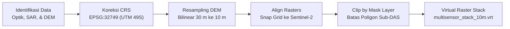
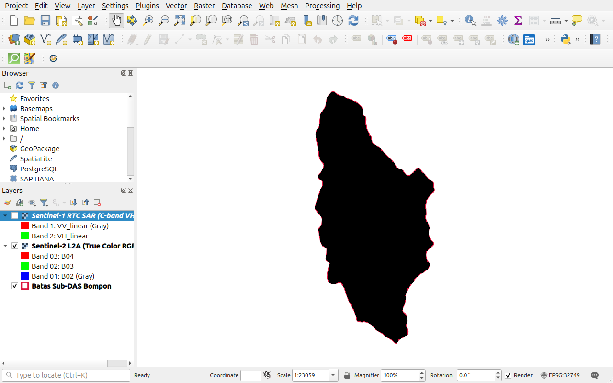
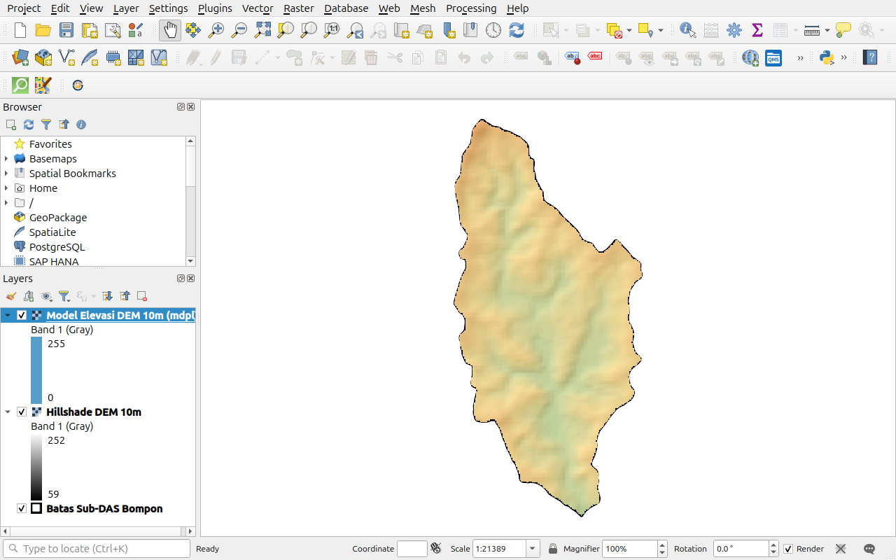
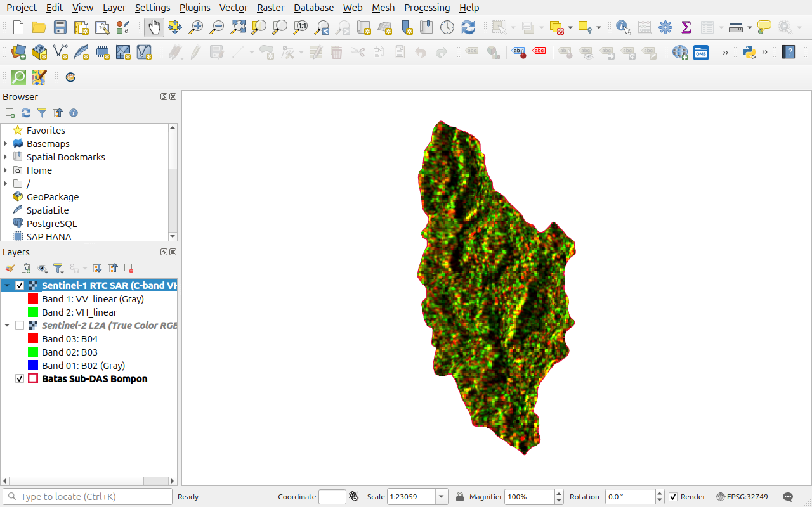

# MODUL PEMBELAJARAN PRAKTIK 1
# PENGOLAHAN DATA SPASIAL TINGKAT LANJUT DALAM PRECISION AGRICULTURE
## Multi-Source Data Fusion: Penyelarasan Grid, Reproyeksi, dan Pemotongan Batas Area of Interest (AOI)
**Studi Kasus: Pemetaan Digital Karbon Organik Tanah (C-Organik) Sub-DAS Bompon**  
*Presented by: Pusat Studi Pengelolaan Sumber Daya Lahan (PS2DL) Universitas Gadjah Mada*  
*Presented to: PT SMART Tbk*

---

## 1. KURIKULUM PEMBELAJARAN
### Analisis Spasial dalam Precision Agriculture: Multi-Source Data Fusion

#### A. Tujuan
Memberikan pemahaman mendalam dan keterampilan praktis kepada peserta pelatihan dalam menyelaraskan, mereproyeksi, dan mengharmonisasi data geospasial multi-sumber (Optik Sentinel-2 L2A, Radar Sentinel-1 RTC SAR, dan Copernicus DEM) pada sistem koordinat dan kisi spasial terstandar untuk pemodelan karbon organik tanah presisi.

#### B. Kompetensi
Setelah menyelesaikan modul praktik ini, peserta latih memiliki kompetensi dalam:
1. Memeriksa dan mengoreksi sistem referensi koordinat geospasial (*Coordinate Reference System / CRS*) ke Universal Transverse Mercator (UTM Zone 49S, `EPSG:32749`).
2. Melakukan *resampling* dan interpolasi spasial *Bilinear* pada model elevasi digital (DEM 30 m ke 10 m).
3. Melakukan penyelarasan kisi spasial (*pixel grid alignment & snapping*) agar seluruh lapisan raster memiliki batas sudut matriks dan origin yang identik.
4. Melakukan pemotongan area kajian (*Clip Raster by Mask Layer*) persis mengikuti batas poligon Area of Interest (AOI Sub-DAS Bompon).
5. Membangun berkas tumpukan raster virtual (*Virtual Raster Stack / VRT*) sebagai fondasi ekstraksi kovariat SCORPAN.

#### C. Ringkasan Studi
1. **Deskripsi Singkat:**  
   Peserta akan mempelajari urgensi harmonisasi data geospasial multi-wahana di wilayah tropis, memahami perbedaan karakteristik sensor optik, gelombang mikro aktif (SAR), dan model elevasi medan, serta mempraktikkan prosedur koreksi CRS, penyeragaman resolusi piksel, dan pemotongan batas poligon di QGIS.
2. **Hasil Belajar:**  
   Peserta mampu menghasilkan tumpukan raster multi-sensor 10 m yang terpotong rapi (*clipped by mask*) dan siap diintegrasikan dengan data uji laboratorium lapangan.
3. **Indikator Hasil Belajar:**
   * Peserta dapat mengidentifikasi ketidaksesuaian CRS dan resolusi antar-dataset.
   * Peserta dapat menjalankan utilitas *Align Rasters* dan *Clip Raster by Mask Layer* tanpa galat pergeseran sub-piksel.
   * Peserta dapat memverifikasi nilai NoData transparan di luar batas poligon AOI.
4. **Materi Pokok:**
   * Karakteristik Data Penginderaan Jauh Multi-Sensor (Optik, Radar SAR, DEM)
   * Prosedur Harmonisasi Geospasial (*Grid Snapping & Resampling*)
   * Ekstraksi dan Pemotongan Batas Area of Interest (AOI)
   * Konstruksi Virtual Raster Stack (VRT)

---

## 2. PROSEDUR PENGOLAHAN DATA SPASIAL MULTI-SENSOR

Prosedur pengolahan data spasial pada modul ini mengikuti bagan alir berkesinambungan:

---

## 3. BAHAN DATA OLAHAN

Seluruh data latihan telah disiapkan pada direktori:
`Output/Pelatihan/data/praktik-1/`

| Nama Berkas | Tipe Data | Resolusi | Peran dalam Pemodelan C-Organik |
|:---|:---:|:---:|:---|
| `Praktik_01_Multi_Source_Data_Fusion.qgz` | Proyek QGIS | - | Berkas proyek QGIS terkonfigurasi lengkap (CRS, batas DAS, simbologi RGB/SAR/DEM) |
| `sentinel2_l2a_20250721_10m.tif` | Raster (GeoTIFF) | 10 m | Sumber kovariat spektral ($s$) dan organisme ($o$): reflektansi tajuk kanopi dan tingkat kegelapan tanah |
| `sentinel1_rtc_20240830_10m.tif` | Raster (GeoTIFF) | 10 m | Sumber kovariat kekasaran permukaan ($p$): hamburan volume kanopi (VH) dan kelembapan lantai kebun (VV) |
| `copdem_glo30_30m.tif` | Raster (GeoTIFF) | 30 m | Sumber kovariat relief ($r$): elevasi dasar pembentukan tanah dan dinamika erosi |
| `batas_subdas.gpkg` | Vektor (GPKG) | - | Batas poligon Area of Interest (AOI) Sub-DAS Bompon (295 ha) |

---

## 4. PROSEDUR LANGKAH KERJA (STEP-BY-STEP)

> [!TIP]
> **Akses Cepat Proyek:** Peserta dapat langsung mengeklik ganda berkas proyek `Praktik_01_Multi_Source_Data_Fusion.qgz` di direktori `Output/Pelatihan/data/praktik-1/` untuk membuka tumpukan data yang telah terkonfigurasi dengan simbologi optimal, atau mengikuti tahapan langkah mandiri di bawah ini:

### Langkah 1: Membuka QGIS dan Mengatur Proyek CRS
1. Buka aplikasi **QGIS**.
2. Buat proyek baru melalui menu **Project** $\rightarrow$ **New**.
3. Atur sistem koordinat proyek ke **WGS 84 / UTM zone 49S (`EPSG:32749`)**:
   * Klik ikon bola dunia di sudut kanan bawah jendela QGIS.
   * Pada filter pencarian, ketik: `32749`.
   * Pilih `EPSG:32749`, lalu klik **Apply** dan **OK**.
4. Muat berkas batas wilayah: Seret layer `batas_subdas.gpkg` ke kanvas peta.
5. Atur garis tepi poligon (*Outline: Simple Line*) dengan warna merah tegas (`#DC143C`) dan ketebalan `0.8 mm`.

---

### Langkah 2: Memuat Citra Satelit Optik Sentinel-2 L2A
1. Seret berkas `sentinel2_l2a_20250721_10m.tif` ke panel *Layers*.
2. Atur komposit warna alami (*True Color RGB 4-3-2*):
   * Klik kanan layer $\rightarrow$ **Properties** $\rightarrow$ **Symbology**.
   * *Render type*: **Multiband color**.
   * Red band: `Band 3 (B04 - Red)`, Green band: `Band 2 (B03 - Green)`, Blue band: `Band 1 (B02 - Blue)`.
   * *Contrast enhancement*: **Stretch to MinMax** (Cumulative count cut: 2% - 98%).
   * Klik **Apply** dan **OK**.

*Gambar 1.1: Tampilan antarmuka QGIS memuat citra multispektral Sentinel-2 L2A dengan batas Sub-DAS Bompon.*

---

### Langkah 3: Reproyeksi dan Resampling Model Elevasi (DEM 30 m ke 10 m)
1. Buka menu **Raster** $\rightarrow$ **Projections** $\rightarrow$ **Warp (Reproject)...**.
2. Pada dialog parameter:
   * **Input layer**: `copdem_glo30_30m`
   * **Target CRS**: `EPSG:32749 - WGS 84 / UTM zone 49S`
   * **Resampling method to use**: Pilih **Bilinear** (mencegah artefak undakan tajam/blok diskontinu pada turunan lereng).
   * **Output file resolution in target georeferenced units**: `10.0`
   * Simpan luaran sebagai `copdem_10m_resampled.tif`.
3. Klik **Run**. Tampilkan hasil elevasi dengan gradasi warna ketinggian di atas hillshade:

*Gambar 1.2: Visualisasi Model Elevasi Digital (DEM 10 m) dengan pewarnaan pseudocolor ketinggian (300–620 mdpl) di atas hillshade relief Sub-DAS Bompon.*

---

### Langkah 4: Penyelarasan Kisi Piksel (*Align Rasters*)
1. Buka menu **Raster** $\rightarrow$ **Align Rasters...**.
2. Klik ikon tanda tambah hijau (`+`) dan masukkan:
   * `sentinel1_rtc_20240830_10m.tif`
   * `copdem_10m_resampled.tif`
3. Tetapkan **Reference layer**: `sentinel2_l2a_20250721_10m.tif` (Cell size = `10.0` m x `10.0` m).
4. Klik tombol **Align** (ikon roda gigi/play) di toolbar atas dialog. Proses ini mengunci koordinat pojok kiri atas dan memastikan batas piksel seluruh sensor berimpit secara eksak.

---

### Langkah 5: Pemotongan Sesuai Batas Wilayah (*Clip Raster by Mask Layer*)
1. Buka menu **Raster** $\rightarrow$ **Extraction** $\rightarrow$ **Clip Raster by Mask Layer...**.
2. Parameter pemotongan:
   * **Input layer**: Layer yang telah diselaraskan (`sentinel2_l2a_20250721_10m.tif` / `sentinel1_rtc_20240830_10m.tif` / `copdem_10m.tif`).
   * **Mask layer**: `batas_subdas.gpkg`.
   * **Source CRS & Target CRS**: `EPSG:32749`.
   * **Assign a specified nodata value to output bands**: Ketik `0` (untuk citra satelit/SAR) atau `-9999` (untuk DEM/indeks).
   * Centang opsi: **Keep resolution of input raster**.
3. Klik **Run**. Seluruh piksel di luar poligon Sub-DAS Bompon kini bernilai `NoData` (transparan penuh), menghasilkan tampilan pulau kajian yang bersih dan terfokus.

---

### Langkah 6: Inspeksi Visual Citra Radar Sentinel-1 RTC
1. Aktifkan layer `sentinel1_rtc_20240830_10m.tif` di panel *Layers*.
2. Atur simbologi:
   * *Render type*: **Singleband gray**.
   * *Gray band*: `Band 2 (VH)` (Polarisasi silang C-band sangat peka terhadap volume biomassa tajuk tanaman).
3. Amati kontras tekstur dan nilai hamburan balik ($\sigma^0$) di dalam batas Sub-DAS Bompon:

*Gambar 1.3: Citra Radar Sentinel-1 RTC SAR polarisasi VH terpotong rapi mengikuti batas Sub-DAS Bompon.*

---

### Langkah 7: Membangun Virtual Raster Stack (VRT)
1. Buka menu **Raster** $\rightarrow$ **Miscellaneous** $\rightarrow$ **Build Virtual Raster...**.
2. Masukkan seluruh kanal yang telah terpotong dan terselaraskan.
3. Centang opsi: **Place each input file into a separate band**.
4. Simpan berkas sebagai `multisensor_stack_10m.vrt`.

---

## 5. TITIK PERIKSA EVALUASI (CHECKPOINT MUTU)
* [ ] **CRS Terverifikasi:** Seluruh layer raster dan vektor berada pada `EPSG:32749`.
* [ ] **Ukuran Kisi Identik:** Properti raster menunjukkan ukuran piksel tepat `10.0, -10.0` meter.
* [ ] **Bebas Galat Luar AOI:** Piksel di luar poligon batas Sub-DAS Bompon berstatus `NoData` transparan dan tidak mengganggu visualisasi kanvas.

---

## 6. PENUTUP & PERTANYAAN REFLEKSI
1. Mengapa interpolasi *Bilinear* atau *Cubic Spline* wajib digunakan saat mengubah resolusi DEM, dan mengapa metode *Nearest Neighbour* harus dihindari untuk data ketinggian?
2. Dalam pemetaan cadangan karbon tanah di perkebunan kelapa sawit, informasi saling melengkapi apa yang diberikan oleh kombinasi citra optik multispektral (penyerapan klorofil) dan radar SAR C-band (penetrasi geometri tajuk)?
