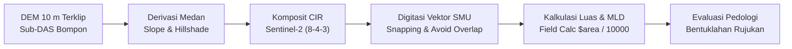
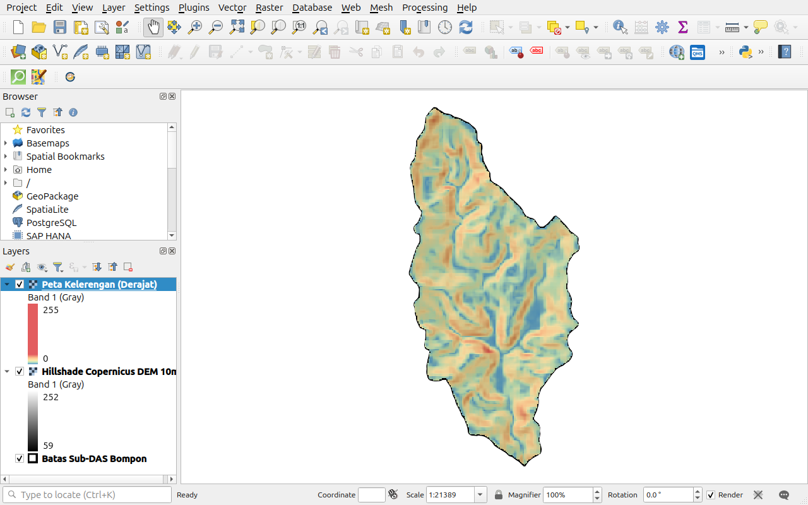
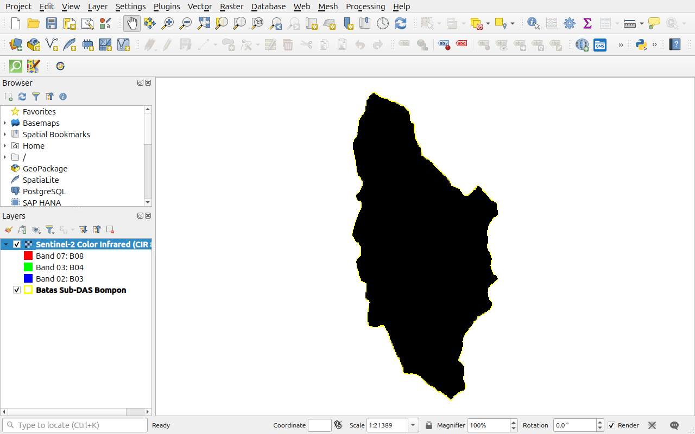
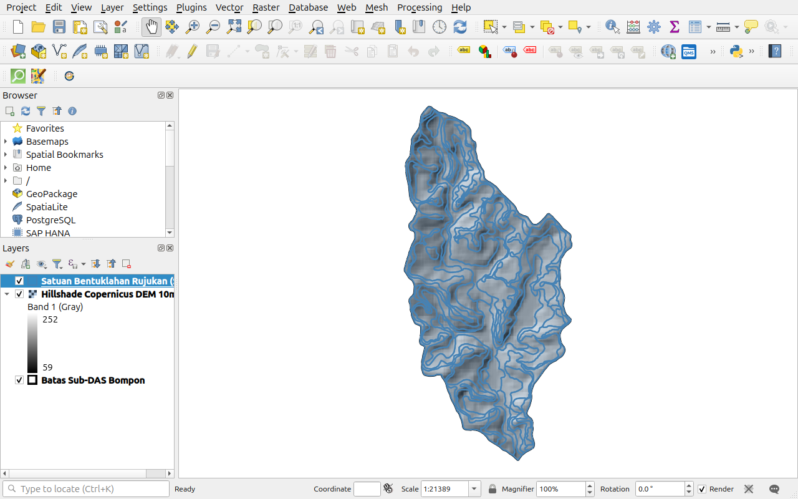

# MODUL PEMBELAJARAN PRAKTIK 2
# PENGOLAHAN DATA SPASIAL TINGKAT LANJUT DALAM PRECISION AGRICULTURE
## Delineasi Soil Mapping Units (SMU) Berbasis Analisis Medan Geomorfometri dan Konsep Katena
**Studi Kasus: Pemetaan Digital Karbon Organik Tanah (C-Organik) Sub-DAS Bompon**  
*Presented by: Pusat Studi Pengelolaan Sumber Daya Lahan (PS2DL) Universitas Gadjah Mada*  
*Presented to: PT SMART Tbk*

---

## 1. KURIKULUM PEMBELAJARAN
### Analisis Spasial dalam Precision Agriculture: Delineasi Satuan Pemetaan Tanah

#### A. Tujuan
Memberikan pemahaman mendalam dan keterampilan praktis kepada peserta pelatihan dalam menurunkan parameter geomorfometri medan (kelerengan dan hillshade 3D), memanfaatkan komposit spektral inframerah pantulan (Color Infrared / CIR), serta menerapkan kaidah katena tanah dan batas keterbacaan minimum (*Minimum Legible Delineation / MLD*) untuk mendigitasi batas poligon *Soil Mapping Units* (SMU) secara bebas kesalahan topologi.

#### B. Kompetensi
Setelah menyelesaikan modul praktik ini, peserta latih memiliki kompetensi dalam:
1. Menurunkan variabel morfometri medan utama dari DEM 10 m: peta kelerengan (*slope*) dan peta bayangan bukit (*hillshade* multi-arah).
2. Melakukan reklasifikasi kelerengan ke dalam 5 kelas kelerengan pedologi terstandar.
3. Mengonfigurasi komposit inframerah pantulan (*Color Infrared / CIR RGB 8-4-3*) untuk membedakan kontras kelembapan dan kerapatan biomassa di alur lembah vs punggung igir.
4. Mendigitasi batas poligon SMU pedologis menggunakan *Snapping Toolbar* di QGIS dengan kaidah *Avoid Overlap* dan *Topological Editing*.
5. Menghitung luas poligon secara otomatis dan mengevaluasi delineasi mandiri terhadap satuan bentuklahan rujukan pakar.

#### C. Ringkasan Studi
1. **Deskripsi Singkat:**  
   Peserta akan mempelajari hubungan antara posisi bentanglahan (*landscape position*), proses hidromorfologi lereng, dan akumulasi karbon organik tanah, serta mempraktikkan proses analisis medan raster dan digitasi vektor SMU di QGIS.
2. **Hasil Belajar:**  
   Peserta mampu menghasilkan layer vektor poligon SMU (`smu_delineasi_peserta.gpkg`) yang bersih dari galat topologi (*no gaps, no overlaps*) dan mematuhi kaidah MLD semi-detail (luas $\ge 0.4$ ha).
3. **Indikator Hasil Belajar:**
   * Peserta dapat mengidentifikasi batas fisiografi punggung igir (*crest*), lereng tengah (*backslope*), dan kaki lembah (*footslope/toeslope*).
   * Peserta dapat mengoperasikan alat digitasi ber-snapping dengan toleransi spasial yang tepat.
   * Peserta dapat menghitung luas poligon otomatis menggunakan *Field Calculator* (`$area / 10000`).
4. **Materi Pokok:**
   * Konsep Katena Tanah (*Soil Catena*) dan Posisi Lereng
   * Morfometri Medan: Derivasi Kelerengan dan Relief 3D Hillshade
   * Komposit Spektral Inframerah Pantulan (CIR 8-4-3)
   * Digitasi Vektor Bebas Galat Topologi dan Kaidah MLD 0.4 ha

---

## 2. PROSEDUR PENGOLAHAN DATA DELINEASI SMU

---

## 3. BAHAN DATA OLAHAN

Seluruh data latihan telah disiapkan pada direktori:
`Output/Pelatihan/data/praktik-2/`

| Nama Berkas | Tipe Data | Peran dalam Delineasi Pedologi |
|:---|:---:|:---|
| `Praktik_02_Delineasi_SMU.qgz` | Proyek QGIS | Berkas proyek QGIS terkonfigurasi (Slope, Hillshade, CIR 8-4-3, dan Vektor Bentuklahan SMU) |
| `copdem_10m.tif` | Raster | Model Elevasi Digital terselaraskan dan terpotong rapi batas Sub-DAS Bompon |
| `slope_10m.tif` | Raster | Peta kelerengan dalam satuan derajat (0° s.d. >40°) |
| `hillshade_10m.tif` | Raster | Model relief bayangan bukit multi-arah |
| `sentinel2_l2a_20250721_10m.tif` | Raster | Citra Sentinel-2 L2A 10-kanal untuk komposit Color Infrared (CIR) |
| `batas_subdas.gpkg` | Vektor | Batas wilayah Sub-DAS Bompon (EPSG:32749) |
| `bentuklahan_rujukan.gpkg` | Vektor | Satuan bentuklahan rujukan hasil survei pedologi lapangan pakar |

---

## 4. PROSEDUR LANGKAH KERJA (STEP-BY-STEP)

> [!TIP]
> **Akses Cepat Proyek:** Peserta dapat langsung membuka berkas proyek siap pakai `Praktik_02_Delineasi_SMU.qgz` di folder `Output/Pelatihan/data/praktik-2/` yang memuat seluruh layer geomorfometri dan simbologi terstandar, atau membangunnya langkah demi langkah berikut ini:

### Langkah 1: Pengaturan Simbologi Kelerengan dan Hillshade
1. Buka aplikasi **QGIS**, muat berkas:
   * `batas_subdas.gpkg`
   * `hillshade_10m.tif`
   * `slope_10m.tif`
2. Atur Simbologi Layer `slope_10m`:
   * Klik kanan layer $\rightarrow$ **Properties** $\rightarrow$ tab **Symbology**.
   * *Render type*: **Singleband pseudocolor**.
   * Color ramp: **Spectral** (*Invert Color Ramp* agar hijau = datar/landai dan merah = curam/terjal).
   * Klasifikasi 5 kelas lereng pedologi:
     * $0^\circ - 4^\circ$ ($0 - 8\%$): **Datar s.d. Landai** (Hijau)
     * $4^\circ - 8^\circ$ ($8 - 15\%$): **Agak Curam** (Kuning-Hijau)
     * $8^\circ - 16^\circ$ ($15 - 30\%$): **Curam** (Kuning-Oranye)
     * $16^\circ - 24^\circ$ ($30 - 45\%$): **Sangat Curam** (Oranye-Merah)
     * $> 24^\circ$ ($> 45\%$): **Terjal / Ekstrem** (Merah Pekat)
   * Di tab **Transparency**, atur *Global Opacity* menjadi `70%`.
3. Letakkan layer `hillshade_10m` tepat di bawah `slope_10m` untuk menampilkan kesan relief 3D yang dramatis:

*Gambar 2.1: Visualisasi morfometri kelerengan 5 kelas pedologi berpadu di atas relief hillshade 3D Sub-DAS Bompon.*

---

### Langkah 2: Mengatur Komposit Inframerah Pantulan (Color Infrared / CIR)
1. Muat berkas `sentinel2_l2a_20250721_10m.tif`.
2. Klik kanan layer $\rightarrow$ **Properties** $\rightarrow$ tab **Symbology**.
3. Set *Render type*: **Multiband color**.
   * **Red band**: `Band 7 (B08 - NIR)`
   * **Green band**: `Band 3 (B04 - Red)`
   * **Blue band**: `Band 2 (B03 - Green)`
4. Klik **Apply** dan **OK**.
5. Kenampakan visual CIR:
   * **Merah Terang Menyala:** Kanopi vegetasi rapat dengan ketersediaan air tanah tinggi (lembah aluvial dan kaki lereng).
   * **Merah Kusam / Pucat:** Vegetasi jarang pada lereng atas dengan solum tipis.
   * **Biru Keabu-abuan:** Permukaan tanah terbuka, jalan kebun, atau singkapan lereng.

*Gambar 2.2: Komposit Color Infrared (CIR RGB 8-4-3) Sentinel-2 mempertegas kontras batas hidrologi dan vegetasi tajuk di Sub-DAS Bompon.*

---

### Langkah 3: Membuat Layer Poligon SMU Baru
1. Buka menu **Layer** $\rightarrow$ **Create Layer** $\rightarrow$ **New GeoPackage Layer...**.
2. Parameter pembuatan layer:
   * **Database**: Simpan sebagai `smu_delineasi_peserta.gpkg`.
   * **Table name**: `smu_delineasi`.
   * **Geometry type**: **Polygon**.
   * **CRS**: `EPSG:32749 - WGS 84 / UTM zone 49S`.
   * **Kolom Atribut Baru**:
     * `Kode_SMU` (String, length 10)
     * `Bentuklahan` (String, length 50)
     * `Posisi_Lereng` (String, length 30)
     * `Kelas_Lereng` (String, length 30)
     * `Luas_Ha` (Decimal number, precision 2)
   * Klik **OK**.

---

### Langkah 4: Mengaktifkan Snapping dan Digitasi Poligon SMU
1. Aktifkan **Snapping Toolbar** (**View** $\rightarrow$ **Toolbars** $\rightarrow$ **Snapping Toolbar**).
2. Klik ikon magnet merah (tombol `S`):
   * Tipe Snapping: Centang **Vertex** dan **Segment** (toleransi: `10 pixels`).
   * Aktifkan ikon **Enable Topological Editing**.
   * Aktifkan ikon **Avoid Overlap on Active Layer**.
3. Mulai Digitasi Terbimbing:
   * Pilih layer `smu_delineasi`, klik ikon pensil kuning (**Toggle Editing** / `Ctrl + E`).
   * Klik ikon **Add Polygon Feature** (`Ctrl + .`).
   * Digitasi batas poligon mengikuti:
     1. Garis batas punggung igir perbukitan (*ridge line*).
     2. Perubahan tajam kelengkungan lereng (*break of slope*).
     3. Batas alur aluvial dasar lembah (*valley floor*).
   * Klik kanan untuk mengakhiri poligon, lalu isi atribut tabel (contoh: Kode_SMU = `SMU-01`, Bentuklahan = `Punggung Perbukitan Denudasional`, Posisi_Lereng = `Crest`, Kelas_Lereng = `Curam`).
   * Lanjutkan digitasi hingga seluruh Sub-DAS tertutup poligon berkesinambungan.

---

### Langkah 5: Kontrol Kualitas MLD dan Kalkulasi Luas
1. Buka tabel atribut layer SMU (**Open Attribute Table** / `F6`).
2. Klik ikon kalkulator (**Open Field Calculator** / `Ctrl + I`).
   * Centang **Update existing field**, pilih kolom `Luas_Ha`.
   * Masukkan formula: `$area / 10000`.
   * Klik **OK**.
3. Evaluasi Batas MLD:
   * Periksa apakah terdapat poligon dengan `Luas_Ha < 0.4` ha.
   * Jika ada poligon kerdil (*sliver*), gunakan algoritma **Eliminate (selected polygons)** pada Processing Toolbox untuk menggabungkannya ke poligon tetangga terluas.
4. Klik kembali ikon pensil kuning (**Toggle Editing**) dan klik **Save**.

---

### Langkah 6: Komparasi Terbimbing dengan Satuan Bentuklahan Rujukan
1. Muat layer `bentuklahan_rujukan.gpkg`.
2. Bandingkan pola batas poligon hasil delineasi Anda dengan bentuklahan rujukan:
   * Punggung Perbukitan Denudasional (erosi aktif, C-Organik rendah).
   * Lereng Bawah Koluvial (transisi pengendapan seresah).
   * Dataran Fluvial / Alur Depresi (zona akumulasi humus dan C-Organik tertinggi).

*Gambar 2.3: Satuan bentuklahan rujukan pedologis di atas relief hillshade 3D Sub-DAS Bompon.*

---

## 5. TITIK PERIKSA EVALUASI (CHECKPOINT MUTU)
* [ ] **Bebas Galat Topologi:** Menjalankan *Topology Checker* tanpa adanya celah (*gaps*) atau tumpang tindih (*overlaps*).
* [ ] **Kepatuhan MLD:** Tidak ada poligon delineasi dengan luas di bawah 0.4 hektare.
* [ ] **Relevansi Pedologi:** Batas SMU mencerminkan diskontinuitas lereng dan alur hidrologi alami.

---

## 6. PENUTUP & PERTANYAAN REFLEKSI
1. Mengapa batas satuan bentuklahan (*landform*) sering kali menjadi batas alamiah yang paling konsisten dalam mencerminkan variabilitas cadangan karbon organik tanah dibandingkan batas tutupan tanaman?
2. Bagaimana pemahaman konsep katena tanah (perbedaan antara lereng atas *crest* dan lereng bawah *toeslope*) dapat digunakan untuk merancang manajemen aplikasi pupuk organik/kompos kelapa sawit secara tepat sasaran?
