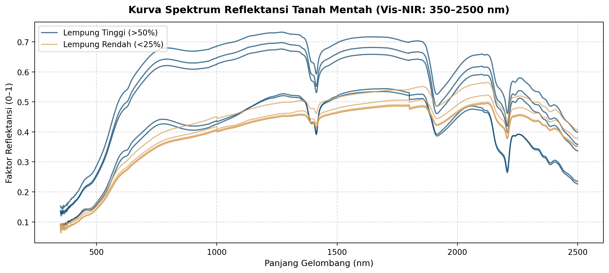
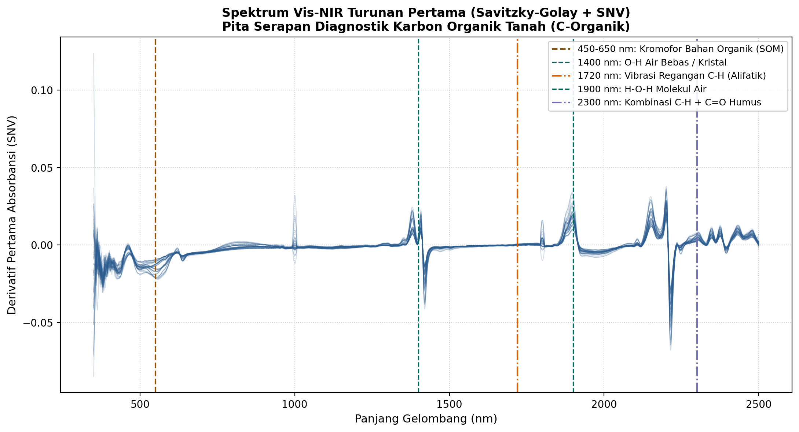
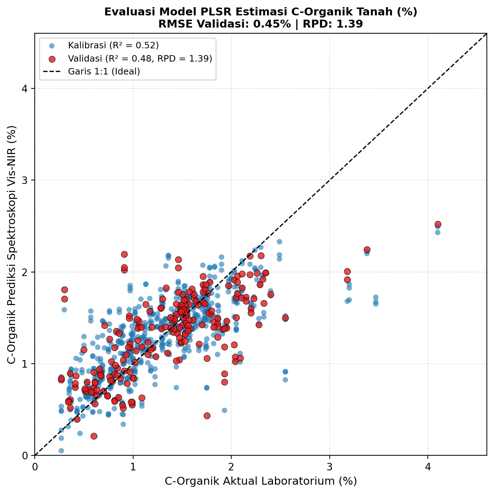
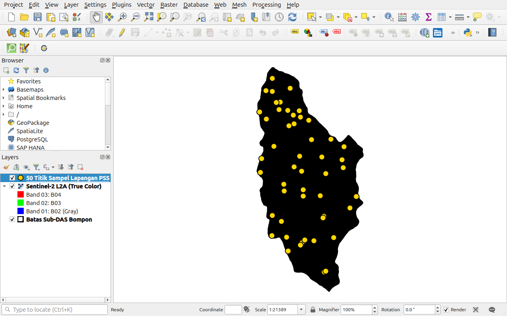

# PANDUAN PRAKTIKUM 3: DEMONSTRASI PROXIMAL SOIL SENSING (PSS)
## Pengolahan Spektroskopi Pantulan Tanah Vis-NIR (350–2500 nm) dan Kalibrasi Kemometrika untuk C-Organik
**Pelatihan Pemanfaatan Penginderaan Jauh, Proximal Soil Sensing, dan Digital Soil Mapping untuk Pertanian Presisi**  
*Pusat Studi Pengelolaan Sumber Daya Lahan (PS2DL) Universitas Gadjah Mada & PT SMART Tbk*

---

## 1. TUJUAN INSTRUKSIONAL
Setelah menyelesaikan modul praktik ini, peserta diharapkan mampu:
1. Memahami prinsip fisis interaksi radiasi elektromagnetik pada rentang Vis-NIR (350–2500 nm) dengan kandungan karbon organik tanah (*Soil Organic Carbon / SOC*).
2. Membaca dan memvisualisasikan matriks data spektral resolusi tinggi (*hyperspectral matrix*) 852 sampel tanah lapangan.
3. Melakukan tahapan pra-olah sinyal spektroskopi (*chemometrics preprocessing*): transformasi absorbansi $\log(1/R)$, normalisasi variat normal standar (*Standard Normal Variate / SNV*), dan penajaman fitur menggunakan turunan pertama Savitzky–Golay.
4. Mengidentifikasi pita serapan diagnostik (*diagnostic absorption features*) untuk kromofor bahan organik tanah (450–650 nm), ikatan alifatik $\text{C-H}$ (1720 nm & 2300 nm), serta molekul air (1400 nm dan 1900 nm).
5. Membangun model kalibrasi multivariat menggunakan *Partial Least Squares Regression* (PLSR) untuk mengestimasi kadar C-Organik (%) secara kuantitatif.
6. Mengevaluasi keandalan model menggunakan metrik statistik standar: Koefisien Determinasi ($R^2$), *Root Mean Squared Error* (RMSE), dan *Residual Prediction Deviation* (RPD).
7. Menampilkan sebaran spasial 50 titik sampel tanah hasil uji sensor di atas peta kerja QGIS.

---

## 2. DASAR TEORI SINGKAT

### Spektroskopi Vis-NIR untuk Estimasi C-Organik Cepat
Analisis laboratorium konvensional untuk karbon organik tanah (metode Walkley & Black atau *Loss on Ignition* / LOI) membutuhkan destruksi kimia menggunakan asam pekat dan kalium dikromat ($\text{K}_2\text{Cr}_2\text{O}_7$) yang menghasilkan limbah berbahaya serta biaya operasional tinggi. *Proximal Soil Sensing* (PSS) berbasis spektroskopi pantulan Vis-NIR (350–2500 nm) memberikan alternatif analisis non-destruktif, cepat, tanpa reagen kimia, dan sangat ideal untuk pemantauan cadangan karbon (*carbon stock*) perkebunan kelapa sawit.

### Pita Serapan Diagnostik Kunci Karbon Organik Tanah
1. **$450–650\text{ nm}$ (Rentang Tampak / Visible):** Ditandai oleh penurunan pantulan tajam (kurva tampak gelap) akibat penyerapan kromofor bahan organik tanah (humus, asam humat, dan asam fulvat). Semakin tinggi kadar C-Organik, semakin landai nilai reflektansi dan semakin curam lereng spektral (*visible slope*).
2. **$1400\text{ nm}$:** Vibrasi ikatan $\text{O-H}$ dari molekul air bebas dan air higroskopis.
3. **$1720\text{ nm}$:** Vibrasi *first overtone* regangan ikatan alifatik $\text{C-H}$ ($\text{C-H}_2$ dan $\text{C-H}_3$) yang merupakan kerangka utama senyawa organik tanah.
4. **$1900\text{ nm}$:** Vibrasi kombinasi ikatan $\text{H-O-H}$ molekul air.
5. **$2300\text{ nm}$:** Vibrasi kombinasi ikatan $\text{C-H} + \text{C=O}$ karboksilat dan amida pada senyawa humat matur.

---

## 3. BAHAN DAN DATA PRAKTIKUM

Semua berkas yang dibutuhkan untuk praktik ini tersimpan di:
* Data: `Output/Pelatihan/data/praktik-3/`
* Notebook: `Output/Pelatihan/notebooks/Praktik_03_Demonstrasi_PSS_Kemometrika.ipynb`

| Nama Berkas | Ukuran | Deskripsi Isi |
|:---|:---:|:---|
| `Praktik_03_Demonstrasi_PSS.qgz` | 9.7 KB | Berkas proyek QGIS visualisasi spasial sebaran 50 titik sampel lapangan PSS dan citra Sentinel-2 L2A |
| `spektra_visnir_857sampel.csv` | 34.6 MB | Dataset 852 sampel tanah dengan 2151 panjang gelombang kontinu (350–2500 nm resolusi 1 nm) berpasangan dengan hasil lab (*C_Organik, Clay, Sand, Silt, pH, KTK*) |
| `titik_sampel_lapangan.gpkg` | 106 KB | Vektor geospasial titik pengambilan sampel tanah di Sub-DAS Bompon (EPSG:32749) |
| `batas_subdas.gpkg` | 106 KB | Poligon batas Sub-DAS Bompon seluas 295 ha |
| `sentinel2_l2a_20250721_10m.tif` | 2.8 MB | Citra Sentinel-2 L2A True Color sebagai latar visual orientasi medan |
| `Praktik_03_Demonstrasi_PSS_Kemometrika.ipynb` | - | Notebook interaktif Jupyter yang siap dijalankan di JupyterLab atau Google Colab |

---

## 4. LANGKAH KERJA PRAKTIKUM (JUPYTER NOTEBOOK & QGIS)

> [!IMPORTANT]
> **Aktivasi Python Virtual Environment (`venv`):**  
> Sebelum membuka JupyterLab, pastikan virtual environment telah diaktifkan agar seluruh pustaka kemometrika berjalan secara terisolasi tanpa konflik:
> * *Linux/macOS:* `source Output/Pelatihan/env_smart/bin/activate`
> * *Windows:* `Output\Pelatihan\env_smart\Scripts\activate.bat`  
> Jalankan perintah `jupyter lab`, lalu saat membuka notebook pastikan kernel yang dipilih di pojok kanan atas adalah **`Python (Pelatihan SMART)`**.

> [!TIP]
> **Visualisasi Titik Sampel di QGIS:** Peserta dapat membuka `Praktik_03_Demonstrasi_PSS.qgz` di QGIS untuk menginspeksi sebaran spasial 50 titik sampel PSS di bentang alam Sub-DAS Bompon sebelum menjalankan pemodelan spektroskopi di notebook.

### Langkah 1: Membuka dan Menjalankan Jupyter Notebook
1. Pastikan environment `(env_smart)` aktif pada terminal Anda.
2. Luncurkan JupyterLab dengan mengetik: `jupyter lab`.
3. Buka berkas `Praktik_03_Demonstrasi_PSS_Kemometrika.ipynb` di panel navigasi file.
4. Periksa kernel di pojok kanan atas; pastikan tertulis **`Python (Pelatihan SMART)`** (jika belum, klik nama kernel lalu pilih `Python (Pelatihan SMART)`).
5. Jalankan **Sel 1** untuk mengimpor pustaka kemometrika (`numpy`, `scipy`, `matplotlib`, `sklearn`).

---

### Langkah 2: Eksplorasi Spektra Mentah (*Raw Reflectance*)
1. Jalankan **Sel 2** untuk membaca dataset. Terdapat 849 sampel valid dengan rentang kadar C-Organik $0.27\% \text{ s.d. } 4.10\%$ (Rata-rata: $1.32\%$).
2. Jalankan **Sel 3** untuk menampilkan kurva spektrum mentah:
   * Sampel dengan kadar C-Organik rendah ($<0.8\%$) berwarna cerah dengan nilai pantulan tinggi ($R > 0.40$).
   * Sampel dengan kadar C-Organik tinggi ($>2.0\%$) tampak gelap dengan nilai pantulan rendah ($R < 0.20$).

*Gambar 3.1: Kurva spektrum reflektansi mentah (350–2500 nm) dari 852 sampel tanah lapangan.*

---

### Langkah 3: Pra-Olah Sinyal Kemometrika (SNV & Savitzky-Golay)
1. Jalankan **Sel 4** untuk mengeksekusi konversi Absorbansi ($A = \log_{10}(1/R)$), normalisasi variat normal standar (*SNV*), dan filter Savitzky–Golay turunan pertama.
2. Jalankan **Sel 5** untuk memvisualisasikan fitur serapan diagnostik C-Organik.
3. Perhatikan bagaimana turunan pertama SNV menonjolkan fitur serapan kromofor bahan organik di **450–650 nm** serta ikatan alifatik $\text{C-H}$ di **1720 nm** dan **2300 nm**!

*Gambar 3.2: Kurva spektral setelah pra-olah SNV dan turunan pertama Savitzky-Golay. Garis penanda menunjukkan serapan kromofor SOM (450–650 nm) serta ikatan C-H alifatik (1720 nm & 2300 nm).*

---

### Langkah 4: Kalibrasi Model PLSR untuk Estimasi C-Organik
1. Jalankan **Sel 6** untuk melatih model *Partial Least Squares Regression* (PLSR) dengan 6 komponen laten pada data latih (75%) dan data validasi (25%).
2. Jalankan **Sel 7** untuk mengevaluasi metrik kinerja model:
   * **Koefisien Determinasi Kalibrasi ($R^2_{\text{cal}}$):** $\approx 0.52$
   * **Koefisien Determinasi Validasi ($R^2_{\text{val}}$):** $\approx 0.48$
   * **RMSE Validasi:** $\approx 0.45\%$
   * **Residual Prediction Deviation (RPD):** $\approx 1.39$

*Gambar 3.3: Diagram pencar evaluasi model kalibrasi PLSR: Perbandingan kadar C-Organik (%) hasil analisis lab basah vs estimasi spektroskopi Vis-NIR.*

---

### Langkah 5: Visualisasi Sebaran Spasial Titik PSS di QGIS
1. Buka aplikasi **QGIS**.
2. Muat berkas titik koordinat sampel lapangan:
   `Output/Pelatihan/data/praktik-5/titik_sampel_lapangan.gpkg`
3. Tampilkan di atas citra Sentinel-2 L2A yang telah terpotong rapi mengikuti batas Sub-DAS Bompon.

*Gambar 3.4: Sebaran spasial 50 titik sampel survei tanah lapangan di Sub-DAS Bompon (terklip rapi tanpa banner).*

---

## 5. TITIK PERIKSA EVALUASI (CHECKPOINT MUTU)

* [ ] **Konvergensi Kode:** Seluruh sel kode pada Jupyter Notebook berhasil dieksekusi tanpa error.
* [ ] **Interpretasi Spektral SOM:** Peserta dapat mengenali lereng kurva tampak (450–650 nm) dan puncak ikatan C-H alifatik pada grafik turunan pertama.
* [ ] **Relevansi Akurasi:** Nilai RMSE validasi $0.45\%$ sangat memadai untuk pemilahan cepat status kesuburan tanah perkebunan (kategori C-Organik sangat rendah $<0.8\%$ vs tinggi $>1.5\%$).

---

## 6. PERTANYAAN DISKUSI DAN REFLEKSI
1. Mengapa keberadaan oksida besi ($\text{Fe}_2\text{O}_3$ / hematit dan goetit) pada tanah tropis sering kali menutupi respon serapan kromofor bahan organik di panjang gelombang tampak (400–600 nm)? Bagaimana teknik turunan spektral membantu memisahkan kedua sinyal tersebut?
2. Dalam program keberlanjutan kelapa sawit (*ISPO/RSPO*), bagaimana sensor spektroskopi tanah proksimal dapat digunakan untuk verifikasi cepat penambahan cadangan karbon tanah (*Soil Carbon Sequestration*) pasca-aplikasi limbah tandan kosong sawit (TKS)?
