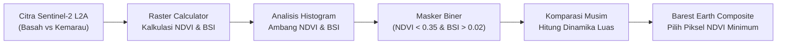
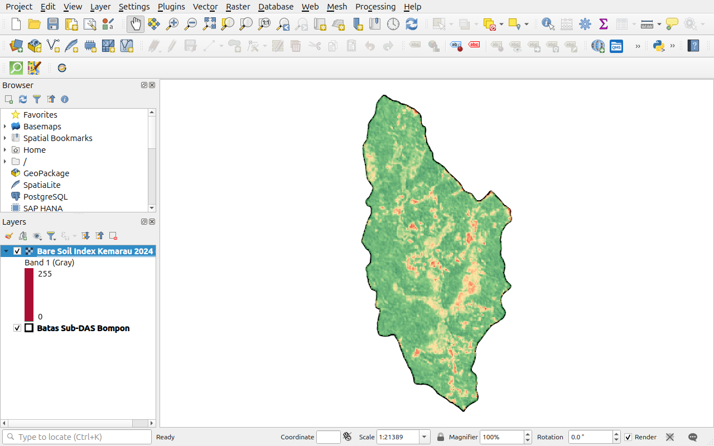
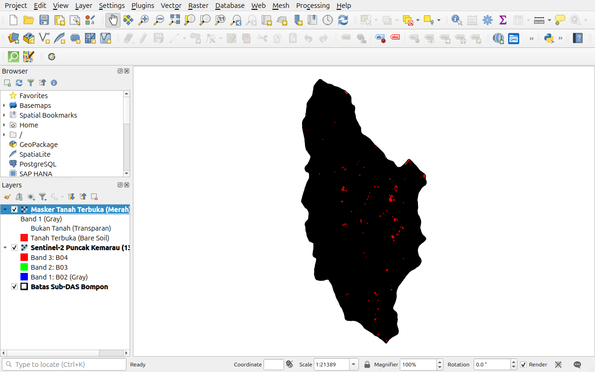

# MODUL PEMBELAJARAN PRAKTIK 4
# PENGOLAHAN DATA SPASIAL TINGKAT LANJUT DALAM PRECISION AGRICULTURE
## Bare Soil Detection & Extraction: Kalkulasi Indeks Spektral dan Masker Biner Tanah Terbuka Multitemporal
**Studi Kasus: Pemetaan Digital Karbon Organik Tanah (C-Organik) Sub-DAS Bompon**  
*Presented by: Pusat Studi Pengelolaan Sumber Daya Lahan (PS2DL) Universitas Gadjah Mada*  
*Presented to: PT SMART Tbk*

---

## 1. KURIKULUM PEMBELAJARAN
### Analisis Spasial dalam Precision Agriculture: Deteksi Tanah Terbuka

#### A. Tujuan
Memberikan pemahaman mendalam dan keterampilan praktis kepada peserta pelatihan dalam mengatasi kendala tutupan kanopi vegetasi tropis (*canopy shielding*) melalui kalkulasi indeks spektral vegetasi (NDVI) dan tanah terbuka (BSI), analisis ambang batas histogram (*thresholding*), ekstraksi masker biner tanah terbuka, serta pemanfaatan citra multitemporal musim kemarau saat fase bera untuk menghasilkan komposit spektral murni (*Barest Earth Composite*).

#### B. Kompetensi
Setelah menyelesaikan modul praktik ini, peserta latih memiliki kompetensi dalam:
1. Menghitung indeks vegetasi (*Normalized Difference Vegetation Index / NDVI*) dan indeks tanah terbuka (*Bare Soil Index / BSI*) menggunakan *Raster Calculator* di QGIS.
2. Melakukan analisis statistik histogram untuk menetapkan batas ambang (*thresholding*) pemisahan tanah terbuka secara objektif.
3. Mengekstrak masker biner tanah terbuka (*binary bare soil mask*) untuk mengisolasi piksel tanah dari tutupan vegetasi dan bayangan awan.
4. Menganalisis dinamika luasan tanah terbuka antara musim basah (Juli 2025) dan puncak musim kemarau saat bera lahan (Agustus 2024).
5. Mengonstruksi citra komposit tanah terbuka terbaik (*Barest Earth Composite*) sebagai lapisan kovariat spektral murni untuk pemodelan C-Organik.

#### C. Ringkasan Studi
1. **Deskripsi Singkat:**  
   Peserta akan mempelajari fenomena paradoks penginderaan jauh tanah di wilayah tropis, memahami formula matematika NDVI dan BSI, serta mempraktikkan proses kalkulasi matriks raster dan perbandingan multitemporal di QGIS.
2. **Hasil Belajar:**  
   Peserta mampu menghasilkan raster biner masker tanah terbuka (`masker_tanah_terbuka_20240813.tif`) dan komposit `barest_earth_bsi_composite.tif` yang terpotong rapi mengikuti batas Sub-DAS Bompon.
3. **Indikator Hasil Belajar:**
   * Peserta dapat menuliskan ekspresi formula matematika NDVI dan BSI tanpa kesalahan sintaksis di QGIS.
   * Peserta dapat mengidentifikasi titik potong pemisah piksel tanah vs kanopi pada histogram frekuensi.
   * Peserta dapat membuktikan peningkatan ketersediaan piksel tanah terbuka pada citra musim kemarau.
4. **Materi Pokok:**
   * Paradoks Spektral Kanopi Vegetasi Rapat pada Tanah Tropis
   * Formulasi Indeks Spektral: NDVI dan Bare Soil Index (BSI)
   * Analisis Ruang Fitur Spektral dan Ambang Batas Logika Biner
   * Rekonstruksi Komposit Spektral Multitemporal (*Barest Pixel*)

---

## 2. PROSEDUR PENGOLAHAN DATA DETEKSI TANAH TERBUKA



---

## 3. BAHAN DATA OLAHAN

Seluruh data latihan telah disiapkan pada direktori:
`Output/Pelatihan/data/praktik-4/`

| Nama Berkas | Tipe Data | Peran dalam Deteksi Tanah Terbuka |
|:---|:---:|:---|
| `Praktik_04_Bare_Soil_Detection.qgz` | Proyek QGIS | Berkas proyek QGIS terkonfigurasi (BSI, NDVI, Masker Tanah Terbuka Merah/Kuning, & Barest Earth) |
| `sentinel2_l2a_20250721_10m.tif` | Raster | Citra Sentinel-2 kondisi vegetasi lebat (musim basah) |
| `sentinel2_l2a_20240813_10m.tif` | Raster | Citra Sentinel-2 puncak kemarau (fase bera lahan, tanah terbuka maksimal) |
| `batas_subdas.gpkg` | Vektor | Batas wilayah Sub-DAS Bompon (EPSG:32749) |
| `penggunaan_lahan.gpkg` | Vektor | Lapisan tutupan lahan (Agroforestri, Sawah, Tegalan, Permukiman) |
| `bsi_20240813.tif` | Raster | Peta Bare Soil Index hasil kalkulasi |
| `masker_tanah_terbuka_20240813.tif` | Raster | Masker biner tanah terbuka acuan |
| `barest_earth_bsi_composite.tif` | Raster | Komposit indeks tanah terbuka terbaik |

---

## 4. PROSEDUR LANGKAH KERJA (STEP-BY-STEP)

> [!TIP]
> **Akses Cepat Proyek:** Peserta dapat langsung mengeklik ganda proyek `Praktik_04_Bare_Soil_Detection.qgz` di direktori `Output/Pelatihan/data/praktik-4/` untuk memeriksa langsung masker biner tanah terbuka dan kontras indeks BSI terhadap tutupan lahan, atau menyusunnya secara mandiri:

### Langkah 1: Memuat Citra Sentinel-2 Dua Musim ke QGIS
1. Buka aplikasi **QGIS**, pastikan CRS proyek berada pada `EPSG:32749`.
2. Muat layer:
   * `batas_subdas.gpkg`
   * `sentinel2_l2a_20250721_10m.tif` (Beri label: `Sentinel-2 Juli 2025 (Basah)`)
   * `sentinel2_l2a_20240813_10m.tif` (Beri label: `Sentinel-2 Agustus 2024 (Kemarau)`)
3. Atur kedua citra ke komposit *True Color RGB 4-3-2*:
   * Red = `Band 3 (B04)`, Green = `Band 2 (B03)`, Blue = `Band 1 (B02)`.
4. Lakukan *toggle visibility* bergantian untuk mengamati fenomena bera: Petak sawah dan tegalan pada Agustus 2024 memperlihatkan warna cokelat kekuningan tanah terbuka.

---

### Langkah 2: Kalkulasi Indeks Spektral (NDVI dan BSI)
1. Buka menu **Raster** $\rightarrow$ **Raster Calculator...**.
2. **Kalkulasi NDVI Kemarau 2024:**
   * Masukkan formula:
     ```text
     ("sentinel2_l2a_20240813_10m@4" - "sentinel2_l2a_20240813_10m@3") / ("sentinel2_l2a_20240813_10m@4" + "sentinel2_l2a_20240813_10m@3")
     ```
     *(Kanal 4 = B08/NIR, Kanal 3 = B04/Red)*.
   * Simpan sebagai `ndvi_20240813.tif`, klik **OK**.

3. **Kalkulasi Bare Soil Index (BSI) Kemarau 2024:**
   * Buka kembali **Raster Calculator**, masukkan formula:
     ```text
     (("sentinel2_l2a_20240813_10m@5" + "sentinel2_l2a_20240813_10m@3") - ("sentinel2_l2a_20240813_10m@4" + "sentinel2_l2a_20240813_10m@1")) / (("sentinel2_l2a_20240813_10m@5" + "sentinel2_l2a_20240813_10m@3") + ("sentinel2_l2a_20240813_10m@4" + "sentinel2_l2a_20240813_10m@1"))
     ```
     *(Kanal 5 = SWIR1/B11, Kanal 3 = Red/B04, Kanal 4 = NIR/B08, Kanal 1 = Blue/B02)*.
   * Simpan sebagai `bsi_20240813.tif`, klik **OK**.

---

### Langkah 3: Analisis Histogram dan Sebaran Nilai BSI
1. Klik kanan layer `bsi_20240813` $\rightarrow$ **Properties** $\rightarrow$ tab **Histogram** $\rightarrow$ **Compute Histogram**.
2. Nilai piksel kanopi vegetasi rapat bernilai negatif ($-0.6 \text{ s.d. } -0.1$), sedangkan permukaan tanah terbuka berada di atas ambang batas $> 0.02$.
3. Atur Simbologi layer `bsi_20240813` dengan Singleband pseudocolor:


*Gambar 4.1: Tampilan spasial Bare Soil Index (BSI) musim kemarau di Sub-DAS Bompon (rentang -0.5 s.d. +0.35, terpotong rapi).*

---

### Langkah 4: Pembuatan Masker Biner Tanah Terbuka (*Bare Soil Mask*)
1. Buka kembali **Raster Calculator**.
2. Masukkan ekspresi logika biner bersyarat:
   ```text
   ("ndvi_20240813@1" < 0.35) AND ("bsi_20240813@1" > 0.02)
   ```
3. Simpan sebagai `masker_tanah_terbuka_20240813.tif`, klik **OK**.
4. Atur Simbologi Masker:
   * *Render type*: **Paletted / Unique values**.
   * Nilai `0`: Transparan penuh (*Opacity 0%*).
   * Nilai `1`: **Merah Terang Menyala** (`#FF0000`).
5. Amati kanvas peta: Piksel merah menyala menempel persis pada petak-petak tanah olahan, jalan tanah, dan singkapan lereng di dalam batas Sub-DAS Bompon!


*Gambar 4.2: Peta masker biner tanah terbuka (warna merah) pada puncak musim kemarau Agustus 2024 di Sub-DAS Bompon di atas citra satelit Sentinel-2.*

---

### Langkah 5: Komparasi Dinamika Luas Multitemporal
Evaluasi kuantitatif perbandingan luasan tanah terbuka di Sub-DAS Bompon:

| Parameter | Citra Juli 2025 (Musim Basah) | Citra Agustus 2024 (Puncak Kemarau) | Kenaikan Persentase |
|:---|:---:|:---:|:---:|
| **Jumlah Piksel Tanah Terbuka** | 78 piksel | 218 piksel | **+179.5%** |
| **Estimasi Luas Fisik** | 0.78 hektare | 2.18 hektare | **+1.40 ha** |
| **Persentase Luas Sub-DAS** | 0.26% | 0.74% | Peningkatan hampir 3 kali lipat |

Fenomena ini membuktikan bahwa **pemilihan tanggal citra satelit pada fase bera kemarau** secara dramatis meningkatkan ketersediaan sinyal tanah murni tanpa gangguan pantulan kanopi daun.

---

### Langkah 6: Pembuatan Komposit Tanah Terbuka Terbaik (*Barest Pixel*)
Muat layer `barest_earth_bsi_composite.tif`. Komposit ini menyimpan nilai indeks dari tanggal yang memiliki NDVI terendah, menghasilkan lapisan kovariat spektral tanah terbaik yang siap dimasukkan ke pemodelan Machine Learning C-Organik pada Praktik 5.

---

## 5. TITIK PERIKSA EVALUASI (CHECKPOINT MUTU)
* [ ] **Ketepatan Masker Biner:** Piksel merah (tanah terbuka) berada di lahan bera/singkapan dan tidak ada piksel hutan kanopi rapat yang salah terdeteksi.
* [ ] **Bebas Pembagi Nol:** Nilai NoData ditangani secara tepat pada formula Raster Calculator.
* [ ] **Kesiapan Kovariat:** Layer komposit BSI siap digunakan sebagai kovariat $s$ (*Spectral*) pada tumpukan SCORPAN.

---

## 6. PENUTUP & PERTANYAAN REFLEKSI
1. Mengapa indeks BSI lebih unggul dibandingkan NDVI tunggal dalam membedakan tanah terbuka dari material buatan manusia seperti atap seng atau aspal jalan?
2. Pada blok kebun kelapa sawit tua dengan tajuk rapat (*closed canopy*), strategi multitemporal atau kombinasi sensor apa yang paling efektif untuk memperoleh informasi tanah jika piksel tanah terbuka sangat terbatas?
