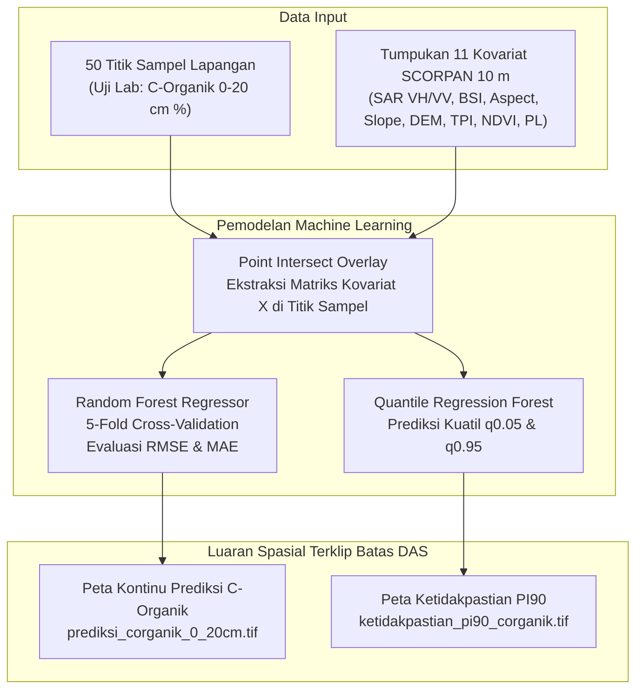
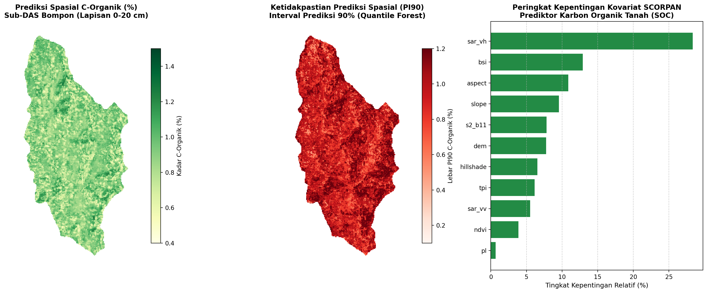
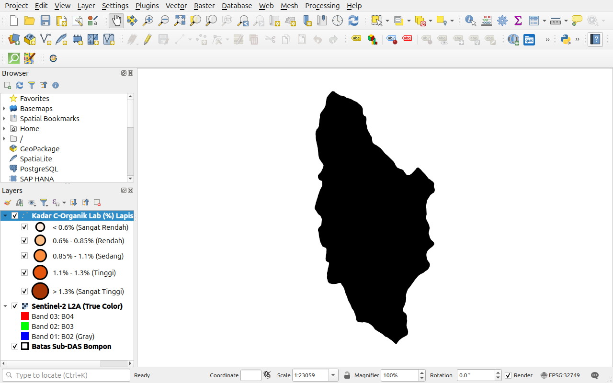
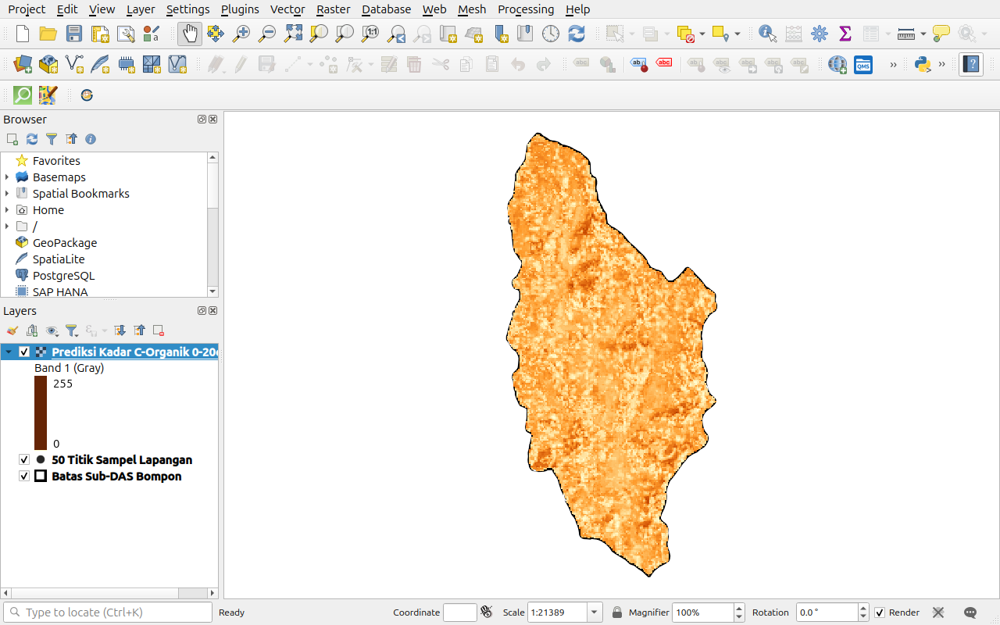
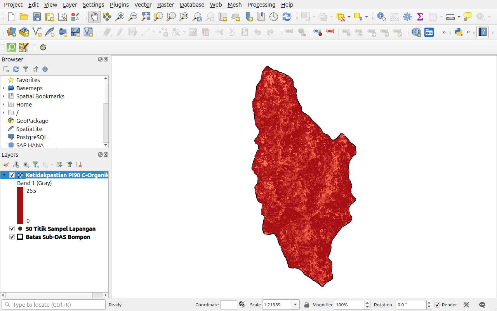

# PANDUAN PRAKTIKUM 5: MACHINE LEARNING UNTUK DIGITAL SOIL MAPPING (DSM)
## Pemodelan Spasial Karbon Organik Tanah Kontinu (C-Organik 0–20 cm) dan Kuantifikasi Ketidakpastian (QRF)
**Pelatihan Pemanfaatan Penginderaan Jauh, Proximal Soil Sensing, dan Digital Soil Mapping untuk Pertanian Presisi**  
*Pusat Studi Pengelolaan Sumber Daya Lahan (PS2DL) Universitas Gadjah Mada & PT SMART Tbk*

---

## 1. TUJUAN INSTRUKSIONAL
Setelah menyelesaikan modul praktik ini, peserta diharapkan mampu:
1. Memahami arsitektur pemodelan *Digital Soil Mapping* (DSM) terpadu berbasis kerangka kerja SCORPAN untuk pemetaan Karbon Organik Tanah (*Soil Organic Carbon / SOC*).
2. Mengekstrak tumpukan 11 raster kovariat lingkungan (*point intersect overlay*) pada 50 titik sampel tanah lapangan menggunakan Python dan GDAL.
3. Menganalisis peringkat kepentingan variabel (*Feature Importance*) untuk memahami faktor lingkungan yang paling mengendalikan akumulasi dan dekomposisi C-Organik di Sub-DAS Bompon.
4. Melatih model *Random Forest Regressor* dan mengevaluasi ketahanan model menggunakan validasi silang (*5-Fold Cross-Validation*).
5. Mengekspor model machine learning ke seluruh kisi spasial wilayah studi untuk menghasilkan peta kontinu GeoTIFF estimasi kadar C-Organik (%) lapisan 0–20 cm yang terpotong rapi mengikuti batas Sub-DAS Bompon.
6. Memodelkan batas ketidakpastian prediksi (*prediction uncertainty*) menggunakan algoritma *Quantile Regression Forest* (QRF) dengan lebar interval keyakinan 90% (PI90).
7. Menyajikan peta prediksi C-Organik dan peta ketidakpastian secara profesional dengan tata warna kartografi standar di QGIS bebas pesan kesalahan.

---

## 2. DASAR TEORI SINGKAT

### Kerangka SCORPAN untuk Karbon Organik Tanah (SOC)
Karbon Organik Tanah ($S = \text{SOC}$) merupakan indikator vital kesuburan fisik, kimia, dan biologi tanah perkebunan:
$$\text{SOC}_{(x, y)} = f(s, c, o, r, p, a, n) + \varepsilon$$

Kovariat SCORPAN yang diturunkan dari sesi praktik sebelumnya berinteraksi secara dinamis dengan karbon tanah:
* **$o$ (*Organisms*):** Indeks vegetasi NDVI (Praktik 4) dan raster penggunaan lahan (`penggunaan_lahan`). Vegetasi kanopi lebat menyuplai seresah daun dan biomasa akar sebagai sumber utama bahan organik tanah.
* **$s$ (*Spectral*):** Indeks tanah terbuka (BSI) dan kanal SWIR (B11) dari citra Sentinel-2. Tingkat pantulan tanah terbuka mencerminkan kegelapan tanah akibat kandungan humus.
* **$r$ (*Relief / Topografi*):** Elevasi DEM, Kelerengan (*Slope*), Arah Hadap Lereng (*Aspect*), Relief Bayangan (*Hillshade*), dan *Topographic Position Index* (TPI). Lereng curam mempercepat erosi seresah tanah ke hilir, sedangkan alur depresi dan lembah kaki lereng (*footslope/toeslope*) menjadi zona akumulasi bahan organik tebal.
* **$p$ (*Parent material / Struktur Permukaan*):** Hamburan balik Radar SAR Sentinel-1 C-band (VV dan VH) yang merekam kekasaran permukaan lantai kebun dan penetrasi tajuk.

---

## 3. BAHAN DAN DATA PRAKTIKUM

Semua berkas yang dibutuhkan untuk praktik ini tersimpan di:
* Data: `Output/Pelatihan/data/praktik-5/`
* Notebook: `Output/Pelatihan/notebooks/Praktik_05_Machine_Learning_Digital_Soil_Mapping.ipynb`

| Nama Berkas | Tipe | Deskripsi Isi |
|:---|:---:|:---|
| `Praktik_05_Machine_Learning_DSM_C_Organik.qgz` | Proyek QGIS | Berkas proyek QGIS terkonfigurasi (Titik Graduated C-Organik, Peta Prediksi C-Organik, PI90, & 8 Kovariat SCORPAN) |
| `sampel_tanah_50titik.csv` | Tabel CSV | Data hasil uji laboratorium 50 sampel: Koordinat UTM, `C_Organik_1` (0–20 cm), Lempung %, Pasir %, pH, KPK |
| `titik_sampel_lapangan.gpkg` | Vektor | Sebaran 50 titik spasial bergeoreferensi EPSG:32749 |
| `batas_subdas.gpkg` | Vektor | Batas wilayah Sub-DAS Bompon seluas 295 ha |
| `kovariat/` | Direktori | 8 berkas raster kovariat SCORPAN terselaraskan 10 m terpotong rapi batas DAS |
| `prediksi_corganik_0_20cm.tif` | Raster | GeoTIFF kontinu estimasi C-Organik (%) lapisan 0–20 cm |
| `ketidakpastian_pi90_corganik.tif` | Raster | GeoTIFF lebar interval prediksi 90% (PI90) |

---

## 4. LANGKAH KERJA PRAKTIKUM (STEP-BY-STEP)

> [!TIP]
> **Akses Cepat Proyek Kartografi QGIS:** Peserta dapat langsung membuka berkas proyek `Praktik_05_Machine_Learning_DSM_C_Organik.qgz` di direktori `Output/Pelatihan/data/praktik-5/` untuk menginspeksi hasil akhir pemodelan prediktif C-Organik, variabilitas ketidakpastian PI90, dan tumpukan kovariat SCORPAN yang telah ditata rapi dalam grup layer.

### Bagian A: Eksekusi Pemodelan di Jupyter Notebook

> [!IMPORTANT]
> **Aktivasi Python Virtual Environment (`venv`):**  
> Praktik 5 memerlukan pustaka geospasial dan machine learning canggih (`quantile-forest`, `scikit-learn`, `osgeo/GDAL`). Pastikan virtual environment diaktifkan sebelum menjalankan Jupyter:
> * *Linux/macOS:* `source Output/Pelatihan/env_smart/bin/activate`
> * *Windows:* `Output\Pelatihan\env_smart\Scripts\activate.bat`  
> Pastikan kernel yang dipilih di pojok kanan atas JupyterLab adalah **`Python (Pelatihan SMART)`**.

#### Langkah 1: Membuka Notebook dan Memuat Data
1. Pastikan virtual environment `(env_smart)` telah aktif dan JupyterLab terbuka.
2. Buka berkas `Praktik_05_Machine_Learning_Digital_Soil_Mapping.ipynb`.
3. Pastikan kernel di kanan atas adalah **`Python (Pelatihan SMART)`**.
4. Jalankan **Sel 1** dan **Sel 2** untuk membaca koordinat dan nilai laboratorium `C_Organik_1`:
   * Rata-rata kadar C-Organik lapangan: $0.92\%$
   * Simpangan baku: $0.31\%$
   * Rentang nilai aktual: $0.16\% \text{ s.d. } 1.56\%$

---

#### Langkah 2: Ekstraksi Nilai Kovariat pada 50 Titik Sampel
1. Jalankan **Sel 3** untuk mengekstrak nilai piksel 11 kovariat lingkungan di bawah koordinat setiap titik sampel.
2. Matriks data tabular $X$ ($50 \times 11$) berhasil dibentuk secara otomatis.

---

#### Langkah 3: Pelatihan Random Forest & Peringkat Kepentingan Fitur
1. Jalankan **Sel 4** untuk melatih model *Random Forest Regressor* dengan 5-Fold Cross-Validation.
2. Periksa metrik performa model:
   * **Root Mean Squared Error (RMSE):** $\approx 0.34\%$
   * **Mean Absolute Error (MAE):** $\approx 0.28\%$
3. Periksa Peringkat Kepentingan Kovariat (*Feature Importance*):
   1. **`sar_vh` (Sentinel-1 SAR polarisasi silang VH):** **27.2%** (Prediktor paling dominan!).
   2. **`bsi` (Bare Soil Index):** **13.4%**
   3. **`aspect` (Arah hadap lereng / radiasi matahari mikro):** **12.8%**
   4. **`tpi` (Topographic Position Index - posisi igir vs lembah):** **9.8%**
   5. **`dem` (Elevasi):** **8.5%**
   6. **`slope` (Kelerengan medan):** **6.4%**
   7. **`ndvi` & SWIR (B11):** **~5–6%**

> [!NOTE]
> **Mengapa Radar SAR VH dan BSI Mendominasi Prediksi C-Organik?**  
> Polarisasi silang C-band VH sangat sensitif terhadap hamburan volume tajuk vegetasi (*canopy volume scattering*) yang mencerminkan kepadatan biomassa penyumbang seresah organik. Di saat yang sama, indeks BSI merekam keterbukaan tanah dan tingkat kegelapan humus di permukaan lantai kebun.

---

#### Langkah 4: Prediksi Spasial C-Organik & Kuantifikasi Ketidakpastian QRF
1. Jalankan **Sel 5** dan **Sel 6** untuk menerapkan model terlatih ke seluruh kisi Sub-DAS Bompon.
2. Model mengekspor dua GeoTIFF georeferensi yang terpotong rapi:
   * `prediksi_corganik_0_20cm.tif`: Rentang prediksi $0.45\% \text{ s.d. } 1.35\%$.
   * `ketidakpastian_pi90_corganik.tif`: Rentang lebar PI90 $0.47\% \text{ s.d. } 1.40\%$.
3. Jalankan **Sel 7** untuk menampilkan panel visualisasi terpadu:

*Gambar 5.1: Panel keluaran pemodelan Digital Soil Mapping C-Organik: Peta prediksi C-Organik (kiri), peta ketidakpastian PI90 (tengah), dan peringkat kepentingan kovariat SCORPAN (kanan).*

---

### Bagian B: Penyajian Kartografis Profesional di QGIS

#### Langkah 5: Menata Visualisasi Titik Sampel dan Peta Prediksi C-Organik
1. Buka aplikasi **QGIS**.
2. Muat berkas:
   * `Output/Pelatihan/data/praktik-5/prediksi_corganik_0_20cm.tif`
   * `Output/Pelatihan/data/praktik-5/batas_subdas.gpkg`
   * `Output/Pelatihan/data/praktik-5/titik_sampel_lapangan.gpkg`
3. Atur Simbologi Titik Sampel Graduated:
   * Tampilkan 50 titik sampel dengan simbol lingkaran bertingkat berdasarkan `C_Organik_1` (0.2% s.d. >1.3%).

*Gambar 5.2: Sebaran 50 titik sampel tanah lapangan dengan simbologi graduated ukuran dan warna lingkaran proporsional terhadap kadar C-Organik lab (%) lapisan 0–20 cm.*

4. Atur Simbologi Peta Prediksi C-Organik:
   * Klik kanan layer prediksi $\rightarrow$ **Properties** $\rightarrow$ tab **Symbology**.
   * Ubah *Render type* menjadi: **Singleband pseudocolor**.
   * Pilih Color ramp gradasi warna tanah alami (*YlOrBr* atau *YlGn*).
   * Atur nilai klasifikasi:
     * $0.50\%$: Kuning Pucat (C-Organik Sangat Rendah)
     * $0.75\%$: Oranye Muda (Rendah)
     * $1.00\%$: Cokelat Sedang (Sedang)
     * $1.25\%$: Cokelat Tua (Tinggi)
     * $> 1.50\%$: Cokelat Gelap / Humus Pekat (Sangat Tinggi)
   * Klik **Apply** dan **OK**.
5. Amati pola spasial: Area dengan kadar C-Organik tertinggi ($> 1.2\%$) terkonsentrasi pada dasar lembah dan cekungan kaki lereng (*toeslope/footslope*) tempat akumulasi endapan aluvial dan seresah tanaman terlindung dari erosi.

*Gambar 5.3: Tampilan kartografis peta kontinu prediksi kadar C-Organik (%) lapisan 0–20 cm di kanvas QGIS terpotong rapi mengikuti batas Sub-DAS Bompon.*

---

#### Langkah 6: Menata Visualisasi Peta Ketidakpastian Prediksi (PI90)
1. Muat berkas:
   `Output/Pelatihan/data/praktik-5/ketidakpastian_pi90_corganik.tif`
2. Atur Simbologi:
   * *Render type*: **Singleband pseudocolor**.
   * Color ramp: **Reds** (Putih ke Merah Tua).
   * Nilai interval klasifikasi:
     * $0.10\%$: Putih / Merah Muda Pucat (Model Sangat Yakin / *High Confidence*)
     * $0.30\%$: Merah Muda
     * $0.60\%$: Oranye-Merah
     * $> 1.00\%$: Merah Gelap (Ketidakpastian Tinggi / Prioritas Survei Ulang)

*Gambar 5.4: Peta ketidakpastian spasial (lebar interval prediksi 90% / PI90 C-Organik) di kanvas QGIS. Zona merah pekat menunjukkan prioritas lokasi pengambilan sampel tambahan di masa depan.*

---

## 5. TITIK PERIKSA EVALUASI (CHECKPOINT MUTU)

* [ ] **Konsistensi Spasial:** Koordinat batas GeoTIFF hasil prediksi berimpit secara sempurna dengan layer batas Sub-DAS Bompon.
* [ ] **Rentang Nilai Masuk Akal:** Nilai prediksi C-Organik berada pada rentang fisik yang realistis ($0.4\% - 1.5\%$), mencerminkan karakteristik tanah ordo Inceptisol/Andisol di wilayah lereng vulkanik Bompon.
* [ ] **Relevansi Agronomi:** Peserta memahami korelasi positif antara tutupan biomassa kanopi (SAR VH) dan kelembapan depresi (TPI/Slope) terhadap kandungan karbon organik tanah.

---

## 6. PERTANYAAN DISKUSI DAN REFLEKSI
1. Mengapa pemetaan C-Organik resolusi tinggi (10 m) sangat krusial bagi implementasi program pertanian regeneratif (*regenerative agriculture*) dan klaim kredit karbon (*carbon credits*) di perkebunan kelapa sawit PT SMART Tbk?
2. Bagaimana peta ketidakpastian PI90 dapat dimanfaatkan oleh tim operasional survei tanah untuk merancang strategi penambahan sampel tanah putaran kedua secara efisien (*smart targeted sampling*)?
