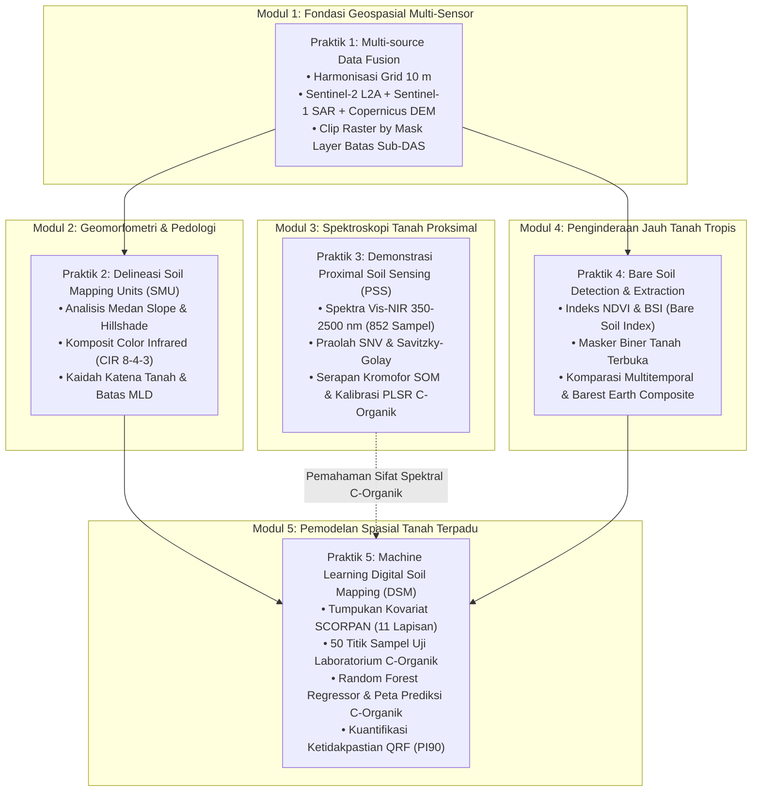

# PANDUAN LENGKAP MODUL PRAKTIKUM PELATIHAN SMART
## Remote Sensing, Proximal Soil Sensing, dan Digital Soil Mapping untuk Pertanian Presisi
**Pusat Studi Pengelolaan Sumber Daya Lahan (PS2DL) Universitas Gadjah Mada & PT SMART Tbk**

---

## 1. STRUKTUR DAN ALUR 5 SESI PRAKTIKUM

Pelatihan praktikum ini dirancang sebagai satu alur kerja terintegrasi (*continuous end-to-end pipeline*) berbasis kasus nyata di Sub-DAS Bompon, Magelang (295 ha, proyeksi `EPSG:32749` / UTM Zone 49S), dengan target akhir pemodelan kuantitatif **Karbon Organik Tanah (C-Organik / Soil Organic Carbon)**.



---

## 2. DAFTAR DOKUMEN MODUL PRAKTIKUM

1. [**Modul Praktik 01: Multi-source Data Fusion**](Modul_Praktik_01_Multi_Source_Data_Fusion.md)
   * Fokus: Penyelarasan kisi piksel (*grid origin snapping*), reproyeksi CRS UTM 49S, resampling DEM Bilinear, pemotongan poligon batas DAS (*Clip Raster by Mask Layer*), inspeksi SAR backscatter VH/VV, dan pembuatan VRT.
2. [**Modul Praktik 02: Delineasi Soil Mapping Units (SMU)**](Modul_Praktik_02_Delineasi_Soil_Mapping_Units.md)
   * Fokus: Analisis lereng dan hillshade, komposit Color Infrared, digitasi vektor pedologi ber-snapping, kontrol kualitas MLD 0.4 ha, dan perbandingan dengan satuan bentuklahan pakar.
3. [**Modul Praktik 03: Demonstrasi Proximal Soil Sensing (PSS)**](Modul_Praktik_03_Demonstrasi_Proximal_Soil_Sensing.md)
   * Fokus: Spektroskopi Vis-NIR 350–2500 nm, pra-olah SNV & Savitzky-Golay, identifikasi serapan diagnostik kromofor bahan organik (SOM 450–650 nm) dan ikatan alifatik $\text{C-H}$ (1720 nm & 2300 nm), kalibrasi PLSR C-Organik, dan evaluasi RPD.
4. [**Modul Praktik 04: Bare Soil Detection & Extraction**](Modul_Praktik_04_Bare_Soil_Detection_and_Extraction.md)
   * Fokus: Indeks NDVI, BSI, ambang batas biner ruang fitur spektral, analisis perbandingan multitemporal musim kemarau 2024 vs basah 2025, dan komposit *Barest Earth*.
5. [**Modul Praktik 05: Machine Learning Digital Soil Mapping (DSM)**](Modul_Praktik_05_Machine_Learning_Digital_Soil_Mapping.md)
   * Fokus: Ekstraksi tumpukan kovariat SCORPAN pada 50 titik sampel lab C-Organik, pemodelan Random Forest, peringkat kepentingan kovariat (*Feature Importance*), peta prediksi kontinu C-Organik 0–20 cm (GeoTIFF), kuantifikasi ketidakpastian QRF (PI90), dan visualisasi kartografis di QGIS.

---

## 3. LOKASI DATA DAN SUMBER DAYA

* **Data Siap Pakai & Berkas Proyek QGIS Mandiri (`.qgz`):** `Output/Pelatihan/data/`
  * `praktik-1/Praktik_01_Multi_Source_Data_Fusion.qgz` (Proyek multi-sensor Optik-SAR-DEM)
  * `praktik-2/Praktik_02_Delineasi_SMU.qgz` (Proyek kelerengan, hillshade, CIR, & batas bentuklahan SMU)
  * `praktik-3/Praktik_03_Demonstrasi_PSS.qgz` (Proyek sebaran 50 titik sampel PSS & citra Sentinel-2)
  * `praktik-4/Praktik_04_Bare_Soil_Detection.qgz` (Proyek BSI, NDVI, & masker tanah terbuka biner)
  * `praktik-5/Praktik_05_Machine_Learning_DSM_C_Organik.qgz` (Proyek peta prediksi C-organik, ketidakpastian PI90, & kovariat SCORPAN)
* **Jupyter Notebook Interaktif:** `Output/Pelatihan/notebooks/`
  * `Praktik_03_Demonstrasi_PSS_Kemometrika.ipynb`
  * `Praktik_05_Machine_Learning_Digital_Soil_Mapping.ipynb`
* **Arsip Tangkapan Layar & Grafik Evaluasi:** `Output/Pelatihan/screenshots/`

---

## 4. PERSYARATAN PERANGKAT LUNAK & PENYIAPAN PYTHON VIRTUAL ENVIRONMENT (VENV)

### A. Perangkat Lunak GIS Desktop
* **QGIS Desktop:** Versi 3.28 LTR atau yang lebih baru (disarankan QGIS 3.34 / 3.44 LTR). Seluruh layer spasial dan berkas proyek `.qgz` telah disesuaikan dengan standar QGIS 3.

---

### B. Penyiapan Python Virtual Environment (`venv`)
Untuk menjalankan **Praktik 3** (Kemometrika PSS) dan **Praktik 5** (Machine Learning DSM) secara terisolasi tanpa konflik pustaka sistem, peserta diarahkan menggunakan **Python Virtual Environment (`venv`)**.

#### 1. Melalui Skrip Otomasi (Praktis):
* **Linux / macOS:**
  ```bash
  cd Output/Pelatihan
  ./setup_env.sh
  ```
* **Windows (Command Prompt / PowerShell):**
  ```cmd
  cd Output\Pelatihan
  setup_env.bat
  ```

---

#### 2. Melalui Prosedur Manual (Langkah demi Langkah):
1. **Buka Terminal / Command Prompt:**
   Arahkan direktori kerja ke folder pelatihan:
   ```bash
   cd Output/Pelatihan
   ```

2. **Buat Virtual Environment (`env_smart`):**
   * *Linux / macOS:*
     ```bash
     python3 -m venv env_smart
     ```
   * *Windows:*
     ```cmd
     python -m venv env_smart
     ```

3. **Aktivasi Virtual Environment:**
   * *Linux / macOS:*
     ```bash
     source env_smart/bin/activate
     ```
   * *Windows (Command Prompt):*
     ```cmd
     env_smart\Scripts\activate.bat
     ```
   * *Windows (PowerShell):*
     ```powershell
     .\env_smart\Scripts\Activate.ps1
     ```
   *(Tanda aktivasi: nama `(env_smart)` akan muncul di sebelah kiri baris perintah terminal).*

4. **Instal Seluruh Pustaka Dependensi:**
   ```bash
   pip install --upgrade pip
   pip install -r requirements.txt
   ```
   *Daftar paket utama:* `numpy`, `scipy`, `matplotlib`, `scikit-learn`, `quantile-forest`, `ipykernel`, `jupyterlab`.

5. **Daftarkan Virtual Environment sebagai Jupyter Kernel:**
   ```bash
   python -m ipykernel install --user --name=env_smart --display-name="Python (Pelatihan SMART)"
   ```

6. **Jalankan JupyterLab:**
   ```bash
   jupyter lab
   ```
   *Penting:* Saat membuka notebook `Praktik_03_Demonstrasi_PSS_Kemometrika.ipynb` atau `Praktik_05_Machine_Learning_Digital_Soil_Mapping.ipynb`, pastikan kernel yang aktif di pojok kanan atas jendela Jupyter adalah **`Python (Pelatihan SMART)`**.
