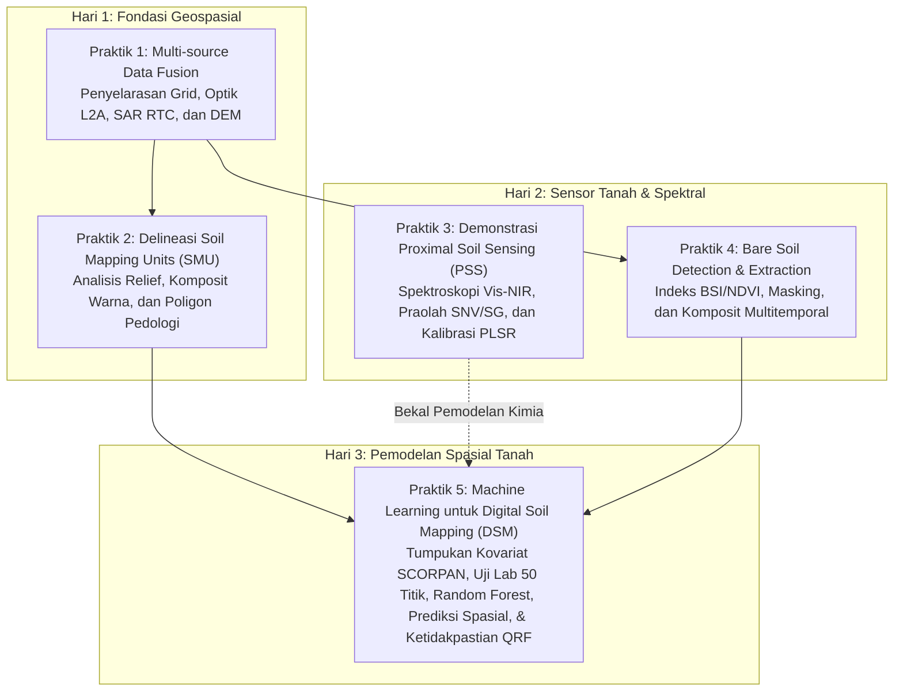

# RENCANA PELAKSANAAN 5 SESI PRAKTIK PELATIHAN
## Remote Sensing, Proximal Soil Sensing, dan Digital Soil Mapping untuk Pertanian Presisi
**Pusat Studi Pengelolaan Sumber Daya Lahan (PS2DL) UGM & PT SMART Tbk**

---

## 1. PENGANTAR DAN BENANG MERAH ALUR PRAKTIK

Rancangan 5 sesi praktik ini dibangun dengan prinsip **satu kesatuan alur kerja (*one continuous pipeline*)**. Seluruh sesi berpusat pada wilayah kajian acuan yang sama (Sub-DAS Bompon, Magelang, 295 ha, proyeksi `EPSG:32749` / UTM Zone 49S), di mana keluaran dari satu sesi praktik menjadi masukan data langsung bagi sesi berikutnya hingga menghasilkan peta prediksi sifat tanah dan peta ketidakpastian digital berstandar operasional.

---

## 2. RINCIAN RENCANA PER SESI PRAKTIK

---

### PRAKTIK 1: MULTI-SOURCE DATA FUSION (PENYELARASAN MULTI-SENSOR)

* **Alokasi Waktu:** 90 Menit (Hari 1)
* **Pemandu / Instruktur:** Tim Pemandu GIS PS2DL UGM
* **Perangkat Lunak:** QGIS 3.44 LTR (Processing Toolbox, GDAL algorithms)
* **Kaitan Modul Teori:** Modul 2 (Karakteristik Sensor) & Modul 3 (Multi-source Data Fusion)

#### A. Tujuan Pembelajaran
1. Peserta memahami urgensi harmonisasi data geospasial dari berbagai wahana sensor (Optik, Radar SAR, dan Model Elevasi DEM).
2. Peserta mampu menyamakan sistem referensi koordinat (CRS) ke UTM Zone 49S (`EPSG:32749`).
3. Peserta mampu melakukan penyelarasan batas kisi spasial (*pixel grid alignment & snapping*) sehingga seluruh lapisan raster memiliki ukuran piksel, dimensi matriks, dan batas sudut yang identik (10 m × 10 m).
4. Peserta mampu membangun berkas tumpukan raster virtual (*Virtual Raster Stack / VRT*) sebagai fondasi ekstraksi kovariat SCORPAN.

#### B. Data Input yang Digunakan
* **Citra Optik L2A:** `Source/Data Bompon/terbuka/sentinel2_l2a_20250721_10m.tif` (10 kanal permukaan: B02, B03, B04, B05, B06, B07, B08, B8A, B11, B12).
* **Citra Radar SAR RTC:** `Source/Data Bompon/terbuka/sentinel1_rtc_20240830_10m.tif` (Polarisasi C-band $\sigma^0$ VV dan VH terkoreksi medan).
* **Model Elevasi:** `Source/Data Bompon/terbuka/copdem_glo30_30m.tif` (Copernicus DEM 30 m).
* **Batas Wilayah Studi:** `Source/Data Bompon/bompon.gpkg` (layer `batas_subdas`).

#### C. Langkah Kerja Rinci (Step-by-Step)
1. **Inisialisasi Proyek QGIS:** Menyetel CRS proyek ke `EPSG:32749` dan memuat layer batas `batas_subdas`.
2. **Reproyeksi dan Resampling DEM:** Menggunakan algoritma GDAL *Warp (reproject)* untuk mengubah resolusi grid Copernicus DEM dari 30 m menjadi 10 m menggunakan interpolasi *bilinear*.
3. **Penyelarasan Grid Piksel (*Align Rasters*):**
   * Membuka menu `Raster` $\rightarrow$ `Align Rasters...`.
   * Memasukkan layer Sentinel-2, Sentinel-1 SAR, dan DEM yang telah di-resample.
   * Menetapkan layer Sentinel-2 sebagai *Reference Layer* (resolusi 10 m, grid origin snap).
   * Menjalankan proses untuk memastikan setiap sel piksel tumpang susun secara 1:1 tanpa pergeseran sub-piksel.
4. **Pemotongan Berdasarkan Batas Wilayah (*Clip by Mask Layer*):** Memotong seluruh lapisan raster yang telah terselaraskan menggunakan batas poligon `batas_subdas` dengan penyangga (*buffer*) 200 m.
5. **Pembuatan Virtual Raster (VRT):**
   * Menggabungkan kanal kunci (Optik: Green, Red, NIR, SWIR1, SWIR2; SAR: VV, VH; DEM: Elevasi) ke dalam satu berkas `multisensor_stack_10m.vrt`.
6. **Inspeksi Visual & Kontrol Mutu:** Memeriksa konsistensi spasial melalui visualisasi *Swipe Tool* dan identifikasi nilai spektral per piksel (*Identify Feature*).

#### D. Rencana Pengambilan Screenshot Otomatis QGIS
* **SS-1.1:** Jendela pengaturan *Project Properties - CRS* (`EPSG:32749 - WGS 84 / UTM zone 49S`).
* **SS-1.2:** Dialog GDAL *Warp (reproject)* untuk DEM dengan interpolasi *Bilinear*.
* **SS-1.3:** Jendela utilitas *Align Rasters* yang menampilkan daftar berkas input, layer acuan, dan parameter toleransi spasial.
* **SS-1.4:** Kanvas utama QGIS menampilkan perbandingan visual 3 panel: Optik True Color (RGB 4-3-2), Citra Intensitas SAR Backscatter (VV/VH), dan Model Elevasi Hillshade.

#### E. Deliverables & Titik Periksa
* **Keluaran:** Berkas raster terselaraskan `multisensor_stack_10m.vrt` dan GeoTIFF DEM 10 m.
* **Titik Periksa (TP-1):** Peserta memverifikasi bahwa resolusi seluruh layer adalah tepat 10.0 m × 10.0 m dan batas koordinat (*extent bounding box*) berimpit persis.

---

### PRAKTIK 2: DELINEASI SOIL MAPPING UNITS (SMU)

* **Alokasi Waktu:** 90 Menit (Hari 1–2)
* **Pemandu / Instruktur:** Prof. Dr. rer. nat. Junun Sartohadi, M.Sc. & Tim Pemandu
* **Perangkat Lunak:** QGIS 3.44 LTR (Raster Terrain Analysis, Advanced Digitizing, Vector Geometry)
* **Kaitan Modul Teori:** Modul 4 (Delineasi SMU & Konsep Catena) & Modul 6 (Interpretasi Pedologis)

#### A. Tujuan Pembelajaran
1. Peserta mampu menerapkan konsep bentanglahan (*catena*) dan pembagian satuan bentuklahan untuk pemetaan tanah.
2. Peserta mampu menurunkan atribut medan pendukung delineasi: peta kelerengan (*slope*) dan peta relief bayangan bukit (*hillshade* multi-arah).
3. Peserta mampu mengatur komposit spektral inframerah pantulan (*Color Infrared / CIR*) untuk mengidentifikasi batas rona vegetasi dan batas geomorfologi.
4. Peserta mampu melakukan digitasi visual poligon batas SMU dengan kaidah kartografi pedologis, menerapkan kaidah batas keterbacaan minimum (*Minimum Legible Delineation / MLD*).

#### B. Data Input yang Digunakan
* **DEM Terselaraskan 10 m:** Hasil Praktik 1.
* **Sentinel-2 L2A 10 m:** Kanal B02 (Blue), B03 (Green), B04 (Red), dan B08 (NIR).
* **Data Rujukan Pedologis Pembanding:** `Source/Data Bompon/bompon.gpkg` (layer `bentuklahan` dan `kelas_lereng` hasil survei riset lapangan).
* **Batas Wilayah Studi:** `Source/Data Bompon/bompon.gpkg` (`batas_subdas`).

#### C. Langkah Kerja Rinci (Step-by-Step)
1. **Derivasi Morfometri Lereng:**
   * Menjalankan algoritma `Raster Terrain Analysis` $\rightarrow$ `Slope` (dalam derajat dan persentase).
   * Menjalankan algoritma `Hillshade` (Azimuth 315°, Altitude 45° dan *Multidirectional Hillshade*).
   * Reklasifikasi peta lereng menggunakan `Reclassify by Table` menjadi 5 kelas lereng pedologi: Datar (0–2%), Landai (2–8%), Agak Curam (8–15%), Curam (15–30%), Sangat Curam (>30%).
2. **Pengaturan Komposit Citra Penginderaan Jauh:**
   * Mengatur simbologi Sentinel-2 menjadi komposit *Color Infrared* (RGB 8-4-3) untuk membedakan kontras kelembapan vegetasi pada dasar lembah vs lereng atas.
3. **Pembuatan Layer Poligon SMU:**
   * Membuat layer Shapefile/GeoPackage baru: `smu_delineasi_peserta.gpkg` (tipe geometri Polygon, CRS `EPSG:32749`).
   * Menambahkan atribut tabel: `ID_SMU`, `Fisiografi`, `Bentuklahan`, `Kelas_Lereng`, `Luas_Ha`.
4. **Digitasi Terbimbing Berbasis Prinsip Catena:**
   * Mengaktifkan *Snapping Toolbar* (opsi *Avoid Overlap* dan *Topological Editing* aktif).
   * Mendigitasi batas poligon tanah mengikuti diskontinuitas lereng (*slope break*), batas punggung igir perbukitan, serta batas depresi alur drainase alami.
5. **Kontrol Kualitas Kartografi (MLD & MLA):**
   * Menghitung luas poligon otomatis menggunakan *Field Calculator* (`$area / 10000`).
   * Mengidentifikasi poligon *slivers* atau poligon di bawah ukuran delineasi minimum (MLD pada skala 1:25.000 = 0.4 ha).
   * Melakukan generalisasi kartografis menggunakan alat `Eliminate Selected Polygons`.
6. **Evaluasi dan Komparasi Ilmiah:** Menampilkan layer rujukan `bentuklahan` pakar dan mengevaluasi konsistensi batas pedologis hasil digitasi peserta.

#### D. Rencana Pengambilan Screenshot Otomatis QGIS
* **SS-2.1:** Dialog algoritma pemrosesan *Slope* dan pengaturan palet warna kelerengan.
* **SS-2.2:** Tampilan jendela kanvas dengan layer *Color Infrared (CIR 8-4-3)* berpadu transparan (50%) di atas *Multidirectional Hillshade*.
* **SS-2.3:** Proses digitasi poligon interaktif di QGIS dengan vertex editor dan *Snapping Guide* menyala.
* **SS-2.4:** Tampilan akhir poligon SMU hasil delineasi peserta disandingkan dengan layer rujukan bentanglahan pakar.

#### E. Deliverables & Titik Periksa
* **Keluaran:** Layer vektor poligon `smu_delineasi.gpkg` yang bersih dari topologi error dan dilengkapi atribut fisiografi.
* **Titik Periksa (TP-2):** Tidak ada poligon yang saling tumpang tindih (*zero topological overlap*), dan seluruh area Sub-DAS tertutup poligon secara berkesinambungan.

---

### PRAKTIK 3: DEMONSTRASI PROXIMAL SOIL SENSING (PSS) & ANALISIS KEMOMETRIKA

* **Alokasi Waktu:** 60 Menit (Hari 2)
* **Pemandu / Instruktur:** Pandu Yudha Adi Putra Wirabuana, Ph.D. & Tim Pemandu
* **Perangkat Lunak:** Python / Jupyter Notebook (Google Colab) + QGIS untuk plotting koordinat
* **Pustaka Utama:** `numpy`, `pandas`, `scipy.signal`, `scikit-learn`, `matplotlib`
* **Kaitan Modul Teori:** Modul 7 (Proximal Soil Sensing)

#### A. Tujuan Pembelajaran
1. Peserta memahami struktur data mentah spektroskopi reflektansi tanah (*raw reflectance spectra*) pada rentang Vis-NIR (350–2500 nm).
2. Peserta mampu menjalankan tahapan pra-pemrosesan sinyal spektral: konversi reflektansi ke absorbansi ($A = \log(1/R)$), normalisasi variat normal standar (*Standard Normal Variate / SNV*), dan turunan Savitzky–Golay.
3. Peserta mampu mengenali secara visual dan fisis posisi puncak serapan diagnostik mineral lempung ($\text{Al-OH}$), bahan organik, dan kelembapan tanah.
4. Peserta memahami cara melatih model regresi kuadrat terkecil parsial (*Partial Least Squares Regression / PLSR*) untuk mengestimasi kadar lempung (*clay*) dan bahan organik tanah dari sinyal spektrum.

#### B. Data Input yang Digunakan
* **Dataset Spektrum Vis-NIR Lengkap:** `Source/Proximal Sensing/Dataset_ML_Tanah_Gabungan_new.xlsx` (857 sampel tanah, rentang 350–2500 nm resolusi 1 nm, berpasangan dengan nilai lab Clay %, Sand %, Silt %, pH, C-Organik, KTK, dan Kadar Air).
* **Dataset Pelengkap:** `Source/Proximal Sensing/Input data spektro_2.xlsx`.

#### C. Langkah Kerja Rinci (Step-by-Step)
1. **Pemeriksaan dan Visualisasi Spektra Mentah:**
   * Membaca matriks spektrum $X$ (dimensi: $857 \times 2151$) dan target sifat tanah $y$.
   * Menampilkan kurva spektrum mentah untuk membedakan pola tanah berpasir (reflektansi tinggi) vs tanah liat berkarbon tinggi (reflektansi rendah dengan serapan kuat).
2. **Tahapan Pra-olah Sinyal Spektroskopi (Chemometrics Preprocessing):**
   * *Langkah 1:* Konversi Reflektansi ($R$) ke Absorbansi ($A = \log_{10}(1/R)$).
   * *Langkah 2:* Penerapan algoritma *Standard Normal Variate* (SNV) untuk menghilangkan bias offset akibat variasi ukuran agregat tanah dan kekasaran permukaan sampel.
   * *Langkah 3:* Penerapan filter Savitzky–Golay (polinomial derajat 2, lebar jendela 15 nm, turunan pertama/kedua) untuk mempertegas puncak serapan tersembunyi.
3. **Analisis Puncak Serapan Diagnostik:**
   * Menandai panjang gelombang kunci pada grafik:
     * $1400\text{ nm}$ dan $1900\text{ nm}$: Serapan getaran kisi air kristal/hidroksil ($\text{O-H}$).
     * $2200\text{ nm}$: Serapan mineral filosilikat lempung (ikatan $\text{Al-OH}$ kaolinit/smektit).
     * $450–650\text{ nm}$: Kemiringan spektrum akibat kromofor bahan organik tanah (SOM) dan oksida besi ($\text{Fe-O}$).
4. **Pembangunan Model Kalibrasi Cepat (PLSR):**
   * Membagi data: 70% data kalibrasi (*training*), 30% data validasi independen (*test*).
   * Melatih algoritma *Partial Least Squares Regression* (jumlah komponen $k=5–8$).
   * Mengevaluasi akurasi model: koefisien determinasi ($R^2$), *Root Mean Square Error* (RMSE), dan *Residual Prediction Deviation* (RPD).
5. **Ekspor Titik Prediksi PSS ke QGIS:** Menyimpan koordinat sampel lapangan beranotasi hasil estimasi PSS ke file CSV dan menampilkannya sebagai peta sebaran di QGIS.

#### D. Rencana Visualisasi & Screenshot
* **SS-3.1:** Grafik kurva spektral: Perbandingan sinyal spektrum sebelum (mentah) vs sesudah perlakuan SNV dan turunan pertama Savitzky–Golay.
* **SS-3.2:** Plot serapan diagnostik dengan garis vertikal penanda mineral lempung ($2200\text{ nm}$) dan gugus hidroksil.
* **SS-3.3:** Scatterplot kalibrasi PLSR antara nilai laboratorium aktual vs nilai prediksi spektroskopi Vis-NIR ($R^2 > 0.80$).
* **SS-3.4:** Tampilan kanvas QGIS dengan layer titik sampel PSS bertematik warna sifat tanah di atas citra satelit.

#### E. Deliverables & Titik Periksa
* **Keluaran:** Notebook Python tereksekusi penuh, grafik kurva spektral terstandar, dan tabel evaluasi akurasi estimasi sensor proksimal.
* **Titik Periksa (TP-3):** Model kalibrasi menghasilkan nilai $R^2 \ge 0.75$ pada data validasi, membuktikan kemampuan sensor proksimal menggantikan analisis lab basah yang mahal.

---

### PRAKTIK 4: BARE SOIL DETECTION & EXTRACTION (DETEKSI TANAH TERBUKA)

* **Alokasi Waktu:** 90 Menit (Hari 2)
* **Pemandu / Instruktur:** Dr. Retnadi Heru Jatmiko, M.Sc. & Tim Pemandu
* **Perangkat Lunak:** QGIS 3.44 LTR (Raster Calculator, Layer Properties, Spatial Statistics)
* **Kaitan Modul Teori:** Modul 5 (Bare Soil Detection & Information Extraction)

#### A. Tujuan Pembelajaran
1. Peserta memahami kendala pantulan kanopi vegetasi rapat pada perkebunan sawit/agroforestri terhadap sinyal tanah murni.
2. Peserta mampu menghitung indeks vegetasi ($\text{NDVI}$), indeks tanah terbuka ($\text{BSI}$), dan indeks serasah ($\text{NBR2}$) secara tepat.
3. Peserta mampu mengeksplorasi ruang fitur dua dimensi ($\text{NDVI} \times \text{BSI}$) untuk menetapkan nilai ambang batas (*thresholding*) pemisahan tanah terbuka secara objektif.
4. Peserta mampu memanfaatkan deret waktu multitemporal (adegan kemarau vs adegan basah) untuk mengekstrak komposit spektral tanah terbuka murni (*Barest Earth Composite*).

#### B. Data Input yang Digunakan
* **Citra Sentinel-2 L2A Juli 2025 (Kondisi Kanopi Rapat):** `Source/Data Bompon/terbuka/sentinel2_l2a_20250721_10m.tif`.
* **Citra Sentinel-2 L2A Agustus 2024 (Puncak Musim Kemarau):** `Source/Data Bompon/terbuka/sentinel2_l2a_20240813_10m.tif`.
* **Lapisan Klasifikasi Adegan (SCL):** `Source/Data Bompon/terbuka/sentinel2_l2a_20250721_scl_10m.tif`.
* **Layer Penggunaan Lahan:** `Source/Data Bompon/bompon.gpkg` (`penggunaan_lahan` dan `batas_subdas`).

#### C. Langkah Kerja Rinci (Step-by-Step)
1. **Perhitungan Indeks Spektral pada QGIS Raster Calculator:**
   * Menghitung Normalised Difference Vegetation Index ($\text{NDVI}$):
     $$\text{NDVI} = \frac{\text{B08} - \text{B04}}{\text{B08} + \text{B04}}$$
   * Menghitung Bare Soil Index ($\text{BSI}$):
     $$\text{BSI} = \frac{(\text{B11} + \text{B04}) - (\text{B08} + \text{B02})}{(\text{B11} + \text{B04}) + (\text{B08} + \text{B02})}$$
   * Menghitung Normalized Burn Ratio 2 ($\text{NBR2}$ untuk diskriminasi serasah kering vs tanah):
     $$\text{NBR2} = \frac{\text{B11} - \text{B12}}{\text{B11} + \text{B12}}$$
2. **Analisis Statistik dan Ruang Fitur Spektral:**
   * Membuka *Raster Layer Properties* $\rightarrow$ *Histogram* untuk memeriksa kurva distribusi frekuensi nilai NDVI dan BSI.
   * Mengidentifikasi ambang pemisah tanah terbuka: umumnya $\text{NDVI} < 0.35$ dan $\text{BSI} > 0.05$.
3. **Pembuatan Masker Biner Tanah Terbuka (*Bare Soil Mask*):**
   * Mengeksekusi ekspresi biner di *Raster Calculator*:
     $$(\text{NDVI} < 0.35) \text{ AND } (\text{BSI} > 0.05) \text{ AND } (\text{SCL} \ne 3) \text{ AND } (\text{SCL} \ne 8)$$
   * Menghasilkan peta biner: nilai 1 (Tanah Terbuka) dan nilai 0 (Bukan Tanah / Kanopi).
4. **Komparasi Multitemporal (Kemarau vs Basah):**
   * Mengulang perhitungan masker biner pada citra Agustus 2024.
   * Menghitung total luas tanah terbuka pada kedua tanggal menggunakan *Raster Layer Unique Values Report*:
     * Adegan Juli 2025: tanah terbuka terbatas pada petak olah tanah sawah/tegalan (~2–5% luas area).
     * Adegan Agustus 2024: tanah terbuka meluas saat bera musim kemarau (>15–20% luas area).
5. **Pembuatan Komposit Tanah Terbuka Terintegrasi (*Barest Pixel*):**
   * Menerapkan logika komposit multitemporal: memilih piksel dari tanggal yang memiliki nilai NDVI terendah (kondisi tanah paling terbuka).
   * Menghasilkan raster komposit tanah terbuka sebagai lapisan kovariat murni untuk pemodelan DSM.

#### D. Rencana Pengambilan Screenshot Otomatis QGIS
* **SS-4.1:** Jendela formula *Raster Calculator* untuk kalkulasi BSI dan NDVI.
* **SS-4.2:** Tampilan histogram frekuensi NDVI dan BSI yang memperlihatkan titik potong pemisahan tutupan lahan.
* **SS-4.3:** Peta sebaran spasial masker tanah terbuka (warna merah menyala) di atas citra satelit latar belakang.
* **SS-4.4:** Komparasi berdampingan (*split screen*) masker tanah terbuka musim basah 2025 vs puncak musim kemarau 2024.

#### E. Deliverables & Titik Periksa
* **Keluaran:** Raster biner masker tanah terbuka (`masker_tanah_terbuka_2024.tif`) dan raster indeks komposit `barest_earth_bsi.tif`.
* **Titik Periksa (TP-4):** Piksel tanah terbuka secara spasial terkonsentrasi pada petak tegalan dan sawah bera, serta tidak ada piksel vegetasi hutan agroforestri lebat yang salah terklasifikasikan sebagai tanah terbuka.

---

### PRAKTIK 5: MACHINE LEARNING UNTUK DIGITAL SOIL MAPPING (DSM TERPADU)

* **Alokasi Waktu:** 120 Menit (Hari 3)
* **Pemandu / Instruktur:** Dr. Eng. Guruh Samodra, S.Si., M.Sc. & Tim Pemandu
* **Perangkat Lunak:** Python / Google Colab + Visualisasi Kartografi QGIS 3.44
* **Pustaka Utama:** `geopandas`, `rasterio`, `pandas`, `scikit-learn`, `quantile-forest`, `matplotlib`
* **Kaitan Modul Teori:** Modul 8 (Pemodelan Digital Soil Mapping)

#### A. Tujuan Pembelajaran
1. Peserta mampu menyusun dataset spasial tabular terintegrasi dengan mengekstrak nilai tumpukan raster kovariat SCORPAN di 50 titik koordinat sampel tanah lapangan.
2. Peserta mampu melakukan seleksi fitur kovariat (*feature selection*) untuk mengeliminasi variabel multikolinearitas dan memilih prediktor paling informatif secara pedologis.
3. Peserta mampu melatih, memvalidasi, dan mengevaluasi model *Random Forest Regressor* menggunakan validasi silang spasial (*Spatial Block Cross-Validation*).
4. Peserta mampu mengekspor model prediksi ke seluruh kisi wilayah studi untuk menghasilkan peta kontinu sifat tanah (Kadar Lempung / Clay % Lapisan 0–20 cm).
5. Peserta mampu memodelkan ketidakpastian prediksi secara spasial menggunakan *Quantile Regression Forest* (QRF / PI90) dan menyajikan hasilnya secara profesional di kanvas QGIS.

#### B. Data Input yang Digunakan
* **Tabel Hasil Uji Laboratorium 50 Titik:** `Source/Data Bompon/sampel.csv` (Kolom target utama: `Lempung_1` untuk fraksi lempung 0–20 cm, `C_Organik_1`, `pH_H2O_1`, dan `KPK1`).
* **Vektor Koordinat Titik Sampel Lapangan:** `Source/Data Bompon/bompon.gpkg` (`titik_sampel_lapangan`).
* **Tumpukan Lapisan Kovariat SCORPAN (Grid 10 m):**
  * $S$ (*Spectral*): Sentinel-2 kanal B02, B03, B04, B08, B11, B12, NDVI, BSI, dan SAR backscatter (VV, VH).
  * $R$ (*Relief*): Elevasi DEM, Kelerengan (*Slope*), Aspek (*Aspect*), *Hillshade*, dan *Topographic Position Index* (TPI).
  * $O$ (*Organisms*): Raster reklasifikasi penggunaan lahan (`penggunaan_lahan`).
  * $P$ (*Parent material*): Raster satuan bentuklahan / fisiografi.

#### C. Langkah Kerja Rinci (Step-by-Step)
1. **Penyusunan Dataset Pemodelan (Point Intersect Overlay):**
   * Menggunakan script Python (`rasterio.sample` / `geopandas`) untuk mengekstrak nilai semua lapisan raster kovariat pada koordinat 50 titik sampel lapangan.
   * Menggabungkan matriks kovariat ($X$) dengan nilai laboratorium aktual ($y = \text{Lempung\_1}$) dari berkas `sampel.csv`.
   * Menghasilkan tabel dataset bersih `dataset_dsm_bompon_50titik.csv`.
2. **Eksplorasi Statistik & Seleksi Kovariat Lingkungan:**
   * Menghitung matriks korelasi Pearson antarkovariat untuk mendeteksi redundansi data ($r > 0.85$).
   * Menilai relevansi pedologis: mengapa faktor kelerengan dan rasio SWIR berhubungan fisis dengan akumulasi fraksi lempung di lereng bawah.
   * Menetapkan daftar kovariat terpilih final (6–8 kovariat paling berpengaruh).
3. **Pembagian Data & Pelatihan Model Random Forest:**
   * Membandingkan dua skema pembagian data:
     * *Skema A:* Validasi acak konvensional (*Random 5-Fold Cross-Validation*).
     * *Skema B:* Validasi silang blok spasial (*Spatial Block CV*) untuk menguji ketahanan model terhadap autokorelasi spasial.
   * Melatih algoritma *Random Forest Regressor* (`n_estimators=300`, `max_depth=6`).
   * Menghitung metrik performa: Koefisien Determinasi ($R^2$), *Root Mean Square Error* (RMSE), *Mean Absolute Error* (MAE), dan Lin's CCC.
   * Menghitung peringkat kepentingan kovariat (*Feature Importance* / Gini Index).
4. **Prediksi Spasial ke Seluruh Grid Wilayah Sub-DAS:**
   * Membaca tumpukan raster seluruh wilayah studi sebagai array NumPy.
   * Mengaplikasikan model Random Forest terlatih ke setiap piksel.
   * Mengekspor array hasil prediksi menjadi GeoTIFF georeferensi: `prediksi_lempung_0_20cm.tif`.
5. **Pemodelan Ketidakpastian Prediksi Spasial (QRF):**
   * Melatih algoritma *Quantile Regression Forest* (`quantile-forest`).
   * Memprediksi persentil ke-5 ($q_{0.05}$) dan persentil ke-95 ($q_{0.95}$).
   * Menghitung lebar interval prediksi 90%: $\text{PI90} = q_{0.95} - q_{0.05}$.
   * Mengekspor raster peta ketidakpastian: `ketidakpastian_pi90_lempung.tif`.
6. **Penyajian Kartografis Standar di QGIS:**
   * Membuka kedua GeoTIFF di QGIS.
   * Menata simbologi warna kontinu (*Singleband Pseudocolor*):
     * Peta Prediksi Lempung: Skema gradasi warna tanah *YlOrBr* (Kuning = lempung rendah ~30%, Cokelat tua = lempung tinggi ~80%).
     * Peta Ketidakpastian: Skema gradasi *Reds* (Merah gelap = ketidakpastian tinggi akibat minimnya sampel / topografi ekstrem).
   * Menambahkan overlay batas poligon SMU (dari Praktik 2) dan sebaran 50 titik sampel lapangan.

#### D. Rencana Pengambilan Screenshot Otomatis QGIS
* **SS-5.1:** Sebaran 50 titik sampel di QGIS dengan ukuran dan warna lingkaran bervariasi proporsional terhadap nilai lab kadar lempung.
* **SS-5.2:** Grafik Feature Importance Random Forest (peringkat kovariat SCORPAN yang paling mengendalikan sebaran tanah).
* **SS-5.3:** Peta kontinu hasil prediksi spasial kadar lempung (%) di kanvas utama QGIS lengkap dengan legenda nilai.
* **SS-5.4:** Peta ketidakpastian prediksi (PI90) berdampingan (*side-by-side*) dengan peta prediksi lempung untuk menunjukkan area yang memerlukan penambahan sampel tanah di masa depan.

#### E. Deliverables & Titik Periksa
* **Keluaran:** Berkas GeoTIFF prediksi kontinu (`prediksi_lempung_0_20cm.tif`), GeoTIFF ketidakpastian (`ketidakpastian_pi90_lempung.tif`), dan laporan ringkas metrik validasi model.
* **Titik Periksa (TP-5):** Model memprediksi rentang nilai lempung yang masuk akal secara fisik (25% s.d. 85%), pola akumulasi lempung tinggi secara alami berada di lembah dan kaki lereng (sesuai logika Catena), serta peserta memahami area mana yang memiliki ketidakpastian tinggi.

---

## 3. MATRIKS RINGKASAN DATASET & ALAT PER PRAKTIK

| No | Nama Praktik | Perangkat | Lapisan Data Input Utama | Hasil Luaran (*Deliverables*) |
|:---:|:---|:---|:---|:---|
| **P1** | **Multi-source Data Fusion** | QGIS 3.44 (GDAL) | • Sentinel-2 L2A (10 m) • Sentinel-1 RTC SAR (10 m) • Copernicus DEM (30 m) • Batas Sub-DAS | • DEM 10 m terselaraskan • `multisensor_stack_10m.vrt` |
| **P2** | **Delineasi SMU** | QGIS 3.44 (Terrain & Vector) | • DEM terselaraskan 10 m • Sentinel-2 CIR (8-4-3) • Peta bentuklahan rujukan | • Peta kelerengan & hillshade • Poligon `smu_delineasi.gpkg` |
| **P3** | **Demonstrasi PSS** | Python (Colab) + QGIS | • `Dataset_ML_Tanah_Gabungan_new.xlsx` (857 spektra Vis-NIR) | • Kurva absorbansi & SNV • Model kalibrasi PLSR ($R^2$) |
| **P4** | **Bare Soil Detection** | QGIS (Raster Calc) | • Sentinel-2 Juli 2025 • Sentinel-2 Agustus 2024 • SCL mask | • Masker biner tanah terbuka • Citra komposit *Barest Earth* |
| **P5** | **Machine Learning DSM** | Python + QGIS | • `sampel.csv` (50 titik uji lab) • Stack kovariat SCORPAN (P1, P2, P4) | • Peta prediksi lempung GeoTIFF • Peta ketidakpastian PI90 |

---

## 4. JADWAL PENYUSUNAN MODUL & OTOMASI SCREENSHOT

1. **Tahap 1:** Pembuatan skrip pipeline otomatisasi eksekusi data dan pengambilan screenshot antarmuka QGIS untuk Praktik 1 dan Praktik 2.
2. **Tahap 2:** Pembuatan notebook pengolahan spektroskopi dan chemometrics untuk Praktik 3.
3. **Tahap 3:** Pembuatan modul ekstraksi indeks spektral dan komposit tanah terbuka multitemporal untuk Praktik 4.
4. **Tahap 4:** Pembuatan skrip pemodelan Random Forest, ekstraksi titik sampel 50 titik, dan ekspor GeoTIFF prediksi untuk Praktik 5.
5. **Tahap 5:** Kompilasi seluruh dokumen panduan praktik ke dalam format Markdown terstandar dan penggabungan dokumen master Word/PDF.
