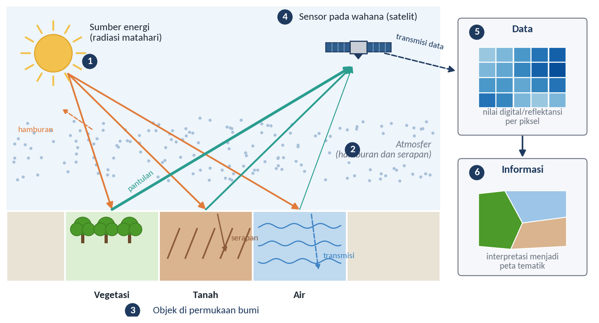
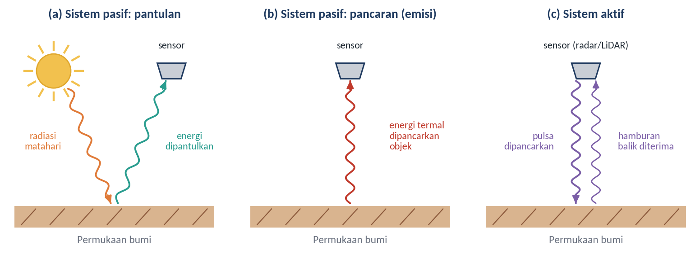
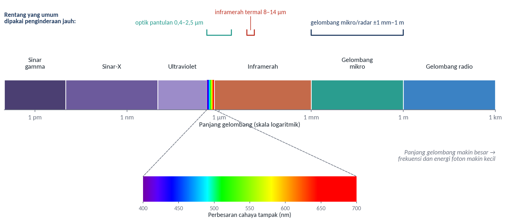
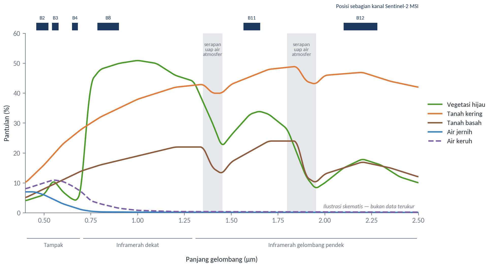
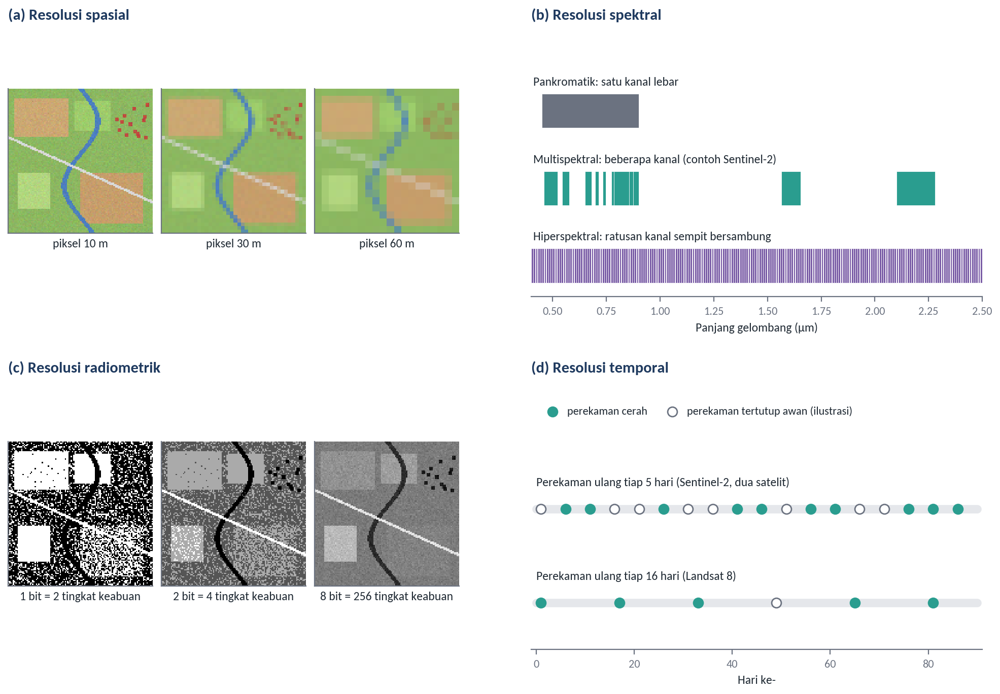
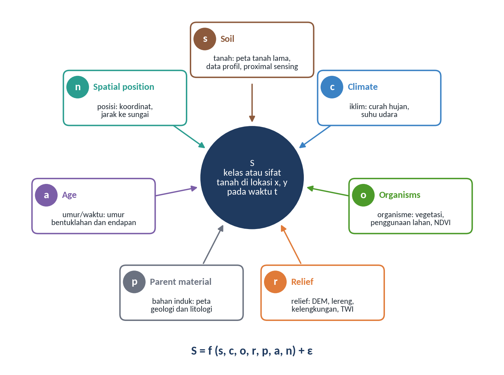
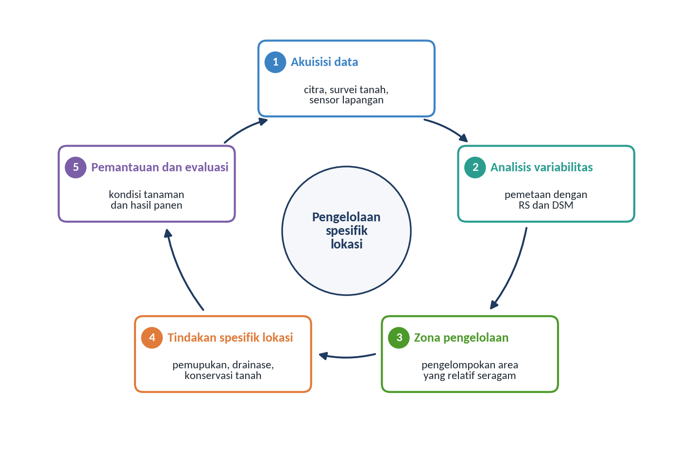
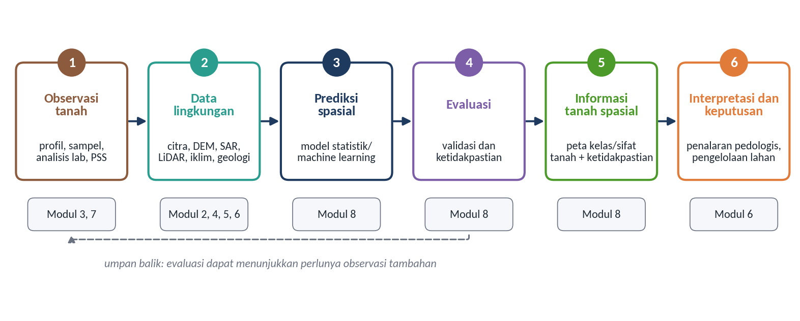
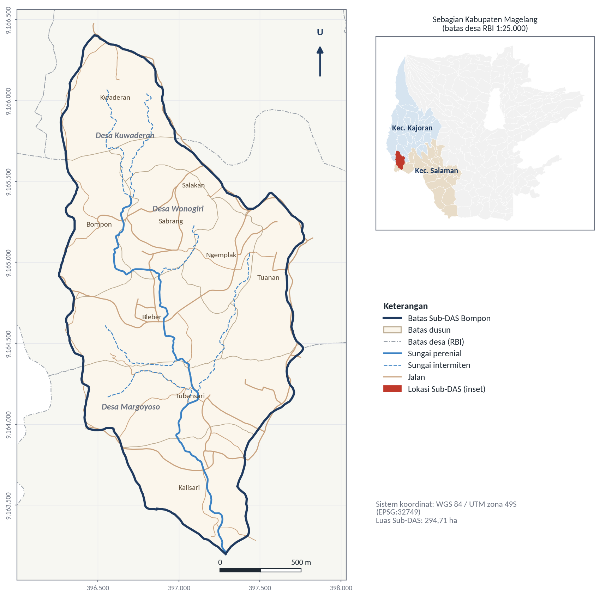

# Dasar-dasar Remote Sensing dan Digital Soil Mapping

## Tujuan dan Capaian Pembelajaran

Modul ini bertujuan membekali peserta dengan pemahaman mengenai konsep dasar pembentukan tanah, *remote sensing*, dan *Digital Soil Mapping* berbasis konsep SCORPAN untuk mendukung pertanian presisi, termasuk dalam pengelolaan perkebunan kelapa sawit. Pemahaman tersebut menjadi landasan bagi modul-modul berikutnya, yang secara bertahap membahas sumber data, delineasi satuan peta tanah, ekstraksi informasi tanah dari citra, interpretasi pedologis, *proximal soil sensing*, hingga pemodelan *Digital Soil Mapping*.

Setelah mempelajari modul ini, peserta diharapkan mampu:

1. menjelaskan komponen sistem penginderaan jauh dan bentuk interaksi energi elektromagnetik dengan objek di permukaan bumi;
2. membedakan empat jenis resolusi citra serta implikasinya terhadap pemilihan data;
3. menjelaskan perbedaan pemetaan tanah konvensional dan pemetaan tanah digital, termasuk dasar konsep SCORPAN;
4. menguraikan peran penginderaan jauh dan *Digital Soil Mapping* dalam pertanian presisi; dan
5. menjelaskan tahapan alur kerja *Digital Soil Mapping* serta kedudukan studi kasus Sub-DAS Bompon dalam rangkaian modul pelatihan.

*Ceramah dan diskusi:*

## Pengenalan Remote Sensing

*Remote sensing* atau penginderaan jauh merupakan ilmu dan seni untuk memperoleh informasi mengenai suatu objek, daerah, atau gejala melalui analisis data yang diperoleh dengan menggunakan alat tanpa kontak langsung dengan objek, daerah, atau gejala yang dikaji (Lillesand & Kiefer, 1990). Informasi tersebut diperoleh menggunakan alat pengindera atau sensor yang ditempatkan pada suatu wahana, seperti balon udara, pesawat terbang, pesawat ulang-alik, maupun satelit (Sutanto, 1994). Sutanto (1994) menjelaskan bahwa penginderaan jauh merupakan teknik untuk memperoleh dan menganalisis informasi mengenai permukaan bumi berdasarkan energi elektromagnetik yang dipantulkan atau dipancarkan oleh suatu objek. Kedua definisi tersebut menegaskan bahwa yang direkam oleh sensor bukanlah objek itu sendiri, melainkan energi yang telah berinteraksi dengan objek. Oleh karena itu, kemampuan menafsirkan data penginderaan jauh bergantung pada pemahaman tentang cara energi dipantulkan, diserap, diteruskan, atau dipancarkan oleh setiap objek.

Proses penginderaan jauh melibatkan empat komponen utama yang saling berkaitan, yaitu sumber energi, atmosfer, objek, dan sensor, dengan rincian sebagai berikut:

1. **Sumber energi**, radiasi elektromagnetik dalam penginderaan jauh berasal dari sumber alami, seperti matahari dan pancaran termal objek itu sendiri, atau dari sumber buatan yang dibangkitkan oleh sensor. Perbedaan sumber energi inilah yang membedakan sistem penginderaan jauh pasif dan aktif.
2. **Atmosfer**, atmosfer menjadi medium perambatan energi elektromagnetik yang dapat menyerap dan menghamburkan energi, sehingga memengaruhi jumlah dan kualitas energi yang diterima sensor.
3. **Objek**, objek penginderaan jauh meliputi berbagai kenampakan di permukaan bumi, seperti tanah, air, vegetasi, dan objek hasil aktivitas manusia. Setiap objek berinteraksi dengan energi secara berbeda sesuai dengan sifat fisik dan kimianya.
4. **Sensor**, sensor merupakan perangkat yang merekam energi elektromagnetik dari objek di permukaan bumi dan mengubahnya menjadi data yang dapat diolah menjadi informasi.

Berdasarkan komponen tersebut, energi elektromagnetik merambat dari sumbernya melalui atmosfer, berinteraksi dengan objek di permukaan bumi melalui proses pemantulan, penyerapan, atau transmisi, kemudian sebagian energi yang kembali ke arah sensor direkam sebagai data. Data tersebut tersimpan sebagai nilai digital atau nilai reflektansi pada setiap piksel, lalu diolah dan diinterpretasikan untuk menghasilkan informasi tematik mengenai karakteristik objek atau fenomena di permukaan bumi. Rangkaian proses tersebut ditunjukkan pada Gambar 1.1.

Gambar 1.1 Diagram alur proses penginderaan jauh

Sumber: Diagram konseptual disusun berdasarkan Lillesand dan Kiefer (1990) dan Sutanto (1994)

Berdasarkan sumber energinya, sistem penginderaan jauh dibedakan menjadi sistem pasif dan sistem aktif. Sistem pasif merekam energi yang tersedia secara alami, baik pantulan radiasi matahari maupun energi termal yang dipancarkan oleh objek, sedangkan sistem aktif membangkitkan dan memancarkan energinya sendiri, lalu merekam energi yang dihamburkan kembali oleh objek (Lillesand et al., 2015). Contoh sensor pasif antara lain Sentinel-2 MSI, Landsat 8 OLI, dan MODIS, sedangkan contoh sensor aktif antara lain radar apertur sintetis (*Synthetic Aperture Radar*, SAR) pada Sentinel-1 dan ALOS PALSAR serta LiDAR. Karena tidak bergantung pada cahaya matahari, sistem aktif dapat merekam pada malam hari, dan radar gelombang mikro mampu menembus awan. Keunggulan ini penting bagi wilayah tropis yang sering tertutup awan seperti Indonesia, dan akan dibahas lebih lanjut dalam Modul 2. Perbedaan mekanisme perekaman pada kedua sistem tersebut diilustrasikan pada Gambar 1.2.

Gambar 1.2 Mekanisme perekaman energi pada sistem penginderaan jauh pasif dan aktif

Sumber: Digambar ulang dengan modifikasi dari Syah (2010)

Energi elektromagnetik yang mengenai suatu objek di permukaan bumi dapat mengalami tiga bentuk interaksi, yaitu dipantulkan, diserap, atau diteruskan (ditransmisikan) (Danoedoro, 2012). Dengan menerapkan hukum kekekalan energi, hubungan ketiga bentuk interaksi tersebut pada panjang gelombang tertentu (λ) dapat dinyatakan sebagai berikut:

E~I~(λ) = E~R~(λ) + E~A~(λ) + E~T~(λ)

dengan:

E~I~ = energi yang mengenai objek

E~R~ = energi yang dipantulkan

E~A~ = energi yang diserap

E~T~ = energi yang ditransmisikan

Proporsi ketiga komponen tersebut berbeda untuk setiap objek dan setiap panjang gelombang. Pada sistem pasif yang bekerja di wilayah optik, komponen yang paling menentukan adalah energi yang dipantulkan, sehingga karakter suatu objek umumnya dinyatakan sebagai reflektansi, yaitu nisbah antara energi yang dipantulkan dan energi yang datang pada panjang gelombang tertentu (Lillesand et al., 2015). Variasi reflektansi menurut panjang gelombang inilah yang dikenal sebagai pola respons spektral atau tanda spektral (*spectral signature*) suatu objek.

Susunan seluruh gelombang elektromagnetik berdasarkan panjang gelombangnya disebut spektrum elektromagnetik (Gambar 1.3). Spektrum ini membentang dari sinar gamma dan sinar-X yang berpanjang gelombang sangat pendek hingga gelombang mikro dan gelombang radio yang berpanjang gelombang panjang; makin panjang gelombangnya, makin rendah frekuensi dan energi fotonnya. Tidak seluruh bagian spektrum dapat dimanfaatkan untuk mengindera permukaan bumi, karena atmosfer menyerap energi secara kuat pada panjang gelombang tertentu. Bagian spektrum yang relatif dapat ditembus oleh energi disebut jendela atmosfer, dan pada bagian inilah sensor penginderaan jauh dirancang untuk bekerja, terutama pada wilayah optik pantulan (sekitar 0,4–2,5 µm), inframerah termal (sekitar 8–14 µm), dan gelombang mikro (Lillesand et al., 2015).

Gambar 1.3 Spektrum gelombang elektromagnetik dan rentang yang umum digunakan dalam penginderaan jauh

Sumber: Digambar ulang dengan modifikasi dari Lillesand et al. (2015)

Setiap objek memiliki struktur dan komposisi yang berbeda, baik pada skala mikro maupun makro, sehingga menghasilkan pola respons yang berbeda terhadap gelombang elektromagnetik pada setiap panjang gelombang. Perbedaan respons tersebut menjadi dasar dalam membedakan objek melalui penginderaan jauh. Gambar 1.4 menyajikan ilustrasi skematis pola pantulan spektral beberapa objek utama, yang dapat dijelaskan sebagai berikut (Lillesand et al., 2015):

1. **Vegetasi hijau (garis hijau)** memiliki pantulan rendah pada wilayah cahaya tampak, terutama pada kanal merah karena penyerapan oleh klorofil, dengan puncak kecil pada kanal hijau. Pantulan meningkat tajam pada inframerah dekat (*near infrared*, NIR) mulai sekitar 0,7 µm akibat hamburan oleh struktur internal daun, kemudian menurun di sekitar 1,4 dan 1,9 µm karena penyerapan oleh air di dalam jaringan daun.
2. **Tanah kering (garis oranye)** menunjukkan pantulan yang relatif tinggi dan meningkat secara bertahap dari wilayah tampak menuju inframerah dekat dan inframerah gelombang pendek, tanpa lonjakan tajam seperti pada vegetasi.
3. **Tanah basah (garis cokelat)** memiliki pola yang serupa dengan tanah kering, tetapi dengan pantulan lebih rendah pada seluruh panjang gelombang karena air di dalam pori tanah menyerap energi, terutama di sekitar pita serapan air.
4. **Air jernih (garis biru)** memiliki pantulan rendah pada wilayah tampak dan hampir tidak memantulkan energi pada inframerah dekat dan inframerah gelombang pendek, karena energi pada wilayah tersebut diserap kuat oleh air.
5. **Air keruh (garis ungu putus-putus)** menunjukkan pantulan sedikit lebih tinggi daripada air jernih pada wilayah tampak hingga awal inframerah dekat karena adanya material tersuspensi di dalam air.

Gambar 1.4 Ilustrasi pola respons spektral beberapa objek

Sumber: Ilustrasi skematis disusun berdasarkan pola umum dalam Lillesand et al. (2015); posisi kanal Sentinel-2 mengacu pada Drusch et al. (2012)

Bagi pemetaan tanah, pola pantulan tanah menjadi perhatian utama. Pantulan permukaan tanah dipengaruhi antara lain oleh kandungan air, bahan organik, oksida besi, tekstur, dan kekasaran permukaan, sehingga informasi spektral dapat dimanfaatkan sebagai petunjuk tidak langsung terhadap sifat tanah (Mulder et al., 2011). Namun, sensor optik hanya merekam lapisan permukaan yang sangat tipis, dan sinyal tanah akan tertutup apabila permukaan bervegetasi. Kedua keterbatasan ini menjelaskan mengapa estimasi sifat tanah dari citra (Modul 4) dan deteksi tanah terbuka (Modul 5) perlu dibahas secara khusus, sekaligus mengapa penginderaan jauh dalam *Digital Soil Mapping* lebih sering berperan sebagai sumber variabel lingkungan daripada sebagai pengukur langsung sifat tanah.

Kemampuan sensor penginderaan jauh dalam merekam dan membedakan informasi objek secara rinci ditentukan oleh empat jenis resolusi, yaitu resolusi spasial, spektral, radiometrik, dan temporal. Rincian keempat jenis resolusi tersebut disajikan pada Tabel 1.1 dan diilustrasikan pada Gambar 1.5.

Tabel 1.1 Resolusi Citra Satelit

| **Resolusi** | **Keterangan** | **Contoh** |
| :--- | :--- | :--- |
| Spasial | Ukuran objek terkecil yang masih dapat dideteksi oleh sistem pencitraan, umumnya dinyatakan sebagai ukuran piksel di permukaan bumi | Sentinel-2 MSI: 10, 20, dan 60 m; Landsat 8 OLI: 30 m |
| Spektral | Kemampuan sistem untuk membedakan informasi objek berdasarkan pantulan atau pancaran spektralnya, ditentukan oleh jumlah, posisi, dan lebar kanal | Sentinel-2 MSI: 13 kanal dari cahaya tampak hingga inframerah gelombang pendek |
| Radiometrik | Kemampuan sensor dalam membedakan perbedaan kecil intensitas energi yang direkam, dinyatakan dalam jumlah bit | Sentinel-2 MSI dan Landsat 8 OLI: 12 bit (4.096 tingkat) |
| Temporal | Kemampuan sistem satelit untuk merekam kembali wilayah yang sama dalam selang waktu tertentu | Sentinel-2: 5 hari (dua satelit); Landsat 8: 16 hari |

Sumber: Lillesand et al. (2015); Drusch et al. (2012); Roy et al. (2014)

Gambar 1.5 Ilustrasi empat jenis resolusi citra: (a) spasial, (b) spektral, (c) radiometrik, dan (d) temporal

Sumber: Ilustrasi konseptual; panel (a) dan (c) menggunakan bentang lahan sintetis, posisi kanal pada panel (b) dan selang perekaman pada panel (d) mengacu pada Drusch et al. (2012) dan Roy et al. (2014)

Keempat jenis resolusi tersebut saling berkaitan dan sering kali harus dipertukarkan. Sensor dengan resolusi spasial sangat tinggi umumnya memiliki cakupan sapuan yang lebih sempit dan jumlah kanal yang lebih sedikit, sedangkan sensor dengan resolusi temporal tinggi cenderung memiliki resolusi spasial yang lebih kasar (Lillesand et al., 2015). Pemilihan data karenanya harus berangkat dari ukuran objek dan luas wilayah yang dikaji. Sebagai gambaran, wilayah studi kasus Sub-DAS Bompon seluas sekitar 295 ha hanya terwakili oleh sekitar 29.500 piksel Sentinel-2 berukuran 10 m atau sekitar 3.300 piksel Landsat berukuran 30 m, sehingga variasi lahan yang berukuran puluhan meter hanya dapat ditangkap dengan baik oleh data beresolusi lebih tinggi. Di wilayah tropis, resolusi temporal nominal juga tidak selalu berarti ketersediaan citra yang dapat digunakan, karena sebagian perekaman tertutup awan, sebagaimana diilustrasikan pada panel (d) Gambar 1.5.

## Pemetaan Tanah Konvensional dan Pemetaan Tanah Digital

Pemahaman mengenai pola sifat tanah sangat penting dalam pertanian untuk meningkatkan produktivitas dan mendukung pengelolaan lahan yang berkelanjutan (Hosseinpour-Zarnaq et al., 2025). Tanah terbentuk melalui interaksi berbagai faktor pembentuk tanah. Jenny (1941) merumuskan bahwa sifat tanah merupakan fungsi dari iklim, organisme, relief, bahan induk, dan waktu, yang dikenal sebagai persamaan *clorpt*. Karena faktor-faktor tersebut berbeda dari satu tempat ke tempat lain, tanah pun bervariasi secara spasial, dan pola variasinya dapat dipahami melalui peta tanah. Pemetaan tanah merupakan kegiatan untuk memperoleh informasi mengenai jenis, sifat, dan sebaran tanah pada suatu wilayah. Pemetaan tanah dapat dilakukan melalui pendekatan konvensional maupun digital, yang berbeda dalam cara pengumpulan data, analisis, dan penyajian informasi spasialnya.

Pemetaan tanah konvensional mengandalkan survei lapangan yang meliputi pengamatan profil tanah, pengambilan sampel, analisis laboratorium, interpretasi lanskap, dan delineasi satuan tanah. Dalam proses tersebut, surveyor tanah membangun pemahaman mengenai hubungan antara tanah dan lanskap, misalnya bahwa tanah pada lereng atas cenderung lebih tipis daripada tanah pada lereng kaki, kemudian menggunakan pemahaman tersebut untuk menarik batas satuan peta dari foto udara dan pengamatan lapangan. Hudson (1992) menyebut kerangka kerja ini sebagai paradigma tanah–lanskap (*soil–landscape paradigm*) dan menunjukkan bahwa sebagian besar pengetahuan yang digunakan bersifat tersirat (*tacit*), sehingga sulit didokumentasikan dan direproduksi oleh orang lain. Hasil akhirnya berupa peta poligon yang setiap satuannya diwakili oleh satu atau beberapa kelas tanah. Pendekatan ini memberikan informasi langsung mengenai karakteristik tanah, tetapi membutuhkan waktu dan biaya yang relatif besar, terutama pada wilayah yang luas, serta umumnya tidak menyertakan ukuran ketidakpastian yang eksplisit pada setiap lokasi (McBratney et al., 2003; Minasny & McBratney, 2016).

*Digital Soil Mapping* (DSM) atau pemetaan tanah digital dikembangkan untuk mengatasi keterbatasan tersebut. Lagacherie dan McBratney (2006) mendefinisikan DSM sebagai pembuatan dan pengisian sistem informasi tanah spasial dengan model numerik yang menduga variasi spasial dan temporal jenis serta sifat tanah berdasarkan observasi tanah, pengetahuan, dan variabel lingkungan yang berkaitan. Dalam DSM, pemahaman surveyor mengenai hubungan tanah dan lanskap dinyatakan secara eksplisit dalam bentuk model kuantitatif, sehingga prosesnya dapat diulang, diperbarui ketika data baru tersedia, dan dievaluasi ketelitiannya (Minasny & McBratney, 2016). Ketersediaan data penginderaan jauh, model elevasi digital, dan kemampuan komputasi yang terus meningkat menjadi pendorong utama perkembangan pendekatan ini.

Pendekatan kuantitatif dalam pemetaan tanah berkembang melalui berbagai metode geostatistik, seperti *trend surfaces*, *kriging*, dan *co-kriging*, yang memanfaatkan keterkaitan spasial antartitik pengamatan. Selanjutnya, konsep faktor pembentuk tanah dari Jenny dikembangkan menjadi fungsi prediksi spasial tanah melalui hubungan kuantitatif empiris antara sifat tanah dan faktor lingkungannya. McBratney et al. (2003) merumuskan pendekatan tersebut sebagai model SCORPAN:

S = f(s, c, o, r, p, a, n) + ε

dengan S adalah kelas atau sifat tanah pada lokasi dan waktu tertentu, sedangkan tujuh faktor penjelasnya adalah *soil* (s), yaitu informasi tanah lain di lokasi tersebut; *climate* (c), yaitu iklim; *organisms* (o), yaitu vegetasi, fauna, dan aktivitas manusia; *relief* (r), yaitu topografi; *parent material* (p), yaitu bahan induk; *age* (a), yaitu umur atau faktor waktu; dan *spatial position* (n), yaitu posisi spasial. Komponen ε menyatakan galat, yaitu bagian variasi tanah yang tidak dapat dijelaskan oleh faktor-faktor tersebut. Berbeda dengan persamaan Jenny yang bertujuan menjelaskan pembentukan tanah, model SCORPAN bersifat empiris dan ditujukan untuk prediksi spasial (McBratney et al., 2003).

Faktor-faktor SCORPAN jarang dapat diukur secara langsung di seluruh wilayah, sehingga dalam praktik setiap faktor diwakili oleh variabel pendekatan (*proxy*) atau kovariat yang tersedia secara menyeluruh. Di sinilah penginderaan jauh dan data turunannya berperan. Indeks vegetasi dan peta penggunaan lahan mewakili faktor organisme, model elevasi digital beserta turunannya, seperti kemiringan lereng, kelengkungan lereng, dan indeks kebasahan topografi, mewakili faktor relief, sedangkan data iklim, peta geologi, dan informasi tanah yang telah ada mewakili faktor lainnya (McBratney et al., 2003; Mulder et al., 2011). Hubungan ketujuh faktor tersebut dengan tanah yang diprediksi ditunjukkan pada Gambar 1.6. Pemilihan kovariat yang sesuai dengan sifat tanah sasaran akan dibahas secara khusus dalam Modul 8.

Gambar 1.6 Diagram konsep SCORPAN dan contoh sumber data untuk setiap faktor

Sumber: Diagram konseptual disusun berdasarkan McBratney et al. (2003)

Perbedaan antara kedua pendekatan pemetaan tanah tersebut dirangkum pada Tabel 1.2. Perbandingan ini tidak dimaksudkan untuk menyatakan bahwa salah satu pendekatan lebih unggul dalam segala hal, melainkan untuk menunjukkan perbedaan cara keduanya memperoleh dan menyajikan informasi tanah.

Tabel 1.2 Perbandingan Pemetaan Tanah Konvensional dan Pemetaan Tanah Digital

| **Aspek** | **Pemetaan tanah konvensional** | **Pemetaan tanah digital (DSM)** |
| :--- | :--- | :--- |
| Dasar penarikan batas atau prediksi | Pemahaman surveyor tentang hubungan tanah dan lanskap | Model kuantitatif hubungan tanah dengan kovariat lingkungan (SCORPAN) |
| Data utama | Pengamatan profil, sampel tanah, foto udara, peta topografi | Observasi tanah ditambah kovariat dari penginderaan jauh, DEM, iklim, dan geologi |
| Bentuk keluaran | Peta poligon satuan peta tanah | Peta raster kelas atau sifat tanah, umumnya disertai peta ketidakpastian |
| Ketidakpastian | Umumnya dinyatakan secara kualitatif, misalnya tingkat kemurnian satuan peta | Dapat dihitung secara kuantitatif untuk setiap lokasi |
| Pemutakhiran | Memerlukan survei ulang | Model dapat dijalankan ulang ketika data baru tersedia |
| Keterbatasan utama | Waktu, biaya, dan ketergantungan pada keahlian individu | Ketergantungan pada jumlah dan mutu observasi serta relevansi kovariat |

Sumber: Disarikan dari Hudson (1992), McBratney et al. (2003), dan Minasny dan McBratney (2016)

Meskipun menawarkan banyak keunggulan, DSM tidak menggantikan peran survei lapangan dan pengetahuan pedologi. Kualitas peta yang dihasilkan sangat bergantung pada jumlah, sebaran, dan mutu titik observasi tanah yang digunakan untuk membangun dan menguji model, serta pada sejauh mana kovariat benar-benar mewakili proses pembentukan tanah di wilayah kajian (Minasny & McBratney, 2016; Wadoux et al., 2020). Model statistik dan *machine learning* dapat menangkap hubungan empiris yang kuat, tetapi hubungan tersebut tidak selalu bermakna secara pedologis, sehingga hasilnya tetap perlu ditafsirkan dengan penalaran pedologis sebagaimana akan dibahas dalam Modul 6. Keterbatasan tersebut juga terlihat di wilayah studi kasus modul ini. Fatmawati (2026) memprediksi fraksi tekstur tanah di Sub-DAS Bompon menggunakan 22 kovariat berbasis SCORPAN dan beberapa algoritma *machine learning*, tetapi nilai koefisien determinasi (R²) tertinggi yang diperoleh hanya 0,249. Rendahnya kemampuan prediksi tersebut dikaitkan dengan dominasi lempung dan rendahnya variasi tekstur pada bahan induk teralterasi, sehingga hubungan antara fraksi tekstur dan kovariat lingkungan sulit dikenali oleh model. Dengan demikian, pemetaan tanah konvensional dan digital lebih tepat dipandang sebagai dua pendekatan yang saling melengkapi.

## Peran Remote Sensing dan Digital Soil Mapping dalam Pertanian Presisi

Pertanian presisi, yang sering disebut juga sebagai pengelolaan tanaman spesifik lokasi, merupakan penerapan teknologi dan prinsip untuk mengelola variabilitas spasial dan temporal yang berkaitan dengan berbagai aspek produksi pertanian. Pertanian presisi didefinisikan sebagai suatu sistem yang mengintegrasikan informasi dengan produksi tanaman untuk meningkatkan efisiensi, produktivitas, dan profitabilitas produksi pertanian dalam jangka panjang secara spesifik lokasi, sekaligus meminimalkan dampak yang tidak diinginkan terhadap ekosistem (Elsharkawy et al., 2022; Mukhamedova et al., 2022).

Penggunaan *remote sensing* memiliki potensi penting dalam mendukung penerapan pertanian presisi (Briliyanti et al., 2025). Penginderaan jauh yang terintegrasi dengan sistem penentuan posisi global (*Global Positioning System*, GPS), Sistem Informasi Geografis (SIG), dan teknologi pendukung lainnya memungkinkan perolehan dan pengolahan informasi spasial untuk pengelolaan lahan secara spesifik lokasi (Weiss et al., 2020). Integrasi berbagai teknologi tersebut melahirkan beragam aplikasi, termasuk pemetaan tanah dan pemantauan pertumbuhan tanaman (Martos et al., 2021; Segarra et al., 2020). Seelan et al. (2003), misalnya, menunjukkan bahwa citra Landsat dapat memperlihatkan bagian lahan yang mengalami serangan hama ulat (*armyworm*) lebih berat, dan bagian tersebut bersesuaian dengan bagian berhasil panen terendah pada peta estimasi hasil panen. Contoh ini memperlihatkan bahwa informasi penginderaan jauh bernilai ketika dapat dikaitkan dengan keputusan pengelolaan di lapangan.

Salah satu informasi penting dalam pengelolaan lahan secara spesifik lokasi adalah informasi mengenai sifat dan variabilitas tanah. Dalam konteks tersebut, DSM dapat digunakan untuk mengestimasi dan memetakan berbagai sifat tanah secara spasial berdasarkan data tanah dan informasi lingkungan, misalnya tekstur, kelembapan, pH, bahan organik, dan indikator kesuburan tanah. Informasi tersebut menjadi dasar penyusunan zona pengelolaan, yaitu pembagian lahan ke dalam satuan-satuan yang relatif seragam sehingga dapat diberi perlakuan yang sama (Elsharkawy et al., 2022), serta melengkapi aplikasi pertanian presisi lainnya, seperti deteksi tekanan biotik berupa serangan hama dan penyakit, tekanan abiotik seperti kekeringan dan banjir, hingga estimasi hasil pertanian (Pascucci et al., 2020; Weiss et al., 2020). Keterkaitan tahapan-tahapan tersebut dalam satu siklus pengelolaan ditunjukkan pada Gambar 1.7.

Gambar 1.7 Siklus informasi dalam pertanian presisi

Sumber: Diagram konseptual disusun berdasarkan Elsharkawy et al. (2022) dan Weiss et al. (2020)

Penerapan pertanian presisi pada perkebunan kelapa sawit didasarkan pada pemanfaatan informasi mengenai berbagai faktor yang memengaruhi produksi, seperti kondisi iklim, kondisi dan kesuburan tanah, umur tanaman, serta faktor lainnya. Selain informasi indeks tanaman yang diperoleh dari citra satelit, faktor eksternal seperti curah hujan, kesuburan tanah, serta serangan hama dan penyakit, dan faktor internal seperti jumlah tanaman, varietas, dan umur tanaman dapat diintegrasikan dengan teknologi komputerisasi untuk mendukung pengelolaan perkebunan secara spesifik lokasi (Ginting & Wiratmoko, 2021). Pada tanaman tahunan bertajuk rapat, permukaan tanah sebagian besar tertutup kanopi, sehingga informasi tanah tidak dapat direkam secara langsung oleh sensor optik (Mulder et al., 2011). Informasi tersebut perlu diperoleh secara tidak langsung melalui kovariat lingkungan, melalui pengamatan pada area yang terbuka, atau melalui pengukuran di lapangan. Keterbatasan inilah yang melatarbelakangi pembahasan *bare soil detection* dalam Modul 5 dan *proximal soil sensing* dalam Modul 7.

## Alur Kerja Digital Soil Mapping

Penerapan DSM mengikuti alur kerja yang relatif baku, meskipun rincian metodenya dapat berbeda sesuai dengan tujuan, skala, dan ketersediaan data. Secara umum, alur kerja tersebut terdiri atas enam tahapan yang saling berurutan dan dapat diulang (Malone et al., 2017; Minasny & McBratney, 2016), yaitu:

1. **Observasi tanah**, pengumpulan data tanah di lapangan melalui pengamatan profil, pengambilan sampel, analisis laboratorium, maupun pengukuran cepat dengan *proximal soil sensing*. Lokasi observasi idealnya dirancang agar mewakili keragaman lanskap, misalnya dengan stratifikasi berdasarkan satuan lahan.
2. **Penyiapan data lingkungan**, pengumpulan dan penyelarasan kovariat yang mewakili faktor SCORPAN, seperti citra optik dan SAR, DEM beserta turunannya, data iklim, dan peta geologi.
3. **Prediksi spasial**, pembangunan model yang menghubungkan data observasi dengan kovariat, baik model statistik maupun *machine learning*, kemudian penerapan model tersebut ke seluruh wilayah kajian.
4. **Evaluasi**, pengujian ketelitian model dengan data yang tidak digunakan saat pembangunan model serta penghitungan ketidakpastian prediksi.
5. **Informasi tanah spasial**, penyajian hasil berupa peta kelas atau sifat tanah beserta peta ketidakpastiannya.
6. **Interpretasi dan dukungan keputusan**, penafsiran hasil berdasarkan penalaran pedologis dan penerjemahannya menjadi rekomendasi pengelolaan lahan.

Tahapan tersebut tidak selalu berjalan satu arah. Hasil evaluasi dapat menunjukkan bahwa bagian tertentu wilayah kajian belum terwakili oleh observasi, sehingga diperlukan pengamatan tambahan sebelum model diperbaiki. Gambar 1.8 juga memperlihatkan keterkaitan setiap tahapan dengan modul-modul dalam pelatihan ini: penyiapan data multisumber dibahas dalam Modul 2, delineasi satuan peta tanah yang dapat menjadi dasar stratifikasi observasi dibahas dalam Modul 3, ekstraksi informasi tanah dari citra dibahas dalam Modul 4 dan 5, interpretasi pedologis dalam Modul 6, *proximal soil sensing* dalam Modul 7, serta pemodelan dan evaluasinya dalam Modul 8.

Gambar 1.8 Alur kerja *Digital Soil Mapping* dan keterkaitannya dengan modul pelatihan

Sumber: Diagram konseptual disusun berdasarkan Malone et al. (2017) dan Minasny dan McBratney (2016)

Untuk menjembatani konsep dan praktik, rangkaian modul ini menggunakan studi kasus serial Sub-DAS Bompon, Kabupaten Magelang, Jawa Tengah (Gambar 1.9). Sub-DAS Bompon terletak di bagian selatan Kabupaten Magelang pada lereng selatan Gunung Sumbing dan merupakan bagian dari DAS Bogowonto, dengan luas sekitar 294,7 ha (Sambodo, 2021). Berdasarkan tumpang susun batas Sub-DAS dengan batas desa Rupabumi Indonesia (RBI) skala 1:25.000, wilayah ini mencakup sebagian Desa Wonogiri dan Desa Kwaderan (dalam data RBI tertulis Kuwaderan) di Kecamatan Kajoran serta Desa Margoyoso di Kecamatan Salaman (Fatmawati, 2026), dengan sembilan dusun di dalamnya.

Gambar 1.9 Peta lokasi Sub-DAS Bompon, Kabupaten Magelang

Sumber: Diolah dari data spasial Sub-DAS Bompon (data proyek) dan batas desa RBI 1:25.000 (Badan Informasi Geospasial, t.t.)

Sub-DAS Bompon dipilih karena kondisi lanskapnya yang kompleks dan karena wilayah ini telah menjadi lokasi berbagai penelitian tanah dan geomorfologi (Prayitno et al., 2019; Sambodo, 2021; Wida et al., 2019). Wilayah ini berada pada zona transisi antara bentang vulkanik Kuarter Gunung Sumbing dan Pegunungan Kulon Progo yang berumur Tersier (Sambodo, 2021). Zona transisi vulkanik semacam ini dicirikan oleh tanah yang tebal, kandungan lempung yang tinggi, kandungan hara yang rendah, erosi yang tinggi, dan kerentanan terhadap longsor (Prayitno et al., 2019). Tanah di wilayah ini berkembang dari pelapukan abu vulkanik Gunung Sumbing, sedangkan material lapuk di bawahnya merupakan hasil alterasi hidrotermal batuan Tersier (Sambodo, 2021). Wida et al. (2019) melaporkan kandungan lempung tanah residual di wilayah ini yang melebihi 50% dan menyimpulkan bahwa lapisan tanah lempung tersebut menjadi faktor pengendali gerakan tanah. Dominasi fraksi lempung juga ditemukan oleh Fatmawati (2026) pada kedua lapisan tanah yang diamati, dengan kandungan lempung lapisan 0–20 cm berkisar antara 39,40% dan 80,92%. Penggunaan lahannya didominasi kebun campuran atau agroforestri dengan tajuk berlapis, diikuti sawah, permukiman, dan tegalan (Sambodo, 2021). Kombinasi lereng perbukitan, endapan koluvial di lembah, dan tutupan vegetasi yang rapat menjadikan Sub-DAS Bompon contoh yang representatif untuk membahas peluang sekaligus keterbatasan penginderaan jauh dalam pemetaan tanah.

Data spasial yang tersedia untuk studi kasus ini meliputi batas Sub-DAS dan dusun, peta bentuklahan, kelas kemiringan lereng, penggunaan lahan, sebaran longsor, jaringan sungai dan jalan, serta lokasi 50 titik sampel tanah. Titik-titik sampel tersebut dirancang secara acak berstrata (*stratified random sampling*) berdasarkan satuan pemetaan yang tersusun dari bentuklahan, penggunaan lahan, dan kemiringan lereng, kemudian diambil pada kedalaman 0–20 cm dan 20–40 cm (Fatmawati, 2026). Data tersebut akan digunakan secara bertahap, mulai dari contoh data multisumber pada Modul 2, dasar delineasi satuan peta tanah pada Modul 3, hingga kerangka penyusunan dataset pemodelan pada Modul 8. Hasil analisis laboratorium dari sampel-sampel tersebut telah dilaporkan oleh Fatmawati (2026) dalam bentuk ringkasan statistik dan hasil pemodelan, tetapi data per titiknya tidak termasuk dalam paket data modul ini. Oleh karena itu, nilai sifat tanah yang dikutip dalam modul-modul berikutnya akan selalu merujuk pada publikasi tersebut, sedangkan uraian lain yang memerlukan nilai sifat tanah akan dinyatakan secara eksplisit sebagai ilustrasi konseptual.

## Rangkuman

Penginderaan jauh merupakan cara memperoleh informasi mengenai objek di permukaan bumi tanpa kontak langsung, dengan merekam energi elektromagnetik yang telah berinteraksi dengan objek tersebut. Prosesnya melibatkan sumber energi, atmosfer, objek, dan sensor, serta dibedakan menjadi sistem pasif yang memanfaatkan energi alami dan sistem aktif yang membangkitkan energinya sendiri. Setiap objek memiliki pola respons spektral yang khas, dan perbedaan pola inilah yang menjadi dasar identifikasi objek. Kemampuan sensor dalam merekam informasi ditentukan oleh resolusi spasial, spektral, radiometrik, dan temporal, yang saling berkaitan dan perlu dipilih sesuai dengan ukuran objek serta luas wilayah kajian.

Tanah bervariasi secara spasial karena faktor pembentuknya bervariasi. Pemetaan tanah konvensional menangkap variasi tersebut melalui survei lapangan dan pemahaman surveyor tentang hubungan tanah dan lanskap, sedangkan *Digital Soil Mapping* menyatakan hubungan tersebut secara eksplisit dalam model kuantitatif berbasis konsep SCORPAN. Dalam kerangka tersebut, penginderaan jauh dan data turunannya terutama berperan sebagai kovariat yang mewakili faktor-faktor pembentuk tanah. Kedua pendekatan pemetaan saling melengkapi, dan kualitas DSM tetap bergantung pada mutu observasi tanah serta penalaran pedologis.

Informasi tanah spasial yang dihasilkan melalui penginderaan jauh dan DSM menjadi bagian dari siklus pertanian presisi, mulai dari akuisisi data, analisis variabilitas, penyusunan zona pengelolaan, tindakan spesifik lokasi, hingga pemantauan. Alur kerja DSM, yang mencakup observasi tanah, penyiapan data lingkungan, prediksi spasial, evaluasi, penyajian informasi, dan interpretasi, menjadi kerangka yang menghubungkan seluruh modul pelatihan ini. Alur kerja tersebut akan diterapkan secara bertahap pada studi kasus Sub-DAS Bompon, sebuah sub-DAS di zona transisi vulkanik dengan tanah yang tebal dan kaya lempung, lereng perbukitan yang rentan longsor, dan tutupan agroforestri yang rapat. Modul 2 selanjutnya membahas berbagai sumber data yang menjadi bahan baku alur kerja tersebut.

## Daftar Pustaka

Badan Informasi Geospasial. (t.t.). *Peta Rupabumi Indonesia skala 1:25.000: Batas administrasi desa* [Data vektor].

Briliyanti, R. D., Maulana, I., Jannah, E. M., & Purboseno, S. (2025). The effectiveness of drones in improving efficiency and accuracy of oil palm plantation management in Indonesia: A literature review. *ARRUS Journal of Engineering and Technology*, *5*(1), 142–149. https://doi.org/10.35877/jetech4033

Danoedoro, P. (2012). *Pengantar penginderaan jauh digital*. Andi.

Drusch, M., Del Bello, U., Carlier, S., Colin, O., Fernandez, V., Gascon, F., Hoersch, B., Isola, C., Laberinti, P., Martimort, P., Meygret, A., Spoto, F., Sy, O., Marchese, F., & Bargellini, P. (2012). Sentinel-2: ESA's optical high-resolution mission for GMES operational services. *Remote Sensing of Environment*, *120*, 25–36. https://doi.org/10.1016/j.rse.2011.11.026

Elsharkawy, M. M., Sheta, A. E. A. S., D'Antonio, P., Abdelwahed, M. S., & Scopa, A. (2022). Tool for the establishment of agro-management zones using GIS techniques for precision farming in Egypt. *Sustainability*, *14*(9), 5437. https://doi.org/10.3390/su14095437

Fatmawati, N. D. (2026). *Evaluasi pendekatan SCORPAN dalam prediksi spasial fraksi tekstur tanah pada bahan induk hasil proses alterasi di Sub-DAS Bompon* [Tesis magister, Universitas Gadjah Mada].

Ginting, E. N., & Wiratmoko, D. (2021). Potensi dan tantangan penerapan precision farming dalam upaya membangun perkebunan kelapa sawit yang berkelanjutan. *Warta Pusat Penelitian Kelapa Sawit*, *26*(2), 55–66. https://doi.org/10.22302/iopri.war.warta.v26i2.47

Hosseinpour-Zarnaq, M., Omid, M., Sarmadian, F., Ghasemi-Mobtaker, H., Alimardani, R., & Bohlol, P. (2025). Exploring the capabilities of hyperspectral remote sensing for soil texture evaluation. *Ecological Informatics*, *90*, 103336. https://doi.org/10.1016/j.ecoinf.2025.103336

Hudson, B. D. (1992). The soil survey as paradigm-based science. *Soil Science Society of America Journal*, *56*(3), 836–841. https://doi.org/10.2136/sssaj1992.03615995005600030027x

Jenny, H. (1941). *Factors of soil formation: A system of quantitative pedology*. McGraw-Hill.

Lagacherie, P., & McBratney, A. B. (2006). Spatial soil information systems and spatial soil inference systems: Perspectives for digital soil mapping. Dalam P. Lagacherie, A. B. McBratney, & M. Voltz (Ed.), *Digital soil mapping: An introductory perspective* (Developments in Soil Science, Vol. 31, hlm. 3–22). Elsevier. https://doi.org/10.1016/S0166-2481(06)31001-X

Lillesand, T. M., & Kiefer, R. W. (1990). *Penginderaan jauh dan interpretasi citra* (Dulbahri dkk., Penerj.). Gadjah Mada University Press.

Lillesand, T. M., Kiefer, R. W., & Chipman, J. W. (2015). *Remote sensing and image interpretation* (Edisi ke-7). John Wiley & Sons.

Malone, B. P., Minasny, B., & McBratney, A. B. (2017). *Using R for digital soil mapping*. Springer. https://doi.org/10.1007/978-3-319-44327-0

Martos, V., Ahmad, A., Cartujo, P., & Ordoñez, J. (2021). Ensuring agricultural sustainability through remote sensing in the era of Agriculture 5.0. *Applied Sciences*, *11*(13), 5911. https://doi.org/10.3390/app11135911

McBratney, A. B., Mendonça Santos, M. L., & Minasny, B. (2003). On digital soil mapping. *Geoderma*, *117*(1–2), 3–52. https://doi.org/10.1016/S0016-7061(03)00223-4

Minasny, B., & McBratney, A. B. (2016). Digital soil mapping: A brief history and some lessons. *Geoderma*, *264*, 301–311. https://doi.org/10.1016/j.geoderma.2015.07.017

Mukhamedova, K. R., Cherepkova, N. P., Korotkov, A. V., Dagasheva, Z. B., & Tvaronavičienė, M. (2022). Digitalisation of agricultural production for precision farming: A case study. *Sustainability*, *14*(22), 14802. https://doi.org/10.3390/su142214802

Mulder, V. L., de Bruin, S., Schaepman, M. E., & Mayr, T. R. (2011). The use of remote sensing in soil and terrain mapping—A review. *Geoderma*, *162*(1–2), 1–19. https://doi.org/10.1016/j.geoderma.2010.12.018

Pascucci, S., Pignatti, S., Casa, R., Darvishzadeh, R., & Huang, W. (2020). Special issue "Hyperspectral remote sensing of agriculture and vegetation". *Remote Sensing*, *12*(21), 3665. https://doi.org/10.3390/rs12213665

Prayitno, A., Sartohadi, J., & Nurudin, M. (2019). Utilization of soil function information for assessing soil quality of rice field in the Quaternary-Tertiary volcanic transitional zones in Central Java. *SAINS TANAH – Journal of Soil Science and Agroclimatology*, *16*(2), 169–180. https://doi.org/10.20961/stjssa.v16i2.35492

Roy, D. P., Wulder, M. A., Loveland, T. R., Woodcock, C. E., Allen, R. G., Anderson, M. C., Helder, D., Irons, J. R., Johnson, D. M., Kennedy, R., Scambos, T. A., Schaaf, C. B., Schott, J. R., Sheng, Y., Vermote, E. F., Belward, A. S., Bindschadler, R., Cohen, W. B., Gao, F., ... Zhu, Z. (2014). Landsat-8: Science and product vision for terrestrial global change research. *Remote Sensing of Environment*, *145*, 154–172. https://doi.org/10.1016/j.rse.2014.02.001

Sambodo, A. P. (2021). *Application of landform arrangement and slope classes on detailed soil resources mapping in transitional volcanic landscape. Case study: Bompon Watershed, Magelang Regency, Central Java* [Tesis magister, Prince of Songkla University]. https://kb.psu.ac.th/psukb/bitstream/2016/17974/3/6130420006.pdf

Seelan, S. K., Laguette, S., Casady, G. M., & Seielstad, G. A. (2003). Remote sensing applications for precision agriculture: A learning community approach. *Remote Sensing of Environment*, *88*(1–2), 157–169. https://doi.org/10.1016/j.rse.2003.04.007

Segarra, J., Buchaillot, M. L., Araus, J. L., & Kefauver, S. C. (2020). Remote sensing for precision agriculture: Sentinel-2 improved features and applications. *Agronomy*, *10*(5), 641. https://doi.org/10.3390/agronomy10050641

Sutanto. (1994). *Penginderaan jauh* (Jilid 1 dan 2). Gadjah Mada University Press.

Syah, A. F. (2010). Penginderaan jauh dan aplikasinya di wilayah pesisir dan lautan. *Jurnal Kelautan*, *3*(1), 18–28.

Wadoux, A. M. J.-C., Minasny, B., & McBratney, A. B. (2020). Machine learning for digital soil mapping: Applications, challenges and suggested solutions. *Earth-Science Reviews*, *210*, 103359. https://doi.org/10.1016/j.earscirev.2020.103359

Weiss, M., Jacob, F., & Duveiller, G. (2020). Remote sensing for agricultural applications: A meta-review. *Remote Sensing of Environment*, *236*, 111402. https://doi.org/10.1016/j.rse.2019.111402

Wida, W. A., Maas, A., & Sartohadi, J. (2019). Pedogenesis of Mt. Sumbing volcanic ash above the alteration clay layer in the formation of landslide susceptible soils in Bompon Sub-Watershed. *Ilmu Pertanian (Agricultural Science)*, *4*(1), 15–22. https://doi.org/10.22146/ipas.41893
