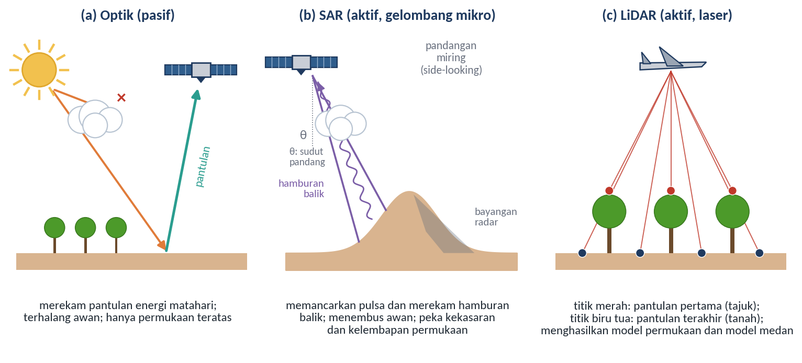
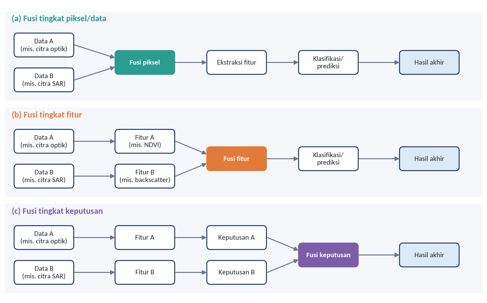
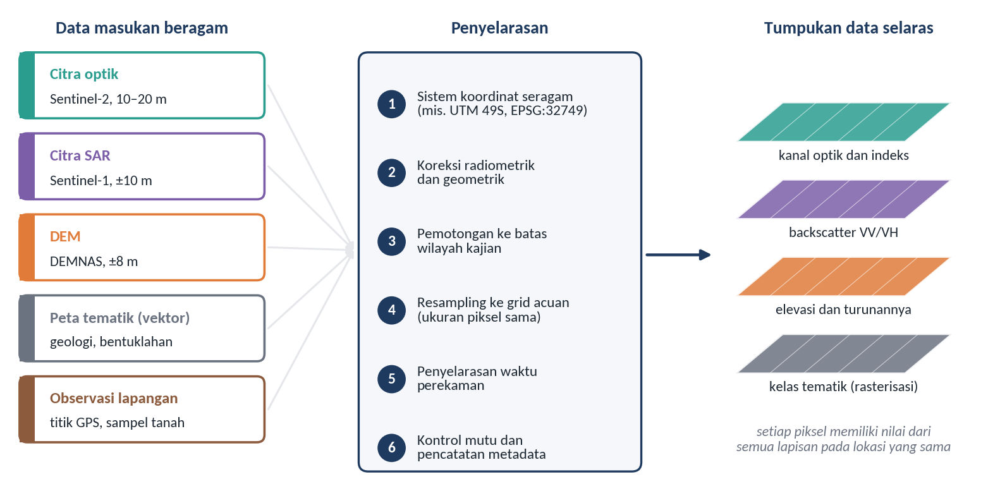
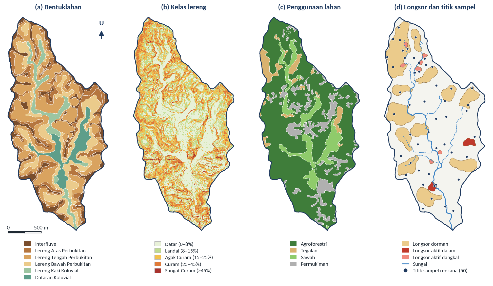

# Multi-source Data Fusion

## Tujuan dan Capaian Pembelajaran

Modul ini bertujuan membekali peserta dengan pemahaman mengenai proses akuisisi data geospasial dan integrasi berbagai sumber data geospasial, yaitu citra optik, SAR, LiDAR, DEM, dan data lingkungan, untuk meningkatkan kualitas informasi tanah. Modul ini melanjutkan konsep SCORPAN pada Modul 1 dengan membahas data yang dapat mewakili setiap faktor pembentuk tanah, sekaligus menyiapkan tumpukan data selaras yang akan digunakan dalam delineasi satuan peta tanah (Modul 3) dan pemodelan DSM (Modul 8).

Setelah mempelajari modul ini, peserta diharapkan mampu:

1. menjelaskan karakteristik, kelebihan, keterbatasan, dan peran citra optik, SAR, LiDAR, DEM, serta data lingkungan dalam pemetaan tanah;
2. menjelaskan metode akuisisi dan sumber perolehan masing-masing data;
3. menjelaskan konsep dan tingkatan fusi data serta prinsip penyelarasan data multisumber; dan
4. mengakses, mengunduh, dan menyelaraskan data multisumber untuk wilayah Sub-DAS Bompon dengan perangkat lunak SIG.

*Ceramah dan diskusi:*

## Data untuk Multi-Source Data Fusion

Setiap sumber data memiliki karakteristik dan informasi yang berbeda. Pemahaman terhadap karakteristik tersebut menjadi dasar dalam menentukan jenis data yang dapat diintegrasikan sesuai dengan tujuan analisis. Dalam pemetaan tanah, tidak ada satu sumber data pun yang mampu merekam seluruh faktor pembentuk tanah. Citra optik merekam kondisi permukaan, radar peka terhadap kekasaran dan kelembapan permukaan, LiDAR dan DEM merekam bentuk medan, sedangkan data iklim dan geologi mewakili faktor yang tidak tampak secara langsung pada citra. Oleh karena itu, integrasi berbagai sumber data menjadi kebutuhan dalam pemetaan tanah berbasis penginderaan jauh (Mulder et al., 2011). Prinsip perekaman tiga kelompok data penginderaan jauh utama diilustrasikan pada Gambar 2.1.

Gambar 2.1 Prinsip perekaman data penginderaan jauh optik, SAR, dan LiDAR

Sumber: Diagram konseptual disusun berdasarkan Lillesand et al. (2015) dan Wehr dan Lohr (1999)

Citra optik merekam pantulan radiasi matahari pada wilayah cahaya tampak hingga inframerah gelombang pendek. Sentinel-2 MSI, misalnya, merekam 13 kanal spektral dengan resolusi spasial 10, 20, dan 60 m serta lebar sapuan 290 km (Drusch et al., 2012), sedangkan Landsat 8 OLI merekam pada resolusi 30 m dengan perekaman ulang setiap 16 hari (Roy et al., 2014). Kekayaan informasi spektral menjadikan citra optik sumber utama untuk menurunkan indeks vegetasi, indeks tanah terbuka, dan peta penggunaan lahan, yang dalam kerangka SCORPAN terutama mewakili faktor organisme. Keterbatasan utamanya adalah ketergantungan pada cahaya matahari dan kondisi bebas awan, serta kenyataan bahwa sensor hanya merekam permukaan teratas, yaitu tajuk vegetasi atau lapisan tipis tanah yang terbuka (Mulder et al., 2011).

Radar apertur sintetis (*Synthetic Aperture Radar*, SAR) merupakan sensor aktif yang memancarkan gelombang mikro dan merekam hamburan balik (*backscatter*) dari permukaan. Sentinel-1 bekerja pada gelombang C (Torres et al., 2012) dengan polarisasi tunggal atau ganda, misalnya VV dan VH. Produk *Ground Range Detected* (GRD)-nya telah diproyeksikan ke jarak permukaan pada elipsoid WGS 84 dan memiliki derau berbintik (*speckle*) yang lebih rendah dengan konsekuensi resolusi spasial yang sedikit lebih kasar (Copernicus Data Space Ecosystem, t.t.-a). ALOS PALSAR bekerja pada gelombang L yang lebih panjang sehingga lebih mampu menembus tajuk vegetasi (Rosenqvist et al., 2007). Karena menggunakan gelombang mikro, SAR dapat merekam dalam kondisi berawan dan pada malam hari, suatu keunggulan penting di wilayah tropis. Intensitas hamburan balik dipengaruhi oleh kekasaran permukaan, struktur objek, dan kandungan air, sehingga SAR berpotensi memberikan informasi mengenai kelembapan permukaan tanah. Di sisi lain, data SAR mengandung *speckle* dan, karena perekamannya miring (*side-looking*), mengalami distorsi geometris pada medan berlereng berupa pemendekan (*foreshortening*), rebahan (*layover*), dan bayangan radar (Lillesand et al., 2015). Distorsi ini perlu diperhatikan pada wilayah perbukitan seperti Sub-DAS Bompon.

*Light Detection and Ranging* (LiDAR) merupakan sensor aktif yang memancarkan pulsa laser dan mengukur waktu tempuh pantulannya untuk menentukan jarak secara sangat teliti (Wehr & Lohr, 1999). Satu pulsa dapat menghasilkan beberapa pantulan. Pantulan pertama umumnya berasal dari puncak tajuk, sedangkan pantulan terakhir dapat berasal dari permukaan tanah yang tercapai melalui celah tajuk (Lefsky et al., 2002). Kemampuan ini memungkinkan penyusunan model permukaan digital (*Digital Surface Model*) yang mencakup tajuk dan bangunan, model medan digital (*Digital Terrain Model*, DTM) yang mewakili permukaan tanah, serta model tinggi tajuk (*Canopy Height Model*, CHM) sebagai selisih keduanya. Agar tidak tertukar dengan singkatan DSM untuk *Digital Soil Mapping*, dalam modul ini model permukaan digital selalu ditulis lengkap. DTM beresolusi tinggi dari LiDAR sangat berharga untuk menggambarkan relief secara rinci, terutama di bawah tutupan vegetasi rapat. Di Sub-DAS Bompon, misalnya, DTM LiDAR telah digunakan sebagai sumber utama kovariat relief dalam pemodelan DSM (Fatmawati, 2026). Keterbatasannya adalah biaya akuisisi yang tinggi dan cakupan yang umumnya terbatas pada area tertentu.

*Digital Elevation Model* (DEM) atau model elevasi digital menyajikan nilai ketinggian permukaan bumi dalam bentuk grid. DEM dapat dihasilkan dari interferometri radar, LiDAR, maupun stereo foto udara atau citra satelit. Contoh DEM global adalah SRTM yang tersedia pada resolusi sekitar 30 m dan 90 m (Farr et al., 2007). Di Indonesia tersedia DEMNAS yang disusun oleh Badan Informasi Geospasial dari gabungan data IFSAR, TerraSAR-X, dan ALOS PALSAR dengan tambahan data titik tinggi hasil stereoplotting, dengan resolusi 0,27 detik busur atau sekitar 8 m dan datum vertikal EGM2008 (Badan Informasi Geospasial, t.t.). Dari DEM dapat diturunkan berbagai parameter medan, seperti kemiringan lereng, arah lereng, kelengkungan lereng, akumulasi aliran, dan indeks kebasahan topografi (*Topographic Wetness Index*, TWI). TWI dihitung sebagai ln(a/tan β), dengan a adalah luas daerah tangkapan spesifik dan β adalah sudut lereng (Beven & Kirkby, 1979; Moore et al., 1991). Parameter-parameter tersebut mewakili faktor relief dalam SCORPAN dan termasuk kovariat yang paling sering digunakan dalam DSM. Perlu diingat bahwa DEM yang berasal dari radar masih dipengaruhi oleh tajuk vegetasi dan bangunan, sehingga belum sepenuhnya mewakili permukaan tanah (Farr et al., 2007).

Selain data penginderaan jauh, pemetaan tanah memerlukan data lingkungan lain yang mewakili faktor SCORPAN yang tidak dapat direkam langsung oleh citra. Data curah hujan dari stasiun pengamatan atau produk berbasis satelit seperti CHIRPS dengan resolusi 0,05° (Funk et al., 2015) mewakili faktor iklim. Peta geologi dan litologi mewakili bahan induk, peta tanah yang telah ada serta data observasi lapangan mewakili faktor tanah, sedangkan peta bentuklahan dapat mewakili gabungan faktor relief dan umur. Data-data tersebut umumnya tersedia dalam format, skala, dan tingkat kerincian yang beragam, sehingga penyelarasannya memerlukan perhatian khusus. Ringkasan karakteristik setiap sumber data disajikan pada Tabel 2.1.

Tabel 2.1 Karakteristik Sumber Data untuk Multi-Source Data Fusion

| **Sumber data** | **Prinsip dan karakteristik** | **Contoh** | **Produk turunan** | **Keterbatasan utama** |
| :--- | :--- | :--- | :--- | :--- |
| Citra optik | Sensor pasif; merekam pantulan cahaya tampak hingga inframerah gelombang pendek | Sentinel-2 MSI, Landsat 8 OLI, SPOT, WorldView | NDVI, EVI, BSI, peta penggunaan lahan | Terhalang awan; hanya merekam permukaan teratas |
| SAR | Sensor aktif gelombang mikro; peka terhadap kekasaran, struktur, dan kelembapan permukaan | Sentinel-1 (gelombang C), ALOS PALSAR (gelombang L), TerraSAR-X | Hamburan balik VV, VH, HH, HV; rasio polarisasi | *Speckle*; distorsi geometris di medan berlereng |
| LiDAR | Sensor aktif laser; sebagian pulsa mencapai tanah melalui celah tajuk | LiDAR wahana udara (pesawat atau drone) | DTM, model permukaan digital, CHM | Biaya tinggi; cakupan terbatas |
| DEM | Grid nilai elevasi hasil radar, LiDAR, atau stereo fotogrametri | DEMNAS, SRTM | Lereng, arah lereng, kelengkungan, TWI, akumulasi aliran | DEM radar masih dipengaruhi tajuk dan bangunan |
| Data lingkungan | Data noncitra yang mewakili faktor pembentuk tanah | Curah hujan (stasiun, CHIRPS), peta geologi, peta tanah, peta bentuklahan | Peta iklim, peta bahan induk, satuan lahan | Format dan skala beragam; sering kurang rinci |

Sumber: Disusun berdasarkan Drusch et al. (2012), Torres et al. (2012), Rosenqvist et al. (2007), Wehr dan Lohr (1999), Farr et al. (2007), Funk et al. (2015), dan Lillesand et al. (2015)

## Metode Akuisisi Data Geospasial

Akuisisi data geospasial dapat dibedakan menjadi akuisisi data primer dan akuisisi data sekunder. Akuisisi data primer adalah perekaman langsung oleh pengguna melalui survei lapangan, pemotretan udara dengan drone, atau survei LiDAR, sedangkan akuisisi data sekunder adalah pengunduhan data yang telah direkam dan didistribusikan oleh lembaga penyedia. Sebagian besar data satelit beresolusi menengah kini tersedia secara terbuka. Data Sentinel-1 dan Sentinel-2 didistribusikan melalui Copernicus Data Space Ecosystem dan dapat dicari serta diunduh menggunakan aplikasi Copernicus Browser (Copernicus Data Space Ecosystem, t.t.-b), sedangkan data Landsat dan SRTM tersedia melalui layanan Survei Geologi Amerika Serikat (USGS). Platform komputasi awan seperti Google Earth Engine juga menyediakan katalog data yang dapat diolah langsung tanpa mengunduh berkas (Gorelick et al., 2017). DEMNAS dapat diperoleh melalui layanan Badan Informasi Geospasial.

Hal penting yang perlu diperhatikan saat mengunduh data adalah tingkat pengolahan produk. Sentinel-2 disediakan antara lain sebagai produk Level-1C berupa reflektansi di puncak atmosfer (*top of atmosphere*) dan Level-2A berupa reflektansi permukaan yang telah dikoreksi atmosfer; keduanya dibagi dalam petak (*tile*) berukuran sekitar 110 × 110 km dalam proyeksi UTM/WGS 84 (Copernicus Data Space Ecosystem, t.t.-b). Untuk analisis yang membandingkan nilai spektral antarwaktu atau antarlokasi, produk reflektansi permukaan lebih sesuai. Sentinel-1 umumnya diunduh sebagai produk GRD yang telah diproyeksikan pada elipsoid tetapi belum dikoreksi terhadap relief medan (Copernicus Data Space Ecosystem, t.t.-a). Oleh karena itu, untuk wilayah berbukit, produk tersebut masih memerlukan kalibrasi radiometrik, penapisan *speckle*, dan koreksi medan sebelum digunakan.

Akuisisi data primer memberikan keleluasaan dalam menentukan waktu, resolusi, dan cakupan perekaman, tetapi memerlukan perencanaan yang cermat. Pemotretan udara dengan drone atau survei LiDAR memerlukan perencanaan jalur terbang, ketinggian terbang, dan tampalan antarfoto, serta titik kontrol tanah untuk menjamin ketelitian geometris. Data proyek Sub-DAS Bompon, misalnya, memuat rencana jalur terbang dan peta foto udara berskala 1:10.000, yang menunjukkan bahwa wilayah ini pernah dipotret dari udara secara rinci. Observasi lapangan, seperti titik pengamatan dan lokasi pengambilan sampel tanah, juga merupakan data primer yang posisinya direkam dengan GPS. Ketelitian posisi GPS genggam yang umumnya dalam orde beberapa meter perlu dipertimbangkan ketika titik tersebut dipasangkan dengan piksel citra beresolusi tinggi. Data proyek yang sama juga menunjukkan pentingnya pencatatan posisi aktual di lapangan: sebagian titik sampel tanah diambil hingga puluhan atau ratusan meter dari lokasi rencananya, sehingga koordinat yang digunakan untuk analisis harus koordinat hasil perekaman di lapangan, bukan koordinat rencana.

## Konsep Multi-source Data Fusion

*Data fusion* atau fusi data merupakan pendekatan multidisiplin yang menggabungkan informasi dari data multisumber untuk meningkatkan nilai informasi, kinerja interpretasi, serta kualitas representasi visual data. Teknik ini dapat dimanfaatkan dalam deteksi, pengenalan, identifikasi, dan klasifikasi objek, pemantauan objek, deteksi perubahan, serta pendukung pengambilan keputusan (Zhang, 2010). Seiring bertambahnya jumlah sensor dan ketersediaan data, fusi data penginderaan jauh berkembang dari penggabungan dua citra menjadi integrasi data multisumber dan multitemporal yang makin kompleks (Schmitt & Zhu, 2016), termasuk integrasi dengan teknologi *deep learning* untuk mendukung pertanian presisi (Ma et al., 2026).

Fusi data penginderaan jauh banyak digunakan untuk mengintegrasikan informasi dari berbagai sensor yang memiliki karakteristik resolusi spasial dan spektral berbeda. Proses integrasi ini bertujuan menghasilkan dataset yang lebih informatif melalui pemanfaatan informasi yang saling melengkapi dari setiap sumber data. Secara umum, fusi data penginderaan jauh dibedakan menjadi tiga tingkatan berdasarkan tahap integrasi informasi, yaitu fusi tingkat piksel atau data (*pixel/data level*), fusi tingkat fitur (*feature level*), dan fusi tingkat keputusan (*decision level*) (Pohl & van Genderen, 1998), yang diilustrasikan pada Gambar 2.2.

Gambar 2.2 Ilustrasi tiga tingkat fusi data

Sumber: Digambar ulang dengan modifikasi berdasarkan konsep Pohl dan van Genderen (1998)

Setiap tingkat fusi memiliki tujuan dan pendekatan yang berbeda, bergantung pada jenis informasi yang digabungkan. Perbedaan tersebut dapat dilihat melalui karakteristik dan contoh penerapannya dalam pengolahan data penginderaan jauh berikut:

1. **Fusi tingkat piksel atau data (*pixel/data level*)**, penggabungan dilakukan langsung pada nilai piksel sebelum informasi diekstraksi. Pada citra optik, fusi tingkat ini digunakan untuk meningkatkan resolusi spasial dan detail tekstur melalui *pan-sharpening*, misalnya menggabungkan citra pankromatik resolusi tinggi dengan citra multispektral resolusi lebih rendah untuk menghasilkan citra berwarna dengan resolusi spasial lebih tinggi. Pada citra multitemporal, fusi tingkat piksel digunakan untuk mengidentifikasi perubahan antarwaktu. Fusi pada tingkat ini menuntut data yang terkoregistrasi dengan sangat teliti.
2. **Fusi tingkat fitur (*feature level*)**, penggabungan dilakukan terhadap fitur atau parameter yang telah diekstraksi dari masing-masing sumber data. Misalnya, NDVI dari Sentinel-2 digabungkan dengan hamburan balik HH dan HV dari ALOS PALSAR untuk klasifikasi tutupan lahan. Pendekatan ini paling dekat dengan praktik DSM, ketika berbagai kovariat dari sumber yang berbeda disusun bersama sebagai masukan model.
3. **Fusi tingkat keputusan (*decision level*)**, penggabungan dilakukan terhadap hasil klasifikasi atau prediksi dari beberapa sumber data atau algoritma untuk menghasilkan keputusan akhir. Misalnya, hasil klasifikasi tutupan lahan dari Sentinel-2 dan ALOS PALSAR digabungkan menggunakan pemungutan suara mayoritas (*majority voting*).

Contoh fusi tingkat fitur dalam pemetaan tanah dapat dilihat pada penelitian di Sub-DAS Bompon. Fatmawati (2026) menyusun 22 kovariat dari beberapa sumber untuk memprediksi fraksi tekstur tanah. Kovariat tersebut meliputi indeks spektral dari citra Sentinel-2, seperti NDVI, SAVI, EVI, dan indeks lempung; penggunaan lahan hasil interpretasi foto udara; berbagai parameter medan yang diturunkan dari DTM LiDAR, seperti elevasi, kemiringan lereng, kelengkungan, TWI, dan indeks posisi topografi; peta material permukaan sebagai wakil bahan induk; serta jarak dari sungai sebagai wakil posisi spasial. Setiap kovariat mewakili salah satu faktor SCORPAN, dan seluruhnya disusun pada lokasi titik sampel yang sama sebagai masukan model. Contoh ini sekaligus menunjukkan bahwa banyaknya kovariat tidak menjamin tingginya ketelitian prediksi, sebagaimana telah dibahas dalam Modul 1.

Apa pun tingkat fusinya, integrasi data multisumber hanya bermakna apabila setiap lapisan data merujuk pada lokasi, satuan, dan waktu yang sebanding. Prinsip penyelarasan tersebut dapat dirinci sebagai berikut (Gambar 2.3):

1. **Sistem koordinat seragam**, seluruh data diproyeksikan ke sistem koordinat yang sama. Untuk Sub-DAS Bompon, sistem yang sesuai adalah WGS 84 / UTM zona 49S (EPSG:32749), yang menggunakan satuan meter sehingga memudahkan perhitungan luas, jarak, dan ukuran piksel.
2. **Koreksi radiometrik dan geometrik**, nilai piksel dikonversi ke besaran fisik yang sebanding, seperti reflektansi permukaan untuk citra optik dan koefisien hamburan balik untuk SAR, serta posisi piksel dikoreksi agar tepat secara geometris.
3. **Pemotongan ke batas wilayah kajian**, data dipotong menurut batas wilayah dengan tambahan penyangga (*buffer*) secukupnya, agar perhitungan turunan medan di tepi wilayah tidak terpengaruh efek tepi.
4. **Resampling ke grid acuan**, seluruh raster disamakan ukuran piksel, titik asal, dan luasannya. Data kategorik, seperti kelas bentuklahan, sebaiknya di-*resample* dengan metode tetangga terdekat (*nearest neighbour*) agar nilai kelasnya tidak berubah, sedangkan data kontinu dapat menggunakan interpolasi bilinear atau kubik (Lillesand et al., 2015).
5. **Penyelarasan waktu perekaman**, citra dipilih pada periode yang relevan dengan kondisi yang ingin direkam, misalnya musim kemarau ketika lahan tegalan terbuka, dan tidak terlalu jauh dari waktu pengambilan sampel tanah.
6. **Kontrol mutu dan metadata**, setiap lapisan diperiksa terhadap nilai kosong, artefak, dan kesesuaian posisi, serta dicatat asal-usul, tanggal, dan tahapan pengolahannya.

Gambar 2.3 Prinsip penyelarasan data multisumber menjadi tumpukan data selaras

Sumber: Diagram konseptual disusun berdasarkan Schmitt dan Zhu (2016) dan Lillesand et al. (2015)

Pemilihan ukuran piksel acuan merupakan keputusan yang perlu dipertimbangkan secara cermat. Menyamakan seluruh data ke resolusi tertinggi tidak menambah informasi pada data yang aslinya kasar, sedangkan menyamakan ke resolusi terkasar menghilangkan detail dari data yang rinci. Ukuran piksel sebaiknya disesuaikan dengan skala peta yang ingin dihasilkan dan dengan resolusi kovariat yang paling penting; keterkaitan antara skala peta dan satuan pemetaan terkecil akan dibahas dalam Modul 3. Pada wilayah sekecil Sub-DAS Bompon, beberapa data lingkungan bahkan tidak memiliki variasi internal. Satu sel CHIRPS berukuran 0,05°, atau sekitar 5,5 km, sudah lebih besar daripada seluruh Sub-DAS, sehingga data curah hujan tersebut tidak dapat menjelaskan variasi tanah di dalam wilayah ini.

Gambar 2.4 memperlihatkan contoh lapisan data multisumber Sub-DAS Bompon yang telah diselaraskan dalam sistem koordinat yang sama, yaitu bentuklahan, kelas kemiringan lereng, penggunaan lahan, serta sebaran longsor dan titik sampel tanah. Setiap lapisan berasal dari sumber dan metode yang berbeda. Data bentuklahan Sub-DAS Bompon berasal dari survei kelompok riset Transbulent yang dikembangkan melalui pemodelan parameter medan berbasis DEM, foto udara, dan pengecekan lapangan (Fatmawati, 2026; Sambodo, 2021). Kelas lereng diturunkan dari DTM LiDAR, sedangkan penggunaan lahan diperoleh dari interpretasi foto udara (Fatmawati, 2026). Ketika ditumpangsusunkan, ketiga lapisan pertama menghasilkan satuan pemetaan yang menjadi dasar rancangan pengambilan 50 sampel tanah secara acak berstrata (Fatmawati, 2026). Gambar tersebut juga memperlihatkan pentingnya kontrol mutu. Lapisan kelas lereng tampak sangat terfragmentasi dan memuat beberapa pola garis lurus yang tidak mengikuti bentuk medan, sehingga perlu diperiksa sebagai kemungkinan artefak pengolahan data sebelum digunakan sebagai kovariat.

Gambar 2.4 Lapisan data multisumber Sub-DAS Bompon: (a) bentuklahan, (b) kelas lereng, (c) penggunaan lahan, dan (d) longsor dan titik sampel rencana

Sumber: Diolah dari data spasial Sub-DAS Bompon (data proyek)

*Demonstrasi dan praktik:*

## Praktik: Akses, Unduh, dan Integrasi Data Multisumber Sub-DAS Bompon

**Tujuan**

Praktik ini melatih peserta untuk mengakses dan mengunduh data penginderaan jauh terbuka, kemudian menyelaraskannya dengan data tematik Sub-DAS Bompon menjadi satu tumpukan data pada grid yang sama. Hasil praktik ini menjadi bahan dasar untuk delineasi satuan peta tanah pada Modul 3 dan penyusunan dataset pemodelan pada Modul 8.

**Input Data**

- Berkas `bompon.gpkg` (sistem koordinat EPSG:32749) yang memuat lapisan `batas_subdas`, `bentuklahan`, `penggunaan_lahan`, `kelas_lereng`, `sungai`, dan `titik_sampel_rencana`.
- Citra Sentinel-2 Level-2A yang meliputi Sub-DAS Bompon, dipilih pada musim kemarau dengan tutupan awan rendah di atas wilayah kajian (diunduh oleh peserta).
- DEMNAS untuk lembar yang meliputi Sub-DAS Bompon (diunduh oleh peserta dari layanan Badan Informasi Geospasial).
- Opsional: citra Sentinel-1 GRD mode *Interferometric Wide* (IW) dengan polarisasi VV dan VH.

**Software**

- QGIS versi 3.x dengan penyedia algoritma GDAL; nama menu dan algoritma dalam panduan ini mengacu pada QGIS 3.44.
- Peramban web untuk Copernicus Browser dan layanan unduhan DEMNAS; pengunduhan data Copernicus memerlukan akun yang dapat dibuat tanpa biaya.
- Opsional: perangkat lunak khusus pengolahan SAR untuk kalibrasi dan koreksi medan Sentinel-1.

**Langkah Kerja**

*A. Menyiapkan proyek*

1. Buka QGIS dan buat proyek baru. Atur sistem koordinat proyek ke EPSG:32749 melalui menu **Project > Properties > CRS**.
2. Tambahkan lapisan dari `bompon.gpkg` melalui **Layer > Add Layer > Add Vector Layer**, lalu muat `batas_subdas`, `bentuklahan`, `penggunaan_lahan`, `kelas_lereng`, `sungai`, dan `titik_sampel_rencana`.
3. Buat penyangga 200 m dari batas Sub-DAS melalui **Vector > Geoprocessing Tools > Buffer** dan simpan sebagai `batas_penyangga_200m`. Lapisan ini digunakan sebagai area kerja agar perhitungan turunan medan di tepi Sub-DAS tidak terganggu efek tepi.
4. Tetapkan grid acuan berukuran piksel 10 m dengan batas 396.060–397.980 m (timur) dan 9.162.990–9.166.610 m (utara) pada EPSG:32749. Batas ini adalah batas penyangga yang dibulatkan ke kelipatan 10 m, sehingga grid acuan berukuran 192 kolom × 362 baris dan berimpit dengan grid 10 m Sentinel-2.

*B. Mengakses dan mengunduh data*

5. Buka Copernicus Browser, masuk dengan akun Copernicus Data Space Ecosystem, lalu arahkan peta ke Sub-DAS Bompon, kira-kira pada 110,06–110,07° BT dan 7,54–7,57° LS.
6. Pilih koleksi Sentinel-2 Level-2A, batasi rentang tanggal pada musim kemarau, dan urutkan hasil berdasarkan tutupan awan. Periksa secara visual bahwa wilayah Sub-DAS benar-benar bebas awan, karena persentase awan yang tercantum berlaku untuk seluruh petak, bukan hanya wilayah kajian. Unduh produk yang dipilih.
7. Unduh petak DEMNAS yang meliputi Sub-DAS Bompon sesuai prosedur pada layanan Badan Informasi Geospasial.
8. Opsional: unduh produk Sentinel-1 GRD mode IW pada tanggal yang berdekatan dengan citra Sentinel-2, lalu lakukan kalibrasi radiometrik, penapisan *speckle*, dan koreksi medan sebelum digunakan.

*C. Menyelaraskan data*

9. Proyeksikan dan potong DEMNAS ke grid acuan melalui **Raster > Projections > Warp (Reproject)**. Atur *Target CRS* ke EPSG:32749, *Resampling method* ke *Bilinear*, *Output file resolution* ke 10, dan *Georeferenced extents* ke `396060,397980,9162990,9166610 [EPSG:32749]`. Simpan sebagai `dem_10m.tif`.
10. Hitung kemiringan lereng dari `dem_10m.tif` melalui **Raster > Analysis > Slope**, dengan opsi *Slope expressed as percent instead of degrees* dicentang agar dapat dibandingkan dengan kelas lereng data proyek. Simpan sebagai `lereng_10m.tif`.
11. Buka kanal Sentinel-2 B2, B3, B4, dan B8 (10 m) serta B11 dan B12 (20 m) dari folder data citra. Selaraskan setiap kanal ke grid acuan menggunakan **Warp (Reproject)** dengan batas dan resolusi yang sama seperti langkah 9. Gunakan *Nearest Neighbour* untuk kanal 10 m dan *Bilinear* untuk kanal 20 m.
12. Siapkan lapisan bentuklahan sebagai raster kategorik. Buka tabel atribut `bentuklahan`, tambahkan kolom bilangan bulat `kode` melalui **Field Calculator** dengan ekspresi berikut, lalu ubah menjadi raster melalui **Raster > Conversion > Rasterize (Vector to Raster)** menggunakan kolom `kode`, resolusi 10 m, dan batas grid acuan yang sama.

    `CASE WHEN "bentuklahan" = 'Interfluve' THEN 1 WHEN "bentuklahan" = 'Lereng Atas Perbukitan' THEN 2 WHEN "bentuklahan" = 'Lereng Tengah Perbukitan' THEN 3 WHEN "bentuklahan" = 'Lereng Bawah Perbukitan' THEN 4 WHEN "bentuklahan" = 'Lereng Kaki Koluvial' THEN 5 WHEN "bentuklahan" = 'Dataran Koluvial' THEN 6 END`

13. Susun seluruh raster selaras menjadi satu tumpukan melalui **Raster > Miscellaneous > Build Virtual Raster**, dengan opsi *Place each input file into a separate band* dicentang. Urutkan masukan sebagai B2, B3, B4, B8, B11, B12, DEM, lereng, dan bentuklahan, lalu simpan sebagai `bompon_tumpukan_10m.vrt`.
14. Ekstrak nilai seluruh lapisan pada lokasi titik sampel melalui **Processing Toolbox > Raster analysis > Sample raster values**, dengan `titik_sampel_rencana` sebagai lapisan titik dan `bompon_tumpukan_10m.vrt` sebagai raster. Simpan tabel hasilnya.

**Expected Output**

- Proyek QGIS dengan seluruh lapisan dalam sistem koordinat EPSG:32749.
- Raster `dem_10m.tif` dan `lereng_10m.tif` pada grid acuan 10 m berukuran 192 kolom × 362 baris.
- Berkas `bompon_tumpukan_10m.vrt` berisi sembilan lapisan (enam kanal Sentinel-2, DEM, lereng, dan kode bentuklahan) yang tepat bertumpang pada grid yang sama.
- Tabel nilai seluruh lapisan pada 50 titik sampel rencana.

Nilai piksel citra bergantung pada tanggal citra yang dipilih masing-masing peserta, sehingga modul ini tidak menyajikan nilai acuan. Ketepatan hasil dinilai dari keselarasan antarlapisan, bukan dari kesamaan nilai.

**Interpretation**

Periksa keselarasan lapisan dengan menampilkan jaringan sungai di atas DEM dan citra Sentinel-2. Alur sungai seharusnya mengikuti lembah pada DEM dan jalur vegetasi riparian atau sawah pada citra. Bandingkan pula `lereng_10m.tif` dengan lapisan `kelas_lereng` dari data proyek. Kemiringan lereng dari DEM 10 m umumnya tampak lebih halus dan kurang mampu menangkap tebing-tebing sempit dibandingkan data elevasi beresolusi lebih tinggi. Perbedaan ini merupakan contoh nyata pengaruh resolusi data terhadap informasi yang dapat diekstraksi, yang akan dibahas lebih lanjut dalam Modul 3. Terakhir, perhatikan titik sampel yang terletak di dekat batas antarsatuan bentuklahan atau penggunaan lahan. Pada titik-titik tersebut, satu piksel 10 m dapat mencampur lebih dari satu kondisi lahan, sehingga nilai kovariatnya perlu ditafsirkan dengan hati-hati.

**Troubleshooting**

- **Lapisan tidak bertumpang tepat.** Periksa sistem koordinat setiap lapisan melalui *Layer Properties*. Reproyeksi tampilan (*on-the-fly*) di QGIS dapat menyembunyikan perbedaan sistem koordinat, padahal analisis raster memerlukan data yang benar-benar berada pada sistem koordinat yang sama.
- **Raster hasil Warp bergeser setengah piksel.** Pastikan batas grid acuan merupakan kelipatan ukuran piksel dan digunakan secara identik pada setiap proses Warp dan Rasterize.
- **Nilai Sentinel-2 Level-2A jauh lebih besar dari 1 atau bernilai negatif setelah dikonversi.** Nilai digital produk Level-2A perlu dikonversi menjadi reflektansi menggunakan faktor skala dan *offset* yang tercantum pada metadata produk (parameter `BOA_QUANTIFICATION_VALUE` dan `BOA_ADD_OFFSET` pada berkas `MTD_MSIL2A.xml`).
- **Sebagian wilayah kajian tertutup awan atau bayangan awan.** Pilih tanggal perekaman lain, atau gunakan lapisan klasifikasi adegan (*Scene Classification Layer*, SCL) pada produk Level-2A untuk menandai dan mengecualikan piksel awan.
- **Nilai lereng sangat kecil atau tidak masuk akal.** Pastikan DEM telah diproyeksikan ke sistem koordinat bersatuan meter (langkah 9) sebelum menghitung lereng. Perhitungan lereng pada DEM bersistem koordinat geografis (derajat) tanpa faktor skala akan menghasilkan nilai yang keliru.
- **Muncul nilai *NoData* di tepi raster.** Gunakan batas penyangga yang cukup lebar dan pastikan petak DEM atau citra yang diunduh menutupi seluruh wilayah penyangga.
- **Ukuran unduhan Sentinel-2 sangat besar.** Produk Sentinel-2 diunduh sebagai satu paket per petak. Setelah diunduh, cukup buka kanal yang diperlukan dari folder data citra, tanpa memuat seluruh isi paket.

## Rangkuman

Pemetaan tanah memerlukan berbagai sumber data karena tidak ada satu sumber pun yang mampu merekam seluruh faktor pembentuk tanah. Citra optik kaya akan informasi spektral permukaan tetapi terhalang awan dan vegetasi. SAR mampu menembus awan dan peka terhadap kekasaran serta kelembapan, tetapi mengandung *speckle* dan distorsi geometris di medan berlereng. LiDAR menyediakan model medan yang rinci di bawah tajuk dengan biaya yang tinggi. DEM menjadi sumber utama kovariat relief, sedangkan data iklim, geologi, dan peta tematik melengkapi faktor-faktor yang tidak tampak pada citra.

Data tersebut dapat diperoleh melalui akuisisi primer, seperti survei lapangan, pemotretan udara, dan survei LiDAR, maupun akuisisi sekunder dari penyedia data terbuka, dengan memperhatikan tingkat pengolahan setiap produk. Fusi data dapat dilakukan pada tingkat piksel, fitur, atau keputusan, dan praktik DSM paling dekat dengan fusi tingkat fitur, yaitu ketika berbagai kovariat disusun sebagai masukan model. Integrasi tersebut hanya bermakna apabila seluruh data diselaraskan dalam sistem koordinat, grid, satuan, dan waktu yang sebanding, serta dikendalikan mutunya.

Pada studi kasus Sub-DAS Bompon, lapisan bentuklahan, kelas lereng, dan penggunaan lahan yang berasal dari sumber berbeda telah diselaraskan dan menjadi dasar rancangan pengambilan sampel tanah berstrata. Praktik dalam modul ini menghasilkan tumpukan data selaras pada grid 10 m beserta nilai kovariat pada titik sampel. Modul 3 selanjutnya memanfaatkan data tersebut untuk membahas prinsip delineasi satuan peta tanah berbasis lanskap.

## Daftar Pustaka

Badan Informasi Geospasial. (t.t.). *DEMNAS* [Halaman produk]. https://big.go.id/en/content/produk/demnas

Beven, K. J., & Kirkby, M. J. (1979). A physically based, variable contributing area model of basin hydrology. *Hydrological Sciences Bulletin*, *24*(1), 43–69. https://doi.org/10.1080/02626667909491834

Copernicus Data Space Ecosystem. (t.t.-a). *Sentinel-1* [Dokumentasi]. https://documentation.dataspace.copernicus.eu/Data/SentinelMissions/Sentinel1.html

Copernicus Data Space Ecosystem. (t.t.-b). *Sentinel-2* [Dokumentasi]. https://documentation.dataspace.copernicus.eu/Data/SentinelMissions/Sentinel2.html

Drusch, M., Del Bello, U., Carlier, S., Colin, O., Fernandez, V., Gascon, F., Hoersch, B., Isola, C., Laberinti, P., Martimort, P., Meygret, A., Spoto, F., Sy, O., Marchese, F., & Bargellini, P. (2012). Sentinel-2: ESA's optical high-resolution mission for GMES operational services. *Remote Sensing of Environment*, *120*, 25–36. https://doi.org/10.1016/j.rse.2011.11.026

Farr, T. G., Rosen, P. A., Caro, E., Crippen, R., Duren, R., Hensley, S., Kobrick, M., Paller, M., Rodriguez, E., Roth, L., Seal, D., Shaffer, S., Shimada, J., Umland, J., Werner, M., Oskin, M., Burbank, D., & Alsdorf, D. (2007). The Shuttle Radar Topography Mission. *Reviews of Geophysics*, *45*(2), RG2004. https://doi.org/10.1029/2005RG000183

Fatmawati, N. D. (2026). *Evaluasi pendekatan SCORPAN dalam prediksi spasial fraksi tekstur tanah pada bahan induk hasil proses alterasi di Sub-DAS Bompon* [Tesis magister, Universitas Gadjah Mada].

Funk, C., Peterson, P., Landsfeld, M., Pedreros, D., Verdin, J., Shukla, S., Husak, G., Rowland, J., Harrison, L., Hoell, A., & Michaelsen, J. (2015). The climate hazards infrared precipitation with stations—A new environmental record for monitoring extremes. *Scientific Data*, *2*, 150066. https://doi.org/10.1038/sdata.2015.66

Gorelick, N., Hancher, M., Dixon, M., Ilyushchenko, S., Thau, D., & Moore, R. (2017). Google Earth Engine: Planetary-scale geospatial analysis for everyone. *Remote Sensing of Environment*, *202*, 18–27. https://doi.org/10.1016/j.rse.2017.06.031

Lefsky, M. A., Cohen, W. B., Parker, G. G., & Harding, D. J. (2002). Lidar remote sensing for ecosystem studies. *BioScience*, *52*(1), 19–30. https://doi.org/10.1641/0006-3568(2002)052[0019:LRSFES]2.0.CO;2

Lillesand, T. M., Kiefer, R. W., & Chipman, J. W. (2015). *Remote sensing and image interpretation* (Edisi ke-7). John Wiley & Sons.

Ma, Z., Chen, X., & Wang, C. (2026). Multi-source remote sensing fusion and deep learning for intelligent precision agriculture. *Sensors*, *26*(20), 6434. https://doi.org/10.3390/s26206434

Moore, I. D., Grayson, R. B., & Ladson, A. R. (1991). Digital terrain modelling: A review of hydrological, geomorphological, and biological applications. *Hydrological Processes*, *5*(1), 3–30. https://doi.org/10.1002/hyp.3360050103

Mulder, V. L., de Bruin, S., Schaepman, M. E., & Mayr, T. R. (2011). The use of remote sensing in soil and terrain mapping—A review. *Geoderma*, *162*(1–2), 1–19. https://doi.org/10.1016/j.geoderma.2010.12.018

Pohl, C., & van Genderen, J. L. (1998). Multisensor image fusion in remote sensing: Concepts, methods and applications. *International Journal of Remote Sensing*, *19*(5), 823–854. https://doi.org/10.1080/014311698215748

Rosenqvist, A., Shimada, M., Ito, N., & Watanabe, M. (2007). ALOS PALSAR: A pathfinder mission for global-scale monitoring of the environment. *IEEE Transactions on Geoscience and Remote Sensing*, *45*(11), 3307–3316. https://doi.org/10.1109/TGRS.2007.901027

Roy, D. P., Wulder, M. A., Loveland, T. R., Woodcock, C. E., Allen, R. G., Anderson, M. C., Helder, D., Irons, J. R., Johnson, D. M., Kennedy, R., Scambos, T. A., Schaaf, C. B., Schott, J. R., Sheng, Y., Vermote, E. F., Belward, A. S., Bindschadler, R., Cohen, W. B., Gao, F., ... Zhu, Z. (2014). Landsat-8: Science and product vision for terrestrial global change research. *Remote Sensing of Environment*, *145*, 154–172. https://doi.org/10.1016/j.rse.2014.02.001

Sambodo, A. P. (2021). *Application of landform arrangement and slope classes on detailed soil resources mapping in transitional volcanic landscape. Case study: Bompon Watershed, Magelang Regency, Central Java* [Tesis magister, Prince of Songkla University]. https://kb.psu.ac.th/psukb/bitstream/2016/17974/3/6130420006.pdf

Schmitt, M., & Zhu, X. X. (2016). Data fusion and remote sensing: An ever-growing relationship. *IEEE Geoscience and Remote Sensing Magazine*, *4*(4), 6–23. https://doi.org/10.1109/MGRS.2016.2561021

Torres, R., Snoeij, P., Geudtner, D., Bibby, D., Davidson, M., Attema, E., Potin, P., Rommen, B., Floury, N., Brown, M., Traver, I. N., Deghaye, P., Duesmann, B., Rosich, B., Miranda, N., Bruno, C., L'Abbate, M., Croci, R., Pietropaolo, A., ... Rostan, F. (2012). GMES Sentinel-1 mission. *Remote Sensing of Environment*, *120*, 9–24. https://doi.org/10.1016/j.rse.2011.05.028

Wehr, A., & Lohr, U. (1999). Airborne laser scanning—An introduction and overview. *ISPRS Journal of Photogrammetry and Remote Sensing*, *54*(2–3), 68–82. https://doi.org/10.1016/S0924-2716(99)00011-8

Zhang, J. (2010). Multi-source remote sensing data fusion: Status and trends. *International Journal of Image and Data Fusion*, *1*(1), 5–24. https://doi.org/10.1080/19479830903561035
