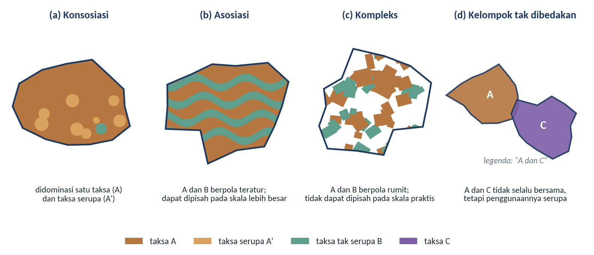
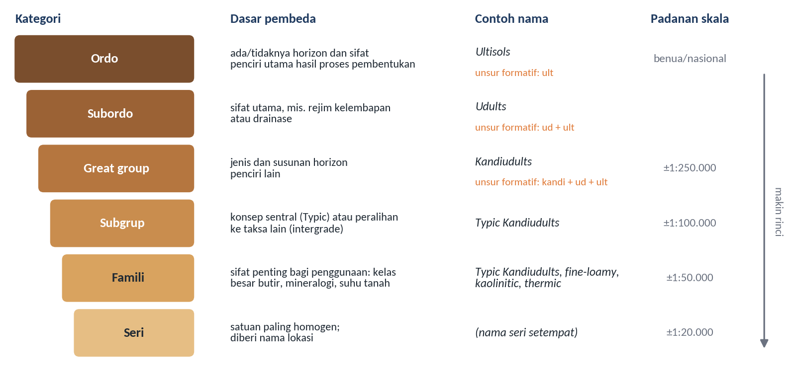
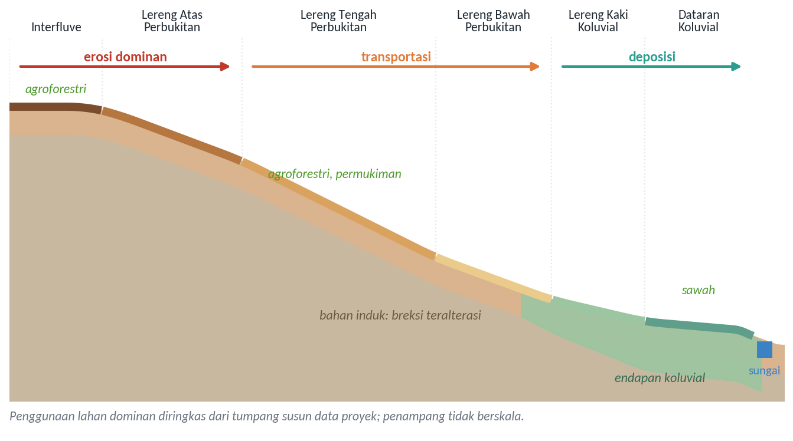
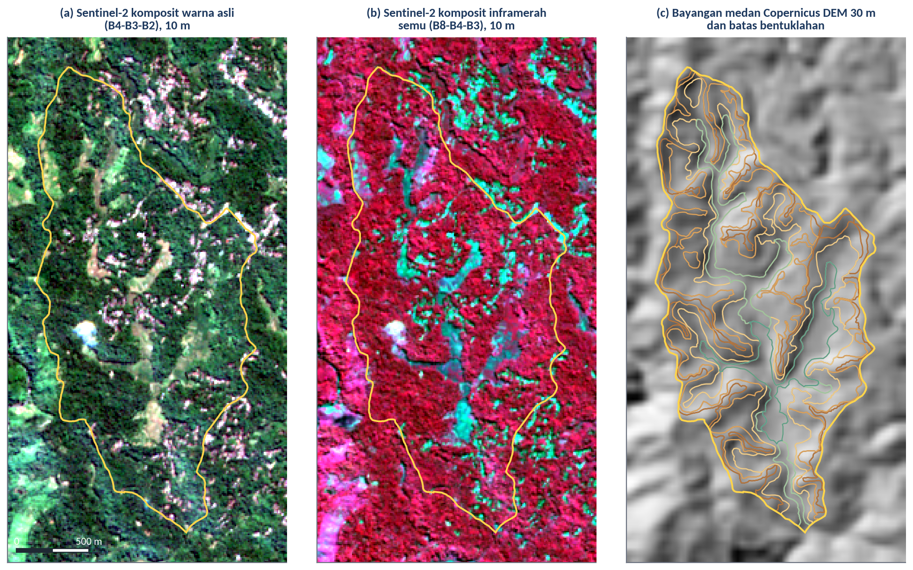
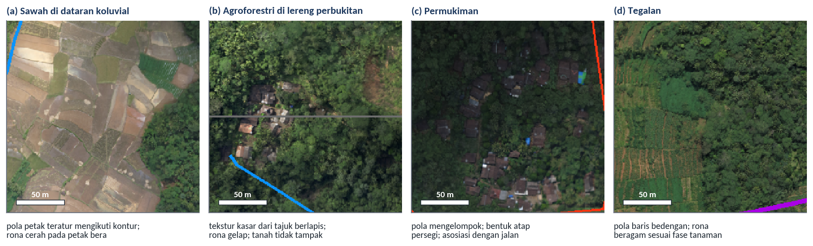
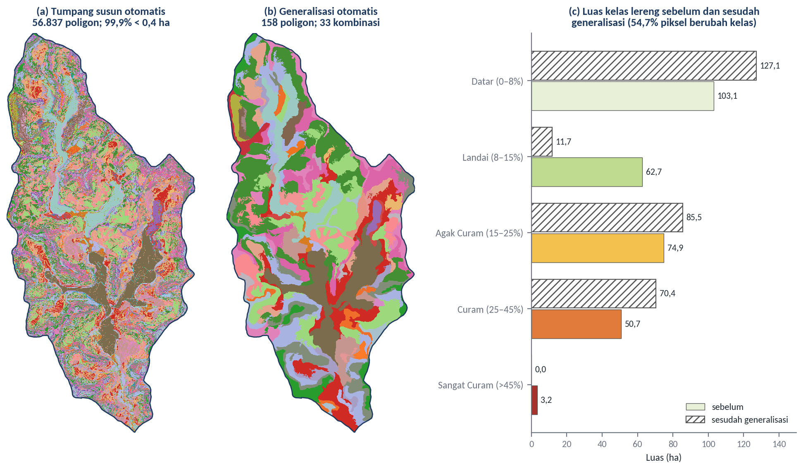
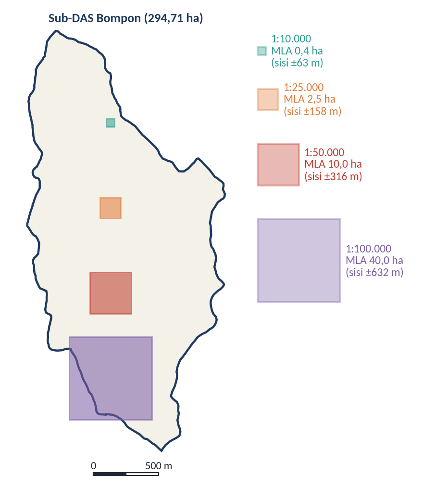

# Remote Sensing untuk Delineasi Soil Mapping Units (SMU)

## Tujuan dan Capaian Pembelajaran

Modul ini bertujuan membekali peserta dengan pemahaman mengenai konsep satuan peta tanah (*Soil Mapping Unit*, SMU), prinsip delineasi berbasis lanskap menggunakan data penginderaan jauh beserta turunannya, serta keterkaitan antara skala pemetaan dan luas satuan pemetaan terkecil. Pembahasan ini menjembatani tumpukan data multisumber yang telah diselaraskan pada Modul 2 dengan tahapan ekstraksi sifat tanah (Modul 4 dan 5), interpretasi pedologis (Modul 6), serta penyusunan rancangan sampel dan pemodelan *Digital Soil Mapping* (Modul 8).

Setelah mempelajari modul ini, peserta diharapkan mampu:

1. membedakan satuan taksonomi tanah dan satuan peta tanah beserta empat jenis satuan peta tanah dan hierarki kategori Taksonomi Tanah;
2. menjelaskan prinsip delineasi satuan peta tanah berbasis lanskap serta pemanfaatan citra penginderaan jauh dan model elevasi digital dalam mengenali batas-batasnya;
3. menerapkan kunci interpretasi citra untuk mengidentifikasi karakteristik bentuklahan, kemiringan lereng, drainase, dan penggunaan lahan sebagai dasar penarikan batas satuan peta tanah;
4. menganalisis hubungan antara skala peta, ukuran delineasi terkecil, serta permasalahan fragmentasi poligon pada tumpang susun otomatis; dan
5. melakukan ekstraksi turunan medan, penyederhanaan poligon otomatis, serta delineasi satuan peta tanah secara *on-screen digitizing* untuk wilayah Sub-DAS Bompon.

*Ceramah dan diskusi:*

## Konsep Soil Mapping Unit (SMU)

Peta tanah pada hakikatnya merupakan penyederhanaan sistematis atas keragaman tanah di alam agar pola spasialnya dapat dipahami dan digunakan untuk pengambilan keputusan pengelolaan lahan. Di lapangan, sifat fisik, kimia, dan morfologi tanah berubah secara berangsur maupun mendadak mengikuti perubahan faktor pembentuknya, sehingga tubuh tanah yang benar-benar seragam jarang ditemukan pada luasan yang besar. Untuk menyajikan keragaman tersebut di atas peta, survei tanah membedakan dua konsep dasar yang saling berkaitan tetapi tidak identik, yaitu satuan taksonomi tanah (*soil taxonomic unit*) dan satuan peta tanah (*Soil Mapping Unit*, SMU) (Soil Survey Division Staff, 2017). Satuan taksonomi tanah adalah kelas konseptual di dalam sistem klasifikasi yang didefinisikan berdasarkan kisaran sifat morfologi, fisik, kimia, dan mineralogi tertentu pada profil tanah, sedangkan satuan peta tanah adalah kumpulan luasan atau poligon di atas peta yang dibatasi oleh garis delineasi dan diberi nama menurut satu atau beberapa komponen tanah penyusunnya (Legros, 2006; Soil Survey Division Staff, 2017).

Perbedaan antara konsep klasifikasi dan poligon peta tersebut muncul karena keterbatasan skala pemetaan serta rumitnya pola sebaran tanah di permukaan bumi. Sehelai poligon pada peta tanah hampir selalu memuat kemurnian yang tidak sempurna; selain tanah utama yang menjadi nama satuan peta, di dalamnya terdapat tanah lain yang luasannya terlalu kecil untuk digambarkan secara terpisah pada skala peta yang digunakan, yang disebut inklusi (*inclusions*) (Soil Survey Division Staff, 2017). Apabila inklusi tersebut memiliki sifat dan respons pengelolaan yang mirip dengan tanah utama, keberadaannya tidak banyak mengganggu penafsiran peta. Sebaliknya, inklusi yang sifatnya bertolak belakang dengan tanah utama, misalnya kantong tanah berdrainase buruk di tengah satuan tanah berdrainase baik, perlu dicatat secara eksplisit dalam deskripsi satuan peta. Berdasarkan komposisi taksa penyusun dan keteraturan pola spasialnya di lapangan, satuan peta tanah dikelompokkan menjadi empat jenis utama (Soil Survey Division Staff, 2017), sebagaimana diilustrasikan pada Gambar 3.1:

1. **Konsosiasi (*consociation*)**, yaitu satuan peta yang didominasi oleh satu taksa tanah tunggal beserta tanah-tanah yang sangat serupa sifatnya. Sekurang-kurangnya separuh dari luasan pedon di dalam setiap delineasi konsosiasi terdiri atas komponen tanah yang menjadi nama satuan peta, sedangkan sisanya berupa inklusi tanah serupa dan sebagian kecil inklusi tanah tak serupa yang tidak melebihi batas toleransi survei.
2. **Asosiasi tanah (*soil association*)**, yaitu satuan peta yang terdiri atas dua atau lebih taksa tanah tak serupa yang keterdapatannya di lapangan mengikuti pola lanskap yang teratur dan berulang, misalnya pergantian tanah punggungan dan tanah lembah. Pada skala peta yang digunakan, masing-masing komponen belum disajikan sebagai poligon tersendiri, tetapi karena polanya dapat diprediksi menurut posisi medan, komponen-komponen tersebut dapat dipisahkan secara kartografis apabila dipetakan pada skala yang lebih besar (skala detail).
3. **Kompleks tanah (*soil complex*)**, yaitu satuan peta yang juga tersusun atas dua atau lebih taksa tanah tak serupa, tetapi komponen-komponennya tersebar dengan pola yang sangat rumit atau berjarak sangat rapat, misalnya pada medan bekas longsoran atau endapan aluvial yang berlapis-lapis. Berbeda dengan asosiasi, komponen di dalam kompleks tanah tetap tidak dapat dipisahkan secara praktis meskipun dipetakan pada skala besar sekitar 1:24.000 atau 1:10.000.
4. **Kelompok tak dibedakan (*undifferentiated group*)**, yaitu satuan peta yang menggabungkan dua atau lebih taksa tanah yang tidak selalu hadir berdampingan secara teratur di dalam satu poligon, tetapi disatukan karena memiliki faktor pembatas atau respons pengelolaan yang sangat serupa, misalnya dua jenis tanah berbeda pada lereng yang sama-sama sangat curam dan berbatu sehingga penggunaannya sama-sama terbatas untuk fungsi lindung.

Gambar 3.1 Empat jenis satuan peta tanah berdasarkan komposisi taksa dan pola spasialnya

Sumber: Diagram konseptual disusun berdasarkan Soil Survey Division Staff (2017) dan Legros (2006)

Komponen tanah yang memberi nama pada keempat jenis satuan peta tersebut diidentifikasi menggunakan sistem klasifikasi tanah, yang di Indonesia umumnya mengacu pada Taksonomi Tanah Departemen Pertanian Amerika Serikat (*USDA Soil Taxonomy*) atau Sistem Klasifikasi Tanah Nasional yang berpadanan dengannya (Soil Survey Staff, 1999; Soil Survey Staff, 2022; Subardja et al., 2016). Taksonomi Tanah disusun secara berjenjang dari kategori tertinggi yang bersifat umum menuju kategori terendah yang bersifat sangat rinci, yaitu Ordo, Subordo, *Great Group*, Subgrup, Famili, dan Seri (Gambar 3.2). Pada tingkat tertinggi, dua belas **Ordo** dibedakan berdasarkan keberadaan atau ketiadaan horizon penciri (*diagnostic horizons*) serta sifat penciri utama yang mencerminkan proses pembentukan tanah dominan, misalnya *Ultisols* yang mengalami pencucian lanjut dengan horizon argilik atau kandik berkejenuhan basa rendah, *Inceptisols* yang baru menunjukkan perkembangan horizon kambik, atau *Andisols* yang berkembang dari bahan vulkanik dengan sifat andik (Soil Survey Staff, 1999). Di bawahnya, **Subordo** membagi Ordo terutama berdasarkan penciri rejim kelembapan tanah, rejim suhu, atau sifat kimia dan bahan induk utama yang mengendalikan proses pedogenesis saat ini.

Gambar 3.2 Hierarki enam kategori dalam Taksonomi Tanah beserta dasar pembeda, contoh penamaan, dan padanan skalanya

Sumber: Diagram konseptual disusun berdasarkan Soil Survey Staff (1999), Soil Survey Staff (2022), dan Legros (2006)

Penamaan taksa dari tingkat Ordo hingga Subgrup bersifat sistematis karena dirangkai dari unsur-unsur pembentuk kata (*formative elements*) yang berasal dari akar kata Yunani atau Latin, sehingga nama tanah sekaligus merangkum sifat utamanya (Soil Survey Staff, 1999). Tiga atau empat huruf terakhir setiap nama taksa selalu menunjukkan akhiran Ordo (misalnya *-ult* untuk *Ultisols* atau *-ept* untuk *Inceptisols*). Nama **Subordo** dibentuk dengan menambahkan awalan penciri di depan akhiran Ordo; sebagai contoh, awalan *ud-* yang menunjukkan rejim kelembapan udik (lembap sepanjang sebagian besar tahun, khas wilayah tropis basah) digabungkan dengan *-ult* menjadi *Udults*. Selanjutnya, kategori ***Great Group*** dibentuk dengan menambahkan satu awalan lagi di depan nama Subordo untuk mencerminkan jenis, susunan, dan derajat ekspresi horizon penciri secara utuh; penambahan unsur *kandi-* (penciri horizon kandik yang didominasi mineral lempung beraktivitas rendah) pada *Udults* menghasilkan *Kandiudults*. Pada kategori keempat, **Subgrup** menambahkan kata sifat di depan nama *Great Group* untuk menunjukkan apakah tanah tersebut mewakili konsep pusat (*Typic*, misalnya *Typic Kandiudults*), merupakan peralihan menuju taksa lain (*intergrade*, misalnya *Andic Dystrudepts* yang memperlihatkan pengaruh debu vulkanik), atau memiliki sifat menyimpang yang belum mengarah ke taksa tertentu (*extragrade*, misalnya *Lithic* yang menandakan kontak batuan keras dangkal) (Soil Survey Staff, 2022).

Dua kategori terbawah dalam Taksonomi Tanah dirancang khusus untuk menjembatani klasifikasi pedologis dengan kebutuhan praktis pengelolaan lahan dan pertumbuhan tanaman. Kategori **Famili** menambahkan pemerian teknis mengenai sifat fisik dan mineralogi yang secara langsung mengatur pergerakan air, ketersediaan hara, dan pengolahan tanah, meliputi kelas besar butir (*particle-size class*, seperti berlempung halus atau *fine-loamy*), kelas mineralogi (misalnya kaolinitik atau smektitik), kelas aktivitas pertukaran kation, dan kelas rejim suhu tanah (misalnya *isohyperthermic*) (Soil Survey Staff, 2022). Kategori terendah, yaitu **Seri**, merupakan kumpulan polipedon yang paling seragam dalam hal susunan dan sifat horizon di bawah lapisan olah, serta biasanya diberi nama menurut lokasi geografis tempat tanah tersebut pertama kali dipertelakan. Dalam praktik pemetaan, tingkat kategori taksonomi yang digunakan untuk menamai SMU disesuaikan dengan skala peta: peta tinjau (*reconnaissance*) umumnya menggunakan kategori *Great Group* atau Subgrup dalam bentuk asosiasi atau kompleks, peta semi-detail (sekitar 1:25.000–1:50.000) menggunakan Subgrup atau Famili, sedangkan peta detail di tingkat kebun (1:10.000–1:20.000) menggunakan Famili atau Seri dalam bentuk konsosiasi yang dilengkapi dengan **fase tanah** (*soil phase*), seperti fase kemiringan lereng, kedalaman efektif, tingkat erosi, atau kebatuan permukaan (Rossiter, 2000; Soil Survey Division Staff, 2017). Penambahan fase ini sangat krusial bagi pengelolaan perkebunan kelapa sawit maupun pertanian presisi, karena dua poligon yang termasuk dalam Subgrup atau Famili tanah yang sama dapat membutuhkan tindakan konservasi tanah, tata air, dan pemupukan yang berbeda apabila terletak pada kelas lereng atau kondisi drainase yang berbeda.

## Prinsip Delineasi Berbasis Lanskap

Karena profil tanah berada di bawah permukaan bumi dan tidak dapat dilihat secara langsung di seluruh bentang lahan, penarikan batas SMU tidak mungkin dilakukan hanya dengan menginterpolasi titik-titik pemboran yang jumlahnya terbatas. Delineasi batas satuan peta tanah bertumpu pada paradigma tanah–lanskap (*soil–landscape paradigm*), yaitu prinsip bahwa sebaran tanah mengikuti pola bentuk permukaan bumi, bahan induk, hidrologi, dan vegetasi secara teratur (Hudson, 1992). Konsep klasik yang mendasari hubungan tersebut adalah konsep *catena* atau toposekuen yang diperkenalkan oleh Milne (1935), yakni rangkaian tanah yang berderet di sepanjang lereng dari puncak punggungan hingga dasar lembah. Meskipun berkembang dari bahan induk yang serupa di bawah kondisi iklim yang sama, tanah-tanah di sepanjang satu lereng mengalami diferensiasi sifat akibat perbedaan kemiringan, posisi topografi, pergerakan air permukaan maupun bawah permukaan, serta proses erosi, transportasi, dan deposisi material (Birkeland, 1999; Schaetzl & Anderson, 2005). Puncak datar (*interfluve*) cenderung mengalami infiltrasi dan pencucian vertikal, lereng atas dan lereng tengah didominasi oleh limpasan permukaan dan pengikisan solum, sedangkan lereng kaki dan dataran lembah menerima limpahan air, sedimen halus, serta kation terlarut dari bagian hulu.

Keteraturan toposekuen tersebut tampak jelas pada wilayah studi kasus Sub-DAS Bompon. Sebagaimana telah diperkenalkan pada Modul 1 dan 2, lanskap Sub-DAS Bompon tersusun atas enam satuan bentuklahan yang membentuk rangkaian dari punggungan perbukitan hingga lembah sungai, yaitu *Interfluve*, Lereng Atas Perbukitan, Lereng Tengah Perbukitan, Lereng Bawah Perbukitan, Lereng Kaki Koluvial, dan Dataran Koluvial (Fatmawati, 2026; Sambodo, 2021). Rangkaian bentuklahan, proses geomorfik dominan, bahan induk, dan penggunaan lahan di sepanjang lereng tersebut diilustrasikan secara skematis pada Gambar 3.3. Perbukitan di bagian atas berkembang di atas batuan breksi andesit Formasi Kebobutak berumur Tersier yang telah mengalami alterasi hidrotermal kuat sehingga menghasilkan lapisan lempung tebal, kemudian tertimbun oleh jatuhan abu vulkanik Kuarter dari Gunung Sumbing (Sambodo, 2021; Wida et al., 2019). Proses erosi dan gerakan massa tanah di lereng atas dan lereng tengah mengangkut material lapuk tersebut ke arah lembah, lalu mengendapkannya kembali sebagai endapan koluvial di lereng kaki dan dataran koluvial di sepanjang alur sungai.

Gambar 3.3 Penampang skematis toposekuen enam satuan bentuklahan, bahan induk, proses geomorfik, dan penggunaan lahan dominan di Sub-DAS Bompon

Sumber: Diagram konseptual disusun berdasarkan data spasial proyek, Sambodo (2021), Wida et al. (2019), dan Fatmawati (2026)

Hubungan yang erat antara posisi bentuklahan, kondisi hidrologi, dan sifat tanah juga tercermin dari pilihan masyarakat dalam memanfaatkan lahan di Sub-DAS Bompon. Hasil tabulasi silang antara lapisan `bentuklahan` dan `penggunaan_lahan` pada data proyek menunjukkan bahwa satuan perbukitan (*Interfluve* hingga Lereng Bawah Perbukitan) yang mencakup sekitar 86,5% luas Sub-DAS didominasi secara mutlak oleh kebun campuran atau agroforestri seluas 202,83 ha, disertai permukiman (32,21 ha) dan tegalan (14,58 ha). Sebaliknya, sawah yang membutuhkan topografi datar hingga landai, ketersediaan air yang menerus, serta tanah bertekstur halus yang mampu menahan genangan air terkonsentrasi pada Dataran Koluvial (17,49 ha dari 20,44 ha luas satuan tersebut, atau 85,6%) dan Lereng Kaki Koluvial (11,51 ha dari 19,75 ha, atau 58,3%). Di dalam kerangka survei sumber daya lahan di Indonesia, satuan lanskap yang menggabungkan bentuklahan, litologi atau bahan induk, relief/kemiringan lereng, dan penggunaan lahan sering disusun terlebih dahulu sebagai satuan lahan (*land unit*) sebelum diisi dengan informasi tanah hasil pengamatan lapangan menjadi satuan peta tanah (Sartohadi et al., 2012; Subardja et al., 2016).

Penginderaan jauh berperan utama dalam menyediakan pandangan sinoptik untuk mengenali batas-batas satuan lanskap tersebut secara konsisten sebelum dan sesudah survei lapangan (Mulder et al., 2011; Dobos et al., 2006). Setiap jenis data penginderaan jauh menonjolkan aspek lanskap yang berbeda, sebagaimana ditunjukkan pada Gambar 3.4 untuk wilayah Sub-DAS Bompon. Citra optik Sentinel-2 komposit warna asli (kanal merah B4, hijau B3, dan biru B2; panel a) memperlihatkan kontras rona permukaan yang menyerupai penglihatan mata manusia: tajuk agroforestri yang rapat tampak hijau gelap, sedangkan petak sawah bera dan lahan terbuka di bagian tengah hingga selatan tampak kecokelatan cerah. Komposit inframerah dekat semu (*false color infrared*, kanal NIR B8, merah B4, dan hijau B3; panel b) mempertajam perbedaan kerapatan dan vigor vegetasi melalui pantulan NIR yang kuat dari jaringan mesofil daun, sehingga jalur lembah koluvial yang ditanami padi atau diberakan tampak sangat kontras dalam rona biru kehijauan hingga merah muda di antara punggungan berhutan rakyat yang berwarna merah tua. Sementara itu, bayangan medan (*hillshade*) dari model elevasi digital (panel c) menyingkap struktur morfologi lereng, punggungan (*interfluve*), tekuk lereng (*slope break*), dan jaringan lembah yang tertutup oleh tajuk vegetasi pada citra optik, sehingga batas poligon bentuklahan dapat ditarik mengikuti perubahan bentuk medan.

Gambar 3.4 Perbandingan tampilan Sub-DAS Bompon pada (a) komposit warna asli Sentinel-2, (b) komposit inframerah dekat semu Sentinel-2, dan (c) bayangan medan Copernicus DEM 30 m beserta batas bentuklahan

Sumber: Diolah dari citra Sentinel-2B Level-2A perekaman 21 Juli 2025, Copernicus DEM GLO-30 (European Space Agency, 2024), dan data spasial Sub-DAS Bompon (data proyek)

Dalam mengenali objek dan menarik batas satuan lanskap maupun penggunaan lahan secara visual dari citra satelit atau foto udara, penafsir citra menggunakan delapan unsur atau kunci interpretasi citra yang tersusun secara hierarkis menurut tingkat kerumitannya, yaitu rona atau warna, ukuran, bentuk, tekstur, pola, tinggi dan bayangan, situs, serta asosiasi (Sutanto, 1994; Lillesand et al., 2015). **Rona dan warna** adalah tingkat kecerahan atau wujud spektral objek yang menjadi kunci paling dasar, misalnya perbedaan rona gelap tanah lembap di cekungan dibandingkan rona cerah tanah kering di punggungan terbuka. **Ukuran** dan **bentuk** merujuk pada dimensi dan konfigurasi batas objek, seperti petak-petak sawah berukuran kecil yang berbentuk memanjang mengikuti garis kontur. **Tekstur** menyatakan frekuensi perubahan rona pada kelompok objek yang terlalu kecil untuk dilihat secara individual, misalnya tekstur kasar dan tidak seragam pada tajuk agroforestri berlapis dibandingkan tekstur halus pada hamparan padi sawah. **Pola** menggambarkan susunan keruangan objek, baik pola alami seperti jaringan aliran sungai dendritik pada batuan seragam maupun pola buatan seperti barisan tanaman perkebunan dan bedengan tegalan. **Tinggi dan bayangan** memberikan kesan relief dan struktur vertikal tajuk atau lereng, sedangkan **situs** (letak objek terhadap lingkungan sekitarnya, misalnya letak di dataran koluvial) dan **asosiasi** (keterkaitan fungsional antarobjek, misalnya permukiman perdesaan yang berasosiasi dengan jaringan jalan dan pekarangan) merupakan kunci tingkat tinggi yang mengintegrasikan penalaran geografis dan pedologis.

Penerapan kedelapan kunci interpretasi tersebut pada foto udara resolusi tinggi Sub-DAS Bompon ditunjukkan pada Gambar 3.5, sedangkan ringkasan penciri interpretasi untuk setiap satuan bentuklahan dan penggunaan lahan dirangkum pada Tabel 3.1. Perlu dicatat bahwa potongan foto udara pada Gambar 3.5 diekstrak dari berkas arsip peta foto udara proyek (`das Bompon1.tif`) yang di dalamnya telah memuat garis jaringan sungai, batas wilayah, dan garis grid tata letak yang terbakar langsung ke dalam piksel citra; oleh karena itu, garis berwarna biru, merah, ungu, dan abu-abu lurus pada potongan tersebut merupakan elemen kartografis dari arsip peta, bukan kenampakan asli permukaan lahan. Meskipun demikian, keempat cuplikan tersebut dengan jelas memperlihatkan bagaimana kombinasi tekstur tajuk, pola pemetakan lahan, rona permukaan, dan posisi situs memungkinkan penafsir membedakan dataran koluvial bersawah, lereng perbukitan beragroforestri, kelompok permukiman, dan lahan tegalan secara meyakinkan pada skala detail.

Gambar 3.5 Contoh penerapan unsur interpretasi visual pada cuplikan foto udara Sub-DAS Bompon untuk empat kelas penggunaan lahan (catatan: garis biru, merah, ungu, dan abu-abu lurus adalah elemen vektor tata letak yang terbakar pada arsip citra proyek)

Sumber: Diolah dari arsip peta foto udara Sub-DAS Bompon skala 1:10.000 (data proyek)

Tabel 3.1 Kunci Interpretasi Penginderaan Jauh dan Karakteristik Satuan Bentuklahan di Sub-DAS Bompon

| **Satuan bentuklahan** | **Luas (ha)** | **Ciri medan dan situs (DEM/bayangan medan)** | **Ciri pada citra optik dan foto udara** | **Penggunaan lahan dominan dan indikasi pedologis** |
| :--- | :--- | :--- | :--- | :--- |
| *Interfluve* | 39,59 | Punggungan teratas pemisah sub-DAS; permukaan relatif sempit, cembung hingga agak datar di puncak | Rona merah gelap pada komposit NIR; tekstur tajuk kasar; setempat terdapat bercak tegalan dan permukiman di punggung jalan | Agroforestri (83,6%), permukiman (9,7%), tegalan (6,6%); pencucian vertikal dan erosi permukaan pada tanah vulkanik-alterasi |
| Lereng Atas Perbukitan | 49,70 | Tepat di bawah *interfluve*; lereng curam hingga agak curam; bentuk lereng cembung; hulu alur-alur kikisan | Tekstur tajuk kasar rapat; bayangan lereng tegas; kadang tampak rona cerah pada tebing bukaan atau mahkota longsoran | Agroforestri (83,5%), permukiman (9,2%), tegalan (7,3%); zona pelepasan material (*erosion dominant*) dan rentan gerakan tanah |
| Lereng Tengah Perbukitan | 109,08 | Satuan terluas di bagian tengah lereng perbukitan; kemiringan bervariasi dengan punggung dan lekuk lereng mikro | Dominasi tekstur kasar agroforestri; diselingi pola mengelompok permukiman di sepanjang jalan punggung/lereng dan petak tegalan | Agroforestri (81,3%), permukiman (11,9%), tegalan (5,0%); zona transportasi material lereng; tanah lempung tebal hasil pelapukan lanjut |
| Lereng Bawah Perbukitan | 56,12 | Bagian bawah lereng perbukitan sebelum tekuk lereng menuju lembah; lereng mulai melandai dan cekung | Tekstur kasar agroforestri dan permukiman di tepi jalan; mulai berbatasan dengan teras sawah sempit di dekat alur | Agroforestri (70,5%), permukiman (19,3%), tegalan (5,2%), sawah (5,0%); peralihan dari zona transportasi ke akumulasi |
| Lereng Kaki Koluvial | 19,75 | Zona tekuk lereng cekung di kaki bukit (*footslope*); kemiringan landai hingga datar; menerima limpasan dari bukit | Pola teras berjenjang mengikuti kontur; kontras rona dan tekstur yang jelas terhadap lereng perbukitan berhutan di atasnya | Sawah (58,3%), agroforestri (23,5%), permukiman (15,5%); akumulasi koluvial bahan halus dan kelembapan tanah lebih tinggi |
| Dataran Koluvial | 20,44 | Dasar lembah sempit memanjang di kiri-kanan sungai utama; topografi datar (0–8%) | Pola petak sawah teratur; tekstur halus; rona sangat kontras antara petak berair/bera (biru-cokelat) dan padi vegetatif | Sawah (85,6%), tegalan (9,3%), agroforestri (5,1%); tanah koluvial-aluvial bertekstur halus dengan drainase terhambat/periodik jenuh |

Sumber: Diolah dari data spasial Sub-DAS Bompon (data proyek), Sambodo (2021), dan Fatmawati (2026)

## Skala Pemetaan dan Minimum Mapping Unit

Dalam penyusunan peta tanah, tingkat kerincian delineasi yang ditarik dari citra dan DEM dibatasi secara ketat oleh skala peta target. Setiap skala peta memiliki batas ukuran terkecil poligon yang masih dapat digambar dengan jelas dan dibaca oleh pengguna peta tanpa berjejalnya garis batas dan simbol legenda. Ukuran terkecil di atas kertas peta atau layar tampilan ini disebut *Minimum Legible Delineation* (MLD), yang menurut konvensi survei tanah Cornell ditentukan sebesar 0,4 cm² (lingkaran berdiameter sekitar 7 mm atau bujur sangkar bersisi sekitar 6,3 mm) (Rossiter, 2000; Soil Survey Division Staff, 2017). Apabila nilai MLD tersebut dikonversikan ke ukuran sebenarnya di lapangan menggunakan bilangan skala peta ($S_N$, misalnya 10.000 untuk skala 1:10.000), diperoleh luas satuan peta terkecil yang boleh muncul di dalam peta, yang disebut *Minimum Legible Area* (MLA) atau sering pula disebut *Minimum Mapping Unit* (MMU) (Rossiter, 2000):

$$\text{MLA (ha)} = \frac{\text{MLD (cm}^2\text{)} \times S_N^2}{10^8} = \frac{0,4 \times S_N^2}{10^8} = \frac{(S_N / 1.000)^2}{250}$$

Persamaan tersebut menunjukkan bahwa MLA meningkat sebanding dengan kuadrat bilangan skala peta. Ketika bilangan skala diperkecil dua kali lipat (misalnya dari 1:25.000 menjadi 1:50.000), luas poligon terkecil yang diizinkan meningkat empat kali lipat (dari 2,5 ha menjadi 10 ha). Hubungan antara tingkat survei tanah, skala pemetaan, nilai MLA, ukuran piksel penginderaan jauh yang sepadan, serta jenis SMU yang lazim digunakan dirangkum pada Tabel 3.2, sedangkan perbandingan visual ukuran MLA pada empat skala pemetaan terhadap luas Sub-DAS Bompon ditampilkan pada Gambar 3.7. Gambar tersebut memperlihatkan dengan gamblang bahwa untuk wilayah seluas Sub-DAS Bompon (294,71 ha), pemetaan pada skala 1:100.000 (MLA 40 ha) hanya mampu membagi seluruh sub-DAS ke dalam segelintir poligon besar, sehingga analisis pengelolaan lahan di tingkat sub-DAS atau blok kebun menuntut skala detail (sekitar 1:10.000, MLA 0,4 ha) hingga semi-detail (1:25.000, MLA 2,5 ha).

Tabel 3.2 Hubungan Skala Peta, Ukuran Satuan Pemetaan Terkecil (MLA), dan Tingkat Survei Tanah

| **Tingkat survei tanah** | **Skala peta khas** | **MLA pada MLD 0,4 cm² (ha)** | **Sisi bujur sangkar setara (m)** | **Resolusi citra/DEM yang sesuai (m)** | **Jenis SMU dan kategori taksonomi utama** |
| :--- | :--- | :--- | :--- | :--- | :--- |
| Sangat detail (*very detailed*) | 1:5.000 | 0,10 | ~32 | 0,5–5 (foto udara/drone, LiDAR) | Konsosiasi Seri dan fase tanah rinci |
| Detail (*detailed*) | 1:10.000 | 0,40 | ~63 | 2–10 (foto udara, SPOT, Sentinel-2, DEMNAS/LiDAR) | Konsosiasi Famili/Seri dan fase lereng/kedalaman |
| Detail kasar | 1:20.000 | 1,60 | ~126 | 5–10 (Sentinel-2, DEMNAS) | Konsosiasi dan kompleks Famili/Subgrup |
| Semi-detail (*semi-detailed*) | 1:25.000 | 2,50 | ~158 | 10–15 (Sentinel-2, ASTER, DEMNAS) | Konsosiasi, asosiasi, dan kompleks Subgrup/Famili |
| Semi-detail kasar | 1:50.000 | 10,00 | ~316 | 15–30 (Landsat, SRTM/Copernicus DEM) | Asosiasi dan kompleks Subgrup/*Great Group* |
| Tinjau (*reconnaissance*) | 1:100.000 | 40,00 | ~632 | 30–60 (Landsat, DEM 30 m) | Asosiasi dan kompleks *Great Group*/Subgrup |
| Eksplorasi (*exploratory*) | 1:250.000 | 250,00 | ~1.581 | 60–250 (MODIS, SRTM) | Asosiasi Ordo/Subordo/*Great Group* |

Sumber: Disusun berdasarkan Rossiter (2000), Soil Survey Division Staff (2017), dan Subardja et al. (2016)

Konsep MLA menjadi sangat krusial ketika data penginderaan jauh dan turunan DEM beresolusi tinggi diintegrasikan secara digital di dalam SIG. Kemudahan melakukan tumpang susun (*overlay*) di komputer sering mendorong pembuat peta untuk langsung menumpangsusunkan poligon bentuklahan, kelas kemiringan lereng dari DEM, dan penggunaan lahan guna memperoleh satuan lahan atau SMU. Padahal, apabila salah satu lapisan masukan berasal dari klasifikasi piksel raster beresolusi sangat tinggi yang belum diperhalus, tumpang susun mekanis tersebut akan menghasilkan puluhan ribu poligon serpihan (*sliver polygons*) dan bercak mikro (*salt-and-pepper effect*) yang sama sekali tidak layak secara kartografis maupun pedologis.

Permasalahan ini dapat dibuktikan secara kuantitatif menggunakan data studi kasus Sub-DAS Bompon pada skala target 1:10.000 (MLA = 0,4 ha). Di dalam berkas `bompon.gpkg`, lapisan `bentuklahan` hanya terdiri atas 68 poligon terhubung (dengan 8 poligon berukuran < 0,4 ha) dan `penggunaan_lahan` terdiri atas 73 poligon (43 poligon < 0,4 ha). Akan tetapi, lapisan `kelas_lereng` berasal dari konversi langsung kemiringan lereng DTM LiDAR beresolusi sangat tinggi tanpa penghalusan medan terlebih dahulu, sehingga di dalam batas Sub-DAS terpecah menjadi 44.425 poligon terpisah yang 44.354 di antaranya (99,84%) berukuran lebih kecil dari 0,4 ha. Ketika ketiga lapisan tersebut ditumpangsusunkan secara otomatis pada grid analisis 2 m (Gambar 3.6 panel a), terbentuk **111 kombinasi unik** satuan lahan yang tersebar ke dalam **56.837 poligon**. Dari jumlah tersebut, sebanyak **56.796 poligon (99,93%)** memiliki luas di bawah ambang MLA 0,4 ha, dan poligon-poligon mikro yang tidak memenuhi syarat peta skala 1:10.000 ini mencakup **84,40%** dari seluruh luas Sub-DAS Bompon. Bahkan, terdapat 47 dari 111 kombinasi satuan lahan yang luas gabungan seluruh poligonnya di dalam Sub-DAS tidak mencapai 0,4 ha.

Gambar 3.6 Perbandingan (a) hasil tumpang susun otomatis bentuklahan, kelas lereng LiDAR, dan penggunaan lahan di Sub-DAS Bompon, (b) hasil generalisasi otomatis bertahap pada ambang MLA 0,4 ha, serta (c) perubahan luas kelas lereng sebelum dan sesudah generalisasi otomatis

Sumber: Diolah dari data spasial Sub-DAS Bompon (`bompon.gpkg`) menggunakan skrip analisis proyek pada grid 2 m

Untuk mengatasi fragmentasi tersebut, pendekatan pertama yang sering ditempuh dalam pengolahan citra dan SIG adalah generalisasi otomatis berbasis penyaringan luas minimum (*sieve filter*), yang meleburkan setiap bercak piksel berukuran di bawah ambang MLA ke dalam kelas tetangga terbesarnya. Apabila penyaringan bertahap pada ambang 0,4 ha diterapkan terlebih dahulu pada lapisan `kelas_lereng` hingga stabil (4 putaran iterasi), kemudian hasilnya ditumpangsusunkan kembali dengan `bentuklahan` dan `penggunaan_lahan` serta disaring ulang (2 putaran iterasi), jumlah poligon memang menyusut drastis dari 56.837 menjadi **158 poligon** yang seluruhnya telah memenuhi syarat $\ge$ 0,4 ha (rata-rata 1,87 ha per poligon) dengan **33 kombinasi** satuan lahan (Gambar 3.6 panel b). Namun, pemeriksaan terhadap distribusi kelas lereng sebelum dan sesudah penyaringan otomatis (Gambar 3.6 panel c) mengungkap kelemahan serius dari generalisasi murni berbasis algoritma: sebanyak **54,7% piksel** di seluruh Sub-DAS berubah kelas lerengnya. Kelas *Sangat Curam (>45%)* yang aslinya mencakup 3,2 ha (berupa tebing-tebing sempit memanjang yang sangat penting sebagai penciri bahaya longsor) lenyap sepenuhnya (0,0 ha) karena setiap bercaknya berukuran kurang dari 0,4 ha, sedangkan kelas *Landai (8–15%)* menyusut tajam dari 62,7 ha menjadi 11,7 ha karena terlebur ke dalam kelas *Datar (0–8%)* dan *Agak Curam (15–25%)*. Selain itu, dari 32 strata satuan lahan yang diwakili oleh 50 titik sampel rencana pada data proyek, hanya 22 strata yang bertahan setelah generalisasi otomatis, sementara 10 strata tempat titik sampel berada ikut hilang terlebur.

Gambar 3.7 Perbandingan ukuran *Minimum Legible Area* (MLA, dengan MLD 0,4 cm²) pada empat skala pemetaan terhadap luas Sub-DAS Bompon

Sumber: Diolah dari batas Sub-DAS Bompon (`bompon.gpkg`) berdasarkan persamaan MLA dalam Rossiter (2000)

Temuan kuantitatif di Sub-DAS Bompon tersebut memberikan pelajaran metodologis yang sangat penting bagi delineasi SMU. Penyederhanaan batas satuan peta tidak boleh diserahkan sepenuhnya pada penyaringan statistik buta (*blind sieve*) atas poligon hasil tumpang susun, melainkan harus dikendalikan oleh pemilihan resolusi DEM yang sepadan dengan skala peta serta penarikan garis batas berbasis penalaran lanskap (*on-screen digitizing*). Sebagai perbandingan, apabila kemiringan lereng dihitung dari Copernicus DEM beresolusi 30 m (`copdem_glo30_30m.tif`), permukaan elevasi yang lebih halus menghasilkan proporsi lereng Agak Curam (40,2%) dan Curam (27,9%) yang lebih menyatu secara spasial dengan median kemiringan 19,3%, berbeda dengan kelas lereng DTM LiDAR yang mencatat 34,9% piksel Datar akibat terdeteksinya pelataran teras-teras mikro di bawah tajuk. Dalam praktik survei tanah, detail mikro seperti guludan teras individual pada lereng perbukitan tidak dipetakan sebagai poligon datar tersendiri, melainkan diperlakukan sebagai karakteristik internal atau fase pengelolaan di dalam satuan lereng perbukitan yang bersangkutan. Prinsip inilah yang akan dilatihkan pada sesi praktik berikut dan diperdalam melalui penalaran pedologis pada Modul 6.

*Demonstrasi dan praktik:*

## Praktik: Delineasi dan Penyederhanaan Satuan Peta Tanah Sub-DAS Bompon

**Tujuan**

Praktik ini melatih peserta untuk menurunkan parameter visualisasi medan dari DEM, membandingkan hasil tumpang susun otomatis dengan penyederhanaan berbasis *Minimum Legible Area* (MLA), serta melakukan delineasi dan penghalusan batas satuan peta tanah (*Soil Mapping Unit*, SMU) secara *on-screen digitizing* menggunakan kombinasi citra Sentinel-2, bayangan medan DEM, dan peta bentuklahan di Sub-DAS Bompon.

**Input Data**

- Berkas `bompon.gpkg` (`EPSG:32749`), khususnya lapisan `batas_subdas`, `bentuklahan`, `kelas_lereng`, `penggunaan_lahan`, `sungai`, `jalan`, dan `titik_sampel_rencana`.
- Citra reflektansi permukaan Sentinel-2 Level-2A `Source/Data Bompon/terbuka/sentinel2_l2a_20250721_10m.tif` (atau tumpukan `bompon_tumpukan_10m.vrt` hasil praktik Modul 2).
- Model elevasi digital `Source/Data Bompon/terbuka/copdem_glo30_30m.tif` atau `dem_10m.tif` dari DEMNAS (Badan Informasi Geospasial, t.t.) hasil praktik Modul 2.

**Software**

- QGIS versi 3.x (panduan menu mengacu pada QGIS 3.44) dengan penyedia algoritma *GDAL* dan *GRASS* / *QGIS native processing* aktif.

**Langkah Kerja**

*A. Menyiapkan tampilan citra komposit dan turunan medan*

1. Buka proyek QGIS pada sistem koordinat `EPSG:32749`, lalu muat `batas_subdas`, `bentuklahan`, `penggunaan_lahan`, `sungai`, dan `titik_sampel_rencana` dari `bompon.gpkg`, serta raster `sentinel2_l2a_20250721_10m.tif` dan `copdem_glo30_30m.tif`.
2. Gandakan tampilan lapisan `sentinel2_l2a_20250721_10m.tif` di panel *Layers* melalui klik kanan **Duplicate Layer**. Atur lapisan pertama sebagai **Komposit Warna Asli** (*Multiband color*: Red = Band 3 [B04], Green = Band 2 [B03], Blue = Band 1 [B02]) dan lapisan kedua sebagai **Komposit Inframerah Semu** (Red = Band 7 [B08], Green = Band 3 [B04], Blue = Band 2 [B03]). Gunakan perentangan kontras *Cumulative count cut* (2%–98%).
3. Buat lapisan bayangan medan (*hillshade*) dari DEM melalui menu **Raster > Analysis > Hillshade** dengan *Azimuth* 315° dan *Altitude* 45°, lalu simpan sebagai `hillshade_bompon.tif`. Buat pula garis kontur berinterval 10 m melalui **Raster > Extraction > Contour** dan simpan sebagai `kontur_10m.gpkg`.
4. Hitung kemiringan lereng dalam satuan persen dari DEM melalui **Raster > Analysis > Slope** (*Slope expressed as percent* dicentang), lalu klasifikasikan ke dalam lima kelas lereng proyek (0–8%, 8–15%, 15–25%, 25–45%, dan >45%) menggunakan **Processing Toolbox > Raster analysis > Reclassify by table** dengan nilai kelas berturut-turut 1 sampai 5. Simpan sebagai `kelas_lereng_dem.tif`.

*B. Mengevaluasi tumpang susun otomatis dan penyaringan MLA*

5. Ubah lapisan `bentuklahan` (kode 1–6, mengikuti ekspresi pada langkah 12 Modul 2) dan `penggunaan_lahan` (Agroforestri = 1, Tegalan = 2, Sawah = 3, Permukiman = 4) menjadi raster beresolusi 2 m pada batas Sub-DAS melalui **Raster > Conversion > Rasterize (Vector to Raster)**, demikian pula `kelas_lereng` dari `bompon.gpkg` (kode 1–5).
6. Gabungkan ketiga raster tersebut menjadi kode satuan lahan tiga digit melalui **Raster > Raster Calculator** dengan rumus:

    `"bentuklahan_2m@1" * 100 + "kelas_lereng_2m@1" * 10 + "penggunaan_2m@1"`

   Simpan hasilnya sebagai `smu_tumpang_susun_2m.tif`. Perhatikan betapa terpecah-pecahnya bercak piksel yang terbentuk akibat fragmentasi lapisan lereng LiDAR.
7. Terapkan penyaringan luas minimum untuk skala 1:10.000 (MLA = 0,4 ha = 4.000 m² = 1.000 piksel berukuran 2 × 2 m) melalui **Raster > Analysis > Sieve**. Masukkan `smu_tumpang_susun_2m.tif`, atur *Threshold* ke `1000` dan aktifkan *Use 8-connectedness*, lalu simpan sebagai `smu_sieve_04ha.tif`.
8. Konversikan `smu_sieve_04ha.tif` menjadi poligon vektor melalui **Raster > Conversion > Polygonize (Raster to Vector)**, potong tepat pada `batas_subdas` melalui **Vector > Geoprocessing Tools > Clip**, lalu hitung luas setiap poligon dalam hektare menggunakan **Field Calculator** dengan ekspresi `round($area / 10000, 2)` pada kolom baru `luas_ha`.
9. Bandingkan secara visual poligon `smu_sieve_04ha` dengan `kelas_lereng_dem.tif`, `hillshade_bompon.tif`, dan komposit Sentinel-2. Identifikasi lokasi-lokasi tempat penyaringan otomatis menghilangkan tebing curam atau menggeser batas lembah koluvial secara tidak wajar.

*C. Melakukan delineasi SMU secara on-screen digitizing*

10. Buat lapisan GeoPackage poligon baru melalui **Layer > Create Layer > New GeoPackage Layer**. Beri nama berkas `smu_bompon_delineasi.gpkg`, nama tabel `smu_manual`, tipe geometri *Polygon*, dan sistem koordinat `EPSG:32749`. Tambahkan kolom atribut: `kode_smu` (Text, panjang 15), `bentuklahan` (Text, 40), `kelas_lereng` (Text, 25), `penggunaan_lahan` (Text, 25), `jenis_smu` (Text, 20), dan `luas_ha` (Decimal).
11. Aktifkan fitur penguncian simpul (*snapping*) melalui **Project > Snapping Options** (atau tombol magnet pada bilah alat), pilih mode *All Layers* atau *Advanced Configuration* pada lapisan `batas_subdas`, `bentuklahan`, dan `smu_manual`, atur *Tolerance* ke `10 pixels`, serta centang **Avoid Overlap on Active Layer** dan **Topological Editing** agar antarpoligon tidak saling tumpang tindih atau menyisakan celah (*gap*).
12. Tampilkan `hillshade_bompon.tif` dengan transparansi 50% di atas komposit inframerah semu Sentinel-2 serta aktifkan garis kontur `kontur_10m.gpkg` dan `sungai`. Mulailah menarik batas satuan peta dari satuan yang paling tegas ciri morfologi dan spektralnya, yaitu **Dataran Koluvial** dan **Lereng Kaki Koluvial** di sepanjang lembah utama, dengan mengikuti tekuk lereng pada bayangan medan, kerenggangan garis kontur, dan batas hamparan sawah pada citra.
13. Lanjutkan delineasi pada tubuh perbukitan (*Interfluve*, Lereng Atas, Lereng Tengah, dan Lereng Bawah Perbukitan) dengan memadukan batas `bentuklahan`, kecenderungan kemiringan lereng dari `kelas_lereng_dem.tif`, dan blok penggunaan lahan utama. Apabila di dalam satu lereng perbukitan terdapat variasi lereng mikro atau bercak tegalan/permukiman yang luasnya kurang dari 0,4 ha, jangan pisahkan sebagai poligon tersendiri, melainkan gabungkan ke dalam poligon induknya dan catat `jenis_smu` sebagai `Konsosiasi` (bila didominasi satu kondisi utama) atau `Kompleks` / `Asosiasi` (bila terdiri atas perpaduan teratur/rumit antara dua komponen).
14. Setelah seluruh area fokus (atau seluruh Sub-DAS) selesai didelineasi, buka **Field Calculator** untuk memperbarui kolom `luas_ha` dengan `round($area / 10000, 2)`. Pastikan tidak ada poligon yang memiliki `luas_ha < 0.4`.
15. Jalankan pemeriksaan topologi melalui **Vector > Topology Checker** (atau **Processing Toolbox > Vector geometry > Check validity**) untuk memastikan tidak ada poligon yang berpotongan sendiri (*self-intersection*), tumpang tindih (*overlap*), atau berlubang (*gap*). Terakhir, tampilkan `titik_sampel_rencana` di atas hasil delineasi dan periksa keterwakilan setiap poligon SMU oleh titik sampel.

**Expected Output**

- Peta kerja QGIS berisi komposit warna asli dan inframerah semu Sentinel-2, `hillshade_bompon.tif`, `kontur_10m.gpkg`, serta `kelas_lereng_dem.tif`.
- Raster dan vektor hasil tumpang susun otomatis (`smu_tumpang_susun_2m.tif`) serta hasil generalisasi otomatis (`smu_sieve_04ha.tif`) yang memperlihatkan penyusutan jumlah poligon menuju ambang MLA $\ge$ 0,4 ha.
- Berkas `smu_bompon_delineasi.gpkg` berisi poligon SMU hasil *on-screen digitizing* yang bebas dari kesalahan topologi, seluruhnya berukuran $\ge$ 0,4 ha, dan dilengkapi atribut bentuklahan, kelas lereng dominan, penggunaan lahan, serta jenis SMU.

**Interpretation**

Bandingkan batas poligon SMU hasil *on-screen digitizing* dengan hasil `smu_sieve_04ha.tif`. Pada hasil *sieve* otomatis, batas poligon tampak bergerigi mengikuti piksel dan sering memotong lereng secara melintang tanpa alasan geomorfologis karena algoritma hanya menghitung jumlah piksel yang bersambungan. Sebaliknya, pada delineasi manual berbasis lanskap, garis batas mengikuti tekuk lereng (*slope break*), punggungan pemisah air, dan batas teras koluvial, sehingga setiap poligon mencerminkan satu kesatuan proses hidrologis dan pedogenesis (sebagaimana diilustrasikan pada Gambar 3.3). Perhatikan pula bahwa di bagian Lereng Tengah dan Lereng Bawah Perbukitan yang tertutup agroforestri rapat, citra Sentinel-2 tampak relatif seragam, sehingga penarikan batas di zona ini jauh lebih bergantung pada bayangan medan dan kontur DEM daripada pada warna citra. Hal ini menegaskan mengapa integrasi data optik dan DEM (Modul 2) menjadi syarat mutlak dalam delineasi SMU di wilayah tropis bervegetasi rapat.

**Troubleshooting**

- **Muncul celah sempit (*gap*) atau tumpang tindih (*sliver overlap*) antarpoligon saat mendigitasi.** Pastikan opsi *Topological Editing* dan *Avoid Overlap on Active Layer* pada bilah alat *Snapping* telah diaktifkan sebelum menggambar poligon yang bersebelahan, atau gunakan alat **Split Features** untuk membagi satu poligon besar (misalnya `batas_subdas` yang disalin) menjadi satuan-satuan yang lebih kecil.
- **Proses *Polygonize* atau *Intersection* berjalan sangat lambat atau berhenti.** Jangan mengonversi raster `smu_tumpang_susun_2m.tif` yang belum disaring langsung menjadi vektor karena mengandung lebih dari 56.000 poligon; lakukan proses *Sieve* pada format raster terlebih dahulu baru konversikan ke vektor.
- **Terdapat poligon hasil digitasi yang luasnya sedikit di bawah 0,4 ha.** Pilih poligon kecil tersebut bersama poligon tetangga yang paling serupa karakteristik bentuklahan dan lerengnya, lalu gabungkan menggunakan alat **Edit > Edit Geometry > Merge Selected Features** dan pilih atribut poligon induk yang lebih luas.
- **Bayangan medan (*hillshade*) dari Copernicus DEM 30 m tampak kotak-kotak ketika diperbesar ke skala 1:10.000.** Pada *Layer Styling* untuk lapisan *hillshade*, ubah metode *Resampling* pada bagian *Zoomed: in* dari *Nearest Neighbour* menjadi *Bilinear* atau *Cubic*, atau gunakan DEMNAS beresolusi ~8 m yang telah diselaraskan ke grid 10 m pada praktik Modul 2.

## Rangkuman

Satuan peta tanah (*Soil Mapping Unit*, SMU) adalah satuan kartografis berupa poligon di atas peta yang menggambarkan sebaran spasial satu atau beberapa komponen satuan taksonomi tanah di lapangan. Karena keterbatasan skala pemetaan dan kerumitan variasi tanah, SMU selalu memuat inklusi dan dibedakan menjadi konsosiasi, asosiasi, kompleks, serta kelompok tak dibedakan. Komponen tanah di dalam SMU diberi nama mengacu pada hierarki enam kategori Taksonomi Tanah—Ordo, Subordo, *Great Group*, Subgrup, Famili, dan Seri—yang dirangkai dari unsur-unsur formatif penciri proses pembentukan tanah, rejim kelembapan, dan sifat fisik-mineralogi, serta dilengkapi dengan fase tanah untuk mendukung keputusan pengelolaan lahan pada skala detail.

Penarikan batas SMU bertumpu pada paradigma tanah–lanskap dan konsep toposekuen (*catena*), yang menyatakan bahwa diferensiasi tanah dari punggungan hingga dasar lembah dikendalikan secara teratur oleh bentuklahan, kemiringan lereng, bahan induk, hidrologi, dan vegetasi. Penginderaan jauh dan model elevasi digital memungkinkan batas-batas satuan lanskap tersebut dikenali secara sinoptik melalui delapan kunci interpretasi visual, yaitu rona/warna, ukuran, bentuk, tekstur, pola, tinggi/bayangan, situs, dan asosiasi. Pada wilayah Sub-DAS Bompon, perpaduan komposit Sentinel-2, bayangan medan DEM, dan foto udara memperlihatkan keterkaitan yang konsisten antara enam satuan bentuklahan—dari *Interfluve* dan lereng perbukitan berbahan induk breksi teralterasi yang didominasi agroforestri hingga Lereng Kaki dan Dataran Koluvial yang didominasi sawah—dengan proses erosi, transportasi, dan deposisi material tanah.

Kerincian delineasi SMU harus selalu disesuaikan dengan skala peta melalui ketentuan *Minimum Legible Area* (MLA), yang untuk skala detail 1:10.000 bernilai 0,4 ha (pada MLD 0,4 cm²). Analisis kuantitatif di Sub-DAS Bompon membuktikan bahwa tumpang susun otomatis tanpa pengendalian skala menghasilkan 56.837 poligon yang 99,93% di antaranya lebih kecil dari 0,4 ha, sedangkan penyaringan otomatis (*sieve*) semata mengubah kelas lereng pada 54,7% piksel dan menghilangkan tebing sangat curam yang penting secara geomorfologis. Oleh karena itu, delineasi SMU harus memadukan pengolahan digital dengan penarikan batas berbasis penalaran lanskap. Setelah batas satuan peta tanah dipahami pada modul ini, Modul 4 selanjutnya akan membahas cara mengekstraksi informasi spektral dari citra penginderaan jauh untuk mengestimasi sifat-sifat tanah di dalam satuan-satuan tersebut.

## Daftar Pustaka

Badan Informasi Geospasial. (t.t.). *DEMNAS* [Halaman produk]. https://big.go.id/en/content/produk/demnas

Birkeland, P. W. (1999). *Soils and geomorphology* (Edisi ke-3). Oxford University Press.

Dobos, E., Carré, F., Hengl, T., Reuter, H. I., & Tóth, G. (2006). *Digital soil mapping as a support to production of functional maps*. Office for Official Publications of the European Communities.

European Space Agency. (2024). *Copernicus Global Digital Elevation Model* [Dataset]. Copernicus Data Space Ecosystem. https://doi.org/10.5270/ESA-c5d3d65

Fatmawati, N. D. (2026). *Evaluasi pendekatan SCORPAN dalam prediksi spasial fraksi tekstur tanah pada bahan induk hasil proses alterasi di Sub-DAS Bompon* [Tesis magister, Universitas Gadjah Mada].

Hudson, B. D. (1992). The soil survey as paradigm-based science. *Soil Science Society of America Journal*, *56*(3), 836–841. https://doi.org/10.2136/sssaj1992.03615995005600030027x

Legros, J.-P. (2006). *Mapping of the soil cover*. Science Publishers.

Lillesand, T. M., Kiefer, R. W., & Chipman, J. W. (2015). *Remote sensing and image interpretation* (Edisi ke-7). John Wiley & Sons.

Milne, G. (1935). Some suggested units of classification and mapping, particularly for East African soils. *Soil Research*, *4*(3), 183–198.

Mulder, V. L., de Bruin, S., Schaepman, M. E., & Mayr, T. R. (2011). The use of remote sensing in soil and terrain mapping—A review. *Geoderma*, *162*(1–2), 1–19. https://doi.org/10.1016/j.geoderma.2010.12.018

Rossiter, D. G. (2000). *Methodology for soil resource inventories* (Edisi revisi ke-2, Lecture Note). International Institute for Aerospace Survey & Earth Sciences (ITC).

Sambodo, A. P. (2021). *Application of landform arrangement and slope classes on detailed soil resources mapping in transitional volcanic landscape. Case study: Bompon Watershed, Magelang Regency, Central Java* [Tesis magister, Prince of Songkla University]. https://kb.psu.ac.th/psukb/bitstream/2016/17974/3/6130420006.pdf

Sartohadi, J., Suratman, Jamulya, & Dewi, N. I. S. (2012). *Pengantar geografi tanah*. Pustaka Pelajar.

Schaetzl, R. J., & Anderson, S. (2005). *Soils: Genesis and geomorphology*. Cambridge University Press. https://doi.org/10.1017/CBO9780511815560

Soil Survey Division Staff. (2017). *Soil survey manual* (C. Ditzler, K. Scheffe, & H. C. Monger, Ed.; USDA Handbook No. 18). Government Printing Office.

Soil Survey Staff. (1999). *Soil taxonomy: A basic system of soil classification for making and interpreting soil surveys* (Edisi ke-2, Agriculture Handbook No. 436). United States Department of Agriculture, Natural Resources Conservation Service.

Soil Survey Staff. (2022). *Keys to soil taxonomy* (Edisi ke-13). United States Department of Agriculture, Natural Resources Conservation Service.

Subardja, D., Ritung, S., Anda, M., Sukarman, Suryani, E., & Subandiono, R. E. (2016). *Petunjuk teknis klasifikasi tanah nasional* (Edisi ke-2). Balai Besar Penelitian dan Pengembangan Sumberdaya Lahan Pertanian.

Sutanto. (1994). *Penginderaan jauh* (Jilid 1 dan 2). Gadjah Mada University Press.

Wida, W. A., Maas, A., & Sartohadi, J. (2019). Pedogenesis of Mt. Sumbing volcanic ash above the alteration clay layer in the formation of landslide susceptible soils in Bompon Sub-Watershed. *Ilmu Pertanian (Agricultural Science)*, *4*(1), 15–22. https://doi.org/10.22146/ipas.41893
