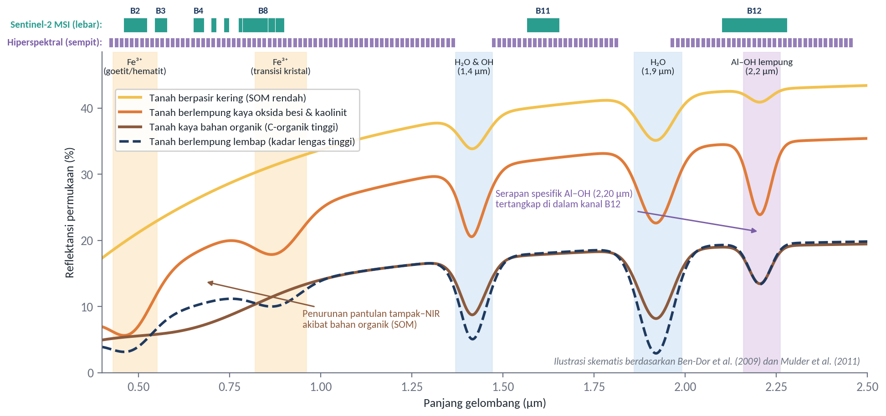
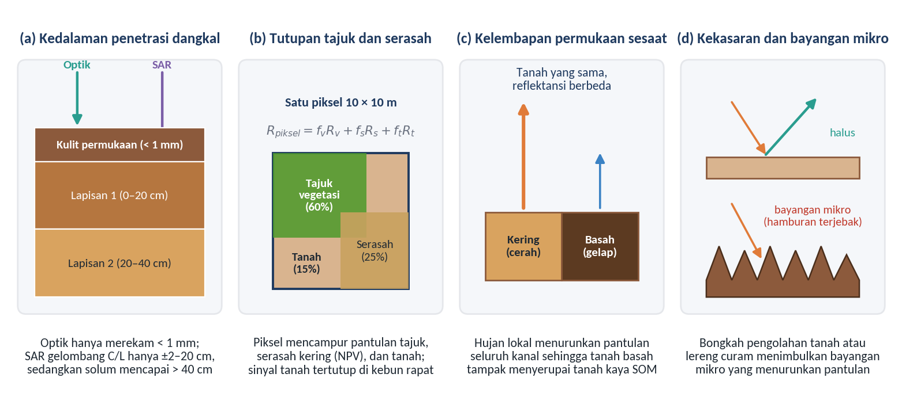
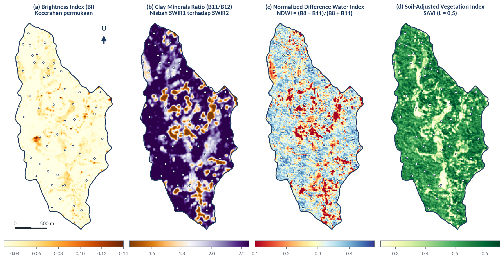
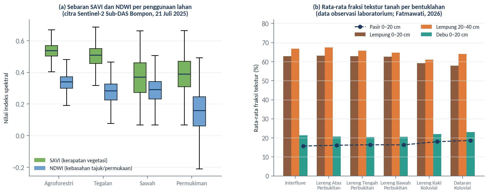

# Remote Sensing untuk Estimasi Soil Properties

## Tujuan dan Capaian Pembelajaran

Modul ini bertujuan membekali peserta dengan pemahaman mengenai prinsip fisik hubungan antara karakteristik spektral penginderaan jauh dan sifat-sifat tanah, pemanfaatan transformasi indeks spektral dari citra multispektral maupun hiperspektral untuk mengestimasi sifat fisik dan kimia tanah, serta berbagai faktor lingkungan dan sensor yang membatasi ketelitian estimasi tersebut. Pembahasan pada modul ini melanjutkan delineasi satuan peta tanah pada Modul 3 dengan mengisi ruang di dalam dan antar-satuan lahan menggunakan indikator spektral kuantitatif, sekaligus menjadi dasar bagi pemisahan piksel tanah terbuka pada Modul 5 dan pemilihan kovariat pada Modul 8.

Setelah mempelajari modul ini, peserta diharapkan mampu:

1. menjelaskan dasar fisik interaksi gelombang elektromagnetik dengan komponen penyusun tanah yang mengendalikan tekstur, kelembapan, karbon organik, oksida besi, dan drainase;
2. membedakan kemampuan citra multispektral dan hiperspektral dalam mendeteksi fitur serapan diagnostik sifat-sifat tanah;
3. merumuskan dan menerapkan transformasi indeks spektral untuk mengekstraksi indikator sifat tanah dan kondisi lingkungan dari citra satelit;
4. menganalisis faktor-faktor yang mengganggu estimasi langsung sifat tanah dari citra, terutama tutupan vegetasi, kelembapan sesaat, kekasaran permukaan, dan kedalaman penetrasi gelombang; dan
5. menghitung indeks spektral dari citra Sentinel-2 serta mengevaluasi pola spasialnya terhadap bentuklahan, penggunaan lahan, dan titik sampel tanah di Sub-DAS Bompon.

*Ceramah dan diskusi:*

## Indikator Remote Sensing untuk Estimasi Soil Properties

Sebagaimana telah diperkenalkan pada Modul 1, pantulan spektral permukaan tanah pada rentang cahaya tampak (*visible*, VIS: 0,4–0,7 µm), inframerah dekat (*near infrared*, NIR: 0,7–1,1 µm), dan inframerah gelombang pendek (*shortwave infrared*, SWIR: 1,1–2,5 µm) tidak bersifat acak, melainkan ditentukan oleh komposisi kimiawi dan susunan fisik partikel penyusun tanah (Ben-Dor et al., 2009; Mulder et al., 2011). Di dalam rentang VNIR–SWIR ini, kurva reflektansi tanah diatur oleh dua mekanisme fisika utama, yaitu transisi elektronik pada ion logam transisi (terutama besi pada panjang gelombang 0,4–1,0 µm) serta getaran molekuler berupa nada atas (*overtones*) dan kombinasi getaran tekuk-ulur (*bending-stretching vibrations*) dari ikatan kimia $\text{O–H}$, $\text{C–H}$, $\text{N–H}$, $\text{Al–OH}$, $\text{Mg–OH}$, dan $\text{CO}_3^{2-}$ pada panjang gelombang 1,1–2,5 µm (Viscarra Rossel & Behrens, 2010; Chabrillat et al., 2019). Komponen-komponen tanah yang memiliki pita serapan aktif dalam rentang tersebut sering disebut sebagai kromofor tanah (*soil chromophores*), yang mencakup air, bahan organik tanah, mineral lempung, oksida besi, karbonat, dan garam mudah larut.

Pengaruh masing-masing kromofor tersebut terhadap bentuk kurva reflektansi tanah ditunjukkan secara skematis pada Gambar 4.1. Pertama, **tekstur dan mineralogi lempung** memengaruhi baik tingkat pantulan keseluruhan maupun lekuk serapan spesifik pada wilayah SWIR. Tanah yang didominasi fraksi pasir kuarsa umumnya memiliki pantulan keseluruhan (*albedo*) yang tinggi karena butiran kuarsa tidak menyerap energi secara kuat pada tampak–NIR dan memiliki rongga antarbutir yang relatif kering, sedangkan tanah berlempung halus cenderung lebih gelap karena menahan lebih banyak air dan bahan organik (Hosseinpour-Zarnaq et al., 2025). Lebih khusus lagi, mineral lempung silikat memiliki gugus hidroksil ($\text{OH}$) yang terikat pada lembaran oktahedral aluminium ($\text{Al–OH}$) atau magnesium ($\text{Mg–OH}$). Kombinasi getaran ulur dan tekuk ikatan $\text{Al–OH}$ pada mineral lempung seperti kaolinit, ilit, dan smektit menghasilkan lembah serapan diagnostik yang tajam di sekitar panjang gelombang **2,20 µm**, disertai serapan gugus $\text{OH}$ struktural di sekitar **1,40 µm** (Chabrillat et al., 2019; Mulder et al., 2011). Kedalaman lembah serapan pada 2,20 µm inilah yang menjadi dasar fisik pendugaan kandungan lempung dari data spektral.

Gambar 4.1 Ilustrasi kurva reflektansi permukaan tanah untuk beberapa kombinasi sifat tanah beserta lokasi pita serapan diagnostik dan perbandingan lebar kanal Sentinel-2 MSI terhadap sensor hiperspektral

Sumber: Ilustrasi skematis disusun berdasarkan Ben-Dor et al. (2009), Mulder et al. (2011), dan Drusch et al. (2012)

Kedua, **kelembapan tanah (kadar lengas)** dan **kondisi drainase** memberikan pengaruh yang paling menyeluruh terhadap spektrum pantulan tanah. Molekul air bebas di dalam pori tanah menyerap energi secara sangat kuat pada pita serapan air utama di sekitar **1,40 µm** dan **1,90 µm**, serta membentuk selaput tipis di sekeliling butir tanah yang menurunkan indeks bias relatif antara partikel padat dan medium pori (Lobell & Asner, 2002). Akibatnya, penambahan kadar air menyebabkan kurva reflektansi tanah bergeser turun menjadi lebih gelap di seluruh panjang gelombang tampak hingga SWIR, sementara lembah serapan di 1,40 dan 1,90 µm makin melebar dan mendalam (Gambar 4.1, garis biru tua putus-putus). Selain melalui wilayah optik, kelembapan permukaan dan drainase juga dapat diindera melalui wilayah inframerah termal (8–14 µm) dan gelombang mikro aktif (SAR). Tanah yang lembap atau berdrainase terhambat memiliki inersia termal yang tinggi sehingga mengalami perubahan suhu siang–malam yang lebih kecil, serta memiliki tetapan dielektrik yang jauh lebih tinggi ($\varepsilon_r \approx 80$ untuk air dibandingkan $\varepsilon_r \approx 3\text{–}5$ untuk mineral tanah kering) yang meningkatkan intensitas hamburan balik radar pada sudut datang curam (Ulaby et al., 2014; Mulder et al., 2011).

Ketiga, **karbon organik tanah (*soil organic carbon*, SOC)** atau bahan organik tanah (*soil organic matter*, SOM) merupakan penentu utama rona gelap pada lapisan tanah atas (horizon A). Senyawa humik di dalam bahan organik menyerap radiasi secara kuat pada wilayah cahaya tampak (0,4–0,7 µm) hingga awal NIR, sehingga peningkatan kandungan C-organik menurunkan tingkat kecerahan tanah dan mengubah bentuk lengkungan kurva tampak–NIR dari cembung menjadi rata atau agak cekung (Gambar 4.1, garis cokelat tua) (Ben-Dor et al., 1999; Bartholomeus et al., 2008). Di samping itu, ikatan kimia organik seperti gugus alifatik $\text{C–H}$, amida $\text{N–H}$, dan karboksil memiliki serapan lemah di wilayah SWIR (sekitar 1,70, 2,10, dan 2,30 µm). Keempat, **oksida dan hidroksida besi** (terutama hematit [$\alpha\text{-Fe}_2\text{O}_3$] dan goetit [$\alpha\text{-FeOOH}$]) merupakan indikator penting bagi tingkat pelapukan batuan induk serta kondisi aerasi atau drainase internal profil tanah (tanah teroksidasi baik berwarna merah hingga kuning kecokelatan, sedangkan tanah tereduksi/tergenang berwarna kelabu kebiruan atau *gley*). Transisi elektronik ion $\text{Fe}^{3+}$ menimbulkan serapan kuat pada kanal biru–hijau (sekitar 0,40–0,55 µm) dan lembah serapan lebar di awal NIR (sekitar 0,85–0,92 µm), disertai lonjakan pantulan pada kanal merah (0,60–0,70 µm) yang memberi warna kemerahan khas pada tanah tropis terlapuk lanjut (Viscarra Rossel et al., 2006; Escadafal et al., 1989).

Kemampuan suatu sensor penginderaan jauh dalam memisahkan sinyal keempat sifat tanah tersebut sangat bergantung pada resolusi spektralnya (Gambar 4.1 bagian atas). Sensor **hiperspektral**—seperti satelit PRISMA dan EnMAP atau spektrometer kamera udara yang memiliki lebih dari 200 kanal sempit bersambungan dengan lebar pita (*bandwidth*) sekitar 5–10 nm—mampu merekam bentuk geometri lembah serapan secara utuh, sehingga memungkinkan pembedaan antara mineral lempung kaolinit (gandaan serapan di 2,16 dan 2,20 µm) dan smektit (serapan tunggal di 2,20 µm acompanhado serapan air kuat di 1,90 µm) maupun pendugaan fraksi tekstur secara kuantitatif (Chabrillat et al., 2019; Hosseinpour-Zarnaq et al., 2025). Sebaliknya, sensor **multispektral** operasional seperti Sentinel-2 MSI (13 kanal) atau Landsat 8/9 OLI (9 kanal optik) mengintegrasikan pantulan pada rentang pita yang lebar (sekitar 15–180 nm). Sebagai contoh, kanal B12 pada Sentinel-2 memiliki lebar pita 180 nm (2,100–2,280 µm), sehingga serapan sempit $\text{Al–OH}$ lempung pada 2,20 µm tercampur rata di dalam satu nilai pantulan kanal B12 (Drusch et al., 2012; Vaudour et al., 2019).

Meskipun tidak mampu menguraikan bentuk kurva serapan secara halus, citra multispektral tetap dapat dimanfaatkan untuk mengestimasi variasi sifat tanah dan kondisi tempat tumbuh melalui **transformasi indeks spektral** (*spectral indices*), yaitu kombinasi matematis berupa nisbah (*ratio*), selisih ternormalisasi (*normalized difference*), atau jarak euklides dari dua atau lebih kanal spektral. Penggunaan nisbah atau selisih ternormalisasi antara kanal yang mengalami serapan kuat (pita aktif) dan kanal pembanding yang tidak mengalami serapan (pita acuan) membantu menekan gangguan variasi pencahayaan topografi dan bayangan lereng (Lillesand et al., 2015). Untuk mineral lempung, misalnya, kanal SWIR1 (B11 pada Sentinel-2, berpusat di 1,61 µm) terletak pada puncak pantulan tanah yang relatif bebas dari serapan mineral, sedangkan kanal SWIR2 (B12, berpusat di 2,19 µm) mencakup pita serapan $\text{Al–OH}$ lempung. Oleh karena itu, nisbah $\text{SWIR1} / \text{SWIR2}$ (sering disebut *Clay Minerals Ratio* atau *Clay Index*) maupun bentuk selisih ternormalisasinya (*Normalized Difference Clay Index*, NDCI) akan bernilai lebih tinggi apabila serapan pada B12 makin kuat (Drury, 1987; Fatmawati, 2026). Demikian pula, perbandingan antara kanal NIR (B8 atau B8A) dan SWIR1 (B11) dalam bentuk *Normalized Difference Water Index* (NDWI; Gao, 1996) menangkap serapan air pada panjang gelombang pendek, baik oleh kelembapan tajuk vegetasi maupun kelembapan permukaan tanah. Rincian formula, kanal Sentinel-2 yang digunakan, serta kaitan pedologis dari berbagai indeks spektral utama dirangkum pada Tabel 4.1.

Tabel 4.1 Transformasi Indeks Spektral untuk Estimasi Sifat Tanah dan Indikator Lingkungan pada Citra Sentinel-2

| **Kelompok indikator** | **Nama indeks** | **Rumus umum dan padanan kanal Sentinel-2** | **Mekanisme fisik dan kaitan dengan sifat tanah** | **Rujukan utama** |
| :--- | :--- | :--- | :--- | :--- |
| Kecerahan dan bahan organik | *Brightness Index* (BI) | $\sqrt{(R^2 + G^2 + B^2)/3} = \sqrt{(\text{B4}^2 + \text{B3}^2 + \text{B2}^2)/3}$ | Mengukur *albedo* cahaya tampak; bernilai rendah pada tanah kaya bahan organik (C-organik tinggi) atau tanah basah, dan tinggi pada tanah tererosi/berpasir kering | Escadafal et al. (1989); Mulder et al. (2011) |
| Oksida besi dan warna tanah | *Redness Index* (RI) | $R^2 / (B \times G^3) = \text{B4}^2 / (\text{B2} \times \text{B3}^3)$ | Menangkap lonjakan pantulan merah relatif terhadap serapan biru–hijau oleh ion $\text{Fe}^{3+}$ (hematit); mencerminkan tingkat pelapukan dan drainase baik | Pouget et al. (1990); Mathieu et al. (1998) |
| Oksida besi dan warna tanah | *Coloration Index* (CI~warna~) | $(R - G)/(R + G) = (\text{B4} - \text{B3})/(\text{B4} + \text{B3})$ | Membedakan rona kekuningan (goetit) dan kemerahan (hematit) pada permukaan tanah terbuka | Escadafal et al. (1989) |
| Mineral lempung dan tekstur | *Clay Minerals Ratio* (*Clay Index*) | $\text{SWIR1} / \text{SWIR2} = \text{B11} / \text{B12}$ | Memanfaatkan puncak pantulan di 1,61 µm terhadap serapan ikatan $\text{Al–OH}$ mineral lempung (kaolinit/ilit/smektit) di sekitar 2,20 µm | Drury (1987); Fatmawati (2026) |
| Mineral lempung dan tekstur | *Normalized Difference Clay Index* (NDCI) | $(\text{SWIR1} - \text{SWIR2})/(\text{SWIR1} + \text{SWIR2}) = (\text{B11} - \text{B12})/(\text{B11} + \text{B12})$ | Bentuk ternormalisasi dari nisbah lempung pada rentang $-1$ hingga $+1$ untuk menstabilkan skala nilai | Mulder et al. (2011) |
| Kelembapan dan drainase | *Normalized Difference Water Index* (NDWI) | $(\text{NIR} - \text{SWIR1})/(\text{NIR} + \text{SWIR1}) = (\text{B8} - \text{B11})/(\text{B8} + \text{B11})$ | Peka terhadap serapan air cair pada 1,61 µm di dalam jaringan daun maupun pada lapisan tanah permukaan; indikator tidak langsung rezim lengas | Gao (1996); Fatmawati (2026) |
| Vegetasi sebagai proksi tanah (faktor $o$) | *Normalized Difference Vegetation Index* (NDVI) | $(\text{NIR} - R)/(\text{NIR} + R) = (\text{B8} - \text{B4})/(\text{B8} + \text{B4})$ | Mengukur kerapatan dan vigor biomassa hijau; mencerminkan masukan serasah (C-organik) serta kapasitas pasokan air dan hara zona perakaran | Rouse et al. (1974); McBratney et al. (2003) |
| Vegetasi sebagai proksi tanah (faktor $o$) | *Soil-Adjusted Vegetation Index* (SAVI) | $\frac{\text{NIR} - R}{\text{NIR} + R + L}(1 + L) = \frac{1,5(\text{B8} - \text{B4})}{\text{B8} + \text{B4} + 0,5}$ | Menambahkan faktor koreksi latar tanah ($L = 0,5$) untuk mengurangi bias kecerahan tanah pada tajuk yang belum menutup rapat | Huete (1988); Fatmawati (2026) |
| Vegetasi sebagai proksi tanah (faktor $o$) | *Enhanced Vegetation Index* (EVI) | $2,5 \frac{\text{B8} - \text{B4}}{\text{B8} + 6\,\text{B4} - 7,5\,\text{B2} + 1}$ | Mengurangi kejenuhan sinyal pada biomassa sangat rapat (seperti agroforestri atau sawit dewasa) dan mengoreksi hamburan aerosol atmosfer | Huete et al. (2002); Fatmawati (2026) |

Sumber: Disusun berdasarkan pustaka pada kolom rujukan dan daftar kovariat dalam Fatmawati (2026)

Penting untuk dipahami bahwa di wilayah bervegetasi, indeks vegetasi seperti NDVI, SAVI, dan EVI bukanlah pengukur langsung sifat tanah, melainkan indikator tidak langsung (*bio-indicators*) yang bekerja melalui hubungan timbal balik antara tanaman dan tanah (faktor $o$ dalam SCORPAN) (McBratney et al., 2003; Mulder et al., 2011). Di satu sisi, variasi tekstur, kedalaman efektif, drainase, dan kesuburan tanah mengendalikan ketersediaan air dan hara bagi tanaman, sehingga perbedaan kondisi tanah sering terekspresikan sebagai perbedaan vigor tajuk atau ketahanan tanaman terhadap cekaman kemarau. Di sisi lain, kerapatan tajuk vegetasi mengatur jumlah masukan bahan organik melalui guguran serasah serta melindungi permukaan tanah dari pukulan air hujan dan radiasi matahari langsung, sehingga memengaruhi kandungan C-organik, berat volume, dan kadar lengas tanah.

## Faktor yang Memengaruhi Estimasi Soil Properties

Meskipun hubungan spektral di laboratorium antara reflektansi tanah kering-udara yang telah diayak dan sifat-sifat tanah sering menunjukkan korelasi yang sangat tinggi, penerapan hubungan tersebut secara langsung pada citra satelit atau pesawat udara dihadapkan pada empat faktor pembatas utama (Gambar 4.2) (Ben-Dor et al., 2009; Mulder et al., 2011; Chabrillat et al., 2019). Faktor pertama adalah **kedalaman penetrasi gelombang yang sangat dangkal** (Gambar 4.2 panel a). Gelombang optik (VNIR–SWIR) hanya berinteraksi dengan kulit terluar permukaan tanah setebal kurang dari 1 mm (sekitar 50–200 µm), sedangkan gelombang mikro radar (SAR gelombang C dan L) hanya menembus sekitar 2–20 cm tergantung pada kekeringan tanah (Ulaby et al., 2014). Padahal, pengamatan pertanian dan survei tanah mengkaji horizon perakaran pada kedalaman 0–20 cm, 20–40 cm, hingga lebih dari 1 m. Apabila kulit permukaan mengalami pembentukan kerak tanah (*soil crusting*), pencucian partikel halus oleh percikan hujan, atau pengendapan debu tipis, spektrum yang terekam oleh sensor optik tidak lagi mewakili komposisi lapisan olah di bawahnya, apalagi lapisan bawah permukaan (*subsoil*) tempat terjadinya akumulasi lempung iluvial.

Gambar 4.2 Empat faktor pengganggu utama dalam estimasi sifat tanah secara langsung dari data penginderaan jauh

Sumber: Diagram konseptual disusun berdasarkan Ben-Dor et al. (2009), Lobell dan Asner (2002), dan Mulder et al. (2011)

Faktor kedua, yang menjadi kendala terbesar di wilayah tropis lembap dan perkebunan tanaman tahunan, adalah **penutupan oleh tajuk vegetasi dan serasah** yang mengakibatkan pencampuran spektral di dalam satu piksel (*mixed pixel*; Gambar 4.2 panel b). Apabila tutupan vegetasi hijau di dalam suatu piksel melampaui 20–30%, lonjakan pantulan NIR dari klorofil dan jaringan daun serta serapan air daun di wilayah SWIR akan mendominasi sinyal piksel dan menutupi fitur serapan mineral tanah (Bartholomeus et al., 2008; Mulder et al., 2011). Bahkan ketika lahan tidak tertutup vegetasi hidup, keberadaan serasah kering, jerami padi, atau pelepah kelapa sawit (*non-photosynthetic vegetation*, NPV) menimbulkan serapan selulosa dan lignin pada panjang gelombang 2,10–2,30 µm yang berimpitan langsung dengan pita serapan $\text{Al–OH}$ mineral lempung pada 2,20 µm, sehingga rasio $\text{B11}/\text{B12}$ dapat terdistorsi secara kuat oleh vegetasi dan residu tanaman (Chabrillat et al., 2019).

Faktor ketiga dan keempat berkaitan dengan dinamika kondisi fisik permukaan tanah saat perekaman citra, yaitu **kelembapan permukaan sesaat** dan **kekasaran permukaan** (Gambar 4.2 panel c dan d). Sebagaimana telah dijelaskan sebelumnya, pembasahan tanah akibat hujan lokal menurunkan pantulan di seluruh panjang gelombang, sehingga tanah berpasir atau tanah miskin bahan organik yang sedang basah dapat memiliki nilai *Brightness Index* yang sama rendahnya dengan tanah kering yang kaya C-organik (Lobell & Asner, 2002). Sementara itu, kekasaran makro akibat pembajakan lahan, pembuatan guludan tegalan, atau kemiringan lereng yang curam menciptakan perangkap cahaya dan bayangan mikro antar-agregat tanah. Permukaan yang kasar dan berbongkah memantulkan energi lebih rendah ke arah sensor dibandingkan permukaan tanah yang sama ketika telah menghalus atau memadat (Mathieu et al., 1998; Ben-Dor et al., 2009).

Keempat faktor pengganggu tersebut dapat diamati secara nyata pada studi kasus Sub-DAS Bompon. Untuk memahami kondisi tanah sasaran yang hendak diestimasi, Tabel 4.2 menyajikan ringkasan statistik hasil analisis laboratorium terhadap 50 titik sampel tanah pada Lapisan 1 (0–20 cm) dan Lapisan 2 (20–40 cm) yang dilaporkan oleh Fatmawati (2026). Data empiris tersebut memperlihatkan karakteristik pedologis yang sangat khas dari lanskap transisi vulkanik Kuarter Gunung Sumbing di atas batuan breksi andesit Tersier yang mengalami alterasi hidrotermal:

1. **Dominasi mutlak fraksi lempung dan proses eluviasi–iluviasi.** Kandungan lempung rata-rata mencapai **62,48%** (kisaran 38,97–82,73%) pada Lapisan 1 dan meningkat menjadi **64,78%** (kisaran 44,49–82,24%) pada Lapisan 2, dengan koefisien variasi (CV) yang rendah (~15,7–15,9%). Sebaliknya, rata-rata fraksi pasir menurun dari 16,43% menjadi 15,68% dan debu menurun dari 21,09% menjadi 19,54% seiring bertambahnya kedalaman. Pada segitiga tekstur USDA, sebanyak 47 dari 50 sampel Lapisan 1 dan seluruh 50 sampel Lapisan 2 jatuh ke dalam satu kelas tekstur yang sama, yaitu kelas lempung (*clay*). Peningkatan lempung pada lapisan bawah mencerminkan pelindian (eluviasi) partikel halus dari lapisan permukaan menuju horizon bawah permukaan di atas batuan induk kaya lempung alterasi (Fatmawati, 2026; Wida et al., 2019).
2. **Keragaman spasial fraksi pasir yang tinggi.** Berbeda dengan lempung yang seragam tinggi di seluruh sub-DAS, fraksi pasir memiliki nilai CV tertinggi, yaitu **41,42%** pada Lapisan 1 dan **46,68%** pada Lapisan 2 (>35%, tergolong sangat heterogen). Keragaman ini dikendalikan oleh redistribusi sedimen di sepanjang lereng bukit serta adanya sisipan material tuf pasiran dan endapan Gunung Sumbing Muda di bagian tertentu lanskap.
3. **Mineralogi lempung beraktivitas rendah (kaolinitik) dan reaksi tanah masam.** Meskipun kandungan lempungnya melebihi 60%, nilai kapasitas pertukaran kation (KPK) tanah tergolong rendah hingga sedang, dengan rata-rata hanya **8,99 cmol(+)/kg** pada Lapisan 1 dan **9,22 cmol(+)/kg** pada Lapisan 2, disertai pH yang masam (rata-rata 5,20 dan 5,23). Fenomena lempung tinggi tetapi KPK rendah ini merupakan bukti kuat bahwa mineral lempung penyusunnya didominasi oleh lempung tipe 1:1 beraktivitas rendah, terutama **kaolinit**, yang terbentuk dari alterasi hidrotermal lanjut dan pelapukan intensif bercurah hujan tinggi (Fatmawati, 2026; Purwaningsih et al., 2025).
4. **Akumulasi C-organik di lapisan atas dan retensi lengas yang tinggi.** Kandungan C-organik rata-rata menurun dari **1,13%** pada Lapisan 1 menjadi **0,92%** pada Lapisan 2 karena pasokan serasah vegetasi terkonsentrasi di permukaan. Dominasi pori mikro pada tanah lempung menghasilkan berat volume (BV) yang rendah (rata-rata 0,94 dan 0,92 g/cm³) serta kadar lengas yang tinggi secara merata pada kedua kedalaman (~22,90–23,03%).

Tabel 4.2 Statistik Deskriptif Sifat Fisik dan Kimia Tanah Hasil Observasi Laboratorium di Sub-DAS Bompon ($n = 50$ titik per lapisan)

| **Parameter sifat tanah** | **Satuan** | **Kedalaman lapisan** | **Minimum** | **Maksimum** | **Rata-rata** | **Simpangan baku (SD)** | **Koefisien variasi (CV, %)** |
| :--- | :--- | :--- | :--- | :--- | :--- | :--- | :--- |
| Fraksi pasir | % | Lapisan 1 (0–20 cm) | 6,49 | 33,67 | 16,43 | 6,81 | 41,42 |
| Fraksi pasir | % | Lapisan 2 (20–40 cm) | 5,94 | 32,50 | 15,68 | 7,32 | 46,68 |
| Fraksi debu | % | Lapisan 1 (0–20 cm) | 10,77 | 41,80 | 21,09 | 6,56 | 31,10 |
| Fraksi debu | % | Lapisan 2 (20–40 cm) | 10,02 | 37,81 | 19,54 | 6,14 | 31,44 |
| Fraksi lempung | % | Lapisan 1 (0–20 cm) | 38,97 | 82,73 | 62,48 | 9,82 | 15,72 |
| Fraksi lempung | % | Lapisan 2 (20–40 cm) | 44,49 | 82,24 | 64,78 | 10,32 | 15,93 |
| Reaksi tanah (pH $\text{H}_2\text{O}$) | – | Lapisan 1 (0–20 cm) | 4,45 | 6,47 | 5,20 | 0,36 | 6,97 |
| Reaksi tanah (pH $\text{H}_2\text{O}$) | – | Lapisan 2 (20–40 cm) | 4,49 | 6,11 | 5,23 | 0,35 | 6,71 |
| Kapasitas Pertukaran Kation (KPK) | cmol(+)/kg | Lapisan 1 (0–20 cm) | 4,01 | 16,45 | 8,99 | 2,46 | 27,43 |
| Kapasitas Pertukaran Kation (KPK) | cmol(+)/kg | Lapisan 2 (20–40 cm) | 3,81 | 14,85 | 9,22 | 2,42 | 26,21 |
| C-organik | % | Lapisan 1 (0–20 cm) | 0,08 | 2,26 | 1,13 | 0,43 | 38,02 |
| C-organik | % | Lapisan 2 (20–40 cm) | 0,16 | 1,56 | 0,92 | 0,32 | 34,62 |
| Berat volume (BV) | g/cm³ | Lapisan 1 (0–20 cm) | 0,56 | 1,11 | 0,94 | 0,11 | 12,04 |
| Berat volume (BV) | g/cm³ | Lapisan 2 (20–40 cm) | 0,69 | 1,18 | 0,92 | 0,12 | 12,55 |
| Kadar lengas | % | Lapisan 1 (0–20 cm) | 11,73 | 35,40 | 22,90 | 4,81 | 20,99 |
| Kadar lengas | % | Lapisan 2 (20–40 cm) | 11,65 | 34,40 | 23,03 | 4,90 | 21,27 |

Sumber: Disarikan dari Tabel 4.1 dan Tabel 4.2 dalam Fatmawati (2026)

Sekarang bandingkan karakteristik laboratorium tersebut dengan sebaran spasial empat indeks spektral Sentinel-2 (perekaman 21 Juli 2025) di Sub-DAS Bompon yang disajikan pada Gambar 4.3, serta distribusi statistiknya menurut penggunaan lahan dan bentuklahan pada Gambar 4.4. Pada Gambar 4.3, pola spasial *Brightness Index* (panel a), *Clay Minerals Ratio* $\text{B11}/\text{B12}$ (panel b), NDWI (panel c), dan SAVI (panel d) menunjukkan kemiripan pola makro yang mencolok: jalur lembah koluvial di bagian tengah-selatan dan bercak-bercak permukiman/tegalan tampak memiliki nilai BI yang tinggi (median BI sawah = 0,043 dan permukiman = 0,042), sedangkan perbukitan yang tertutup agroforestri memiliki BI sangat rendah (median 0,029) serta SAVI dan NDWI yang tinggi (median SAVI agroforestri = 0,537; median NDWI = 0,340; Gambar 4.4 panel a).

Gambar 4.3 Peta sebaran spasial empat indeks spektral dari citra Sentinel-2 Level-2A (21 Juli 2025) beserta lokasi 50 titik sampel rencana di Sub-DAS Bompon: (a) *Brightness Index*, (b) *Clay Minerals Ratio* ($\text{B11}/\text{B12}$), (c) NDWI, dan (d) SAVI

Sumber: Diolah dari citra Sentinel-2B Level-2A perekaman 21 Juli 2025 dan data spasial Sub-DAS Bompon (`bompon.gpkg`)

Temuan paling kritis bagi penafsir penginderaan jauh terlihat pada peta *Clay Minerals Ratio* ($\text{B11}/\text{B12}$, Gambar 4.3 panel b). Secara keseluruhan di Sub-DAS Bompon, rasio $\text{B11}/\text{B12}$ bernilai paling tinggi pada kelas Agroforestri (median 2,265; kuartil 2,150–2,348), menurun pada Tegalan (median 2,008) dan Sawah (median 1,992), serta paling rendah pada Permukiman (median 1,658). Apabila rasio $\text{B11}/\text{B12}$ ditafsirkan secara naif sebagai ukuran langsung kandungan mineral lempung permukaan tanah, seseorang akan menyimpulkan bahwa sensor satelit berhasil mendeteksi lempung yang sangat tinggi di bawah hutan agroforestri. Kesimpulan semacam itu keliru secara fisik: pada area agroforestri yang memiliki median NDVI 0,880, permukaan tanah tertutup sepenuhnya oleh tajuk pohon berlapis. Tingginya rasio $\text{B11}/\text{B12}$ pada piksel agroforestri sebenarnya disebabkan oleh **serapan air jaringan daun dan biokimia tajuk** yang menurunkan pantulan kanal B12 (2,19 µm) jauh lebih kuat daripada kanal B11 (1,61 µm). Dengan kata lain, pada area bervegetasi rapat, indeks tanah seperti $\text{B11}/\text{B12}$ bekerja sebagai proksi kerapatan dan kebasahan tajuk vegetasi, bukan sebagai pendeteksi langsung mineral lempung tanah!

Gambar 4.4 Perbandingan (a) sebaran nilai indeks spektral SAVI dan NDWI menurut penggunaan lahan dari citra Sentinel-2 dan (b) rata-rata fraksi tekstur tanah hasil laboratorium menurut satuan bentuklahan di Sub-DAS Bompon

Sumber: Panel (a) diolah dari citra Sentinel-2B Level-2A (21 Juli 2025) dan `bompon.gpkg`; panel (b) diolah dari Lampiran 4 dalam Fatmawati (2026)

Sebaliknya, ketika kita memeriksa variasi fraksi tekstur hasil laboratorium menurut enam satuan bentuklahan (Gambar 4.4 panel b; Fatmawati, 2026), tampak pola pedogeomorfik yang nyata tetapi halus: kandungan lempung Lapisan 1 sedikit menurun dari satuan perbukitan atas (*Interfluve* 62,86% dan Lereng Atas 63,09%) menuju Lereng Kaki Koluvial (59,20%) dan Dataran Koluvial (57,91%), diiringi peningkatan rata-rata fraksi debu (dari ~20,4–21,3% di perbukitan menjadi 21,96% di Lereng Kaki dan 23,00% di Dataran Koluvial) serta fraksi pasir (dari 15,72% di *Interfluve* menjadi 18,00–18,61% di satuan koluvial). Pada Lapisan 2 (20–40 cm), kandungan lempung di Dataran Koluvial kembali melonjak menjadi 64,04%. Perbedaan antara lapisan atas dan lapisan bawah di lembah koluvial ini terjadi karena pengolahan tanah sawah (*puddling*) dan pengendapan sedimen banjir baru di permukaan, sementara lapisan bawahnya tetap menyimpan akumulasi lempung yang padat. Karena sinyal spektral citra di Sub-DAS Bompon sangat dipengaruhi oleh penutupan vegetasi pada 50 titik sampel (median NDVI pada 50 titik sampel mencapai 0,868 dengan rentang 0,375–0,908), mudah dipahami mengapa indeks spektral tunggal tidak dapat menduga tekstur secara langsung dengan akurasi tinggi, dan mengapa kita memerlukan teknik pemisahan piksel tanah terbuka yang akan dibahas secara khusus pada Modul 5.

*Demonstrasi dan praktik:*

## Praktik: Perhitungan Transformasi Indeks Spektral dan Analisis Pola Sifat Tanah Sub-DAS Bompon

**Tujuan**

Praktik ini melatih peserta untuk menghitung berbagai transformasi indeks spektral yang berkaitan dengan sifat tanah dan kondisi vegetasi/kelembapan dari citra Sentinel-2 Level-2A, mengekstrak nilai indeks tersebut pada titik-titik sampel tanah serta satuan penggunaan lahan dan bentuklahan, lalu mengevaluasi secara kritis kemampuan dan keterbatasan indikator spektral dalam mencerminkan variasi sifat tanah di Sub-DAS Bompon.

**Input Data**

- Citra reflektansi permukaan Sentinel-2 Level-2A `Source/Data Bompon/terbuka/sentinel2_l2a_20250721_10m.tif` (10 kanal: B02=Band 1, B03=Band 2, B04=Band 3, B05=Band 4, B06=Band 5, B07=Band 6, B08=Band 7, B8A=Band 8, B11=Band 9, B12=Band 10; nilai piksel sudah dalam satuan reflektansi permukaan 0–1).
- Berkas `bompon.gpkg` (`EPSG:32749`), khususnya lapisan `batas_subdas`, `bentuklahan`, `penggunaan_lahan`, dan `titik_sampel_rencana`.

**Software**

- QGIS versi 3.x (panduan menu mengacu pada QGIS 3.44) dengan alat *Raster Calculator*, *Zonal Statistics*, dan *Sample Raster Values*.

**Langkah Kerja**

*A. Menghitung transformasi indeks spektral di Raster Calculator*

1. Buka proyek QGIS (`EPSG:32749`) dan muat `sentinel2_l2a_20250721_10m.tif` beserta lapisan `batas_subdas`, `bentuklahan`, `penggunaan_lahan`, dan `titik_sampel_rencana` dari `bompon.gpkg`. Pastikan urutan nomor band pada berkas `sentinel2_l2a_20250721_10m.tif` diperiksa melalui **Layer Properties > Information** (Band 1 = B02 [Biru], Band 2 = B03 [Hijau], Band 3 = B04 [Merah], Band 7 = B08 [NIR], Band 9 = B11 [SWIR1], Band 10 = B12 [SWIR2]).
2. Buka **Raster > Raster Calculator**, lalu hitung **Brightness Index (BI)** sebagai indikator kecerahan permukaan dengan ekspresi berikut dan simpan sebagai `indeks_bi_10m.tif`:

    `sqrt( ( "sentinel2_l2a_20250721_10m@3" ^ 2 + "sentinel2_l2a_20250721_10m@2" ^ 2 + "sentinel2_l2a_20250721_10m@1" ^ 2 ) / 3.0 )`

3. Hitung **Redness Index (RI)** atau **Coloration Index (CI~warna~)** untuk menonjolkan rona kemerahan oksida besi pada permukaan terbuka. Untuk *Coloration Index* yang memiliki rentang nilai stabil $(-1 \text{ hingga } +1)$, gunakan ekspresi berikut dan simpan sebagai `indeks_ci_warna_10m.tif`:

    `( "sentinel2_l2a_20250721_10m@3" - "sentinel2_l2a_20250721_10m@2" ) / ( "sentinel2_l2a_20250721_10m@3" + "sentinel2_l2a_20250721_10m@2" )`

4. Hitung **Clay Minerals Ratio (CI)** menggunakan kanal SWIR1 (Band 9 = B11) dan SWIR2 (Band 10 = B12) dengan ekspresi berikut, lalu simpan sebagai `indeks_lempung_10m.tif`:

    `"sentinel2_l2a_20250721_10m@9" / "sentinel2_l2a_20250721_10m@10"`

5. Hitung **Normalized Difference Water Index (NDWI)** menggunakan kanal NIR (Band 7 = B08) dan SWIR1 (Band 9 = B11) dengan ekspresi berikut, lalu simpan sebagai `indeks_ndwi_10m.tif`:

    `( "sentinel2_l2a_20250721_10m@7" - "sentinel2_l2a_20250721_10m@9" ) / ( "sentinel2_l2a_20250721_10m@7" + "sentinel2_l2a_20250721_10m@9" )`

6. Hitung **Normalized Difference Vegetation Index (NDVI)** dan **Soil-Adjusted Vegetation Index (SAVI, $L = 0,5$)** menggunakan kanal NIR (Band 7 = B08) dan Merah (Band 3 = B04) dengan ekspresi berikut, lalu simpan berturut-turut sebagai `indeks_ndvi_10m.tif` dan `indeks_savi_10m.tif`:

    - NDVI: `( "sentinel2_l2a_20250721_10m@7" - "sentinel2_l2a_20250721_10m@3" ) / ( "sentinel2_l2a_20250721_10m@7" + "sentinel2_l2a_20250721_10m@3" )`
    - SAVI: `1.5 * ( "sentinel2_l2a_20250721_10m@7" - "sentinel2_l2a_20250721_10m@3" ) / ( "sentinel2_l2a_20250721_10m@7" + "sentinel2_l2a_20250721_10m@3" + 0.5 )`

*B. Memvisualisasikan dan mengekstrak statistik indeks per satuan lahan dan titik sampel*

7. Potong atau samarkan tampilan keenam raster indeks menggunakan poligon `batas_subdas` (melalui **Layer Properties > Symbology** dengan mengatur rentang *Min/Max* sesuai persentil 2%–98% di dalam Sub-DAS, atau menggunakan *Mask* poligon batas Sub-DAS).
8. Gabungkan keenam raster indeks menjadi satu tumpukan virtual melalui **Raster > Miscellaneous > Build Virtual Raster** (*Place each input file into a separate band* dicentang) dan simpan sebagai `tumpukan_indeks_modul4.vrt`.
9. Ekstrak nilai keenam indeks pada 50 titik sampel melalui **Processing Toolbox > Raster analysis > Sample raster values** dengan `titik_sampel_rencana` sebagai *Input layer* dan `tumpukan_indeks_modul4.vrt` sebagai *Raster layer*. Simpan keluaran sebagai lapisan `sampel_indeks_modul4.gpkg`.
10. Hitung statistik zona (*mean*, *median*, dan *standard deviation*) untuk masing-masing indeks pada poligon `penggunaan_lahan` dan `bentuklahan` menggunakan **Processing Toolbox > Raster analysis > Zonal statistics**.
11. Buka tabel atribut `sampel_indeks_modul4.gpkg`, urutkan titik sampel berdasarkan nilai NDVI dari yang terendah hingga tertinggi, dan amati bagaimana perubahan nilai BI, `indeks_lempung_10m`, dan NDWI mengikuti gradien kerapatan vegetasi (NDVI/SAVI) serta kelas penggunaan lahannya.

**Expected Output**

- Enam berkas raster indeks spektral (`indeks_bi_10m.tif`, `indeks_ci_warna_10m.tif`, `indeks_lempung_10m.tif`, `indeks_ndwi_10m.tif`, `indeks_ndvi_10m.tif`, dan `indeks_savi_10m.tif`) pada grid acuan 10 m (`EPSG:32749`).
- Untuk citra acuan 21 Juli 2025 di dalam batas Sub-DAS Bompon, median nilai indeks yang dihasilkan adalah sekitar: $\text{BI} = 0,031$, $\text{CI (B11/B12)} = 2,188$, $\text{NDWI} = 0,323$, $\text{SAVI} = 0,521$, dan $\text{NDVI} = 0,869$.
- Berkas `sampel_indeks_modul4.gpkg` yang memuat nilai keenam indeks spektral pada 50 titik sampel beserta atribut bentuklahan, kelas lereng, dan penggunaan lahannya.
- Tabel statistik zona yang memperlihatkan kontras respons spektral antara Agroforestri, Tegalan, Sawah, dan Permukiman.

**Interpretation**

Perhatikan hasil ekstraksi pada 50 titik sampel di `sampel_indeks_modul4.gpkg`. Sebagian besar titik sampel yang terletak di bawah penggunaan lahan Agroforestri memiliki nilai NDVI > 0,80 dan SAVI > 0,50, yang menandakan penutupan tajuk sangat rapat. Pada titik-titik tersebut, nilai *Brightness Index* sangat rendah (~0,025–0,032) dan rasio $\text{B11}/\text{B12}$ tinggi (~2,15–2,40) bukan karena permukaan tanahnya paling gelap oleh bahan organik atau paling kaya kaolinit di permukaan, melainkan karena sinyal yang tertangkap sensor didominasi oleh serapan klorofil dan air daun. Sebaliknya, pada titik-titik sampel di Sawah atau Tegalan yang sedang bera/terbuka sebagian (NDVI < 0,55), nilai BI meningkat (>0,040) dan variasi warna permukaan tanah mulai terekspresikan. Hasil ini membuktikan secara langsung bahwa: (1) indeks spektral pada wilayah tertutup vegetasi bekerja sebagai kovariat organisme (faktor $o$ dalam SCORPAN), dan (2) estimasi langsung sifat permukaan tanah dari spektrum citra hanya sahih apabila diterapkan pada piksel-piksel yang telah disaring sebagai tanah terbuka (yang akan dipraktikkan pada Modul 5).

**Troubleshooting**

- **Nilai SAVI tampak jauh lebih besar dari 1 atau menjadi negatif seluruhnya.** Periksa kembali satuan piksel citra masukan. Rumus SAVI dengan konstanta $L = 0,5$ mengasumsikan nilai kanal B08 dan B04 telah berada dalam satuan reflektansi permukaan ($0\text{–}1$). Apabila menggunakan citra Sentinel-2 mentah yang masih bersatuan *Digital Number* ($0\text{–}10.000$), bagi nilai kanal dengan `10000.0` terlebih dahulu atau ubah konstanta $L$ menjadi `5000`.
- **Muncul nilai *NaN* atau *Infinity* pada hasil `indeks_lempung_10m.tif`.** Hal ini terjadi apabila terdapat piksel bernilai nol pada kanal penyebut (B12). Gunakan fungsi `max("sentinel2_l2a_20250721_10m@10", 0.0001)` pada penyebut di *Raster Calculator*.
- **Peta *Brightness Index* tampak gelap merata di seluruh layar.** Karena sebagian besar Sub-DAS tertutup vegetasi dengan pantulan tampak yang rendah ($0,02\text{–}0,05$) sedangkan segelintir piksel atap bangunan/awan bernilai tinggi ($>0,15$), perentangan *Min/Max* otomatis membuat kontras lahan menjadi datar. Ubah pengaturan *Min* ke `0.02` dan *Max* ke `0.12` pada *Layer Styling*.

## Rangkuman

Estimasi sifat-sifat tanah menggunakan penginderaan jauh didasarkan pada interaksi fisik gelombang elektromagnetik dengan kromofor tanah—terutama mineral lempung, air, bahan organik, dan oksida besi—yang membentuk kurva reflektansi khas pada rentang VNIR–SWIR, termal, dan gelombang mikro. Sensor hiperspektral mampu menguraikan bentuk lembah serapan sempit seperti ikatan $\text{Al–OH}$ mineral lempung pada 2,20 µm secara rinci, sedangkan sensor multispektral seperti Sentinel-2 MSI merangkum perbedaan spektral tersebut melalui transformasi indeks spektral, seperti *Brightness Index* (BI), *Redness Index* (RI), *Clay Minerals Ratio* ($\text{B11}/\text{B12}$), dan NDWI, serta indeks vegetasi (NDVI, SAVI, EVI) yang berperan sebagai indikator tidak langsung kondisi tempat tumbuh.

Dalam penerapannya di lapangan, hubungan antara sinyal spektral citra dan sifat tanah dipengaruhi secara kuat oleh empat faktor pembatas, yaitu kedalaman penetrasi gelombang yang hanya menyentuh lapisan kulit permukaan, pencampuran spektral akibat tutupan tajuk vegetasi dan serasah, fluktuasi kelembapan permukaan sesaat, serta kekasaran permukaan tanah. Keempat faktor tersebut menyebabkan satu nilai indeks spektral tidak selalu berkorespondensi tunggal dengan satu sifat tanah apabila kondisi penutup lahan dan kelembapan permukaannya berbeda.

Pada studi kasus Sub-DAS Bompon, data laboratorium menunjukkan bahwa tanah didominasi oleh fraksi lempung beraktivitas rendah (kaolinitik) dengan rata-rata lempung 62,48% pada kedalaman 0–20 cm dan 64,78% pada 20–40 cm, KPK rendah–sedang (8,99–9,22 cmol(+)/kg), pH masam (5,20–5,23), serta variasi pasir yang tinggi di sepanjang lereng. Namun, evaluasi terhadap citra Sentinel-2 membuktikan bahwa sebaran spasial BI, rasio $\text{B11}/\text{B12}$, dan NDWI di Sub-DAS Bompon terutama dikendalikan oleh kontras antara tutupan agroforestri rapat (median NDVI 0,880) dan petak sawah/tegalan/permukiman. Agar ekstraksi informasi sifat tanah secara langsung dari spektrum citra tidak terdistorsi oleh sinyal vegetasi, piksel-piksel tanah terbuka harus dipisahkan terlebih dahulu. Teknik deteksi tanah terbuka (*bare soil detection*) dan ekstraksi informasinya pada lanskap bervegetasi tersebut menjadi pokok bahasan Modul 5 selanjutnya.

## Daftar Pustaka

Bartholomeus, H. M., Schaepman, M. E., Kooistra, L., Stevens, A., Hoogmoed, W. B., & Spaargaren, O. S. P. (2008). Spectral reflectance based indices for soil organic carbon quantification. *Geoderma*, *145*(1–2), 28–36. https://doi.org/10.1016/j.geoderma.2008.01.010

Ben-Dor, E., Chabrillat, S., Demattê, J. A. M., Taylor, G. R., Hill, J., Whiting, M. L., & Sommer, S. (2009). Using imaging spectroscopy to study soil properties. *Remote Sensing of Environment*, *113*(Suppl. 1), S38–S55. https://doi.org/10.1016/j.rse.2008.09.019

Ben-Dor, E., Irons, J. R., & Epema, G. F. (1999). Soil reflectance. Dalam A. N. Rencz (Ed.), *Remote sensing for the earth sciences: Manual of remote sensing* (Edisi ke-3, Vol. 3, hlm. 111–188). John Wiley & Sons.

Chabrillat, S., Ben-Dor, E., Cierniewski, J., Gomez, C., Schmid, T., & van Wesemael, B. (2019). Imaging spectroscopy for soil mapping and monitoring. *Surveys in Geophysics*, *40*(3), 361–399. https://doi.org/10.1007/s10712-019-09524-0

Drury, S. A. (1987). *Image interpretation in geology*. Allen & Unwin.

Drusch, M., Del Bello, U., Carlier, S., Colin, O., Fernandez, V., Gascon, F., Hoersch, B., Isola, C., Laberinti, P., Martimort, P., Meygret, A., Spoto, F., Sy, O., Marchese, F., & Bargellini, P. (2012). Sentinel-2: ESA's optical high-resolution mission for GMES operational services. *Remote Sensing of Environment*, *120*, 25–36. https://doi.org/10.1016/j.rse.2011.11.026

Escadafal, R., Girard, M.-C., & Courault, D. (1989). Munsell soil color and soil reflectance in the visible spectral bands of Landsat MSS and TM data. *Remote Sensing of Environment*, *27*(1), 37–46. https://doi.org/10.1016/0034-4257(89)90035-7

Fatmawati, N. D. (2026). *Evaluasi pendekatan SCORPAN dalam prediksi spasial fraksi tekstur tanah pada bahan induk hasil proses alterasi di Sub-DAS Bompon* [Tesis magister, Universitas Gadjah Mada].

Gao, B.-C. (1996). NDWI—A normalized difference water index for remote sensing of vegetation liquid water from space. *Remote Sensing of Environment*, *58*(3), 257–266. https://doi.org/10.1016/S0034-4257(96)00067-3

Hosseinpour-Zarnaq, M., Omid, M., Sarmadian, F., Ghasemi-Mobtaker, H., Alimardani, R., & Bohlol, P. (2025). Exploring the capabilities of hyperspectral remote sensing for soil texture evaluation. *Ecological Informatics*, *90*, 103336. https://doi.org/10.1016/j.ecoinf.2025.103336

Huete, A. R. (1988). A soil-adjusted vegetation index (SAVI). *Remote Sensing of Environment*, *25*(3), 295–309. https://doi.org/10.1016/0034-4257(88)90106-X

Huete, A., Didan, K., Miura, T., Rodriguez, E. P., Gao, X., & Ferreira, L. G. (2002). Overview of the radiometric and biophysical performance of the MODIS vegetation indices. *Remote Sensing of Environment*, *83*(1–2), 195–213. https://doi.org/10.1016/S0034-4257(02)00096-2

Lillesand, T. M., Kiefer, R. W., & Chipman, J. W. (2015). *Remote sensing and image interpretation* (Edisi ke-7). John Wiley & Sons.

Lobell, D. B., & Asner, G. P. (2002). Moisture effects on soil reflectance. *Soil Science Society of America Journal*, *66*(3), 722–727. https://doi.org/10.2136/sssaj2002.7220

Mathieu, R., Pouget, M., Cervelle, B., & Escadafal, R. (1998). Relationships between satellite-based radiometric indices simulated using laboratory reflectance data and typic soil color of an arid environment. *Remote Sensing of Environment*, *66*(1), 17–28. https://doi.org/10.1016/S0034-4257(98)00030-3

McBratney, A. B., Mendonça Santos, M. L., & Minasny, B. (2003). On digital soil mapping. *Geoderma*, *117*(1–2), 3–52. https://doi.org/10.1016/S0016-7061(03)00223-4

Mulder, V. L., de Bruin, S., Schaepman, M. E., & Mayr, T. R. (2011). The use of remote sensing in soil and terrain mapping—A review. *Geoderma*, *162*(1–2), 1–19. https://doi.org/10.1016/j.geoderma.2010.12.018

Pouget, M., Madeira, J., Le Floch, E., & Kamal, S. (1990). *Caractérisation spectrale des surfaces sableuses de la région côtière nord-ouest de l'Égypte: Application aux données satellitaires Spot*. ORSTOM.

Purwaningsih, R., Sartohadi, J., & Nurudin, M. (2025). Karakteristik mineralogi tanah pada bentang lahan transisi vulkanik Menoreh–Sumbing. Universitas Gadjah Mada.

Rouse, J. W., Haas, R. H., Schell, J. A., & Deering, D. W. (1974). Monitoring vegetation systems in the Great Plains with ERTS. Dalam S. C. Freden, E. P. Mercanti, & M. A. Becker (Ed.), *Third Earth Resources Technology Satellite-1 Symposium* (Vol. 1, hlm. 309–317). NASA.

Ulaby, F. T., Long, D. G., Blackwell, W. J., Elachi, C., Fung, A. K., Ruf, C., Sarabandi, K., Zebker, H. A., & Van Zyl, J. (2014). *Microwave radar and radiometric remote sensing*. University of Michigan Press.

Vaudour, E., Gomez, C., Fouad, Y., & Lagacherie, P. (2019). Sentinel-2 image capacities to predict common topsoil properties of temperate and Mediterranean agroecosystems. *Remote Sensing of Environment*, *223*, 21–33. https://doi.org/10.1016/j.rse.2019.01.006

Viscarra Rossel, R. A., & Behrens, T. (2010). Using data mining to model and interpret soil diffuse reflectance spectra. *Geoderma*, *158*(1–2), 46–54. https://doi.org/10.1016/j.geoderma.2009.12.025

Viscarra Rossel, R. A., Walvoort, D. J. J., McBratney, A. B., Janik, L. J., & Skjemstad, J. O. (2006). Visible, near infrared, mid infrared or combined diffuse reflectance spectroscopy for simultaneous assessment of various soil properties. *Geoderma*, *131*(1–2), 59–75. https://doi.org/10.1016/j.geoderma.2005.03.007

Wida, W. A., Maas, A., & Sartohadi, J. (2019). Pedogenesis of Mt. Sumbing volcanic ash above the alteration clay layer in the formation of landslide susceptible soils in Bompon Sub-Watershed. *Ilmu Pertanian (Agricultural Science)*, *4*(1), 15–22. https://doi.org/10.22146/ipas.41893
