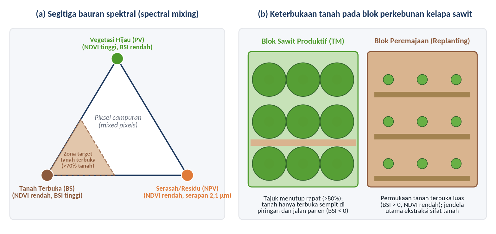
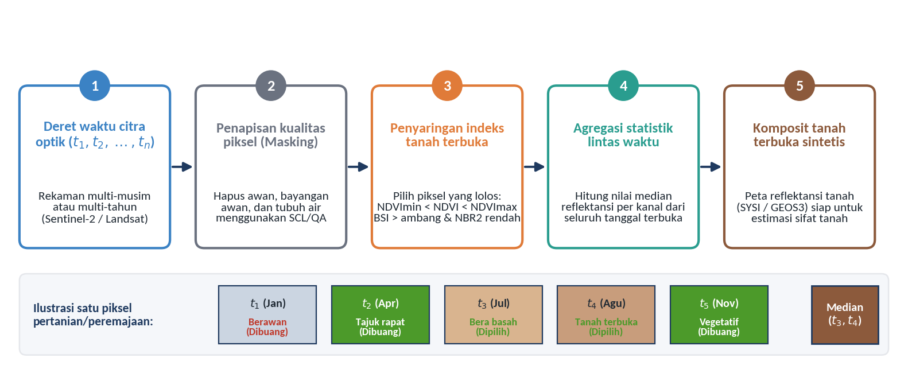
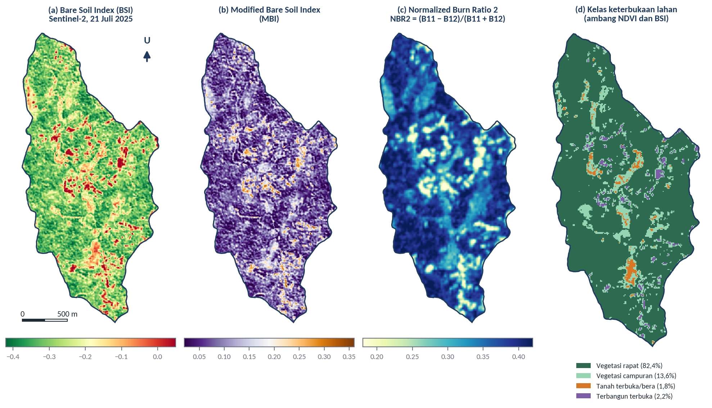
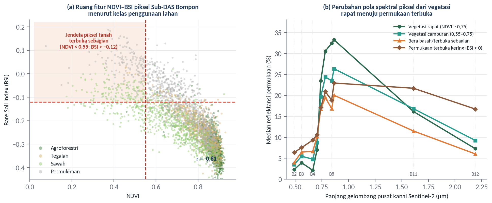

# Bare Soil Detection & Information Extraction

## Tujuan dan Capaian Pembelajaran

Modul keempat telah menunjukkan bahwa citra optik multispektral dan data elevasi digital menyimpan variasi spasial kondisi vegetasi, kebasahan kanopi, serta bentuk lahan yang berkaitan erat dengan sifat fisik-kimia tanah. Namun, pemanfaatan citra optik untuk menduga sifat permukaan tanah secara langsung menghadapi satu kendala mendasar di wilayah beriklim tropis basah: permukaan tanah mineral jarang sekali terekspos secara utuh ke arah sensor satelit. Di lanskap pertanian intensif maupun perkebunan kelapa sawit, sebagian besar energi elektromagnetik yang terekam oleh sensor berasal dari tajuk tanaman hijau, tanaman penutup tanah (*legume cover crops*), serasah daun kering, atau pelepah hasil pangkasan. Apabila nilai pantulan dari piksel yang masih tertutup vegetasi atau residu serasah tersebut langsung dimasukkan ke dalam model pendugaan bahan organik, tekstur, atau mineralogi tanah, maka model yang dihasilkan sesungguhnya sedang memetakan variasi biomassa kanopi dan bukan sifat tanah di bawahnya (Ben-Dor et al., 2009; Demattê et al., 2018).

Oleh karena itu, pemisahan piksel tanah terbuka dari piksel bervegetasi dan residu tanaman—yang dikenal sebagai deteksi tanah terbuka (*bare soil detection*)—merupakan prasyarat mutlak sebelum ekstraksi informasi spektral permukaan tanah dilakukan. Setelah mempelajari modul ini, peserta pelatihan diharapkan mampu:

1. Menjelaskan mekanisme bauran spektral (*spectral mixing*) antara tanah terbuka (*bare soil*), vegetasi fotosintetik (*photosynthetic vegetation*), dan residu tanaman tak berfotosintesis (*non-photosynthetic vegetation*) beserta implikasinya pada pemetaan tanah di perkebunan kelapa sawit.
2. Menghitung, membandingkan, dan memilih indeks spektral penciri tanah terbuka—meliputi *Bare Soil Index* (BSI), *Modified Bare Soil Index* (MBI), *Normalized Difference Soil Index* (NDSI), *Normalized Difference Built-up and Bareness Index*, serta *Normalized Burn Ratio 2* (NBR2)—sesuai dengan karakteristik sensor dan gangguan penutup permukaan.
3. Menerapkan metode deteksi tanah terbuka mulai dari pengambangan multi-indeks (*multi-index thresholding*), analisis bauran spektral (*spectral unmixing*), hingga penyusunan komposit tanah terbuka multitemporal (*bare soil composite* seperti GEOS3 dan SYSI).
4. Mengekstraksi nilai pantulan spektral dan indeks tanah terbuka dari citra Sentinel-2A pada wilayah studi Sub-DAS Bompon di QGIS untuk mengidentifikasi jendela spasial permukaan terbuka serta mengevaluasi keterbatasannya pada lanskap bervegetasi rapat.

---

*Ceramah dan diskusi:*

## Permukaan Tanah, Vegetasi, dan Pantulan Spektral

### Masalah Bauran Spektral (*Spectral Mixing*) pada Piksel Citra Optik

Setiap piksel pada citra satelit penginderaan jauh merekam pancaran energi terintegrasi dari seluruh objek yang berada di dalam luasan tapak pengamatan (*instantaneous field of view*) sensor. Pada resolusi spasial 10 hingga 30 meter yang dimiliki oleh Sentinel-2 dan Landsat, luasan 100 hingga 900 $\text{m}^2$ di permukaan bumi hampir selalu memuat campuran beberapa komponen penutup lahan sekaligus. Dalam kajian penginderaan jauh tanah dan ekologi lanskap, komponen penyusun permukaan daratan tersebut disederhanakan ke dalam tiga anggota akhir (*endmembers*) utama sebagaimana dirumuskan oleh Guerschman et al. (2009) dan Chabrillat et al. (2019):

1. **Vegetasi fotosintetik (*Photosynthetic Vegetation* atau PV)**, yakni daun dan tajuk tanaman hijau aktif yang memiliki serapan klorofil sangat kuat pada kanal biru serta merah ($0{,}45\text{–}0{,}68\ \mu\text{m}$) dan lonjakan pantulan tajam pada dataran tinggi inframerah dekat (*near-infrared* / NIR, $0{,}75\text{–}1{,}30\ \mu\text{m}$).
2. **Vegetasi tak berfotosintesis (*Non-Photosynthetic Vegetation* atau NPV)**, yang mencakup serasah daun kering, ranting mati, jerami sisa panen, gulma kering pasca-penyemprotan herbisida, serta tumpukan pelepah kelapa sawit. Komponen NPV telah kehilangan pigmen klorofil sehingga kurva pantulannya pada rentang tampak hingga NIR menanjak secara monoton menyerupai kurva tanah terbuka, tetapi masih menyimpan ikatan biokimia selulosa dan lignin yang menghasilkan pita serapan khas di sekitar panjang gelombang $2{,}10\ \mu\text{m}$ pada daerah inframerah gelombang pendek kedua (*shortwave infrared* / SWIR-2) (Nagler et al., 2000; Daughtry et al., 2006).
3. **Tanah terbuka (*Bare Soil* atau BS)**, yaitu permukaan horizon tanah atas yang bebas dari tajuk hijau maupun hamparan serasah kering. Pantulan spektral tanah terbuka dikendalikan oleh empat kromofor tanah utama: kadar lengas tanah, kandungan bahan organik (*soil organic carbon*), konsentrasi oksida besi bebas (hematit dan goetit), serta komposisi tekstur dan mineral lempung (kaolinit, smektit, dan ilit) (Stoner & Baumgardner, 1981; Ben-Dor et al., 2009).

Secara matematis, apabila interaksi foton antar-komponen di dalam satu piksel diasumsikan bersifat linier, maka reflektansi permukaan piksel pada panjang gelombang $\lambda$, yaitu $\rho(\lambda)$, merupakan penjumlahan terbobot dari reflektansi masing-masing komponen murni:

$$\rho(\lambda) = f_{\text{PV}}\,\rho_{\text{PV}}(\lambda) + f_{\text{NPV}}\,\rho_{\text{NPV}}(\lambda) + f_{\text{BS}}\,\rho_{\text{BS}}(\lambda) + \varepsilon(\lambda)$$

$$\text{dengan syarat}\quad f_{\text{PV}} + f_{\text{NPV}} + f_{\text{BS}} = 1 \quad \text{dan} \quad f_i \ge 0$$

Pada persamaan tersebut, $f_{\text{PV}}$, $f_{\text{NPV}}$, dan $f_{\text{BS}}$ masing-masing menyatakan fraksi tutupan luas vegetasi hijau, residu serasah kering, dan tanah terbuka di dalam piksel, sedangkan $\varepsilon(\lambda)$ adalah galat pemodelan atau efek hamburan berganda nonlinier. Studi eksperimental dan pemodelan radiatif menunjukkan bahwa sinyal spektral tanah asli baru dapat diekstraksi dengan tingkat keandalan yang memadai untuk memprediksi tekstur atau karbon organik tanah apabila fraksi tanah terbuka di dalam piksel mencapai sekurang-kurangnya $70\text{–}80\%$ (atau tutupan vegetasi hijau $f_{\text{PV}} < 15\text{–}20\%$ dan residu serasah $f_{\text{NPV}} < 15\%$) (Bartholomeus et al., 2011; Castaldi et al., 2019). Ketika tutupan tajuk hijau melampaui 20–30%, lonjakan reflektansi NIR dari jaringan mesofil daun dan serapan merah oleh klorofil akan menutupi fitur serapan halus oksida besi di kanal tampak–NIR serta mengubah kemiringan spektrum SWIR yang seharusnya mencerminkan mineral lempung dan bahan organik tanah.


Gambar 5.1 Konseptualisasi bauran spektral dan keterbukaan permukaan tanah: (a) segitiga bauran spektral antara vegetasi hijau (PV), residu serasah kering (NPV), dan tanah terbuka (BS) beserta zona target ekstraksi spektrum tanah murni; (b) kontras keterbukaan permukaan tanah antara blok kelapa sawit tanaman menghasilkan (TM) yang tertutup rapat dan blok peremajaan (replanting / TBM) yang membuka jendela pengamatan tanah.
Sumber: Disintesis dari Guerschman et al. (2009), Demattê et al. (2018), dan Fairhurst & Hardter (2003).

### Dinamika Keterbukaan Permukaan Tanah di Lanskap Pertanian dan Perkebunan Kelapa Sawit

Sebagaimana diilustrasikan pada Gambar 5.1, peluang menemukan piksel yang berada di dalam zona target tanah terbuka sangat bergantung pada sistem pengelolaan lahan dan fase pertumbuhan tanaman. Pada lahan pertanian tanaman semusim (*annual croplands*) seperti padi sawah, jagung, atau tebu, permukaan tanah terbuka secara berkala setiap kali petani melakukan pengolahan tanah (*tillage*), pembajakan, dan penggaruan menjelang musim tanam baru. Sebaliknya, pada sistem wanatani (*agroforestry*) dan perkebunan tanaman tahunan (*perennial plantation crops*) seperti kelapa sawit (*Elaeis guineensis* Jacq.), keterbukaan permukaan tanah diatur oleh siklus umur tegakan yang berlangsung sekitar 25 tahun serta tata ruang mikro di dalam blok kebun (Fairhurst & Hardter, 2003; Corley & Tinker, 2016):

1. **Fase pembukaan lahan dan peremajaan (*land clearing and replanting*, umur 0–1 tahun)**. Ketika tegakan sawit tua yang telah berumur 25 tahun ditebang dan dicacah (*chipping*), kemudian diikuti oleh pembuatan teras kontur, saluran drainase, dan jalur tanam baru, proporsi tanah mineral yang terbuka terhadap pengamatan satelit mencapai puncaknya ($f_{\text{BS}} > 60\text{–}85\%$). Fase peremajaan ini merupakan jendela waktu paling berharga bagi praktisi pemetaan tanah digital di perkebunan sawit untuk mengekstraksi pantulan spektral tanah asli secara langsung dari citra Sentinel-2 atau Landsat. Meskipun demikian, perhatian khusus harus diberikan pada jalur rumpukan batang sawit cacah (*windrowing*) yang menghasilkan sinyal NPV sangat tinggi di dalam blok peremajaan.
2. **Fase tanaman belum menghasilkan (*immature phase* / TBM, umur 1–3 tahun)**. Pada tahap ini, tajuk bibit kelapa sawit masih berdiameter kecil sehingga ruang antar-baris (*inter-row*) masih terbuka terhadap penyinaran matahari. Namun, standar agronomi perkebunan berkelanjutan mewajibkan penanaman kacang-kacangan penutup tanah (*legume cover crops* / LCC seperti *Mucuna bracteata*, *Pueraria phaseoloides*, atau *Calopogonium mucunoides*) guna menekan erosi dan memfiksasi nitrogen. Begitu LCC menutup penuh gawangan pada umur 6–12 bulan setelah tanam, pantulan spektral piksel 10 meter akan beralih dari ciri tanah terbuka menjadi ciri vegetasi hijau rapat dengan nilai NDVI melampaui $0{,}75$.
3. **Fase tanaman menghasilkan (*mature phase* / TM, umur 4–25 tahun)**. Pada tegakan sawit dewasa dengan kerapatan 130–148 pokok per hektare, pelepah antar-pohon saling bertaut (*canopy closure*) dan menutup lebih dari 80–90% permukaan lahan (Gambar 5.1b). Di bawah tajuk, permukaan tanah sebenarnya terbagi menjadi tiga zona manajemen mikro yang memiliki sifat fisik-kimia tanah berbeda (Fairhurst & Hardter, 2003; Nelson et al., 2014):
   - **Piringan pohon (*weeded circle*)**, yakni area melingkar berjari-jari 1,5–2,0 meter di sekeliling pangkal batang yang dijaga bersih dari gulma untuk memudahkan pengutipan brondolan dan aplikasi pupuk.
   - **Jalur panen (*harvesting path* / pasar pikul)**, yaitu lorong sempit selebar 1,0–1,5 meter di setiap dua baris tanaman yang dilalui pemanen dan alat angkut tandan buah segar, sehingga tanahnya cenderung terbuka tetapi mengalami pemadatan (*compaction*).
   - **Gawangan mati (*frond stack* / *inter-row*)**, yaitu ruang antar-baris tempat pelepah hasil tunasan ditumpuk secara teratur sehingga kaya akan serasah NPV dan bahan organik tanah.

Karena lebar piringan dan pasar pikul hanya berkisar antara 1 hingga 3 meter serta berada di bawah naungan pelepah sawit di atasnya, sensor satelit beresolusi 10–30 meter tidak dapat memisahkan tanah terbuka di piringan dari tajuk pelepah hijau pada blok TM. Di sinilah letak perbedaan mendasar antara strategi penggunaan citra optik pada blok TBM/replanting (yang memungkinkan ekstraksi spektrum tanah langsung melalui *bare soil detection*) dan pada blok TM (yang menuntut pemanfaatan indeks respons tajuk tidak langsung sebagaimana dibahas pada Modul 4 atau penggabungan deret waktu historis saat blok tersebut mengalami peremajaan).

### Gangguan Kelembapan Permukaan, Kekasaran, dan Serasah terhadap Spektrum Tanah

Bahkan ketika sebuah piksel telah terbebas dari tutupan tajuk hijau ($f_{\text{PV}} \approx 0$), nilai reflektansi permukaan tanah yang terekam oleh sensor masih dipengaruhi oleh tiga faktor kondisi permukaan sesaat yang harus dipahami oleh analis sebelum mengekstraksi informasi pedologis:

- **Kelembapan permukaan tanah (*surface soil moisture*)**. Air yang menyelimuti pori dan permukaan partikel mineral memiliki indeks bias yang lebih rendah dibandingkan udara, sehingga meningkatkan hamburan ke depan (*forward scattering*) dan memperpanjang lintasan optik cahaya di dalam matriks tanah sebelum dipantulkan kembali (Lobell & Asner, 2002). Akibatnya, tanah yang basah tampak jauh lebih gelap (albedo menurun di seluruh rentang VNIR–SWIR) dibandingkan tanah yang sama dalam keadaan kering udara. Penurunan reflektansi akibat pembasahan bersifat paling tajam pada kanal SWIR-1 ($1{,}61\ \mu\text{m}$) dan SWIR-2 ($2{,}19\ \mu\text{m}$) karena berada di dekat sayap pita serapan fundamental molekul air pada $1{,}40\ \mu\text{m}$ dan $1{,}90\ \mu\text{m}$ (Muller & Décamps, 2001; Minasny et al., 2011). Pada lahan sawah yang baru dibajak dalam kondisi tergenang atau berlumpur (*puddled soil*), penyerapan radiasi SWIR oleh air sedemikian kuat sehingga nilai reflektansi $\text{B11}$ dan $\text{B12}$ menjadi lebih rendah daripada $\text{B08}$ (NIR), suatu fenomena penting yang akan kita amati secara empiris pada citra Sub-DAS Bompon.
- **Kekasaran permukaan (*surface roughness*) dan struktur agregat**. Pengolahan tanah dengan bajak singkal menghasilkan bongkahan tanah kasar yang menciptakan bayangan mikro (*micro-shadowing*) di antara agregat, sehingga menurunkan pantulan tampak dan NIR sebesar 10–25% dibandingkan permukaan tanah yang telah mengalami penghancuran agregat dan pembentukan kerak permukaan (*surface crusting*) akibat pukulan air hujan (Matthieu et al., 1998; Cierniewski et al., 2015).
- **Residu tanaman tak berfotosintesis (NPV)**. Keberadaan serasah kering, mulsa tandan kosong, atau pelepah kering menghasilkan nilai NDVI yang rendah ($0{,}15\text{–}0{,}35$) dan nilai BSI yang positif, sehingga sering kali lolos sebagai "tanah terbuka" apabila penyaringan hanya mengandalkan NDVI dan BSI. Untuk memisahkan tanah mineral terbuka dari hamparan NPV, diperlukan indeks berbasis rasio antara kanal SWIR-1 dan SWIR-2 seperti *Normalized Burn Ratio 2* (NBR2) yang sensitif terhadap serapan ligno-selulosa pada kanal SWIR-2 (Daughtry et al., 2006; Castaldi et al., 2019; Demattê et al., 2020).

---

## Indeks yang Digunakan dalam Bare Soil Detection

Untuk menonjolkan kontras spektral antara permukaan tanah terbuka dan tutupan vegetasi atau air secara kuantitatif, berbagai indeks tanah terbuka telah dikembangkan dalam literatur penginderaan jauh. Berbeda dengan indeks vegetasi yang hanya memanfaatkan dua kanal di sekitar tepi merah (*red-edge*), sebagian besar indeks tanah terbuka menggabungkan informasi dari kanal biru, merah, inframerah dekat (NIR), hingga inframerah gelombang pendek (SWIR). Prinsip fisika di balik penggabungan tersebut bertumpu pada fakta bahwa tanah mineral kering memiliki kurva pantulan yang menanjak secara bertahap dari kanal biru ($\sim 0{,}49\ \mu\text{m}$), melewati kanal merah ($\sim 0{,}66\ \mu\text{m}$) dan NIR ($\sim 0{,}84\ \mu\text{m}$), hingga mencapai puncak reflektansi pada kanal SWIR-1 ($\sim 1{,}61\ \mu\text{m}$), sedangkan vegetasi hijau memiliki pantulan sangat rendah pada kanal biru dan merah, mencapai puncak tinggi pada kanal NIR, lalu menurun kembali pada kanal SWIR akibat serapan air daun.

### Formulasi Matematik dan Mekanisme Fisik Indeks Tanah Terbuka

1. ***Bare Soil Index* (BSI)**
   Dirumuskan awalnya oleh Rikimaru et al. (2002) untuk pemetaan kepadatan tajuk hutan tropis dan kemudian diadopsi secara luas dalam pemetaan tanah digital (Diek et al., 2017; Rizzo et al., 2020), BSI menggabungkan empat kanal utama—biru, merah, NIR, dan SWIR-1—ke dalam bentuk rasio selisih ternormalisasi:

   $$\text{BSI} = \frac{(\rho_{\text{SWIR1}} + \rho_{\text{Red}}) - (\rho_{\text{NIR}} + \rho_{\text{Blue}})}{(\rho_{\text{SWIR1}} + \rho_{\text{Red}}) + (\rho_{\text{NIR}} + \rho_{\text{Blue}})} = \frac{(\text{B11} + \text{B04}) - (\text{B08} + \text{B02})}{(\text{B11} + \text{B04}) + (\text{B08} + \text{B02})}$$

   Pada persamaan tersebut, suku pembilang bagian pertama $(\text{B11} + \text{B04})$ merangkum dua kanal tempat tanah terbuka kering memiliki pantulan relatif tinggi dibandingkan vegetasi (pantulan SWIR-1 tanah kering yang tinggi serta tiadanya serapan klorofil di kanal merah). Suku pembilang bagian kedua $(\text{B08} + \text{B02})$ merangkum kanal NIR tempat vegetasi memantulkan radiasi secara dominan dan kanal biru tempat tanah kaya oksida besi menyerap radiasi melalui transisi muatan $\text{Fe}^{3+}\text{–O}^{2-}$. Hasilnya, nilai BSI berkisar antara $-1$ hingga $+1$: vegetasi hijau rapat menghasilkan nilai BSI sangat negatif (umumnya $<-0{,}25$), vegetasi jarang atau lahan bera lembap menghasilkan nilai sekitar $-0{,}15$ hingga $0{,}00$, sedangkan permukaan tanah terbuka kering dan lahan terbangun menghasilkan nilai BSI positif ($>0{,}00$ hingga $+0{,}35$).

2. ***Modified Bare Soil Index* (MBI)**
   Nguyen et al. (2021) memperkenalkan MBI khusus untuk sensor Sentinel-2 dan Landsat-8 guna mengatasi kelemahan BSI konvensional yang kerap mengalami tumpang-tindih nilai antara tanah terbuka lembap, vegetasi meranggas, dan permukaan kedap air. MBI memanfaatkan selisih antara kanal SWIR-1 ($\text{B11}$), SWIR-2 ($\text{B12}$), dan NIR ($\text{B08}$) dengan penambahan konstanta pergeseran $f = 0{,}5$:

   $$\text{MBI} = \frac{\rho_{\text{SWIR1}} - \rho_{\text{SWIR2}} - \rho_{\text{NIR}}}{\rho_{\text{SWIR1}} + \rho_{\text{SWIR2}} + \rho_{\text{NIR}}} + 0{,}5 = \frac{\text{B11} - \text{B12} - \text{B08}}{\text{B11} + \text{B12} + \text{B08}} + 0{,}5$$

   Penempatan $\text{B08}$ dan $\text{B12}$ sebagai pengurang terhadap $\text{B11}$ didasarkan pada sifat lengkungan spektrum tanah mineral kering yang mencapai titik balik maksimum lokal pada panjang gelombang $1{,}61\ \mu\text{m}$ ($\text{B11} > \text{B08}$ dan $\text{B11} > \text{B12}$). Sebaliknya, pada vegetasi hijau berlaku $\text{B08} \gg \text{B11}$, sehingga suku pecahan bernilai negatif besar dan menghasilkan nilai MBI mendekati nol. Semakin tinggi nilai MBI (khususnya $\text{MBI} > 0{,}20\text{–}0{,}25$), semakin kuat indikasi bahwa piksel tersebut didominasi oleh tanah terbuka atau singkapan substrat mineral kering.

3. ***Normalized Difference Soil Index* (NDSI) dan *Normalized Difference Bareness Index* (NDBaI)**
   Rogers & Kearney (2004) mendefinisikan NDSI sebagai rasio ternormalisasi antara kanal SWIR-1 dan NIR (sering pula disebut sebagai kebalikan dari NDMI):

   $$\text{NDSI}_{\text{SWIR-NIR}} = \frac{\rho_{\text{SWIR1}} - \rho_{\text{NIR}}}{\rho_{\text{SWIR1}} + \rho_{\text{NIR}}} = \frac{\text{B11} - \text{B08}}{\text{B11} + \text{B08}}$$

   Varian lain dari NDSI yang diusulkan oleh Deng et al. (2015) membandingkan kanal SWIR-1 dengan kanal hijau ($\text{B03}$): $\text{NDSI}_{\text{SWIR-Green}} = (\text{B11} - \text{B03})/(\text{B11} + \text{B03})$ untuk menekan gangguan bayangan topografi. Sementara itu, pada sensor yang tidak memiliki kanal termal beresolusi 10–20 meter seperti Sentinel-2, kontras antara kedua kanal gelombang pendek ($\text{B11}$ dan $\text{B12}$) dirumuskan sebagai ***Normalized Burn Ratio 2* (NBR2)** (Key & Benson, 2006; Demattê et al., 2018; Castaldi et al., 2019):

   $$\text{NBR2} = \frac{\rho_{\text{SWIR1}} - \rho_{\text{SWIR2}}}{\rho_{\text{SWIR1}} + \rho_{\text{SWIR2}}} = \frac{\text{B11} - \text{B12}}{\text{B11} + \text{B12}}$$

   Dalam protokol deteksi tanah terbuka modern (seperti *Geospatial Soil Sensing System* / GEOS3 dan *Soil Composite Mapping Processor* / SCMaP), NBR2 memegang peran krusial sebagai penyaring pendamping bersama NDVI (Demattê et al., 2018; Rogge et al., 2018). Alasannya adalah karena residu tanaman kering (NPV) dan tanah yang sangat basah menunjukkan kemiringan lereng spektral antara $1{,}61\ \mu\text{m}$ dan $2{,}19\ \mu\text{m}$ yang jauh lebih curam dibandingkan tanah mineral kering. Oleh sebab itu, penetapan batas atas nilai NBR2 (misalnya $\text{NBR2} < 0{,}15\text{–}0{,}30$ bergantung pada rezim lengas regional) sangat efektif untuk membuang piksel yang tertutup mulsa jerami, pelepah sawit kering, maupun genangan air dangkal.

4. **Indeks Berbasis Ruang Fitur Tanah–Vegetasi (*Soil Line* dan PV Index)**
   Ketika pantulan kanal NIR ($\rho_{\text{NIR}}$) diplotkan terhadap pantulan kanal merah ($\rho_{\text{Red}}$) untuk sekumpulan piksel tanah terbuka yang memiliki variasi kadar air dan kekasaran berbeda, titik-titik piksel tersebut akan berimpit membentuk satu garis lurus diagonal yang disebut **garis tanah (*soil line*)** (Richardson & Wiegand, 1977; Baret et al., 1993):

   $$\rho_{\text{NIR, tanah}} = a\,\rho_{\text{Red, tanah}} + b$$

   di mana $a$ adalah kemiringan (*slope*) dan $b$ adalah perpotongan sumbu (*intercept*) garis tanah spesifik untuk jenis bahan induk di suatu wilayah. Jarak tegak lurus suatu piksel dari garis tanah menuju puncak NIR mencerminkan kepadatan vegetasi hijau (dikenal sebagai *Perpendicular Vegetation Index* / PVI), sedangkan posisi piksel di sepanjang garis tanah—dari ujung kiri bawah yang gelap menuju ujung kanan atas yang terang—mencerminkan tingkat kecerahan permukaan tanah (*soil brightness*), kadar bahan organik, dan status drainase.

Ringkasan pada Tabel 5.1 menyajikan perbandingan formula, kanal Sentinel-2 yang digunakan, rentang nilai tipikal, serta fungsi spesifik dari kelima indeks utama dalam alur kerja deteksi tanah terbuka.

Tabel 5.1 Perbandingan karakteristik, formulasi kanal Sentinel-2 MSI, dan fungsi operasional indeks spektral dalam deteksi tanah terbuka.

| Nama Indeks | Formula Kanal Sentinel-2 | Rentang Nilai Tanah Terbuka Tipikal | Keunggulan Utama | Keterbatasan dan Sumber Bias |
| :--- | :--- | :--- | :--- | :--- |
| **NDVI** (*Normalized Difference Vegetation Index*) | $\dfrac{\text{B08} - \text{B04}}{\text{B08} + \text{B04}}$ | $0{,}05 \le \text{NDVI} < 0{,}25$ (ketat) atau $< 0{,}35\text{–}0{,}50$ (tropis lembap/parsial) | Sangat peka menyaring tutupan daun hijau berfotosintesis (PV) sejak fraksi tutupan $>15\%$ | Tidak mampu membedakan tanah terbuka dari serasah kering (NPV), aspal, atau atap bangunan |
| **BSI** (*Bare Soil Index*) | $\dfrac{(\text{B11} + \text{B04}) - (\text{B08} + \text{B02})}{(\text{B11} + \text{B04}) + (\text{B08} + \text{B02})}$ | $> 0{,}00$ (tanah kering) atau $> -0{,}12$ (bera lembap tropis) | Menggabungkan 4 kanal VNIR–SWIR sekaligus sehingga kontras tanah terhadap tajuk hijau sangat tajam | Nilai BSI turun drastis pada tanah sawah tergenang/basah dan bias positif pada atap genteng tanah liat |
| **MBI** (*Modified Bare Soil Index*) | $\dfrac{\text{B11} - \text{B12} - \text{B08}}{\text{B11} + \text{B12} + \text{B08}} + 0{,}5$ | $0{,}20\text{–}0{,}42$ | Memanfaatkan puncak $\text{B11}$ terhadap $\text{B08}$ dan $\text{B12}$; mengurangi tumpang-tindih dengan vegetasi jarang | Sensitif terhadap penurunan $\text{B11}$ pada tanah berlumpur dengan kadar air mendekati jenuh |
| **NDSI** (*Normalized Difference Soil Index*) | $\dfrac{\text{B11} - \text{B08}}{\text{B11} + \text{B08}}$ | $> -0{,}05$ (tanah kering memiliki $\text{B11} > \text{B08}$) | Indikator paling langsung untuk menguji pembalikan lereng NIR–SWIR1 dari vegetasi ke tanah mineral | Identik secara terbalik dengan NDMI sehingga sangat dipengaruhi oleh fluktuasi lengas permukaan sesaat |
| **NBR2** (*Normalized Burn Ratio 2*) | $\dfrac{\text{B11} - \text{B12}}{\text{B11} + \text{B12}}$ | $0{,}05\text{–}0{,}28$ (lebih rendah daripada vegetasi hijau $\sim 0{,}35\text{–}0{,}45$) | Sangat efektif memisahkan tanah mineral dari residu serasah kering (NPV) dan variasi lengas ekstrem | Tidak dapat berdiri sendiri; wajib dikombinasikan dengan ambang NDVI atau BSI |

Sumber: Disintesis dari Rikimaru et al. (2002), Rogers & Kearney (2004), Demattê et al. (2018), Castaldi et al. (2019), dan Nguyen et al. (2021).

---

## Metode Bare Soil Detection

Dalam praktik pemetaan tanah digital, indeks-indeks spektral pada Tabel 5.1 tidak berhenti sebagai peta visual semata, melainkan diintegrasikan ke dalam algoritma deteksi tanah terbuka yang sistematis. Secara garis besar, metode deteksi dan ekstraksi informasi tanah terbuka berkembang melalui tiga pendekatan utama dengan tingkat kompleksitas yang meningkat.

### 1. Pengambangan Aturan Multi-Indeks (*Rule-Based Multi-Index Thresholding*) pada Citra Tunggal

Pendekatan paling mendasar dan transparan adalah menerapkan aturan keputusan berlapis (*decision tree rules*) pada satu perekaman citra bebas awan. Satu piksel pada koordinat $(x, y)$ ditetapkan sebagai piksel tanah terbuka ($M_{\text{BS}}(x, y) = 1$) apabila memenuhi irisan beberapa syarat mutu radiometrik dan ambang indeks spektral sekaligus:

$$M_{\text{BS}}(x, y) = \begin{cases} 1, & \text{jika } \text{QA}(x,y) = \text{bersih} \;\land\; \text{NDVI}_{\min} < \text{NDVI}(x,y) < \text{NDVI}_{\max} \\ & \quad\land\; \text{BSI}(x,y) > \tau_{\text{BSI}} \;\land\; \text{NBR2}(x,y) < \tau_{\text{NBR2}} \;\land\; \text{Mask}_{\text{non-bangunan}}(x,y) = 1 \\[4pt] 0, & \text{lainnya} \end{cases}$$

Setiap komponen aturan di atas menjalankan fungsi penyaringan yang spesifik:

- **Penapisan kualitas radiometrik ($\text{QA} = \text{bersih}$)**: membuang piksel awan tebal, awan sirus, bayangan awan, dan tubuh air menggunakan pita klasifikasi adegan (*Scene Classification Layer* / SCL pada Sentinel-2 Level-2A, yakni membuang kelas SCL $1, 2, 3, 6, 8, 9, 10$).
- **Batas bawah NDVI ($\text{NDVI} > \text{NDVI}_{\min} \approx 0{,}02\text{–}0{,}05$)**: menyaring sisa tubuh air jernih, genangan air dalam, serta bayangan topografi gelap yang luput dari pita SCL.
- **Batas atas NDVI ($\text{NDVI} < \text{NDVI}_{\max}$)**: membuang piksel yang telah tertutup tajuk vegetasi hijau. Di wilayah beriklim kering hingga subtropis (seperti cekungan Mediterania atau lahan pertanian Eropa dan Brasil bagian tengah), ambang ketat $\text{NDVI}_{\max} = 0{,}25$ atau $0{,}30$ lazim digunakan untuk menjamin kemurnian spektrum tanah (Diek et al., 2017; Demattê et al., 2018; Castaldi et al., 2019). Namun, di lanskap tropis basah Indonesia yang memiliki pertumbuhan gulma sangat cepat dan ukuran petak lahan petani yang sempit ($<0{,}1\text{ ha}$), penerapan ambang ketat $\text{NDVI} < 0{,}25$ pada citra tanggal tunggal sering kali menghasilkan kurang dari $0{,}5\%$ piksel yang lolos. Dalam situasi demikian, analis perlu membedakan antara **ambang tanah terbuka murni** ($\text{NDVI} < 0{,}30\text{–}0{,}40$ dan $\text{BSI} > 0{,}00$) dan **ambang tanah terbuka sebagian / bera pertanian** ($\text{NDVI} < 0{,}50\text{–}0{,}55$ dan $\text{BSI} > -0{,}12$) untuk mengidentifikasi lokasi petak yang sedang mengalami pengolahan lahan atau fase awal tanam.
- **Batas bawah BSI ($\text{BSI} > \tau_{\text{BSI}}$) dan batas atas NBR2 ($\text{NBR2} < \tau_{\text{NBR2}}$)**: memastikan bahwa penurunan nilai NDVI memang disebabkan oleh tereksposnya substrat mineral tanah, bukan akibat kanopi yang ternaungi bayangan atau tertutupi hamparan mulsa organik kering.
- **Penapisan objek terbangun ($\text{Mask}_{\text{non-bangunan}}$)**: langkah yang sangat krusial di lanskap perdesaan Jawa dan area konsesi perkebunan (sekitar emplasemen pabrik, perumahan karyawan, dan jaringan jalan utama). Atap genteng tanah liat yang terbuat dari tanah terbakar (*terracotta*), lapangan tanah padat, serta perkerasan jalan batu/aspal memiliki tanda spektral VNIR–SWIR yang sangat mirip dengan tanah mineral kering beroksida besi tinggi ($\text{NDVI} < 0{,}30$, $\text{BSI} > 0{,}05$). Tanpa pemotongan menggunakan peta penggunaan lahan atau lapisan jejak bangunan (*building footprint*), piksel permukiman akan terdeteksi sebagai "tanah terbuka" semu dan menimbulkan galat besar apabila diekstraksi sebagai kovariat tanah.

### 2. Komposit Tanah Terbuka Multitemporal (*Multi-Temporal Bare Soil Composite*: SYSI / GEOS3 / SCMaP)

Kelemahan terbesar dari deteksi tanah terbuka pada citra tanggal tunggal adalah sifat keterbukaan lahan yang tidak serempak secara ruang dan waktu. Pada tanggal perekaman tertentu, petak sawah A mungkin sedang dibajak sehingga tanahnya terbuka, sementara petak B di sebelahnya sudah memasuki fase vegetatif maksimum; tiga bulan kemudian, giliran petak B yang dipanen dan dibajak, atau blok kebun sawit C yang mulai ditebang untuk peremajaan. Untuk mengatasi fragmentasi spasial tersebut, Rogge et al. (2018) melalui metode *Soil Composite Mapping Processor* (SCMaP) dan Demattê et al. (2018) melalui metode *Geospatial Soil Sensing System* (GEOS3) memelopori penyusunan **Citra Tanah Sintetis (*Synthetic Soil Image* / SYSI)** dari tumpukan deret waktu citra multi-tahun.


Gambar 5.2 Alur kerja penyusunan komposit tanah terbuka sintetis (Synthetic Soil Image / SYSI) menggunakan deret waktu citra optik multitemporal beserta ilustrasi pemilihan piksel lintas waktu pada satu lokasi pengamatan.
Sumber: Disintesis dari prosedur GEOS3 (Demattê et al., 2018), SCMaP (Rogge et al., 2018), dan Barest Earth (Roberts et al., 2019).

Sebagaimana ditunjukkan pada Gambar 5.2, algoritma komposit tanah terbuka multitemporal bekerja melalui lima tahapan berurutan pada tingkat piksel:

1. **Pengumpulan tumpukan deret waktu (*time-series stack*)**: seluruh rekaman citra Sentinel-2 Level-2A atau Landsat Collection 2 Level-2 dalam rentang waktu 3 hingga 5 tahun (atau hingga 10–35 tahun pada arsip Landsat untuk menangkap satu daur penuh peremajaan sawit) dikumpulkan dan diselaraskan grid spasialnya.
2. **Penapisan awan, bayangan, dan air per tanggal rekaman**: setiap adegan citra pada waktu $t \in \{t_1, t_2, \dots, t_n\}$ dibersihkan dari gangguan atmosfer dan genangan air menggunakan pita QA/SCL.
3. **Penyaringan kandidat tanah terbuka per piksel-waktu**: pada setiap piksel $(x, y)$ dan setiap waktu $t$, dihitung nilai $\text{NDVI}(x, y, t)$, $\text{BSI}(x, y, t)$, dan $\text{NBR2}(x, y, t)$. Hanya pengamatan pada tanggal-tanggal $t \in T_{\text{terbuka}}(x, y)$ yang memenuhi kriteria tanah terbuka (misalnya $0{,}05 < \text{NDVI} < 0{,}28$, $\text{BSI} > 0{,}02$, dan $\text{NBR2} < 0{,}22$) yang dipertahankan; seluruh pengamatan saat piksel tersebut tertutup tajuk rapat dibuang.
4. **Agregasi statistik lintas waktu**: dari himpunan tanggal terbuka $T_{\text{terbuka}}(x, y)$ yang lolos saringan pada piksel tersebut, dihitung nilai **median reflektansi** (atau rata-rata terpangkas / *trimmed mean*) untuk setiap kanal spektral $b$:

   $$\tilde{\rho}_b(x, y) = \underset{t \,\in\, T_{\text{terbuka}}(x, y)}{\text{median}} \;\rho_b(x, y, t)$$

   Penggunaan operator median—atau pembobotan geometris multi-kanal seperti pada algoritma *Barest Earth* (Roberts et al., 2019)—sangat krusial karena mampu meredam anomali sesaat akibat tanah yang terlalu basah sehabis hujan, sisa bayangan awan tipis yang lolos deteksi, atau perbedaan kekasaran bajakan antar-musim.
5. **Pembangkitan peta komposit tanah sintetis dan frekuensi keterbukaan**: keluaran akhir berupa raster multi-kanal $\tilde{\rho}_b(x, y)$ yang merepresentasikan pantulan spektral permukaan tanah asli secara menerus di seluruh petak yang pernah terbuka minimal 3–5 kali selama periode pengamatan, disertai peta jumlah pengamatan valid (*bare soil frequency*) sebagai indikator keandalan piksel (Loiseau et al., 2019; Safanelli et al., 2020).

Di lingkungan perkebunan kelapa sawit berskala besar (misalnya konsesi seluas 10.000–50.000 ha), metode SYSI sangat bernilai strategis. Karena peremajaan kebun umumnya dijadwalkan secara bergilir sekitar 4–5% luas kebun per tahun, penggabungan arsip citra Landsat (1985–sekarang) dan Sentinel-2 (2015–sekarang) di platform komputasi awan seperti Google Earth Engine memungkinkan rekonstruksi spektrum tanah terbuka untuk sebagian besar blok kebun yang pernah mengalami pembukaan atau *replanting* dalam dua dekade terakhir.

### 3. Analisis Bauran Spektral (*Linear Spectral Unmixing*)

Apabila di suatu wilayah terdapat piksel-piksel yang selalu memiliki tutupan vegetasi parsial sepanjang tahun ($0{,}30 \le \text{NDVI} \le 0{,}60$) sehingga tidak pernah lolos saringan tanah terbuka murni, pendekatan alternatif yang dapat ditempuh adalah **pemisahan bauran spektral linier (*Linear Spectral Unmixing* / LSU)** (Adams et al., 1986; Guerschman et al., 2009) atau metode koreksi efek vegetasi seperti *Soil Line Transformation* (Bartholomeus et al., 2007). Dalam kerangka LSU, apabila spektrum acuan (*reference endmembers*) untuk vegetasi hijau lokal ($\rho_{\text{PV}}$) dan residu serasah ($\rho_{\text{NPV}}$) telah diketahui dari pustaka spektral atau piksel murni di lapangan, maka fraksi tutupan masing-masing komponen dapat diestimasi melalui inversi kuadrat terkecil terkendala (*constrained least squares*). Selanjutnya, komponen pantulan vegetasi dikurangkan secara proporsional untuk memperoleh taksiran spektrum residu tanah:

$$\hat{\rho}_{\text{BS}}(\lambda) = \frac{\rho(\lambda) - \hat{f}_{\text{PV}}\,\rho_{\text{PV}}(\lambda) - \hat{f}_{\text{NPV}}\,\rho_{\text{NPV}}(\lambda)}{\hat{f}_{\text{BS}}}$$

Walaupun secara teoretis menarik, inversi spektrum residu tanah di atas memiliki keterbatasan praktis yang tegas: ketika fraksi tanah terbuka $\hat{f}_{\text{BS}}$ turun di bawah $0{,}40\text{–}0{,}50$, galat acak dan variasi internal spektrum tajuk akan teramplifikasi secara drastis oleh pembagian dengan $\hat{f}_{\text{BS}}$ yang kecil (Chabrillat et al., 2019). Oleh sebab itu, pada wilayah yang tertutup vegetasi permanen dengan $f_{\text{BS}} \to 0$ (seperti kebun campur kerapatan tinggi di Sub-DAS Bompon atau blok sawit TM dewasa yang belum pernah diremajakan dalam rekaman satelit), pendekatan pemetaan tanah digital yang jujur secara ilmiah tidak memaksakan ekstraksi spektrum tanah murni, melainkan mengintegrasikan indeks keterbukaan dan indeks vegetasi sebagai kovariat *organisms* ($o$) bersama variabel medan ($r$) di dalam kerangka SCORPAN.

---

### Studi Kasus Empiris: Deteksi Keterbukaan Permukaan pada Sub-DAS Bompon

Untuk menguji perilaku indeks-indeks tanah terbuka pada lanskap tropis basah yang sesungguhnya, kita menganalisis citra Sentinel-2A Level-2A akuisisi 21 Juli 2025 pada wilayah studi Sub-DAS Bompon ($29.469$ piksel ukuran $10\text{ m}$, luas $294{,}69\text{ ha}$). Peta spasial distribusi nilai BSI, MBI, NBR2, serta hasil klasifikasi kelas keterbukaan permukaan ditunjukkan pada Gambar 5.3, sedangkan statistik deskriptif per kelas penggunaan lahan dirangkum pada Tabel 5.2.


Gambar 5.3 Peta spasial indeks deteksi tanah terbuka pada Sub-DAS Bompon dari citra Sentinel-2A tanggal 21 Juli 2025: (a) Bare Soil Index (BSI), (b) Modified Bare Soil Index (MBI), (c) Normalized Burn Ratio 2 (NBR2), dan (d) peta klasifikasi kelas keterbukaan permukaan berdasarkan kombinasi ambang NDVI, BSI, dan penapisan kelas penggunaan lahan.
Sumber: Hasil pengolahan citra Copernicus Sentinel-2A Level-2A akuisisi 21 Juli 2025 dan poligon penggunaan lahan Sub-DAS Bompon.

Tabel 5.2 Statistik distribusi indeks tanah terbuka dan proporsi piksel terbuka per kelas penggunaan lahan di Sub-DAS Bompon ($N = 29.469$ piksel resolusi 10 m).

| Kelas Penggunaan Lahan | Luas ($\text{ha}$) | Median NDVI | Median BSI (Q25 s.d. Q75) | Median MBI | Median NBR2 | Piksel Terbuka Sebagian ($\text{NDVI}<0{,}55 \;\land\; \text{BSI}>-0{,}12$) | Piksel Terbuka Murni ($\text{NDVI}<0{,}40 \;\land\; \text{BSI}>0{,}00$) |
| :--- | :---: | :---: | :---: | :---: | :---: | :---: | :---: |
| **Agroforestri / Kebun Campur** | $208{,}46$ | $0{,}880$ | $-0{,}314$ ($-0{,}347\text{ s.d. }-0{,}275$) | $0{,}075$ | $0{,}387$ | $31$ piksel ($0{,}15\%$) | $0$ piksel ($0{,}00\%$) |
| **Tegalan / Lahan Kering** | $17{,}07$ | $0{,}825$ | $-0{,}245$ ($-0{,}294\text{ s.d. }-0{,}181$) | $0{,}110$ | $0{,}335$ | $32$ piksel ($1{,}87\%$) | $3$ piksel ($0{,}18\%$) |
| **Sawah** | $33{,}94$ | $0{,}700$ | $-0{,}208$ ($-0{,}279\text{ s.d. }-0{,}139$) | $0{,}102$ | $0{,}331$ | $467$ piksel ($13{,}76\%$) | $10$ piksel ($0{,}29\%$) |
| **Permukiman / Terbangun** | $35{,}22$ | $0{,}714$ | $-0{,}115$ ($-0{,}209\text{ s.d. }-0{,}022$) | $0{,}169$ | $0{,}248$ | $659$ piksel ($18{,}71\%$) | $135$ piksel ($3{,}83\%$) |
| **Keseluruhan Sub-DAS Bompon** | **$294{,}69$** | **$0{,}869$** | **$-0{,}294$** ($\text{min }-0{,}480\text{; maks }0{,}232$) | **$0{,}085$** | **$0{,}373$** | **$1.189$ piksel ($4{,}03\%$)** | **$148$ piksel ($0{,}50\%$)** |

Sumber: Analisis zonal piksel citra Sentinel-2A Level-2A (21 Juli 2025) terhadap layer `penggunaan_lahan` Sub-DAS Bompon.

Analisis terpadu terhadap Gambar 5.3, Tabel 5.2, serta diagram ruang fitur pada Gambar 5.4 mengungkap empat temuan empiris yang sangat penting bagi praktik ekstraksi informasi tanah dari citra optik:

1. **Hubungan terbalik yang sangat kuat antara NDVI dan BSI ($r = -0{,}813$)**. Sebagaimana terlihat pada diagram pencar Gambar 5.4a, peningkatan kerapatan vegetasi dari permukaan terbuka menuju tajuk agroforestri diikuti oleh penurunan nilai BSI secara konsisten dari $+0{,}232$ menuju $-0{,}480$. Secara keseluruhan, $82{,}35\%$ wilayah Sub-DAS Bompon ($242{,}69\text{ ha}$) berada pada kelas vegetasi rapat ($\text{NDVI} \ge 0{,}75$) dan $13{,}61\%$ ($40{,}11\text{ ha}$) berada pada kelas vegetasi campuran ($0{,}55 \le \text{NDVI} < 0{,}75$). Kondisi ini membuktikan secara kuantitatif pernyataan pada Modul 4 bahwa lanskap perbukitan volkanik kuarter di Jawa Tengah didominasi oleh penutupan tajuk pohon permanen yang rapat.
2. **Jebakan spektral permukaan terbangun dan atap genteng tanah liat**. Apabila seorang analis menerapkan ambang deteksi tanah terbuka murni secara buta ($\text{NDVI} < 0{,}40$ dan $\text{BSI} > 0{,}00$) tanpa memotong poligon penggunaan lahan, maka dari $148$ piksel yang terdeteksi di seluruh Sub-DAS Bompon, sebanyak **$135$ piksel ($91{,}2\%$)** sesungguhnya jatuh di dalam kelas **Permukiman**! Di perdesaan Jawa, atap rumah penduduk didominasi oleh genteng tanah liat bakar (*terracotta roof tiles*) yang tersusun atas mineral lempung dan hematit hasil pembakaran tanah lokal. Secara spektral (kurva cokelat tua pada Gambar 5.4b), piksel permukaan terbuka kering yang didominasi atap genteng dan halaman tanah padat ini menampilkan kenaikan pantulan dari kanal biru ($\text{B02} = 6{,}39\%$) ke merah ($\text{B04} = 9{,}35\%$) dan mencapai puncak tinggi pada SWIR-1 ($\text{B11} = 21{,}70\%$) yang melampaui kanal NIR ($\text{B08} = 18{,}87\%$), sehingga menghasilkan nilai BSI positif tinggi dan MBI tinggi ($>0{,}25$). Fakta ini menegaskan bahwa **penapisan area terbangun (*built-up masking*) wajib dilakukan sebelum ekstraksi spektrum tanah**.
3. **Konsentrasi tanah terbuka pertanian di lembah sawah dan tegalan**. Setelah kelas permukiman dipisahkan (kelas ungu sebesar $2{,}24\%$ luas DAS pada Gambar 5.3d), jendela piksel tanah terbuka sebagian atau bera pertanian ($\text{NDVI} < 0{,}55$ dan $\text{BSI} > -0{,}12$, kelas oranye sebesar $1{,}80\%$ luas DAS atau $5{,}30\text{ ha}$) terkonsentrasi secara tajam pada kelas **Sawah** ($467$ piksel atau $13{,}76\%$ dari luas sawah) dan sebagian kecil **Tegalan** ($32$ piksel atau $1{,}87\%$ dari luas tegalan). Sebaliknya, pada kelas **Agroforestri**, hanya terdapat $31$ piksel ($0{,}15\%$) yang terbuka sebagian dan $0$ piksel yang terbuka murni.
4. **Pengaruh kebasahan tanah bera terhadap kurva spektral SWIR**. Perhatikan perbandingan kurva spektral pada Gambar 5.4b antara kelompok vegetasi rapat (hijau tua), vegetasi campuran (hijau kebiruan), bera basah/terbuka sebagian pertanian (oranye), dan permukaan terbuka kering (cokelat tua). Saat beralih dari vegetasi rapat ke petak sawah bera basah, pantulan kanal merah ($\text{B04}$) naik lebih dari tiga kali lipat dari $2{,}14\%$ menjadi $6{,}64\%$ (karena hilangnya serapan klorofil daun) dan pantulan NIR ($\text{B08}$) turun tajam menjadi separuhnya dari $32{,}40\%$ menjadi $16{,}83\%$. Namun, karena sebagian besar petak sawah bera di lembah aluvial Bompon berada dalam kondisi tanah lembap hingga basah berlumpur, air pori tanah menyerap radiasi SWIR secara kuat sehingga pantulan $\text{B11}$ ($11{,}51\%$) dan $\text{B12}$ ($6{,}05\%$) tetap berada di bawah $\text{B08}$. Hanya pada petak tanah dan permukaan yang benar-benar kering ($\text{BSI} > 0$, kurva cokelat tua) pantulan $\text{B11}$ ($21{,}70\%$) naik melampaui $\text{B08}$ ($18{,}87\%$).


Gambar 5.4 Ekstraksi karakteristik spektral keterbukaan lahan di Sub-DAS Bompon: (a) diagram pencar ruang fitur NDVI terhadap BSI menurut kelas penggunaan lahan beserta jendela deteksi piksel terbuka sebagian; (b) perubahan profil median reflektansi permukaan Sentinel-2 dari kelompok vegetasi rapat, vegetasi campuran, bera pertanian lembap, hingga permukaan terbuka kering ($\text{BSI} > 0$).
Sumber: Hasil analisis piksel citra Sentinel-2A Level-2A akuisisi 21 Juli 2025 ($N = 29.469$ piksel).

---

*Demonstrasi dan praktik:*

## Praktik: Deteksi Tanah Terbuka dan Ekstraksi Spektrum Permukaan dari Citra Sentinel-2

### **Tujuan**
Peserta mampu menghitung indeks tanah terbuka (BSI, MBI, dan NBR2) dari citra Sentinel-2 Level-2A di QGIS, menyusun aturan pengambangan multi-indeks disertai penapisan area permukiman untuk mengisolasi piksel tanah terbuka pertanian, serta mengekstraksi nilai spektral permukaan pada 50 titik sampel lapangan Sub-DAS Bompon guna mengevaluasi kelayakan piksel untuk estimasi sifat tanah langsung.

### **Input Data**
1. `Source/Data Bompon/terbuka/sentinel2_l2a_20250721_10m.tif` — Citra multispektral 10 kanal Sentinel-2A Level-2A (Band 1 = `B02`, Band 2 = `B03`, Band 3 = `B04`, Band 4 = `B05`, Band 5 = `B06`, Band 6 = `B07`, Band 7 = `B08`, Band 8 = `B8A`, Band 9 = `B11`, Band 10 = `B12`) dalam satuan reflektansi permukaan ($0\text{–}1$), sistem koordinat `EPSG:32749`.
2. `Source/Data Bompon/terbuka/sentinel2_l2a_20250721_scl_10m.tif` — Pita *Scene Classification Layer* (SCL) untuk penapisan kualitas piksel.
3. `Source/Data Bompon/bompon.gpkg` — GeoPackage wilayah studi yang memuat layer `batas_subdas`, `penggunaan_lahan`, dan `titik_sampel_lapangan` (50 titik pengamatan tanah).
4. Layer `ndvi_bompon_10m.tif` — Hasil perhitungan NDVI dari sesi praktik Modul 4 (atau dihitung ulang pada langkah pertama).

### **Software**
- **QGIS Desktop** (versi 3.28 LTR atau 3.34+) dengan modul bawaan **Raster Calculator**, **Rasterize (Vector to Raster)**, **Zonal Statistics**, dan **Sample Raster Values**.

### **Langkah Kerja**

1. **Persiapan Proyek dan Pemeriksaan Kualitas Piksel (SCL)**
   - Buka proyek kerja QGIS dari Modul 4 atau buat proyek baru dengan CRS `EPSG:32749` (WGS 84 / UTM zone 49S). Muat layer `sentinel2_l2a_20250721_10m.tif`, `sentinel2_l2a_20250721_scl_10m.tif`, serta layer vektor `batas_subdas`, `penggunaan_lahan`, dan `titik_sampel_lapangan` dari `bompon.gpkg`.
   - Klik kanan pada `sentinel2_l2a_20250721_scl_10m` $\rightarrow$ **Properties** $\rightarrow$ **Histogram** (atau gunakan **Raster Layer Unique Values Report** di **Processing Toolbox**). Pastikan bahwa seluruh piksel di dalam batas Sub-DAS Bompon hanya bernilai `4` (*Vegetation*) dan `5` (*Not-vegetated / Bare soils*), serta bebas dari nilai `3` (*Cloud shadows*), `6` (*Water*), maupun `8–10` (*Clouds*).

2. **Perhitungan *Bare Soil Index* (BSI), *Modified Bare Soil Index* (MBI), dan NBR2**
   - Buka **Raster** $\rightarrow$ **Raster Calculator...** dan hitung ketiga indeks tanah terbuka dengan memperhatikan urutan nomor band pada berkas `sentinel2_l2a_20250721_10m` (`@1` = B02, `@3` = B04, `@7` = B08, `@9` = B11, `@10` = B12):
   - **Perhitungan BSI** (simpan sebagai `bsi_bompon_10m.tif`):
     ```text
     ( ( "sentinel2_l2a_20250721_10m@9" + "sentinel2_l2a_20250721_10m@3" ) - ( "sentinel2_l2a_20250721_10m@7" + "sentinel2_l2a_20250721_10m@1" ) ) / ( ( "sentinel2_l2a_20250721_10m@9" + "sentinel2_l2a_20250721_10m@3" ) + ( "sentinel2_l2a_20250721_10m@7" + "sentinel2_l2a_20250721_10m@1" ) + 0.000001 )
     ```
   - **Perhitungan MBI** (simpan sebagai `mbi_bompon_10m.tif`):
     ```text
     ( ( "sentinel2_l2a_20250721_10m@9" - "sentinel2_l2a_20250721_10m@10" - "sentinel2_l2a_20250721_10m@7" ) / ( "sentinel2_l2a_20250721_10m@9" + "sentinel2_l2a_20250721_10m@10" + "sentinel2_l2a_20250721_10m@7" + 0.000001 ) ) + 0.5
     ```
   - **Perhitungan NBR2** (simpan sebagai `nbr2_bompon_10m.tif`):
     ```text
     ( "sentinel2_l2a_20250721_10m@9" - "sentinel2_l2a_20250721_10m@10" ) / ( "sentinel2_l2a_20250721_10m@9" + "sentinel2_l2a_20250721_10m@10" + 0.000001 )
     ```
   - Atur simbologi `bsi_bompon_10m.tif` menggunakan tipe **Singleband pseudocolor** dengan rampa warna `RdYlGn` yang dibalik (*Invert Color Ramp*) pada rentang `-0.42` hingga `0.05` agar area dengan nilai BSI tinggi tampil berwarna jingga hingga merah tua sebagaimana Gambar 5.3a.

3. **Pembuatan Masker Non-Permukiman dari Poligon Penggunaan Lahan**
   - Untuk mencegah kesalahan deteksi atap genteng tanah liat sebagai tanah terbuka, buka **Processing Toolbox** $\rightarrow$ cari **Select by expression** pada layer `penggunaan_lahan`, atau buka **Rasterize (Vector to Raster)**.
   - Sebelum merasterisasi, buka **Attribute Table** layer `penggunaan_lahan`, aktifkan **Field Calculator**, dan buat kolom bilangan bulat baru bernama `kode_non_permukiman` dengan ekspresi:
     ```sql
     CASE WHEN "Penggunaan" = 'Permukiman' THEN 0 ELSE 1 END
     ```
   - Jalankan alat **Raster** $\rightarrow$ **Conversion** $\rightarrow$ **Rasterize (Vector to Raster)** pada layer `penggunaan_lahan`:
     - **Field to use for a burn-in value**: `kode_non_permukiman`
     - **Output raster size units**: `Georeferenced units`
     - **Width / Horizontal resolution**: `10.0` dan **Height / Vertical resolution**: `10.0`
     - **Output extent**: klik tanda panah $\rightarrow$ **Calculate from Layer** $\rightarrow$ pilih `sentinel2_l2a_20250721_10m`
     - **Assign a specified nodata value**: `-9999`
     - Simpan sebagai `mask_non_permukiman_10m.tif`. Piksel bernilai `1` adalah area pertanian/agroforestri di dalam Sub-DAS Bompon, sedangkan piksel bernilai `0` adalah area permukiman.

4. **Deteksi Piksel Tanah Terbuka dan Klasifikasi Keterbukaan Permukaan**
   - Buka **Raster Calculator** dan terapkan persamaan klasifikasi empat kelas keterbukaan permukaan sebagaimana Gambar 5.3d (`1` = Vegetasi rapat, `2` = Vegetasi campuran, `3` = Tanah terbuka/bera pertanian, `4` = Terbangun/permukiman terbuka):
     ```text
     ( "ndvi_bompon_10m@1" >= 0.75 ) * 1 + ( ( "ndvi_bompon_10m@1" < 0.75 ) AND NOT ( "ndvi_bompon_10m@1" < 0.55 AND "bsi_bompon_10m@1" > -0.12 ) ) * 2 + ( "ndvi_bompon_10m@1" < 0.55 AND "bsi_bompon_10m@1" > -0.12 AND "mask_non_permukiman_10m@1" = 1 ) * 3 + ( "ndvi_bompon_10m@1" < 0.55 AND "bsi_bompon_10m@1" > -0.12 AND "mask_non_permukiman_10m@1" = 0 ) * 4
     ```
   - Simpan hasilnya sebagai `kelas_keterbukaan_bompon_10m.tif`, lalu potong terhadap poligon `batas_subdas` menggunakan **Clip Raster by Mask Layer**.
   - Untuk membuat raster khusus **masker tanah terbuka pertanian** yang memberikan nilai `1` hanya pada piksel kelas `3` dan `NoData` pada kelas lainnya, jalankan di **Raster Calculator**:
     ```text
     ( "kelas_keterbukaan_bompon_10m@1" = 3 ) / ( "kelas_keterbukaan_bompon_10m@1" = 3 )
     ```
     Simpan sebagai `mask_tanah_terbuka_pertanian.tif`. (Trik pembagian ekspresi logika dengan dirinya sendiri di QGIS akan menghasilkan nilai `1` jika benar dan `0/0 = NoData` jika salah).

5. **Ekstraksi Spektrum dan Indeks Tanah Terbuka pada Titik Sampel Lapangan**
   - Buka **Processing Toolbox** $\rightarrow$ **Raster analysis** $\rightarrow$ **Sample raster values**.
   - Pilih `titik_sampel_lapangan` sebagai **Input layer** dan `bsi_bompon_10m.tif` sebagai **Raster layer** dengan **Output column prefix**: `bsi_`.
   - Ulangi atau rangkai proses ekstraksi untuk `mbi_bompon_10m.tif` (`mbi_`), `nbr2_bompon_10m.tif` (`nbr2_`), `ndvi_bompon_10m.tif` (`ndvi_`), serta `kelas_keterbukaan_bompon_10m.tif` (`kelas_`), lalu simpan layer titik hasil akhirnya sebagai `titik_sampel_keterbukaan.gpkg`.
   - Buka **Attribute Table** pada `titik_sampel_keterbukaan.gpkg` dan urutkan kolom `bsi_1` dari nilai tertinggi ke terendah untuk memeriksa berapa banyak titik sampel tanah lapangan yang jatuh pada piksel terbuka sebagian (`kelas_1 = 3`) versus piksel vegetasi rapat (`kelas_1 = 1`).

### **Expected Output**
1. Tiga layer raster indeks spektral (`bsi_bompon_10m.tif`, `mbi_bompon_10m.tif`, dan `nbr2_bompon_10m.tif`) beresolusi 10 meter yang telah tervalidasi rentang nilainya.
2. Satu peta kategorikal 4 kelas keterbukaan lahan (`kelas_keterbukaan_bompon_10m.tif`) dan satu layer masker biner (`mask_tanah_terbuka_pertanian.tif`) yang mengisolasi 530 piksel ($5{,}30\text{ ha}$) petak bera/tanah terbuka pertanian bebas permukiman.
3. Layer vektor `titik_sampel_keterbukaan.gpkg` yang memuat nilai NDVI, BSI, MBI, NBR2, dan status keterbukaan pada ke-50 titik sampel tanah Sub-DAS Bompon.

### **Interpretation**
- Ketika tabel atribut `titik_sampel_keterbukaan.gpkg` diperiksa, peserta akan mendapati bahwa sebagian besar dari 50 titik pengamatan tanah di Sub-DAS Bompon berada pada kelas vegetasi rapat (`kelas_1 = 1`) dan vegetasi campuran (`kelas_1 = 2`), dengan nilai median BSI sekitar $-0{,}30$, dan hanya segelintir titik di lembah sawah yang berada pada kondisi terbuka sebagian (`kelas_1 = 3`).
- Temuan ini memberikan pelajaran metodologis yang sangat mendasar: **pada lanskap yang didominasi oleh vegetasi tahunan rapat (seperti kebun campur di Sub-DAS Bompon atau blok kelapa sawit TM dewasa), nilai reflektansi permukaan Sentinel-2 pada titik sampel tidak boleh diperlakukan seolah-olah sebagai spektrum laboratorium tanah murni**. Di wilayah demikian, indeks BSI, MBI, dan NBR2 yang diekstraksi pada seluruh piksel tetap bermanfaat sebagai kovariat lingkungan dalam model *machine learning* (Modul 8), tetapi perannya secara pedologis adalah merepresentasikan gradien kerapatan kanopi, rezim penggunaan lahan, dan kelembapan permukaan, bukan serapan mineralogi lempung secara langsung.
- Sebaliknya, pada poligon yang teridentifikasi sebagai kelas `3` (`mask_tanah_terbuka_pertanian.tif`)—atau pada blok perkebunan kelapa sawit yang sedang berada pada fase *replanting* ($f_{\text{BS}} > 70\%$)—nilai pantulan kanal tampak hingga SWIR benar-benar mencerminkan warna, kelembapan, dan komposisi permukaan tanah atas sehingga dapat dimanfaatkan untuk kalibrasi sifat tanah permukaan secara langsung.

### **Troubleshooting**
1. **Atap perkampungan dan jalan raya ikut terpilih sebagai piksel tanah terbuka dengan nilai BSI tertinggi**:
   - *Penyebab*: Langkah pemotongan menggunakan masker penggunaan lahan (`mask_non_permukiman_10m.tif`) terlewat atau ekspresi logika `AND "mask_non_permukiman_10m@1" = 1` belum disertakan di dalam Raster Calculator.
   - *Solusi*: Pastikan poligon kelas `Permukiman` (atau poligon *emplacement* pabrik, jalan utama, dan bangunan kebun) telah diberi kode `0` dan dikalikan sebagai syarat penyaringan. Jika peta penggunaan lahan belum tersedia di area kerja baru, gunakan kombinasi indeks bangunan seperti NDBI bersama lapisan bangunan dari *OpenStreetMap* atau *Google Open Buildings*.
2. **Petak sawah yang baru dibajak di lapangan tidak terdeteksi apabila menggunakan ambang literatur daerah kering ($\text{BSI} > 0{,}02$)**:
   - *Penyebab*: Petak sawah yang sedang diolah dalam keadaan jenuh air atau tergenang dangkal mengalami penurunan reflektansi SWIR-1 ($\text{B11}$) yang tajam akibat serapan air pada $1{,}40\ \mu\text{m}$ dan $1{,}90\ \mu\text{m}$, sehingga nilai BSI-nya turun ke kisaran $-0{,}12$ hingga $0{,}00$.
   - *Solusi*: Sesuaikan ambang BSI secara adaptif berdasarkan histogram lokal dan diagram pencar NDVI–BSI (Gambar 5.4a), atau gunakan komposit multitemporal pada puncak musim kemarau saat tanah bera berada dalam kondisi kering udara.
3. **Hasil pembagian masker biner menampilkan nilai `0` alih-alih transparan (`NoData`)**:
   - *Penyebab*: Ekspresi yang ditulis hanya `( "kelas_keterbukaan_bompon_10m@1" = 3 )` tanpa pembagian dirinya sendiri, sehingga piksel bukan tanah terbuka diberi angka `0`.
   - *Solusi*: Gunakan ekspresi pembagian diri sendiri `(kondisi) / (kondisi)` atau isikan angka `0` pada kolom **Additional no data value** di tab **Transparency** properti layer raster.

---

## Rangkuman

1. Sinyal pantulan yang terekam oleh sensor optik pada resolusi 10–30 meter merupakan hasil bauran spektral (*spectral mixing*) antara vegetasi fotosintetik (PV), residu tanaman tak berfotosintesis (NPV), dan tanah terbuka (BS). Ekstraksi informasi spektral tanah secara langsung mensyaratkan fraksi tanah terbuka yang dominan di dalam piksel ($f_{\text{BS}} > 70\text{–}80\%$) agar fitur serapan karbon organik, oksida besi, dan mineral lempung tidak tertutup oleh lonjakan pantulan NIR daun hijau maupun serapan ligno-selulosa serasah kering pada panjang gelombang $2{,}10\ \mu\text{m}$.
2. Di perkebunan kelapa sawit, keterbukaan permukaan tanah dikendalikan oleh daur umur tegakan: blok tanaman menghasilkan (TM) memiliki penutupan tajuk $>80\%$ sehingga tanah hanya terbuka sempit di piringan dan pasar pikul di bawah naungan pelepah, sedangkan fase pembukaan lahan dan peremajaan (*replanting* / awal TBM) menyediakan jendela tanah terbuka yang luas bagi penginderaan jauh optik.
3. Indeks spektral penciri tanah terbuka—meliputi BSI, MBI, NDSI, dan NBR2—bekerja dengan mengeksploitasi kenaikan reflektansi tanah mineral kering dari kanal tampak menuju puncak SWIR-1 ($\text{B11}$, $1{,}61\ \mu\text{m}$). Kombinasi ambang batas atas NDVI, batas bawah BSI/MBI, batas atas NBR2, serta penapisan area terbangun (*built-up masking*) diperlukan secara simultan untuk memisahkan tanah terbuka pertanian dari vegetasi hijau, serasah NPV, tubuh air, dan atap bangunan berbahan tanah liat.
4. Untuk mengatasi keterbukaan lahan yang tidak serempak pada citra tanggal tunggal, metode komposit tanah terbuka multitemporal (seperti GEOS3 dan SCMaP / SYSI) menyaring piksel tanah terbuka dari tumpukan deret waktu citra multi-musim atau multi-tahun, lalu menghitung median reflektansi per kanal guna menghasilkan peta spektrum permukaan tanah yang menerus secara spasial.
5. Pengujian empiris pada citra Sentinel-2A Sub-DAS Bompon menunjukkan korelasi negatif kuat antara NDVI dan BSI ($r = -0{,}813$), di mana $95{,}96\%$ wilayah tertutup vegetasi rapat hingga campuran, $2{,}24\%$ merupakan permukaan terbangun terbuka, dan hanya $1{,}80\%$ ($5{,}30\text{ ha}$, terutama di lembah sawah dan tegalan) yang berupa tanah terbuka sebagian/bera pertanian. Fakta ini menegaskan pentingnya membedakan strategi ekstraksi spektrum tanah langsung pada piksel terbuka dari strategi penggunaan kovariat lingkungan SCORPAN pada lanskap bervegetasi rapat.

---

## Daftar Pustaka

Adams, J. B., Smith, M. O., & Johnson, P. E. (1986). Spectral mixture modeling: A new analysis of rock and soil types at the Viking Lander 1 site. *Journal of Geophysical Research: Solid Earth*, 91(B8), 8098–8112. https://doi.org/10.1029/JB091iB08p08098

Baret, F., Jacquemoud, S., & Hanocq, J. F. (1993). The soil line concept in remote sensing. *Remote Sensing Reviews*, 7(1), 65–82. https://doi.org/10.1080/02757259309532166

Bartholomeus, H., Epema, G., & Schaepman, M. (2007). Determining iron content in Mediterranean soils in partly vegetated regions, using spectral reflectance and imaging spectroscopy. *International Journal of Applied Earth Observation and Geoinformation*, 9(2), 194–203. https://doi.org/10.1016/j.jag.2006.09.001

Bartholomeus, H., Kooistra, L., Stevens, A., van Leeuwen, M., van Wesemael, B., Ben-Dor, E., & Tychon, B. (2011). Soil Organic Carbon mapping of partially vegetated agricultural fields with imaging spectroscopy. *International Journal of Applied Earth Observation and Geoinformation*, 13(1), 81–88. https://doi.org/10.1016/j.jag.2010.06.009

Ben-Dor, E., Chabrillat, S., Demattê, J. A. M., Taylor, G. R., Hill, J., Whiting, M. L., & Sommer, S. (2009). Using imaging spectroscopy to study soil properties. *Remote Sensing of Environment*, 113(Suppl. 1), S38–S55. https://doi.org/10.1016/j.rse.2008.09.019

Castaldi, F., Hueni, A., Chabrillat, S., Ward, K., Buttafuoco, G., Bomans, B., Vreys, K., Brell, M., & van Wesemael, B. (2019). Evaluating the capability of the Sentinel 2 data for soil organic carbon prediction in croplands. *ISPRS Journal of Photogrammetry and Remote Sensing*, 147, 267–282. https://doi.org/10.1016/j.isprsjprs.2018.11.026

Chabrillat, S., Ben-Dor, E., Cierniewski, J., Gomez, C., Schmid, T., & van Wesemael, B. (2019). Imaging spectroscopy for soil mapping and monitoring. *Surveys in Geophysics*, 40(3), 361–399. https://doi.org/10.1007/s10712-019-09524-0

Cierniewski, J., Karnieli, A., Kaźmierowski, C., Królewicz, S., Piekarczyk, J., Lewińska, K., Goldberg, A., Wesolowski, R., & Orzechowski, M. (2015). Effects of soil surface irregularities on the diurnal variation of soil broadband blue-sky albedo. *IEEE Journal of Selected Topics in Applied Earth Observations and Remote Sensing*, 8(2), 493–502. https://doi.org/10.1109/JSTARS.2014.2330691

Corley, R. H. V., & Tinker, P. B. (2016). *The oil palm* (5th ed.). Wiley-Blackwell. https://doi.org/10.1002/9781118953297

Daughtry, C. S. T., Doraiswamy, P. C., Hunt, E. R., Stern, A. J., McMurtrey, J. E., & Prueger, J. H. (2006). Remote sensing of crop residue cover and soil tillage intensity. *Soil and Tillage Research*, 91(1–2), 101–108. https://doi.org/10.1016/j.still.2005.11.013

Demattê, J. A. M., Fongaro, C. T., Rizzo, R., & Safanelli, J. L. (2018). Geospatial Soil Sensing System (GEOS3): A powerful data mining procedure to retrieve soil spectral reflectance from satellite images. *Remote Sensing of Environment*, 212, 161–175. https://doi.org/10.1016/j.rse.2018.04.047

Demattê, J. A. M., Safanelli, J. L., Poppiel, R. R., Rizzo, R., Silvero, N. E. Q., Mendes, W. D. S., Bonfatti, B. R., Dotto, A. C., Salazar, D. F. U., Mello, F. A. D. O., Paiva, A. F. D. S., Barros, P. P. D. S., & Chabrillat, S. (2020). Bare earth's surface spectra as a proxy for soil resource monitoring. *Scientific Reports*, 10(1), 4461. https://doi.org/10.1038/s41598-020-61408-1

Deng, Y., Wu, C., Li, M., & Chen, R. (2015). RNDSI: A ratio normalized difference soil index for remote sensing of urban/suburban environments. *International Journal of Applied Earth Observation and Geoinformation*, 39, 40–48. https://doi.org/10.1016/j.jag.2015.02.010

Diek, S., Fornallaz, F., Schaepman, M. E., & De Jong, R. (2017). Barest Pixel Composite for agricultural areas using Landsat time series. *Remote Sensing*, 9(12), 1245. https://doi.org/10.3390/rs9121245

Fairhurst, T., & Hardter, R. (Eds.). (2003). *Oil palm: Management for large and sustainable yields*. Potash & Phosphate Institute (PPI), Potash & Phosphate Institute of Canada (PPIC), and International Potash Institute (IPI).

Guerschman, J. P., Hill, M. J., Renzullo, L. J., Barrett, D. J., Marks, A. S., & Botha, E. J. (2009). Estimating fractional cover of photosynthetic vegetation, non-photosynthetic vegetation and bare soil in the Australian tropical savanna region upscaled from EO-1 Hyperion and MODIS sensors. *Remote Sensing of Environment*, 113(5), 928–945. https://doi.org/10.1016/j.rse.2009.01.006

Key, C. H., & Benson, N. C. (2006). Landscape Assessment (LA): Sampling and analysis methods. In D. C. Lutes (Ed.), *FIREMON: Fire Effects Monitoring and Inventory System* (General Technical Report RMRS-GTR-164-CD, pp. LA-1–LA-55). USDA Forest Service, Rocky Mountain Research Station.

Lobell, D. B., & Asner, G. P. (2002). Moisture effects on soil reflectance. *Soil Science Society of America Journal*, 66(3), 722–727. https://doi.org/10.2136/sssaj2002.7220

Loiseau, T., Chen, S., Mulder, V. L., Román Dobarco, M., Richer-de-Forges, A. C., Lehmann, S., Bourennane, H., Saby, N. P. A., Martin, M. P., Vaudour, E., Gomez, C., Lagacherie, P., & Arrouays, D. (2019). Satellite data integration for soil clay content modelling at a national scale. *International Journal of Applied Earth Observation and Geoinformation*, 82, 101905. https://doi.org/10.1016/j.jag.2019.101905

Matthieu, R., Pouget, M., Cervelle, B., & Escadafal, R. (1998). Relationships between satellite-based radiometric indices simulated using laboratory reflectance data and typic soil color of an arid environment. *Remote Sensing of Environment*, 66(1), 17–28. https://doi.org/10.1016/S0034-4257(98)00030-3

Minasny, B., McBratney, A. B., Bellon-Maurel, V., Roger, J.-M., Gobrecht, A., Ferrand, L., & Joalland, S. (2011). Removing the effect of soil moisture from NIR diffuse reflectance spectra for the prediction of soil organic carbon. *Geoderma*, 167–168, 118–124. https://doi.org/10.1016/j.geoderma.2011.09.008

Muller, E., & Décamps, H. (2001). Modeling soil moisture–reflectance. *Remote Sensing of Environment*, 76(2), 173–180. https://doi.org/10.1016/S0034-4257(00)00198-X

Nagler, P. L., Daughtry, C. S. T., & Goward, S. N. (2000). Plant litter and soil reflectance. *Remote Sensing of Environment*, 71(2), 207–215. https://doi.org/10.1016/S0034-4257(99)00082-6

Nelson, P. N., Banabas, M., Goodrick, I., Webb, M. J., Huth, N. I., & O'Grady, D. (2014). Soil fertility changes under oil palm plantations in Papua New Guinea. *Geoderma*, 213, 568–577. https://doi.org/10.1016/j.geoderma.2013.08.022

Nguyen, C. T., Chidthaisong, A., Kieu Diem, P., & Huo, L.-Z. (2021). A Modified Bare Soil Index to identify bare land features during agricultural fallow-period in Southeast Asia using Landsat 8. *Land*, 10(3), 231. https://doi.org/10.3390/land10030231

Richardson, A. J., & Wiegand, C. L. (1977). Distinguishing vegetation from soil background information. *Photogrammetric Engineering and Remote Sensing*, 43(12), 1541–1552.

Rikimaru, A., Roy, P. S., & Miyatake, S. (2002). Tropical forest cover density mapping. *Tropical Ecology*, 43(1), 39–47.

Rizzo, R., Medeiros, L. G., Mello, F. A. D. O., Marques, K. P. P., Mendes, W. D. S., Silvero, N. E. Q., Safanelli, J. L., & Demattê, J. A. M. (2020). Multi-temporal bare surface image associated with transfer functions to support soil classification and mapping in southeastern Brazil. *Geoderma*, 361, 114018. https://doi.org/10.1016/j.geoderma.2019.114018

Roberts, D., Wilford, J., & Ghattas, O. (2019). Exposed soil and mineral map of the Australian continent revealing the land at its barest. *Nature Communications*, 10(1), 5297. https://doi.org/10.1038/s41467-019-13276-1

Rogers, A. S., & Kearney, M. S. (2004). Reducing signature variability in unmixing coastal marsh Thematic Mapper scenes using spectral indices. *International Journal of Remote Sensing*, 25(12), 2317–2335. https://doi.org/10.1080/01431160310001618103

Rogge, D., Bauer, A., Zeidler, J., Mueller, A., Esch, T., & Heiden, U. (2018). Building an exposed soil composite processor (SCMaP) for mapping spatial and temporal characteristics of soils with Landsat imagery (1984–2014). *Remote Sensing of Environment*, 205, 1–17. https://doi.org/10.1016/j.rse.2017.11.004

Safanelli, J. L., Chabrillat, S., Ben-Dor, E., & Demattê, J. A. M. (2020). Multispectral models from bare soil composites for mapping topsoil properties over Europe. *Remote Sensing*, 12(9), 1369. https://doi.org/10.3390/rs12091369

Stoner, E. R., & Baumgardner, M. F. (1981). Characteristic variations in reflectance of surface soils. *Soil Science Society of America Journal*, 45(6), 1161–1165. https://doi.org/10.2136/sssaj1981.03615995004500060031x
