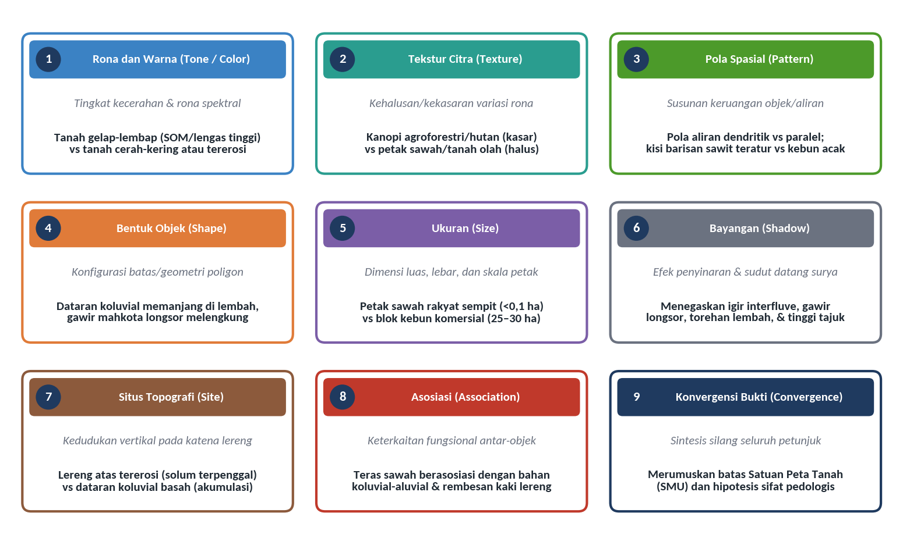
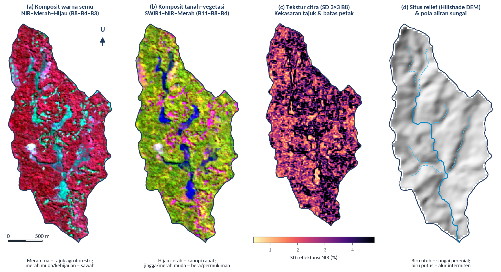
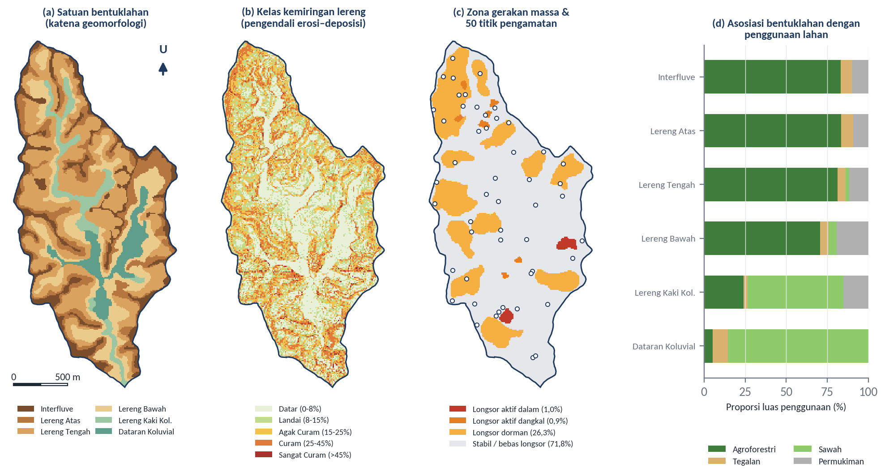
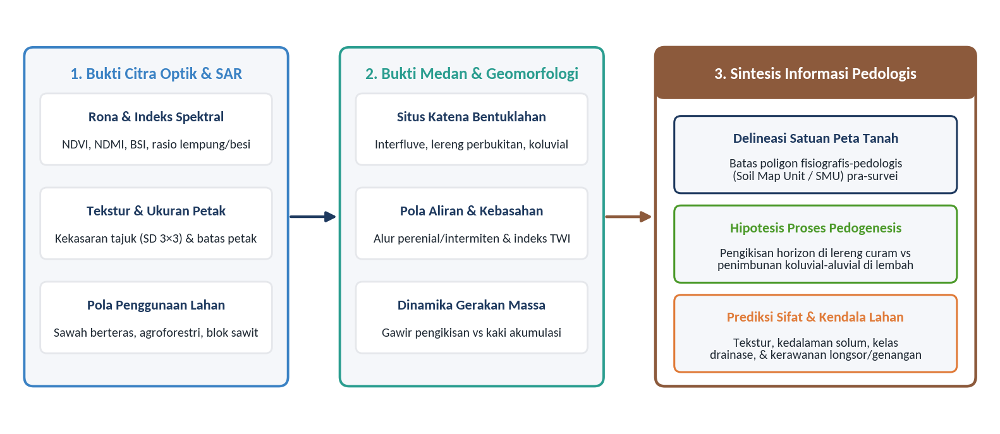

# Interpretasi Pedologis dari Data Remote Sensing

## Tujuan dan Capaian Pembelajaran

Pada Modul 4 dan Modul 5, peserta telah mempelajari cara menurunkan indeks spektral vegetasi, kelembapan, mineral tanah, serta algoritma deteksi tanah terbuka dari citra satelit multispektral. Namun, angka indeks spektral pada satu piksel tunggal tidak serta-merta menjelaskan bagaimana tubuh tanah terbentuk, mengapa horizon permukaan di suatu lereng mengalami pengikisan, atau mengapa cekungan di kaki lereng memiliki drainase terhambat. Dalam survei dan pemetaan tanah, jembatan intelektual yang mengubah tampilan visual maupun nilai numerik penginderaan jauh menjadi pemahaman utuh tentang genesis, sebaran, dan perilaku tanah di lanskap dikenal sebagai **interpretasi pedologis (*pedological image interpretation*)** (Goosen, 1967; Zinck, 2013).

Sejak era pemotretan udara stereoskopik hingga era citra satelit optik–radar resolusi tinggi dan LiDAR saat ini, prinsip dasar interpretasi pedologis bertumpu pada premis bahwa tanah bukanlah kumpulan titik yang saling bebas di ruang hampa, melainkan bagian integral dari bentang lahan (*landscape continuum*) yang dibentuk oleh interaksi bahan induk, relief, iklim, organisme, dan waktu (Jenny, 1941; Hudson, 1992). Dengan membaca petunjuk spektral, tekstur kanopi, pola pengatusan (*drainage pattern*), posisi katena lereng, dan asosiasi penggunaan lahan secara serempak, seorang pedolog dapat merumuskan hipotesis batas satuan peta tanah serta memprediksi kendala pengelolaan lahan sebelum turun ke lapangan. Setelah mempelajari modul ini, peserta pelatihan diharapkan mampu:

1. Menguraikan kesembilan kunci interpretasi citra penginderaan jauh—rona/warna, tekstur, pola, bentuk, ukuran, bayangan, situs, asosiasi, dan konvergensi bukti—serta menerjemahkan maknanya ke dalam konteks ilmu tanah dan agronomi perkebunan.
2. Menerapkan pendekatan fisiografis dan geopedologis untuk menerjemahkan pola visual citra, komposit warna semu (*false color composite*), tekstur citra, dan bayangan lereng menjadi informasi sifat tanah (perkembangan solum, kelas drainase, bahaya erosi/longsor, dan akumulasi koluvial).
3. Menganalisis keterkaitan spasial antara satuan bentuklahan, kemiringan lereng, zona gerakan massa (*landslide*), pola aliran sungai, dan respons spektral Sentinel-2 pada wilayah studi Sub-DAS Bompon maupun lanskap perkebunan kelapa sawit.
4. Melaksanakan praktik pembuatan komposit warna semu, ekstraksi tekstur citra lokal, dan sintesis kunci interpretasi pedologis di QGIS guna menyusun tabel kunci interpretasi satuan lahan pra-survei.

---

*Ceramah dan diskusi:*

## Kunci Interpretasi Citra Penginderaan Jauh

Interpretasi citra penginderaan jauh secara sistematis dibangun di atas sembilan unsur pengenalan objek yang pertama kali diformulasikan dalam fotogrametri dan foto-interpretasi oleh Rabben (1960), Colwell (1997), serta Lillesand et al. (2015), kemudian diadaptasi secara khusus untuk survei tanah oleh Goosen (1967), Vink (1968), dan Zinck (2013). Kesembilan unsur atau **kunci interpretasi (*interpretation keys*)** tersebut tersusun secara hierarkis dari unsur radiometrik dasar pada tingkat piksel (rona dan warna), unsur keruangan tingkat lokal (tekstur, pola, bentuk, ukuran, dan bayangan), hingga unsur kontekstual tingkat lanskap (situs topografi, asosiasi, dan konvergensi bukti) sebagaimana dirangkum pada Gambar 6.1.

Gambar 6.1 Sembilan kunci interpretasi citra penginderaan jauh beserta terjemahan indikator pedologisnya pada pemetaan tanah dan evaluasi lanskap pertanian/perkebunan.
Sumber: Disintesis dari Rabben (1960), Goosen (1967), Zinck (2013), dan Lillesand et al. (2015).

### 1. Rona dan Warna (*Tone and Color*)

**Rona (*tone*)** merujuk pada tingkat kecerahan atau kegelapan relatif suatu objek pada citra saluran tunggal (hitam–putih), sedangkan **warna (*color*)** merupakan manifestasi kombinasi tiga saluran spektral yang dipetakan ke dalam ruang warna Merah–Hijau–Biru (*Red–Green–Blue* / RGB). Dalam interpretasi pedologis, rona dan warna merupakan cerminan langsung dari interaksi radiasi elektromagnetik dengan kromofor permukaan tanah maupun vigor tajuk vegetasi di atasnya (Baumgardner et al., 1985; Escadafal, 1993):

- **Pada permukaan tanah terbuka**, rona gelap secara konsisten menandai dua kondisi pedologis utama: (a) kandungan bahan organik tanah (*soil organic matter* / SOM) dan humus yang tinggi—seperti pada horizon permukaan *epipedon molik* atau *umbrik* serta tanah gambut (*Histosols*)—dan/atau (b) kadar lengas tanah permukaan yang tinggi hingga jenuh air pada cekungan berdrainase buruk (*aquic moisture regime*). Sebaliknya, rona tanah yang sangat cerah atau keputihan mengindikasikan pencucian horizon permukaan (*horizon eluviasi albic* E), tersingkapnya horizon bawah permukaan yang miskin bahan organik akibat erosi lembar/parit, akumulasi garam mudah larut atau karbonat di daerah kering, maupun dominasi fraksi pasir kuarsa dan mineral kaolinit. Warna kemerahan hingga kekuningan pada komposit warna asli ($\text{B04–B03–B02}$) mencerminkan tingginya kadar oksida besi bebas ($\text{Fe}_2\text{O}_3$) berupa hematit (merah) dan goetit (kuning-cokelat) yang menjadi penciri tanah tua berdrainase baik (*Oxisols* dan *Ultisols*).
- **Pada permukaan bervegetasi**, pemilihan kombinasi saluran komposit warna semu (*False Color Composite* / FCC) sangat menentukan ketajaman pemisahan unit pedologis:
  1. **Komposit Warna Asli (*True Color*, $\text{RGB} = \text{B04–B03–B02}$)**: menampilkan lanskap sesuai persepsi mata manusia; efektif untuk membedakan tanah terbuka cokelat-kemerahan, tubuh air keruh, dan atap permukiman, tetapi memiliki kontras rendah di antara berbagai tipe vegetasi hijau.
  2. **Komposit Inframerah Dekat Standar (*Standard False Color*, $\text{RGB} = \text{B08–B04–B03}$)**: menempatkan kanal NIR pada saluran merah. Vegetasi dengan biomassa tinggi dan struktur mesofil sehat tampak merah tua menyala, petak sawah fase awal atau rumput tampak merah muda pucat, sedangkan tanah lembap dan air tampak biru kehijauan gelap (Gambar 6.2a).
  3. **Komposit Gelombang Pendek Tanah–Vegetasi (*SWIR–NIR–Red*, $\text{RGB} = \text{B11–B08–B04}$ atau $\text{B12–B08–B04}$)**: menempatkan kanal SWIR pada saluran merah, NIR pada saluran hijau, dan merah tampak pada saluran biru. Kombinasi ini sangat digemari oleh pemeta tanah karena menampilkan vegetasi rapat dalam warna hijau segar, memisahkan perbedaan kebasahan tajuk/tanah dalam gradasi biru-tua hingga sian, serta menonjolkan tanah terbuka, singkapan batuan, dan permukiman dalam warna merah muda hingga jingga keunguan yang sangat kontras (Gambar 6.2b).

### 2. Tekstur Citra (*Image Texture*)

Harap dibedakan dengan tegas antara **tekstur tanah (*soil texture*)**—yakni perbandingan relatif fraksi pasir, debu, dan lempung di dalam masa tanah—dan **tekstur citra (*image texture*)**, yaitu frekuensi perubahan rona atau kekasaran visual (*smoothness vs coarseness*) pada sekelompok piksel yang bertetangga (Haralick et al., 1973; Lillesand et al., 2015). Secara kuantitatif pada citra digital, tekstur lokal dapat diukur menggunakan simpangan baku (*standard deviation*) atau matriks ko-okurensi tingkat keabuan (*Gray-Level Co-occurrence Matrix* / GLCM) di dalam jendela geser berukuran $3\times 3$ atau $5\times 5$ piksel:

$$\sigma_{\text{lokal}}(x, y) = \sqrt{\frac{1}{N_w - 1} \sum_{(i, j) \in W(x,y)} \left(\rho(i, j) - \bar{\rho}_W\right)^2}$$

di mana $W(x, y)$ adalah jendela ketetanggaan berpusat di piksel $(x, y)$ dan $N_w$ adalah jumlah piksel di dalam jendela (misalnya $N_w = 9$ untuk jendela $3\times 3$). Dalam interpretasi pedologis:

- **Tekstur citra halus (*smooth/fine texture*, nilai $\sigma_{\text{lokal}}$ rendah)** mencirikan permukaan yang homogen secara radiometrik, seperti hamparan petak sawah aluvial yang rata, padang rumput seragam, tubuh air tenang, atau dataran tanah olah bertekstur halus.
- **Tekstur citra kasar atau berbintik (*coarse/mottled texture*, nilai $\sigma_{\text{lokal}}$ tinggi)** mencirikan kanopi hutan dan kebun campur (*agroforestry*) bertajuk multi-strata yang menghasilkan selang-seling antara puncak tajuk terang dan celah bayangan antar-pohon, topografi berbukit yang terkikis rapat oleh parit erosi (*badlands* / *gully erosion*), atau peralihan tajam di sepanjang batas petak penggunaan lahan (Gambar 6.2c). Pada perkebunan kelapa sawit, tekstur citra membedakan blok tanaman belum menghasilkan (TBM) yang bertekstur halus-sedang dari blok tanaman menghasilkan (TM) tua yang bertekstur kasar akibat lebarnya diameter tajuk pelepah dan adanya celah pohon tumbang (*canopy gaps*) karena serangan jamur *Ganoderma boninense*.

### 3. Pola (*Pattern*), Bentuk (*Shape*), dan Ukuran (*Size*)

Ketiga unsur spasial-geometris ini bekerja secara berdampingan untuk mengungkap struktur geologi bawah permukaan, proses geomorfik, serta campur tangan manajemen manusia terhadap tanah:

- **Pola (*pattern*)** adalah susunan keruangan yang berulang secara teratur maupun khas. Dua jenis pola yang paling bernilai tinggi bagi pedolog adalah **pola aliran sungai (*drainage pattern*)** dan **pola tata ruang petak tanaman**:
  - *Pola aliran dendritik* (menyerupai percabangan pohon) mengindikasikan batuan induk atau endapan yang relatif seragam ketahanannya terhadap erosi tanpa kontrol struktur patahan yang dominan (misalnya endapan tuf volkanik tebal atau batulempung marin).
  - *Pola aliran paralel hingga sub-paralel* mencirikan lereng volkanik tengah–atas yang curam dan seragam arah kemiringannya.
  - *Pola aliran rektangular atau trelis* menandai kontrol kekar, sesar, atau perselingan lapisan batuan sedimen keras–lunak yang menghasilkan kontras jenis tanah tajam antar-punggungan.
  - *Kerapatan drainase (*drainage density*, panjang alur sungai per satuan luas $\text{km}/\text{km}^2$)* berbanding terbalik dengan permeabilitas tanah dan batuan induk (Horton, 1945; Strahler, 1957): tanah bertekstur kasar dan sarang (*porous*, seperti *Andisols* atau *Psamments*) memiliki infiltrasi tinggi sehingga kerapatan alur permukaannya jarang, sedangkan tanah berlempung kedap air di atas batuan breksi/lempung terlapuk lanjut menghasilkan limpasan permukaan tinggi dengan jaringan parit dan alur sungai yang sangat rapat.
  - Di perkebunan kelapa sawit, pola kisi geometri jalan koleksi (*collection road*), jalan kontrol (*main road*), parit drainase tersier, serta barisan pohon segitiga sama sisi ($9\times 9\times 9\text{ m}$) langsung membedakan blok perkebunan terencana dari kebun rakyat swadaya atau hutan sekunder.
- **Bentuk (*shape*)** merujuk pada garis batas luar suatu objek. Bentuk pita sempit memanjang dan berkelok (*meandering ribbon*) di dasar lembah merupakan ciri khas dataran aluvial atau dataran koluvial tempat berkembangnya tanah muda berdrainase terhambat (*Fluvaquents* atau *Endoaquents*). Bentuk kipas menyebar di mulut lembah pegunungan menandai kipas aluvial (*alluvial fan*), sedangkan bentuk cekungan tapal kuda (*crescentic / spoon-shaped scar*) pada lereng bukit dengan tubuh lidah bergelombang di bawahnya merupakan ciri diagnostik mahkota dan tubuh **tanah longsor (*landslide*)** (Varnes, 1978; Cruden & Varnes, 1996).
- **Ukuran (*size*)** memberikan petunjuk skala intensitas pengelolaan dan fragmentasi lahan. Petak-petak sawah berteras di lembah perbukitan volkanik Jawa memiliki ukuran individual yang sangat sempit ($0{,}02\text{–}0{,}15\text{ ha}$) mengikuti rapatnya garis kontur lereng kaki, berbeda kontras dengan petak sawah dataran aluvial pantai utara yang berukuran luas ($>0{,}5\text{ ha}$) atau blok standar kebun kelapa sawit komersial yang dirancang seluas $25\text{–}30\text{ ha}$ ($300\times 1.000\text{ m}$).

### 4. Bayangan (*Shadow*), Situs (*Site*), Asosiasi (*Association*), dan Konvergensi Bukti (*Convergence of Evidence*)

Empat kunci interpretasi tingkat lanjut ini menghubungkan pengamatan piksel dengan posisi lanskap tiga dimensi dan logika proses pembentukan tanah:

- **Bayangan (*shadow*)**: Pada citra optik yang direkam pada pagi hari (sekitar pukul 09.30–10.30 waktu lokal untuk Sentinel-2 dan Landsat) maupun pada model bayangan bukit (*hillshade*) yang diturunkan dari DEM (Gambar 6.2d), kontras antara lereng yang menghadap matahari (*sunlit slope*) dan lereng yang membelakangi matahari (*shaded slope*) mempertegas mikro-relief permukaan. Punggung igir *interfluve*, tebing teras sungai, gawir mahkota longsor, dan beda tinggi antara tajuk pohon agroforestri terhadap petak sawah menjadi tampak tiga dimensi berkat adanya bayangan.
- **Situs (*site*)**: Merujuk pada kedudukan topografi dan lingkungan fisik tempat suatu satuan tanah berada di sepanjang katena lereng—mulai dari puncak punggungan (*interfluve*), bahu lereng (*shoulder*), lereng punggung (*backslope*), lereng kaki (*footslope*), hingga lembah dataran (*toeslope*) (Milne, 1935; Ruhe, 1960). Situs mengendalikan arah gerakan air lateral dan translokasi sedimen: situs *interfluve* yang datar-agak landai didominasi infiltrasi vertikal dan pembentukan horizon kambik/argilik yang relatif stabil; situs lereng atas dan lereng tengah yang curam didominasi erosi permukaan dan gerakan massa yang memenggal horizon A (*soil truncation*); sedangkan situs lereng kaki dan dataran koluvial menjadi zona penampungan sedimen halus serta rembesan air tanah dangkal.
- **Asosiasi (*association*)**: Keterkaitan fungsional yang konsisten antara dua atau lebih fenomena di permukaan bumi sehingga kehadiran fenomena pertama menjadi petunjuk kuat bagi keberadaan fenomena kedua. Sebagai contoh klasik di lanskap volkanik Jawa: keberadaan **sawah berteras irigasi teknis/setengah teknis** hampir selalu berasosiasi dengan satuan bentuklahan **dataran koluvial dan lereng kaki koluvial** yang memiliki tanah bertekstur lempung berdebu hingga lempung, bersolum dalam, ketersediaan mata air rembesan (*seepage*), dan lereng datar hingga landai ($0\text{–}15\%$). Di perkebunan kelapa sawit lahan rawa pasang surut atau gambut, rapatnya jaringan kanal drainase buatan (*parit cacing* setiap 4 atau 8 baris tanaman) berasosiasi langsung dengan tanah *Histosols* (gambut) atau tanah sulfat masam (*Sulfaquepts*) yang membutuhkan pengendalian muka air tanah secara ketat.
- **Konvergensi bukti (*convergence of evidence*)**: Tidak ada satu pun kunci interpretasi yang mampu berdiri sendiri tanpa risiko salah tafsir. Rona merah muda pada komposit SWIR dapat berarti tanah pertanian terbuka, tetapi dapat pula berarti atap genteng permukiman; tekstur halus dapat berarti petak sawah, tetapi dapat pula berarti rumput lapangan. Oleh karena itu, interpretasi pedologis bekerja dengan menyilangkan seluruh petunjuk secara simultan hingga mengarah pada satu kesimpulan pedologis yang paling masuk akal (Rabben, 1960; Zinck, 2013). Apabila suatu poligon memiliki (1) *rona* komposit NIR merah muda-kehijauan dengan nilai kecerahan tampak relatif tinggi, (2) *tekstur* citra halus, (3) *bentuk* memanjang mengikuti lembah, (4) *pola* petak berteras bertingkat di kiri-kanan sungai perenial, dan (5) *situs* di dasar cekungan berlereng $<8\%$, maka konvergensi bukti memastikan bahwa poligon tersebut adalah **satuan peta tanah dataran koluvial-aluvial bersawah dengan rezim kelembapan akuik (*Aquic Inceptisols* / *Entisols*)**.

Ringkasan pada Tabel 6.1 menyarikan kesembilan kunci interpretasi penginderaan jauh beserta indikator kuantitatif pada citra digital dan implikasi pedologisnya.

Tabel 6.1 Matriks operasional sembilan kunci interpretasi penginderaan jauh untuk ekstraksi informasi pedologis.

| No | Kunci Interpretasi | Indikator Visual & Numerik pada Citra / DEM | Proses Pedogenesis & Sifat Tanah yang Diindikasikan | Contoh di Sub-DAS Bompon & Perkebunan Sawit |
| :-: | :--- | :--- | :--- | :--- |
| 1 | **Rona / Warna** (*Tone / Color*) | Albedo tampak, komposit RGB ($\text{B8–B4–B3}$, $\text{B11–B8–B4}$), NDVI, NDMI, BSI | Akumulasi bahan organik (gelap), kadar lengas/genangan (SWIR gelap), oksida $\text{Fe}^{3+}$ hematit/goetit (merah/kuning) | Tajuk agroforestri sangat gelap di kanal tampak ($2{,}75\%$) vs sawah bera/permukiman lebih cerah ($>4{,}0\%$) |
| 2 | **Tekstur Citra** (*Texture*) | Simpangan baku lokal ($\text{SD } 3\times 3$ NIR), entropi/kontras GLCM | Keragaman struktur kanopi di atas tanah, intensitas torehan parit erosi (*gully*), atau homogenitas olah tanah | Sawah dan tajuk rapat homogen memiliki SD NIR lebih rendah dibandingkan zona transisi permukiman ($4{,}24\%$) dan longsor dangkal ($3{,}71\%$) |
| 3 | **Pola** (*Pattern*) | Geometri jaringan sungai (dendritik, paralel) & tata letak blok/barisan | Permeabilitas bahan induk (kerapatan drainase), kontrol struktur geologi, sistem manajemen drainase kebun | Kerapatan sungai $2{,}54\text{ km/km}^2$ berpola sub-dendritik; pola kisi blok sawit $300\times 1.000\text{ m}$ dan kanal gambut |
| 4 | **Bentuk** (*Shape*) | Rasio keliling–luas poligon, kelengkungan batas | Proses transportasi-deposisi sedimen (pita aluvial, kipas koluvial) dan morfologi gawir/lidah gerakan massa | Dataran koluvial berbentuk pita bercabang mengikuti lembah; zona longsor berbentuk cekungan melebar di lereng |
| 5 | **Ukuran** (*Size*) | Luas poligon ($\text{ha}$) dan lebar penampang ($\text{m}$) | Skala proses geomorfik, fragmentasi pengelolaan tanah, serta kesesuaian terhadap luas delineasi minimum (MLA) | Petak sawah sempit di lereng kaki vs hamparan agroforestri luas ($208{,}46\text{ ha}$) di lereng perbukitan |
| 6 | **Bayangan** (*Shadow*) | Kontras iluminasi *hillshade* ($\text{azimut } 315^\circ$) & bayangan tajuk | Kemiringan dan arah hadap lereng (*aspect*), ketajaman igir punggungan, kedalaman torehan lembah dan gawir | Memperjelas batas antara igir *interfluve* sempit, lereng perbukitan curam, dan dasar lembah Bompon |
| 7 | **Situs** (*Site*) | Elevasi relatif, kemiringan lereng ($\%$), *Topographic Position Index* (TPI), TWI | Urutan katena tanah (*soil catena*): pencucian/erosi di posisi atas vs penimbunan/gleisasi di posisi bawah | Enam posisi katena dari *Interfluve* hingga *Dataran Koluvial* yang mengendalikan ketebalan solum |
| 8 | **Asosiasi** (*Association*) | Ko-okurensi spasial antar-layer (tabulasi silang bentuklahan $\times$ penggunaan) | Hubungan kausal antara ketersediaan air tanah, kemudahan olah tanah, dan adaptasi penggunaan lahan | $85{,}3\%$ *Dataran Koluvial* dan $58{,}1\%$ *Lereng Kaki Koluvial* digunakan sebagai sawah berteras |
| 9 | **Konvergensi Bukti** (*Convergence*) | Integrasi multi-sensor (optik + DEM + geologi + lapangan) | Penetapan batas Satuan Peta Tanah (*Soil Map Unit*) beserta hipotesis taksonomi dan sifat fisik-kimia tanah | Pemisahan tegas antara satuan tanah koluvial lembah (basah, bertekstur halus) dan satuan tanah perbukitan volkanik tererosi |

Sumber: Disintesis dari Rabben (1960), Goosen (1967), Vink (1968), Zinck (2013), dan analisis empiris Sub-DAS Bompon.

---

## Interpretasi Pola Citra Menjadi Informasi Pedologis

### Pendekatan Fisiografis dan Geopedologis dalam Pemetaan Tanah

Mengapa seorang pemeta tanah dapat mendelineasi batas satuan tanah dari citra satelit padahal sebagian besar permukaan tanah tertutup oleh vegetasi sebagaimana telah kita buktikan pada Modul 5? Jawabannya terletak pada **paradigma geopedologi (*geopedologic approach*)** yang dikembangkan oleh Vink (1968) dan disempurnakan secara komprehensif oleh Zinck (1988) dan Zinck (2013). Dalam kerangka geopedologi, bentuklahan (*landform*) dipandang sebagai wadah fisik sekaligus pengatur utama proses pembentukan tanah (*pedogenesis*):

1. **Batas geomorfik berimpit dengan batas pedologis**: Perubahan mendadak pada kemiringan lereng (*break of slope*), peralihan dari lereng pengikisan (*erosional backslope*) ke lereng kaki penimbunan (*colluvial footslope*), atau batas antara teras sungai dan dataran banjir hampir selalu menandai perubahan tajam pada ketebalan solum, urutan horizon, distribusi ukuran butir (tekstur), dan kelas drainase tanah.
2. **Vegetasi dan penggunaan lahan bertindak sebagai indikator ekologis tanah**: Di wilayah yang telah lama dikelola oleh masyarakat maupun perkebunan, petani secara turun-temurun menyesuaikan jenis tanaman dengan daya dukung tanah dan ketersediaan air. Begitu pula pada vegetasi alami atau semi-alami, kerapatan tajuk (NDVI) dan kandungan air kanopi (NDMI) pada puncak musim kemarau mencerminkan kapasitas tanah menyimpan air tersedia (*available water capacity*) di zona perakaran.

Untuk memvisualisasikan bagaimana kunci interpretasi spektral, tekstur, dan relief bekerja secara nyata, Gambar 6.2 menampilkan empat representasi penginderaan jauh dari wilayah studi Sub-DAS Bompon yang diturunkan dari citra Sentinel-2A (21 Juli 2025) dan Copernicus DEM 30 m.

Gambar 6.2 Penerapan kunci interpretasi visual dan numerik pada Sub-DAS Bompon: (a) komposit warna semu standar NIR–Merah–Hijau ($\text{B08–B04–B03}$), (b) komposit tanah–vegetasi SWIR1–NIR–Merah ($\text{B11–B08–B04}$), (c) peta tekstur citra dari simpangan baku lokal $3\times 3$ piksel kanal NIR ($\text{B08}$), dan (d) peta bayangan relief (*hillshade*) DEM beserta pola aliran sungai perenial dan intermiten.
Sumber: Hasil pengolahan citra Copernicus Sentinel-2A Level-2A (21 Juli 2025), Copernicus DEM GLO-30, dan layer hidrografi `bompon.gpkg`.

Pada Gambar 6.2a dan Gambar 6.2b, tampak jelas struktur spasial yang menyerupai cabang daun (*dendritic valley floor*) di bagian tengah hingga selatan Sub-DAS Bompon. Pada komposit $\text{B08–B04–B03}$ (Gambar 6.2a), pita bercabang di dasar lembah tersebut memiliki rona merah muda pucat bercampur sian-kehijauan, sedangkan pada komposit $\text{B11–B08–B04}$ (Gambar 6.2b) pita yang sama tampak hijau kekuningan bercampur bercak biru gelap (air genangan sawah) dan merah muda keunguan (petak bera dan permukiman di tepi lembah). Sebaliknya, perbukitan di sekelilingnya tampil merah tua pekat pada Gambar 6.2a dan hijau tua seragam pada Gambar 6.2b. Ketika kita menyandingkan pola warna tersebut dengan peta tekstur citra $\text{SD } 3\times 3$ kanal NIR (Gambar 6.2c) dan peta bayangan relief beserta jaringan sungai (Gambar 6.2d), terungkap bahwa pita bercabang tersebut berimpit tepat dengan alur **sungai perenial** sepanjang $2.956{,}2\text{ m}$ yang mengalir di dasar lembah, sedangkan lereng perbukitan di bagian hulu ditoreh oleh cabang-cabang **sungai intermiten** sepanjang $4.526{,}3\text{ m}$ (total panjang alur $7.482{,}5\text{ m}$ atau kerapatan drainase sebesar $2{,}54\text{ km/km}^2$).

### Hubungan Katena Bentuklahan, Gerakan Massa, dan Sifat Tanah di Sub-DAS Bompon

Untuk menguji secara kuantitatif bagaimana keenam kunci interpretasi di atas berkonvergensi menjadi satuan-satuan pedologis, kita melakukan analisis tumpang-susun spasial (*spatial overlay*) antara keenam satuan bentuklahan katena volkanik-struktural (`bentuklahan`), lima kelas kemiringan lereng (`kelas_lereng`), tiga zona kerawanan gerakan massa/longsor (`longsor`), dan empat kelas penggunaan lahan (`penggunaan_lahan`) terhadap parameter spektral Sentinel-2 di Sub-DAS Bompon. Hasil pemetaan tiga tema pengontrol pedogenesis beserta grafik proporsi asosiasinya disajikan pada Gambar 6.3, sedangkan rincian angka kuantitatifnya dirangkum secara lengkap pada Tabel 6.2.

Gambar 6.3 Sintesis fisiografis dan dinamika geomorfik sebagai dasar interpretasi pedologis di Sub-DAS Bompon: (a) peta enam satuan bentuklahan katena perbukitan hingga lembah koluvial, (b) peta lima kelas kemiringan lereng, (c) peta zona gerakan massa (longsor aktif dalam, aktif dangkal, dan dorman) beserta sebaran 50 titik sampel tanah lapangan, serta (d) diagram batang asosiasi proporsi penggunaan lahan pada setiap satuan bentuklahan.
Sumber: Analisis spasial layer `bentuklahan`, `kelas_lereng`, `longsor`, `penggunaan_lahan`, dan `titik_sampel_lapangan` pada `bompon.gpkg`.

Tabel 6.2 Karakteristik spektral, tekstur citra, proporsi zona longsor, dan asosiasi penggunaan lahan pada setiap satuan bentuklahan di Sub-DAS Bompon ($N = 29.469$ piksel).

| Satuan Bentuklahan (Urutan Katena Atas $\rightarrow$ Bawah) | Luas ($\text{ha}$) & Proporsi | Median NDVI | Median NDMI | Kecerahan Tampak (%) | Tekstur NIR $\text{SD } 3\times 3$ (%) | Proporsi Zona Longsor (Aktif / Dorman) | Penggunaan Lahan Dominan | Interpretasi Proses Pedologis Utama |
| :--- | :---: | :---: | :---: | :---: | :---: | :---: | :--- | :--- |
| **1. Interfluve** (Puncak / Igir Punggungan) | $39{,}53\text{ ha}$ ($13{,}41\%$) | $0{,}875$ | $0{,}337$ | $2{,}84\%$ | $2{,}85\%$ | $0{,}1\%$ aktif; $12{,}1\%$ dorman | Agroforestri ($83{,}2\%$), Permukiman ($10{,}0\%$) | Infiltrasi vertikal dominan; pelapukan *in-situ* menghasilkan solum relatif tebal dan stabil (*Inceptisols* / *Dystrudepts*) |
| **2. Lereng Atas Perbukitan** (*Upper Slope*) | $49{,}65\text{ ha}$ ($16{,}85\%$) | $0{,}876$ | $0{,}331$ | $2{,}89\%$ | $2{,}98\%$ | $1{,}2\%$ aktif; $20{,}2\%$ dorman | Agroforestri ($83{,}4\%$), Permukiman ($9{,}2\%$) | Zona pelepasan air dan awal pengikisan; pencucian basa dan erosi permukaan mulai menipiskan horizon A |
| **3. Lereng Tengah Perbukitan** (*Middle Backslope*) | $109{,}02\text{ ha}$ ($36{,}99\%$) | $0{,}878$ | $0{,}331$ | $2{,}77\%$ | $3{,}15\%$ | $1{,}5\%$ aktif; $32{,}4\%$ dorman | Agroforestri ($81{,}3\%$), Permukiman ($11{,}8\%$) | Satuan terluas; transportasi sedimen intensif dan rayapan tanah (*soil creep*); profil tanah sering terpenggal dan bercampur bahan batuan lapuk |
| **4. Lereng Bawah Perbukitan** (*Lower Backslope*) | $56{,}28\text{ ha}$ ($19{,}10\%$) | $0{,}861$ | $0{,}313$ | $2{,}99\%$ | $3{,}31\%$ | **$4{,}8\%$ aktif; $38{,}7\%$ dorman** | Agroforestri ($70{,}5\%$), Permukiman ($19{,}3\%$) | Zona ketidakstabilan lereng tertinggi ($43{,}5\%$ terdampak longsor); percampuran koluvial dari runtuhan lereng atas dan variasi tekstur tanah sangat tinggi |
| **5. Lereng Kaki Koluvial** (*Colluvial Footslope*) | $19{,}68\text{ ha}$ ($6{,}68\%$) | $0{,}706$ | $0{,}277$ | $4{,}15\%$ | $3{,}42\%$ | $1{,}9\%$ aktif; $21{,}1\%$ dorman | **Sawah ($58{,}1\%$)**, Agroforestri ($23{,}9\%$) | Zona transisi tekuk lereng (*concave footslope*); akumulasi koluvium halus, munculnya mata air rembesan, dan pembentukan *anthraquic epipedon* pada sawah berteras |
| **6. Dataran Koluvial** (*Colluvial-Alluvial Valley*) | $20{,}53\text{ ha}$ ($6{,}97\%$) | $0{,}736$ | $0{,}294$ | $4{,}15\%$ | $2{,}91\%$ | $0{,}8\%$ aktif; $6{,}9\%$ dorman | **Sawah ($85{,}3\%$)**, Tegalan ($9{,}4\%$) | Zona pengendapan sedimen halus di dasar lembah; drainase agak terhambat–terhambat, proses reduksi-oksidasi (*gleisasi/mottling*), tekstur lempung berdebu |

Sumber: Analisis tumpang-susun spasial data `bompon.gpkg` dan citra Sentinel-2A Level-2A (21 Juli 2025).

Data pada Tabel 6.2 dan Gambar 6.3 memperlihatkan bagaimana pendekatan geopedologis mampu menguraikan kompleksitas tanah di lanskap tropis yang memiliki variasi hasil prediksi model cukup menantang (sebagaimana ditemukan dalam studi Fatmawati (2026) di wilayah yang sama):

1. **Pemisahan dua rezim pedogenesis utama berdasarkan posisi katena**:
   - **Kelompok Satuan Perbukitan Erodisional–Denudasional (*Interfluve*, *Lereng Atas*, *Lereng Tengah*, dan *Lereng Bawah*)** mencakup $86{,}35\%$ luas Sub-DAS Bompon ($254{,}48\text{ ha}$). Keempat satuan ini memiliki ciri spektral yang mirip (median NDVI tinggi $0{,}861\text{–}0{,}878$; kecerahan tampak rendah $2{,}77\text{–}2{,}99\%$) karena sama-sama didominasi oleh tutupan **Agroforestri** ($70{,}5\text{–}83{,}4\%$). Namun, penambahan kunci interpretasi **situs lereng** dan **tekstur citra** membedakan keempatnya secara tajam: ketika bergerak turun dari *Interfluve* ke *Lereng Bawah*, tekstur citra NIR meningkat secara monoton dari $2{,}85\%$ menjadi $3{,}31\%$ seiring dengan meningkatnya fragmentasi tajuk oleh permukiman dan torehan lembah.
   - **Kelompok Satuan Lembah Akumulatif (*Lereng Kaki Koluvial* dan *Dataran Koluvial*)** mencakup $13{,}65\%$ luas Sub-DAS ($40{,}21\text{ ha}$). Begitu lereng melandai di kaki bukit, penggunaan lahan beralih secara drastis menjadi **Sawah** ($58{,}1\%$ pada Lereng Kaki Koluvial dan $85{,}3\%$ pada Dataran Koluvial; Gambar 6.3d). Perubahan asosiasi penggunaan lahan ini tercermin langsung pada lonjakan kecerahan tampak menjadi $4{,}15\%$ dan penurunan median NDVI menjadi $0{,}706\text{–}0{,}736$. Secara pedologis, kedua satuan lembah ini menerima limpahan partikel lempung dan debu yang tercuci dari lereng atas, mengalami genangan berkala untuk budidaya padi (*puddling*), serta membentuk horizon bawah permukaan dengan bercak karatan besi-mangan (*redoximorphic features*) akibat fluktuasi muka air tanah.
2. **Peran kunci gerakan massa (*landslide*) sebagai pengacak distribusi tekstur tanah**:
   Salah satu temuan paling menarik dari Tabel 6.2 dan Gambar 6.3c adalah luasnya zona gerakan massa di Sub-DAS Bompon: sebesar **$28{,}16\%$ luas DAS ($83{,}00\text{ ha}$)** berada di dalam zona longsor, yang terdiri atas longsor aktif dalam ($2{,}93\text{ ha}$ atau $0{,}99\%$), longsor aktif dangkal ($2{,}60\text{ ha}$ atau $0{,}88\%$), dan longsor dorman/lama ($77{,}47\text{ ha}$ atau $26{,}29\%$). Proporsi area terdampak longsor meningkat dari $12{,}2\%$ di *Interfluve*, menjadi $21{,}4\%$ di *Lereng Atas*, $33{,}9\%$ di *Lereng Tengah*, dan mencapai puncaknya sebesar **$43{,}5\%$ di *Lereng Bawah Perbukitan***.
   - Pada zona **longsor aktif dangkal**, terbukanya gawir longsor dan rusaknya tajuk vegetasi menurunkan median NDVI menjadi $0{,}826$ dan meningkatkan kekasaran tekstur citra NIR menjadi $3{,}71\%$ (dibandingkan $2{,}95\%$ pada longsor dorman yang telah tertutup kembali oleh vegetasi).
   - Dari sudut pandang genesis tanah, longsor yang berulang di atas breksi volkanik terlapuk (Formasi Kebobutak) mengaduk horizon tanah atas (0–20 cm) dengan horizon bawah (20–40 cm) dan bahan induk saprolit (*pedoturbasi geomorfik*). Di bagian mahkota longsor (*depletion zone*), lapisan tanah atas yang kaya lempung/bahan organik terkelupas sehingga menyisakan substrat bertekstur lebih kasar di permukaan; sebaliknya di bagian kaki/lidah longsor (*accumulation zone*), material rombakan menimbun tanah lama (*buried soil*) secara acak pada jarak puluhan meter. Fenomena geopedologis inilah yang menjelaskan mengapa variasi lokal fraksi pasir, debu, dan lempung di Sub-DAS Bompon sangat tinggi meskipun berada pada satu satuan peta penggunaan lahan yang sama (Fatmawati, 2026).

### Sintesis Konvergensi Bukti Menuju Informasi Pedologis dan Manajemen Kebun

Untuk merangkum seluruh alur penalaran dari pengamatan citra menuju kesimpulan pedologis, Gambar 6.4 menyajikan kerangka kerja **konvergensi bukti (*convergence of evidence*)** yang mengintegrasikan bukti spektral-spasial citra dengan bukti medan-geomorfologi.

Gambar 6.4 Kerangka kerja konvergensi bukti dalam interpretasi pedologis: penggabungan bukti spektral-spasial citra penginderaan jauh (Kolom 1) dan bukti medan-geomorfologi (Kolom 2) untuk menghasilkan delineasi Satuan Peta Tanah, hipotesis pedogenesis, serta prediksi sifat dan kendala pengelolaan lahan (Kolom 3).
Sumber: Disintesis dari metodologi geopedologi Zinck (2013) dan McBratney et al. (2003).

Di lingkungan operasional perkebunan kelapa sawit, kerangka konvergensi bukti pada Gambar 6.4 diterapkan secara langsung oleh tim survei tanah dan agronomi untuk menjawab empat persoalan manajemen blok:

1. **Identifikasi zona genangan kronis dan drainase terhambat (*waterlogging*)**: Kombinasi situs cekungan lembah ($\text{TWI} > 10$), rona gelap pada kanal SWIR ($\text{B11}$ dan $\text{B12}$ rendah), nilai NDMI tinggi pada tanah terbuka tetapi disertai nilai NDVI tajuk sawit yang tertekan ($<0{,}65$) dan tekstur citra berbintik kasar (akibat mahkota pelepah menguning atau ukuran tajuk kerdil) menjadi bukti konvergen adanya tanah berdrainase buruk (*Gleysols* / *Aquents* / *Aquepts*) yang membutuhkan pembangunan parit pembuangan (*outlet drain*).
2. **Deteksi zona solum dangkal, singkapan batuan, atau laterit (*petroferric / lithic contact*)**: Situs punggungan sempit atau bahu lereng curam ($>25\%$) yang menampilkan rona komposit SWIR kemerahan cerah (BSI dan IOI tinggi), kerapatan tajuk kelapa sawit yang jarang dengan diameter tajuk kecil, serta stres kekeringan cepat pada awal musim kemarau (penurunan tajam NDMI) mengindikasikan tanah bersolum dangkal atau berkerikil kuarsa/konkresi besi (*plinthite/ironstone*) yang membatasi perkembangan akar dan menurunkan potensi produksi tandan buah segar.
3. **Pemetaan risiko erosi dan kelongsoran jalan kebun**: Situs lereng tengah–bawah yang curam dengan kerapatan alur drainase intermiten tinggi, bentuk lereng cekung pengumpul aliran, dan tekstur citra kasar di sepanjang tebing teras menandai satuan tanah yang rawan mengalami longsor dangkal, sehingga memerlukan penguatan teras individu (*tapak kuda*), rorak (*silt pit*), dan penanaman *Mucuna bracteata* yang rapat.
4. **Stratifikasi blok manajemen pemupukan (*Site-Specific Nutrient Management* / SSNM)**: Dengan memadukan batas bentuklahan, kelas lereng, dan pola rona spektral ke dalam Satuan Peta Tanah (SMU) yang bermakna secara pedologis, rekomendasi dosis pupuk (N, P, K, Mg, dan B) tidak lagi dipukul rata per divisi administratif, melainkan disesuaikan dengan kapasitas sangga hara dan potensi kehilangan pencucian/limpasan dari masing-masing unit lanskap (Fairhurst & Hardter, 2003; Goh et al., 2009).

---

*Demonstrasi dan praktik:*

## Praktik: Interpretasi Pedologis Terpadu dari Citra Sentinel-2, DEM, dan Bentuklahan di QGIS

### **Tujuan**
Peserta mampu menyusun komposit warna semu (*false color composite*) di QGIS, menurunkan peta tekstur citra lokal (simpangan baku $3\times 3$ NIR) dan peta bayangan relief (*hillshade*), serta memadukan kesembilan kunci interpretasi penginderaan jauh untuk melakukan karakterisasi pedologis dan menyusun matriks interpretasi satuan lahan di Sub-DAS Bompon.

### **Input Data**
1. `Source/Data Bompon/terbuka/sentinel2_l2a_20250721_10m.tif` — Citra Sentinel-2A Level-2A 10 kanal (`EPSG:32749`).
2. `Source/Data Bompon/terbuka/copdem_glo30_30m.tif` — Data elevasi digital Copernicus DEM 30 meter (`EPSG:32749`).
3. `Source/Data Bompon/bompon.gpkg` — Memuat layer vektor `batas_subdas`, `bentuklahan`, `kelas_lereng`, `penggunaan_lahan`, `longsor`, `sungai`, dan `titik_sampel_lapangan`.
4. Layer raster indeks dari Modul 4 dan Modul 5 (`ndvi_bompon_10m.tif`, `ndmi_bompon_10m.tif`, dan `bsi_bompon_10m.tif`).

### **Software**
- **QGIS Desktop** (versi 3.28 LTR atau 3.34+) dengan modul **GDAL DEM Processing (Hillshade)**, **GRASS GIS `r.neighbors`** (atau SAGA Focal Statistics), dan **Zonal Statistics**.

### **Langkah Kerja**

1. **Penyusunan Tiga Komposit Warna Citra Sentinel-2 (Kunci Rona dan Warna)**
   - Buka proyek QGIS dan muat `sentinel2_l2a_20250721_10m.tif`. Klik kanan pada layer tersebut di panel **Layers** $\rightarrow$ pilih **Duplicate Layer** sebanyak dua kali sehingga terdapat tiga salinan layer citra yang dapat dinyalakan/dimatikan secara bergantian.
   - Beri nama ketiganya dan atur **Symbology** $\rightarrow$ **Render type: Multiband color** sebagai berikut:
     - **Layer 1 — `S2 Komposit Warna Asli (B4-B3-B2)`**: Red band = `Band 3 (B04)`, Green band = `Band 2 (B03)`, Blue band = `Band 1 (B02)`.
     - **Layer 2 — `S2 Komposit Warna Semu NIR (B8-B4-B3)`**: Red band = `Band 7 (B08)`, Green band = `Band 3 (B04)`, Blue band = `Band 2 (B03)` (sebagaimana Gambar 6.2a).
     - **Layer 3 — `S2 Komposit Tanah-Vegetasi SWIR (B11-B8-B4)`**: Red band = `Band 9 (B11)`, Green band = `Band 7 (B08)`, Blue band = `Band 3 (B04)` (sebagaimana Gambar 6.2b).
   - Pada masing-masing layer, perluas bagian **Min / Max Value Settings**, pilih **Cumulative count cut** (`2.0%` hingga `98.0%`), lalu klik **Apply**. Bandingkan secara visual bagaimana lembah sawah dan bercak permukiman terpisah jauh lebih tegas pada komposit SWIR dan NIR dibandingkan komposit warna asli.

2. **Ekstraksi Peta Tekstur Citra Lokal $3\times 3$ pada Kanal NIR (Kunci Tekstur)**
   - Untuk menghitung simpangan baku lokal kanal NIR ($\text{B08}$, yaitu Band 7), terlebih dahulu ekstrak Band 7 menjadi berkas tunggal melalui **Raster** $\rightarrow$ **Conversion** $\rightarrow$ **Translate (Convert Format)** dengan parameter `-b 7`, atau gunakan **Raster Calculator** dengan ekspresi `"sentinel2_l2a_20250721_10m@7" * 100` (dalam satuan persen reflektansi) dan simpan sebagai `b08_persen_10m.tif`.
   - Buka **Processing Toolbox** $\rightarrow$ ketik `r.neighbors` (di bawah grup **GRASS** $\rightarrow$ **Raster**):
     - **Input raster layer**: `b08_persen_10m.tif`
     - **Neighborhood operation**: pilih `stddev` (*standard deviation*)
     - **Neighborhood size**: `3` (jendela $3\times 3$ piksel atau $30\times 30\text{ m}$)
     - Simpan keluaran **Neighborhood** sebagai `tekstur_nir_sd3x3.tif` dan klik **Run**.
   - Atur simbologi `tekstur_nir_sd3x3.tif` menggunakan **Singleband pseudocolor** dengan rampa warna `Magma` (dibalik / *Invert*) pada rentang `0.4` hingga `4.8` sebagaimana Gambar 6.2c.

3. **Pembangkitan *Hillshade* dan Penampalan Pola Aliran Sungai (Kunci Bayangan, Pola, dan Situs)**
   - Buka **Raster** $\rightarrow$ **Analysis** $\rightarrow$ **Hillshade...**:
     - **Input layer**: `copdem_glo30_30m.tif`
     - **Z factor**: `1.5` (untuk mempertegas kontras relief lokal pada resolusi 30 m)
     - **Azimuth (horizontal angle)**: `315.0` derajat; **Altitude (vertical angle)**: `45.0` derajat
     - Simpan sebagai `hillshade_bompon_30m.tif`.
   - Muat layer vektor `sungai`, `bentuklahan`, dan `longsor` dari `bompon.gpkg`. Atur simbologi `sungai` menjadi **Categorized** berdasarkan kolom `jenis`: garis biru tua utuh (`1.2 mm`) untuk `Sungai perenial` dan garis biru muda putus-putus (`0.8 mm`) untuk `Sungai intermiten` (Gambar 6.2d).
   - Gandakan layer `bentuklahan`, letakkan di atas `hillshade_bompon_30m.tif`, atur transparansi (*Opacity*) menjadi `55%` dengan **Blending mode: Multiply** agar warna keenam satuan bentuklahan menyatu secara tiga dimensi dengan bayangan lereng di bawahnya.

4. **Kuantifikasi Karakteristik Spektral dan Tekstur per Satuan Bentuklahan (Zonal Statistics)**
   - Buka **Processing Toolbox** $\rightarrow$ **Raster analysis** $\rightarrow$ **Zonal statistics**.
   - Pilih `bentuklahan` sebagai **Input layer** (atau terlebih dahulu jalankan **Dissolve** berdasarkan kolom `bentuklahan` menjadi `bentuklahan_6unit.gpkg` agar diperoleh 6 baris ringkasan utuh).
   - Jalankan **Zonal statistics** secara berurutan terhadap:
     1. `ndvi_bompon_10m.tif` (prefix: `ndvi_`, statistik: `Median, Mean, Std dev`)
     2. `ndmi_bompon_10m.tif` (prefix: `ndmi_`, statistik: `Median, Mean`)
     3. `tekstur_nir_sd3x3.tif` (prefix: `tex_`, statistik: `Median, Mean`)
   - Selanjutnya, jalankan **Vector** $\rightarrow$ **Analysis Tools** $\rightarrow$ **Overlap Analysis** dengan **Input layer**: `bentuklahan_6unit.gpkg` dan **Overlay layers**: `penggunaan_lahan` serta `longsor` untuk menghitung persentase luas sawah, agroforestri, dan zona longsor di dalam masing-masing bentuklahan sebagaimana Tabel 6.2.

5. **Penyusunan Tabel Kunci Interpretasi Pedologis pada Titik Sampel**
   - Nyalakan layer `titik_sampel_rencana` dan `titik_sampel_lapangan`. Pilih 6 titik wakil yang mewakili keenam posisi katena dari puncak hingga lembah (misalnya satu titik pada *Interfluve*, *Lereng Atas*, *Lereng Tengah*, *Lereng Bawah*, *Lereng Kaki Koluvial*, dan *Dataran Koluvial*).
   - Gunakan alat **Identify Features** (ikon `i`) sambil menyalakan komposit warna semu, tekstur NIR, *hillshade*, dan zona longsor untuk mencatat kesembilan kunci interpretasi beserta kesimpulan kondisi pedologis pada keenam titik tersebut.

### **Expected Output**
1. Tiga layer tampilan komposit warna Sentinel-2 (Warna Asli, Warna Semu NIR, dan Komposit SWIR–NIR–Merah) yang tersimpan di dalam proyek kerja QGIS.
2. Layer raster tekstur citra `tekstur_nir_sd3x3.tif` dan relief `hillshade_bompon_30m.tif` yang dipadukan secara semi-transparan dengan poligon `bentuklahan`, `longsor`, dan jaringan `sungai`.
3. Layer vektor `bentuklahan_6unit.gpkg` yang memuat tabel atribut ringkasan nilai median NDVI, NDMI, tekstur NIR, persentase penggunaan lahan, serta persentase keterdampakan longsor pada keenam satuan bentuklahan katena Bompon.

### **Interpretation**
- Melalui perbandingan simultan di kanvas QGIS, peserta dapat membuktikan prinsip **konvergensi bukti** secara nyata: batas poligon `Dataran Koluvial` dan `Lereng Kaki Koluvial` bukan sekadar garis kontur topografi, melainkan berimpit langsung dengan (a) perubahan rona komposit $\text{B11–B08–B04}$ dari hijau tua ke hijau kekuningan/biru-merah muda, (b) berhentinya cabang sungai intermiten menjadi sungai perenial utama, (c) penurunan tajam persentase zona longsor aktif dari $4{,}8\%$ di Lereng Bawah menjadi $0{,}8\%$ di Dataran Koluvial, serta (d) peralihan penggunaan lahan dari agroforestri ($>70\%$) menjadi sawah berteras ($58{,}1\text{–}85{,}3\%$).
- Sebaliknya, pada zona `Lereng Tengah` dan `Lereng Bawah Perbukitan`, meskipun rona tajuk agroforestri tampak seragam dari atas ($>86\%$ NDVI), penampalan peta `longsor` dan tekstur citra `tekstur_nir_sd3x3.tif` mengungkap bahwa lebih dari sepertiga hingga hampir separuh lereng tersebut merupakan tubuh longsor dorman dan aktif. Secara pedologis, informasi ini memperingatkan pemeta tanah bahwa profil tanah di lereng tengah–bawah Sub-DAS Bompon telah mengalami gangguan erosi-koluviasi berulang (*rejuvenation and mixing*), sehingga hubungan antara kovariat permukaan dan tekstur tanah akan jauh lebih kompleks dibandingkan pada katena lereng yang stabil.

### **Troubleshooting**
1. **Alat GRASS `r.neighbors` gagal dijalankan atau tidak muncul di Processing Toolbox**:
   - *Penyebab*: Plugin **GRASS GIS Provider** belum diaktifkan atau instalasi QGIS tidak menyertakan paket biner GRASS.
   - *Solusi*: Aktifkan melalui menu **Plugins** $\rightarrow$ **Manage and Install Plugins...** $\rightarrow$ centang **GRASS GIS Provider**. Alternatif tanpa GRASS: gunakan **Raster Calculator** untuk menghitung selisih absolut terhadap rata-rata lokal, atau jalankan skrip Python singkat menggunakan fungsi `scipy.ndimage.generic_filter` / `sliding_window_view` seperti pada `Output/scripts/gambar_modul_6.py`.
2. **Tampilan komposit warna semu tampak terlalu gelap atau pucat merata di seluruh Sub-DAS Bompon**:
   - *Penyebab*: Nilai peregangan kontras (*contrast stretch*) dihitung dari keseluruhan luasan raster asli sebelum dipotong, atau masih menggunakan batas minimum–maksimum absolut yang terpengaruh piksel ekstrem.
   - *Solusi*: Pada tab **Symbology** layer multiband, buka bagian **Min / Max Value Settings**, pilih **Cumulative count cut** (`2%–98%`), ubah **Statistics extent** menjadi **Updated canvas** (setelah melakukan *Zoom to Layer* pada `batas_subdas`), lalu klik **Apply**.
3. **Nilai tekstur citra ($\text{SD } 3\times 3$) melonjak sangat tinggi membentuk garis cincin di sepanjang tepi luar batas Sub-DAS**:
   - *Penyebab*: Piksel di luar poligon batas bernilai `0` atau `-9999` tanpa dikenali sebagai `NoData`, sehingga jendela $3\times 3$ di tepi batas menghitung simpangan baku antara nilai reflektansi normal dan angka `-9999`.
   - *Solusi*: Hitung tekstur `r.neighbors` pada citra `b08_persen_10m.tif` yang **belum dipotong** (*unclipped*) terlebih dahulu, baru kemudian potong hasil tekstur tersebut terhadap poligon `batas_subdas` menggunakan **Clip Raster by Mask Layer**.

---

## Rangkuman

1. Interpretasi pedologis dari data penginderaan jauh adalah proses penalaran ilmiah yang menerjemahkan sembilan kunci pengenalan citra—rona/warna, tekstur, pola, bentuk, ukuran, bayangan, situs topografi, asosiasi, dan konvergensi bukti—menjadi informasi genesis, sebaran satuan peta tanah (*Soil Map Unit*), serta sifat fisik-kimia tanah di lanskap.
2. Pemilihan kombinasi saluran komposit warna semu (seperti $\text{B08–B04–B03}$ dan $\text{B11–B08–B04}$) bersama ukuran tekstur lokal citra ($\text{SD } 3\times 3$ kanal NIR) memungkinkan pemisahan yang tajam antara kanopi vegetasi tahunan yang rapat-kasar, petak sawah berteras yang halus-lembap, serta zona bukaan lahan atau gangguan gerakan massa.
3. Pendekatan fisiografis dan geopedologis (Vink, 1968; Zinck, 2013) menegaskan bahwa satuan bentuklahan dan posisi katena lereng merupakan pengendali utama rezim hidrologi dan proses pembentukan tanah, sementara pola jaringan drainase (kerapatan $2{,}54\text{ km/km}^2$ di Sub-DAS Bompon) dan asosiasi penggunaan lahan bertindak sebagai indikator eksternal terhadap permeabilitas, tekstur, dan kedalaman air tanah.
4. Analisis tumpang-susun empiris di Sub-DAS Bompon membuktikan adanya pembagian lanskap ke dalam dua domain pedologis utama: (a) domain perbukitan erosional–denudasional (*Interfluve* hingga *Lereng Bawah*, $86{,}35\%$ luas DAS) yang tertutup agroforestri rapat namun mengalami ketidakstabilan lereng tinggi (hingga $43{,}5\%$ area *Lereng Bawah* terdampak longsor dorman dan aktif yang mengaduk profil tanah), serta (b) domain lembah akumulatif (*Lereng Kaki Koluvial* dan *Dataran Koluvial*, $13{,}65\%$ luas DAS) yang berasosiasi kuat dengan sawah berteras ($58{,}1\text{–}85{,}3\%$), kecerahan tampak lebih tinggi ($4{,}15\%$), dan tanah koluvial-aluvial berdrainase terhambat.
5. Di lingkungan perkebunan kelapa sawit, sintesis konvergensi bukti digunakan secara operasional untuk mendelineasi zona genangan kronis di cekungan, mengidentifikasi bukit bersolum dangkal atau berkonkresi besi/laterit, memetakan lereng rawan longsor untuk konservasi tanah dan air, serta menyusun blok manajemen pemupukan spesifik lokasi.

---

## Daftar Pustaka

Baumgardner, M. F., Silva, L. F., Biehl, L. L., & Stoner, E. R. (1985). Reflectance properties of soils. *Advances in Agronomy*, 38, 1–44. https://doi.org/10.1016/S0065-2113(08)60672-0

Colwell, R. N. (Ed.). (1997). *Manual of photographic interpretation* (2nd ed.). American Society for Photogrammetry and Remote Sensing (ASPRS).

Cruden, D. M., & Varnes, D. J. (1996). Landslide types and processes. In A. K. Turner & R. L. Schuster (Eds.), *Landslides: Investigation and mitigation* (Special Report 247, pp. 36–75). Transportation Research Board, National Academy Press.

Escadafal, R. (1993). Remote sensing of soil color: Principles and applications. *Remote Sensing Reviews*, 7(3–4), 261–279. https://doi.org/10.1080/02757259309532181

Fairhurst, T., & Hardter, R. (Eds.). (2003). *Oil palm: Management for large and sustainable yields*. Potash & Phosphate Institute (PPI), Potash & Phosphate Institute of Canada (PPIC), and International Potash Institute (IPI).

Fatmawati, A. (2026). *Pemetaan digital tekstur tanah menggunakan algoritma machine learning pada Sub-DAS Bompon, Kabupaten Magelang* [Skripsi Sarjana, Universitas Gadjah Mada]. Repositori Institusi Universitas Gadjah Mada.

Goh, K. J., Ng, P. H. C., & Lee, C. T. (2009). Fertilizer management and productivity of oil palm in Malaysia. In *Proceedings of the International Planters Conference* (pp. 1–29). Incorporated Society of Planters, Kuala Lumpur.

Goosen, D. (1967). *Aerial photo interpretation in soil survey* (Soils Bulletin No. 6). Food and Agriculture Organization of the United Nations (FAO).

Haralick, R. M., Shanmugam, K., & Dinstein, I. (1973). Textural features for image classification. *IEEE Transactions on Systems, Man, and Cybernetics*, SMC-3(6), 610–621. https://doi.org/10.1109/TSMC.1973.4309314

Horton, R. E. (1945). Erosional development of streams and their drainage basins; hydrophysical approach to quantitative morphology. *Geological Society of America Bulletin*, 56(3), 275–370. https://doi.org/10.1130/0016-7606(1945)56[275:EDOSAT]2.0.CO;2

Hudson, B. D. (1992). The soil survey as paradigm-based science. *Soil Science Society of America Journal*, 56(3), 836–841. https://doi.org/10.2136/sssaj1992.03615995005600030027x

Jenny, H. (1941). *Factors of soil formation: A system of quantitative pedology*. McGraw-Hill.

Lillesand, T., Kiefer, R. W., & Chipman, J. (2015). *Remote sensing and image interpretation* (7th ed.). John Wiley & Sons.

McBratney, A. B., Mendonça Santos, M. L., & Minasny, B. (2003). On digital soil mapping. *Geoderma*, 117(1–2), 3–52. https://doi.org/10.1016/S0016-7061(03)00223-4

Milne, G. (1935). Some suggested units of classification and mapping, particularly for East African soils. *Soil Research*, 4(3), 183–198.

Rabben, E. L. (1960). Fundamentals of photo interpretation. In R. N. Colwell (Ed.), *Manual of photographic interpretation* (pp. 99–168). American Society of Photogrammetry.

Ruhe, R. V. (1960). Elements of the soil landscape. *Transactions of the 7th International Congress of Soil Science*, 4, 165–170.

Strahler, A. N. (1957). Quantitative analysis of watershed geomorphology. *Transactions, American Geophysical Union*, 38(6), 913–920. https://doi.org/10.1029/TR038i006p00913

Varnes, D. J. (1978). Slope movement types and processes. In R. L. Schuster & R. J. Krizek (Eds.), *Landslides: Analysis and control* (Special Report 176, pp. 11–33). Transportation Research Board, National Academy of Sciences.

Vink, A. P. A. (1968). *Aerial photographs and the soil sciences*. UNESCO.

Zinck, J. A. (1988). *Physiography and soils: Lecture notes for soil students*. International Institute for Aerospace Survey and Earth Sciences (ITC).

Zinck, J. A. (2013). *Geopedology: Elements of geomorphicology for soil and geohazard studies*. ITC Special Lecture Notes Series, Faculty of Geo-Information Science and Earth Observation, University of Twente.
