# Persiapan Praktik

Pelatihan ini memuat lima praktik. Empat di antaranya mengerjakan satu wilayah latihan yang sama, yaitu Sub-DAS Bompon di Kabupaten Magelang, sedangkan Praktik 3 memakai pustaka spektral dari sampel tanah Site Gunung Madu Plantation (GMP), Lampung. Hasil satu praktik menjadi masukan praktik berikutnya, sehingga pada akhirnya peserta memegang satu alur kerja yang utuh, dari data mentah sampai peta prediksi sifat tanah beserta ketidakpastiannya.

Sub-DAS Bompon bukan perkebunan kelapa sawit. Luasnya sekitar 295 ha dan penggunaan lahannya berupa agroforestri, tegalan, sawah, dan permukiman. Wilayah ini dipakai karena datanya paling lengkap untuk latihan DSM, yaitu titik sampel berstrata dengan hasil laboratorium, peta bentuklahan hasil riset, dan citra satelit. Pemandu akan menarik analogi ke kebun sawit pada setiap praktik. Agroforestri yang tajuknya rapat, misalnya, dapat dibayangkan sebagai blok tanaman menghasilkan, sedangkan tegalan dan sawah saat bera sebagai blok peremajaan.

## Lima Praktik

Tabel P0.1 Lima Praktik, Perangkat, dan Modul Teorinya

| **Praktik** | **Pemandu** | **Perangkat** | **Modul teori** |
| :------: | :---: | :---: | :---: |
| 1. Multi-source Data Fusion | Johan | QGIS, Jupyter | Modul 2 |
| 2. Delineasi SMU | Johan, Nurarfiyah | QGIS | Modul 3, 4, 6 |
| 3. Proximal Soil Sensing | Pak Pandu, Nurarfiyah | ASD FieldSpec 4, Jupyter | Modul 4, 7 |
| 4. Bare Soil Detection | Nurarfiyah | QGIS | Modul 5 |
| 5. Machine Learning untuk DSM | Ferry | QGIS, Jupyter | Modul 2, 4, 8 |

Sumber: Pembagian pemandu pelatihan

Urutan pengerjaan tidak selalu sama dengan nomor bab di buku teori. Keluaran Praktik 2 dan Praktik 5 dipakai sebagai bahan presentasi pada akhir pelatihan.

## Memasang QGIS

QGIS dipakai pada hampir semua praktik. Pasanglah versi rilis jangka panjang (*Long Term Release*, LTR), bukan versi terbaru. Versi LTR lebih stabil dan menjadi versi yang dipakai saat menguji modul ini, yaitu QGIS 3.44. Pada saat modul ini disusun, halaman unduhan juga menawarkan QGIS 4.2 sebagai *Latest Release*, tetapi versi itu tidak diuji, dan tampilannya dapat berbeda dari gambar pada modul.

1. Buka <https://qgis.org/download/>, lalu pilih sistem operasi Anda.
2. Pada bagian **Long Term Release**, klik **Download LTR 3.44**. Pada Windows, berkas yang terunduh bernama seperti `QGIS-OSGeo4W-3.44.15-2.msi`. Angka di belakang 3.44 dapat berubah, karena perbaikan terus dirilis. Jika LTR yang tertera sudah lebih baru, pilih tetap LTR tersebut.
3. Jalankan berkasnya, setujui lisensinya, lalu ikuti langkah pemasangan sampai selesai. Pemasang Windows sudah menyertakan GDAL dan GRASS, yang dipakai pada Praktik 1 dan Praktik 5. Pengguna Linux mengikuti petunjuk distribusi pada halaman yang sama.
4. Buka QGIS. Tombol dan menu dalam modul ini mengikuti antarmuka berbahasa Inggris, sehingga sebaiknya bahasa diatur melalui **Settings > Options > General**, dengan mencentang **Override System Locale** dan memilih *American English*, lalu menutup dan membuka kembali QGIS.

**Titik periksa.** **Help > About** menampilkan versi 3.44, dan **Raster > Analysis > Slope** dapat dibuka.

## Memasang Jupyter Notebook

Jupyter Notebook menjalankan kode Python di dalam browser, dan dipakai untuk akuisisi data dengan Python, evaluasi pada Praktik 1, serta Praktik 3 dan Praktik 5. Tangkapan layar pada modul memakai JupyterLab, yaitu antarmuka yang lebih baru dari proyek yang sama. Keduanya membuka berkas `.ipynb` yang sama dan terpasang sekaligus dengan langkah berikut. Ada dua cara yang sama-sama dapat dipakai.

Cara pertama adalah memasangnya di laptop, sehingga praktik tetap dapat berjalan tanpa bergantung pada layanan daring.

1. **Pasang Python 3.13.** Buka <https://www.python.org/downloads/>, lalu pilih rilis 3.13 terbaru pada daftar **Looking for a specific release?** Jangan langsung menekan tombol unduhan utama, karena tombol itu menawarkan Python 3.15, sedangkan sebagian pustaka praktik belum menyediakan paket siap pasang untuk versi tersebut. Pada Windows, centang **Add python.exe to PATH** di jendela pertama pemasang, lalu klik **Install Now**.
2. **Buka terminal di folder `Pelatihan`.** Pada Windows, buka folder itu di File Explorer, ketik `cmd` pada bilah alamat, lalu tekan Enter. Pada macOS dan Linux, buka Terminal, lalu masuk ke folder itu dengan perintah `cd`.
3. **Periksa Python.** Ketik `python --version`, atau `python3 --version` pada macOS dan Linux. Keluarannya harus menunjukkan 3.13.
4. **Buat lingkungan kerja dan pasang pustaka.** Jalankan perintah berikut satu per satu. Tulisan di dalam kurung tidak ikut diketik. Perintah kedua dari bawah memperbarui pemasang paket `pip`, sedangkan perintah terakhir memasang semua pustaka praktik, termasuk Jupyter. Perintah terakhir memerlukan internet dan ruang penyimpanan sekitar 800 MB, sehingga sebaiknya dikerjakan sebelum pelatihan.

```
python -m venv env_pelatihan
env_pelatihan\Scripts\activate            (Windows)
source env_pelatihan/bin/activate         (Linux atau macOS)
python -m pip install --upgrade pip
python -m pip install -r requirements.txt
```

5. **Periksa hasilnya.** Jalankan perintah berikut. Keluarannya harus berbunyi `Siap dipakai`.

```
python -c "import rasterio, sklearn, catboost, imblearn; print('Siap dipakai')"
```

6. **Buka Jupyter.** Ketik `jupyter lab`, atau `python -m notebook` jika ingin tampilan yang lebih sederhana. Browser akan terbuka dan menampilkan isi folder. Masuk ke `data/`, lalu klik dua kali berkas `.ipynb`. Biarkan terminal tetap terbuka selama bekerja, dan tekan **Ctrl + C** pada terminal itu untuk menutup Jupyter.

Saat membukanya lagi di lain waktu, langkah 1 sampai 5 tidak perlu diulang. Cukup buka terminal di folder `Pelatihan`, jalankan perintah `activate` seperti langkah 4, lalu `jupyter lab`.

Tabel P0.2 Masalah yang Umum saat Memasang Jupyter

| **Gejala** | **Penyebab yang mungkin** | **Jalan keluar** |
| :------: | :------: | :------: |
| `python` tidak dikenali | Python belum masuk PATH | Pasang ulang dengan mencentang **Add python.exe to PATH**, lalu buka terminal baru |
| Perintah `activate` ditolak | Terminal yang dipakai PowerShell | Pakai Command Prompt (`cmd`) seperti langkah 2 |
| `pip` gagal memasang `rasterio` atau `scipy` | Versi Python terlalu baru atau terlalu lama | Pasang Python 3.13, hapus folder `env_pelatihan`, lalu ulangi langkah 4 |
| `jupyter` tidak dikenali | Lingkungan kerja belum aktif | Jalankan perintah `activate` lebih dulu, atau pakai `python -m notebook` |

Sumber: Disusun penyusun

Cara kedua adalah Google Colab, yang hanya memerlukan akun Google dan koneksi internet. Unggah folder `Pelatihan/data` ke Google Drive, buka notebook dengan Colab, lalu sesuaikan satu baris alamat folder pada sel pertama. Sel tersebut memasang pustaka yang diperlukan secara otomatis.

## Susunan Folder

Setiap praktik memiliki foldernya sendiri dan isinya sudah mencukupi, sehingga peserta tidak perlu mencari berkas di folder lain. Berkas yang merupakan hasil praktik sebelumnya, seperti `smu_akhir.gpkg`, sudah disalin ke folder praktik yang membutuhkannya.

```
Pelatihan/
├── modul/                 modul praktik ini
├── data/
│   ├── praktik-0/         notebook akuisisi data
│   ├── praktik-1/         Sentinel-1, Sentinel-2, DEMNAS, LiDAR, foto udara, dan notebook evaluasi
│   ├── praktik-2/         citra, DEM 10 m, dan peta riset pembanding
│   ├── praktik-3/         pustaka spektral dan notebook
│   ├── praktik-4/         citra dua tanggal
│   └── praktik-5/         titik tutupan material, kovariat, dan notebook
└── screenshots/           tangkapan layar hasil uji coba
```

Di dalam setiap folder praktik terdapat `hasil-contoh/`, yang berisi semua keluaran hasil uji coba penyusun beserta proyek QGIS `Praktik_N_selesai.qgz`. Buat folder baru bernama `hasil/` untuk menyimpan pekerjaan Anda sendiri, dan biarkan `hasil-contoh/` tetap utuh. Peserta yang tertinggal pada suatu tahap dapat mengambil berkas dari `hasil-contoh/`, lalu melanjutkan tahap berikutnya bersama yang lain.

Tangkapan layar pada modul ini berasal dari uji coba langsung pada QGIS 3.44 dan JupyterLab. Tampilan pada versi lain dapat sedikit berbeda, tetapi nama alat dan parameternya sama. Alamat folder yang tampak pada gambar adalah alamat di komputer penyusun.

## Akuisisi Data

Sebelum data dapat dipadukan, data itu harus diperoleh dulu. Data latihan sudah disediakan di folder `data/`, sehingga bagian ini tidak wajib dikerjakan sebelum pelatihan. Bagian ini disertakan agar peserta dapat mengulang langkah yang sama untuk kebun masing-masing.

Tabel P0.3 Sumber Data dan Cara Mengambilnya

| **Data** | **Portal** | **Akun** | **Cara dengan Python** |
| :-----: | :------: | :---: | :------: |
| Peta dasar dan batas wilayah | Ina-Geoportal | Diperlukan untuk unduhan portal | Layanan peta BIG, tanpa akun |
| DEMNAS | Ina-Geoportal | Diperlukan | Unduh manual, lalu dipotong dengan Python |
| Sentinel-2 L2A | Copernicus Browser | Diperlukan untuk unduhan | Earth Search, tanpa akun |
| Sentinel-1 | Copernicus Browser | Diperlukan untuk unduhan | Planetary Computer, tanpa akun |

Sumber: Hasil penelusuran portal, 2 November 2026

Tampilan portal sering berubah, sehingga nama tombol dapat berbeda dari gambar. Langkah pendaftaran akun tidak diuji pada modul ini karena penyusun memakai akun yang sudah ada. Nama pengguna pada gambar telah ditutup.

## Tahap 1: Mencari Data di Ina-Geoportal

Ina-Geoportal (<https://tanahair.indonesia.go.id/portal-web/>) adalah portal Jaringan Informasi Geospasial Nasional, yang menghimpun data dari kementerian, lembaga, dan pemerintah daerah. Ada dua pintu yang perlu dibedakan.

1. **Pencarian katalog.** Ketik nama data pada kotak pencarian di halaman utama, misalnya `DEMNAS`. Hasilnya adalah dataset dari banyak instansi, dengan abstrak, instansi pemilik, jenis layanan, dan tanggal publikasi. Periksa instansi pemiliknya, karena hasil pencarian "DEMNAS" juga memuat peta lereng buatan daerah yang hanya diturunkan dari DEMNAS.

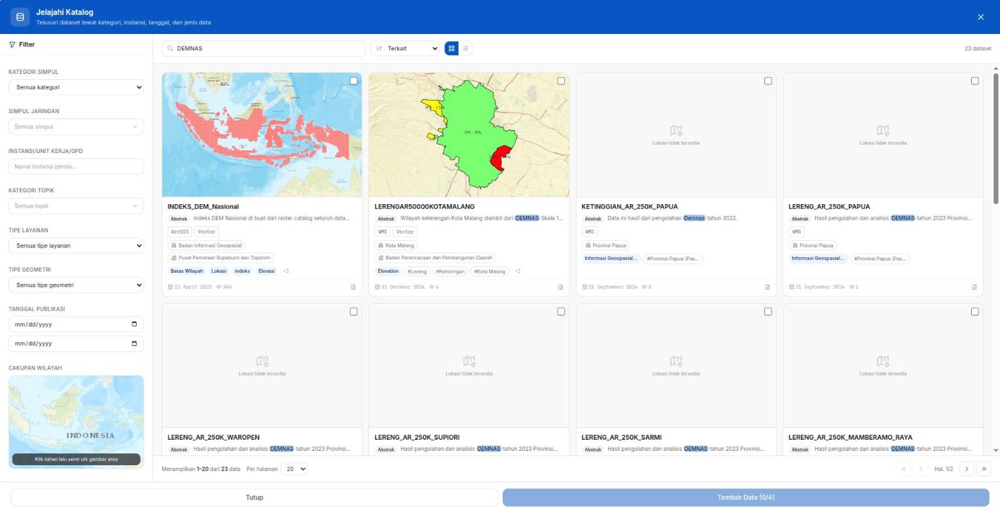

Gambar P0.1 Hasil pencarian katalog Ina-Geoportal dengan kata kunci DEMNAS

Sumber: Tangkapan layar Ina-Geoportal, Badan Informasi Geospasial

2. **Menu Unduh Data.** Klik ikon unduh pada bilah kiri. Halaman ini memuat data yang dapat diunduh langsung, antara lain DEMNAS, Batnas, Rupabumi Indonesia (RBI) per wilayah, dan batas wilayah.

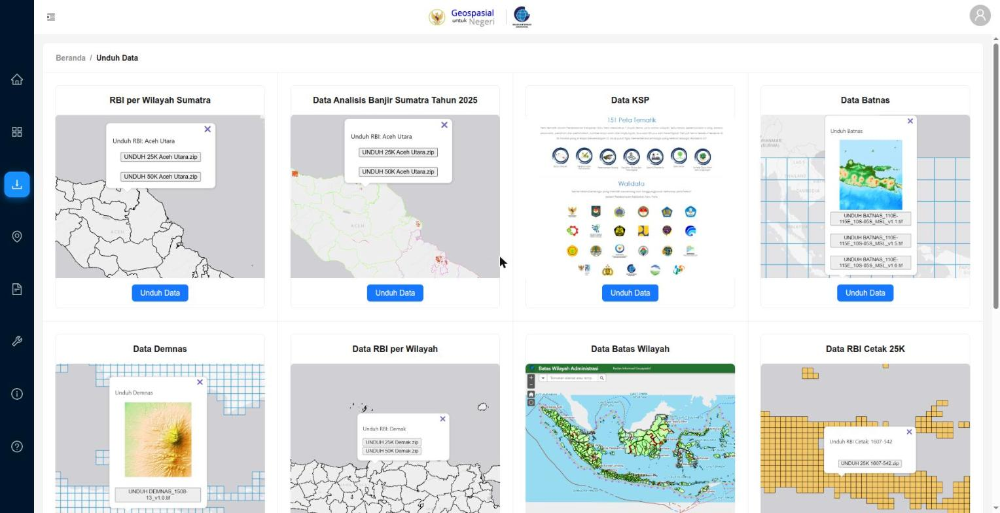

Gambar P0.2 Halaman Unduh Data di Ina-Geoportal

Sumber: Tangkapan layar Ina-Geoportal, Badan Informasi Geospasial

## Tahap 2: Mengunduh DEMNAS

DEMNAS dibangun dari IFSAR, TerraSAR-X, dan ALOS PALSAR, dengan tambahan titik tinggi dari pembuatan peta RBI. Menurut halaman informasinya, resolusinya 0,27 detik busur, atau sekitar 8 m, dengan datum vertikal EGM2008 (Badan Informasi Geospasial, 2026).

1. Masuk dengan akun Anda, lalu buka **Unduh Data > Data Demnas > Unduh Data**. Peta menampilkan grid lembar DEMNAS.
2. Ketik nama lokasi pada **Cari Lokasi**, lalu pilih saran yang sesuai. Peta akan memperbesar terlalu jauh dan menampilkan *Map data not yet available*, jadi klik tombol **−** beberapa kali sampai garis lembar terlihat.
3. Klik lembar yang mencakup wilayah Anda, lalu klik tombol **UNDUH DEMNAS_...tif** pada jendela yang muncul. Sub-DAS Bompon berada pada lembar `DEMNAS_1408-23_v1.0.tif`, berukuran 44 MB, yang mencakup 110,00–110,25° BT dan 7,50–7,75° LS.

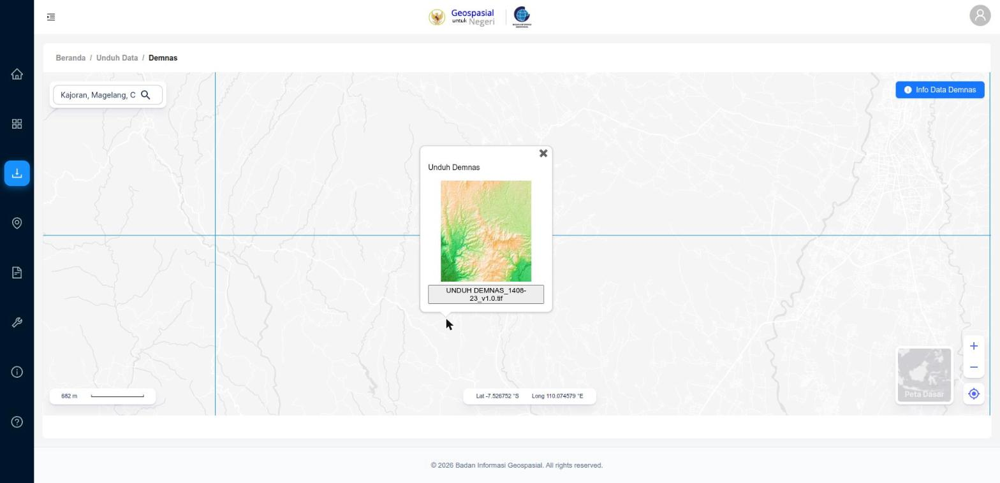

Gambar P0.3 Lembar DEMNAS 1408-23 yang mencakup Sub-DAS Bompon

Sumber: Tangkapan layar Ina-Geoportal, Badan Informasi Geospasial

**Perhatikan.** Berkas yang diunduh pada uji coba tidak menyimpan sistem koordinat, sehingga QGIS menanyakannya atau tidak dapat menempatkannya. Koordinatnya adalah derajat geografis, jadi tetapkan `EPSG:4326` saat memuatnya. Praktik 1 tahap 1 menunjukkan caranya.

Wilayah yang melintasi dua lembar perlu digabung lebih dulu dengan **Raster > Miscellaneous > Merge**.

## Tahap 3: Mengunduh Sentinel-2

Copernicus Browser (<https://browser.dataspace.copernicus.eu>) adalah pintu ke arsip Sentinel. Pencarian terbuka, tetapi unduhan memerlukan akun Copernicus Data Space Ecosystem yang gratis.

1. Masuk, geser peta ke wilayah Anda, lalu buka tab **SEARCH**.
2. Klik ikon penanda pada bilah kanan, lalu klik satu titik pada peta sebagai lokasi pencarian.
3. Pada **Data Sources**, centang **SENTINEL-2**, lalu **MSI**, lalu **L2A**, yaitu produk pantulan permukaan yang sudah terkoreksi atmosfer. Geser batas tutupan awan bila perlu. Tutupan awan itu berlaku untuk seluruh petak, bukan wilayah Anda.
4. Isi **Time Range**, lalu klik **Search**.

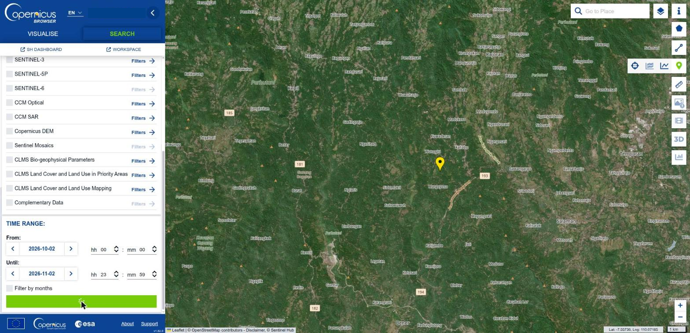

Gambar P0.4 Formulir pencarian Copernicus Browser, dengan titik lokasi pada peta

Sumber: Tangkapan layar Copernicus Browser; *Contains modified Copernicus Sentinel data*

5. Daftar hasil menampilkan nama, ukuran, dan waktu perekaman. **Visualise** untuk melihat citranya lebih dulu, lalu klik ikon unduh pada produk yang dipilih. Periksa gambar kecilnya, karena sebagian petak hanya terisi sebagian dan bisa saja wilayah Anda kosong.

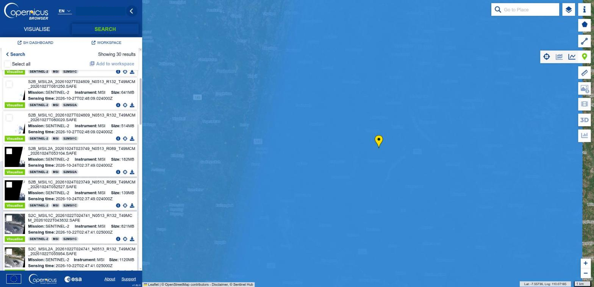

Gambar P0.5 Daftar hasil pencarian Sentinel-2

Sumber: Tangkapan layar Copernicus Browser; *Contains modified Copernicus Sentinel data*

Ukuran produk L2A pada pencarian uji coba berkisar 182–1.120 MB. Berkasnya berupa `.zip` berisi folder `.SAFE`, dengan kanal terpisah pada resolusi 10, 20, dan 60 m.

## Tahap 4: Mengunduh Sentinel-1

Langkahnya sama dengan Sentinel-2, tetapi pada **Data Sources** centang **SENTINEL-1**, lalu **C-SAR**, lalu **Level-1 GRD**.

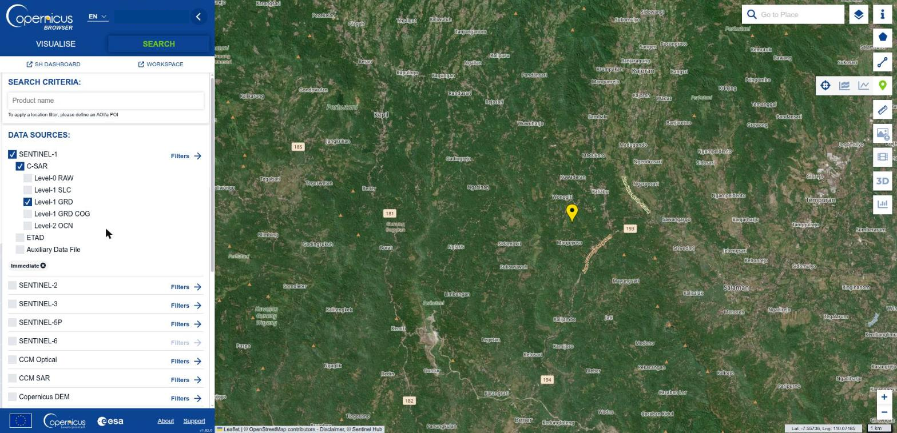

Gambar P0.6 Memilih produk Sentinel-1 Level-1 GRD

Sumber: Tangkapan layar Copernicus Browser

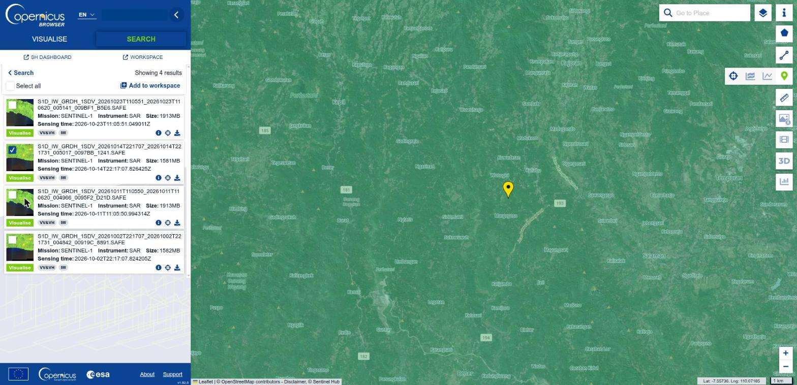

Gambar P0.7 Daftar hasil pencarian Sentinel-1

Sumber: Tangkapan layar Copernicus Browser; *Contains modified Copernicus Sentinel data*

Produknya berukuran 1,5–1,9 GB pada uji coba. GRD ini belum terkoreksi medan, sehingga masih perlu diolah, misalnya dengan SNAP, sebelum dipakai di wilayah berbukit. Karena itu data latihan memakai produk RTC yang sudah terkoreksi, yang lebih mudah diambil dengan Python pada tahap berikutnya.

**Titik periksa.** Anda dapat menyebutkan nama lembar DEMNAS serta nama satu adegan Sentinel-2 dan Sentinel-1 untuk wilayah Anda. Tidak perlu mengunduhnya pada koneksi pelatihan.

## Tahap 5: Mengambil Data dengan Python

Portal cocok untuk sekali ambil, tetapi langkahnya sulit diulang persis. Notebook `data/praktik-0/Praktik_0_Akuisisi_Data.ipynb` mengambil data yang sama dengan kode. Hanya jendela wilayah kerja yang dibaca, sehingga Sentinel-2 dan Sentinel-1 tidak perlu diunduh utuh. Seluruh notebook selesai dalam sekitar 1 menit pada koneksi uji coba. Untuk wilayah lain, cukup ganti `BATAS` dan `TITIK` pada sel kedua.

1. Buka notebook di JupyterLab atau Colab, lalu jalankan sel berurutan.
2. **Batas desa.** Sel pertama bertanya ke layanan peta BIG, lalu menyimpan `hasil/desa_wilayah_kerja.geojson`. Pada uji coba, tujuh desa di Kabupaten Magelang dan Purworejo bersinggungan dengan wilayah kerja, karena kotak wilayah kerja lebih luas daripada Sub-DAS.

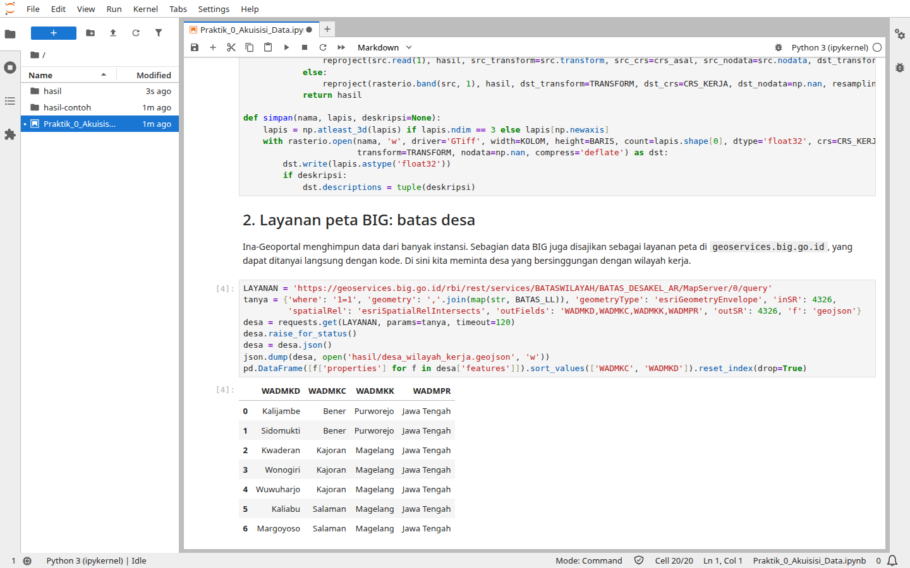

Gambar P0.8 Desa yang bersinggungan dengan wilayah kerja

Sumber: Tangkapan layar uji coba; data Badan Informasi Geospasial

3. **DEMNAS.** Bagian ini tidak mengunduh, karena unduhan portal memerlukan login, dan penyusun tidak menemukan cara unduh otomatis yang terbuka. Tuliskan lokasi berkas hasil Tahap 2 pada variabel `DEMNAS`. Notebook memberi tahu sistem koordinatnya dengan `crs_asal='EPSG:4326'`, lalu menyelaraskannya ke grid kerja.
4. **Sentinel-2.** Notebook mencari di katalog STAC Earth Search dan menampilkan daftar adegan menurut tutupan awan. Pilih satu id pada variabel `ADEGAN`.

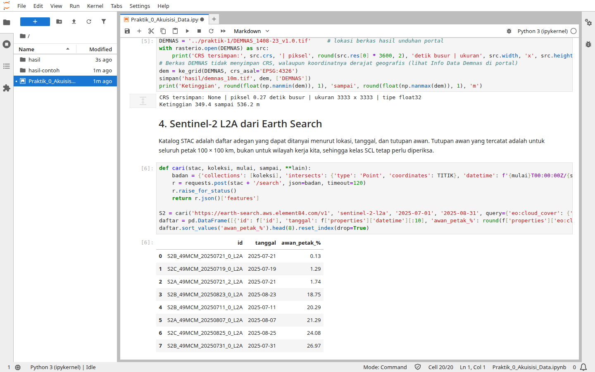

Gambar P0.9 Daftar adegan Sentinel-2 dari katalog STAC

Sumber: Tangkapan layar uji coba; *Contains modified Copernicus Sentinel data 2025*

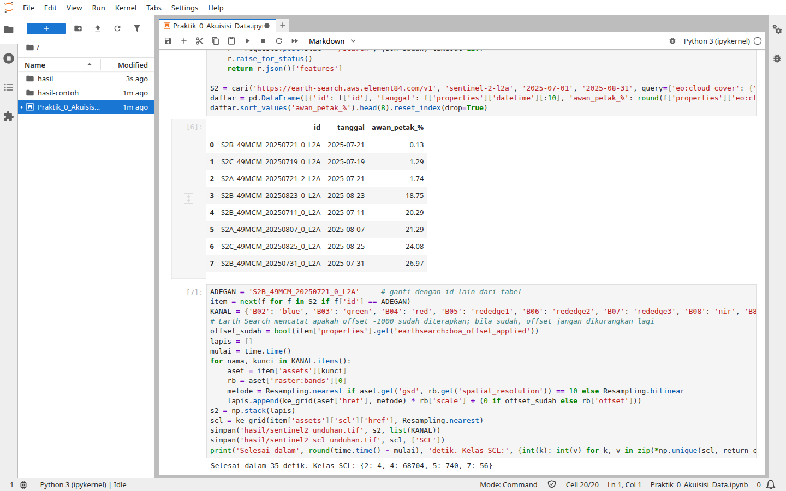

Gambar P0.10 Membaca sepuluh kanal Sentinel-2 dan SCL pada jendela wilayah kerja

Sumber: Tangkapan layar uji coba

5. **Sentinel-1.** Notebook mencari produk RTC di Microsoft Planetary Computer, meminta tanda tangan sementara secara otomatis, lalu membaca VV dan VH.

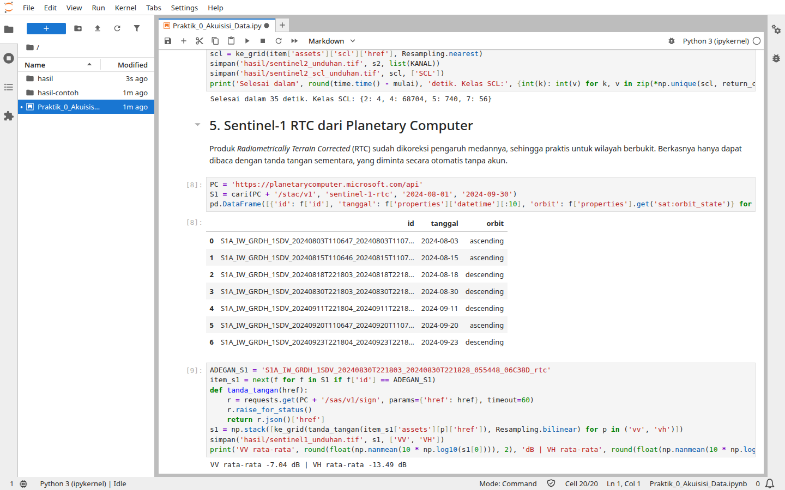

Gambar P0.11 Daftar adegan dan pembacaan Sentinel-1 RTC

Sumber: Tangkapan layar uji coba; *Contains modified Copernicus Sentinel data 2024*

6. **Pencocokan.** Sel berikutnya menampilkan ketiga data dan mencocokkannya dengan berkas Praktik 1.

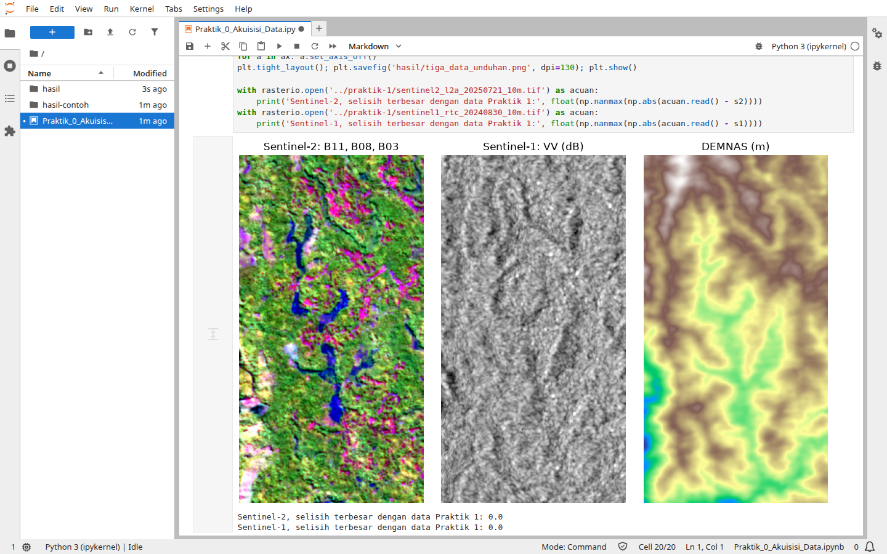

Gambar P0.12 Hasil unduhan dan pencocokannya dengan data Praktik 1

Sumber: Tangkapan layar uji coba; *Contains modified Copernicus Sentinel data 2024–2025*

7. **Produk utuh.** Sel terakhir mencari produk di katalog Copernicus Data Space tanpa akun. Kode untuk mengunduhnya ditulis sebagai contoh dan tidak dijalankan, karena memerlukan akun dan berukuran besar. Masukkan kata sandi hanya lewat `getpass` dan jangan menuliskannya di notebook.

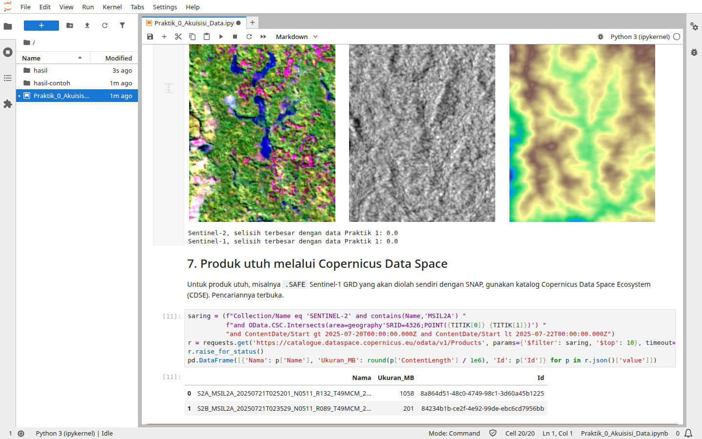

Gambar P0.13 Pencarian produk utuh di Copernicus Data Space

Sumber: Tangkapan layar uji coba

**Titik periksa.** Sentinel-1 rata-rata VV −7,04 dB dan VH −13,49 dB, dan selisih terbesar dengan data Praktik 1 tercetak 0,0 untuk Sentinel-2 maupun Sentinel-1. Jika Anda mengganti adegan, selisih itu tentu tidak lagi nol, dan selnya perlu dilewati.


## Cara Membaca Modul

Setiap modul dibuka dengan gambaran praktik dan data yang dipakai, lalu langkah kerja per tahap. Nama menu dan tombol dicetak tebal, misalnya **Raster > Analysis > Slope**. Sebagian besar alat juga dapat ditemukan dengan mengetikkan namanya pada kotak pencarian di kiri bawah QGIS atau pada **Processing Toolbox** (**Processing > Toolbox**).

Setiap tahap diakhiri titik periksa, yaitu hasil antara yang seharusnya sudah dimiliki sebelum melanjutkan. Angka pada titik periksa berasal dari uji coba, sehingga hasil Anda seharusnya sama atau sangat dekat jika langkahnya sama. Pengecualiannya adalah digitasi, karena setiap penafsir menarik batas yang berbeda. Hasil uji coba disajikan apa adanya, termasuk ketika model tidak bekerja sebaik yang diharapkan, karena membaca hasil secara jujur merupakan bagian dari kemampuan yang ingin dibangun.

## Rujukan Tambahan

Badan Informasi Geospasial. (2026). *Info Data Demnas* [Halaman portal]. Ina-Geoportal. https://tanahair.indonesia.go.id/portal-web/unduh/demnas
