# Praktik 1. Multi-source Data Fusion

*Praktik terbimbing:*

Pemandu: Johan. Perangkat: QGIS dan Jupyter Notebook. Rujukan teori: Modul 2.

## Kurikulum Pembelajaran

**Tujuan**

Membekali peserta agar mampu menggabungkan Sentinel-1, Sentinel-2, DEMNAS, dan LiDAR pada satu grid, meningkatkan resolusi citra dengan pan-sharpening, dan menilai apakah hasilnya masih dapat dipercaya.

**Kompetensi**

Setelah mengikuti praktik ini, peserta memiliki kompetensi dalam:

1. Memeriksa watak data raster, termasuk data tanpa sistem koordinat
2. Menyelaraskan data beresolusi berbeda ke satu grid dengan metode yang sesuai
3. Menyusun dan memotong tumpukan data multisumber
4. Melakukan pan-sharpening Sentinel-2 dengan foto udara dan LiDAR
5. Menilai hasil penajaman dengan protokol Wald
6. Menggabungkan DEMNAS dan LiDAR

**Ringkasan Studi**

1. Deskripsi singkat
   - Peserta menyelaraskan empat sumber data dan memotongnya dengan `Batas_Bompon`
   - Peserta menajamkan Sentinel-2 dari 10 m ke 2,5 m
   - Peserta menguji hasilnya dan membandingkan DEMNAS dengan LiDAR
2. Hasil belajar
   - Peserta memahami perbedaan antara citra yang tampak tajam dan nilai yang benar
   - Peserta memiliki tumpukan 14 kanal dan citra hasil penajaman
3. Indikator hasil belajar
   - `stack_bompon_terpotong.tif` berukuran 152 × 322 piksel dengan 14 kanal
   - `s2_rgb_tajam_fu_2m5.tif` berukuran 608 × 1.288 piksel dengan piksel 2,5 m
   - Peserta dapat menjelaskan untuk apa citra hasil penajaman boleh dipakai
4. Materi pokok
   - Tingkat fusi data dan penyelarasan grid
   - Pan-sharpening: weighted Brovey dan high-pass filter
   - Protokol Wald, ERGAS, dan SAM
   - Fusi DEM berdasarkan panjang gelombang

## Gambaran Praktik

Praktik ini mengerjakan dua hal. Yang pertama adalah **penggabungan**: nilai dari sensor yang berbeda dibuat bertemu pada piksel yang sama. Yang kedua adalah **peningkatan resolusi**: detail dari data yang lebih rinci dipindahkan ke citra yang lebih kasar. Sentinel-2 merekam banyak kanal pada 10–20 m, sedangkan foto udara dan LiDAR Sub-DAS Bompon jauh lebih rinci tetapi hanya merekam warna dan bentuk medan. Pan-sharpening mencoba mengambil kelebihan keduanya.

Modul 2 membedakan fusi tingkat piksel, fitur, dan keputusan (Pohl & van Genderen, 1998). Hampir seluruh praktik ini berada pada tingkat piksel.

Ada satu pelajaran yang perlu dipegang sejak awal, karena ditemukan saat uji coba: **citra yang tampak paling tajam belum tentu paling benar.** Hasil penajaman yang paling memukau justru memiliki galat nilai paling besar. Karena itu, praktik ini tidak berhenti pada tampilan, tetapi juga mengujinya.

## Data yang Dipakai

Semua berkas ada di folder `data/praktik-1/`. Buat folder baru `data/praktik-1/hasil/` untuk menyimpan keluaran Anda.

Tabel P1.1 Data Praktik 1

| **Berkas** | **Isi** | **Asal** |
| :------: | :------: | :------: |
| `sentinel2_l2a_20250721_10m.tif` | Pantulan permukaan, 10 kanal, 21 Juli 2025 | Sentinel-2 L2A, adegan `S2B_49MCM_20250721_0_L2A`, Earth Search |
| `sentinel1_rtc_20240830_10m.tif` | Hamburan balik VV dan VH, satuan linear, 30 Agustus 2024 | Sentinel-1 RTC, adegan `S1A_IW_GRDH_1SDV_20240830T221803_20240830T221828_055448_06C38D_rtc`, Microsoft Planetary Computer |
| `DEMNAS_1408-23_v1.0.tif` | Ketinggian, 0,27 detik busur, satu lembar utuh | Ina-Geoportal, Badan Informasi Geospasial |
| `LiDAR_Kalijambe_Bompon_20222023.tif` | Model medan digital (DTM), 1 m | Data riset Bompon-Kalijambe, diambil 2022–2024 |
| `foto_udara_rgb_1m.tif` | Foto udara RGB yang dirata-ratakan dari sekitar 5–8 cm ke 1 m | Data riset, menyertai data LiDAR |
| `Batas_Bompon.shp` | Batas Sub-DAS Bompon | Data riset |

Sumber: Data proyek; *Contains modified Copernicus Sentinel data 2024–2025*

LiDAR dan foto udara diambil pada kurun 2022–2024. Tanggal pasti setiap pemotretan tidak tercantum pada data.

## Tahap 1: Memuat dan Mengenali Data

1. Buka QGIS, pilih **Project > New**, lalu simpan melalui **Project > Save As** ke `hasil/praktik1.qgz`.
2. Pilih **Layer > Add Layer > Add Raster Layer**, lalu muat kelima berkas `.tif`. Muat `Batas_Bompon.shp` melalui **Layer > Add Layer > Add Vector Layer**.
3. **DEMNAS tidak memiliki CRS.** Klik kanan layer DEMNAS, pilih **Layer CRS > Set Layer CRS**, lalu pilih `EPSG:4326`. Pengaturan ini hanya berlaku di proyek, sehingga pada tahap 2 CRS asalnya perlu disebutkan lagi.
4. Pastikan CRS proyek di pojok kanan bawah adalah `EPSG:32749`. Atur `Batas_Bompon` tanpa isian dengan garis kuning, lalu klik kanan dan pilih **Zoom to Layer**.

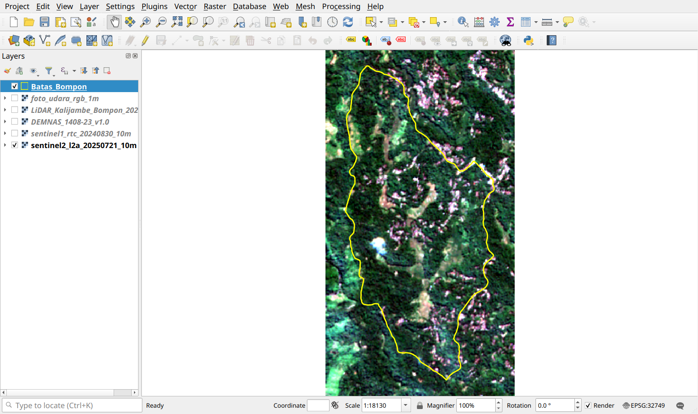

Gambar P1.1 Data dimuat di QGIS, dengan Sentinel-2 warna asli dan batas Sub-DAS

Sumber: Tangkapan layar uji coba; *Contains modified Copernicus Sentinel data 2025*

5. Buka tab **Information** pada setiap layer dan cocokkan dengan Tabel P1.2.

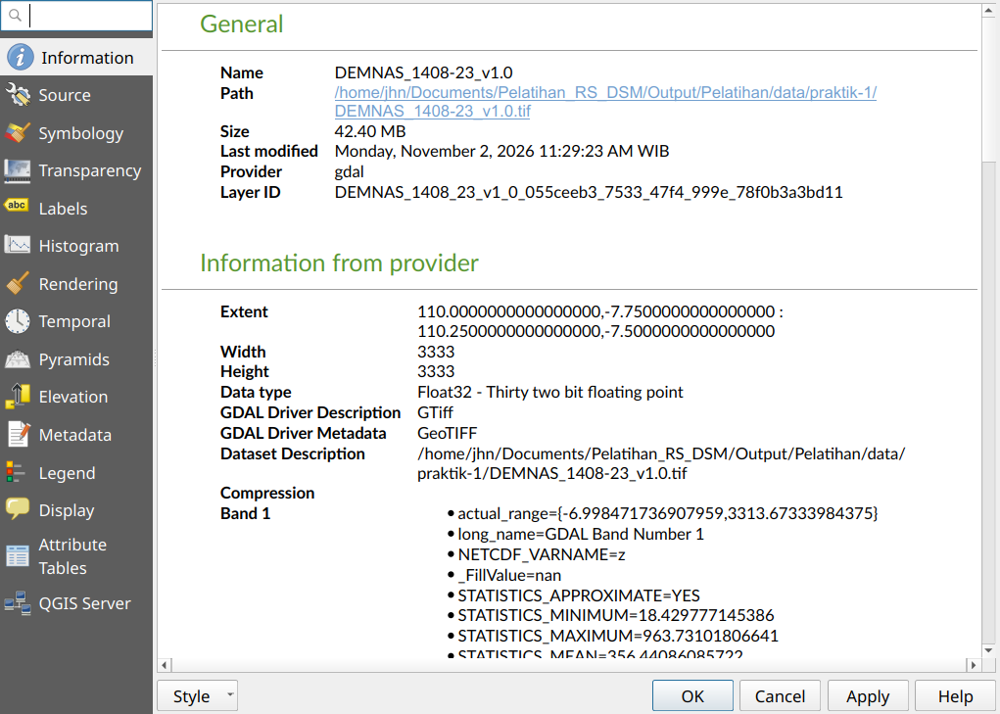

Gambar P1.2 Tab Information pada DEMNAS

Sumber: Tangkapan layar uji coba

Tabel P1.2 Hasil Pemeriksaan Data pada Uji Coba

| **Layer** | **Kolom × baris** | **Ukuran piksel** | **Kanal** | **Satuan nilai** |
| :-----: | :---: | :---: | :---: | :-----: |
| Sentinel-2 | 192 × 362 | 10 m | 10 | Pantulan, 0 sampai 1 |
| Sentinel-1 | 192 × 362 | 10 m | 2 | Hamburan balik linear |
| DEMNAS | 3.333 × 3.333 | 0,27 detik busur, sekitar 8 m | 1 | Meter, datum EGM2008 |
| LiDAR | 1.761 × 5.005 | 1 m | 1 | Meter, datum belum tercantum |
| Foto udara | 1.520 × 3.220 | 1 m | 3 | 0 sampai 255 |

Sumber: Hasil uji coba; datum DEMNAS dari Badan Informasi Geospasial (2026)

CRS LiDAR tampil tanpa kode EPSG karena berkasnya memakai definisi ESRI untuk UTM zona 49S. Isinya tetap benar. Urutan kanal Sentinel-2 perlu diingat: kanal 1 B02 (biru), 2 B03 (hijau), 3 B04 (merah), 4 B05, 5 B06, 6 B07, 7 B08 (inframerah dekat), 8 B8A, 9 B11, dan 10 B12. Kanal B05, B06, B07, B8A, B11, dan B12 aslinya 20 m dan sudah di-*resample* ke 10 m saat data disiapkan.

6. Tampilkan foto udara. Perhatikan garis melintang di sekitar koordinat Y 9164437.

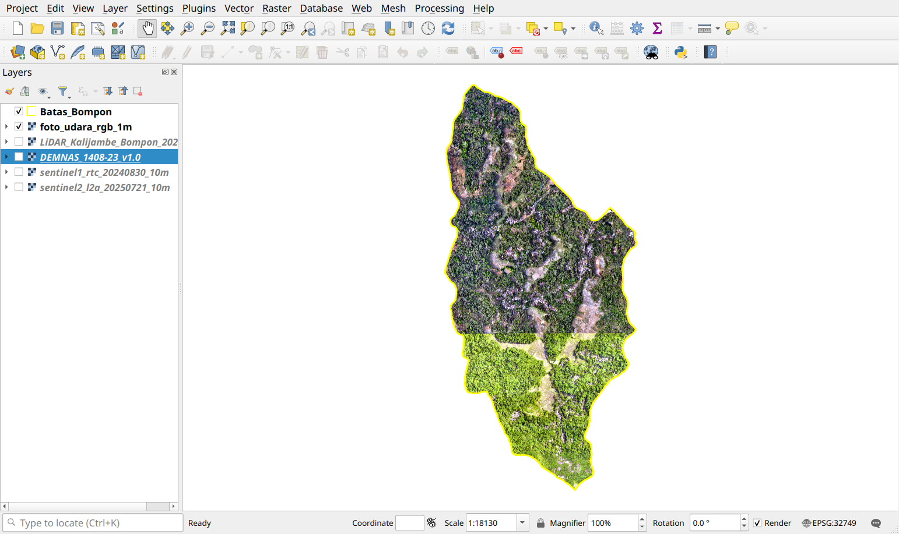

Gambar P1.3 Foto udara yang tersusun dari dua pemotretan dengan warna berbeda

Sumber: Tangkapan layar uji coba; foto udara data riset

Bagian utara dan selatan berasal dari dua berkas foto udara yang warnanya berbeda. Sambungan ini akan ikut terbawa ke hasil penajaman.

**Titik periksa.** Semua layer berimpit dengan batas Sub-DAS, termasuk DEMNAS setelah CRS-nya ditetapkan.

## Tahap 2: Menyelaraskan ke Grid 10 m

Sentinel-2 dan Sentinel-1 sudah berada pada grid yang sama. DEMNAS dan LiDAR perlu dibawa ke grid itu, tetapi dengan metode yang berbeda, karena arah perubahan resolusinya berbeda.

1. Pilih **Raster > Projections > Warp (Reproject)**, lalu isi parameternya untuk DEMNAS:
   - **Input layer**: `DEMNAS_1408-23_v1.0`;
   - **Source CRS**: `EPSG:4326`;
   - **Target CRS**: `EPSG:32749`;
   - **Resampling method to use**: *Bilinear (2x2 Kernel)*;
   - **Output file resolution**: `10`;
   - buka **Advanced Parameters**, isi **Georeferenced extents of output file to be created** dengan `396060,397980,9162990,9166610 [EPSG:32749]`, lalu pilih **Output data type** *Float32*;
   - **Reprojected**: `hasil/demnas_10m.tif`.

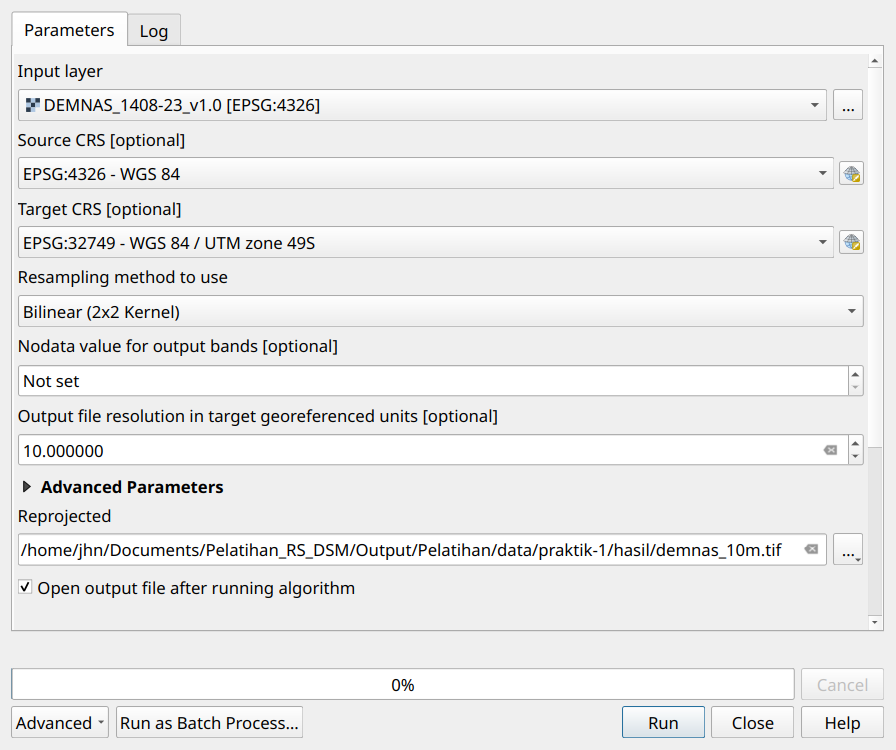

Gambar P1.4 Dialog Warp untuk DEMNAS

Sumber: Tangkapan layar uji coba

2. Ulangi untuk LiDAR, tetapi kosongkan **Source CRS**, pilih **Resampling** *Average*, lalu simpan ke `hasil/lidar_10m.tif`.

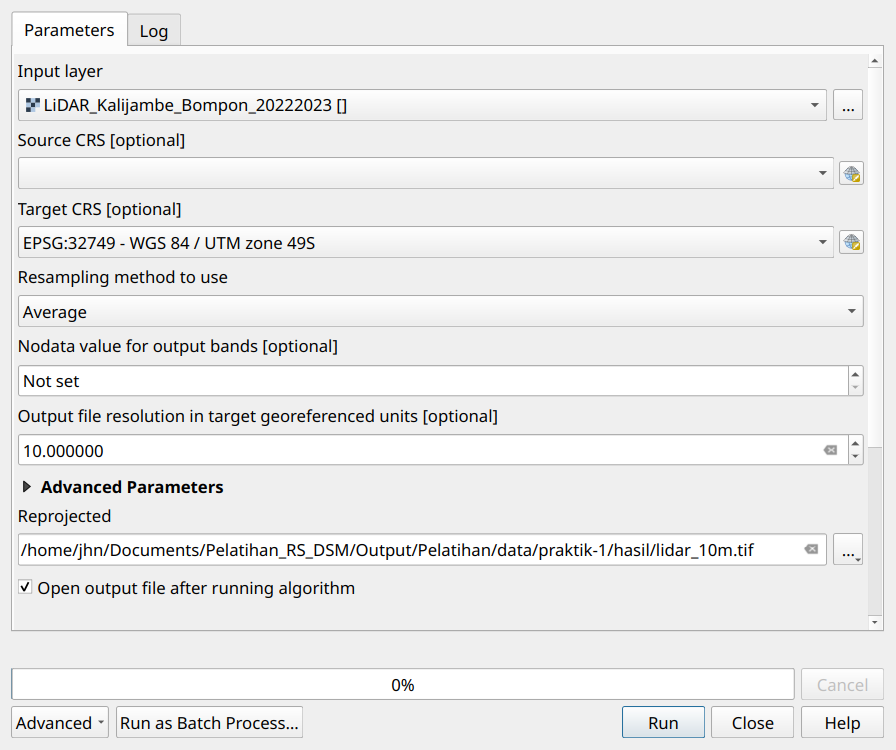

Gambar P1.5 Dialog Warp untuk LiDAR dengan metode *Average*

Sumber: Tangkapan layar uji coba

LiDAR 1 m dikasarkan ke 10 m, sehingga satu piksel baru mewakili 100 piksel lama, dan rata-rata adalah cara yang wajar. Metode bilinear hanya akan mengambil sedikit piksel di sekitar pusat dan mengabaikan sisanya.

3. Pilih **Raster > Raster Calculator** untuk mengubah Sentinel-1 ke desibel. Simpan ke `hasil/s1_vv_db.tif`, lalu ulangi dengan `@2` ke `hasil/s1_vh_db.tif`.

```
10 * log10("sentinel1_rtc_20240830_10m@1")
```

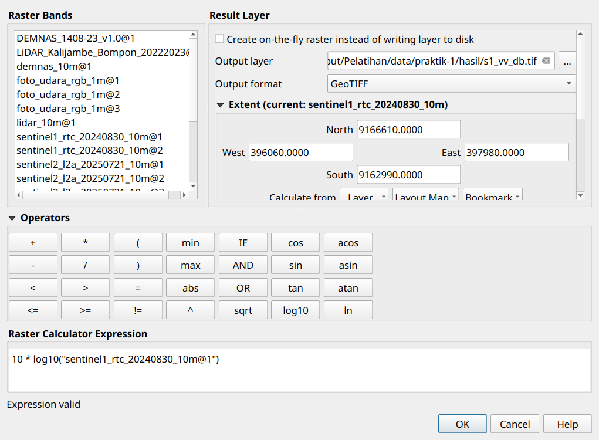

Gambar P1.6 Mengubah hamburan balik VV ke desibel

Sumber: Tangkapan layar uji coba

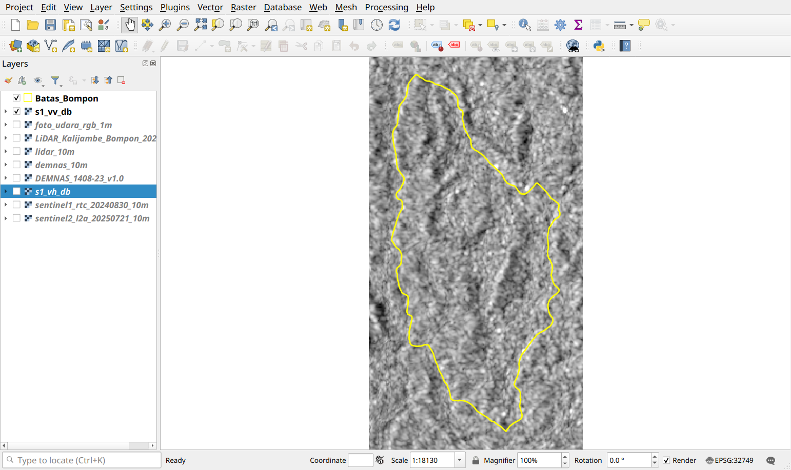

Gambar P1.7 Sentinel-1 VV dalam desibel

Sumber: Tangkapan layar uji coba; *Contains modified Copernicus Sentinel data 2024*

**Titik periksa.** `demnas_10m` dan `lidar_10m` berukuran 192 × 362 piksel. VV bernilai −23,32 sampai 7,08 dB dengan rata-rata −7,04 dB, sedangkan VH −26,30 sampai −1,66 dB dengan rata-rata −13,49 dB.

## Tahap 3: Menyusun dan Memotong Tumpukan Data

1. Pilih **Raster > Miscellaneous > Build Virtual Raster**. Pada **Input layers**, centang dan urutkan `sentinel2_l2a_20250721_10m`, `s1_vv_db`, `s1_vh_db`, `demnas_10m`, `lidar_10m`.
2. Centang **Place each input file into a separate band**, simpan ke `hasil/stack_bompon_10m.vrt`, lalu klik **Run**.

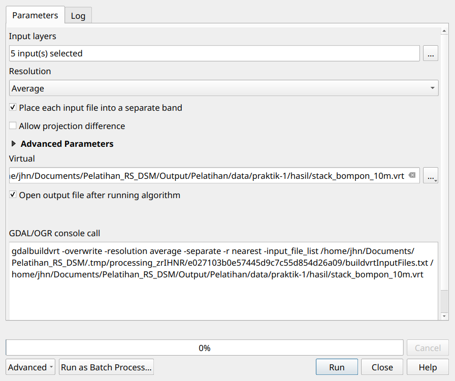

Gambar P1.8 Dialog Build Virtual Raster

Sumber: Tangkapan layar uji coba

3. Pilih **Raster > Extraction > Clip Raster by Mask Layer**. Isi **Input layer** `stack_bompon_10m`, **Mask layer** `Batas_Bompon`, **Assign a specified NoData value** `-9999`, dan **Output data type** *Float32*. Pastikan **Match the extent** dan **Keep resolution** tercentang, lalu simpan ke `hasil/stack_bompon_terpotong.tif`.

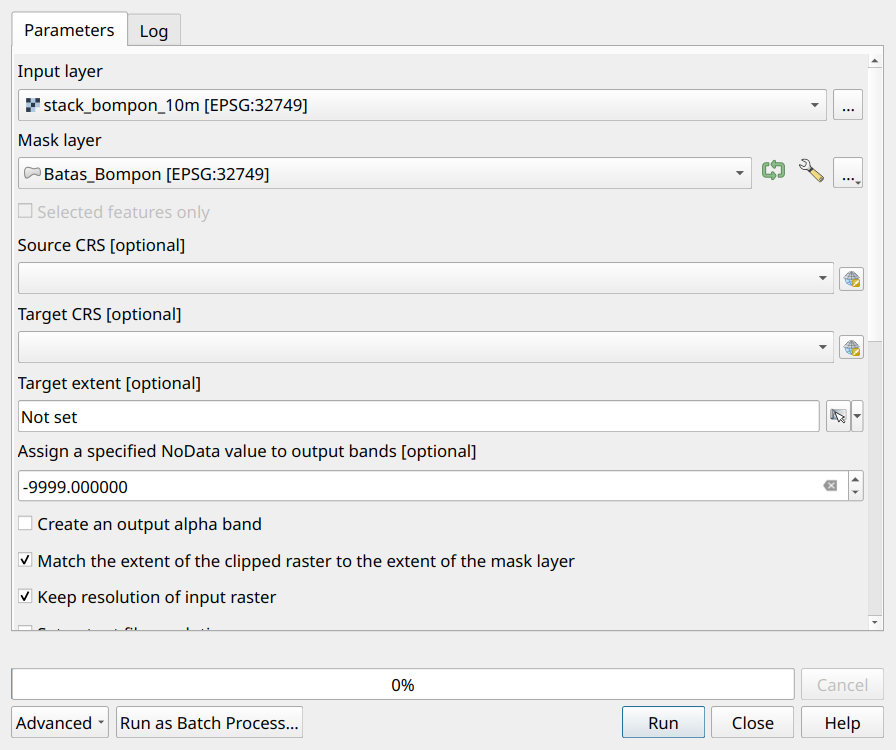

Gambar P1.9 Memotong tumpukan dengan Batas_Bompon

Sumber: Tangkapan layar uji coba

4. Tampilkan dengan **Multiband color**: merah kanal 7 (inframerah dekat), hijau kanal 12 (VH), biru kanal 14 (LiDAR).

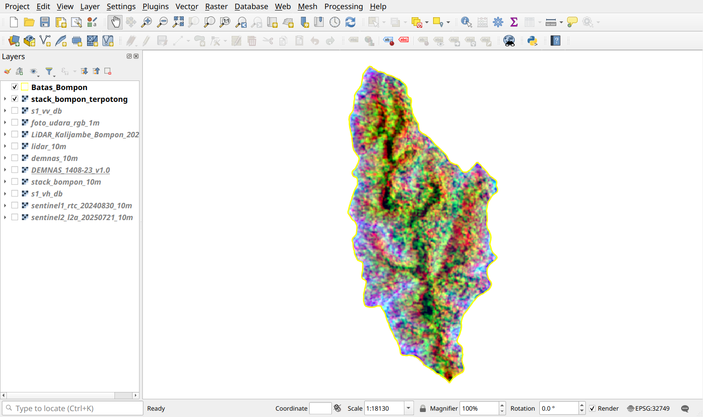

Gambar P1.10 Komposit lintas sensor dari Sentinel-2, Sentinel-1, dan LiDAR

Sumber: Tangkapan layar uji coba; *Contains modified Copernicus Sentinel data 2024–2025*

5. Klik satu piksel dengan **Identify Features**.

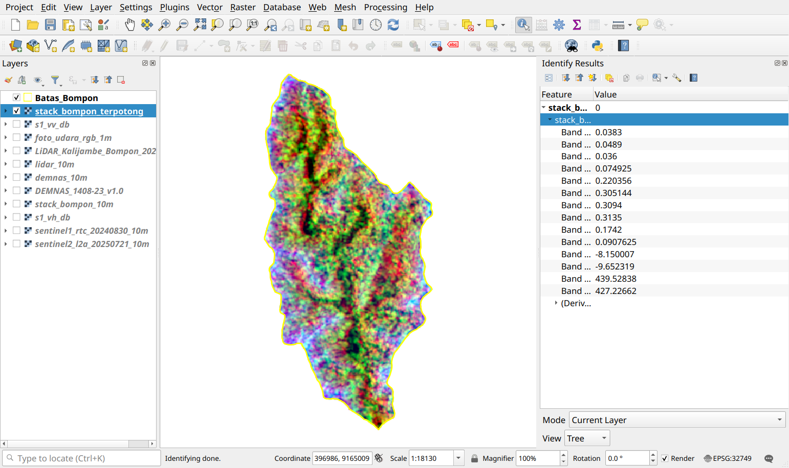

Gambar P1.11 Identify Features menampilkan 14 nilai dari empat sumber

Sumber: Tangkapan layar uji coba

Pada koordinat 396990, 9165005, misalnya, B04 bernilai 0,0321, B08 0,3568, VV −3,95 dB, VH −9,07 dB, DEMNAS 439,23 m, dan LiDAR 427,19 m. Satu baris angka inilah bentuk paling dasar dari data pemodelan. Perhatikan pula bahwa dua sumber ketinggian berselisih 12 m pada piksel yang sama.

**Titik periksa.** `stack_bompon_terpotong.tif` berukuran 152 × 322 piksel dengan 14 kanal.

## Tahap 4: Membandingkan DEMNAS dan LiDAR

1. Hitung selisihnya dengan Raster Calculator, lalu simpan ke `hasil/selisih_demnas_lidar.tif`. Potong hasilnya dengan `Batas_Bompon` seperti tahap 3.

```
"demnas_10m@1" - "lidar_10m@1"
```

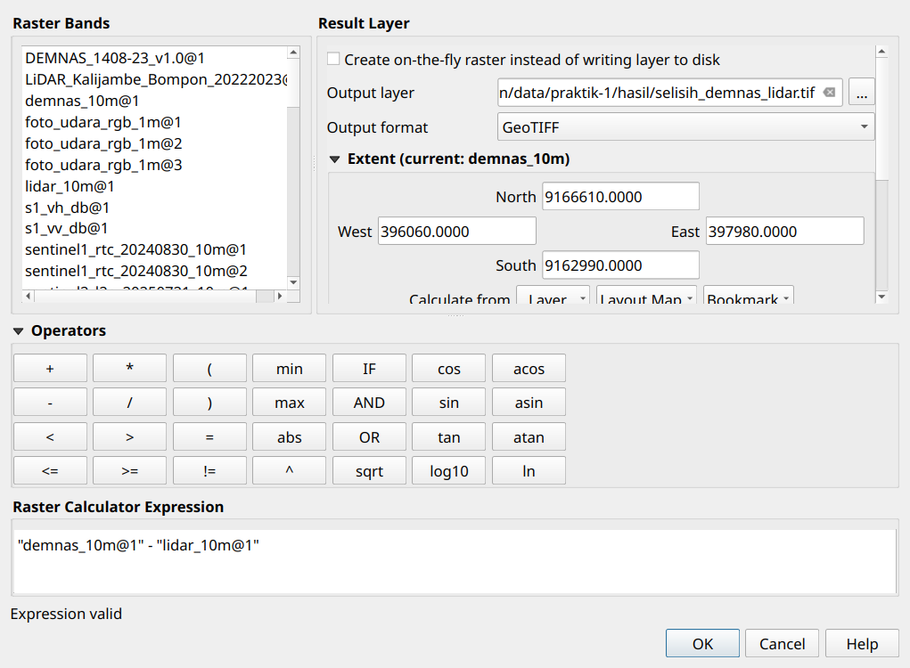

Gambar P1.12 Menghitung selisih DEMNAS dan LiDAR

Sumber: Tangkapan layar uji coba

2. Tampilkan sebagai **Singleband pseudocolor** dengan palet merah-biru, rentang −40 sampai 40.

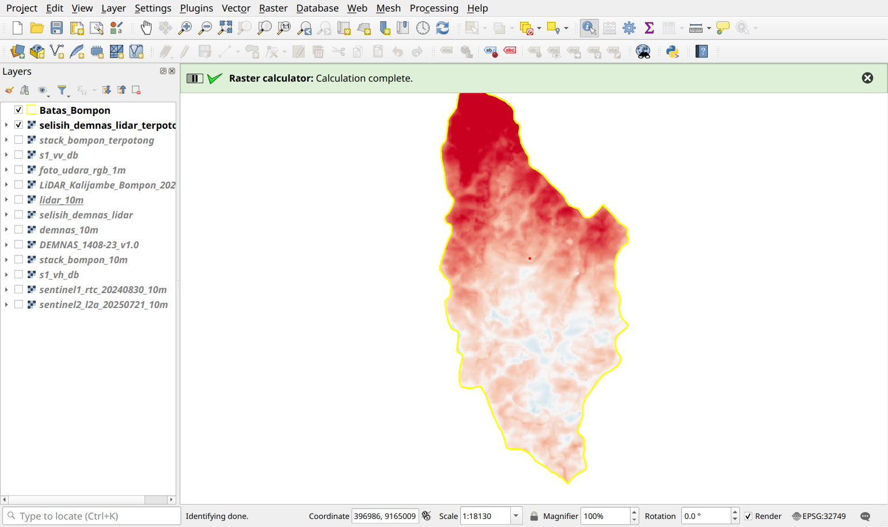

Gambar P1.13 Selisih DEMNAS dan LiDAR, makin merah berarti DEMNAS makin tinggi

Sumber: Tangkapan layar uji coba; data Badan Informasi Geospasial dan data riset

Selisih rata-rata 15,85 m, dan polanya tidak acak. Di bagian selatan selisihnya sekitar 3–5 m, sedangkan di bagian utara naik mulus sampai sekitar 37 m. Tajuk tidak dapat menjelaskan pola seluas ini. Copernicus DEM, yang tidak dipakai pada praktik ini, berselisih rata-rata hanya 2 m dengan DEMNAS, sehingga yang paling mungkin miring adalah DTM LiDAR. Penyebabnya belum dapat dipastikan dari data ini.

Kemiringan ini juga berpengaruh pada pengolahan lanjutan. Berkas `lidar_fill` pada data riset, yaitu hasil pengisian cekungan dari DTM ini, menaikkan bagian utara sampai 41 m dan membuat 54 ha lahan menjadi datar sempurna. Karena itu, praktik ini memakai DTM sebelum pengisian. Bagi pekerjaan yang memerlukan ketinggian mutlak atau arah aliran, jangan langsung memakai salah satunya sebelum masalah ini diperiksa.

3. Buat bayangan medan dari keduanya dengan **Raster > Analysis > Hillshade**, simpan ke `hasil/hillshade_demnas_10m.tif` dan `hasil/hillshade_lidar_1m.tif`.

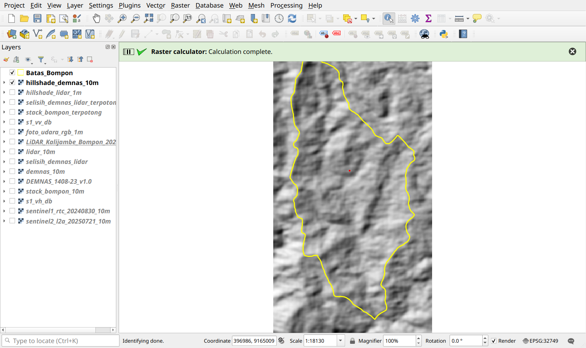

Gambar P1.14 Bayangan medan DEMNAS

Sumber: Tangkapan layar uji coba; data Badan Informasi Geospasial

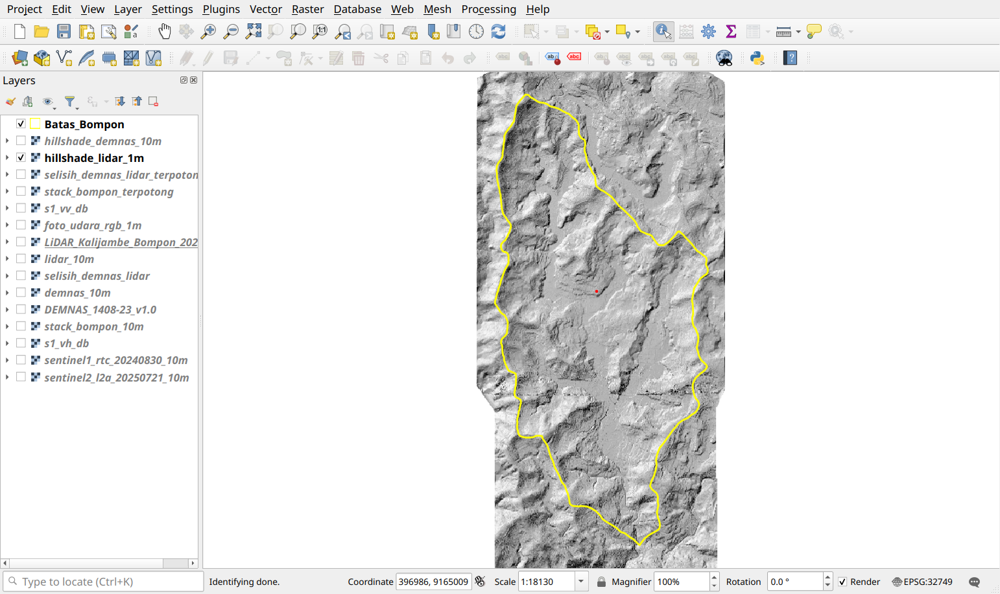

Gambar P1.15 Bayangan medan LiDAR 1 m

Sumber: Tangkapan layar uji coba; data riset

Inilah sebabnya LiDAR tetap sangat berharga: ketinggian mutlaknya bermasalah, tetapi kerincian bentuk medannya jauh melampaui DEMNAS. Teras, alur, dan tekuk lereng yang penting bagi Praktik 2 terlihat jelas.

## Tahap 5: Menyiapkan Data Detail dari Foto Udara

Pan-sharpening memerlukan satu kanal rinci, yang disebut pan. Sentinel-2 tidak memiliki kanal pankromatik, sehingga pan diambil dari foto udara. Rasio resolusi yang dipakai 1:4, dari 10 m ke 2,5 m, karena pada rasio yang jauh lebih besar hasilnya hampir seluruhnya berasal dari pan.

1. Ubah foto udara menjadi kelabu dengan Raster Calculator, lalu simpan ke `hasil/fu_abu_1m.tif`.

```
("foto_udara_rgb_1m@1" + "foto_udara_rgb_1m@2" + "foto_udara_rgb_1m@3") / 3
```

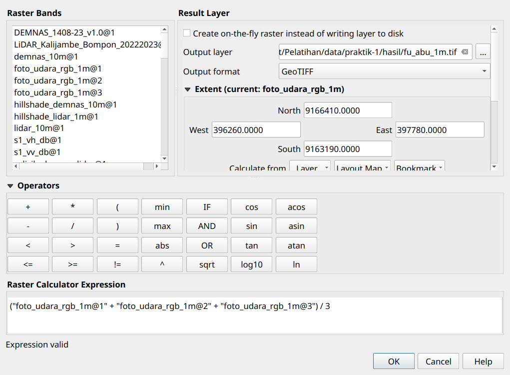

Gambar P1.16 Membuat kanal kelabu dari foto udara

Sumber: Tangkapan layar uji coba

2. Bawa ke grid 2,5 m dengan Warp: **Resampling** *Average*, **Nodata** `-9999`, **Output file resolution** `2.5`, **extents** `396260,397780,9163190,9166410 [EPSG:32749]`, lalu simpan ke `hasil/pan_fu_2m5.tif`.

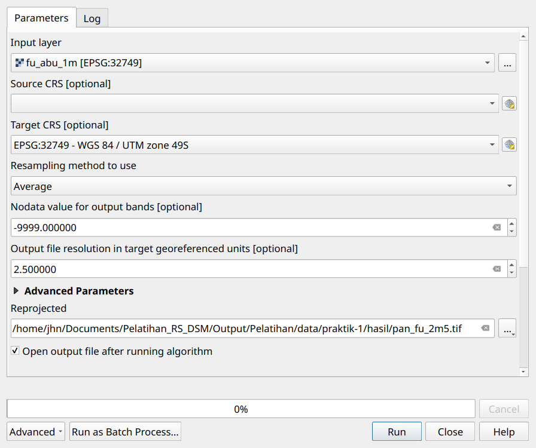

Gambar P1.17 Membawa pan ke grid 2,5 m

Sumber: Tangkapan layar uji coba

3. Ambil kanal merah, hijau, dan biru Sentinel-2 pada wilayah yang sama dengan **Raster > Conversion > Translate**. Pada **Additional command-line parameters** tulis `-b 3 -b 2 -b 1 -projwin 396260 9166410 397780 9163190`, lalu simpan ke `hasil/s2_rgb_10m.tif`.

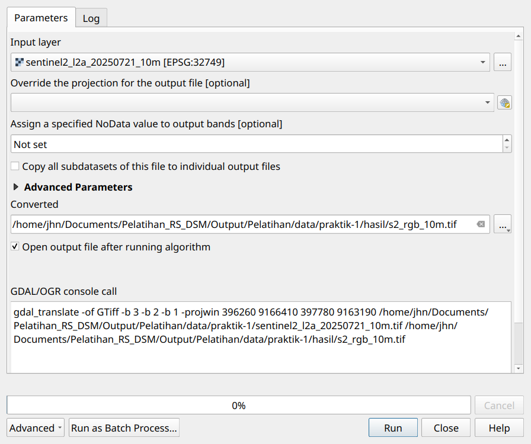

Gambar P1.18 Mengambil tiga kanal tampak Sentinel-2

Sumber: Tangkapan layar uji coba

4. **Setarakan skala pan.** Foto udara bernilai 0–255, sedangkan pantulan 0–0,2. Alat pan-sharpening tidak menyetarakannya, sehingga tanpa langkah ini nilai hasilnya ikut menjadi ratusan. Hitung rata-rata dan simpangan baku dengan **Raster layer statistics** pada dua layer berikut: pan yang dikasarkan ke 10 m di dalam batas, dan intensitas `("s2_rgb_10m@1" + "s2_rgb_10m@2" + "s2_rgb_10m@3") / 3` yang dipotong dengan `Batas_Bompon`. Lalu terapkan rumus ini dan simpan ke `hasil/pan_fu_setara.tif`.

```
("pan_fu_2m5@1" - 114.64499) * 0.01209 / 24.29142 + 0.033
```

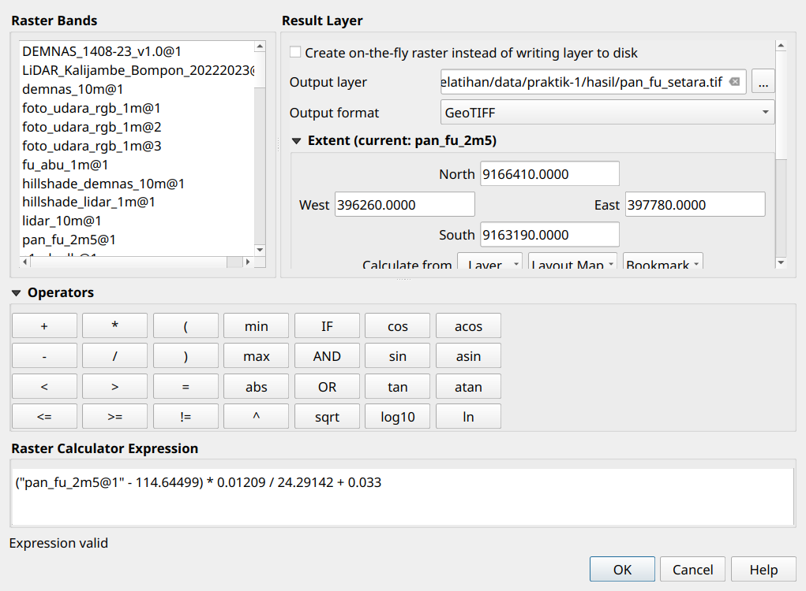

Gambar P1.19 Menyetarakan pan dengan rata-rata dan simpangan baku intensitas Sentinel-2

Sumber: Tangkapan layar uji coba

**Titik periksa.** Pan rata-rata 114,64 dengan simpangan baku 24,29, sedangkan intensitas rata-rata 0,033 dengan simpangan baku 0,01209.

## Tahap 6: Pan-sharpening Sentinel-2

1. Buka **Processing > Toolbox**, ketik `pansharpening` pada kotak pencarian, lalu klik dua kali alat **Pansharpening** dari kelompok GDAL.
2. Isi **Spectral dataset** `s2_rgb_10m` dan **Panchromatic dataset** `pan_fu_setara`, buka **Advanced Parameters**, pilih **Resampling algorithm** *Cubic*, lalu simpan ke `hasil/s2_rgb_tajam_fu_2m5.tif`.

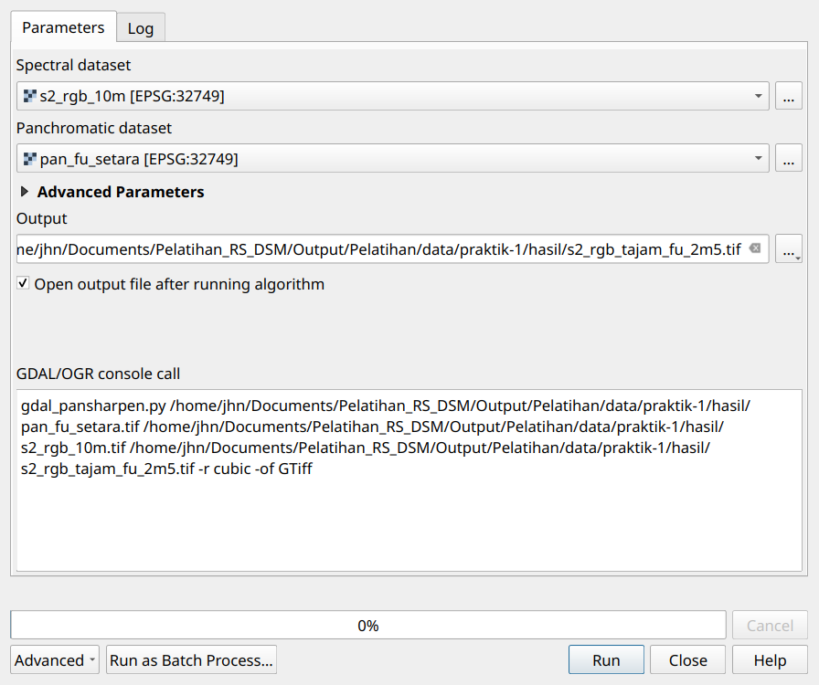

Gambar P1.20 Dialog Pansharpening

Sumber: Tangkapan layar uji coba

Alat ini memakai metode *weighted Brovey*. Setiap kanal di-*resample* ke 2,5 m, lalu dikalikan rasio pan terhadap rata-rata kanal. Jadi pan menentukan terang dan gelapnya, sedangkan Sentinel-2 menentukan perbandingan warnanya.

3. Tampilkan citra asli dan hasilnya dengan **Multiband color**, kanal 1, 2, 3, rentang 0,005–0,11 untuk semua kanal, lalu perbesar ke sekitar 396660–397460 dan 9164210–9165010.

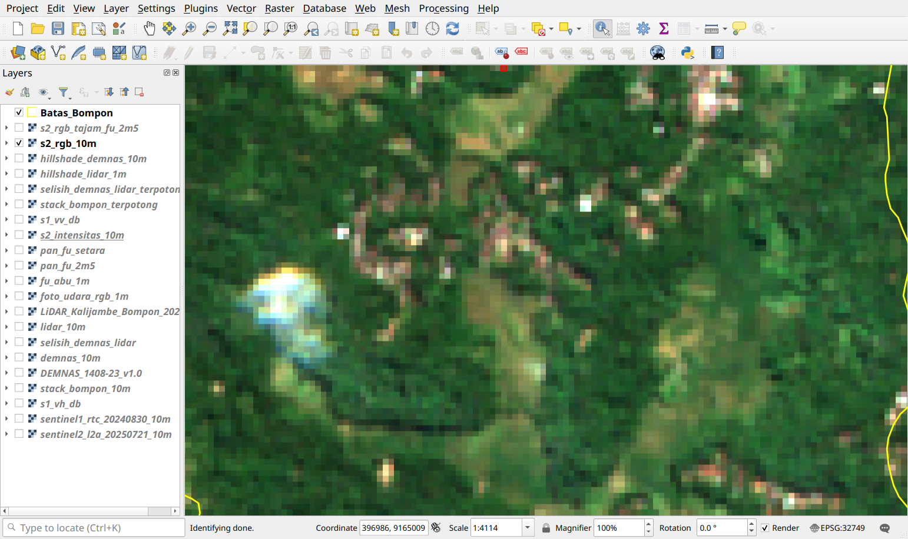

Gambar P1.21 Sentinel-2 asli, 10 m

Sumber: Tangkapan layar uji coba; *Contains modified Copernicus Sentinel data 2025*

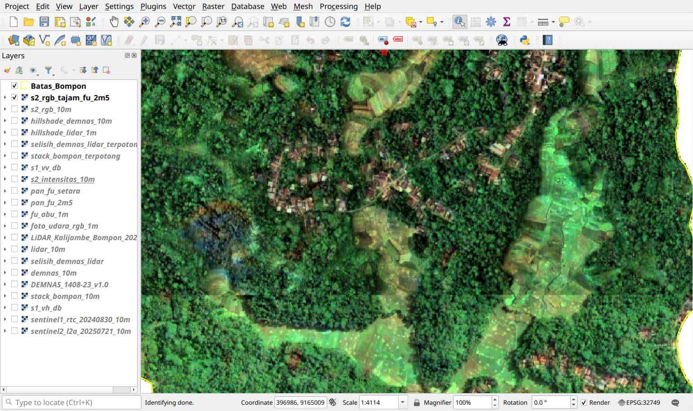

Gambar P1.22 Sentinel-2 setelah ditajamkan dengan foto udara, 2,5 m

Sumber: Tangkapan layar uji coba; *Contains modified Copernicus Sentinel data 2025*

Rumah, tajuk, dan pematang sawah kini dapat dibedakan. Perubahan ini nyata bagi mata.

**Titik periksa.** `s2_rgb_tajam_fu_2m5.tif` berukuran 608 × 1.288 piksel dengan piksel 2,5 m dan 3 kanal.

## Tahap 7: Bagaimana dengan LiDAR?

DEM tidak dapat langsung dipakai sebagai pan, karena ketinggian tidak berhubungan dengan terang-gelapnya citra. Yang paling dekat adalah bayangan medannya.

1. Bawa `hillshade_lidar_1m` ke grid 2,5 m seperti langkah pan, lalu simpan ke `hasil/hillshade_lidar_2m5.tif`.
2. Setarakan seperti tahap 5 dengan statistik bayangan medan, yaitu rata-rata 169,98028 dan simpangan baku 38,5938, lalu simpan ke `hasil/pan_hs_setara.tif`.

```
("hillshade_lidar_2m5@1" - 169.98028) * 0.01209 / 38.5938 + 0.033
```

3. Jalankan Pansharpening dengan pan tersebut, lalu simpan ke `hasil/s2_rgb_tajam_lidar_2m5.tif`.

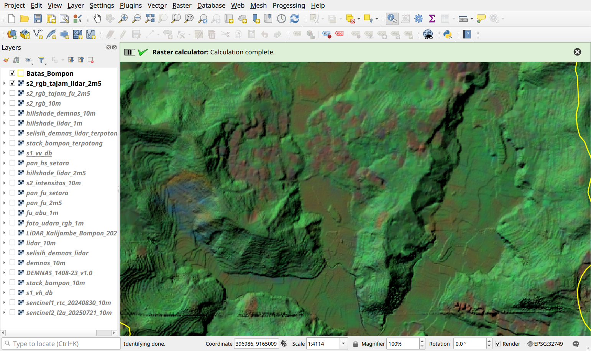

Gambar P1.23 Sentinel-2 setelah ditajamkan dengan bayangan medan LiDAR

Sumber: Tangkapan layar uji coba; *Contains modified Copernicus Sentinel data 2025*

Medannya tampak timbul, tetapi rumah dan tajuk kehilangan bentuk. Terang pada gambar ini berasal dari matahari buatan pada azimut 315°, bukan dari pantulan permukaan. Citra ini berguna untuk membaca lanskap, tetapi nilainya tidak lagi berarti pantulan.

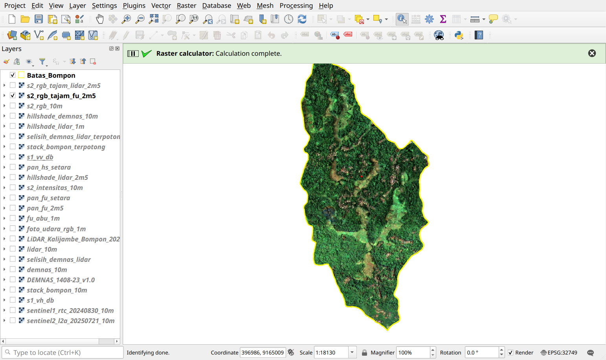

Gambar P1.24 Seluruh Sub-DAS setelah ditajamkan dengan foto udara

Sumber: Tangkapan layar uji coba; *Contains modified Copernicus Sentinel data 2025*

## Tahap 8: Menguji Hasilnya

Buka `Praktik_1_Evaluasi_Pansharpening.ipynb`, lalu jalankan sel dari atas. Seluruhnya memerlukan sekitar 15 detik pada komputer uji coba.

Pengujian mengikuti protokol Wald et al. (1997). Kebenaran pada 2,5 m tidak kita miliki, jadi percobaan diturunkan satu tingkat. Sentinel-2 dikasarkan ke 40 m dan pan ke 10 m, lalu hasil penajaman ke 10 m dibandingkan dengan Sentinel-2 10 m yang asli. Pembandingnya adalah interpolasi bilinear, yang tidak menambah informasi apa pun. Selain Brovey, notebook mencoba *high-pass filter* (HPF), yang termasuk keluarga metode lain dalam ulasan Vivone et al. (2015). HPF hanya menambahkan detail pan, dengan bobot dari regresi kanal terhadap pan.

Bagian pertama notebook menanyakan syarat dasarnya, yaitu apakah data detail memang mirip dengan kanal yang ditajamkan.

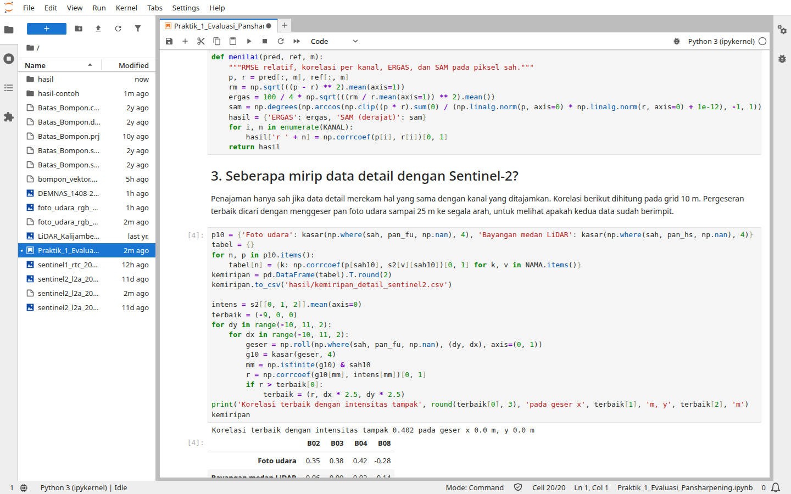

Gambar P1.25 Kemiripan data detail dengan kanal Sentinel-2 di notebook

Sumber: Tangkapan layar uji coba

Tabel P1.3 Korelasi Data Detail dengan Sentinel-2 pada Grid 10 m

| **Data detail** | **B02** | **B03** | **B04** | **B08** |
| :-----: | ---: | ---: | ---: | ---: |
| Foto udara | 0,35 | 0,38 | 0,42 | −0,28 |
| Bayangan medan LiDAR | −0,06 | −0,09 | −0,02 | −0,14 |

Sumber: Hasil uji coba

Foto udara hanya sedang kemiripannya dengan kanal tampak, dan pada B08 korelasinya negatif, karena vegetasi yang gelap di foto justru terang di inframerah dekat. Bayangan medan hampir tidak berkorelasi dengan kanal apa pun. Menggeser foto udara sampai 25 m tidak memperbaiki korelasi, sehingga masalahnya bukan pergeseran posisi. Perbedaan waktu perekaman, sudut pandang, dan warna antarberkas foto lebih mungkin berperan, walaupun hal itu belum diuji satu per satu.

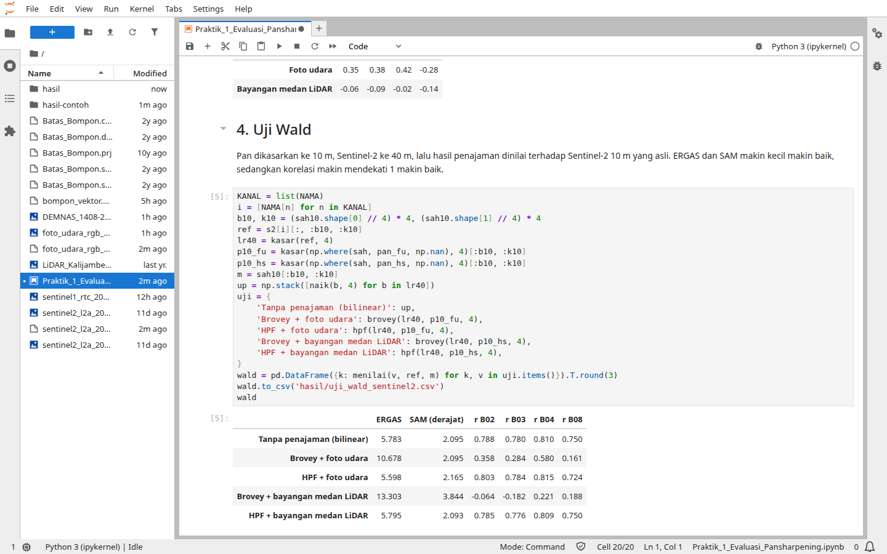

Gambar P1.26 Hasil uji Wald di notebook

Sumber: Tangkapan layar uji coba

Tabel P1.4 Hasil Uji Wald pada Sentinel-2

| **Cara** | **ERGAS** | **SAM (°)** | **r B02** | **r B03** | **r B04** | **r B08** |
| :-----: | ---: | ---: | ---: | ---: | ---: | ---: |
| Tanpa penajaman (bilinear) | 5,78 | 2,10 | 0,79 | 0,78 | 0,81 | 0,75 |
| Brovey + foto udara | 10,68 | 2,10 | 0,36 | 0,28 | 0,58 | 0,16 |
| HPF + foto udara | 5,60 | 2,17 | 0,80 | 0,78 | 0,82 | 0,72 |
| Brovey + bayangan medan LiDAR | 13,30 | 3,84 | −0,06 | −0,18 | 0,22 | 0,19 |
| HPF + bayangan medan LiDAR | 5,80 | 2,09 | 0,79 | 0,78 | 0,81 | 0,75 |

Sumber: Hasil uji coba; ERGAS dan SAM makin kecil makin baik

Bacalah tabel ini pelan-pelan. Brovey, metode pada alat QGIS yang menghasilkan gambar paling memukau, justru hampir melipatduakan galat dibandingkan tidak menajamkan sama sekali. HPF dengan foto udara hanya sedikit lebih baik pada kanal tampak dan lebih buruk pada B08. HPF dengan bayangan medan praktis tidak mengubah apa pun, karena bobot regresinya hampir nol. SAM Brovey sama dengan bilinear karena metode ini menjaga perbandingan antarkanal dan hanya mengubah terangnya.

Hasil ini berlaku untuk data ini, pada satu tingkat skala, dan belum tentu sama pada foto udara yang direkam berdekatan dengan citranya.

Notebook juga menguji dua gabungan lain.

Tabel P1.5 Uji Wald pada Gabungan Lain

| **Data yang ditajamkan** | **Data detail** | **r bilinear** | **r HPF** | **RMSE bilinear** | **RMSE HPF** |
| :-----: | :-----: | ---: | ---: | ---: | ---: |
| Sentinel-2 B11, 20 m | Sentinel-2 B08 | 0,946 | 0,948 | 0,0088 | 0,0082 |
| Sentinel-2 B12, 20 m | Sentinel-2 B08 | 0,945 | 0,927 | 0,0073 | 0,0080 |
| Sentinel-2 B12, 20 m | Sentinel-2 B04 | 0,945 | 0,935 | 0,0073 | 0,0073 |
| Sentinel-1 VV | Foto udara | 0,785 | 0,763 | 1,805 dB | 1,849 dB |
| Sentinel-1 VV | Bayangan medan LiDAR | 0,785 | 0,783 | 1,805 dB | 1,808 dB |

Sumber: Hasil uji coba

Satu-satunya perbaikan kecil yang konsisten adalah B11 dengan B08, yaitu dua kanal dari satu perekaman. Sentinel-1 tidak terbantu. Radar merekam kekasaran dan geometri permukaan dari arah miring, dan bintiknya bukan detail yang dapat diperjelas dengan foto.

**Fusi DEMNAS dan LiDAR.** Di sinilah penggabungan terbukti paling berguna. Tahap 4 menunjukkan bahwa kedua DEM saling melengkapi: DEMNAS lebih dapat dipercaya pada ketinggian regional, LiDAR pada detail. Notebook menghitung DEM gabungan pada 2,5 m dengan rumus LiDAR ditambah selisih versi halus DEMNAS dan versi halus LiDAR, memakai penghalusan Gaussian dengan sigma 200 m.

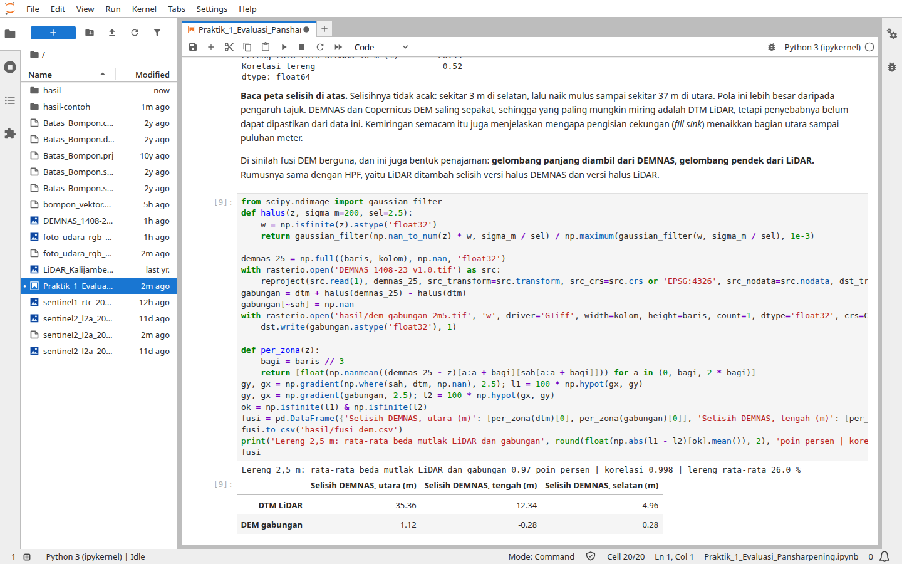

Gambar P1.27 Hasil fusi DEM di notebook

Sumber: Tangkapan layar uji coba

Tabel P1.6 Selisih Rata-rata terhadap DEMNAS menurut Zona (m)

| **DEM** | **Utara** | **Tengah** | **Selatan** |
| :-----: | ---: | ---: | ---: |
| DTM LiDAR | 35,36 | 12,34 | 4,96 |
| DEM gabungan | 1,12 | −0,28 | 0,28 |

Sumber: Hasil uji coba

Kemiringan regionalnya hilang, sedangkan detail lereng hampir tidak berubah: korelasi lereng 2,5 m antara LiDAR dan DEM gabungan mencapai 0,998, dengan beda rata-rata 0,97 poin persen. Ada dua batasan. Selisih terhadap DEMNAS memang kecil karena DEMNAS dijadikan acuan, sehingga tabel ini tidak membuktikan ketinggian mutlaknya benar. DEMNAS juga dapat memuat tajuk, sehingga DEM gabungan bukan DTM murni pada skala regional.

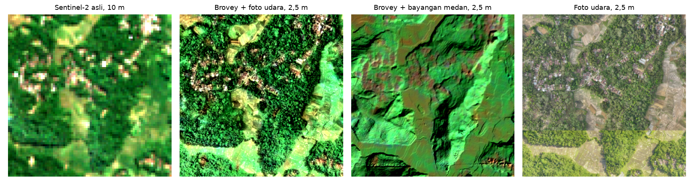

Gambar P1.28 Sentinel-2 asli, hasil dua penajaman, dan foto udara pada potongan yang sama

Sumber: Hasil uji coba; *Contains modified Copernicus Sentinel data 2025*

**Titik periksa.** `hasil/uji_wald_sentinel2.csv` sama dengan Tabel P1.4, dan `hasil/dem_gabungan_2m5.tif` terbentuk.

## Membaca Hasil

Citra hasil penajaman tetap berguna, tetapi untuk tujuan yang tepat. Pakailah untuk interpretasi visual, misalnya mengenali permukiman dan pematang saat menarik batas SMU. Jangan memakainya untuk menghitung indeks atau melatih model seolah-olah Sentinel-2 benar-benar memiliki piksel 2,5 m, karena nilai itu terbukti bergeser dari pantulan aslinya. Untuk pemodelan, tumpukan 10 m pada tahap 3 lebih jujur, sedangkan foto udara dan turunan LiDAR dapat masuk langsung sebagai lapisan sendiri, yaitu fusi tingkat fitur.

Keselarasan grid juga tidak berarti data itu setara. Citra optik direkam pada Juli 2025, radar pada Agustus 2024, LiDAR dan foto udara pada kurun 2022–2024, dan DEMNAS merupakan gabungan beberapa sumber. Sebelum memakai data berlapis di kebun, tanyakan selalu kapan setiap lapisan direkam dan apa yang diukurnya. Di kebun kelapa sawit, tanyakan pula pada vendor foto udara atau LiDAR: apakah ketinggiannya sudah diperiksa terhadap titik kontrol? Kemiringan seperti pada tahap 4 tidak tampak pada peta bayangan medan yang indah.

Praktik 2 memakai Copernicus DEM yang sudah disiapkan pada foldernya, sehingga hasil di atas belum memengaruhinya. Praktik 5 memakai DEMNAS yang sama dengan praktik ini, yang sudah diproyeksikan ke UTM dan dipotong, lalu dibawa ke grid 10 m dengan pengaturan seperti tahap 2.

## Jika Tertinggal

Semua keluaran uji coba tersedia di `data/praktik-1/hasil-contoh/`, termasuk proyek `Praktik_1_selesai.qgz` yang dapat langsung dibuka.

## Rujukan Tambahan

Badan Informasi Geospasial. (2026). *Info Data Demnas* [Halaman portal]. Ina-Geoportal. https://tanahair.indonesia.go.id/portal-web/unduh/demnas

Vivone, G., Alparone, L., Chanussot, J., Dalla Mura, M., Garzelli, A., Licciardi, G. A., Restaino, R., & Wald, L. (2015). A critical comparison among pansharpening algorithms. *IEEE Transactions on Geoscience and Remote Sensing*, *53*(5), 2565–2586. https://doi.org/10.1109/TGRS.2014.2361734

Wald, L., Ranchin, T., & Mangolini, M. (1997). Fusion of satellite images of different spatial resolutions: Assessing the quality of resulting images. *Photogrammetric Engineering and Remote Sensing*, *63*(6), 691–699.
