# Praktik 2. Remote Sensing untuk Delineasi Soil Mapping Unit

*Praktik terbimbing:*

Pemandu: Johan dan Nurarfiyah. Perangkat: QGIS. Rujukan teori: Modul 3, Modul 4, dan Modul 6.

## Kurikulum Pembelajaran

**Tujuan**

Membekali peserta agar mampu menyusun peta satuan peta tanah dari turunan DEM dan interpretasi citra, lalu menyesuaikannya dengan skala peta.

**Kompetensi**

Setelah mengikuti praktik ini, peserta memiliki kompetensi dalam:

1. Menurunkan kemiringan dan kelas lereng dari DEM
2. Menghitung indeks sifat tanah dan menilai keterbatasannya
3. Mendigitasi satuan bentuklahan tanpa celah dan tumpang tindih
4. Menyusun SMU melalui tumpang susun
5. Menggeneralisasi satuan sesuai luasan terkecil yang terbaca
6. Membandingkan hasil delineasi dengan peta riset

**Ringkasan Studi**

1. Deskripsi singkat
   - Peserta membuat peta lereng, bayangan medan, kontur, dan indeks sifat tanah
   - Peserta menarik batas tiga satuan bentuklahan dengan unsur interpretasi citra
   - Peserta menyusun dan menggeneralisasi SMU, lalu membandingkannya dengan peta riset
2. Hasil belajar
   - Peserta memahami SMU sebagai hipotesis sebaran tanah
   - Peserta memiliki peta SMU beserta legendanya
3. Indikator hasil belajar
   - Jumlah luas poligon sekitar 294,71 ha, tanpa celah dan tumpang tindih
   - Tidak ada poligon SMU yang lebih kecil dari 0,4 ha
   - Peserta dapat menjelaskan di mana batasnya berbeda dari peta riset dan mengapa
4. Materi pokok
   - Konsep SMU dan prinsip delineasi berbasis lanskap
   - Turunan DEM dan indeks sifat tanah
   - Skala peta dan MLA
   - Tumpang susun dan generalisasi

## Gambaran Praktik

Satuan peta tanah (*Soil Mapping Unit*, SMU) tidak ditarik dari tanah yang terlihat, karena tanah jarang terlihat. Satuan itu ditarik dari kenampakan lanskap yang berkaitan dengan pembentukan tanah, seperti bentuklahan dan lereng, sebagaimana dibahas pada Modul 3 dan Modul 4. Hasilnya berupa hipotesis tentang sebaran tanah, bukan kebenaran lapangan.

Praktik ini mengerjakan alur tersebut dari awal. Peserta menurunkan peta lereng dari DEM, melihat apa yang dapat dan tidak dapat diberikan indeks sifat tanah dari citra, menarik batas satuan bentuklahan secara manual, menumpangsusunkannya dengan kelas lereng, lalu menggeneralisasi hasilnya sesuai skala peta. Pada akhir praktik, hasil peserta dibandingkan dengan peta bentuklahan dan kelas lereng hasil riset, yang sengaja baru dibuka pada tahap terakhir.

## Data yang Dipakai

Semua berkas ada di folder `data/praktik-2/`. Buat folder `data/praktik-2/hasil/` untuk menyimpan keluaran.

Tabel P2.1 Data Praktik 2

| **Berkas** | **Isi** |
| :------: | :------: |
| `dem_10m.tif` | Copernicus DEM yang sudah diselaraskan ke grid 10 m |
| `sentinel2_l2a_20250721_10m.tif` | Sentinel-2 L2A, 21 Juli 2025, 10 kanal |
| `bompon_vektor.gpkg` | `batas_subdas`, `penggunaan_lahan`, `sungai` |
| `pembanding/peta_riset.gpkg` | `bentuklahan` dan `kelas_lereng` hasil riset; **jangan dibuka sebelum tahap 6** |

Sumber: Data proyek; *Contains modified Copernicus Sentinel data 2025*

Skala sasaran pada latihan ini adalah 1:10.000, sehingga luasan terkecil yang terbaca (MLA) 0,4 ha menurut rumus pada Modul 3.

## Tahap 1: Menurunkan Lereng dari DEM

1. Buat proyek baru, simpan sebagai `hasil/praktik2.qgz`, lalu muat semua data kecuali folder `pembanding`.
2. Pilih **Raster > Analysis > Slope**. Isi **Input layer** `dem_10m`, centang **Express slope as percent instead of degrees** dan **Compute edges**, lalu simpan ke `hasil/lereng_persen.tif`.

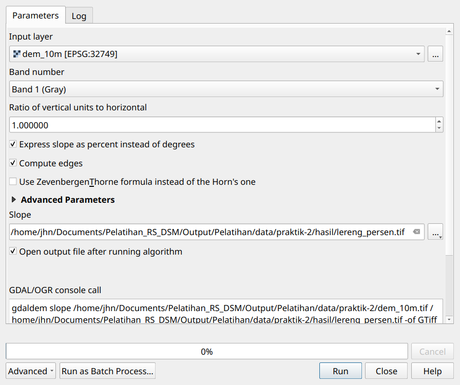

Gambar P2.1 Dialog Slope

Sumber: Tangkapan layar uji coba

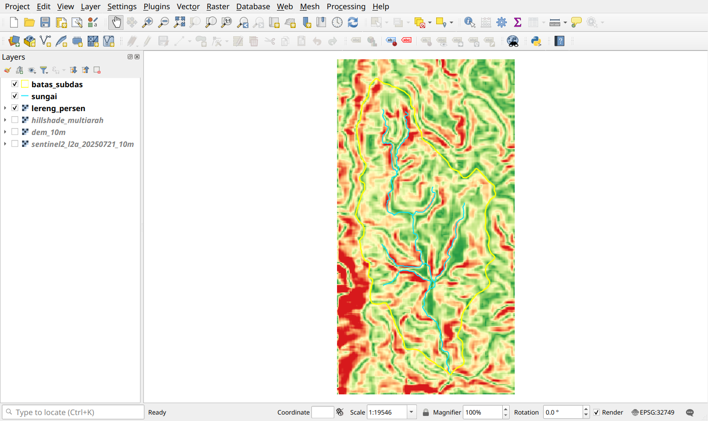

Gambar P2.2 Kemiringan lereng dalam persen

Sumber: Tangkapan layar uji coba; data dari Copernicus DEM GLO-30

3. Cari **Reclassify by table** di Processing Toolbox. Isi **Raster layer** `lereng_persen`, lalu klik **...** pada **Reclassification table** dan isi lima baris pada Tabel P2.2.
4. Buka **Advanced Parameters**, pilih **Range boundaries** *min <= value < max*, lalu simpan ke `hasil/kelas_lereng.tif`.

Tabel P2.2 Kelas Lereng

| **Minimum** | **Maximum** | **Value** | **Kelas** |
| ---: | ---: | :---: | :---: |
| 0 | 8 | 1 | 0–8% |
| 8 | 15 | 2 | 8–15% |
| 15 | 25 | 3 | 15–25% |
| 25 | 45 | 4 | 25–45% |
| 45 | 100000 | 5 | >45% |

Sumber: Kelas yang dipakai pada survei Sub-DAS Bompon

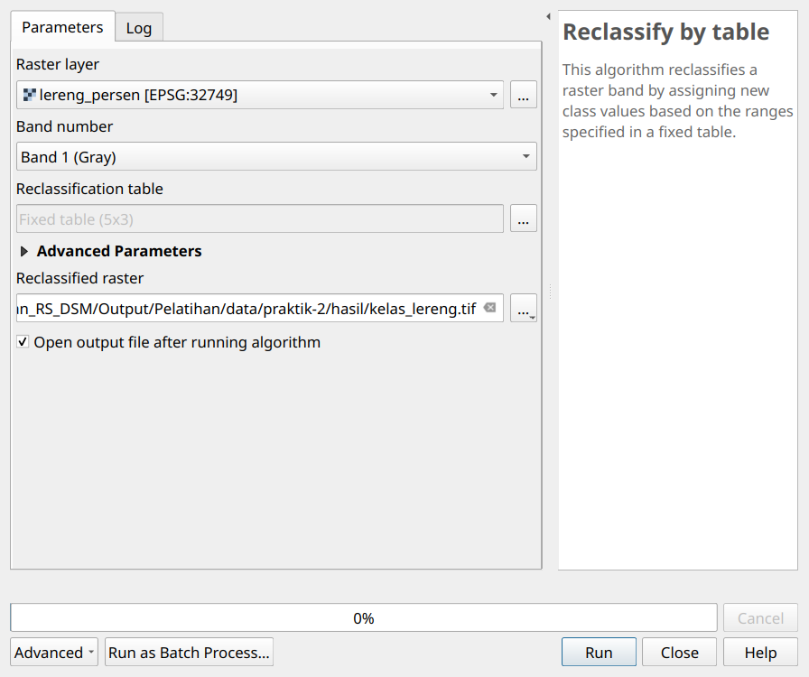

Gambar P2.3 Dialog Reclassify by Table

Sumber: Tangkapan layar uji coba

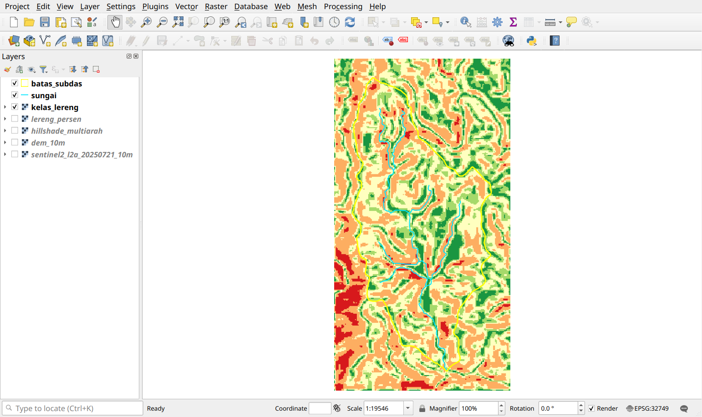

Gambar P2.4 Lima kelas lereng

Sumber: Tangkapan layar uji coba; data dari Copernicus DEM GLO-30

5. Pilih **Raster > Analysis > Hillshade**, centang **Multidirectional shading** dan **Compute edges**, lalu simpan ke `hasil/hillshade_multiarah.tif`.
6. Pilih **Raster > Extraction > Contour**, dengan **Interval between contour lines** `10`, lalu simpan ke `hasil/kontur_10m.gpkg`.

**Titik periksa.** Pada uji coba, lereng bernilai 0 sampai 87,9% dengan rata-rata 22,1%.

## Tahap 2: Indeks Sifat Tanah dari Citra

Tahap ini mempraktikkan isi Modul 4. Tabel 4.2 pada modul tersebut memuat indeks yang berkaitan dengan sifat tanah. Tiga di antaranya dihitung di sini, ditambah NDVI sebagai pembanding. Indeks yang memerlukan data hiperspektral, seperti NSMI dan kedalaman serapan, hanya dapat dibahas dan tidak dapat dihitung dari Sentinel-2.

Hitung dengan **Raster > Raster Calculator**. Pada rumus di bawah, `S` mewakili `sentinel2_l2a_20250721_10m`.

Tabel P2.3 Rumus Indeks

| **Indeks** | **Ekspresi** | **Keluaran** |
| :---: | :------: | :---: |
| Kecerahan (BI) | `sqrt(("S@3"^2 + "S@2"^2 + "S@1"^2) / 3)` | `hasil/indeks_bi.tif` |
| Pewarnaan (CI) | `("S@3" - "S@2") / ("S@3" + "S@2")` | `hasil/indeks_ci.tif` |
| Rasio mineral lempung (CMR) | `"S@9" / "S@10"` | `hasil/indeks_cmr.tif` |
| NDVI | `("S@7" - "S@3") / ("S@7" + "S@3")` | `hasil/indeks_ndvi.tif` |

Sumber: Rumus dari Tabel 4.2 Modul 4, disesuaikan dengan urutan kanal berkas

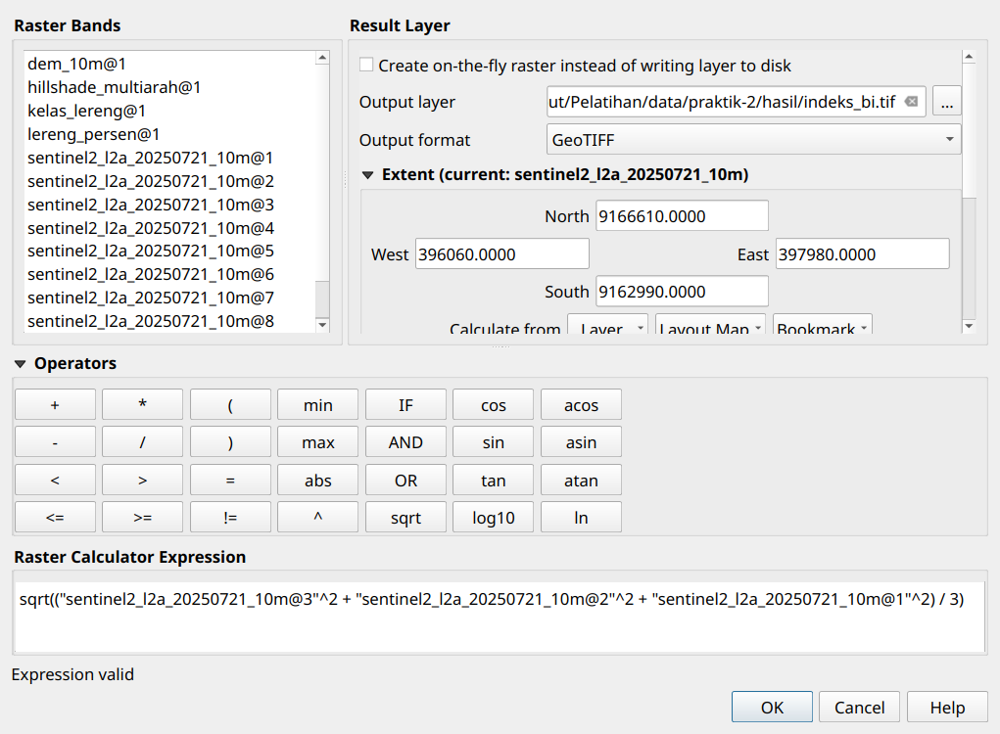

Gambar P2.5 Menghitung indeks kecerahan

Sumber: Tangkapan layar uji coba

Tampilkan CMR dan NDVI berdampingan dengan mencentang layernya bergantian.

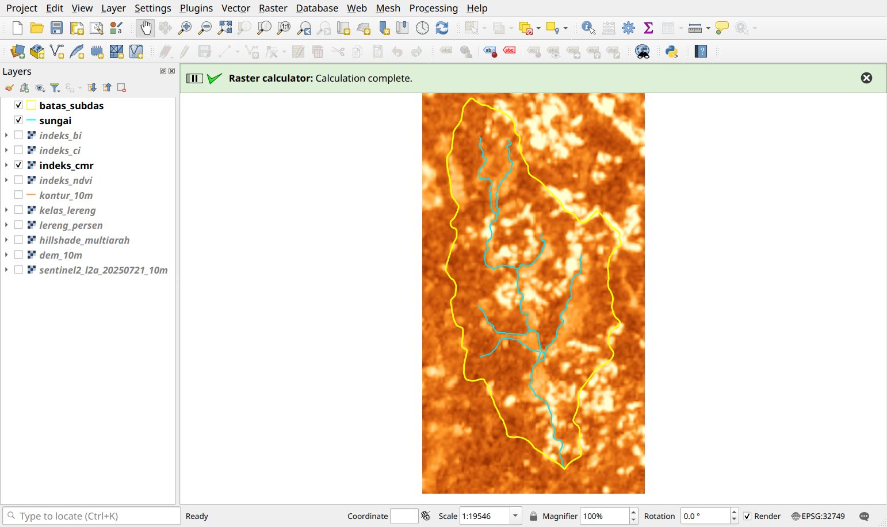

Gambar P2.6 Rasio mineral lempung (CMR)

Sumber: Tangkapan layar uji coba; *Contains modified Copernicus Sentinel data 2025*

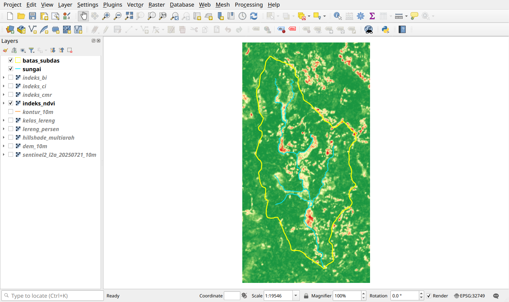

Gambar P2.7 NDVI

Sumber: Tangkapan layar uji coba; *Contains modified Copernicus Sentinel data 2025*

Kedua peta tampak sangat mirip, dan inilah pelajaran utamanya. Pada citra 2024 yang dipakai di Praktik 4, korelasi Spearman CMR dengan NDVI di dalam Sub-DAS mencapai 0,78. Sebuah indeks bernama "rasio mineral lempung" ternyata terutama menggambarkan vegetasi, karena hanya sedikit piksel yang tanahnya terbuka. Modul 4 sudah menjelaskan bahwa estimasi langsung hanya bermakna pada tanah terbuka. Karena itu, peta indeks ini tidak dipakai untuk menarik batas SMU. Praktik 4 akan membahas cara menyaring piksel tanah terbuka.

**Titik periksa.** BI bernilai 0,012–0,201, CI −0,547–0,319, CMR 1,111–2,660, dan NDVI 0,038–0,936.

## Tahap 3: Mendigitasi Satuan Bentuklahan

Inti delineasi ada pada tahap ini. Peta lereng dari komputer tidak dapat menggantikan penafsir, karena penafsirlah yang memutuskan mana batas yang bermakna. Gunakan unsur interpretasi pada Tabel 3.2 Modul 3 dan prinsip konvergensi bukti pada Modul 6, yaitu batas yang muncul dari beberapa petunjuk lebih dapat dipercaya.

Untuk latihan ini, cukup tiga satuan. Kunci interpretasi berikut disusun penyusun modul untuk latihan.

Tabel P2.4 Kunci Interpretasi Sederhana untuk Latihan

| **Kode** | **Satuan** | **Petunjuk pada data** |
| :-: | :-----: | :---------: |
| K | Kaki lereng dan dataran koluvial | Situs terendah di sepanjang alur; kontur renggang; biru tua pada komposit SWIR (sawah) |
| P | Punggung dan interfluve | Bagian tertinggi di sepanjang batas Sub-DAS dan punggungan; relatif landai di puncak |
| L | Lereng perbukitan | Bagian di antara keduanya; kontur rapat dan bayangan medan kontras |

Sumber: Disusun untuk latihan, memakai prinsip Tabel 3.2 Modul 3

1. Siapkan dua tampilan acuan. Yang pertama adalah `sentinel2_l2a_20250721_10m` sebagai **Multiband color** kanal 9, 7, 2. Yang kedua adalah `hillshade_multiarah` dengan `kontur_10m` dan `sungai` di atasnya. Tampilkan bergantian saat menarik batas.

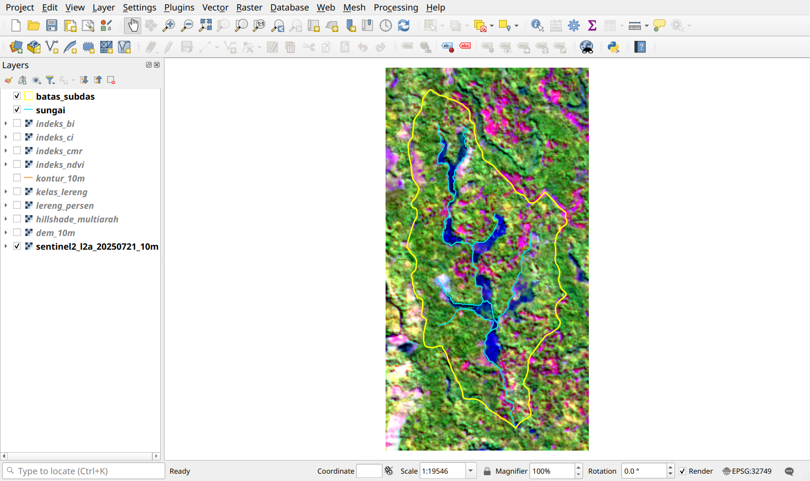

Gambar P2.8 Tampilan acuan: komposit SWIR dengan sungai dan batas Sub-DAS

Sumber: Tangkapan layar uji coba; *Contains modified Copernicus Sentinel data 2025*

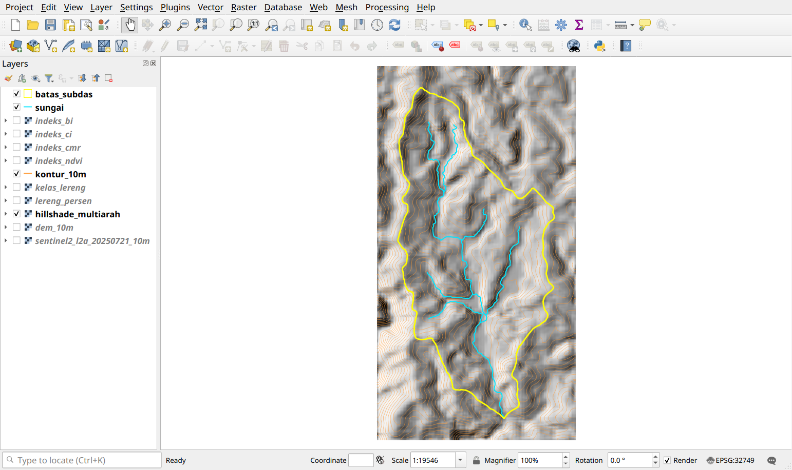

Gambar P2.9 Tampilan acuan: bayangan medan, kontur 10 m, dan sungai

Sumber: Tangkapan layar uji coba; data dari Copernicus DEM GLO-30

2. Pilih **Layer > Create Layer > New GeoPackage Layer**. Isi **File name** `hasil/bentuklahan_peserta.gpkg`, **Geometry type** *Polygon*, dan CRS `EPSG:32749`. Pada **New Field**, tambahkan dua kolom teks, yaitu `kode` dan `bentuklahan`, dengan tombol **Add to Fields List**, lalu klik **OK**. Periksa CRS-nya sebelum menutup dialog. Bawaan dialog adalah `EPSG:4326`, seperti terlihat pada gambar, sehingga harus diganti lewat tombol di sebelahnya.

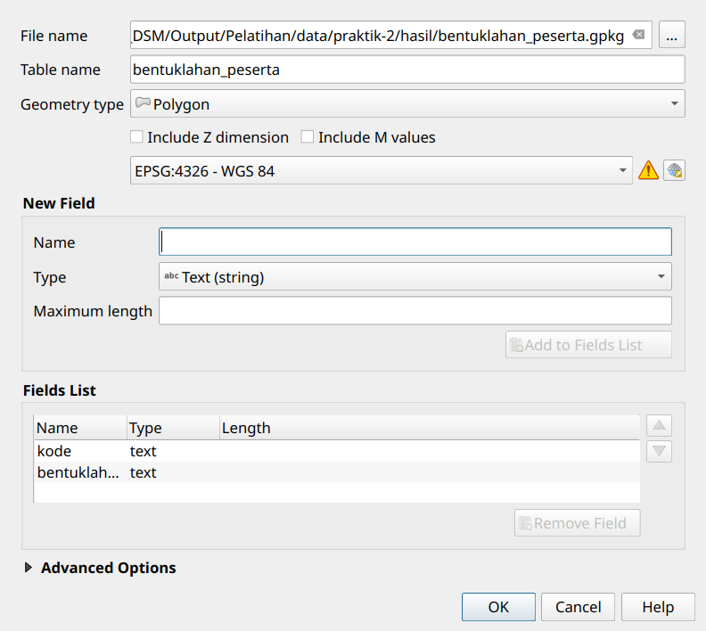

Gambar P2.10 Membuat layer GeoPackage baru

Sumber: Tangkapan layar uji coba

3. Aktifkan **View > Toolbars > Snapping Toolbar**. Klik ikon magnet untuk mengaktifkan *snapping*, aktifkan **Vertex** dan **Segment**, dan isi toleransi `8` piksel. Klik ikon **Enable Topological Editing**, lalu pilih **Avoid Overlap on Active Layer**.
4. Pilih layer `bentuklahan_peserta`, klik **Toggle Editing** (ikon pensil), lalu **Add Polygon Feature**.
5. Mulailah dari satuan yang paling jelas, yaitu kaki lereng dan dataran koluvial. Klik sepanjang batas yang Anda tafsirkan, lalu klik kanan untuk mengakhiri poligon. Isi `kode` dan `bentuklahan` pada form yang muncul, lalu klik **OK**.

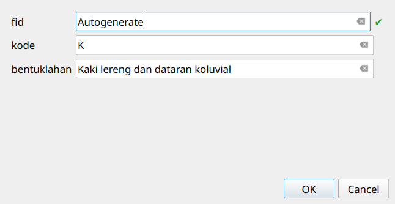

Gambar P2.11 Form atribut setelah satu poligon selesai

Sumber: Tangkapan layar uji coba

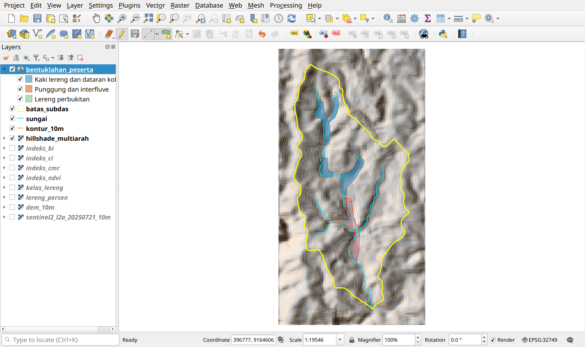

Gambar P2.12 Digitasi poligon sedang berjalan

Sumber: Tangkapan layar uji coba

6. Lanjutkan dengan satuan punggung. Terakhir, gambar satu poligon besar untuk satuan lereng perbukitan yang melewati seluruh batas Sub-DAS. Dengan **Avoid Overlap**, QGIS memotong poligon baru mengikuti poligon yang sudah ada, sehingga tidak ada celah maupun tumpang tindih, tanpa perlu menelusuri batas yang sama dua kali.
7. Klik **Save Layer Edits**, lalu matikan **Toggle Editing**.

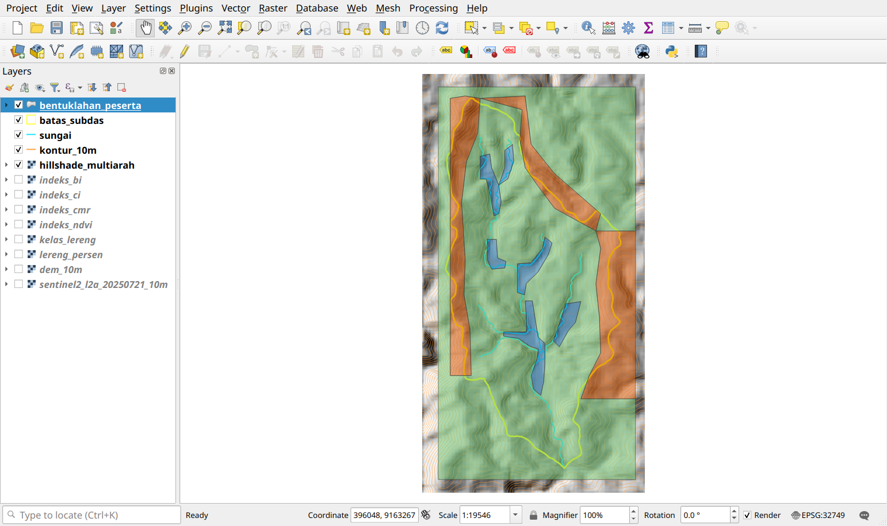

Gambar P2.13 Hasil digitasi dengan Avoid Overlap, sebelum dipotong mengikuti batas Sub-DAS

Sumber: Tangkapan layar uji coba

8. Pilih **Vector > Geoprocessing Tools > Clip**, dengan **Input layer** `bentuklahan_peserta` dan **Overlay layer** `batas_subdas`. Simpan ke `hasil/bentuklahan_terpotong.gpkg`.

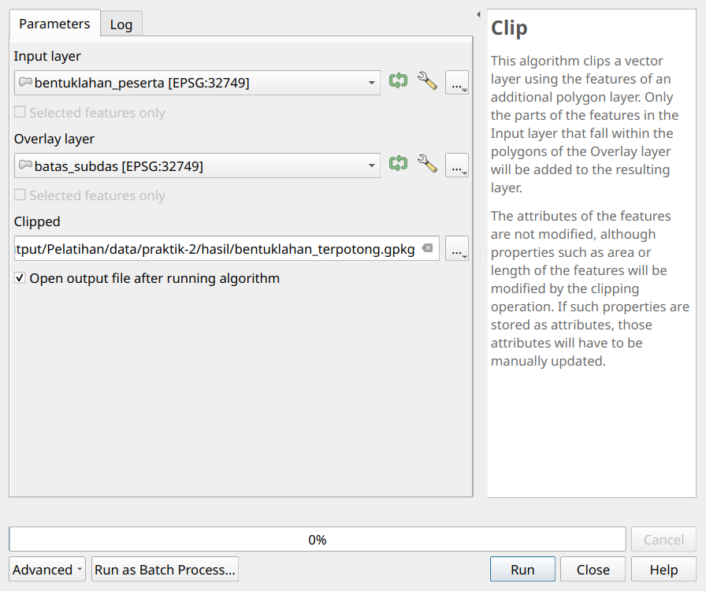

Gambar P2.14 Dialog Clip

Sumber: Tangkapan layar uji coba

9. Cari **Field calculator** di Processing Toolbox. Isi **Input layer** `bentuklahan_terpotong`, **Field name** `luas_ha`, **Result field type** *Decimal*, dan formula berikut, lalu simpan ke `hasil/bentuklahan_luas.gpkg`.

```
area($geometry) / 10000
```

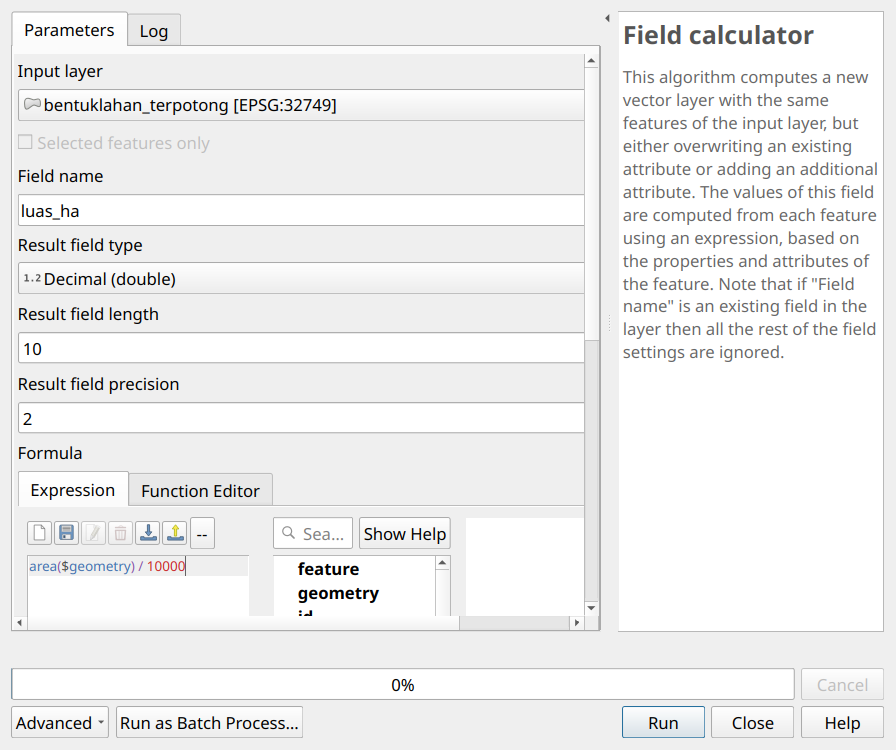

Gambar P2.15 Menghitung luas poligon dengan Field Calculator

Sumber: Tangkapan layar uji coba

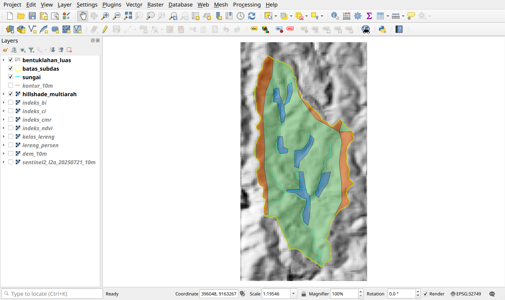

Gambar P2.16 Contoh peta satuan bentuklahan hasil digitasi uji coba

Sumber: Tangkapan layar uji coba; delineasi merupakan tafsiran penyusun untuk latihan, tanpa pengamatan lapangan

**Titik periksa.** Jumlah kolom `luas_ha` seluruh poligon harus sekitar 294,71 ha, sama dengan luas Sub-DAS. Pada contoh uji coba, satuan kaki lereng dan dataran koluvial seluas 26,52 ha, punggung 43,57 ha, dan lereng perbukitan 224,62 ha. Hasil Anda pasti berbeda, dan justru perbedaan itu yang didiskusikan pada tahap 6. Simpan berkas ini sebagai titik henti hari pertama.

## Tahap 4: Menyusun SMU dengan Tumpang Susun

Tahap ini dimulai dari berkas `bentuklahan_luas` dan `kelas_lereng`. Peserta yang belum selesai dapat memuatnya dari `hasil-contoh/`. SMU pada latihan ini adalah gabungan bentuklahan dan kelas lereng, sejalan dengan Sambodo dan Arpornthip (2021). Penggunaan lahan sengaja tidak dimasukkan, karena Modul 3 menjelaskan bahwa batasnya merupakan keputusan manusia yang tidak selalu mengikuti batas tanah.

1. Pilih **Raster > Conversion > Polygonize (Raster to Vector)**. Isi **Input layer** `kelas_lereng`, **Name of the field to create** `kelas`, lalu simpan ke `hasil/kelas_lereng_poligon.gpkg`.

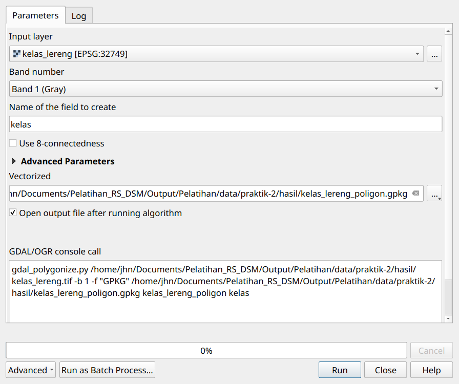

Gambar P2.17 Dialog Polygonize

Sumber: Tangkapan layar uji coba

**Perhatian.** Jika Polygonize dijalankan dua kali ke berkas GeoPackage yang sama, fiturnya bertambah, bukan tertimpa, sehingga jumlah poligon menjadi dua kali lipat dan perhitungan berikutnya keliru. Hal ini sempat terjadi saat uji coba. Jika perlu mengulang, hapus dulu layernya dari proyek dan hapus berkasnya, atau simpan dengan nama baru.

2. Jalankan **Fix geometries** dari Processing Toolbox pada `kelas_lereng_poligon`, sebagai layer sementara. Poligon hasil konversi raster sering memiliki geometri yang menyentuh dirinya sendiri, sehingga alat berikutnya dapat menolaknya.

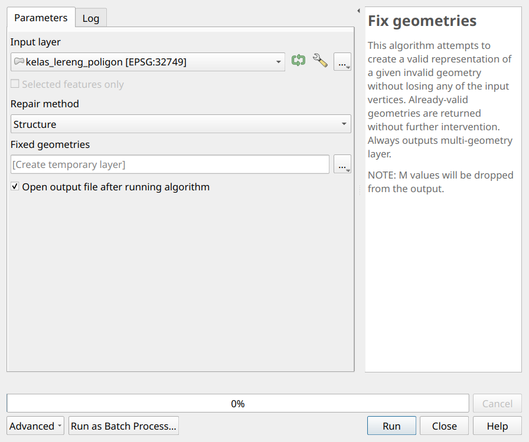

Gambar P2.18 Dialog Fix Geometries

Sumber: Tangkapan layar uji coba

3. Pilih **Vector > Geoprocessing Tools > Intersection**. Isi **Input layer** `bentuklahan_luas`, **Overlay layer** hasil langkah 2, **Input fields to keep** `kode` dan `bentuklahan`, dan **Overlay fields to keep** `kelas`.

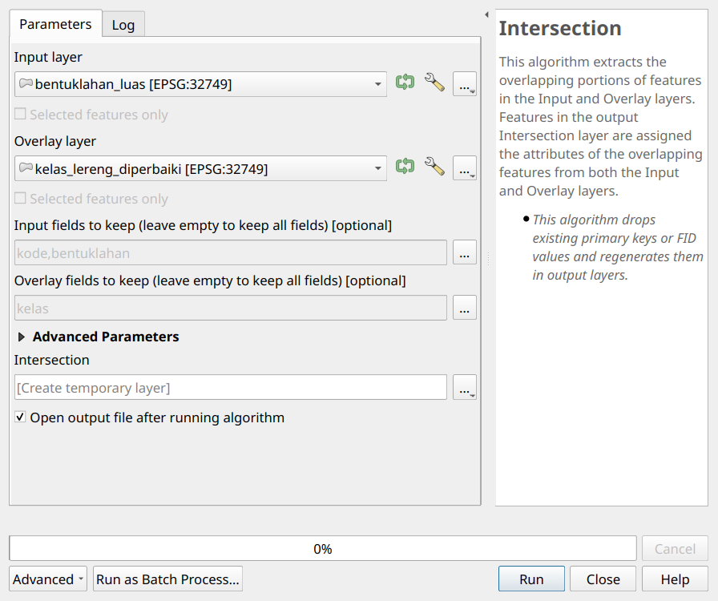

Gambar P2.19 Dialog Intersection

Sumber: Tangkapan layar uji coba

4. Jalankan **Multipart to singleparts** pada hasilnya.
5. Jalankan **Field calculator** dua kali. Yang pertama membuat kolom desimal `luas_ha` dengan rumus `area($geometry) / 10000`. Yang kedua membuat kolom teks `smu` dengan rumus berikut, lalu simpan ke `hasil/smu_mentah.gpkg`.

```
"kode" || to_string(to_int("kelas"))
```

Kode `L3`, misalnya, berarti lereng perbukitan dengan kelas lereng 15–25%.

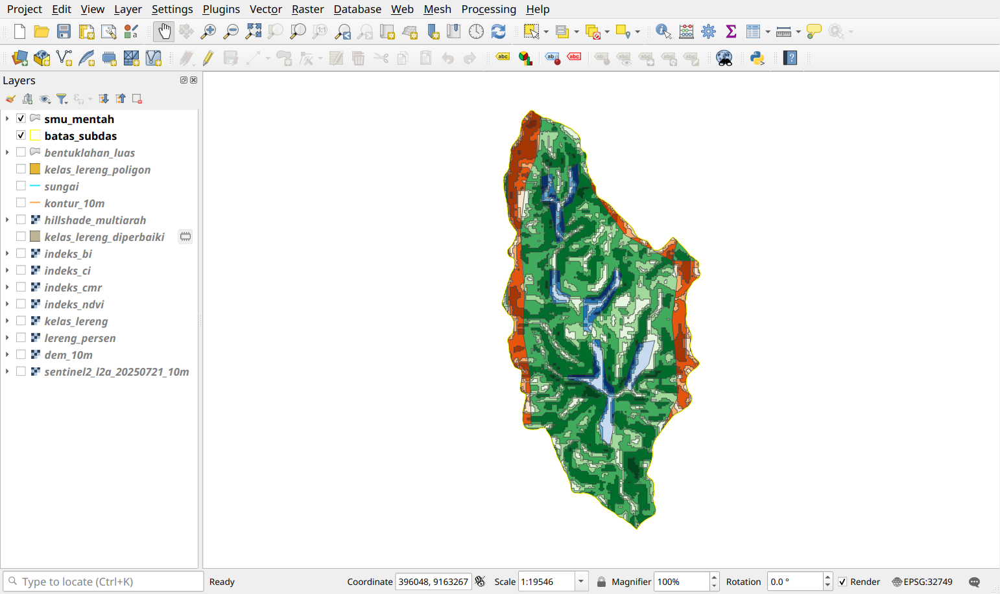

Gambar P2.20 Satuan peta sebelum generalisasi

Sumber: Tangkapan layar uji coba

**Titik periksa.** Pada contoh uji coba, kelas lereng menjadi 2.707 poligon, dan tumpang susun menghasilkan 1.422 poligon, dengan 1.297 poligon, atau 91,2%, lebih kecil dari MLA 0,4 ha. Angka ini mirip dengan ilustrasi Gambar 3.5 di Modul 3, yang memperingatkan gejala yang sama. Peta seperti ini tidak terbaca pada skala 1:10.000.

## Tahap 5: Generalisasi Sesuai Skala

1. Pilih layer `smu_mentah`, lalu klik **Select Features by Expression** (Ctrl+F3) dan masukkan ekspresi berikut.

```
"luas_ha" < 0.4
```


Gambar P2.21 Poligon yang lebih kecil dari MLA terpilih

Sumber: Tangkapan layar uji coba

2. Cari **Eliminate selected polygons** di Processing Toolbox. Isi **Input layer** `smu_mentah` dan **Merge selection with the neighbouring polygon with the** *Largest Common Boundary*, lalu **Run**.

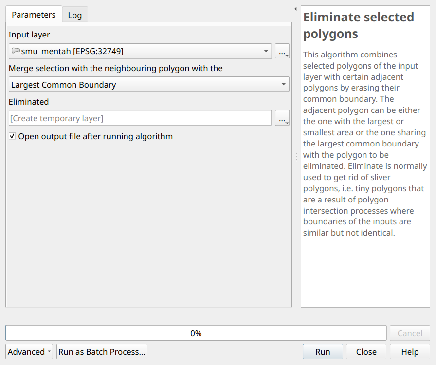

Gambar P2.22 Dialog Eliminate Selected Polygons

Sumber: Tangkapan layar uji coba

3. Hitung ulang `luas_ha` dengan **Field calculator** pada hasilnya, memakai nama kolom yang sama. Periksa dengan ekspresi yang sama bahwa tidak ada lagi poligon di bawah 0,4 ha. Jika masih ada, ulangi langkah 2.
4. Jalankan **Retain fields** dan pertahankan `smu`, `bentuklahan`, dan `kelas`. Langkah ini membuang kolom `fid` lama, yang akan menimbulkan galat saat menyimpan ke GeoPackage pada langkah berikutnya.

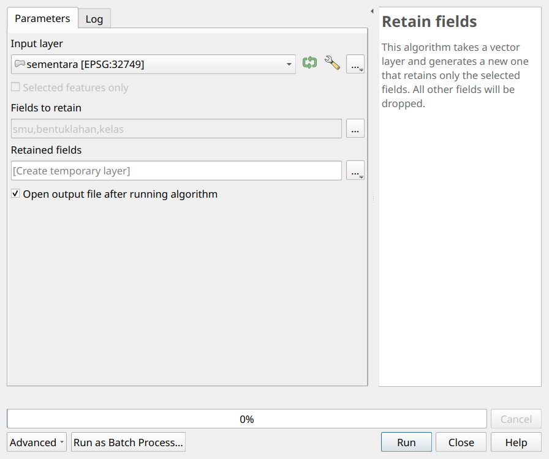

Gambar P2.23 Dialog Retain Fields

Sumber: Tangkapan layar uji coba

5. Pilih **Vector > Geoprocessing Tools > Dissolve**. Pilih kolom `smu`, `bentuklahan`, dan `kelas` pada **Dissolve field(s)**. Di **Advanced Parameters**, centang **Keep disjoint features separate**, supaya poligon yang tidak bersentuhan tetap terpisah.

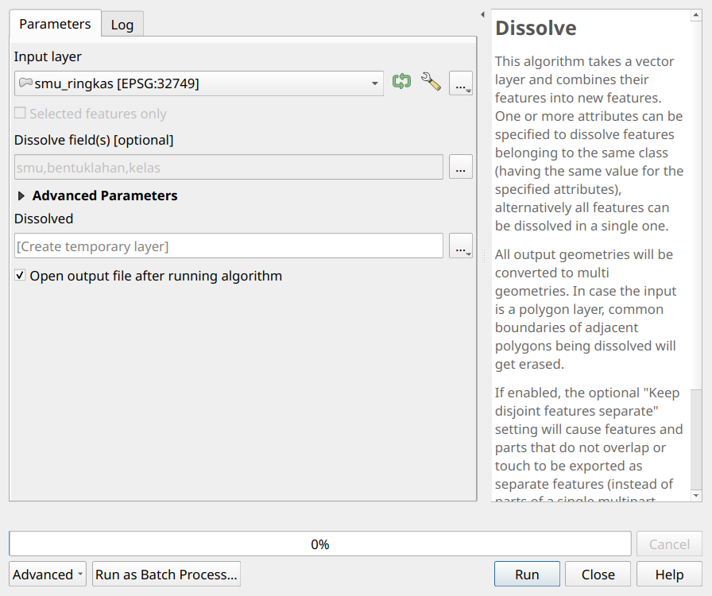

Gambar P2.24 Dialog Dissolve

Sumber: Tangkapan layar uji coba

6. Hitung `luas_ha` sekali lagi, lalu simpan ke `hasil/smu_akhir.gpkg`.


Gambar P2.25 Peta SMU setelah generalisasi

Sumber: Tangkapan layar uji coba; satuan merupakan hipotesis untuk latihan

7. Cari **Statistics by categories**. Isi **Input vector layer** `smu_akhir`, **Field to calculate statistics on** `luas_ha`, dan **Field(s) with categories** `smu`, `bentuklahan`, `kelas`, lalu simpan ke `hasil/legenda_smu.csv`.

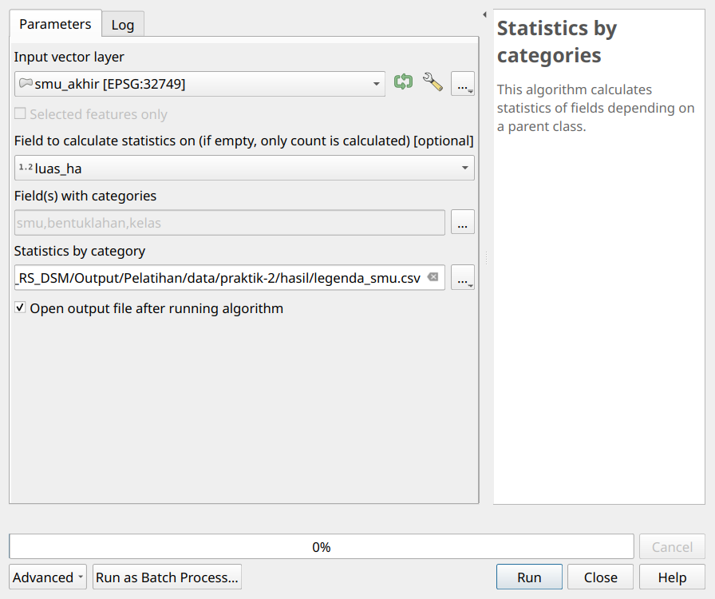

Gambar P2.26 Membuat legenda SMU dengan Statistics by Categories

Sumber: Tangkapan layar uji coba

Tabel P2.5 Legenda SMU Contoh Hasil Uji Coba

| **SMU** | **Satuan bentuklahan** | **Kelas lereng** | **Poligon** | **Luas (ha)** |
| :-: | :-----: | :---: | ---: | ---: |
| K1 | Kaki lereng dan dataran koluvial | 0–8% | 4 | 11,86 |
| K2 | Kaki lereng dan dataran koluvial | 8–15% | 2 | 1,46 |
| K3 | Kaki lereng dan dataran koluvial | 15–25% | 2 | 1,51 |
| K4 | Kaki lereng dan dataran koluvial | 25–45% | 6 | 7,47 |
| L1 | Lereng perbukitan | 0–8% | 9 | 9,33 |
| L2 | Lereng perbukitan | 8–15% | 24 | 34,72 |
| L3 | Lereng perbukitan | 15–25% | 20 | 98,13 |
| L4 | Lereng perbukitan | 25–45% | 20 | 86,51 |
| L5 | Lereng perbukitan | >45% | 3 | 2,12 |
| P1 | Punggung dan interfluve | 0–8% | 1 | 0,63 |
| P2 | Punggung dan interfluve | 8–15% | 2 | 1,13 |
| P3 | Punggung dan interfluve | 15–25% | 7 | 25,11 |
| P4 | Punggung dan interfluve | 25–45% | 5 | 14,73 |
| **Jumlah** | | | **105** | **294,71** |

Sumber: Hasil uji coba; kolom `count` dan `sum` pada `legenda_smu.csv`

**Titik periksa.** Pada contoh uji coba, jumlah poligon turun dari 1.422 menjadi 105, dengan poligon terkecil 0,41 ha, dan jenis SMU turun dari 15 menjadi 13. Jumlah poligon akhir dapat berbeda sedikit setiap kali dijalankan. Pada tiga kali uji ulang dengan masukan yang sama, hasilnya 102 sampai 105 poligon, karena urutan penggabungan pada Eliminate tidak selalu sama. Dua jenis yang hilang adalah kelas lereng paling curam pada satuan kaki lereng dan satuan punggung. Modul 3 sudah memperingatkan hal ini: penggabungan menurut ukuran tidak mempertimbangkan makna pedologis, sehingga satuan kecil yang kontras dapat hilang. Dalam pekerjaan sungguhan, satuan seperti itu dapat dipertahankan sebagai simbol titik.

## Tahap 6: Membandingkan dengan Peta Riset

1. Muat `pembanding/peta_riset.gpkg`, lalu pilih layer `bentuklahan`. Layer `kelas_lereng` sangat berat untuk digambar, sehingga jangan dicentang.
2. Tampilkan `bentuklahan` sebagai **Categorized**, dengan batas digitasi Anda sebagai garis di atasnya.

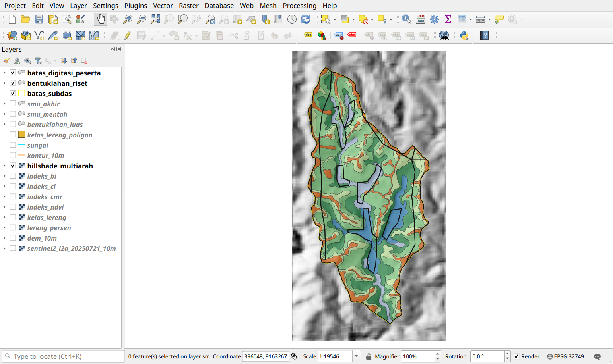

Gambar P2.27 Batas digitasi uji coba (garis hitam) di atas peta bentuklahan riset

Sumber: Tangkapan layar uji coba; peta bentuklahan dari data riset Sub-DAS Bompon

3. Untuk mendapat angka, jalankan **Intersection** antara `bentuklahan_luas` dan `bentuklahan` riset, hitung luasnya, lalu rangkum dengan **Statistics by categories**.

Tabel P2.6 Perbandingan Luas Delineasi Uji Coba dengan Bentuklahan Riset (ha)

| **Delineasi uji coba** | **Interfluve** | **Lereng atas, tengah, bawah** | **Lereng kaki koluvial dan dataran koluvial** | **Jumlah** |
| :-----: | ---: | ---: | ---: | ---: |
| Punggung dan interfluve | 12,80 | 30,77 | 0,00 | 43,57 |
| Lereng perbukitan | 26,59 | 177,51 | 20,51 | 224,61 |
| Kaki lereng dan dataran koluvial | 0,21 | 6,62 | 19,67 | 26,50 |
| Jumlah | 39,60 | 214,90 | 40,18 | 294,68 |

Sumber: Hasil uji coba, tiga satuan dibandingkan dengan padanannya pada enam satuan riset

Sekitar 71% luas berada pada satuan yang sepadan (12,80 + 177,51 + 19,67 = 209,98 ha), tetapi angka itu didominasi oleh lereng perbukitan yang memang luas. Satuan kaki lereng cukup baik: 74% luasnya memang koluvial menurut peta riset, walaupun separuh koluvial riset belum tertangkap. Satuan punggung paling lemah: hanya 29% luasnya yang merupakan interfluve menurut peta riset, dan sebagian besar sisanya adalah lereng. Dari DEM 30 m, puncak yang sempit sulit dipisahkan dari lereng di sebelahnya, dan koridor punggung yang digambar pada uji coba kemungkinan terlalu lebar.

Peta riset juga bukan kebenaran mutlak. Peta itu merupakan hasil survei lain dengan data yang lebih rinci. Yang diuji di lapangan adalah keduanya.

4. Lihat tabel atribut `kelas_lereng` pada peta riset, dan bandingkan kolom `luas_ha` dengan luas dari DEM 30 m. Luas dari DEM dapat dihitung dengan **Zonal histogram** pada `kelas_lereng` Anda dengan zona `batas_subdas`, lalu mengalikan jumlah piksel dengan 0,01 ha.

Tabel P2.7 Luas Kelas Lereng dari DEM 30 m dan dari LiDAR (ha)

| **Kelas lereng** | **Copernicus DEM 30 m** | **Peta riset, dari LiDAR** |
| :---: | ---: | ---: |
| 0–8% | 31,14 | 102,99 |
| 8–15% | 56,93 | 63,14 |
| 15–25% | 109,66 | 74,52 |
| 25–45% | 91,69 | 50,68 |
| >45% | 5,27 | 3,34 |

Sumber: Hasil uji coba dan layer `kelas_lereng`; kelas riset diturunkan dari DTM LiDAR

Perbedaannya mencolok. Peta riset mencatat 103 ha lahan 0–8%, sedangkan DEM global hanya 31 ha. Penjelasan yang mungkin adalah bahwa model medan LiDAR menangkap permukaan tanah termasuk teras dan dasar lembah yang datar, sedangkan Copernicus DEM adalah model permukaan yang memuat tajuk, dan pada 30 m teras seperti itu tidak terekam. Tafsiran ini belum diuji di lapangan. Yang pasti, peta lereng dari data global tidak dapat diperlakukan sebagai pengganti LiDAR, dan akibatnya pada kebun dapat besar jika kelas lereng dipakai untuk menentukan kesesuaian atau konservasi.

## Bahan Diskusi

1. Di mana batas digitasi Anda paling berbeda dari peta riset, dan petunjuk apa yang Anda pakai di tempat itu?
2. Sesudah generalisasi, satuan mana yang hilang? Apakah satuan itu penting bagi pengelolaan?
3. Apa yang berubah jika skala sasaran 1:25.000, dengan MLA 2,5 ha?
4. Di kebun sawit, batas blok dan jalan sangat jelas pada citra. Bagaimana menghindari batas SMU yang hanya mengikuti batas blok?

SMU pada latihan ini tetap hipotesis, sampai diuji dengan pengamatan tanah. Praktik 5 akan menumpangkan peta prediksi tutupan material di atas peta ini, dan pada Tahap 8 praktik tersebut akan terlihat seberapa jauh satuan bentuklahan pada peta SMU benar-benar memisahkan kelas bahan induk.

## Jika Tertinggal

Semua keluaran uji coba tersedia di `data/praktik-2/hasil-contoh/`, termasuk `Praktik_2_selesai.qgz`. Delineasi pada folder itu adalah tafsiran penyusun untuk latihan, tanpa pengamatan lapangan, dan klik digitasinya dijalankan secara otomatis pada alat **Add Polygon Feature** saat uji coba. Peserta yang belum selesai mendigitasi dapat memakai `bentuklahan_luas.gpkg` dari folder tersebut untuk tahap 4.
