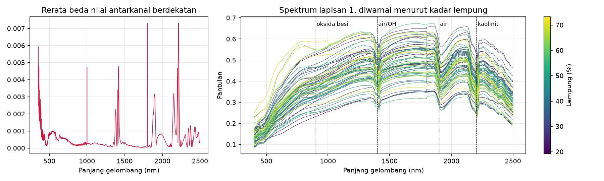
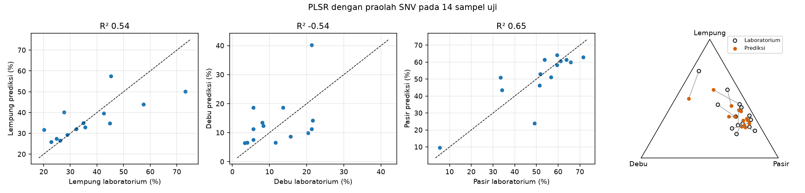
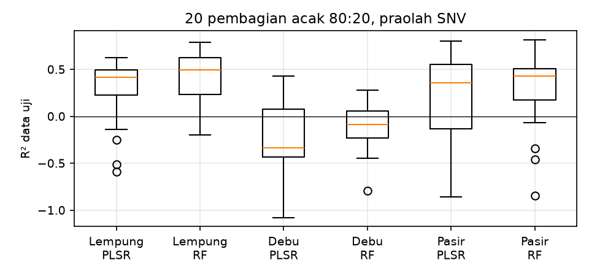
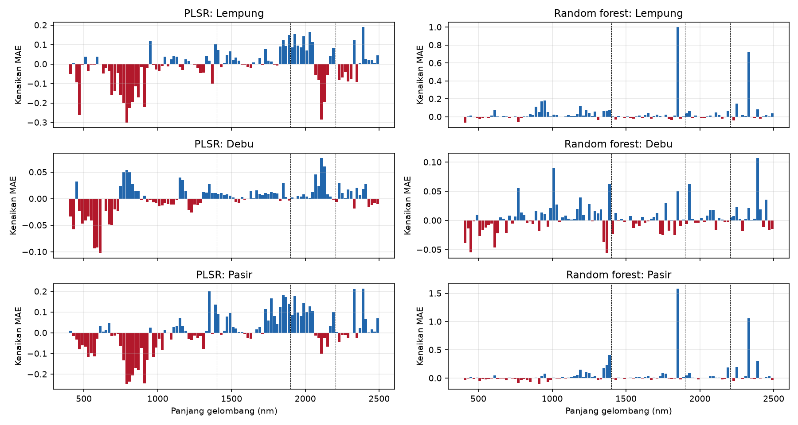

# Praktik 3. Proximal Soil Sensing

*Demonstrasi dan praktik terbimbing:*

Pemandu: Pak Pandu, didampingi Nurarfiyah. Perangkat: ASD FieldSpec 4 dan Jupyter Notebook. Rujukan teori: Modul 7 dan Modul 4.

## Kurikulum Pembelajaran

**Tujuan**

Membekali peserta agar memahami bagaimana spektrum pantulan dari ASD FieldSpec 4 diubah menjadi komposisi tekstur tanah, bagaimana menilai model kalibrasinya secara jujur, dan bagaimana memakai model itu untuk sampel tanah yang belum dianalisis di laboratorium.

**Kompetensi**

Setelah mengikuti praktik ini, peserta memiliki kompetensi dalam:

1. Mengenali prosedur pengukuran spektrum pantulan tanah
2. Membaca spektrum dan fitur serapan
3. Menerapkan praolah SNV, MSC, penghalusan Savitzky–Golay, dan turunan pertama
4. Memodelkan komposisi tekstur dengan transformasi ILR, PLSR, dan *random forest*
5. Membaca ukuran ketelitian per fraksi dan kepentingan wilayah spektrum
6. Memakai model tersimpan untuk sampel tanah baru dan menilai batas keberlakuannya

**Ringkasan Studi**

1. Deskripsi singkat
   - Peserta mengikuti demonstrasi pengukuran dengan ASD FieldSpec 4
   - Peserta membaca spektrum 69 sampel lapisan atas dari pustaka spektral Site Gunung Madu Plantation
   - Peserta melatih model komposisi tekstur dan menilai hasilnya per fraksi
   - Peserta memakai model tersimpan untuk menduga tekstur sampel yang belum dianalisis di laboratorium
2. Hasil belajar
   - Peserta memahami bahwa alat merekam spektrum, sedangkan nilai tanah datang dari model
   - Peserta mampu menilai klaim akurasi model spektroskopi
3. Indikator hasil belajar
   - Notebook berjalan sampai akhir tanpa galat dalam satu sampai dua menit
   - Setiap prediksi tekstur berjumlah 100%
   - Berkas model `model_tekstur_lapisan1.joblib` dan prediksi sampel baru terbentuk di folder `hasil/`
   - Peserta dapat menjelaskan mengapa satu nilai R² dari 14 sampel uji belum cukup untuk menilai model
4. Materi pokok
   - Spektroskopi vis-NIR dan fitur serapan
   - Praolah spektrum
   - Data komposisi dan transformasi ILR
   - PLSR, *random forest*, dan pemilihan model tanpa mengintip data uji
   - Pemakaian model untuk sampel baru dan batas keberlakuannya

## Gambaran Praktik

Ada satu hal yang perlu dipegang sejak awal: spektroradiometer seperti ASD FieldSpec 4 merekam **spektrum pantulan** (*reflectance spectrum*), bukan nilai sifat tanah. Layar alat tidak akan menampilkan kadar lempung atau pasir. Angka-angka itu baru diperoleh setelah spektrum dihubungkan dengan hasil laboratorium melalui model kalibrasi (*calibration model*), seperti pada Gambar 7.4 di Modul 7.

Praktik ini karena itu memiliki dua bagian. Bagian pertama adalah demonstrasi pengukuran oleh Pak Pandu dengan ASD FieldSpec 4. Bagian kedua membawa peserta ke tahap sesudah pengukuran, yaitu mengubah spektrum menjadi tekstur tanah dengan notebook Jupyter. Notebook memakai pustaka spektral (*spectral library*) yang sudah tersedia, karena membuat model tidak mungkin dari beberapa sampel yang diukur saat demonstrasi. Seluruh praktik dirancang untuk satu sesi 60 menit, yaitu sekitar 20 menit demonstrasi, 30 menit notebook, dan 10 menit diskusi. Notebook sendiri hanya memerlukan satu sampai dua menit untuk dijalankan, sehingga sebagian besar waktunya dipakai untuk membaca hasil.

Sasaran notebook adalah tekstur lapisan atas (*topsoil texture*), yaitu persentase lempung (*clay*), debu (*silt*), dan pasir (*sand*). Ketiganya adalah data komposisi (*compositional data*) yang jumlahnya selalu 100%, sehingga prediksinya pun harus berjumlah 100%. Pesan terpenting dari notebook bukan tentang algoritme, melainkan tentang cara menilai. Dengan 69 sampel, perbedaan antara praolah dan antara algoritme ternyata lebih kecil daripada keragaman akibat cara data dibagi. Notebook diakhiri dengan cara memakai model yang sudah jadi untuk sampel tanah yang belum dianalisis di laboratorium, beserta batas keberlakuannya.

## Data yang Dipakai

Tabel P3.1 Berkas Praktik 3

| **Berkas** | **Isi** |
| :------: | :------: |
| `Praktik_3_Spektrum_ke_Sifat_Tanah.ipynb` | Notebook praktik |
| `spektra_visnir_gmp.csv.gz` | Pustaka spektral vis-NIR 350–2.500 nm: satu spektrum untuk setiap 274 sampel dari 71 profil, disertai hasil laboratorium seperti tekstur, pH, C-organik, N total, KTK, dan hara tersedia |
| `spektrum_sampel_baru.csv` | Contoh (*dummy*) berkas spektrum sampel baru, berisi 10 spektrum dari pustaka yang sama tanpa kolom laboratorium |

Sumber: Disiapkan dari berkas `data spectro geo.csv`

Pustaka ini merupakan hasil pengujian sampel tanah dari Site Gunung Madu Plantation (GMP), Lampung, jadi **bukan** data Sub-DAS Bompon. Tanah lapisan atasnya jauh lebih berpasir (rata-rata pasir 51% dan lempung 37%) daripada tanah Bompon (pasir 16% dan lempung 62%). Kode `S3 L1` ditafsirkan sebagai profil S3 lapisan 1. Rentang 350–2.500 nm dan 2.151 kanalnya sama dengan spesifikasi ASD FieldSpec 4. Model pada notebook dilatih dari tanah GMP, sehingga berguna untuk latihan, tetapi untuk tanah dari tempat lain hasilnya hanya pendekatan. Modul 7 menjelaskan alasannya: prediksi dari pustaka yang bukan lokal cenderung bias untuk satu kebun.

Ada tiga catatan tentang data yang dipakai:

1. **Hanya lapisan 1**, yaitu 71 sampel lapisan atas. Lapisan dari profil yang sama saling mirip, sehingga jika semua lapisan dipakai, pembagian acak dapat menempatkan lapisan dari satu profil di data latih sekaligus data uji. Dengan satu sampel per profil, masalah itu tidak muncul.
2. **Sampel tanpa hasil laboratorium**, yaitu S73 L1 dan S45 L1. Keduanya tidak ikut melatih model, sehingga tersisa 69 sampel. Spektrum keduanya, ditambah delapan sampel lapisan 4 yang dipilih acak, disalin ke `spektrum_sampel_baru.csv` sebagai contoh sampel baru pada akhir notebook.
3. **Jumlah fraksi**, yang pada berkas sumber berkisar 100,00–100,10% karena pembulatan. Setiap sampel dinormalisasi agar jumlahnya tepat 100%, dengan perbandingan antarfraksi yang tetap. Berkas sumber tidak mencantumkan satuan, sehingga tekstur dibaca sebagai persen dari besarnya nilai.

## Bagian 1: Demonstrasi Pengukuran

Bagian ini dipandu langsung oleh Pak Pandu dengan ASD FieldSpec 4, yaitu spektroradiometer portabel yang merekam seluruh rentang tampak sampai inframerah gelombang pendek.

Tabel P3.2 Spesifikasi ASD FieldSpec 4

| **Spesifikasi** | **Nilai** |
| :------: | :------: |
| Rentang panjang gelombang | 350–2.500 nm, 2.151 kanal |
| Resolusi spektral VNIR (700 nm) | 3 nm |
| Resolusi spektral SWIR (1.400 dan 2.100 nm) | 6–10 nm |
| Interval sampling | 1,4 nm (VNIR), 1,1 nm (SWIR) |
| Kecepatan | Waktu pindai 100 milidetik, 2 spektrum per detik |
| Detektor | Silikon 512 elemen untuk VNIR (350–1.000 nm); fotodioda InGaAs untuk SWIR 1 (1.000–1.800 nm) dan SWIR 2 (1.800–2.500 nm) |
| Masukan | Serat optik 1,5 m dengan bidang pandang 25° |
| Berat | 5,44 kg |

Sumber: SciAps (2025)

Brosur alat mencantumkan antara lain *contact probe*, *muglight*, *turntable*, dan panel referensi putih (SciAps, 2025). Ada satu hal yang sering disalahpahami pada tabel tersebut. Jumlah 2.151 kanal berarti nilai tersedia setiap 1 nm, tetapi kemampuan alat membedakan fitur ditentukan oleh resolusi spektralnya, yaitu 3 nm di VNIR dan 6–10 nm di SWIR.

Saat mengikuti demonstrasi, perhatikan hal-hal berikut:

1. **Komponen alat**, yaitu spektrometer, serat optik, sumber cahaya, dan wadah atau pemegang sampel.
2. **Pengukuran referensi**, yaitu bagaimana panel putih dipakai sebelum mengukur sampel, dan seberapa sering langkah ini diulang.
3. **Penyiapan sampel**, yaitu apakah tanah dikeringkan, dihaluskan, dan diayak, karena Modul 7 menunjukkan bahwa kondisi sampel memengaruhi spektrum.
4. **Ulangan**, yaitu berapa kali satu sampel dipindai dan seberapa mirip hasilnya. Pustaka pada notebook hanya memuat satu spektrum untuk setiap sampel, sehingga keragaman ini hanya dapat dilihat pada demonstrasi.

Keempat hal tersebut menentukan apakah spektrum dari hari yang berbeda, atau dari kebun yang berbeda, masih dapat dibandingkan. Pada giliran mencoba alat, bandingkan spektrum dua sampel yang warnanya jelas berbeda, lalu cari perbedaannya pada bentuk kurva.

## Bagian 2: Membuka Notebook

1. Buka JupyterLab atau Google Colab seperti pada Modul Persiapan.
2. Masuk ke folder `data/praktik-3/`, lalu buka `Praktik_3_Spektrum_ke_Sifat_Tanah.ipynb`.
3. Jalankan sel satu per satu dengan **Shift + Enter**, dan baca keluarannya sebelum lanjut. Pada uji coba, seluruh notebook selesai dalam 93 detik.

Notebook sudah menyimpan keluaran hasil uji coba sebagai pembanding. Menjalankan ulang sel akan menimpanya, dan gambar serta tabel Anda tersimpan di folder `hasil/`.

## Bagian 3: Membaca Spektrum

Jalankan bagian 1 sampai 4 pada notebook.

Keluaran pertama menunjukkan 274 sampel dari 71 profil, dengan 71 sampel pada lapisan 1. Sebanyak 69 di antaranya memiliki hasil tekstur. Sel berikutnya memeriksa derau (*noise*). Di bawah 400 nm, beda nilai antarkanal yang berdekatan rata-rata 0,00236, atau empat kali lipat daripada 0,00054 pada 400–2.500 nm. Nilai yang melompat-lompat itu menandakan derau, sehingga pemodelan hanya memakai 400–2.500 nm. Undakan kecil di 1.000 nm dan 1.800 nm bukan sifat tanah, melainkan batas antara tiga detektor alat (SciAps, 2025).

Gambar P3.1 Derau antarkanal (kiri) dan spektrum 69 sampel lapisan 1 yang diwarnai menurut kadar lempung (kanan)

Sumber: Hasil uji coba

Lembah pada spektrum disebut fitur serapan (*absorption feature*). Lembah di sekitar 1.400 dan 1.900 nm berasal dari air dan gugus hidroksil, sedangkan lembah sempit di sekitar 2.205 nm berasal dari kaolinit (Molin & Tavares, 2019). Notebook kemudian mengukur kedalaman serapan (*absorption depth*) kaolinit itu terhadap garis kontinum (*continuum*) sederhana dan membandingkannya dengan kadar lempung.

Gambar P3.2 Kedalaman serapan 2.205 nm terhadap kadar lempung

Sumber: Hasil uji coba

Kedalaman serapan di 2.205 nm berkorelasi r = 0,40 dengan kadar lempung. Hubungan itu nyata, tetapi sebarannya lebar, sehingga satu fitur tidak cukup untuk menduga tekstur. Kedalaman serapan bergantung pada jenis mineral lempung, dan spektrum dipengaruhi banyak hal sekaligus. Inilah alasan model memakai seluruh spektrum, bukan satu panjang gelombang.

## Bagian 4: Praolah dan Data Komposisi

Jalankan bagian 5 sampai 7.

Data dibagi sekali secara acak (*random train-test split*) menjadi 55 sampel latih (*training set*) dan 14 sampel uji (*test set*). Pembagian yang sama dipakai untuk semua praolah dan algoritme, dan data uji tidak disentuh sampai penilaian akhir. Lima praolah (*preprocessing*) dicoba:

1. **RAW**, yaitu pantulan apa adanya.
2. **SNV** (*Standard Normal Variate*), yaitu setiap spektrum dikurangi rata-ratanya lalu dibagi simpangan bakunya, sehingga kurva yang berbeda kecerahan dirapatkan (Barnes et al., 1989).
3. **MSC** (*Multiplicative Scatter Correction*), yaitu setiap spektrum diregresikan terhadap spektrum acuan, lalu dikoreksi dengan potongan dan kemiringannya (Geladi et al., 1985). Spektrum acuan dihitung dari data latih saja, agar tidak ada informasi dari data uji yang ikut masuk.
4. **SG**, yaitu penghalusan Savitzky–Golay (*Savitzky–Golay smoothing*) dengan jendela 11 kanal (Savitzky & Golay, 1964).
5. **SG-FD**, yaitu turunan pertama (*first derivative*) Savitzky–Golay, yang menonjolkan posisi fitur serapan.

Gambar P3.3 Contoh spektrum lapisan 1 dengan lima praolah

Sumber: Hasil uji coba

Bagian 7 pada notebook menjelaskan mengapa tekstur perlu diperlakukan sebagai komposisi. Jika lempung, debu, dan pasir dimodelkan dengan tiga model regresi kuadrat terkecil parsial (*Partial Least Squares Regression*, PLSR) yang terpisah, jumlah prediksinya pada 14 sampel uji berkisar 98,7–101,6%. Selisih itu kecil pada data ini, tetapi tidak ada yang menjaminnya. Pada tanah dengan salah satu fraksi yang sangat kecil, prediksi terpisah dapat bernilai negatif atau berjumlah jauh dari 100%.

Transformasi log-rasio isometrik (*isometric log-ratio*, ILR) mengatasi persoalan itu (Egozcue et al., 2003). Tiga persentase diubah menjadi dua koordinat log-rasio, yaitu ilr₁ = √(1/2) · ln(lempung / debu) dan ilr₂ = √(2/3) · ln(√(lempung · debu) / pasir). Kedua koordinat itu bebas bernilai berapa saja, sehingga dapat dimodelkan seperti peubah biasa. Model memprediksi kedua koordinat, lalu hasilnya dikembalikan menjadi persentase. Hasil kebalikan ILR selalu positif dan selalu berjumlah 100%, dan notebook memeriksa bahwa transformasi bolak-balik mengembalikan data asli dengan tepat.

## Bagian 5: Membandingkan dan Memilih Model

Jalankan bagian 8 dan 9.

Dua algoritme dilatih pada setiap praolah. PLSR meringkas ribuan kanal menjadi beberapa komponen laten (*latent variables*; Wold et al., 2001), dan jumlah komponennya dipilih dengan validasi silang (*cross-validation*) pada data latih. *Random forest* menggabungkan banyak pohon keputusan (*decision trees*; Breiman, 2001) dengan pengaturan yang sama untuk semua praolah. Untuk setiap kombinasi, notebook menghitung dua hal. Galat akar rata-rata kuadrat (*root mean square error*, RMSE) validasi silang dihitung hanya dari data latih, dengan 5 lipatan (*fold*) yang diulang 3 kali, dan dipakai untuk memilih kombinasi. Ukuran pada data uji dihitung terpisah untuk setiap fraksi.

Tabel P3.3 Hasil Lima Praolah dan Dua Algoritme

| **Praolah** | **Algoritme** | **R² lempung** | **R² debu** | **R² pasir** | **RMSE lempung** | **RMSE debu** | **RMSE pasir** | **Komponen PLSR** | **RMSE validasi silang** |
| :---: | :---: | ---: | ---: | ---: | ---: | ---: | ---: | ---: | ---: |
| RAW | PLSR | 0,60 | −0,36 | 0,44 | 8,97 | 7,89 | 12,22 | 2 | 8,44 |
| RAW | *Random forest* | 0,21 | −0,14 | 0,21 | 12,61 | 7,23 | 14,57 | – | 9,75 |
| SNV | PLSR | 0,54 | −0,54 | 0,65 | 9,58 | 8,42 | 9,64 | 6 | 8,36 |
| SNV | *Random forest* | 0,70 | 0,03 | 0,59 | 7,73 | 6,68 | 10,52 | – | 8,63 |
| MSC | PLSR | 0,68 | 0,18 | 0,76 | 8,03 | 6,14 | 8,09 | 5 | 8,47 |
| MSC | *Random forest* | 0,69 | 0,05 | 0,57 | 7,92 | 6,61 | 10,77 | – | 8,53 |
| SG | PLSR | 0,60 | −0,36 | 0,44 | 8,97 | 7,89 | 12,22 | 2 | 8,44 |
| SG | *Random forest* | 0,22 | −0,14 | 0,22 | 12,52 | 7,23 | 14,51 | – | 9,72 |
| SG-FD | PLSR | 0,45 | −0,17 | 0,29 | 10,55 | 7,34 | 13,85 | 3 | 8,42 |
| SG-FD | *Random forest* | 0,54 | 0,13 | 0,59 | 9,58 | 6,33 | 10,47 | – | 8,86 |

Sumber: Hasil uji coba; R² dan RMSE (poin persen) dari 14 sampel uji, RMSE validasi silang dari 55 sampel latih

Bacalah tabel ini per kolom. Pertama, debu hampir selalu gagal diduga, dengan R² di bawah atau sedikit di atas nol. Kadarnya hanya 3–24% dan keragamannya kecil, sedangkan lempung dan pasir lebih mudah diduga. Kedua, penghalusan SG memberi hasil yang hampir sama dengan pantulan mentah, karena jendela 11 kanal pada spektrum berinterval 1 nm hampir tidak mengubah bentuk kurva. Ketiga, *random forest* sangat bergantung pada praolah, sedangkan PLSR lebih stabil. Keempat, urutan menurut data uji tidak sama dengan urutan menurut validasi silang. MSC dengan PLSR tampak paling baik pada data uji, tetapi hanya berada di urutan kelima menurut validasi silang.

Godaannya adalah memilih kombinasi dengan R² uji tertinggi, lalu melaporkan R² itu. Cara itu curang, karena informasi data uji ikut bocor ke dalam pemilihan model (*data leakage*). Notebook memilih dari validasi silang data latih, dan pilihan jatuh pada SNV dengan PLSR 6 komponen. Lima kombinasi teratas hanya berselisih 0,11 poin persen, yaitu 8,36–8,47, sehingga selisih sekecil itu tidak perlu dibaca sebagai keunggulan SNV atau PLSR.

Gambar P3.4 RMSE terhadap jumlah komponen PLSR pada praolah SNV, dari validasi silang data latih dan dari data uji

Sumber: Hasil uji coba; garis data uji hanya untuk peragaan

Godaan yang sama terlihat pada jumlah komponen di Gambar P3.4. Validasi silang memilih 6 komponen, dengan RMSE uji 9,23 poin persen. Garis data uji mencapai minimum pada 9 komponen dengan RMSE 7,75. Jika 9 komponen dipilih karena garis itu, angka uji akan tampak lebih baik, tetapi tidak lagi jujur, karena model sudah disesuaikan dengan 14 sampel yang seharusnya mewakili sampel baru.

Tabel P3.4 Ketelitian Model Terpilih pada Data Uji

| **Fraksi** | **R** | **R²** | **RMSE (%)** | **nRMSE (%)** | **MAE (%)** | **MAPE (%)** |
| :---: | ---: | ---: | ---: | ---: | ---: | ---: |
| Lempung | 0,75 | 0,54 | 9,58 | 18,08 | 6,78 | 17,72 |
| Debu | 0,42 | −0,54 | 8,42 | 45,84 | 7,13 | 70,67 |
| Pasir | 0,82 | 0,65 | 9,64 | 14,61 | 7,07 | 19,89 |

Sumber: Hasil uji coba, SNV dan PLSR 6 komponen pada 14 sampel uji

Ukuran pada Tabel P3.4 juga menunjukkan mengapa satu ukuran tidak cukup. R adalah koefisien korelasi Pearson (*Pearson correlation coefficient*), yang mengukur seberapa searah prediksi dengan nilai laboratorium. R² adalah koefisien determinasi (*coefficient of determination*), yang mengukur kedekatan prediksi dengan garis 1:1 dan sama dengan MEC pada Modul 8. RMSE dan galat absolut rata-rata (*mean absolute error*, MAE) menyatakan besar galat dalam poin persen, nRMSE (*normalized RMSE*) adalah RMSE yang dibagi jangkauan nilai uji, sedangkan MAPE (*mean absolute percentage error*) adalah rata-rata galat relatif. Debu memiliki korelasi positif (R = 0,42), tetapi R²-nya negatif. Prediksi yang searah tetapi meleset jauh tetap buruk. MAPE debu yang mencapai 71% juga dibesarkan oleh kadarnya yang kecil, karena galat 7 poin persen pada kadar 10% adalah galat relatif 70%.

## Bagian 6: Membaca Hasil

Jalankan bagian 10 sampai 12.

Gambar P3.5 Prediksi terhadap nilai laboratorium untuk setiap fraksi dan pada segitiga tekstur

Sumber: Hasil uji coba, SNV dan PLSR 6 komponen pada 14 sampel uji

Pada segitiga tekstur (*soil texture triangle*), titik kosong adalah nilai laboratorium, titik isi adalah prediksi, dan garis menghubungkan keduanya. Semua prediksi berada di dalam segitiga dan berjumlah tepat 100%, berkat transformasi ILR. Prediksi cenderung tertarik ke tengah sebaran, sehingga sampel yang sangat berlempung atau sangat berpasir diduga kurang ekstrem daripada aslinya.

Bagian 11 mengulang pembagian 80:20 sebanyak 20 kali dengan praolah SNV, untuk PLSR dan *random forest*.

Gambar P3.6 Sebaran R² data uji dari 20 pembagian acak

Sumber: Hasil uji coba

Tabel P3.5 R² dari 20 Pembagian Acak dengan Praolah SNV

| **Fraksi** | **Algoritme** | **Terendah** | **Median** | **Tertinggi** |
| :---: | :---: | ---: | ---: | ---: |
| Lempung | PLSR | −0,59 | 0,42 | 0,62 |
| Lempung | *Random forest* | −0,20 | 0,49 | 0,79 |
| Debu | PLSR | −1,08 | −0,34 | 0,43 |
| Debu | *Random forest* | −0,79 | −0,09 | 0,28 |
| Pasir | PLSR | −0,86 | 0,36 | 0,80 |
| Pasir | *Random forest* | −0,85 | 0,43 | 0,82 |

Sumber: Hasil uji coba

Untuk lempung, R² dari model yang sama berkisar dari −0,59 sampai 0,62 hanya karena sampel ujinya berbeda. Nilai 0,54 pada Tabel P3.4 berada di dalam rentang itu, tetapi pembagian lain dapat saja memberi kesan yang sangat berbeda. Median *random forest* bahkan sedikit lebih tinggi daripada PLSR, padahal PLSR yang terpilih pada satu pembagian tadi. Dengan 69 sampel, data ini tidak cukup untuk menyatakan bahwa salah satu algoritme lebih baik. Jika sebuah vendor melaporkan akurasi model spektroskopi dari satu pembagian dengan belasan sampel uji, tanyakan berapa sampel ujinya dan bagaimana hasilnya bila pembagian diulang.

Bagian 12 menghitung kepentingan wilayah spektrum dengan permutasi (*permutation importance*) untuk praolah SG-FD, karena turunan pertama menonjolkan posisi fitur serapan sehingga wilayah yang penting lebih mudah dikaitkan dengan fitur tertentu. Nilai satu jendela 20 nm (*spectral window*) pada data uji diacak, lalu diukur kenaikan MAE setiap fraksi. Yang diacak adalah jendela, bukan kanal tunggal, karena kanal yang bersebelahan hampir identik. Jika hanya satu kanal yang diacak, informasinya masih tersedia di kanal tetangganya, sehingga kepentingannya tampak hampir nol. Dengan 105 jendela dan 5 ulangan, perhitungan ini selesai dalam kurang dari setengah menit.

Gambar P3.7 Kenaikan MAE saat setiap jendela 20 nm diacak, untuk PLSR dan *random forest* dengan praolah SG-FD

Sumber: Hasil uji coba; garis putus-putus menandai 1.400, 1.900, dan 2.205 nm

Kedua algoritme memakai spektrum dengan cara yang berbeda. PLSR memakai wilayah yang lebar, terutama 1.850–2.050 nm di sekitar serapan air 1.900 nm dan 2.320–2.400 nm, dengan kenaikan MAE paling besar sekitar 0,2 poin persen. *Random forest* bertumpu pada dua jendela sempit, yaitu 1.840–1.860 nm dan 2.320–2.340 nm. Mengacak jendela pertama menaikkan MAE lempung sebesar 1,0 poin persen dan MAE pasir sebesar 1,6 poin persen. Jendela pertama berada di tepi serapan air 1.900 nm. Wilayah 2.320–2.400 nm tidak termasuk fitur serapan yang dibahas Modul 7, sehingga kaitannya dengan penyusun tanah tertentu perlu diperiksa lebih lanjut. Menariknya, serapan kaolinit di 2.205 nm yang berkorelasi dengan lempung tidak menonjol pada kedua model. Hasil dari 14 sampel uji ini masih kasar, sehingga yang patut diperhatikan adalah wilayah yang konsisten, bukan urutan jendela satu per satu.

## Bagian 7: Memakai Model untuk Sampel Tanah Baru

Jalankan bagian 13. Inilah yang terjadi setelah demonstrasi alat. Setelah model jadi, sampel tanah baru cukup diukur spektrumnya tanpa dianalisis di laboratorium. Alurnya terdiri atas lima langkah:

1. **Latih model akhir dan simpan**, yaitu model dilatih ulang dengan seluruh 69 sampel memakai kombinasi terpilih, SNV dan PLSR 6 komponen, lalu disimpan ke `hasil/model_tekstur_lapisan1.joblib`. Berkas itu memuat semua yang diperlukan untuk memakai model, yaitu nama praolah, spektrum acuan MSC, daftar panjang gelombang, dan ringkasan sebaran spektrum pustaka.
2. **Siapkan spektrum baru**, yaitu berkas CSV dengan kolom `sampel` dan kolom pantulan `w350` sampai `w2500`, satu baris untuk setiap sampel. Pantulan dinyatakan sebagai pecahan 0–1 pada setiap 1 nm, seperti pada pustaka. Model sendiri hanya memakai kolom 400–2.500 nm.
3. **Prediksi**, yaitu spektrum baru diberi praolah yang **sama persis** dengan data latih, dimasukkan ke model, lalu hasilnya dikembalikan dari koordinat ILR menjadi persentase. Fungsi `prediksi_tekstur` pada notebook mengerjakan langkah ini dan menghentikan proses bila ada kolom panjang gelombang yang hilang.
4. **Periksa kemiripan dengan pustaka**, karena model hanya dapat dipercaya untuk spektrum yang mirip dengan spektrum yang dipakai melatihnya. Kemiripan diukur dengan jarak Mahalanobis (*Mahalanobis distance*) pada lima komponen utama (*principal component analysis*, PCA) spektrum pustaka, yang meringkas 97,7% keragamannya. Jarak itu dibagi jarak sampel pustaka yang terjauh, sehingga nilai di atas 1 berarti spektrum baru lebih asing daripada sampel pustaka mana pun.
5. **Uji sebagian sampel di laboratorium**, karena kemiripan spektrum tidak menjamin prediksi benar.

Gagasan langkah 4 sama dengan wilayah keberlakuan model pada Modul 8, yaitu prediksi hanya dapat dipercaya di wilayah yang menyerupai data latih. Bedanya, wilayah itu di sini berada dalam ruang spektrum, bukan ruang kovariat.

Berkas `spektrum_sampel_baru.csv` adalah contoh (*dummy*) berkas spektrum sampel baru. Isinya 10 spektrum asli dari pustaka yang sama tanpa kolom laboratorium, yaitu S73 L1 dan S45 L1 yang memang tidak dianalisis, ditambah delapan sampel lapisan 4 yang tidak dipakai melatih model. Untuk sampel Anda sendiri, cukup ganti nama berkas pada baris `pd.read_csv('spektrum_sampel_baru.csv')`. Model tersimpan dapat dipakai lagi di lain waktu tanpa dilatih ulang, yaitu dengan menjalankan bagian 1 notebook, sel fungsi praolah pada bagian 6, sel fungsi ILR pada bagian 7, lalu sel `prediksi_tekstur`.

Tabel P3.6 Prediksi Tekstur Sampel pada Berkas Contoh

| **Sampel** | **Lempung (%)** | **Debu (%)** | **Pasir (%)** | **Jarak ke pustaka** | **Mirip pustaka** |
| :---: | ---: | ---: | ---: | ---: | :---: |
| S73 L1 | 23,9 | 11,9 | 64,2 | 0,44 | ya |
| S45 L1 | 25,1 | 9,4 | 65,5 | 0,39 | ya |
| S5 L4 | 56,0 | 10,9 | 33,1 | 0,69 | ya |
| S15 L4 | 66,3 | 14,8 | 18,9 | 0,58 | ya |
| S28 L4 | 60,3 | 7,9 | 31,8 | 0,67 | ya |
| S33 L4 | 53,6 | 10,9 | 35,6 | 0,48 | ya |
| S49 L4 | 64,0 | 23,0 | 13,0 | 0,92 | ya |
| S51 L4 | 45,5 | 6,3 | 48,2 | 0,50 | ya |
| S53 L4 | 40,5 | 4,4 | 55,1 | 0,54 | ya |
| S61 L4 | 56,4 | 24,7 | 18,9 | 0,59 | ya |

Sumber: Hasil uji coba, SNV dan PLSR 6 komponen; tersimpan di `prediksi_sampel_baru.csv`

Kesepuluh sampel dinilai mirip dengan pustaka, dengan jarak 0,39–0,92. Prediksi untuk kedua sampel lapisan 1 tidak dapat diperiksa, dan galatnya kira-kira sebesar RMSE pada Tabel P3.4, yaitu sekitar 10 poin persen untuk lempung dan pasir. Delapan sampel lapisan 4 berbeda keadaannya, karena pustaka sebenarnya memiliki hasil laboratorium untuk sampel-sampel itu, demikian pula untuk semua sampel lapisan 2 sampai 4. Sel terakhir notebook memanfaatkan keadaan ini untuk menguji seberapa jauh model lapisan 1 berlaku bagi tanah lain, dengan memperlakukan semua sampel lapisan bawah sebagai sampel baru.

Tabel P3.7 Ketelitian Model Lapisan 1 pada Sampel Lapisan 2 sampai 4

| **Lapisan** | **Sampel** | **Mirip pustaka (%)** | **RMSE lempung** | **Bias lempung** | **RMSE debu** | **Bias debu** | **RMSE pasir** | **Bias pasir** |
| :---: | ---: | ---: | ---: | ---: | ---: | ---: | ---: | ---: |
| 2 | 69 | 100,0 | 6,0 | 0,2 | 4,3 | 0,4 | 7,6 | −0,6 |
| 3 | 64 | 95,3 | 7,9 | 2,0 | 4,8 | 0,0 | 9,2 | −2,0 |
| 4 | 60 | 80,0 | 13,7 | 6,7 | 5,9 | 2,9 | 17,2 | −9,5 |

Sumber: Hasil uji coba; RMSE dan bias dalam poin persen, dengan bias positif berarti prediksi terlalu tinggi; tersimpan di `uji_lapisan_bawah.csv`

Lapisan 2 tampak cukup baik, bahkan lebih baik daripada data uji lapisan 1 pada Tabel P3.4, karena lapisan 2 berasal dari profil yang lapisan 1-nya ikut melatih model. Pada lapisan yang lebih dalam, galat dan biasnya membesar. Pada lapisan 4, lempung rata-rata diduga 6,7 poin persen terlalu tinggi dan pasir 9,5 poin persen terlalu rendah, padahal 80% spektrumnya dinilai mirip dengan pustaka. Kedelapan sampel lapisan 4 pada berkas contoh pun lolos pemeriksaan kemiripan. Jadi, pemeriksaan kemiripan membantu menyaring spektrum yang asing, tetapi tidak menjamin prediksi benar.

Karena itu, setiap kali model dipakai untuk tanah dari kebun atau kedalaman lain, kirim sebagian sampel ke laboratorium dan bandingkan hasilnya dengan prediksi. Bila prediksinya bias, tambahkan sampel setempat ke data kalibrasi, lalu latih ulang modelnya. Modul 7 menyebut cara ini *spiking*, dan pendekatan rs-local menunjukkan bahwa 12–20 sampel lokal yang dipadukan dengan sampel terpilih dari pustaka besar sudah dapat meningkatkan ketelitian dan kekokohan prediksi (England & Viscarra Rossel, 2018). Spektrum hasil demonstrasi dapat dimasukkan dengan cara yang sama, tetapi hasilnya tetap pendekatan, karena model belajar dari tanah GMP.

**Titik periksa.** Notebook berjalan sampai bagian 13 tanpa galat, dan folder `hasil/` berisi gambar serta berkas `metrik_per_fraksi.csv`, `kepentingan_jendela_top10.csv`, `model_tekstur_lapisan1.joblib`, `prediksi_sampel_baru.csv`, dan `uji_lapisan_bawah.csv`. Angkanya seharusnya sama dengan tabel di atas.

## Jembatan ke Praktik 5

Demonstrasi tadi menghasilkan spektrum. Notebook menunjukkan bagaimana spektrum menjadi tekstur tanah. Pada Praktik 5, logika yang sama, yaitu menghubungkan pengamatan dengan data pendukung melalui model lalu menilainya secara jujur, dipakai untuk sasaran yang berbeda, yaitu kelas tutupan material. Masukannya bukan spektrum melainkan kovariat lingkungan, dan keluarannya bukan nilai satu sampel melainkan peta kelas. Data sensor proksimal yang rapat dapat masuk ke alur itu, baik sebagai data sasaran tambahan maupun sebagai kovariat lokal, sebagaimana dibahas dalam Modul 7 dan Tabel 8.1.

## Jika Tertinggal

Notebook pada folder ini sudah memuat keluaran uji coba, sehingga dapat dibaca tanpa dijalankan. Gambar dan tabelnya juga tersedia di `data/praktik-3/hasil-contoh/`.

## Rujukan Tambahan

Egozcue, J. J., Pawlowsky-Glahn, V., Mateu-Figueras, G., & Barceló-Vidal, C. (2003). Isometric logratio transformations for compositional data analysis. *Mathematical Geology*, *35*(3), 279–300.

Geladi, P., MacDougall, D., & Martens, H. (1985). Linearization and scatter-correction for near-infrared reflectance spectra of meat. *Applied Spectroscopy*, *39*(3), 491–500.

SciAps. (2025). *ASD FieldSpec 4: The industry-leading portable device for field spectroscopy* [Brosur]. Salinan: `Source/Proximal Sensing/`.

Rujukan lain mengikuti daftar pustaka modul teori.
