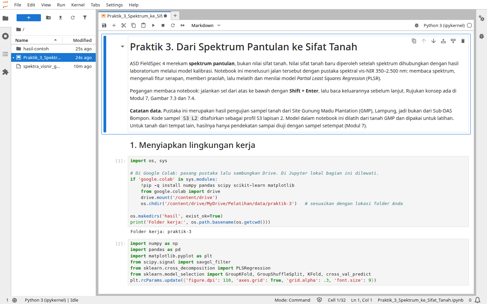
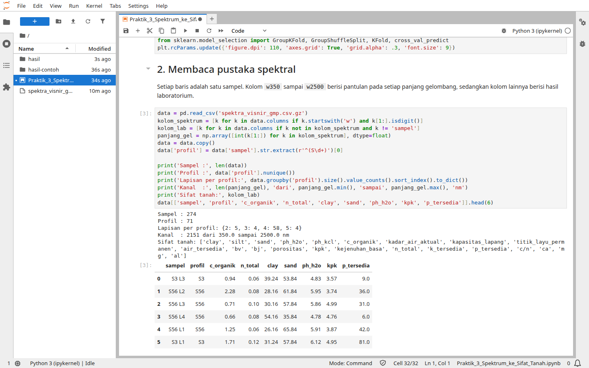
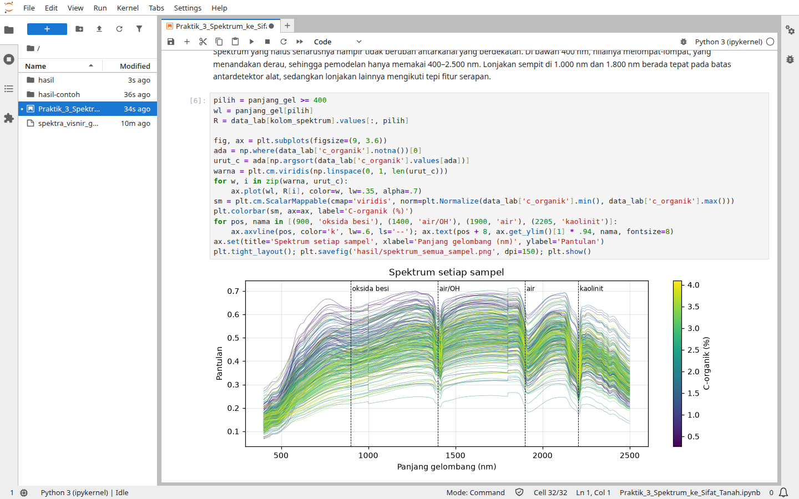
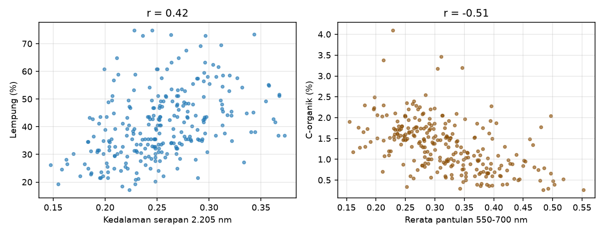
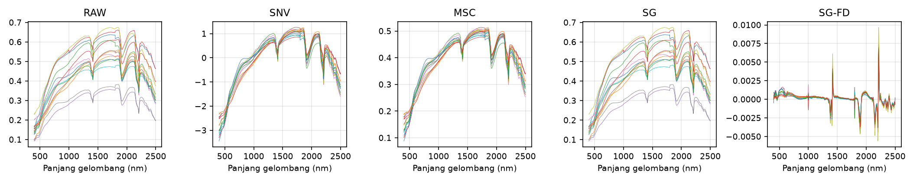
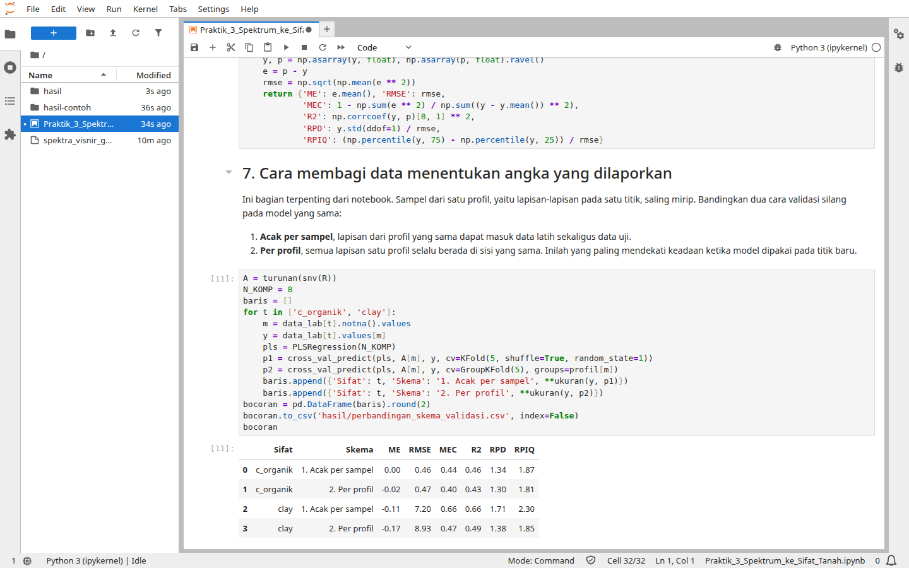
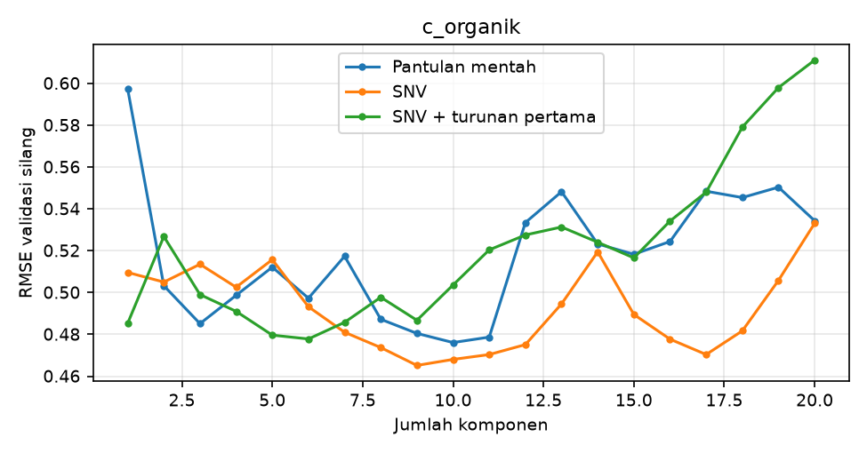
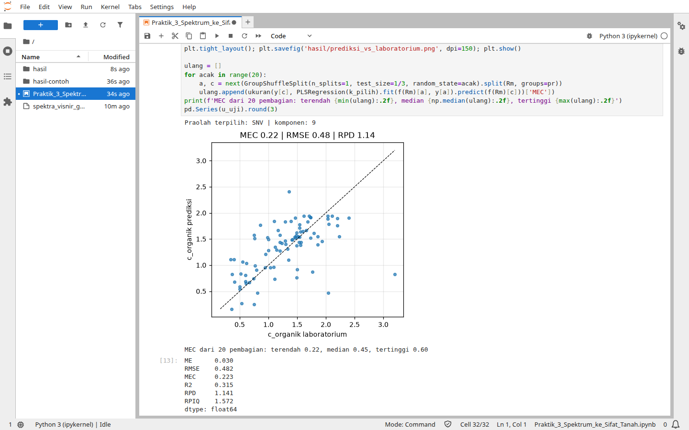
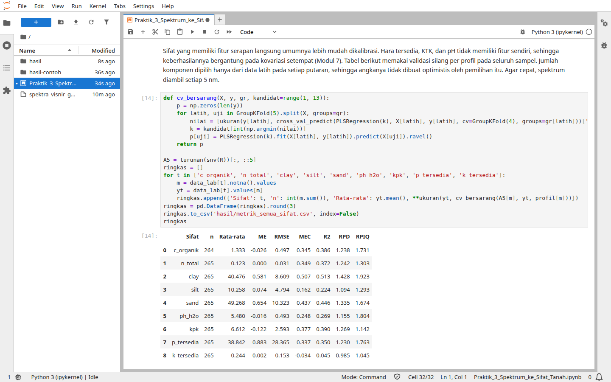
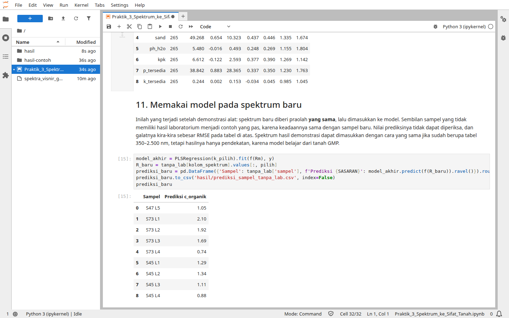

# Praktik 3. Proximal Soil Sensing

*Demonstrasi dan praktik terbimbing:*

Pemandu: Pak Pandu, didampingi Nurarfiyah. Perangkat: ASD FieldSpec 4 dan Jupyter Notebook. Rujukan teori: Modul 7 dan Modul 4.

## Kurikulum Pembelajaran

**Tujuan**

Membekali peserta agar memahami bagaimana spektrum pantulan dari ASD FieldSpec 4 diubah menjadi nilai sifat tanah, dan bagaimana menilai model kalibrasinya.

**Kompetensi**

Setelah mengikuti praktik ini, peserta memiliki kompetensi dalam:

1. Mengenali prosedur pengukuran spektrum pantulan tanah
2. Membaca spektrum dan fitur serapan
3. Menerapkan praolah SNV dan turunan pertama
4. Melatih model PLSR dan menilainya per profil
5. Membaca RMSE, MEC, RPD, dan RPIQ

**Ringkasan Studi**

1. Deskripsi singkat
   - Peserta mengikuti demonstrasi pengukuran dengan ASD FieldSpec 4
   - Peserta membaca pustaka spektral sampel tanah Site Gunung Madu Plantation
   - Peserta melatih model C-organik dan membandingkan cara membagi data
2. Hasil belajar
   - Peserta memahami bahwa alat merekam spektrum, sedangkan nilai tanah datang dari model
   - Peserta mampu menilai klaim akurasi model spektroskopi
3. Indikator hasil belajar
   - Notebook berjalan sampai akhir tanpa galat
   - Peserta dapat menjelaskan selisih hasil validasi acak dan validasi per profil
4. Materi pokok
   - Spektroskopi vis-NIR dan fitur serapan
   - Praolah spektrum
   - Kalibrasi PLSR dan pustaka spektral
   - Pembagian data dan ukuran ketelitian

## Gambaran Praktik

Ada satu hal yang perlu dipegang sejak awal: spektroradiometer seperti ASD FieldSpec 4 merekam **spektrum pantulan**, bukan nilai sifat tanah. Layar alat tidak akan menampilkan kadar karbon organik atau lempung. Angka-angka itu baru diperoleh setelah spektrum dihubungkan dengan hasil laboratorium melalui model kalibrasi, seperti pada Gambar 7.4 di Modul 7.

Praktik ini karena itu memiliki dua bagian. Bagian pertama adalah demonstrasi pengukuran oleh Pak Pandu dengan ASD FieldSpec 4. Bagian kedua membawa peserta ke tahap sesudah pengukuran, yaitu mengubah spektrum menjadi sifat tanah dengan notebook Jupyter. Notebook memakai pustaka spektral yang sudah tersedia, karena membuat model tidak mungkin dari beberapa sampel yang diukur saat demonstrasi.

Pesan terpenting dari notebook bukan tentang algoritme, melainkan tentang cara menilai. Data yang sama dan model yang sama dapat tampak jauh lebih baik hanya karena datanya dibagi secara keliru.

## Data yang Dipakai

Tabel P3.1 Berkas Praktik 3

| **Berkas** | **Isi** |
| :------: | :------: |
| `Praktik_3_Spektrum_ke_Sifat_Tanah.ipynb` | Notebook praktik |
| `spektra_visnir_gmp.csv.gz` | Pustaka spektral vis-NIR 350–2.500 nm: satu spektrum untuk setiap 274 sampel dari 71 profil, disertai hasil laboratorium seperti tekstur, pH, C-organik, N total, KTK, dan hara tersedia |

Sumber: Disiapkan dari berkas `data spectro geo.csv`

Pustaka ini merupakan hasil pengujian sampel tanah dari Site Gunung Madu Plantation (GMP), Lampung, jadi **bukan** data Sub-DAS Bompon. Tanahnya memang jauh lebih berpasir (rata-rata pasir 49% dan lempung 40%) daripada tanah Bompon (pasir 16% dan lempung 62%). Kode `S3 L2` ditafsirkan sebagai profil S3 lapisan 2. Rentang 350–2.500 nm dan 2.151 kanalnya sama dengan spesifikasi ASD FieldSpec 4. Model pada notebook dilatih dari tanah GMP, sehingga berguna untuk latihan, tetapi untuk tanah dari tempat lain hasilnya hanya pendekatan. Modul 7 menjelaskan alasannya: prediksi dari pustaka yang bukan lokal cenderung bias untuk satu kebun.

Ada tiga catatan tentang isi tabelnya, dan dua yang pertama diperiksa di awal notebook:

1. **Sampel tanpa hasil laboratorium**, yaitu S47 L5, empat lapisan S73, dan empat lapisan S45. Kesembilan sampel ini tidak ikut melatih model, sehingga tersisa 265 sampel dari 69 profil. Sampel tersebut dipakai pada akhir notebook sebagai contoh sampel baru.
2. **Nilai yang mustahil**, yaitu C-organik S4 L3 yang tercatat 0, padahal N totalnya 0,11%. Nilai itu dikosongkan, sehingga C-organik tersedia pada 264 sampel.
3. **Satuan**, karena berkas sumber tidak mencantumkannya. Tekstur, C-organik, dan N total dibaca sebagai persen dari besarnya nilai, sedangkan KTK (kolom `kpk`), P tersedia, dan K tersedia ditampilkan tanpa satuan.

## Bagian 1: Demonstrasi Pengukuran

Bagian ini dipandu langsung oleh Pak Pandu dengan ASD FieldSpec 4, yaitu spektroradiometer portabel yang merekam seluruh rentang tampak sampai inframerah gelombang pendek.

Tabel P3.2 Spesifikasi ASD FieldSpec 4

| **Spesifikasi** | **Nilai** |
| :------: | :------: |
| Rentang panjang gelombang | 350–2.500 nm, 2.151 kanal |
| Resolusi spektral VNIR (700 nm) | 3 nm |
| Resolusi spektral SWIR (1.400 dan 2.100 nm) | 6–10 nm |
| Interval sampling | 1,4 nm (VNIR), 1,1 nm (SWIR) |
| Kecepatan | Waktu pindai 100 milidetik, 2 spektrum per detik |
| Detektor | Silikon 512 elemen untuk VNIR (350–1.000 nm); fotodioda InGaAs untuk SWIR 1 (1.000–1.800 nm) dan SWIR 2 (1.800–2.500 nm) |
| Masukan | Serat optik 1,5 m dengan bidang pandang 25° |
| Berat | 5,44 kg |

Sumber: SciAps (2025)

Brosur alat mencantumkan antara lain *contact probe*, *muglight*, *turntable*, dan panel referensi putih (SciAps, 2025). Ada satu hal yang sering disalahpahami pada tabel tersebut. Jumlah 2.151 kanal berarti nilai tersedia setiap 1 nm, tetapi kemampuan alat membedakan fitur ditentukan oleh resolusi spektralnya, yaitu 3 nm di VNIR dan 6–10 nm di SWIR.

Saat mengikuti demonstrasi, perhatikan hal-hal berikut:

1. **Komponen alat**, yaitu spektrometer, serat optik, sumber cahaya, dan wadah atau pemegang sampel.
2. **Pengukuran referensi**, yaitu bagaimana panel putih dipakai sebelum mengukur sampel, dan seberapa sering langkah ini diulang.
3. **Penyiapan sampel**, yaitu apakah tanah dikeringkan, dihaluskan, dan diayak, karena Modul 7 menunjukkan bahwa kondisi sampel memengaruhi spektrum.
4. **Ulangan**, yaitu berapa kali satu sampel dipindai dan seberapa mirip hasilnya. Pustaka pada notebook hanya memuat satu spektrum untuk setiap sampel, sehingga keragaman ini hanya dapat dilihat pada demonstrasi.

Keempat hal tersebut menentukan apakah spektrum dari hari yang berbeda, atau dari kebun yang berbeda, masih dapat dibandingkan. Pada giliran mencoba alat, bandingkan spektrum dua sampel yang warnanya jelas berbeda, lalu cari perbedaannya pada bentuk kurva.

## Bagian 2: Membuka Notebook

1. Buka JupyterLab atau Google Colab seperti pada Modul Persiapan.
2. Masuk ke folder `data/praktik-3/`, lalu buka `Praktik_3_Spektrum_ke_Sifat_Tanah.ipynb`.
3. Jalankan sel satu per satu dengan **Shift + Enter**, dan baca keluarannya sebelum lanjut. Pada uji coba, seluruh notebook selesai dalam sekitar 20 detik.

Notebook sudah menyimpan keluaran hasil uji coba sebagai pembanding. Menjalankan ulang sel akan menimpanya, dan gambar serta tabel Anda tersimpan di folder `hasil/`.

Gambar P3.1 Notebook Praktik 3 di JupyterLab

Sumber: Tangkapan layar uji coba

## Bagian 3: Membaca Spektrum

Jalankan bagian 1 sampai 5 pada notebook.

Gambar P3.2 Membaca pustaka spektral

Sumber: Tangkapan layar uji coba

Keluaran pertama menunjukkan 274 sampel dari 71 profil, dan 58 profil di antaranya memiliki empat lapisan. Angka inilah yang kelak menentukan cara membagi data. Sel berikutnya memeriksa derau. Di bawah 400 nm, nilai antarkanal melompat-lompat, sehingga pemodelan hanya memakai 400–2.500 nm. Undakan kecil di 1.000 nm dan 1.800 nm bukan sifat tanah, melainkan batas antara tiga detektor alat (SciAps, 2025). Gambar berikutnya menampilkan spektrum setiap sampel, diwarnai menurut kadar C-organik.

Gambar P3.3 Spektrum 264 sampel beserta posisi fitur serapan

Sumber: Tangkapan layar uji coba

Lembah di sekitar 1.400 dan 1.900 nm berasal dari air dan gugus hidroksil, sedangkan lembah sempit di sekitar 2.205 nm berasal dari kaolinit (Molin & Tavares, 2019). Kurva berwarna hijau muda dan kuning, yang C-organiknya lebih tinggi, cenderung berada di bagian bawah kumpulan kurva. Hal ini sejalan dengan Modul 4, bahwa bahan organik menurunkan pantulan.

Notebook kemudian menguji dua hubungan secara kuantitatif.

Gambar P3.4 Kedalaman serapan 2.205 nm terhadap lempung, dan pantulan 550–700 nm terhadap C-organik

Sumber: Hasil uji coba

Kedalaman serapan di 2.205 nm berkorelasi r = 0,42 dengan kadar lempung, sedangkan pantulan 550–700 nm berkorelasi r = −0,51 dengan C-organik. Kedua hubungan itu memang nyata, tetapi sebarannya lebar, sehingga satu fitur tidak cukup untuk menduga sifat tanah seorang diri. Kedalaman serapan bergantung pada jenis mineral, dan spektrum dipengaruhi banyak hal sekaligus. Inilah alasan model memakai seluruh spektrum, bukan satu panjang gelombang.

Pada bagian praolah, perhatikan bagaimana SNV merapatkan kurva yang berbeda kecerahan, dan bagaimana turunan pertama menonjolkan posisi fitur serapan (Barnes et al., 1989; Savitzky & Golay, 1964).

Gambar P3.5 Contoh spektrum sebelum dan sesudah praolah

Sumber: Hasil uji coba

## Bagian 4: Cara Membagi Data Menentukan Angka

Jalankan bagian 6 dan 7. Sel ini melatih model PLSR yang sama dengan dua cara membagi data. Pada cara pertama, sampel dibagi acak, sehingga lapisan dari profil yang sama dapat masuk data latih sekaligus data uji. Pada cara kedua, semua lapisan satu profil selalu berada di sisi yang sama.

Gambar P3.6 Perbandingan dua skema validasi di notebook

Sumber: Tangkapan layar uji coba

Tabel P3.3 Pengaruh Skema Validasi pada Model yang Sama

| **Sifat** | **Skema** | **RMSE** | **MEC** | **RPD** |
| :---: | :------: | ---: | ---: | ---: |
| C-organik (%) | Acak per sampel | 0,46 | 0,44 | 1,34 |
| C-organik (%) | Per profil | 0,47 | 0,40 | 1,30 |
| Lempung (%) | Acak per sampel | 7,20 | 0,66 | 1,71 |
| Lempung (%) | Per profil | 8,93 | 0,47 | 1,38 |

Sumber: Hasil uji coba, PLSR 8 komponen dengan validasi silang 5 lipatan

Tidak ada yang berubah selain cara membagi data, tetapi MEC lempung turun dari 0,66 menjadi 0,47. Pada C-organik penurunannya jauh lebih kecil, dari 0,44 menjadi 0,40. Data ini sendiri menjelaskan perbedaannya. Perhitungan terpisah saat menyusun modul menunjukkan bahwa sekitar 68% keragaman lempung berasal dari perbedaan antarprofil, sehingga model yang sudah melihat satu lapisan mudah menebak lapisan lain dari profil yang sama. Pada C-organik, angka itu hanya sekitar 5%, karena nilainya berubah tajam menurut kedalaman, dari rata-rata 1,63% pada lapisan 1 menjadi 0,74% pada lapisan 4.

Hanya pembagian per profil yang mendekati keadaan saat model dipakai pada profil baru. Modul 8 menyebutnya membagi data menurut struktur yang menimbulkan ketergantungan (Roberts et al., 2017).

Untuk perkebunan, pelajarannya langsung terpakai. Jika sebuah vendor melaporkan akurasi model spektroskopi, tanyakan bagaimana datanya dibagi. Ulangan pindaian, lapisan dari profil yang sama, atau sampel dari blok yang sama yang masuk ke kedua sisi dapat membuat angka itu tampak lebih baik dari kenyataannya.

## Bagian 5: Model Akhir

Jalankan bagian 8 sampai 12. Sepertiga profil, yaitu 88 sampel dari 23 profil, disisihkan sebagai data uji dan hanya dipakai sekali pada penilaian akhir. Praolah dan jumlah komponen dipilih dari 176 sampel sisanya.

Gambar P3.7 Pemilihan praolah dan jumlah komponen dari data kalibrasi

Sumber: Hasil uji coba

Pilihan jatuh pada SNV dengan 9 komponen, dengan RMSE validasi silang 0,465. Dua praolah lainnya hanya sedikit di belakang, yaitu 0,476 dan 0,478, dan kurvanya naik turun, sehingga selisih sekecil itu tidak perlu dibaca sebagai keunggulan SNV.

Gambar P3.8 Prediksi C-organik terhadap nilai laboratorium pada profil yang belum pernah dilihat model

Sumber: Tangkapan layar uji coba

Pada 88 sampel uji, model memperoleh RMSE 0,48%, MEC 0,22, dan RPD 1,14. Ketika pembagian diulang dengan 20 pilihan profil uji yang berbeda, MEC berkisar dari 0,22 sampai 0,60 dengan median 0,45. Pembagian yang kebetulan dipakai di sini justru yang terendah di antara keduapuluhnya. Seandainya yang terpilih pembagian lain, kesan terhadap model yang sama bisa sangat berbeda.

Bagian 10 merangkum semua sifat dengan validasi silang per profil, dan jumlah komponen dipilih ulang di dalam setiap putaran.

Gambar P3.9 Semua sifat tanah dalam satu tabel di notebook

Sumber: Tangkapan layar uji coba

Tabel P3.4 Kinerja PLSR pada Validasi Silang per Profil

| **Sifat** | **n** | **Rata-rata** | **RMSE** | **MEC** | **RPD** | **RPIQ** |
| :---: | ---: | ---: | ---: | ---: | ---: | ---: |
| Lempung (%) | 265 | 40,48 | 8,61 | 0,51 | 1,43 | 1,92 |
| Pasir (%) | 265 | 49,27 | 10,32 | 0,44 | 1,34 | 1,67 |
| Debu (%) | 265 | 10,26 | 4,79 | 0,16 | 1,09 | 1,29 |
| C-organik (%) | 264 | 1,33 | 0,50 | 0,35 | 1,24 | 1,73 |
| N total (%) | 265 | 0,12 | 0,03 | 0,35 | 1,24 | 1,30 |
| pH H₂O | 265 | 5,48 | 0,49 | 0,25 | 1,16 | 1,80 |
| KTK | 265 | 6,61 | 2,59 | 0,38 | 1,27 | 1,14 |
| P tersedia | 265 | 38,84 | 28,37 | 0,34 | 1,23 | 1,76 |
| K tersedia | 265 | 0,24 | 0,15 | −0,03 | 0,99 | 1,05 |

Sumber: Hasil uji coba, praolah SNV dan turunan pertama, spektrum setiap 5 nm

MEC C-organik pada tabel ini 0,35, berbeda dari 0,40 pada Tabel P3.3 dan 0,22 pada satu pembagian tadi. Prosedurnya memang berbeda, tetapi kesimpulannya sama: model menjelaskan sekitar separuh keragaman C-organik atau kurang. Galat sekitar 0,50% cukup besar dibandingkan rata-ratanya yang 1,33%. Model ini dapat membantu memilah sampel, tetapi belum dapat menggantikan laboratorium.

Urutan antarsifat sebagian sejalan dengan Modul 7. Lempung berada paling atas, sedangkan K tersedia tidak dapat diduga sama sekali, dengan MEC di bawah nol. KTK dan P tersedia memperoleh MEC yang setara dengan C-organik, padahal Modul 7 menyebut keduanya tidak memiliki fitur serapan sendiri. Jangan cepat menyimpulkan bahwa keduanya mudah diukur dengan spektroskopi. Keberhasilan semacam itu umumnya bergantung pada kovariasi dengan penyusun tanah yang aktif secara spektral, sehingga bersifat lokal (Molin & Tavares, 2019). Lagi pula, RPIQ KTK termasuk yang paling rendah, dan galat P tersedia hampir tiga perempat rata-ratanya. Selalu lihat sebaran datanya sebelum memercayai satu angka.

Bagian 11 notebook memperlihatkan pemakaian model pada spektrum baru, yaitu sembilan sampel yang tidak memiliki hasil laboratorium.

Gambar P3.10 Prediksi C-organik untuk sampel tanpa hasil laboratorium

Sumber: Tangkapan layar uji coba

Pada profil S73, prediksinya menurun dari 2,10% pada lapisan 1 menjadi 0,74% pada lapisan 4, pola yang masuk akal. Namun, kebenarannya tidak dapat diperiksa, dan galatnya kira-kira sebesar RMSE pada Tabel P3.4.

Sebagai pengayaan, bagian 12 merata-ratakan spektrum ke enam kanal lebar seperti Sentinel-2. Untuk lempung, MEC turun dari 0,51 menjadi 0,36, kemungkinan karena fitur sempit di sekitar 2.205 nm hilang di dalam kanal lebar B12. Untuk C-organik, MEC tidak turun (0,35 dan 0,37), mungkin karena informasinya pada data ini banyak berasal dari kecerahan wilayah tampak, yang tetap tertangkap kanal lebar. Modul 7 menyebut ketelitian umumnya menurun ketika spektrum pustaka diresampel ke kanal satelit (Castaldi et al., 2016), dan hasil ini menunjukkan bahwa penurunannya tidak selalu sama pada setiap sifat. Data ini masih merupakan pengukuran dekat di laboratorium, sehingga citra satelit yang sebenarnya akan menghadapi gangguan tambahan dari atmosfer dan penutup lahan.

**Titik periksa.** Notebook berjalan sampai bagian 12 tanpa galat, dan folder `hasil/` berisi gambar serta tabel `perbandingan_skema_validasi.csv`, `metrik_semua_sifat.csv`, dan `prediksi_sampel_tanpa_lab.csv`. Angkanya seharusnya sama dengan tabel di atas.

## Jembatan ke Praktik 5

Demonstrasi tadi menghasilkan spektrum. Notebook menunjukkan bagaimana spektrum menjadi sifat tanah. Pada Praktik 5, logika yang sama, yaitu menghubungkan pengamatan dengan data pendukung melalui model lalu menilainya secara jujur, dipakai untuk sasaran yang berbeda, yaitu kelas tutupan material. Masukannya bukan spektrum melainkan kovariat lingkungan, dan keluarannya bukan nilai satu sampel melainkan peta kelas. Data sensor proksimal yang rapat dapat masuk ke alur itu, baik sebagai data sasaran tambahan maupun sebagai kovariat lokal, sebagaimana dibahas dalam Modul 7 dan Tabel 8.1.

## Jika Tertinggal

Notebook pada folder ini sudah memuat keluaran uji coba, sehingga dapat dibaca tanpa dijalankan. Gambar dan tabelnya juga tersedia di `data/praktik-3/hasil-contoh/`.

## Rujukan Tambahan

SciAps. (2025). *ASD FieldSpec 4: The industry-leading portable device for field spectroscopy* [Brosur]. Salinan: `Source/Proximal Sensing/`.

Rujukan lain mengikuti daftar pustaka modul teori.
