# Praktik 4. Bare Soil Detection & Information Extraction

*Praktik terbimbing:*

Pemandu: Nurarfiyah. Perangkat: QGIS. Rujukan teori: Modul 5.

## Kurikulum Pembelajaran

**Tujuan**

Membekali peserta agar mampu mendeteksi tanah terbuka dari citra Sentinel-2, memeriksa hasilnya, dan mengekstraksi informasi tanah hanya dari piksel yang sesuai.

**Kompetensi**

Setelah mengikuti praktik ini, peserta memiliki kompetensi dalam:

1. Menyingkirkan piksel bermasalah dengan SCL
2. Menghitung NDVI, SAVI, BSI, dan NBR2
3. Menyusun dan membandingkan aturan ambang
4. Memeriksa hasil deteksi dengan peta penggunaan lahan dan bentuk spektrum
5. Mengekstraksi indeks tanah dan menyusun komposit sederhana

**Ringkasan Studi**

1. Deskripsi singkat
   - Peserta menghitung indeks tanah terbuka pada citra dua tanggal
   - Peserta mencoba tiga aturan ambang dan memeriksanya menurut penggunaan lahan
   - Peserta mengekstraksi indeks dari piksel tanah terbuka dan menyusun komposit dua tanggal
2. Hasil belajar
   - Peserta memahami bahwa ambang indeks tidak berlaku umum
   - Peserta memiliki masker tanah terbuka yang sudah diperiksa
3. Indikator hasil belajar
   - Rekap kandidat tanah terbuka per penggunaan lahan tersusun
   - Masker akhir berisi 75 piksel, atau 0,75 ha, jika memakai aturan yang sama
   - Peserta dapat menjelaskan mengapa sebagian besar kandidat berada di permukiman
4. Materi pokok
   - Kontras spektral tanah, vegetasi, dan serasah
   - Indeks dan ambang tanah terbuka
   - Pemeriksaan mutu hasil deteksi
   - Komposit multitemporal

## Gambaran Praktik

Modul 5 menjelaskan bahwa citra optik hanya dapat membaca tanah yang terbuka, dan bahwa ambang indeks tidak berlaku umum. Praktik ini menguji kedua pernyataan itu pada data sungguhan. Sub-DAS Bompon pada musim kemarau hampir seluruhnya tertutup vegetasi, mirip kondisi kebun yang tajuknya telah menutup, sehingga tanah terbuka di sini sedikit dan harus dicari dengan teliti. Tegalan dan sawah saat bera dapat dibayangkan sebagai blok peremajaan, yang tanahnya hanya terbuka sesaat.

Peserta akan menghitung indeks, mencoba beberapa aturan ambang, dan memeriksa hasilnya terhadap peta penggunaan lahan. Pada uji coba, pemeriksaan ini memberi kejutan yang menjadi pelajaran utama praktik ini: sebagian besar piksel yang lolos sebagai tanah terbuka ternyata berada di permukiman. Tanpa pemeriksaan, peta "tanah terbuka" itu sebagian besar adalah peta atap dan halaman.

## Data yang Dipakai

Semua berkas ada di folder `data/praktik-4/`. Buat folder `data/praktik-4/hasil/` untuk menyimpan keluaran.

Tabel P4.1 Data Praktik 4

| **Berkas** | **Isi** |
| :------: | :------: |
| `sentinel2_l2a_20240813_10m.tif` | Sentinel-2 L2A, 13 Agustus 2024, adegan `S2A_49MCM_20240813_0_L2A`, 6 kanal |
| `sentinel2_l2a_20240813_scl_10m.tif` | Kelas permukaan (SCL) untuk tanggal tersebut |
| `sentinel2_l2a_20250721_10m.tif` | Sentinel-2 L2A, 21 Juli 2025, adegan `S2B_49MCM_20250721_0_L2A`, 10 kanal |
| `sentinel2_l2a_20250721_scl_10m.tif` | Kelas permukaan (SCL) untuk tanggal tersebut |
| `bompon_vektor.gpkg` | `batas_subdas`, `penggunaan_lahan`, `jalan` |

Sumber: Data proyek; *Contains modified Copernicus Sentinel data 2024–2025*

**Perhatikan urutan kanalnya.** Kedua citra tidak memiliki susunan kanal yang sama, sehingga rumus untuk satu tanggal tidak boleh disalin begitu saja ke tanggal yang lain.

Tabel P4.2 Nomor Kanal pada Kedua Citra

| **Kanal Sentinel-2** | **13 Agustus 2024** | **21 Juli 2025** |
| :---: | :---: | :---: |
| B02 (biru) | 1 | 1 |
| B03 (hijau) | 2 | 2 |
| B04 (merah) | 3 | 3 |
| B08 (inframerah dekat) | 4 | 7 |
| B11 (SWIR 1) | 5 | 9 |
| B12 (SWIR 2) | 6 | 10 |

Sumber: Metadata berkas

## Tahap 1: Melihat Kedua Citra

1. Muat semua berkas ke dalam proyek baru, simpan sebagai `hasil/praktik4.qgz`, dan pastikan CRS proyek `EPSG:32749`.
2. Tampilkan citra 2024 sebagai **Multiband color** dengan kanal 5, 4, 2 (B11, B8, B3), dan citra 2025 dengan kanal 9, 7, 2. Pilih **Cumulative count cut** 2–98%.
3. Tampilkan bergantian dengan mencentang dan menghapus centang layernya.

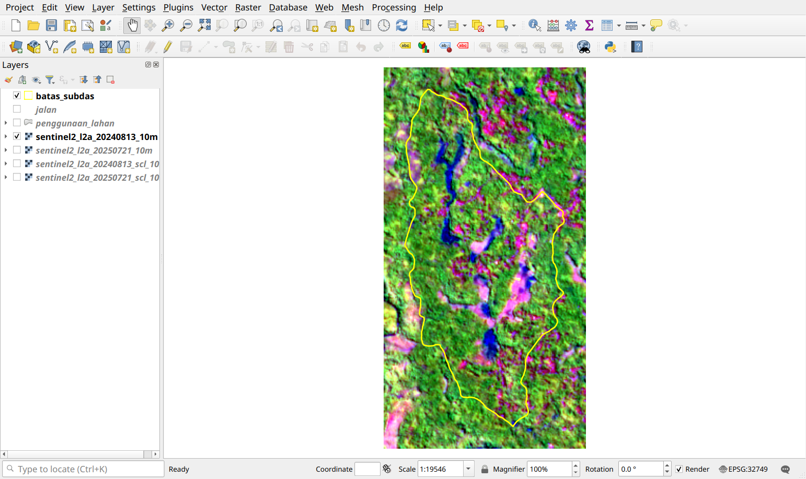

Gambar P4.1 Komposit SWIR 13 Agustus 2024

Sumber: Tangkapan layar uji coba; *Contains modified Copernicus Sentinel data 2024*

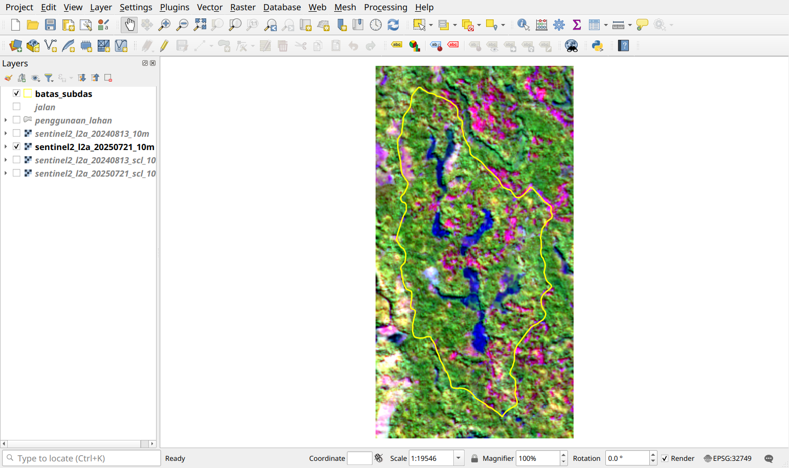

Gambar P4.2 Komposit SWIR 21 Juli 2025

Sumber: Tangkapan layar uji coba; *Contains modified Copernicus Sentinel data 2025*

Warna merah muda menandai permukaan yang kurang bervegetasi, dan tampak lebih luas pada 2024. Sebelum menghitung apa pun, buat dugaan di mana tanah terbuka berada, lalu bandingkan dengan hasilnya nanti.

## Tahap 2: Menyingkirkan Piksel Bermasalah

Modul 5 menyebut bahwa awan, bayangan, dan piksel bermasalah lain perlu disingkirkan lebih dulu. Lapisan SCL dipakai untuk itu, dengan hanya mempertahankan kelas 4 (vegetasi) dan 5 (tidak bervegetasi).

1. Pilih **Raster > Raster Calculator**.
2. Masukkan ekspresi berikut, simpan ke `hasil/bersih_20240813.tif`, lalu klik **OK**.

```
("sentinel2_l2a_20240813_scl_10m@1" = 4) OR ("sentinel2_l2a_20240813_scl_10m@1" = 5)
```

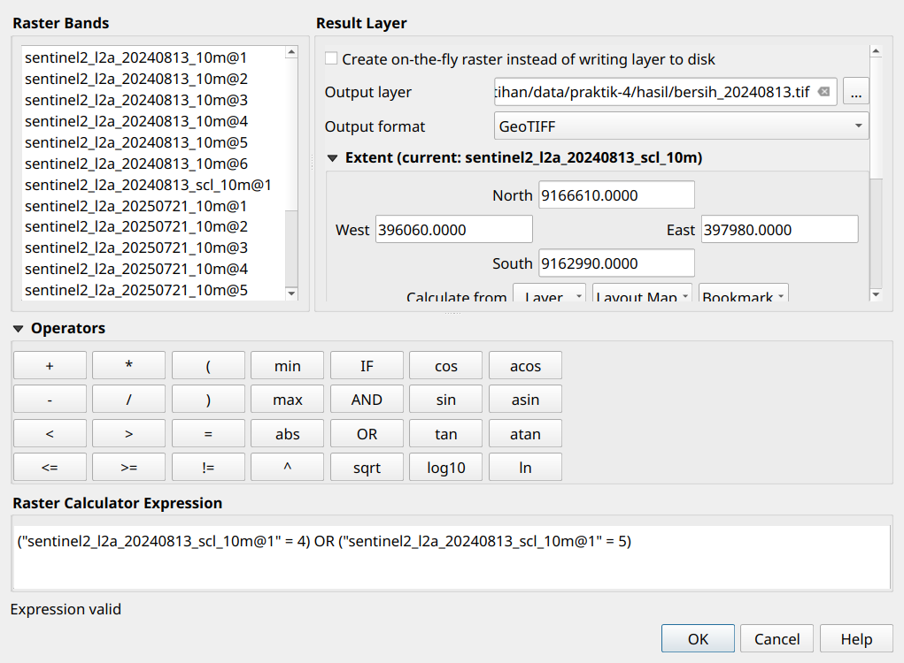

Gambar P4.3 Membuat masker piksel bersih dari SCL

Sumber: Tangkapan layar uji coba

3. Ulangi untuk tanggal 2025, dan simpan ke `hasil/bersih_20250721.tif`.

Nilai 1 berarti piksel bersih dan nilai 0 berarti piksel disingkirkan. Di dalam Sub-DAS, adegan 2024 memiliki 28.693 piksel vegetasi, 584 piksel tidak bervegetasi, dan 192 piksel kelas lain dari total 29.469 piksel.

## Tahap 3: Menghitung Indeks

Hitung indeks untuk 2024 dengan Raster Calculator, satu rumus untuk satu berkas keluaran. Awalan layer `S` di bawah ini mewakili `sentinel2_l2a_20240813_10m`, jadi ketikkan nama lengkapnya atau klik dua kali namanya pada daftar **Raster Bands**.

Tabel P4.3 Rumus Indeks untuk Citra 13 Agustus 2024

| **Indeks** | **Ekspresi Raster Calculator** | **Keluaran** |
| :---: | :------: | :---: |
| NDVI | `("S@4" - "S@3") / ("S@4" + "S@3")` | `ndvi_20240813.tif` |
| SAVI | `1.5 * ("S@4" - "S@3") / ("S@4" + "S@3" + 0.5)` | `savi_20240813.tif` |
| BSI | `(("S@5" + "S@3") - ("S@4" + "S@1")) / (("S@5" + "S@3") + ("S@4" + "S@1"))` | `bsi_20240813.tif` |
| NBR2 | `("S@5" - "S@6") / ("S@5" + "S@6")` | `nbr2_20240813.tif` |

Sumber: Rumus dari Tabel 5.1 Modul 5, disesuaikan dengan urutan kanal berkas

Untuk citra 2025, hitung NDVI, BSI, dan NBR2 dengan kanal 7 sebagai inframerah dekat, kanal 9 sebagai SWIR 1, dan kanal 10 sebagai SWIR 2. Simpan sebagai `ndvi_20250721.tif`, `bsi_20250721.tif`, dan `nbr2_20250721.tif`.

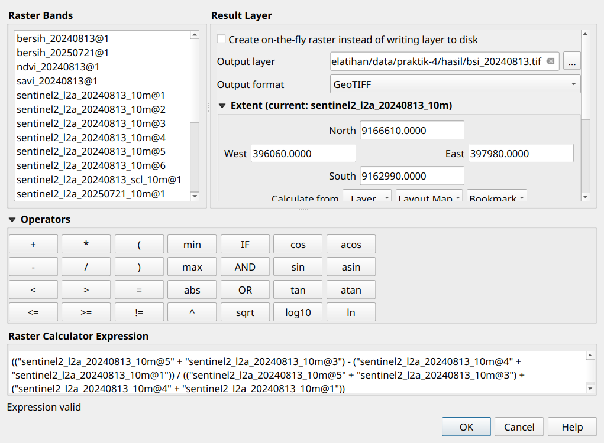

Gambar P4.4 Menghitung BSI dengan Raster Calculator

Sumber: Tangkapan layar uji coba

Tampilkan hasilnya sebagai **Singleband pseudocolor** dan bandingkan polanya.

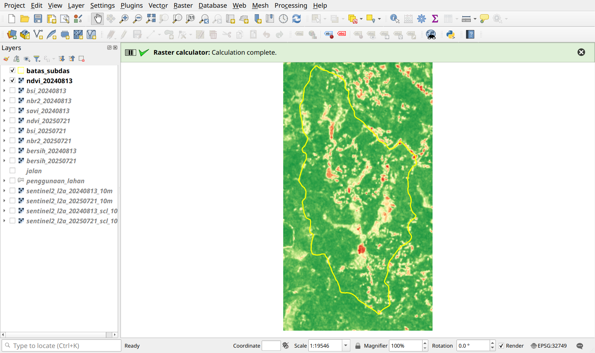

Gambar P4.5 NDVI 13 Agustus 2024

Sumber: Tangkapan layar uji coba; *Contains modified Copernicus Sentinel data 2024*

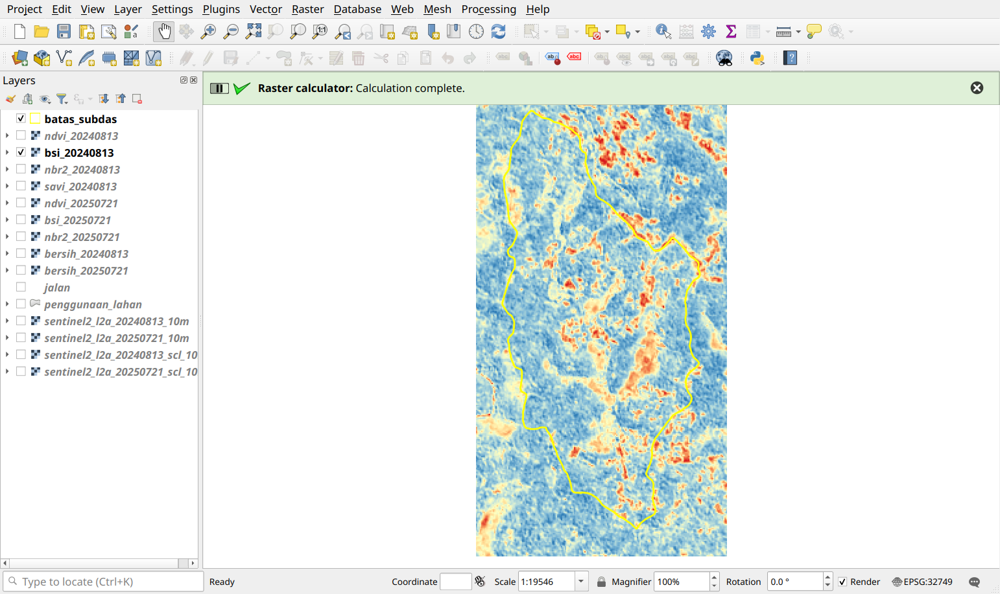

Gambar P4.6 BSI 13 Agustus 2024

Sumber: Tangkapan layar uji coba; *Contains modified Copernicus Sentinel data 2024*

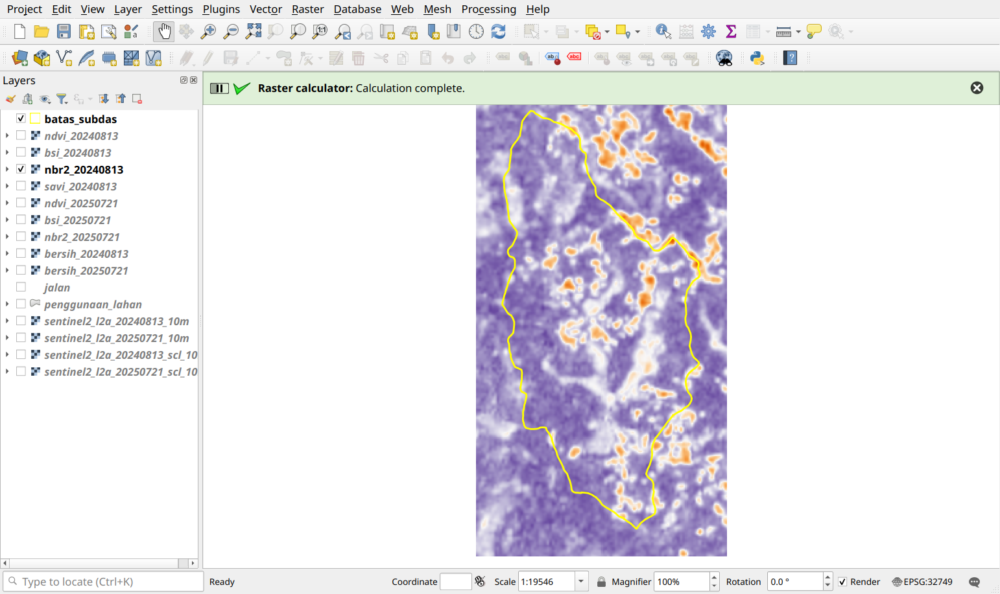

Gambar P4.7 NBR2 13 Agustus 2024

Sumber: Tangkapan layar uji coba; *Contains modified Copernicus Sentinel data 2024*

Di dalam Sub-DAS, median NDVI 2024 sekitar 0,82. Hanya 5% piksel yang NDVI-nya di bawah 0,46. Angka ini memberi gambaran betapa sedikitnya tanah yang terbuka.

## Tahap 4: Mencoba Aturan Ambang

Coba tiga aturan berikut dengan Raster Calculator. Aturan A dan C memakai ambang dari pustaka yang tercantum di Tabel 5.1. Aturan B disusun penyusun modul setelah melihat citra dan nilainya, untuk latihan.

Tabel P4.4 Tiga Aturan Tanah Terbuka untuk Citra 2024

| **Aturan** | **Ekspresi** | **Keluaran** |
| :---: | :------: | :---: |
| A | `("ndvi_20240813@1" < 0.25) AND ("bersih_20240813@1" = 1)` | `aturan_a_ndvi025.tif` |
| B | `("ndvi_20240813@1" < 0.35) AND ("bsi_20240813@1" > 0) AND ("bersih_20240813@1" = 1)` | `aturan_b_ndvi035_bsi0.tif` |
| C | `("ndvi_20240813@1" < 0.25) AND ("nbr2_20240813@1" > -0.30) AND ("nbr2_20240813@1" < 0.10) AND ("bersih_20240813@1" = 1)` | `aturan_c_ndvi025_nbr2.tif` |

Sumber: Ambang A dari Castaldi et al. (2019); rentang NBR2 pada C dari Demattê et al. (2020); aturan B disusun untuk latihan

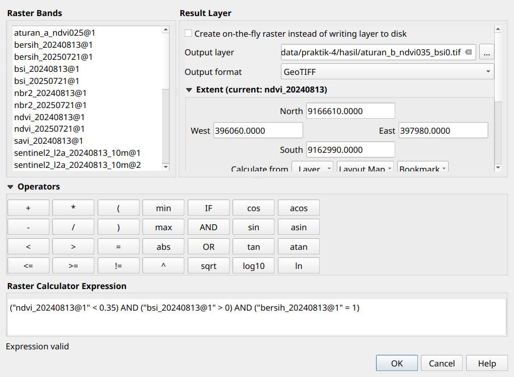

Gambar P4.8 Menuliskan aturan B pada Raster Calculator

Sumber: Tangkapan layar uji coba

Buat juga aturan B untuk 2025 dengan layer `ndvi_20250721`, `bsi_20250721`, dan `bersih_20250721`, lalu simpan ke `aturan_b_20250721.tif`. Berikutnya, hitung jumlah piksel setiap aturan di dalam Sub-DAS.

1. Buka **Processing Toolbox**, cari **Zonal histogram**.
2. Isi **Raster layer** dengan hasil aturan, **Vector layer containing zones** dengan `batas_subdas`, dan **Output column prefix** dengan `H_`.
3. Klik **Run**, lalu buka tabel atribut hasilnya. Kolom `H_1` berisi jumlah piksel bernilai 1.

Tabel P4.5 Jumlah Piksel Tanah Terbuka di Dalam Sub-DAS (Total 29.469 Piksel)

| **Aturan** | **Piksel** | **Luas (ha)** |
| :------: | ---: | ---: |
| A, NDVI < 0,25 | 111 | 1,11 |
| B, NDVI < 0,35 dan BSI > 0 | 240 | 2,40 |
| C, NDVI < 0,25 dan −0,30 < NBR2 < 0,10 | 31 | 0,31 |
| B pada citra 2025 | 83 | 0,83 |

Sumber: Hasil uji coba

Perbedaan antaraturan itu sendiri sudah menjadi pelajaran. Rentang NBR2 dari pustaka menyisakan hanya 31 piksel, karena pada citra ini nilai NBR2 umumnya berada di atas 0,10, dengan median sekitar 0,37. Ambang dari wilayah lain tidak dapat dipindahkan begitu saja, seperti diingatkan Demattê et al. (2020). Aturan B dipakai pada tahap selanjutnya karena memberi jumlah piksel yang cukup untuk latihan, bukan karena terbukti benar. Pembuktiannya dimulai pada tahap berikut.

Tampilkan aturan B di atas citra dengan warna mencolok. Gunakan **Paletted/Unique values**, buat nilai 0 transparan dengan mengatur *opacity* warnanya menjadi 0, dan beri nilai 1 warna sian.

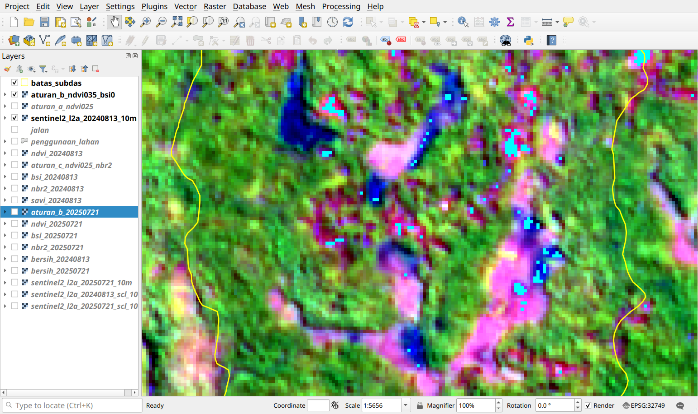

Gambar P4.9 Kandidat tanah terbuka aturan B di atas komposit SWIR, diperbesar di bagian tengah Sub-DAS

Sumber: Tangkapan layar uji coba; *Contains modified Copernicus Sentinel data 2024*

## Tahap 5: Memeriksa dengan Peta Penggunaan Lahan

1. Tampilkan `penggunaan_lahan` sebagai **Categorized** dan aturan B di atasnya.
2. Jalankan **Zonal histogram** lagi, kali ini dengan **Vector layer containing zones** `penggunaan_lahan`, lalu simpan ke `hasil/histogram_per_penggunaan_lahan.gpkg`.
3. Jalankan **Statistics by categories** dengan **Input vector layer** hasil tersebut, **Field to calculate statistics on** `H_1`, dan **Field(s) with categories** `penggunaan_lahan`. Simpan ke `hasil/rekap_per_penggunaan_lahan.csv`, lalu lihat kolom `sum`.

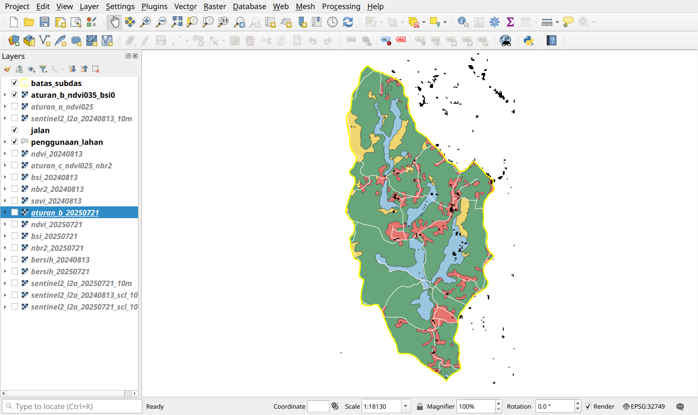

Gambar P4.10 Kandidat tanah terbuka (hitam) di atas peta penggunaan lahan

Sumber: Tangkapan layar uji coba; data riset Sub-DAS Bompon

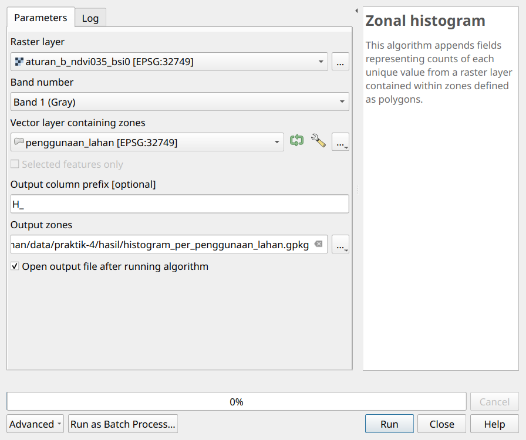

Gambar P4.11 Dialog Zonal Histogram

Sumber: Tangkapan layar uji coba

Tabel P4.6 Kandidat Tanah Terbuka Aturan B Menurut Penggunaan Lahan

| **Penggunaan lahan** | **Piksel 2024** | **% dari kelasnya** | **Piksel 2025** |
| :-----: | ---: | ---: | ---: |
| Permukiman | 165 | 4,68 | 80 |
| Sawah | 62 | 1,83 | 2 |
| Tegalan | 12 | 0,70 | 1 |
| Agroforestri | 1 | 0,00 | 0 |

Sumber: Hasil uji coba

Inilah temuan utama. Pada citra 2024, 165 dari 240 piksel, atau 69%, berada di permukiman. Pada citra 2025, angkanya 80 dari 83 piksel, atau 96%. Indeks tanah terbuka memang tidak membedakan tanah dari atap, halaman, dan jalan, seperti diingatkan Modul 5. Yang menarik, sawah muncul pada 2024 dan hampir hilang pada 2025, sehingga kemungkinan besar sawah sedang bera atau baru diolah pada Agustus 2024. Dugaan ini perlu dikonfirmasi dengan kalender tanam atau pengamatan lapangan.

## Tahap 6: Menyusun Masker Akhir

1. Jalankan **Extract by expression** dengan **Input layer** `penggunaan_lahan` dan **Expression** berikut, lalu simpan **Matching features** ke `hasil/lahan_non_permukiman.gpkg`.

```
"penggunaan_lahan" <> 'Permukiman'
```

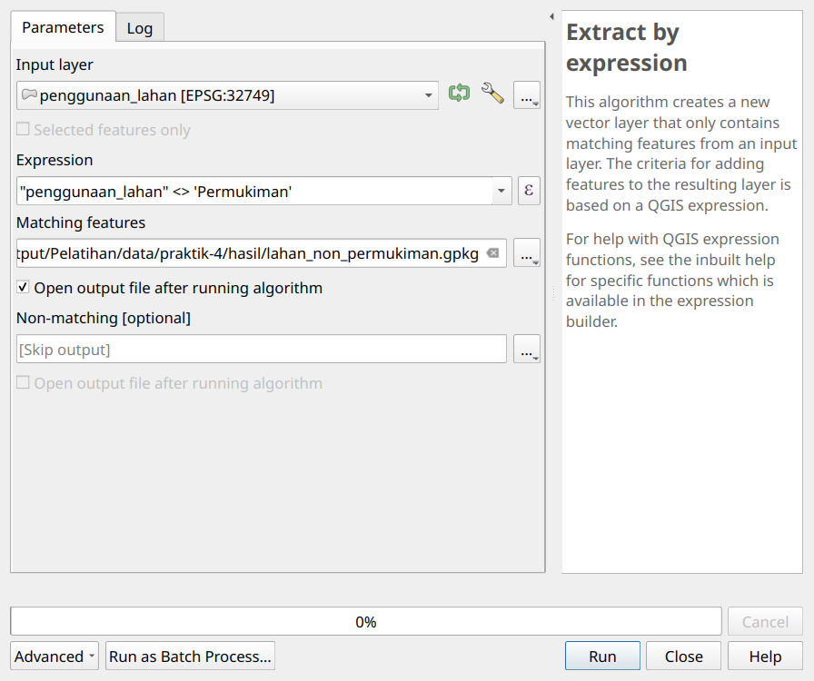

Gambar P4.12 Menyaring poligon selain permukiman

Sumber: Tangkapan layar uji coba

2. Pilih **Raster > Extraction > Clip Raster by Mask Layer**. Isi **Input layer** `aturan_b_ndvi035_bsi0`, **Mask layer** `lahan_non_permukiman`, **Assign a specified NoData value** `0`, hapus centang **Match the extent**, centang **Keep resolution**, pilih **Output data type** *Byte*, lalu simpan ke `hasil/masker_tanah_terbuka_20240813.tif`.

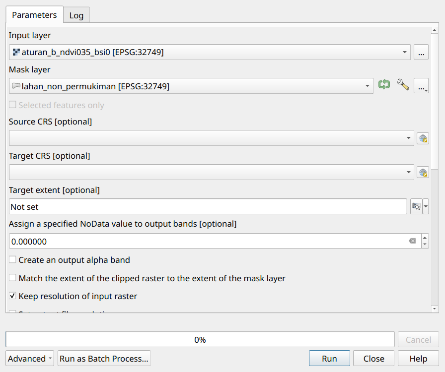

Gambar P4.13 Memotong masker dengan poligon selain permukiman

Sumber: Tangkapan layar uji coba

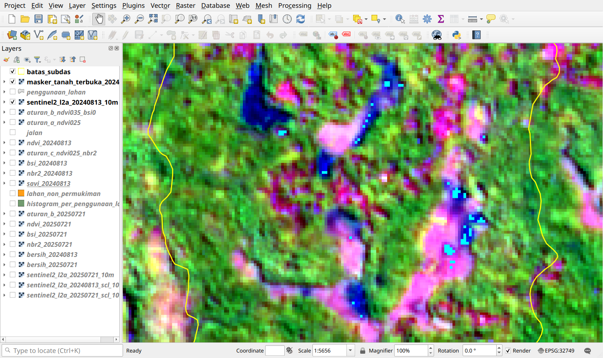

Gambar P4.14 Masker tanah terbuka akhir di atas komposit SWIR, diperbesar di bagian tengah Sub-DAS

Sumber: Tangkapan layar uji coba; *Contains modified Copernicus Sentinel data 2024*

**Titik periksa.** Masker akhir berisi 75 piksel, atau 0,75 ha. Dari luas 295 ha, tanah terbuka yang dapat dipakai hanya sekitar 0,25%. Bagi kebun bertajuk tertutup, gambaran seperti inilah yang perlu diantisipasi.

## Tahap 7: Mengekstraksi Informasi Tanah

1. Hitung dua indeks sifat tanah pada citra 2024, dengan `S` seperti pada tahap 3. Simpan sebagai `bi_20240813.tif` dan `cmr_20240813.tif`.

```
sqrt(("S@3"^2 + "S@2"^2 + "S@1"^2) / 3)
"S@5" / "S@6"
```

2. Terapkan masker dengan membagi nilainya. Pembagian dengan nol menghasilkan NoData, sehingga hanya piksel tanah terbuka yang tersisa. Simpan sebagai `bi_tanah_terbuka.tif` dan `cmr_tanah_terbuka.tif`.

```
"cmr_20240813@1" / ("masker_tanah_terbuka_20240813@1" = 1)
```

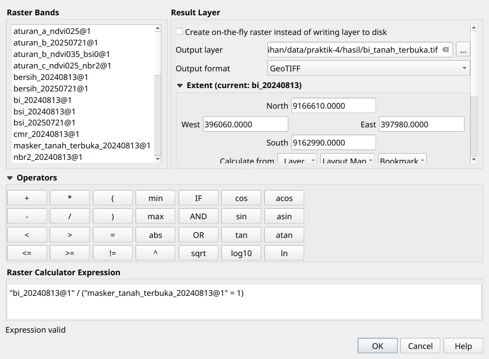

Gambar P4.15 Menerapkan masker untuk mengekstraksi indeks

Sumber: Tangkapan layar uji coba

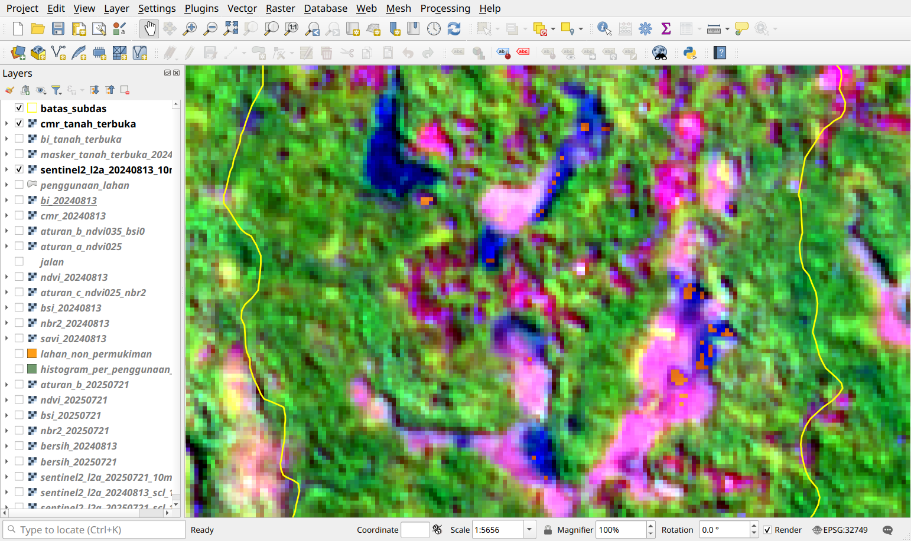

Gambar P4.16 Rasio mineral lempung (CMR) hanya pada piksel tanah terbuka

Sumber: Tangkapan layar uji coba; *Contains modified Copernicus Sentinel data 2024*

3. Bandingkan statistik sebelum dan sesudah masker pada tab **Information**, atau dengan alat **Raster layer statistics**.

Tabel P4.7 Statistik Indeks Sebelum dan Sesudah Masker

| **Indeks** | **Cakupan** | **Piksel** | **Minimum** | **Rata-rata** | **Maksimum** |
| :---: | :---: | ---: | ---: | ---: | ---: |
| BI | Seluruh grid | 69.504 | 0,015 | 0,036 | 0,397 |
| BI | Tanah terbuka | 75 | 0,042 | 0,069 | 0,092 |
| CMR | Seluruh grid | 69.504 | 1,069 | 2,096 | 2,593 |
| CMR | Tanah terbuka | 75 | 1,460 | 1,744 | 2,066 |

Sumber: Hasil uji coba

Rata-rata CMR berubah dari 2,10 menjadi 1,74. Artinya, nilai CMR pada seluruh grid terutama dikendalikan vegetasi, bukan mineral lempung. Peta CMR tanpa masker dapat tampak seperti peta tanah, padahal yang tergambar adalah tutupan vegetasi.

Berikutnya, periksa mutu hasilnya dengan cara yang dipakai Demattê et al. (2020), yaitu melihat bentuk spektrumnya.

Tabel P4.8 Rerata Pantulan Piksel Tanah Terbuka dan Vegetasi Rapat

| **Kanal** | **Tanah terbuka (75 piksel)** | **Vegetasi, NDVI > 0,8 (45.405 piksel)** |
| :---: | ---: | ---: |
| B02 | 0,046 | 0,022 |
| B03 | 0,071 | 0,040 |
| B04 | 0,085 | 0,025 |
| B08 | 0,157 | 0,294 |
| B11 | 0,145 | 0,154 |
| B12 | 0,085 | 0,069 |

Sumber: Hasil uji coba; rerata dihitung dari seluruh piksel setiap kelompok

Spektrum yang diharapkan dari tanah terbuka naik terus dari biru sampai SWIR pertama. Kumpulan piksel ini naik sampai B08, lalu sedikit turun di B11, dan NDVI dari nilai reratanya masih sekitar 0,30. Jadi, piksel-piksel ini kemungkinan bukan tanah yang benar-benar terbuka, melainkan campuran tanah dengan sisa tanaman, tumbuhan muda, atau air. Mengambil nilai CMR dari piksel ini lalu menyebutnya sifat tanah akan berlebihan tanpa pengamatan lapangan. Peserta dapat memeriksanya sendiri dengan **Identify Features** pada satu piksel masker dan satu piksel vegetasi.

## Tahap 8: Komposit Dua Tanggal

Modul 5 menjelaskan bahwa komposit multitemporal mengambil kondisi paling terbuka dari banyak citra. Latihan ini hanya memakai dua tanggal sehingga sekadar memperlihatkan caranya, karena komposit yang sebenarnya memerlukan banyak citra (Diek et al., 2017).

1. Jalankan **Cell statistics** dengan **Input layers** `ndvi_20240813` dan `ndvi_20250721`, **Statistic** *Minimum*, dan **Reference layer** `ndvi_20240813`. Simpan ke `hasil/ndvi_minimum.tif`.

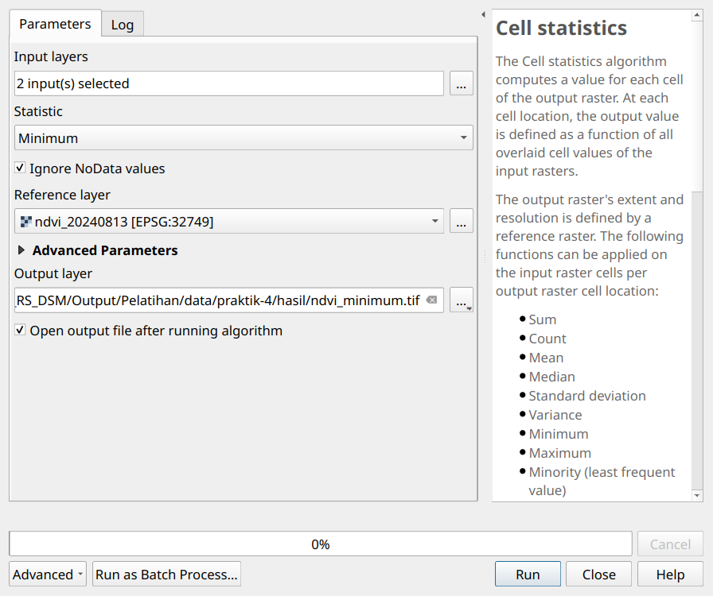

Gambar P4.17 Dialog Cell Statistics

Sumber: Tangkapan layar uji coba

2. Hitung frekuensi keterbukaan dengan menjumlahkan kedua aturan B, lalu simpan ke `hasil/frekuensi_terbuka.tif`.

```
"aturan_b_ndvi035_bsi0@1" + "aturan_b_20250721@1"
```

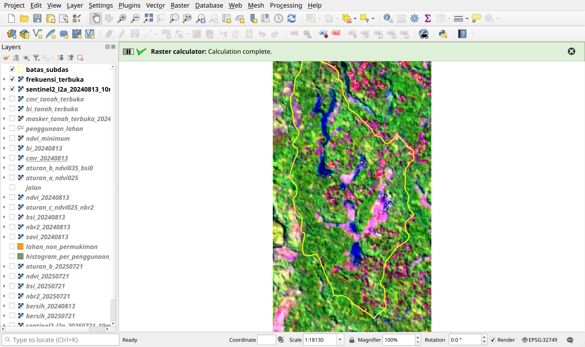

Gambar P4.18 Frekuensi keterbukaan dari dua tanggal

Sumber: Tangkapan layar uji coba; *Contains modified Copernicus Sentinel data 2024–2025*

Di dalam Sub-DAS, 231 piksel terbuka satu kali dan 46 piksel terbuka dua kali. Periksa posisi piksel yang terbuka dua kali dengan peta penggunaan lahan: **seluruh 46 piksel itu berada di permukiman**. Permukaan yang terbuka di semua tanggal lebih mungkin atap atau jalan daripada tanah. Sebaliknya, permukaan pertanian muncul sesekali saja. Frekuensi keterbukaan karena itu berguna untuk memisahkan tanah garapan dari permukaan buatan, dan gagasan ini dapat dipakai di kebun.

3. Buat komposit CMR dari tanggal yang NDVI-nya lebih rendah di setiap piksel, lalu simpan ke `hasil/komposit_cmr_terbersih.tif`.

```
("ndvi_20240813@1" <= "ndvi_20250721@1") * "cmr_20240813@1" + ("ndvi_20240813@1" > "ndvi_20250721@1") * ("sentinel2_l2a_20250721_10m@9" / "sentinel2_l2a_20250721_10m@10")
```

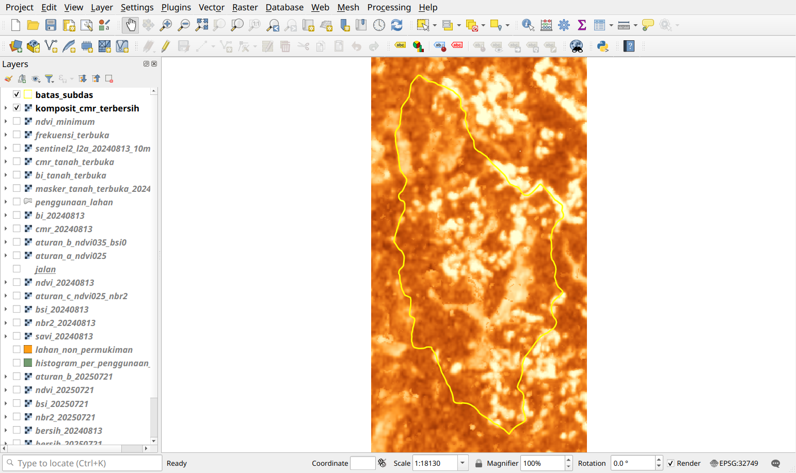

Gambar P4.19 Komposit CMR dari tanggal dengan NDVI terendah

Sumber: Tangkapan layar uji coba; *Contains modified Copernicus Sentinel data 2024–2025*

## Bahan Diskusi

Sub-DAS Bompon memperlihatkan keadaan yang tidak nyaman tetapi jujur. Setelah permukiman dibuang, tanah terbuka hanya tersisa 0,75 ha, dan spektrumnya pun belum meyakinkan. Dari data ini, peta sifat tanah untuk seluruh wilayah jelas tidak dapat disusun dari pantulan langsung. Itulah alasan pemetaan pada Praktik 5 harus bersandar pada kovariat lingkungan.

Pertanyaan untuk dibawa pulang ke kebun: blok mana yang sedang atau akan diremajakan dalam dua tahun ke depan, dan apakah citra pada saat itu tersedia bebas awan? Modul 5 menunjukkan bahwa jendela waktunya hanya beberapa bulan. Peta permukiman, jalan kebun, dan area bangunan juga harus disiapkan lebih dulu, karena aturan indeks tidak dapat memisahkannya dari tanah.

## Jika Tertinggal

Semua keluaran uji coba tersedia di `data/praktik-4/hasil-contoh/`, termasuk `Praktik_4_selesai.qgz`. Indeks yang dipakai pada Praktik 5 sudah tersedia di `data/praktik-5/kovariat/`.
