# Praktik 5. Machine Learning untuk Digital Soil Mapping

*Praktik terbimbing:*

Pemandu: Ferry. Perangkat: QGIS dan Jupyter Notebook. Rujukan teori: Modul 8, Modul 2, dan Modul 4.

## Kurikulum Pembelajaran

**Tujuan**

Membekali peserta agar mampu membangun model pemetaan tanah digital untuk C-organik, dari penyiapan kovariat sampai peta prediksi dan ketidakpastiannya, serta menilai hasilnya secara kritis.

**Kompetensi**

Setelah mengikuti praktik ini, peserta memiliki kompetensi dalam:

1. Menyiapkan kovariat SCORPAN dari data penginderaan jauh dan data lingkungan
2. Memilih kovariat berdasarkan alasan pedologis dan redundansi
3. Melatih dan menilai model dengan validasi acak dan validasi spasial
4. Membandingkan model dengan pembanding sederhana
5. Membuat dan membaca peta prediksi, peta ketidakpastian, dan wilayah keberlakuan model

**Ringkasan Studi**

1. Deskripsi singkat
   - Peserta menyiapkan 16 kovariat di QGIS dan menempatkan 50 titik sampel
   - Peserta melatih model di Jupyter Notebook dan menilainya dengan beberapa skema validasi
   - Peserta menampilkan hasilnya di QGIS bersama peta SMU dari Praktik 2
2. Hasil belajar
   - Peserta memahami alur dari data tanah dan kovariat sampai peta prediksi
   - Peserta mampu menyatakan seberapa jauh sebuah peta DSM dapat dipercaya
3. Indikator hasil belajar
   - Semua kovariat berukuran 192 × 362 piksel dengan piksel 10 m
   - Tabel metrik memuat model dan pembandingnya pada validasi acak dan spasial
   - Peta prediksi, PI90, dan AOA tampil di QGIS bersama batas SMU
4. Materi pokok
   - Faktor SCORPAN sebagai kovariat
   - *Random forest* dan *quantile regression forest*
   - Validasi spasial, MEC, dan PICP
   - Wilayah keberlakuan model dan residual

## Gambaran Praktik

Praktik ini menyatukan semua hasil sebelumnya. Persamaan SCORPAN pada Modul 8 menyatakan sifat tanah sebagai fungsi kondisi lingkungan, dan fungsi itu dipelajari dari data. Peserta menyiapkan datanya, melatih modelnya, menilainya, lalu menerapkannya ke setiap piksel Sub-DAS Bompon sehingga menghasilkan peta C-organik beserta peta ketidakpastiannya.

Satu hal perlu disampaikan sejak awal: **pada data latihan ini, model praktis tidak lebih baik daripada menebak nilai rata-rata.** Hal itu ditemukan saat uji coba dan bukan kekeliruan langkah. Peserta justru diharapkan menemukannya sendiri, memahami penyebabnya, dan mampu membacanya dengan jujur. Peta prediksi tetap dibuat karena alur kerjanya yang sedang dipelajari, dan alur yang sama akan berlaku pada data kebun yang lebih memadai.

## Data yang Dipakai

Semua berkas ada di folder `data/praktik-5/`.

Tabel P5.1 Data Praktik 5

| **Berkas** | **Isi** |
| :------: | :------: |
| `Praktik_5_Machine_Learning_DSM.ipynb` | Notebook praktik |
| `sampel_tanah_bompon.csv` | Hasil laboratorium 50 titik pada kedalaman 0–20 cm (akhiran `_1`) dan 20–40 cm (akhiran `_2`) |
| `kovariat/` | 16 kovariat siap pakai, satu GeoTIFF per kovariat, grid 10 m |
| `copdem_glo30_30m.tif` | DEM asal untuk atribut medan |
| `bompon_vektor.gpkg` | `batas_subdas`, `bentuklahan`, `penggunaan_lahan`, `sungai` |
| `smu_akhir.gpkg` | Peta SMU hasil Praktik 2 |

Sumber: Data proyek; tabel laboratorium sama dengan data yang dianalisis Fatmawati (2026)

Sasaran pemodelan adalah **C-organik 0–20 cm** (`C_Organik_1`). Sifat lain dapat dicoba dengan mengganti satu baris di notebook. Ada tiga catatan tentang tabel sampel, dan ketiganya diperiksa pada notebook:

1. **Nama kolom**, berkas sumber memiliki dua kolom bernama `C_Organik_1`. Kolom kedua diberi nama `C_Organik_2`. Penamaan ini teruji, karena pada 49 dari 50 titik di berkas sumber, rasionya dengan `Bahan_Organik_2` mengikuti faktor 1,724, sedangkan jika dipasangkan silang hanya 2 titik yang cocok.
2. **Titik 49**, pada berkas sumber C-organik tercatat 0,08% dan 0,16%, padahal bahan organiknya 1,13% dan 1,27%. Nilai itu diduga salah ukur, sehingga untuk latihan ini diperbaiki menjadi 0,66% dan 0,74%, yaitu bahan organik dibagi 1,724.
3. **KPK dan berat volume**, nilai 0 dikosongkan karena tidak mungkin secara fisik, sehingga KPK hanya tersedia pada 32 titik di lapisan pertama.

## Tahap 1: Alur Machine Learning

Buka `Praktik_5_Machine_Learning_DSM.ipynb` di JupyterLab atau Colab, lalu jalankan sel sampai akhir **Bagian A**. Seluruh notebook memerlukan 3–7 menit pada komputer uji coba. Waktu di laptop Anda dapat berbeda.

Bagian A memperkenalkan alur dasarnya. Data dibaca dan diperiksa, nilai kovariat diambil di titik sampel, data dibagi 80% latih dan 20% uji, lalu *random forest* dilatih.

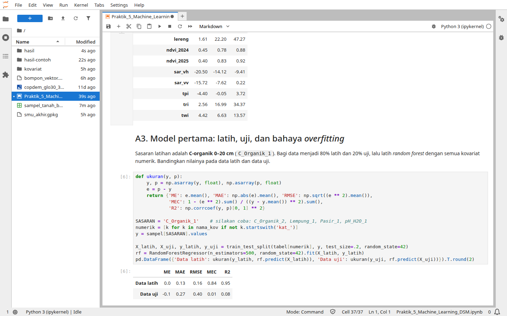

Gambar P5.1 Model pertama di notebook, memperlihatkan kesenjangan data latih dan data uji

Sumber: Tangkapan layar uji coba

Tabel P5.2 Model Pertama pada Data Latih dan Data Uji

| **Data** | **RMSE (%)** | **MEC** |
| :---: | ---: | ---: |
| Data latih | 0,16 | 0,84 |
| Data uji | 0,40 | 0,01 |

Sumber: Hasil uji coba, sasaran C-organik 0–20 cm

Pada data latih, model tampak sangat baik. Pada data yang belum pernah dilihatnya, RMSE naik lebih dari dua kali lipat dan MEC hampir nol. Inilah *overfitting* yang dibahas pada Modul 8. Angka pada data latih tidak boleh dilaporkan sebagai kemampuan model.

Sel berikutnya mengulang pembagian acak sebanyak 30 kali. MEC yang diperoleh berkisar dari −4,03 sampai 0,20, dengan median −0,37. Dengan hanya 10 titik uji, satu pembagian yang kebetulan baik dapat memberi kesan keliru. Jika sebuah laporan hanya menyebut satu pembagian tunggal pada data sedikit, angkanya perlu dibaca dengan hati-hati.

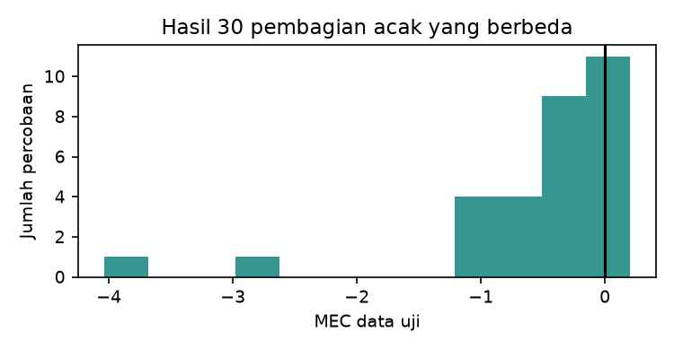

Gambar P5.2 Sebaran MEC dari 30 pembagian acak yang berbeda

Sumber: Hasil uji coba

## Tahap 2: Menyiapkan Kovariat di QGIS

Folder `kovariat/` sudah berisi semua kovariat siap pakai, sehingga notebook tetap berjalan walaupun tahap ini belum selesai. Tahap ini menunjukkan cara membuatnya, dan kovariat buatan Anda dapat menimpa berkas di folder itu. Tutup dulu layer yang akan ditimpa dari panel **Layers**. Kovariat optik dan radar berasal dari data Praktik 1 dan Praktik 4, sehingga tidak dibuat ulang.

1. Buat proyek baru, simpan sebagai `hasil/praktik5.qgz`, lalu muat `kovariat/elevasi.tif`, `copdem_glo30_30m.tif`, dan semua layer `bompon_vektor.gpkg`.
2. **Kemiringan lereng.** Pilih **Raster > Analysis > Slope**, dengan **Input layer** `elevasi`, centang **Express slope as percent** dan **Compute edges**, lalu simpan ke `kovariat/lereng.tif`.
3. **Arah hadap.** Pilih **Raster > Analysis > Aspect**, dengan input yang sama, centang **Return 0 for flat** dan **Compute edges**, lalu simpan ke `hasil/aspek_derajat.tif`. Nilai 359° dan 1° sebenarnya berdekatan, tetapi angkanya berjauhan. Karena itu arah diubah menjadi kosinus, yaitu ukuran seberapa menghadap ke utara, dengan Raster Calculator berikut, lalu disimpan ke `kovariat/arah_utara.tif`.

```
cos("aspek_derajat@1" * 3.14159265 / 180)
```

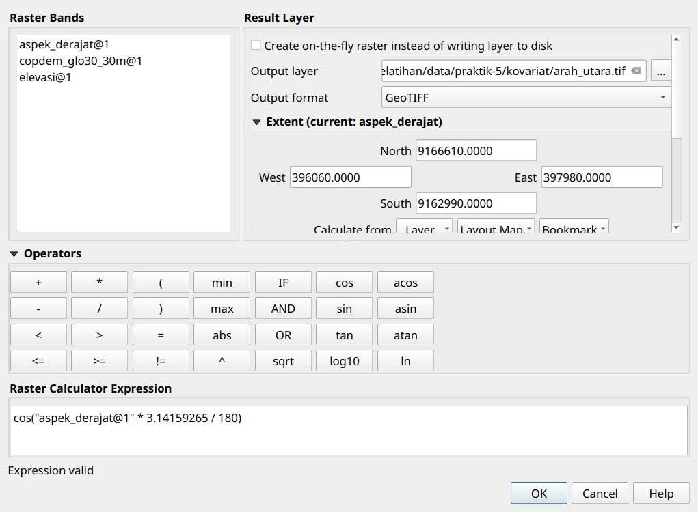

Gambar P5.3 Mengubah arah hadap menjadi kosinus

Sumber: Tangkapan layar uji coba

4. **Posisi topografi dan kekasaran medan.** Cari **Topographic Position Index (TPI)** di Processing Toolbox. Gunakan **Input layer** `copdem_glo30_30m`, centang **Compute edges**, lalu simpan ke `hasil/tpi_30m.tif`. Lakukan hal yang sama dengan **Terrain Ruggedness Index (TRI)** ke `hasil/tri_30m.tif`. Keduanya sengaja dihitung dari DEM 30 m. Pada DEM yang sudah di-*resample* ke 10 m, jendela 3 × 3 piksel terlalu kecil dibanding kerincian aslinya.

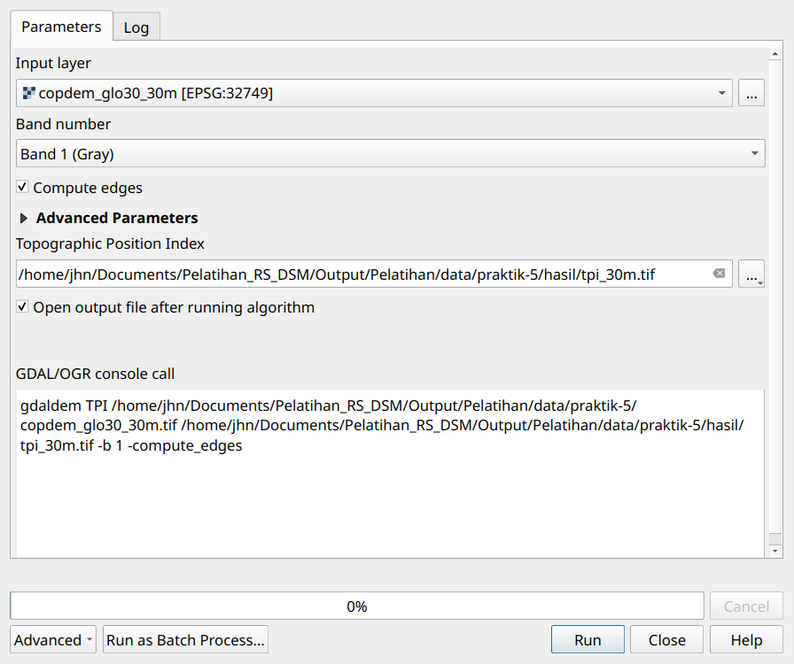

Gambar P5.4 Dialog Topographic Position Index

Sumber: Tangkapan layar uji coba

5. **Kebasahan topografi.** Cari **r.topidx** di Processing Toolbox. Isi **Input elevation layer** `copdem_glo30_30m`, lalu simpan ke `hasil/twi_30m.tif`. Alat ini memerlukan penyedia GRASS. Jika tidak tersedia di laptop Anda, lewati langkah ini dan pakai berkas yang sudah ada.

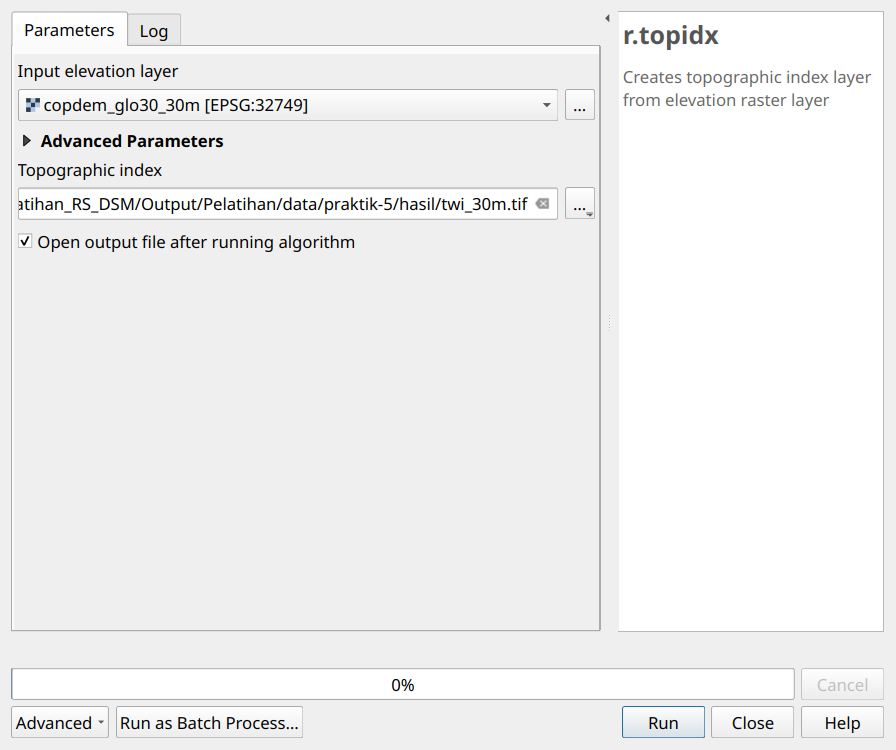

Gambar P5.5 Menghitung indeks kebasahan topografi dengan r.topidx

Sumber: Tangkapan layar uji coba

6. Selaraskan ketiganya ke grid 10 m dengan **Raster > Projections > Warp (Reproject)**, memakai pengaturan yang sama seperti Praktik 1 tahap 2, tetapi dengan DEM ini sebagai masukan dan metode *Bilinear*, dan simpan sebagai `kovariat/tpi.tif`, `kovariat/tri.tif`, dan `kovariat/twi.tif`.
7. **Jarak ke sungai.** Pilih **Raster > Conversion > Rasterize (Vector to Raster)** dengan **Input layer** `sungai`, **A fixed value to burn** `1`, **Output raster size units** *Georeferenced units*, resolusi `10` dan `10`, **Output extent** `396060,397980,9162990,9166610 [EPSG:32749]`, dan **Assign a specified NoData value** `0`. Simpan ke `hasil/sungai_raster.tif`.

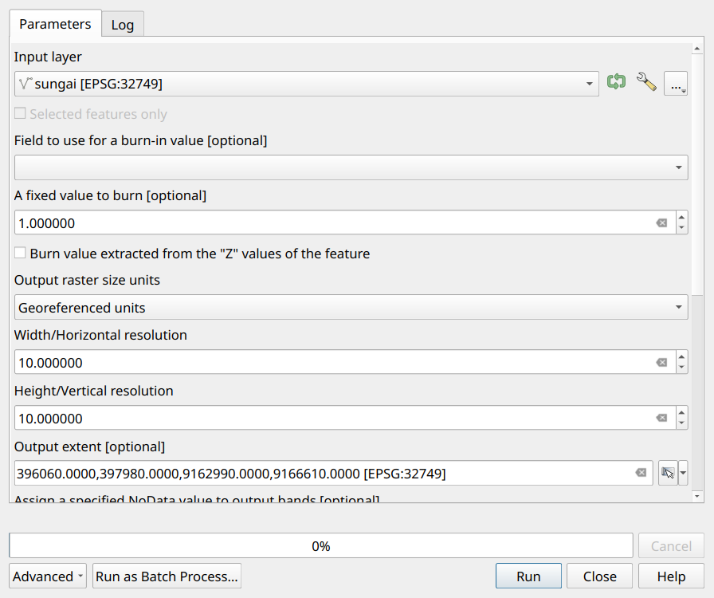

Gambar P5.6 Mengubah garis sungai menjadi raster

Sumber: Tangkapan layar uji coba

8. Pilih **Raster > Analysis > Proximity (Raster Distance)** dengan **Input layer** `sungai_raster`, **List of target pixels** `1`, **Distance units** *Georeferenced coordinates*, **Nodata value to use for the destination proximity raster** `-9999`, dan **Output data type** *Float32*. Simpan ke `kovariat/jarak_sungai.tif`.

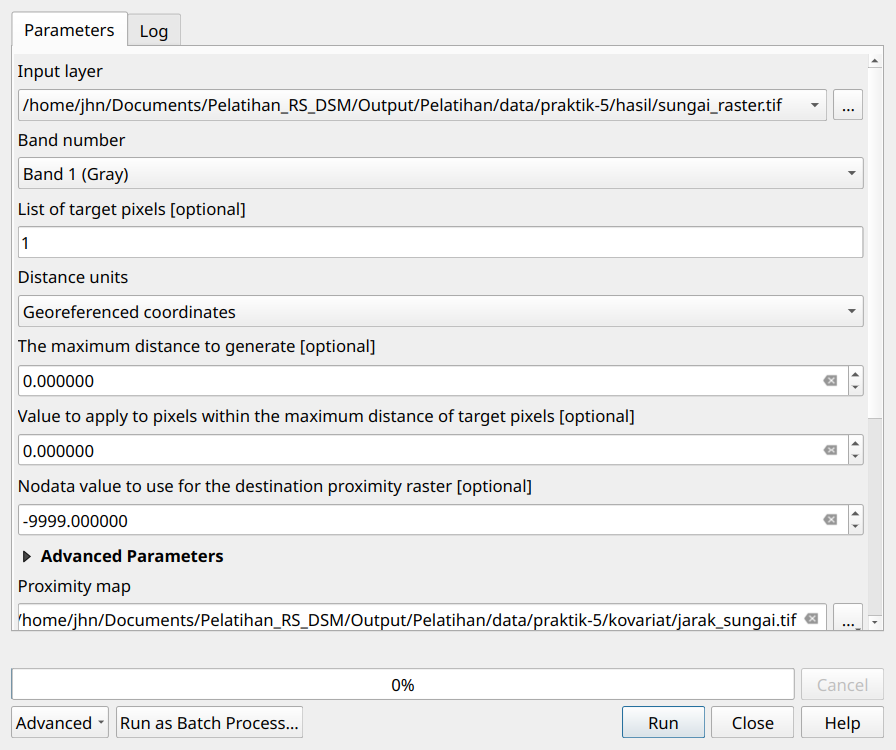

Gambar P5.7 Menghitung jarak ke sungai terdekat

Sumber: Tangkapan layar uji coba

9. **Kovariat kategorik.** Raster memerlukan angka, sehingga nama kelas diberi kode lebih dulu. Jalankan **Field calculator** dari Processing Toolbox pada layer `bentuklahan`, dengan **Field name** `kode`, **Result field type** *Integer*, dan formula berikut. Simpan ke `hasil/bentuklahan_kode.gpkg`.

```
CASE WHEN "bentuklahan"='Interfluve' THEN 1
     WHEN "bentuklahan"='Lereng Atas Perbukitan' THEN 2
     WHEN "bentuklahan"='Lereng Tengah Perbukitan' THEN 3
     WHEN "bentuklahan"='Lereng Bawah Perbukitan' THEN 4
     WHEN "bentuklahan"='Lereng Kaki Koluvial' THEN 5
     WHEN "bentuklahan"='Dataran Koluvial' THEN 6 END
```

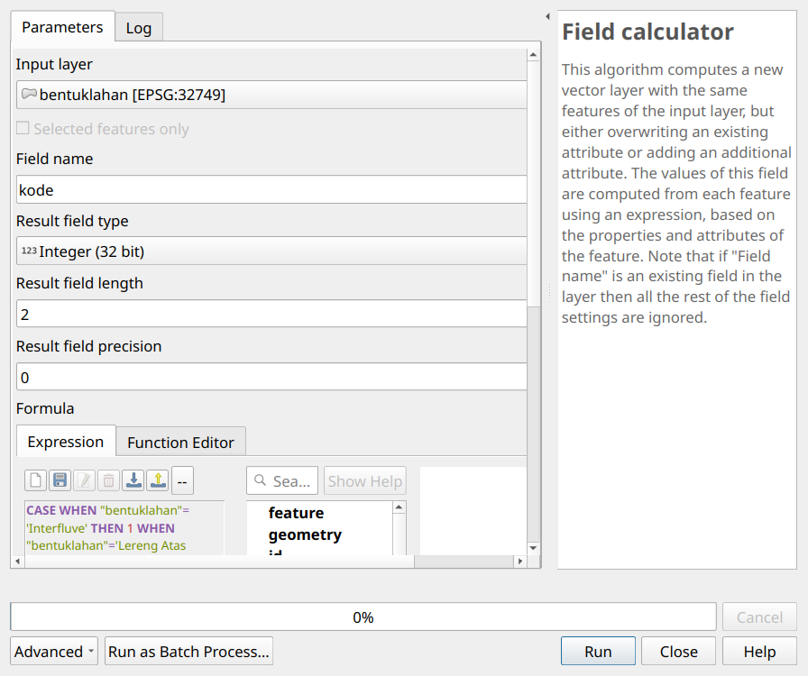

Gambar P5.8 Memberi kode numerik pada kelas bentuklahan

Sumber: Tangkapan layar uji coba

10. Rasterize hasil tersebut seperti langkah 7, tetapi pilih **Field to use for a burn-in value** `kode`, **Assign a specified NoData value** `0`, dan **Output data type** *Int16*. Simpan ke `kovariat/kat_bentuklahan.tif`. Ulangi untuk `penggunaan_lahan` dengan kode Agroforestri 1, Tegalan 2, Sawah 3, dan Permukiman 4, lalu simpan ke `kovariat/kat_penggunaan_lahan.tif`.

Tabel P5.3 Enam Belas Kovariat dan Faktor SCORPAN-nya

| **Kovariat** | **Faktor** | **Asal** | **Minimum** | **Rata-rata** | **Maksimum** |
| :---: | :--: | :-----: | ---: | ---: | ---: |
| `elevasi` (m) | r | DEM GLO-30 | 343,17 | 456,61 | 537,91 |
| `lereng` (%) | r | DEM GLO-30 | 0,00 | 22,10 | 87,95 |
| `arah_utara` | r | DEM GLO-30 | −1,00 | −0,10 | 1,00 |
| `tpi` (m) | r | DEM GLO-30 | −11,40 | 0,02 | 10,12 |
| `tri` | r | DEM GLO-30 | 1,01 | 17,57 | 58,26 |
| `twi` | r | DEM GLO-30 | 3,53 | 6,45 | 17,45 |
| `jarak_sungai` (m) | r | Peta sungai | 0,00 | 360,19 | 1.287,98 |
| `kat_bentuklahan` | r, p | Peta riset | 1 | kategori | 6 |
| `kat_penggunaan_lahan` | o | Foto udara | 1 | kategori | 4 |
| `ndvi_2024` | o | Sentinel-2 | 0,05 | 0,78 | 0,92 |
| `ndvi_2025` | o | Sentinel-2 | 0,04 | 0,83 | 0,94 |
| `bsi_2024` | o, s | Sentinel-2 | −0,47 | −0,22 | 0,25 |
| `bi_2024` | o, s | Sentinel-2 | 0,02 | 0,04 | 0,40 |
| `cmr_2024` | o, s | Sentinel-2 | 1,07 | 2,10 | 2,59 |
| `sar_vv` (dB) | o, r | Sentinel-1 | −23,32 | −7,04 | 7,08 |
| `sar_vh` (dB) | o | Sentinel-1 | −26,30 | −13,49 | −1,66 |

Sumber: Hasil uji coba, seluruh grid 192 × 362 piksel; *Contains modified Copernicus Sentinel data 2024–2025*

Tidak ada faktor iklim, karena hampir tidak bervariasi di wilayah seluas ini, dan tidak ada peta bahan induk, karena peta material permukaan Sub-DAS Bompon belum tersedia pada data latihan.

**Titik periksa.** Semua raster di `kovariat/` berukuran 192 × 362 piksel dengan piksel 10 m. Jika ada yang berbeda, notebook akan gagal membaca atau salah menempatkan nilainya.

## Tahap 3: Menempatkan Titik Sampel

1. Cari **Create points layer from table** di Processing Toolbox. Isi **Input layer** dengan `sampel_tanah_bompon.csv`, **X field** `x`, **Y field** `y`, **Target CRS** `EPSG:32749`, lalu simpan ke `hasil/titik_sampel.gpkg`.

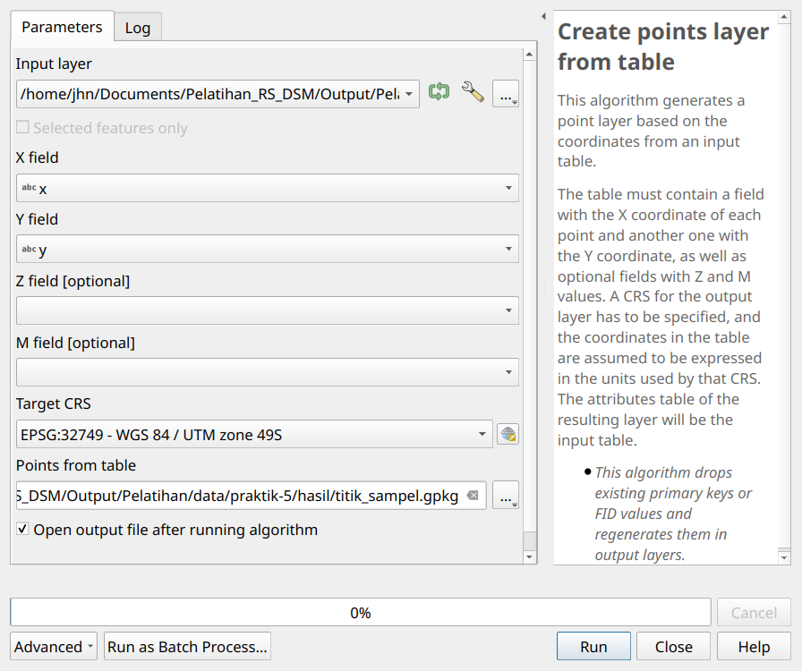

Gambar P5.9 Membuat titik dari tabel koordinat

Sumber: Tangkapan layar uji coba

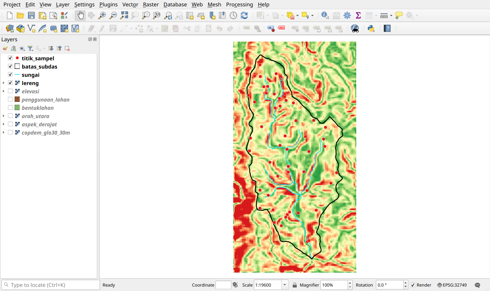

Gambar P5.10 Lima puluh titik sampel di atas peta kemiringan lereng

Sumber: Tangkapan layar uji coba; data riset Sub-DAS Bompon dan Copernicus DEM GLO-30

2. Cari **Sample raster values**. Isi **Input Layer** `titik_sampel`, **Raster Layer** `lereng`, **Output column prefix** `lereng_`, lalu simpan ke `hasil/titik_sampel_lereng.gpkg`.


Gambar P5.11 Dialog Sample Raster Values

Sumber: Tangkapan layar uji coba

3. Buka tabel atribut hasilnya dengan tombol **F6**. Kolom `lereng_1` berisi nilai lereng di setiap titik.


Gambar P5.12 Tabel atribut titik sampel

Sumber: Tangkapan layar uji coba

Langkah ini disebut penumpangan (*overlay*), dan satu baris pada tabel inilah contoh terkecil dari tabel pemodelan. Di notebook, langkah yang sama dilakukan sekaligus untuk 16 kovariat.

**Titik periksa.** Ada 50 titik dan semuanya berada di dalam batas Sub-DAS.

## Tahap 4: Memilih Kovariat

Kembali ke notebook, lalu jalankan **Bagian B**.

Tabel pada B1 memetakan kovariat ke faktor SCORPAN beserta alasannya untuk C-organik. Diskusikan bersama: apakah alasan itu masuk akal? NDVI, misalnya, masuk akal sebagai petunjuk masukan bahan organik, tetapi pada citra kemarau nilainya mungkin lebih mencerminkan jenis tanaman daripada karbon yang tersimpan di tanah.

B2 membuang kovariat yang saling berkorelasi kuat, dengan batas |r| = 0,8 dan urutan prioritas yang ditentukan dari penilaian pedologis untuk C-organik, yaitu masukan dari vegetasi dan kebasahan lebih dulu, lalu erosi dan posisi lanskap.

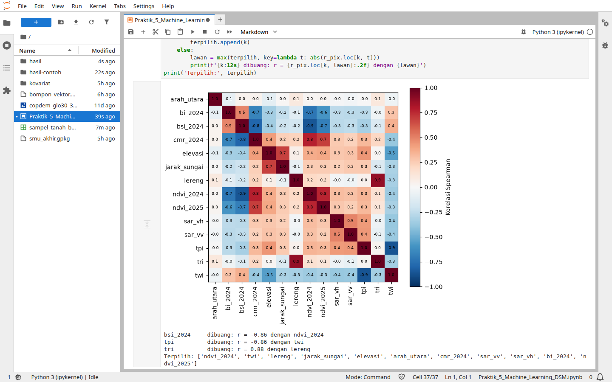

Gambar P5.13 Matriks korelasi antarkovariat di notebook

Sumber: Tangkapan layar uji coba

Pada uji coba, tiga kovariat dibuang: `bsi_2024` (r = −0,86 dengan `ndvi_2024`), `tpi` (r = −0,86 dengan `twi`), dan `tri` (r = 0,88 dengan `lereng`). Sebelas kovariat numerik dipertahankan, ditambah kolom 0/1 untuk bentuklahan dan penggunaan lahan, sehingga tabel pemodelan berukuran 50 baris dan 21 kolom. Jumlah kolomnya hampir separuh jumlah titik, dan ini sudah menjadi tanda peringatan.

Korelasi sengaja dihitung antarkovariat, dari seluruh piksel. Kovariat tidak dipilih berdasarkan korelasinya dengan C-organik di 50 titik, karena pada data sesedikit ini cara tersebut mudah menangkap hubungan kebetulan.

Perhatikan pula kecukupan sampel per kelas pada B3. Dataran Koluvial hanya memiliki 3 titik dan Lereng Kaki Koluvial 5 titik. Permukiman tidak memiliki titik sama sekali, padahal luasnya 35 ha, sehingga model tetap memprediksi permukiman tanpa pernah melihat contohnya.

**Titik periksa.** `hasil/tabel_pemodelan.csv` terbentuk dan daftar kovariat terpilih tercetak.

## Tahap 5: Membangun dan Menilai Model

Jalankan **Bagian C**, sel C1 sampai C4.

Sel C1 membentuk lima blok spasial dari lokasi titik. Sel C2 membandingkan empat model pada dua skema validasi. Dua di antaranya adalah pembanding sederhana: menebak rata-rata, dan rata-rata per bentuklahan, yang setara dengan peta tanah konvensional yang memberi satu nilai untuk setiap satuan peta.

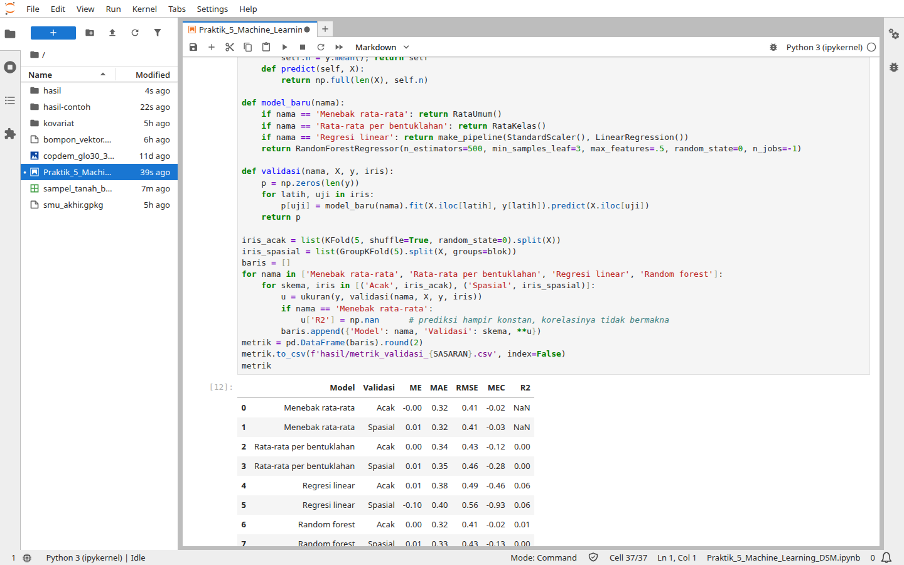

Gambar P5.14 Tabel metrik validasi di notebook

Sumber: Tangkapan layar uji coba

Tabel P5.4 Hasil Validasi Silang C-organik 0–20 cm

| **Model** | **Validasi** | **ME** | **MAE** | **RMSE** | **MEC** |
| :-----: | :---: | ---: | ---: | ---: | ---: |
| Menebak rata-rata | Acak | 0,00 | 0,32 | 0,41 | −0,02 |
| Menebak rata-rata | Spasial | 0,01 | 0,32 | 0,41 | −0,03 |
| Rata-rata per bentuklahan | Acak | 0,00 | 0,34 | 0,43 | −0,12 |
| Rata-rata per bentuklahan | Spasial | 0,01 | 0,35 | 0,46 | −0,28 |
| Regresi linear | Acak | 0,01 | 0,38 | 0,49 | −0,46 |
| Regresi linear | Spasial | −0,10 | 0,40 | 0,56 | −0,93 |
| *Random forest* | Acak | 0,00 | 0,32 | 0,41 | −0,02 |
| *Random forest* | Spasial | 0,01 | 0,33 | 0,43 | −0,13 |

Sumber: Hasil uji coba; satuan galat dalam persen C-organik

Bacalah tabel ini pelan-pelan. MEC di bawah 0 berarti prediksi lebih buruk daripada rata-rata. Baris pertama sedikit di bawah nol karena setiap putaran memakai rata-rata data latihnya sendiri, dan itulah patokan yang harus dilampaui. *Random forest* pada validasi acak hanya menyamainya (MEC −0,02), dan pada validasi spasial berada di bawahnya (MEC −0,13). RMSE-nya 0,43%, sedangkan menebak rata-rata 0,41%. Regresi linear jauh lebih buruk, karena kovariatnya banyak dan titiknya sedikit. Peta bentuklahan pun tidak membantu: memberi satu nilai per satuan malah memperbesar galat.

Selisih antara validasi acak dan validasi spasial di sini kecil, tetapi arahnya sesuai dengan yang dibahas pada Modul 8, yaitu validasi acak lebih optimistis.

Tabel P5.5 Kinerja *Random Forest* pada Beberapa Sifat Tanah

| **Sifat** | **Rata-rata** | **Simpangan baku** | **RMSE spasial** | **MEC acak** | **MEC spasial** |
| :-----: | ---: | ---: | ---: | ---: | ---: |
| C-organik 0–20 cm (%) | 1,14 | 0,41 | 0,43 | −0,02 | −0,13 |
| C-organik 20–40 cm (%) | 0,93 | 0,30 | 0,30 | −0,01 | −0,01 |
| Lempung 0–20 cm (%) | 62,48 | 9,82 | 10,92 | −0,23 | −0,26 |
| Lempung 20–40 cm (%) | 64,78 | 10,32 | 10,96 | −0,08 | −0,15 |
| Pasir 0–20 cm (%) | 16,43 | 6,81 | 7,73 | −0,21 | −0,32 |
| Debu 0–20 cm (%) | 21,09 | 6,56 | 6,54 | −0,05 | −0,01 |
| pH H₂O 0–20 cm | 5,20 | 0,36 | 0,39 | −0,21 | −0,20 |

Sumber: Hasil uji coba

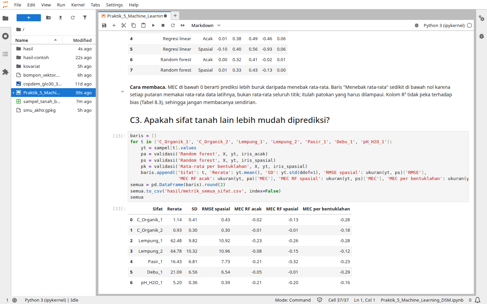

Gambar P5.15 Perbandingan beberapa sifat tanah di notebook

Sumber: Tangkapan layar uji coba

Keadaan ini berlaku pada semua sifat dalam Tabel P5.5. Fatmawati (2026), yang memodelkan fraksi tekstur pada titik yang sama, juga memperoleh kinerja rendah. R² *random forest* untuk lempung lapisan 1 hanya 0,03 dengan RMSE 9,86%, dan model terbaiknya, *stacking*, memperoleh R² 0,098 dengan RMSE 9,24%, meskipun memakai 22 kovariat termasuk peta material permukaan. Jadi, hasil lemah pada Sub-DAS Bompon bukan semata-mata akibat penyederhanaan latihan.

Mengapa demikian? Modul 8 dan data latihan ini memberi beberapa kemungkinan. Ini adalah tafsiran yang perlu didiskusikan, bukan temuan yang sudah terbukti:

1. **Jumlah titik**, yaitu 50 titik untuk wilayah yang beragam, dengan 21 kolom prediktor. Pada beberapa kelas, jumlah titiknya sangat sedikit.
2. **Kerincian medan**, karena semua atribut medan berasal dari DEM permukaan 30 m yang memuat tajuk. Praktik 2 menunjukkan betapa jauh bedanya kelas lereng dari DEM ini dengan kelas lereng dari LiDAR.
3. **Tutupan vegetasi**, yang membuat citra optik lebih banyak merekam tajuk daripada tanah, seperti ditunjukkan Praktik 4.
4. **Waktu perekaman**, karena citra direkam pada 2024 dan 2025, sedangkan sampel diambil pada Februari 2025.
5. **Keragaman lokal yang pendek jangkauannya**, karena C-organik dapat berubah pada jarak yang lebih pendek daripada yang dapat ditangkap data ini, misalnya akibat pengelolaan setiap petak.

**Peringatan tentang tingkat kepentingan kovariat.** Sel C4 menampilkan grafik kepentingan kovariat. Pada uji coba, nilainya hanya sekitar ±0,005 persen C-organik, dan banyak kovariat bernilai negatif, sehingga mengacak kovariat itu justru membuat model sedikit lebih baik. Godaannya adalah menyimpulkan bahwa kovariat di urutan atas mengendalikan C-organik. Kesimpulan seperti itu tidak sah. Model yang tidak mampu memprediksi tidak dapat memberi tahu apa yang mengendalikan tanah (Wadoux, Samuel-Rosa, et al., 2020).


Gambar P5.16 Tingkat kepentingan kovariat, yang tidak boleh ditafsirkan sebagai temuan pedologis pada kasus ini

Sumber: Hasil uji coba

## Tahap 6: Peta Prediksi dan Ketidakpastian

Jalankan sel C5 sampai C8.

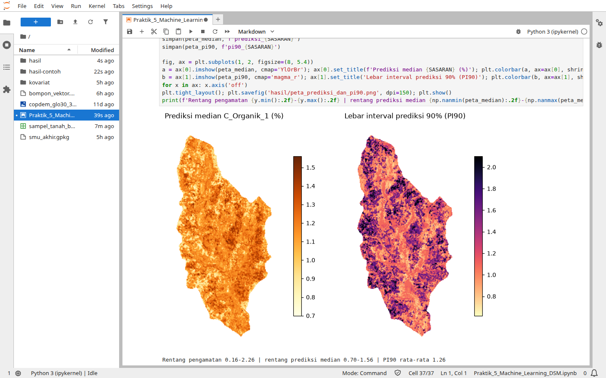

Gambar P5.17 Peta prediksi median dan lebar interval prediksi 90% di notebook

Sumber: Tangkapan layar uji coba

Tiga pemeriksaan berikut lebih penting daripada tampilan petanya:

1. **Rentang nilai.** Pengamatan berkisar 0,16–2,26%, sedangkan prediksi median hanya 0,70–1,56%. *Random forest* merata-ratakan banyak pohon, sehingga petanya lebih halus daripada keragaman sebenarnya. Polanya terlihat meyakinkan, padahal validasi menunjukkan polanya tidak terbukti.

2. **Lebar interval.** PI90 rata-rata sebesar 1,26 poin persen, padahal seluruh rentang pengamatan hanya 2,10 poin. Artinya, model hampir tidak mempersempit kemungkinan nilai C-organik pada suatu piksel.

3. **Kejujuran interval.** PICP pada validasi spasial adalah 0,82 dan pada validasi acak 0,86, cukup dekat dengan sasaran 0,90 walaupun sedikit lebih sempit. Jadi, interval itu kurang lebih jujur: model mengakui ketidaktahuannya sendiri. Peta PI90 pada kasus ini lebih dapat dipercaya daripada peta prediksinya.

Sel C7 menghitung wilayah keberlakuan model. Pada uji coba, 93,5% piksel berada di dalam wilayah keberlakuan dengan ambang DI 0,76. Angka setinggi ini tidak berarti peta dapat dipercaya. Yang diukur hanyalah kemiripan kovariat dengan titik latih. Karena itu, AOA hanya memberi tahu di mana model mengekstrapolasi, bukan apakah modelnya baik. Di sini kovariat diberi bobot sama, karena tingkat kepentingan dari model ini tidak dapat diandalkan, sehingga ini penyederhanaan dari Meyer dan Pebesma (2021) untuk peragaan.

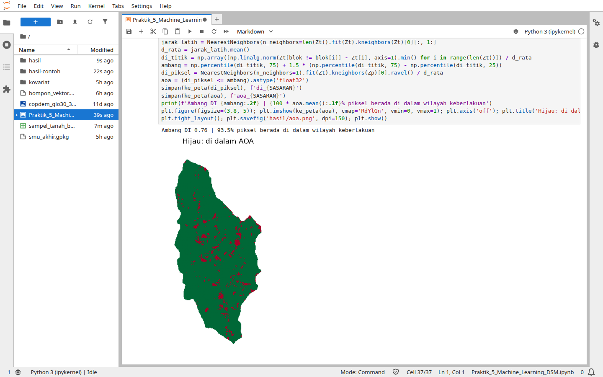

Gambar P5.18 Wilayah keberlakuan model di notebook

Sumber: Tangkapan layar uji coba

Sel C8 menghitung Moran's I residual, dengan hasil −0,03. Nilai yang mendekati 0 berarti residual tidak berpola secara spasial, sehingga pada data ini *kriging* residual kecil kemungkinannya membantu.

**Titik periksa.** Folder `hasil/` berisi `prediksi_C_Organik_1.tif`, `pi90_C_Organik_1.tif`, `di_C_Organik_1.tif`, `aoa_C_Organik_1.tif`, dan tabel `metrik_validasi_C_Organik_1.csv`.

## Tahap 7: Menampilkan Hasil di QGIS

1. Muat `hasil/prediksi_C_Organik_1.tif`, `hasil/pi90_C_Organik_1.tif`, `hasil/aoa_C_Organik_1.tif`, `smu_akhir.gpkg`, dan `hasil/titik_sampel.gpkg`.
2. Tampilkan prediksi sebagai **Singleband pseudocolor**, dan `smu_akhir` hanya sebagai garis batas dengan **Simple Fill**, **Fill style** *No Brush*.

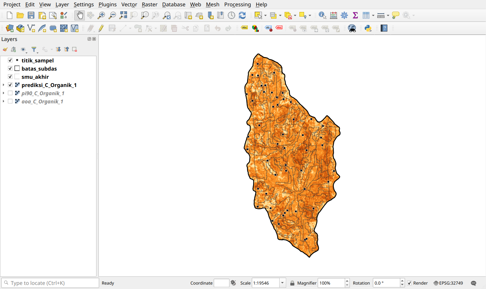

Gambar P5.19 Prediksi C-organik 0–20 cm dengan batas SMU dan titik sampel

Sumber: Tangkapan layar uji coba; prediksi model latihan, bukan peta tanah yang tervalidasi

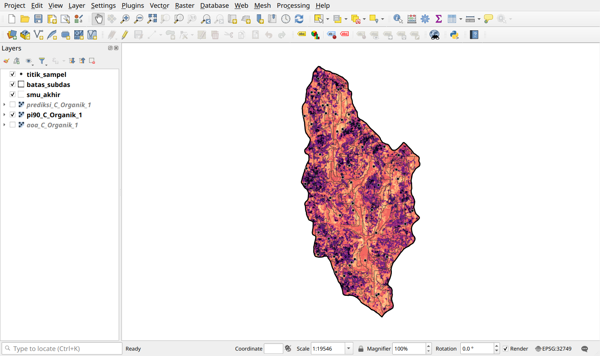

Gambar P5.20 Lebar interval prediksi 90% dengan batas SMU dan titik sampel

Sumber: Tangkapan layar uji coba

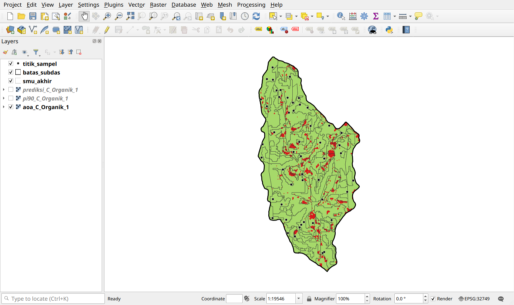

Gambar P5.21 Wilayah keberlakuan model, dengan merah menandai piksel di luar AOA

Sumber: Tangkapan layar uji coba

3. Cari **Zonal statistics** di Processing Toolbox. Isi **Input layer** `smu_akhir`, **Raster layer** `prediksi_C_Organik_1`, **Output column prefix** `pred_`, pilih statistik *Mean*, *Minimum*, dan *Maximum*, lalu simpan ke `hasil/smu_prediksi.gpkg`. Ulangi pada hasilnya dengan `pi90_C_Organik_1` dan awalan `pi90_`, lalu simpan ke `hasil/smu_prediksi_pi90.gpkg`.

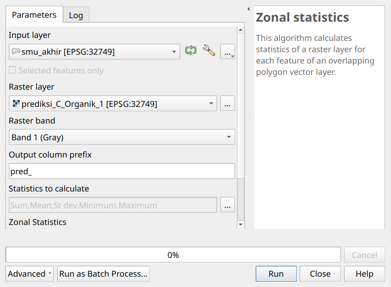

Gambar P5.22 Dialog Zonal Statistics

Sumber: Tangkapan layar uji coba

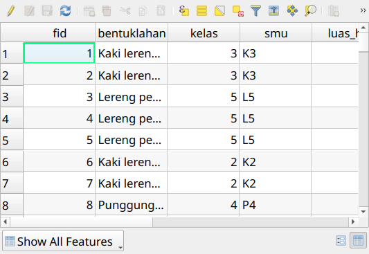

Gambar P5.23 Nilai prediksi dan PI90 per poligon SMU pada tabel atribut

Sumber: Tangkapan layar uji coba

Tabel P5.6 Rata-rata Prediksi dan PI90 menurut Bentuklahan pada Peta SMU Contoh

| **Bentuklahan pada peta SMU** | **Luas (ha)** | **Prediksi C-organik (%)** | **PI90 (poin persen)** |
| :-----: | ---: | ---: | ---: |
| Punggung dan interfluve | 41,6 | 1,13 | 1,33 |
| Lereng perbukitan | 230,8 | 1,16 | 1,27 |
| Kaki lereng dan dataran koluvial | 22,3 | 1,14 | 1,04 |

Sumber: Hasil uji coba, rata-rata terbobot luas; peta SMU contoh dari Praktik 2

Selisih prediksi antarsatuan hanya 0,03 poin persen, sedangkan lebar intervalnya lebih dari satu poin. Perbedaan seperti itu tidak boleh dijadikan dasar perbedaan perlakuan, misalnya perbedaan dosis pupuk organik.

## Tahap 8: Bahan Presentasi

Pada akhir pelatihan, setiap peserta atau kelompok menyajikan alur kerja dan hasilnya. Ekspor peta melalui **Project > Import/Export > Export Map to Image**. Susun penyajian untuk menjawab pertanyaan berikut:

1. Data apa yang dipakai, dan apa keterbatasan setiap sumbernya?
2. Bagaimana peta SMU disusun, dan di mana batasnya berbeda dari peta riset?
3. Kovariat mana yang dipilih dan apa alasannya?
4. Seberapa baik model dibandingkan pembanding sederhananya?
5. Di mana peta ini paling tidak dapat dipercaya?
6. Jika ada anggaran untuk satu perbaikan, apa yang akan dipilih: titik sampel tambahan, DEM yang lebih rinci, peta bahan induk, atau data sensor proksimal? Mengapa?

## Bahan Diskusi

Mudah sekali membuat peta tanah yang tampak meyakinkan, dan peta dari praktik ini adalah contohnya. Warnanya rapi dan terlihat berpola, sehingga pengguna dapat percaya padahal validasi menunjukkan peta itu tidak lebih baik daripada satu angka rata-rata. Kemampuan membaca hasil seperti ini sama pentingnya dengan kemampuan menjalankan modelnya, dan itulah kemampuan yang paling berguna saat menerima peta dari pihak lain.

Bandingkan pula dengan Praktik 3, yang sasarannya juga C-organik. Di sana, MEC pada validasi per profil berkisar 0,35–0,40 dari 264 sampel. Di sini, MEC pada validasi spasial −0,13 dari 50 titik. Wilayah, jumlah sampel, dan kedalamannya berbeda, sehingga kedua angka itu tidak dapat dibandingkan langsung, tetapi selisihnya masuk akal. Spektrum merekam tanah itu sendiri, sedangkan kovariat lingkungan hanya petunjuk tidak langsung yang harus melewati tajuk, data medan 30 m, dan waktu perekaman yang berbeda.

Bagi perkebunan, tanyakan selalu hal-hal berikut sebelum memakai peta DSM untuk rekomendasi pemupukan. Apakah nilai validasinya berasal dari data yang terpisah secara spasial atau dari blok yang berbeda? Berapa nilainya dibanding menebak rata-rata? Mana peta ketidakpastiannya? Hasil yang lemah pada latihan ini juga bukan vonis bagi DSM. Praktik ini menunjukkan bahwa model tidak dapat menciptakan informasi yang tidak ada dalam data. Kebun dengan sampel lebih rapat, DEM lebih rinci, data proksimal, atau peta bahan induk memiliki peluang lebih baik, dan cara menilainya tetap sama.

## Jika Tertinggal

Notebook sudah memuat keluaran uji coba. Semua keluaran tersedia di `data/praktik-5/hasil-contoh/`, termasuk proyek `Praktik_5_selesai.qgz`. Salin isinya ke `hasil/` jika perlu melanjutkan dari tahap tertentu.

## Rujukan Tambahan

Fatmawati, N. D. (2026). *Evaluasi pendekatan SCORPAN dalam prediksi spasial fraksi tekstur tanah pada bahan induk hasil proses alterasi di Sub-DAS Bompon* [Tesis magister, Universitas Gadjah Mada].

Rujukan lain mengikuti daftar pustaka modul teori.
