# Praktik 5. Machine Learning untuk Digital Soil Mapping

*Praktik terbimbing:*

Pemandu: Ferry. Perangkat: QGIS dan Jupyter Notebook. Rujukan teori: Modul 8, Modul 2, dan Modul 4.

## Kurikulum Pembelajaran

**Tujuan**

Membekali peserta agar mampu membangun model pemetaan tanah digital untuk sasaran kategorik, dalam praktik ini tutupan material atau bahan induk, dengan CatBoost, mulai dari penyiapan dan pemilihan kovariat sampai peta kelas beserta peluangnya, serta menilai hasilnya secara kritis.

**Kompetensi**

Setelah mengikuti praktik ini, peserta memiliki kompetensi dalam:

1. Menyiapkan kovariat SCORPAN dari data penginderaan jauh dan data lingkungan
2. Memilih kovariat berdasarkan korelasi Pearson dan tingkat kepentingan kovariat
3. Melatih CatBoost dengan kovariat kategorik dan menilainya dengan validasi acak dan validasi spasial
4. Menangani kelas yang jumlah sampelnya tidak seimbang dengan bobot kelas dan SMOTE-NC
5. Membuat dan membaca peta kelas, peta peluang, dan wilayah keberlakuan model

**Ringkasan Studi**

1. Deskripsi singkat
   - Peserta menyiapkan 16 kovariat di QGIS dan menampilkan 210 titik latih dan uji tutupan material
   - Peserta melatih CatBoost di Jupyter Notebook, memilih kovariat, dan menilainya dengan beberapa skema validasi
   - Peserta menampilkan peta tutupan material hasil prediksi di QGIS bersama peta SMU dari Praktik 2
2. Hasil belajar
   - Peserta memahami alur dari titik berkelas dan kovariat sampai peta kelas
   - Peserta mampu menyatakan seberapa jauh sebuah peta kelas hasil DSM dapat dipercaya
3. Indikator hasil belajar
   - Semua kovariat berukuran 192 × 362 piksel dengan piksel 10 m
   - Tabel metrik memuat CatBoost dan pembandingnya pada validasi acak, blok spasial, dan zona
   - Peta kelas, peta peluang, dan AOA tampil di QGIS bersama batas SMU
4. Materi pokok
   - Faktor SCORPAN sebagai kovariat, dengan bahan induk sebagai sasaran
   - CatBoost dan kovariat kategorik
   - Pemilihan kovariat dengan korelasi Pearson dan kepentingan permutasi
   - Validasi spasial, matriks kebingungan, dan data yang tidak seimbang
   - Peluang kelas dan wilayah keberlakuan model

## Gambaran Praktik

Praktik ini menyatukan semua hasil sebelumnya. Persamaan SCORPAN pada Modul 8 menyatakan tanah sebagai fungsi kondisi lingkungan, dan fungsi itu dipelajari dari data. Sasarannya tidak selalu berupa angka. Banyak kebutuhan pemetaan di perkebunan berupa kelas, misalnya jenis tanah, kelas drainase, atau bahan induk. Karena itu, sasaran praktik ini adalah **tutupan material**, yaitu tujuh kelas bahan induk pada peta Malik (2017) untuk Sub-DAS Bompon. Peserta menyiapkan datanya, memilih kovariatnya, melatih dan menilai modelnya, lalu menerapkannya ke setiap piksel sehingga menghasilkan peta kelas beserta peta peluangnya.

Model utamanya adalah CatBoost (Prokhorenkova et al., 2018), algoritme *gradient boosting* yang dapat membaca kovariat kategorik secara langsung, sedangkan *random forest* menjadi pembanding. Dua hal perlu disampaikan sejak awal. Pertama, kelas di titik sampel diambil dari **peta**, bukan dari pengamatan lapangan, sehingga semua angka ketelitian menyatakan seberapa baik model mereproduksi peta Malik (2017). Kedua, **pada data latihan ini CatBoost tidak lebih teliti daripada *random forest*.** Keduanya jelas lebih baik daripada pembanding sederhana pada validasi acak dan validasi blok spasial, tetapi hampir gagal ketika diterapkan ke zona yang belum pernah dilihatnya. Temuan ini berasal dari uji coba dan bukan kekeliruan langkah. Peserta diharapkan menemukannya sendiri dan mampu menjelaskan penyebabnya.

## Data yang Dipakai

Semua berkas ada di folder `data/praktik-5/`.

Tabel P5.1 Data Praktik 5

| **Berkas** | **Isi** |
| :------: | :------: |
| `Praktik_5_Machine_Learning_DSM.ipynb` | Notebook praktik |
| `titik_tutupan_material.gpkg` | 210 titik latih dan uji, dengan kolom `id`, `kode`, `material`, `subset`, `x`, `y`, dan `jarak_tepi_m` |
| `titik_tutupan_material.csv` | Isi yang sama dalam bentuk tabel, dibaca oleh notebook |
| `material_acuan_10m.tif` | Peta tutupan material pada grid 10 m, hanya sebagai pembanding hasil |
| `material_acuan_10m.qml` | Gaya QGIS berisi warna dan nama ketujuh kelas, dimuat otomatis bersama petanya |
| `kovariat/` | 16 kovariat siap pakai, satu GeoTIFF per kovariat, grid 10 m |
| `demnas_8m.tif` | DEMNAS yang sudah diproyeksikan ke UTM zona 49S dengan piksel 8 m dan dipotong 500 m lebih luas daripada grid kovariat, untuk atribut medan |
| `bompon_vektor.gpkg` | `batas_subdas`, `bentuklahan`, `penggunaan_lahan`, `sungai` |
| `smu_akhir.gpkg` | Peta SMU hasil Praktik 2 |

Sumber: Data proyek; peta tutupan material dari Malik (2017) sebagaimana dipakai Fatmawati (2026); DEMNAS dari Badan Informasi Geospasial (2026)

Tabel P5.2 Tujuh Kelas Tutupan Material Sub-DAS Bompon

| **Kode** | **Material** | **Luas (ha)** | **Luas (%)** | **Titik latih** | **Titik uji** |
| :---: | :-----: | ---: | ---: | ---: | ---: |
| 1 | Breksi andesit sisipan diorit | 9,7 | 3,3 | 21 | 9 |
| 2 | Breksi andesit teralterasi | 75,5 | 25,6 | 21 | 9 |
| 3 | Breksi andesit teralterasi, ditumpangi lapukan batupasir Menoreh | 38,2 | 13,0 | 21 | 9 |
| 4 | Breksi vulkanik | 39,8 | 13,5 | 21 | 9 |
| 5 | Endapan material Sumbing Muda, pasir tufan, tuff pasiran, breksi andesit | 67,4 | 22,9 | 21 | 9 |
| 6 | Endapan Sumbing Muda dan endapan material longsor | 35,4 | 12,0 | 21 | 9 |
| 7 | Tuff pasiran | 28,7 | 9,7 | 21 | 9 |

Sumber: Hasil uji coba; luas dihitung dari `material_acuan_10m.tif` di dalam batas Sub-DAS

Titik dibuat dari peta asal beresolusi 1 m dengan skrip `pelatihan_titik_tutupan_material.py`. Setiap titik berada di pusat satu sel grid kovariat 10 m, sekurang-kurangnya 15 m di dalam poligon kelasnya agar tidak jatuh di sel campuran pada batas kelas, dan disebar merata di setiap kelas dengan bantuan *k-means*. Kolom `subset` membagi titik menjadi latih dan uji secara acak berstrata. Ada tiga catatan tentang data ini:

1. **Asal kelas**, yaitu peta Malik (2017) yang merupakan hasil pemetaan geomorfologi, bukan pengamatan di setiap titik. Peta asal hanya menyimpan kode 1 sampai 7. Nama kelasnya dicocokkan dengan legenda Gambar 2.2 pada Fatmawati (2026) berdasarkan letak setiap kode di peta.
2. **Jumlah titik sama untuk setiap kelas**, padahal luas kelas terbesar hampir delapan kali luas kelas terkecil. Akibat rancangan ini dibahas pada Tahap 6 dan Tahap 7.
3. **Bahan induk sebagai sasaran.** Fatmawati (2026) memakai peta ini sebagai kovariat faktor p. Di sini perannya dibalik, sehingga peta material tidak boleh masuk ke folder `kovariat/`, karena justru itulah yang diprediksi.

## Tahap 1: Alur Machine Learning

Buka `Praktik_5_Machine_Learning_DSM.ipynb` di JupyterLab atau Colab, lalu jalankan sel sampai akhir **Bagian A**. Seluruh notebook memerlukan 2–5 menit pada komputer uji coba. Waktu di laptop Anda dapat berbeda.

Bagian A memperkenalkan alur dasarnya. Titik dan kovariat dibaca, nilai kovariat diambil di setiap titik, lalu CatBoost dilatih dengan pembagian latih dan uji pada kolom `subset`. Ukuran utamanya adalah **akurasi keseluruhan** (*overall accuracy*), yaitu proporsi titik yang kelasnya ditebak benar. Dengan tujuh kelas yang sama banyak, menebak sembarang menghasilkan akurasi sekitar 0,14.

Tabel P5.3 Model Pertama pada Data Latih dan Data Uji

| **Data** | **Akurasi** | **Kappa** | **F1 makro** |
| :---: | ---: | ---: | ---: |
| Data latih (147 titik) | 1,00 | 1,00 | 1,00 |
| Data uji (63 titik) | 0,54 | 0,46 | 0,51 |

Sumber: Hasil uji coba, CatBoost dengan 14 kovariat numerik

Pada data latih, model menebak semua titik dengan benar. Pada data yang belum pernah dilihatnya, akurasinya turun menjadi 0,54. Inilah *overfitting* yang dibahas pada Modul 8. Angka 0,54 memang jauh di atas 0,14, tetapi berarti hampir separuh titik uji masih salah kelas.

Sel berikutnya mengulang pembagian acak 70/30 sebanyak 30 kali. Akurasinya berkisar dari 0,40 sampai 0,60, dengan median 0,48. Satu pembagian yang kebetulan baik dapat memberi kesan keliru, sehingga laporan yang hanya menyebut satu pembagian tunggal perlu dibaca dengan hati-hati.

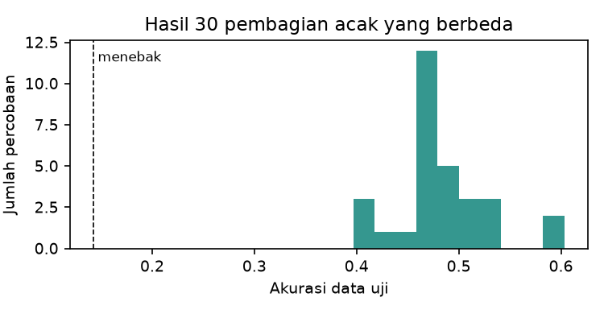

Gambar P5.1 Sebaran akurasi dari 30 pembagian acak yang berbeda

Sumber: Hasil uji coba

## Tahap 2: Menyiapkan Kovariat di QGIS

Folder `kovariat/` sudah berisi semua kovariat siap pakai, sehingga notebook tetap berjalan walaupun tahap ini belum selesai. Tahap ini menunjukkan cara membuatnya, dan kovariat buatan Anda dapat menimpa berkas di folder itu. Tutup dulu layer yang akan ditimpa dari panel **Layers**. Kovariat optik dan radar berasal dari data Praktik 1 dan Praktik 4, sehingga tidak dibuat ulang. Atribut medan dihitung dari DEMNAS (Badan Informasi Geospasial, 2026), yaitu DEM yang sama dengan Praktik 1. Pada folder ini, DEMNAS sudah diproyeksikan ke UTM zona 49S dengan piksel 8 m dan dipotong 500 m lebih luas daripada grid kovariat, sehingga atribut medan di tepi Sub-DAS tidak terpotong.

1. Buat proyek baru, simpan sebagai `hasil/praktik5.qgz`, lalu muat `demnas_8m.tif` dan semua layer `bompon_vektor.gpkg`.
2. **Elevasi.** Pilih **Raster > Projections > Warp (Reproject)** dengan **Input layer** `demnas_8m`, **Target CRS** `EPSG:32749`, **Resampling method to use** *Bilinear (2x2 Kernel)*, dan **Output file resolution** `10`. Buka **Advanced Parameters**, isi **Georeferenced extents of output file to be created** dengan `396060,397980,9162990,9166610 [EPSG:32749]`, lalu pilih **Output data type** *Float32*. Simpan ke `kovariat/elevasi.tif`. Pengaturan ini sama dengan Praktik 1 tahap 2.

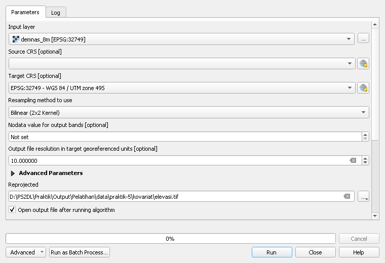

Gambar P5.2 Membawa DEMNAS 8 m ke grid kovariat 10 m

Sumber: Tangkapan layar uji coba

3. **Kemiringan lereng.** Pilih **Raster > Analysis > Slope**, dengan **Input layer** `elevasi`, centang **Express slope as percent** dan **Compute edges**, lalu simpan ke `kovariat/lereng.tif`.
4. **Arah hadap.** Pilih **Raster > Analysis > Aspect**, dengan input yang sama, centang **Return 0 for flat** dan **Compute edges**, lalu simpan ke `hasil/aspek_derajat.tif`. Nilai 359° dan 1° sebenarnya berdekatan, tetapi angkanya berjauhan. Karena itu arah diubah menjadi kosinus, yaitu ukuran seberapa menghadap ke utara, dengan Raster Calculator berikut, lalu disimpan ke `kovariat/arah_utara.tif`.

```
cos("aspek_derajat@1" * 3.14159265 / 180)
```

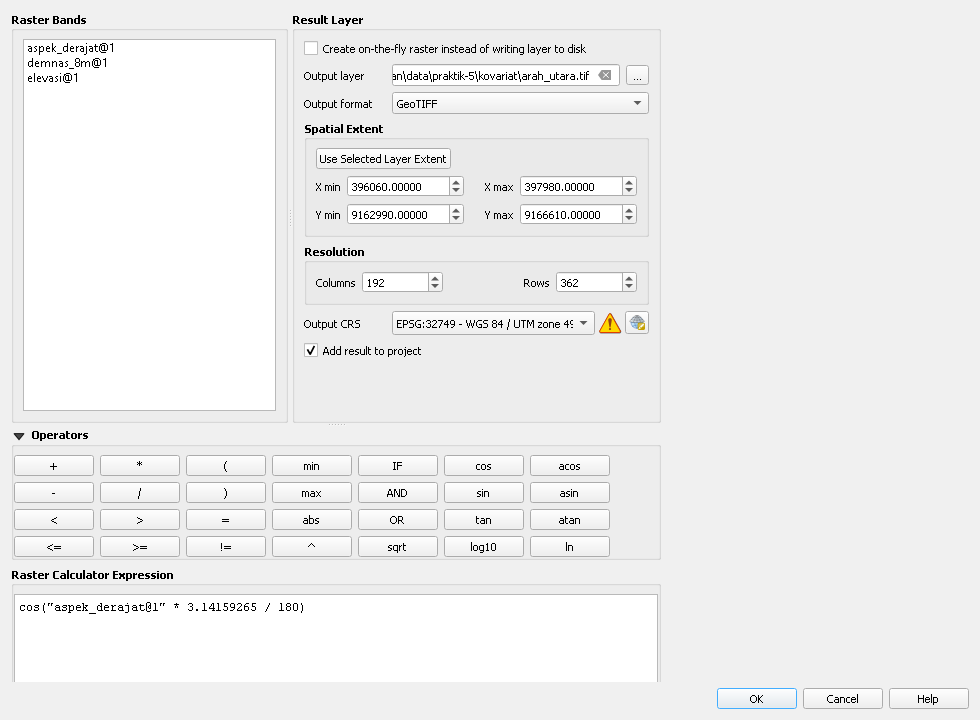

Gambar P5.3 Mengubah arah hadap menjadi kosinus

Sumber: Tangkapan layar uji coba

5. **Posisi topografi dan kekasaran medan.** Cari **Topographic Position Index (TPI)** di Processing Toolbox. Gunakan **Input layer** `demnas_8m`, centang **Compute edges**, lalu simpan ke `hasil/tpi_8m.tif`. Lakukan hal yang sama dengan **Terrain Ruggedness Index (TRI)** ke `hasil/tri_8m.tif`. Keduanya sengaja dihitung pada piksel asli DEMNAS, sebelum diselaraskan ke 10 m, agar jendela 3 × 3 piksel mengolah ketinggian asli, bukan nilai hasil interpolasi. Jendela itu hanya mencakup sekitar 24 m × 24 m, sehingga TPI dan TRI di sini menggambarkan bentuk medan yang sangat setempat.

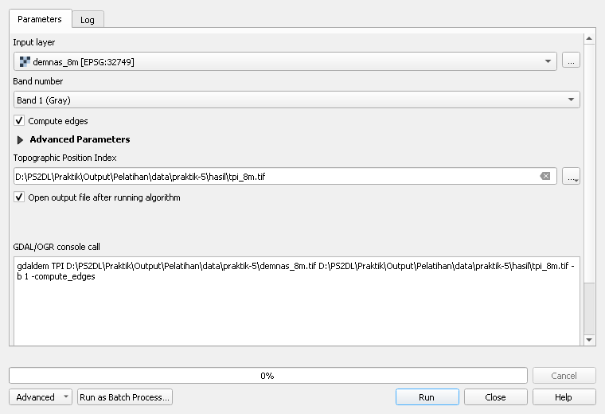

Gambar P5.4 Dialog Topographic Position Index

Sumber: Tangkapan layar uji coba

6. **Kebasahan topografi.** Cari **r.topidx** di Processing Toolbox. Isi **Input elevation layer** `demnas_8m`, lalu simpan ke `hasil/twi_8m.tif`. Alat ini memerlukan penyedia GRASS. Jika tidak tersedia di laptop Anda, lewati langkah ini dan pakai berkas yang sudah ada.

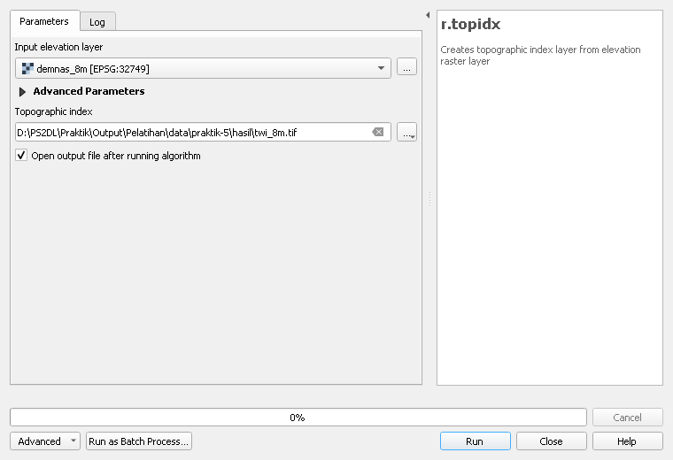

Gambar P5.5 Menghitung indeks kebasahan topografi dengan r.topidx

Sumber: Tangkapan layar uji coba

7. Selaraskan ketiganya ke grid 10 m dengan pengaturan Warp yang sama seperti langkah 2, lalu simpan sebagai `kovariat/tpi.tif`, `kovariat/tri.tif`, dan `kovariat/twi.tif`.
8. **Jarak ke sungai.** Pilih **Raster > Conversion > Rasterize (Vector to Raster)** dengan **Input layer** `sungai`, **A fixed value to burn** `1`, **Output raster size units** *Georeferenced units*, resolusi `10` dan `10`, **Output extent** `396060,397980,9162990,9166610 [EPSG:32749]`, dan **Assign a specified NoData value** `0`. Simpan ke `hasil/sungai_raster.tif`.

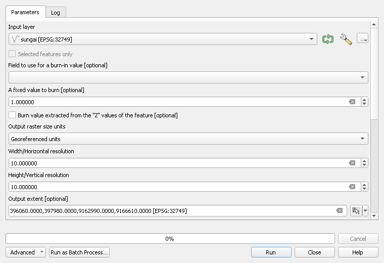

Gambar P5.6 Mengubah garis sungai menjadi raster

Sumber: Tangkapan layar uji coba

9. Pilih **Raster > Analysis > Proximity (Raster Distance)** dengan **Input layer** `sungai_raster`, **List of target pixels** `1`, **Distance units** *Georeferenced coordinates*, **Nodata value to use for the destination proximity raster** `-9999`, dan **Output data type** *Float32*. Simpan ke `kovariat/jarak_sungai.tif`.

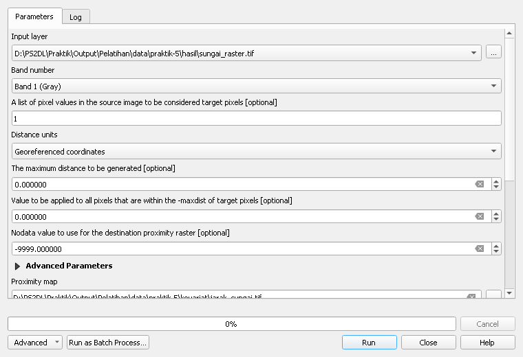

Gambar P5.7 Menghitung jarak ke sungai terdekat

Sumber: Tangkapan layar uji coba

10. **Kovariat kategorik.** Raster memerlukan angka, sehingga nama kelas diberi kode lebih dulu. Jalankan **Field calculator** dari Processing Toolbox pada layer `bentuklahan`, dengan **Field name** `kode`, **Result field type** *Integer*, dan formula berikut. Simpan ke `hasil/bentuklahan_kode.gpkg`.

```
CASE WHEN "bentuklahan"='Interfluve' THEN 1
     WHEN "bentuklahan"='Lereng Atas Perbukitan' THEN 2
     WHEN "bentuklahan"='Lereng Tengah Perbukitan' THEN 3
     WHEN "bentuklahan"='Lereng Bawah Perbukitan' THEN 4
     WHEN "bentuklahan"='Lereng Kaki Koluvial' THEN 5
     WHEN "bentuklahan"='Dataran Koluvial' THEN 6 END
```

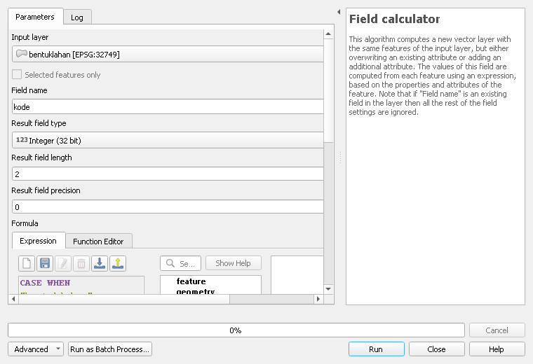

Gambar P5.8 Memberi kode numerik pada kelas bentuklahan

Sumber: Tangkapan layar uji coba

11. Rasterize hasil tersebut seperti langkah 8, tetapi pilih **Field to use for a burn-in value** `kode`, **Assign a specified NoData value** `0`, dan **Output data type** *Int16*. Simpan ke `kovariat/kat_bentuklahan.tif`. Ulangi untuk `penggunaan_lahan` dengan kode Agroforestri 1, Tegalan 2, Sawah 3, dan Permukiman 4, lalu simpan ke `kovariat/kat_penggunaan_lahan.tif`.

Tabel P5.4 Enam Belas Kovariat dan Faktor SCORPAN-nya

| **Kovariat** | **Faktor** | **Asal** | **Minimum** | **Rata-rata** | **Maksimum** |
| :---: | :--: | :-----: | ---: | ---: | ---: |
| `elevasi` (m) | r | DEMNAS | 349,57 | 458,62 | 536,04 |
| `lereng` (%) | r | DEMNAS | 0,05 | 21,51 | 74,10 |
| `arah_utara` | r | DEMNAS | −1,00 | −0,10 | 1,00 |
| `tpi` (m) | r | DEMNAS | −0,89 | 0,00 | 0,68 |
| `tri` | r | DEMNAS | 0,21 | 4,36 | 14,25 |
| `twi` | r | DEMNAS | 3,57 | 5,89 | 15,47 |
| `jarak_sungai` (m) | r | Peta sungai | 0,00 | 360,19 | 1.287,98 |
| `kat_bentuklahan` | r | Peta riset | 1 | kategori | 6 |
| `kat_penggunaan_lahan` | o | Foto udara | 1 | kategori | 4 |
| `ndvi_2024` | o | Sentinel-2 | 0,05 | 0,78 | 0,92 |
| `ndvi_2025` | o | Sentinel-2 | 0,04 | 0,83 | 0,94 |
| `bsi_2024` | o, s | Sentinel-2 | −0,47 | −0,22 | 0,25 |
| `bi_2024` | o, s | Sentinel-2 | 0,02 | 0,04 | 0,40 |
| `cmr_2024` | o, s | Sentinel-2 | 1,07 | 2,10 | 2,59 |
| `sar_vv` (dB) | o, r | Sentinel-1 | −23,32 | −7,04 | 7,08 |
| `sar_vh` (dB) | o | Sentinel-1 | −26,30 | −13,49 | −1,66 |

Sumber: Hasil uji coba, seluruh grid 192 × 362 piksel; DEMNAS dari Badan Informasi Geospasial (2026); *Contains modified Copernicus Sentinel data 2024–2025*

Tidak ada faktor iklim, karena hampir tidak bervariasi di wilayah seluas ini. Faktor bahan induk (p) juga tidak ada di daftar ini, karena pada praktik ini bahan induk justru menjadi sasaran pemodelan.

**Titik periksa.** Semua raster di `kovariat/` berukuran 192 × 362 piksel dengan piksel 10 m. Jika ada yang berbeda, notebook akan gagal membaca atau salah menempatkan nilainya.

## Tahap 3: Menampilkan Titik Latih dan Uji

1. Muat `material_acuan_10m.tif`. Di folder yang sama ada `material_acuan_10m.qml`, yaitu berkas gaya QGIS yang namanya sama dengan rasternya. QGIS memuat gaya itu secara otomatis, sehingga peta tampil sebagai **Paletted/Unique values** lengkap dengan warna dan nama ketujuh kelas pada Tabel P5.2. Buka **Properties > Symbology** untuk melihat pengaturannya.
2. Muat layer `titik_tutupan_material` dari `titik_tutupan_material.gpkg`. Buka **Properties > Symbology**, pilih **Categorized**, isi **Value** dengan `subset`, lalu klik **Classify**. Beri titik latih warna hitam dan titik uji warna putih.

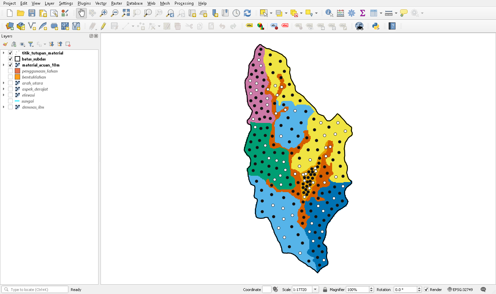

Gambar P5.9 Titik latih (hitam) dan titik uji (putih) di atas peta tutupan material

Sumber: Tangkapan layar uji coba; peta tutupan material dari Malik (2017)

Perhatikan titik-titik yang rapat di tengah Sub-DAS. Titik itu milik kelas 1, yang hanya seluas 9,7 ha tetapi tetap mendapat 30 titik.

3. Cari **Sample raster values** di Processing Toolbox. Isi **Input Layer** `titik_tutupan_material`, **Raster Layer** `elevasi`, **Output column prefix** `elevasi_`, lalu simpan ke `hasil/titik_material_elevasi.gpkg`.

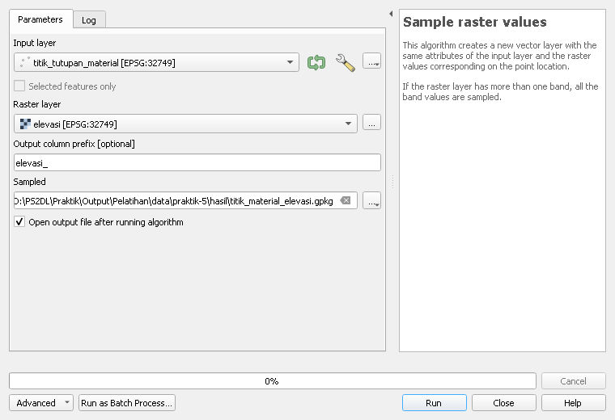

Gambar P5.10 Dialog Sample Raster Values

Sumber: Tangkapan layar uji coba

4. Buka tabel atribut hasilnya dengan tombol **F6**. Kolom `elevasi_1` berisi ketinggian di setiap titik.

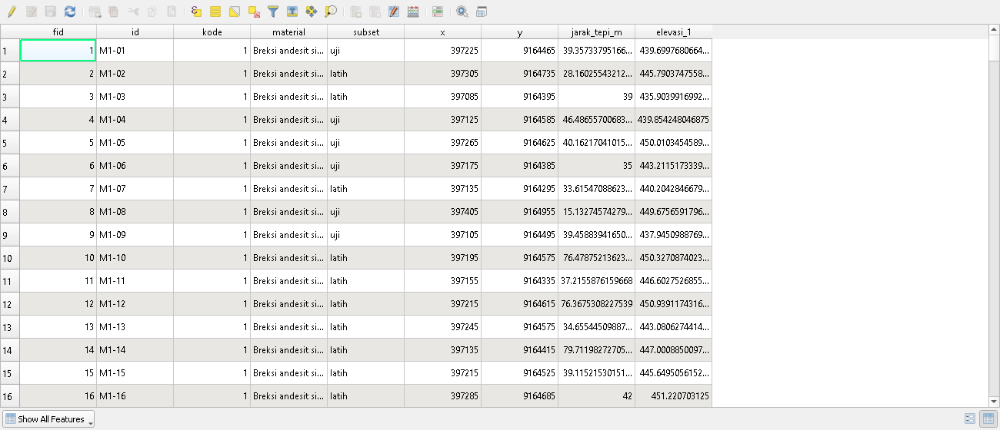

Gambar P5.11 Tabel atribut titik latih dan uji

Sumber: Tangkapan layar uji coba

Langkah ini disebut penumpangan (*overlay*), dan satu baris pada tabel inilah contoh terkecil dari tabel pemodelan. Di notebook, langkah yang sama dilakukan sekaligus untuk 16 kovariat.

**Titik periksa.** Ada 210 titik, 30 titik untuk setiap kelas, dan semuanya berada di dalam batas Sub-DAS.

## Tahap 4: Menyiapkan dan Memilih Kovariat

Kembali ke notebook, lalu jalankan **Bagian B**.

B1 memetakan kovariat ke faktor SCORPAN. Kali ini yang ditanyakan adalah seberapa jauh relief (r) dan data penginderaan jauh (o, s) mencerminkan bahan induk di bawahnya. Diskusikan alasan pada tabel itu. Rasio mineral lempung (`cmr_2024`), misalnya, masuk akal sebagai petunjuk mineral lempung hasil alterasi, tetapi Praktik 4 menunjukkan bahwa sebagian besar permukaan Sub-DAS tertutup vegetasi, sehingga citra lebih banyak merekam tajuk daripada tanah.

Tabel median per kelas pada A2 sudah memberi petunjuk awal. Kelas 6, yaitu endapan Sumbing Muda dan material longsor, sangat berbeda dari kelas lain. Median lerengnya 8,9%, sedangkan kelas lain 18,8–23,8%, dan median indeks kebasahan topografinya 7,4, sedangkan kelas lain 5,0–5,6. Enam kelas lainnya jauh lebih mirip satu sama lain.

B2 menghitung korelasi Pearson antarkovariat dari seluruh piksel di dalam Sub-DAS. Empat pasangan memiliki |r| ≥ 0,8 (Tabel P5.5). Pasangan itu baru dicatat, belum dibuang. Kovariat mana yang dipertahankan diputuskan pada Tahap 5, setelah kepentingannya bagi model diketahui.

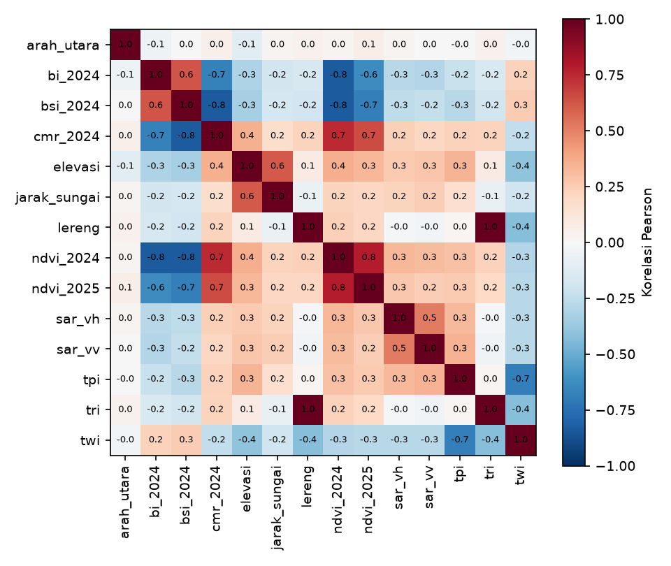

Gambar P5.12 Matriks korelasi Pearson antarkovariat

Sumber: Hasil uji coba

Tabel P5.5 Pasangan Kovariat dengan Korelasi Pearson |r| ≥ 0,8

| **Kovariat 1** | **Kovariat 2** | **r** |
| :---: | :---: | ---: |
| `bi_2024` | `ndvi_2024` | −0,83 |
| `bsi_2024` | `cmr_2024` | −0,83 |
| `bsi_2024` | `ndvi_2024` | −0,83 |
| `lereng` | `tri` | 0,99 |

Sumber: Hasil uji coba, seluruh piksel di dalam Sub-DAS

B3 menyiapkan kovariat kategorik dalam dua bentuk. *Random forest* di scikit-learn memerlukan *one-hot*, yaitu satu kolom 0/1 untuk setiap kelas kategori, sehingga 16 kovariat menjadi 24 kolom. CatBoost menerima kolom berisi nama kelas apa adanya. Kategori dengan sedikit nilai dikodekan *one-hot* di dalam model, sedangkan kategori dengan banyak nilai diubah menjadi statistik sasaran berurutan (*ordered target statistics*). Statistik ini pada dasarnya rata-rata sasaran per kategori, tetapi untuk setiap titik hanya dihitung dari titik-titik sebelumnya dalam suatu urutan acak, sehingga nilai sasaran titik itu tidak ikut menentukan kodenya sendiri (Prokhorenkova et al., 2018). Keunggulan ini paling terasa pada kategori yang sangat beragam, misalnya kode blok kebun atau varietas.

Tabel silang pada B3 memperlihatkan dua hal. Seluruh titik kelas 6 berada pada Dataran Koluvial dan Lereng Kaki Koluvial, dan di kedua bentuklahan itu hanya ada satu titik dari kelas lain. Selain itu, penggunaan lahan didominasi agroforestri, yaitu 149 dari 210 titik. Kecocokan bentuklahan dengan kelas 6 masuk akal secara proses, tetapi perlu diingat bahwa peta bentuklahan dan peta material sama-sama hasil kajian geomorfologi di wilayah yang sama. Sebagian kecocokan itu mungkin terjadi karena batasnya ditarik dengan cara yang serupa.

**Titik periksa.** `hasil/korelasi_kovariat.png` terbentuk, dan tabel CatBoost berukuran 210 baris dan 16 kolom.

## Tahap 5: Membangun, Menilai, dan Memilih Kovariat Model

Jalankan **Bagian C**, sel C1 sampai C4.

C1 membentuk tiga skema validasi. Skema acak membagi titik secara acak ke dalam lima lipatan. Skema blok spasial membagi wilayah menjadi blok persegi 400 m, dan setiap blok utuh masuk ke satu lipatan. Skema zona mengelompokkan titik menjadi lima zona besar, sehingga meniru penerapan model ke wilayah yang benar-benar baru. Pada skema zona, satu lipatan tidak memiliki satu pun titik latih kelas 7, sehingga kelas itu mustahil ditebak benar pada lipatan tersebut.

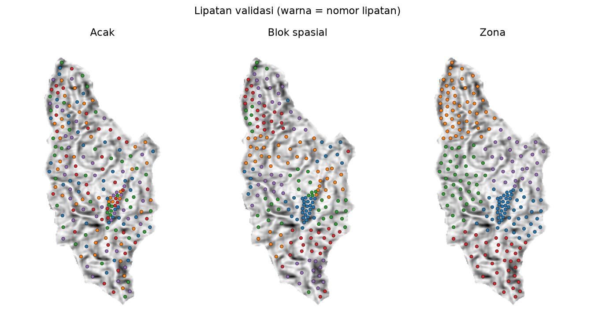

Gambar P5.13 Tiga skema validasi, dengan warna yang menunjukkan nomor lipatan

Sumber: Hasil uji coba

C2 membandingkan empat model. Dua di antaranya adalah pembanding sederhana, yaitu menebak kelas terbanyak dan memberi satu kelas material untuk setiap bentuklahan. Pembanding kedua setara dengan peta konvensional, yang memberi satu label untuk setiap satuan peta.

Tabel P5.6 Hasil Validasi Silang Klasifikasi Tutupan Material

| **Model** | **Akurasi acak** | **Akurasi blok spasial** | **Akurasi zona** | **F1 makro blok spasial** |
| :-----: | ---: | ---: | ---: | ---: |
| Kelas terbanyak | 0,14 | 0,02 | 0,00 | 0,01 |
| Kelas terbanyak per bentuklahan | 0,30 | 0,19 | 0,15 | 0,18 |
| *Random forest* (*one-hot*) | 0,51 | 0,37 | 0,19 | 0,35 |
| CatBoost | 0,48 | 0,38 | 0,18 | 0,37 |

Sumber: Hasil uji coba dengan 16 kovariat; nilai kappa tersimpan di `metrik_validasi_material.csv`

Bacalah tabel ini per kolom. Pada validasi acak dan blok spasial, kedua model pembelajaran mesin jelas melampaui pembanding sederhana. Akurasi blok spasial sekitar 0,1 lebih rendah daripada akurasi acak, karena pada validasi acak titik uji selalu memiliki tetangga dekat di data latih. Pada skema zona, akurasi kedua model turun menjadi 0,18–0,19, hanya sedikit di atas menebak sembarang. Model yang dipelajari di satu bagian Sub-DAS hampir tidak berlaku di bagian lain. Ini peringatan penting sebelum memakai model dari satu kebun untuk kebun tetangga.

CatBoost dan *random forest* praktis sama. Sel tambahan pada C2 juga menunjukkan bahwa cara CatBoost mengodekan kategori tidak memperbaiki hasil. Dengan *one-hot* di dalam model, akurasi blok spasialnya 0,38, sedangkan dengan statistik sasaran berurutan, yaitu pengaturan bawaannya, akurasinya 0,35 dan waktunya sekitar delapan kali lebih lama (32 detik dibanding 4 detik pada komputer uji coba). Hanya ada dua kovariat kategorik, masing-masing dengan 6 dan 4 kelas, sehingga keunggulan CatBoost dalam mengolah kategori belum mendapat kesempatan untuk tampak.

Kappa dilaporkan karena lazim dipakai, tetapi pada data ini tidak menambah informasi. Jumlah titik per kelas sama, sehingga kappa hanyalah akurasi yang diskalakan ulang. Pontius dan Millones (2011) bahkan menganjurkan agar kappa diganti dengan ukuran selisih jumlah dan selisih letak kelas.

C3 menampilkan matriks kebingungan (*confusion matrix*) CatBoost pada validasi blok spasial. Recall adalah proporsi titik suatu kelas yang ditebak benar, sedangkan presisi adalah proporsi tebakan suatu kelas yang memang benar.

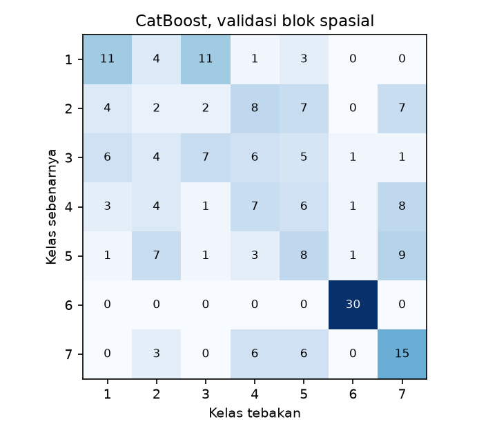

Gambar P5.14 Matriks kebingungan CatBoost pada validasi blok spasial

Sumber: Hasil uji coba

Tabel P5.7 Ketelitian per Kelas pada Validasi Blok Spasial

| **Kode** | **Material** | **Recall** | **Presisi** | **F1** |
| :---: | :-----: | ---: | ---: | ---: |
| 1 | Breksi andesit sisipan diorit | 0,37 | 0,44 | 0,40 |
| 2 | Breksi andesit teralterasi | 0,07 | 0,08 | 0,07 |
| 3 | Breksi andesit teralterasi, ditumpangi lapukan batupasir Menoreh | 0,23 | 0,32 | 0,27 |
| 4 | Breksi vulkanik | 0,23 | 0,23 | 0,23 |
| 5 | Endapan material Sumbing Muda, pasir tufan, tuff pasiran, breksi andesit | 0,27 | 0,23 | 0,25 |
| 6 | Endapan Sumbing Muda dan endapan material longsor | 1,00 | 0,91 | 0,95 |
| 7 | Tuff pasiran | 0,50 | 0,38 | 0,43 |

Sumber: Hasil uji coba, CatBoost dengan 16 kovariat

Semua titik kelas 6 ditebak benar, karena kelas ini menempati dataran dan kaki lereng koluvial yang landai dan dekat sungai. Kelas 2, yaitu breksi andesit teralterasi, paling sering tertukar dengan kelas lain (F1 0,07), disusul kelas 4, kelas 5, dan kelas 3 (F1 0,23–0,27). Kelas-kelas itu berupa batuan breksi dan endapan pada lereng perbukitan, dan kovariat yang tersedia hampir tidak membedakannya.

C4 memilih kovariat untuk model akhir dengan dua informasi. Tingkat kepentingan dihitung dengan permutasi, yaitu mengacak nilai satu kovariat pada data uji setiap lipatan blok spasial, lalu mengukur penurunan akurasinya. Kepentingan sengaja dihitung pada data yang tidak dipakai melatih model, karena kepentingan dari data latih dapat menonjolkan kovariat yang hanya membantu model menghafal (Meyer et al., 2019). Aturan pemilihannya adalah sebagai berikut:

1. **Urutan**, yaitu kovariat diurutkan dari kepentingan permutasi terbesar.
2. **Kepentingan positif**, yaitu kovariat dengan kepentingan ≤ 0 dibuang, karena mengacaknya tidak menurunkan akurasi pada data yang belum pernah dilihat model.
3. **Korelasi Pearson**, yaitu kovariat numerik yang berkorelasi |r| ≥ 0,8 dengan kovariat terpilih yang lebih penting dibuang, sehingga dari setiap pasangan pada Tabel P5.5 hanya satu yang dipertahankan.

Ketiga aturan itu menggabungkan dua sudut pandang. Kepentingan menjawab kovariat mana yang benar-benar dipakai model pada data baru, sedangkan korelasi menjawab kovariat mana yang hanya mengulang informasi kovariat lain.

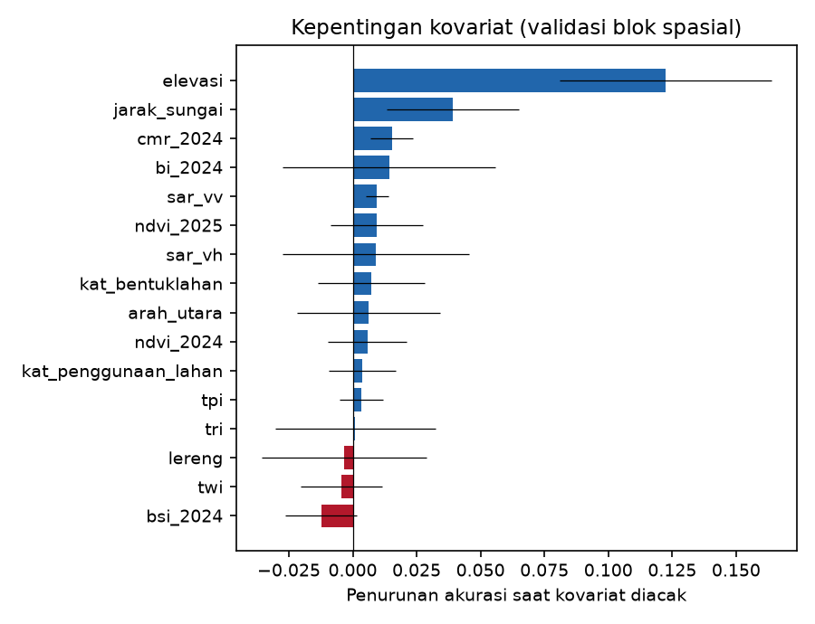

Gambar P5.15 Kepentingan permutasi kovariat, dengan garis yang menunjukkan simpangan baku antarlipatan

Sumber: Hasil uji coba

Tabel P5.8 Kepentingan Kovariat dan Keputusan Pemilihan

| **Kovariat** | **Kepentingan permutasi** | **Kepentingan bawaan CatBoost (%)** | **Keputusan** |
| :---: | ---: | ---: | :-----: |
| `elevasi` | 0,122 | 22,5 | Dipakai |
| `jarak_sungai` | 0,039 | 12,5 | Dipakai |
| `cmr_2024` | 0,015 | 3,7 | Dipakai |
| `bi_2024` | 0,014 | 6,9 | Dipakai |
| `sar_vv` | 0,010 | 5,3 | Dipakai |
| `ndvi_2025` | 0,010 | 3,4 | Dipakai |
| `sar_vh` | 0,009 | 5,3 | Dipakai |
| `kat_bentuklahan` | 0,007 | 4,0 | Dipakai |
| `arah_utara` | 0,006 | 6,1 | Dipakai |
| `ndvi_2024` | 0,006 | 4,6 | Dibuang, r = −0,83 dengan `bi_2024` |
| `kat_penggunaan_lahan` | 0,004 | 6,1 | Dipakai |
| `tpi` | 0,003 | 5,9 | Dipakai |
| `tri` | 0,001 | 3,9 | Dipakai |
| `lereng` | −0,003 | 4,5 | Dibuang, kepentingan ≤ 0 |
| `twi` | −0,004 | 2,6 | Dibuang, kepentingan ≤ 0 |
| `bsi_2024` | −0,012 | 2,8 | Dibuang, kepentingan ≤ 0 |

Sumber: Hasil uji coba; kepentingan permutasi berupa penurunan akurasi rata-rata pada lima lipatan blok spasial

Ketinggian adalah kovariat terpenting dengan selisih jauh, disusul jarak ke sungai. Kecuali untuk `elevasi`, `jarak_sungai`, `cmr_2024`, dan `sar_vv`, simpangan antarlipatan pada Gambar P5.15 lebih besar daripada nilai kepentingannya sendiri, sehingga urutan kovariat lainnya tidak stabil. Kepentingan bawaan CatBoost, yang dihitung dari data latih, memberi gambaran yang berbeda. `kat_penggunaan_lahan`, misalnya, memperoleh 6,1% pada kepentingan bawaan, tetapi mengacaknya hanya menurunkan akurasi sebesar 0,004 pada data uji. `lereng` dan `tri` hampir identik (r = 0,99). Dari pasangan itu `tri` yang dipertahankan, karena `lereng` sudah tersisih oleh aturan kepentingan. Hal yang sama terjadi pada pasangan `bsi_2024` dan `cmr_2024`.

Tabel P5.9 Pengaruh Pemilihan Kovariat pada Ketelitian CatBoost

| **Kovariat** | **Jumlah** | **Akurasi acak** | **Akurasi blok spasial** | **F1 makro blok spasial** |
| :-----: | :---: | ---: | ---: | ---: |
| Semua kovariat | 16 | 0,48 | 0,38 | 0,37 |
| Kovariat terpilih | 12 | 0,53 | 0,40 | 0,39 |
| Dipilih ulang di dalam setiap lipatan (*nested*) | 5–10 | – | 0,37 | 0,36 |

Sumber: Hasil uji coba

Dengan 12 kovariat, akurasi blok spasial naik sedikit dari 0,38 menjadi 0,40. Angka itu optimistis, karena kovariat dipilih memakai lipatan yang sama dengan yang dipakai untuk menilainya. Jika pemilihan diulang di dalam setiap lipatan hanya dari data latihnya (*nested*), akurasinya 0,37, praktis sama dengan memakai semua kovariat. Jadi, pada data ini pemilihan kovariat tidak menaikkan ketelitian. Manfaatnya adalah model yang lebih ramping dan tersingkirnya kovariat yang hanya mengulang informasi kovariat lain. Kovariat yang terpilih juga berubah dari lipatan ke lipatan. Setiap lipatan memilih 5 sampai 10 kovariat, dan hanya tiga yang selalu terpilih, yaitu `elevasi`, `jarak_sungai`, dan `bi_2024`. Hasil pemilihan kovariat pada data sebanyak ini tidak boleh dianggap sebagai daftar baku.

**Titik periksa.** Folder `hasil/` berisi `metrik_validasi_material.csv`, `matriks_kebingungan.png`, dan `kepentingan_kovariat.png`, dan notebook mencetak 12 kovariat terpilih.

## Tahap 6: Menangani Data yang Tidak Seimbang

Jalankan sel C5.

Data latihan ini seimbang, tetapi di kebun keadaan seperti itu jarang terjadi. Bila titik disebar acak, jumlah titik setiap kelas kira-kira sebanding dengan luasnya, sehingga kelas yang sempit hanya memperoleh sedikit titik dan model cenderung mengabaikannya. C5 menirukan keadaan itu. Pada setiap lipatan blok spasial, titik latih dikurangi sehingga jumlahnya sebanding dengan luas kelas, lalu tiga cara dibandingkan:

1. **Tanpa penanganan**, yaitu model dilatih apa adanya.
2. **Bobot kelas**, yaitu kesalahan pada kelas yang sedikit titiknya diberi bobot lebih besar. Pada CatBoost, `auto_class_weights='Balanced'` memberi setiap kelas bobot sebesar jumlah titik kelas terbanyak dibagi jumlah titik kelas itu.
3. **SMOTE-NC**, yaitu titik sintetis ditambahkan pada kelas yang sedikit dengan menginterpolasi antara sebuah titik dan tetangganya di ruang kovariat (Chawla et al., 2002), memakai pustaka imbalanced-learn (Lemaître et al., 2017). Akhiran NC menandakan bahwa kovariat kategorik ikut ditangani, yaitu titik sintetis mengambil kategori yang paling sering muncul di antara tetangganya.

Kedua penanganan hanya diterapkan pada data latih setiap lipatan. Bila titik sintetis dibuat sebelum data dibagi, informasi dari titik uji ikut masuk ke data latih dan akurasinya menjadi semu. Metode SMOGN sering disebut dalam konteks yang sama, tetapi metode itu dirancang untuk sasaran kontinu yang nilai ekstremnya jarang, misalnya C-organik yang sangat tinggi (Branco et al., 2017). Untuk sasaran berupa kelas seperti tutupan material, padanannya adalah SMOTE.

Tabel P5.10 Pengaruh Penanganan Data Tidak Seimbang pada Validasi Blok Spasial

| **Cara** | **Akurasi** | **F1 makro** | **Recall kelas 1** | **Recall kelas 2** | **Recall kelas 3** | **Recall kelas 4** |
| :-----: | ---: | ---: | ---: | ---: | ---: | ---: |
| Tanpa penanganan | 0,30 | 0,27 | 0,01 | 0,34 | 0,06 | 0,08 |
| Bobot kelas | 0,33 | 0,31 | 0,03 | 0,27 | 0,17 | 0,19 |
| SMOTE-NC | 0,32 | 0,31 | 0,01 | 0,24 | 0,18 | 0,21 |

Sumber: Hasil uji coba, rata-rata tiga ulangan pengurangan titik

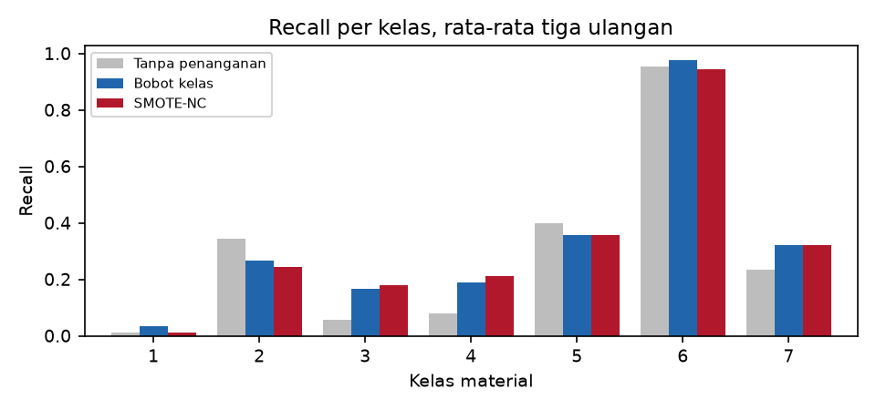

Gambar P5.16 Recall per kelas pada tiga cara penanganan data tidak seimbang

Sumber: Hasil uji coba

Penanganan menaikkan F1 makro dari 0,27 menjadi 0,31 dan menaikkan recall kelas yang berukuran sedang, misalnya kelas 3 dari 0,06 menjadi 0,17–0,18 dan kelas 4 dari 0,08 menjadi 0,19–0,21, dengan mengorbankan sebagian recall kelas yang luas. Recall kelas 2, kelas terluas, turun dari 0,34 menjadi 0,27 dengan bobot kelas dan 0,24 dengan SMOTE-NC. Untuk kelas 1, keduanya praktis tidak membantu. Setelah dikurangi, kelas ini kadang hanya memiliki satu titik latih dalam satu lipatan. Dari satu titik, SMOTE tidak dapat menginterpolasi apa pun, dan bobot sebesar apa pun hanya memperkuat satu contoh. Penyeimbangan tidak dapat menciptakan informasi yang tidak ada di dalam data.

Penyeimbangan juga mengubah luas kelas pada peta, seperti terlihat pada Tabel P5.11.

Tabel P5.11 Proporsi Luas Kelas pada Peta Prediksi (%)

| **Rancangan sampel dan cara** | **1** | **2** | **3** | **4** | **5** | **6** | **7** |
| :-----: | ---: | ---: | ---: | ---: | ---: | ---: | ---: |
| Peta acuan | 3,3 | 25,6 | 13,0 | 13,5 | 22,9 | 12,0 | 9,7 |
| Sampel seimbang (30 per kelas) | 10,2 | 13,3 | 18,7 | 14,2 | 15,1 | 14,3 | 14,2 |
| Sebanding luas, tanpa penanganan | 0,5 | 34,4 | 12,7 | 9,1 | 24,5 | 14,0 | 4,9 |
| Sebanding luas, bobot kelas | 2,7 | 24,5 | 16,7 | 11,1 | 21,7 | 15,1 | 8,2 |
| Sebanding luas, SMOTE-NC | 3,2 | 23,7 | 16,0 | 13,7 | 19,4 | 14,6 | 9,3 |

Sumber: Hasil uji coba, CatBoost dengan kovariat terpilih yang dilatih dengan seluruh titik

Model yang dilatih dari sampel sebanding luas tanpa penanganan memperluas kelas yang besar dan hampir menghilangkan kelas 1. Sebaliknya, model dari sampel seimbang memperluas kelas 1 sekitar tiga kali lipat dan menyempitkan kelas 2 menjadi sekitar separuhnya. Model menganggap setiap kelas sama umumnya dengan di data latihnya. Karena itu, rancangan sampel dan cara penanganan harus mengikuti tujuan peta. Jika yang penting adalah menemukan kelas yang jarang, misalnya bahan induk tertentu yang bermasalah, recall kelas itulah yang dikejar. Jika yang penting adalah luas setiap kelas, proporsi pada peta perlu dibandingkan dengan sumber lain. Pada uji coba ini, sampel sebanding luas yang diberi bobot kelas atau SMOTE-NC menghasilkan proporsi yang paling dekat dengan peta acuan, tetapi hasil dari satu wilayah seperti ini belum dapat dijadikan aturan umum.

**Titik periksa.** Folder `hasil/` berisi `recall_data_tidak_seimbang.png`.

## Tahap 7: Peta Kelas, Peluang, dan Keberlakuan Model

Jalankan sel C6 sampai C9.

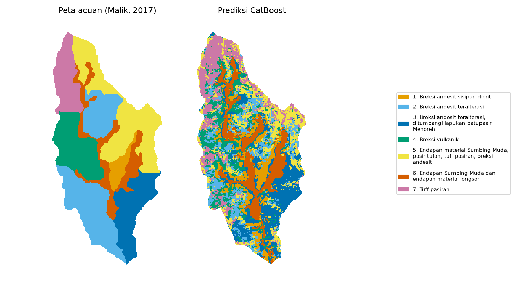

Gambar P5.17 Peta acuan dan peta prediksi tutupan material

Sumber: Hasil uji coba; peta acuan dari Malik (2017); prediksi model latihan, bukan peta bahan induk yang tervalidasi

Empat pemeriksaan berikut lebih penting daripada tampilan petanya:

1. **Kesesuaian dengan peta acuan**, yaitu 46,1% piksel prediksi sama dengan peta acuan. Kelas 6 paling sesuai, dengan 89,6% luasnya diprediksi benar, sedangkan kelas 2 hanya 25,9%. Angka ini bukan validasi independen, karena titik latih diambil dari peta yang sama, tetapi menunjukkan seberapa jauh model mereproduksi peta itu di antara titik-titiknya.
2. **Luas setiap kelas**, yaitu kelas 1 diprediksi seluas 30,2 ha padahal pada peta acuan hanya 9,7 ha, sedangkan kelas 2 hanya 39,2 ha dari 75,5 ha. Model akhir dilatih dengan 30 titik per kelas, sehingga inilah sisi lain dari persoalan pada Tahap 6.
3. **Tekstur peta**, yaitu peta acuan berupa poligon utuh hasil delineasi, sedangkan peta prediksi berbintik karena setiap piksel ditebak sendiri-sendiri. Bintik itu bukan informasi baru tentang batuan, melainkan tanda ketidakpastian model.
4. **Peluang**, yaitu rata-rata peluang kelas tertinggi di seluruh peta 0,51, dan hanya 17,3% piksel yang memiliki peluang ≥ 0,7. Kejujuran peluang itu diperiksa pada Tabel P5.12.

Tabel P5.12 Peluang Kelas Tertinggi dan Proporsi Tebakan yang Benar

| **Peluang kelas tertinggi** | **Jumlah titik** | **Proporsi benar** |
| :---: | ---: | ---: |
| ≤ 0,3 | 20 | 0,15 |
| 0,3–0,5 | 103 | 0,29 |
| 0,5–0,7 | 47 | 0,38 |
| > 0,7 | 40 | 0,80 |

Sumber: Hasil uji coba, prediksi validasi blok spasial dengan kovariat terpilih

Titik yang diprediksi dengan peluang di atas 0,7 benar pada 80% kasus, sedangkan titik dengan peluang yang lebih rendah hanya benar pada 15–38% kasus. Jadi, peta peluang dapat dipakai untuk memisahkan bagian peta yang dapat dipegang dari bagian yang sebaiknya diperiksa di lapangan. Peluang dari model *boosting* belum tentu terkalibrasi sempurna, sehingga pemeriksaan seperti ini perlu diulang setiap kali model berubah.

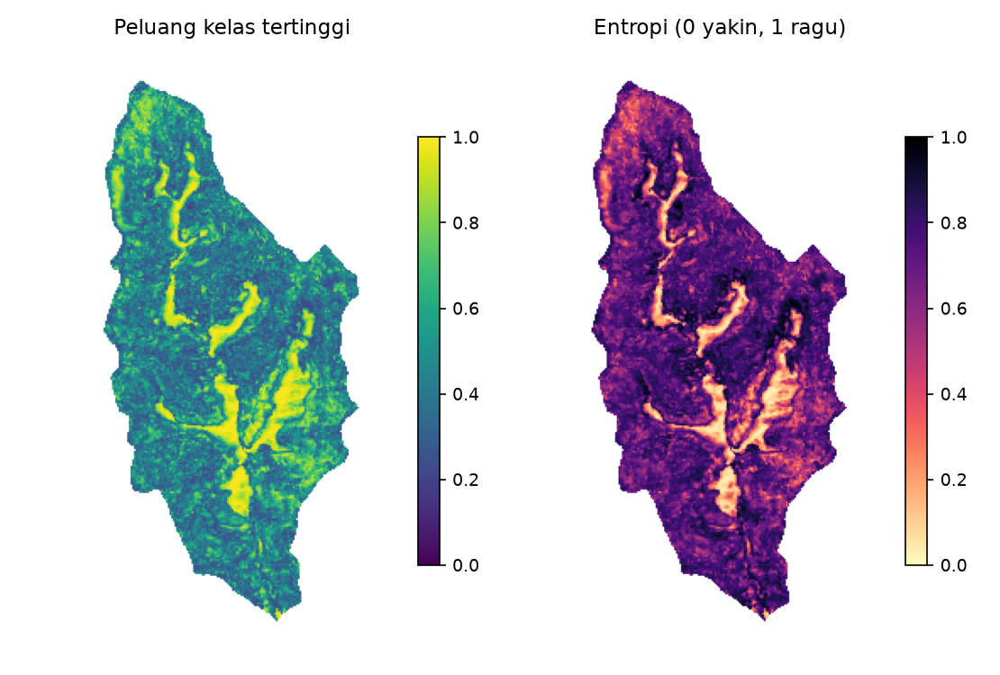

Gambar P5.18 Peluang kelas tertinggi dan entropi peluang

Sumber: Hasil uji coba

Sel C8 menghitung wilayah keberlakuan model dengan kovariat yang dibobot menurut kepentingannya. Pada uji coba, 97,8% piksel berada di dalam AOA dengan ambang DI 0,31. Hasil ini perlu dibaca bersama Tabel P5.6. Hampir semua piksel memiliki kombinasi kovariat yang mirip dengan titik latih, tetapi validasi zona menunjukkan bahwa model hampir gagal di wilayah yang belum dilihatnya. AOA hanya memeriksa kemiripan kovariat, sehingga tidak dapat mendeteksi keadaan ketika nilai kovariat yang sama, misalnya ketinggian yang sama, ditempati material yang berbeda di bagian Sub-DAS yang berbeda.

Sel C9 memetakan kesesuaian prediksi dengan peta acuan, bersama titik yang salah pada validasi blok spasial. Dari 210 titik, 127 titik salah. Kesalahan terbanyak terjadi pada kelas 2 (25 dari 30 titik), disusul kelas 3, kelas 4, dan kelas 5 yang masing-masing salah pada 23 titik, sedangkan seluruh titik kelas 6 benar.

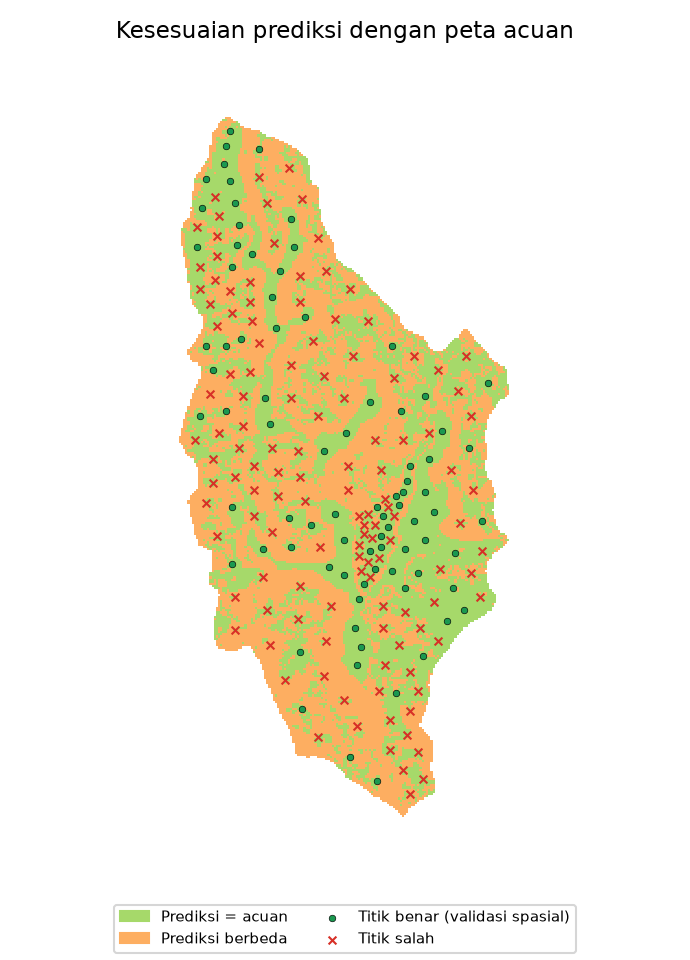

Gambar P5.19 Kesesuaian prediksi dengan peta acuan dan titik yang salah pada validasi blok spasial

Sumber: Hasil uji coba

**Titik periksa.** Folder `hasil/` berisi `prediksi_material.tif`, `peluang_maks_material.tif`, `entropi_material.tif`, `di_material.tif`, `aoa_material.tif`, dan `kesesuaian_material.tif`.

## Tahap 8: Menampilkan Hasil di QGIS

1. Muat `hasil/prediksi_material.tif`, `hasil/peluang_maks_material.tif`, `hasil/kesesuaian_material.tif`, `hasil/aoa_material.tif`, `smu_akhir.gpkg`, dan `titik_tutupan_material.gpkg`.
2. Notebook menyalin berkas gaya peta acuan menjadi `hasil/prediksi_material.qml`, sehingga peta prediksi langsung tampil dengan warna dan nama kelas yang sama dengan peta acuan. Tampilkan `kesesuaian_material` sebagai **Paletted/Unique values**, klik **Classify**, lalu beri nilai 1 warna hijau dengan label *Sama dengan peta acuan* dan nilai 2 warna jingga dengan label *Berbeda*. Lakukan hal yang sama pada `aoa_material` untuk nilai 0 (di luar AOA) dan 1 (di dalam AOA). Tampilkan `peluang_maks_material` sebagai **Singleband pseudocolor** dengan **Min** 0 dan **Max** 1, dan `smu_akhir` hanya sebagai garis batas dengan **Simple Fill**, **Fill style** *No Brush*.

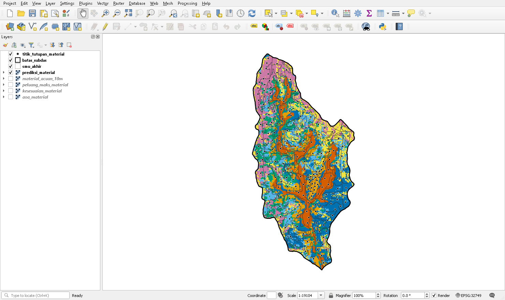

Gambar P5.20 Prediksi tutupan material dengan batas SMU dan titik sampel

Sumber: Tangkapan layar uji coba; prediksi model latihan, bukan peta bahan induk yang tervalidasi

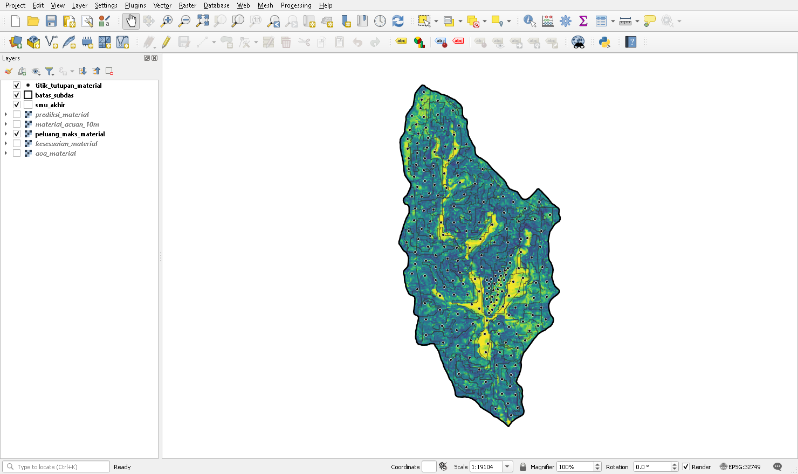

Gambar P5.21 Peluang kelas tertinggi dengan batas SMU dan titik sampel

Sumber: Tangkapan layar uji coba

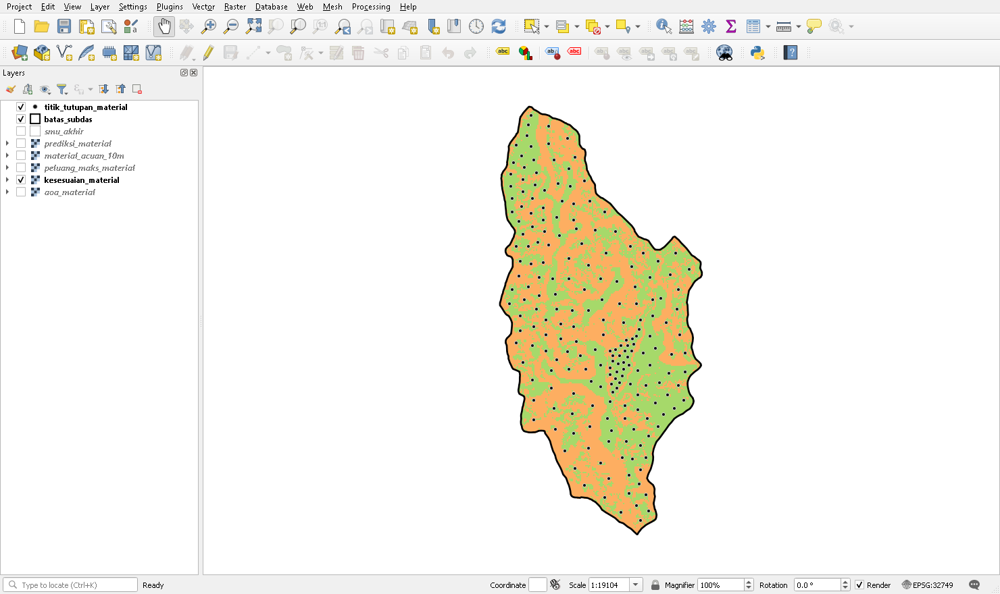

Gambar P5.22 Kesesuaian prediksi dengan peta acuan, dengan hijau untuk piksel yang sama dan jingga untuk piksel yang berbeda

Sumber: Tangkapan layar uji coba

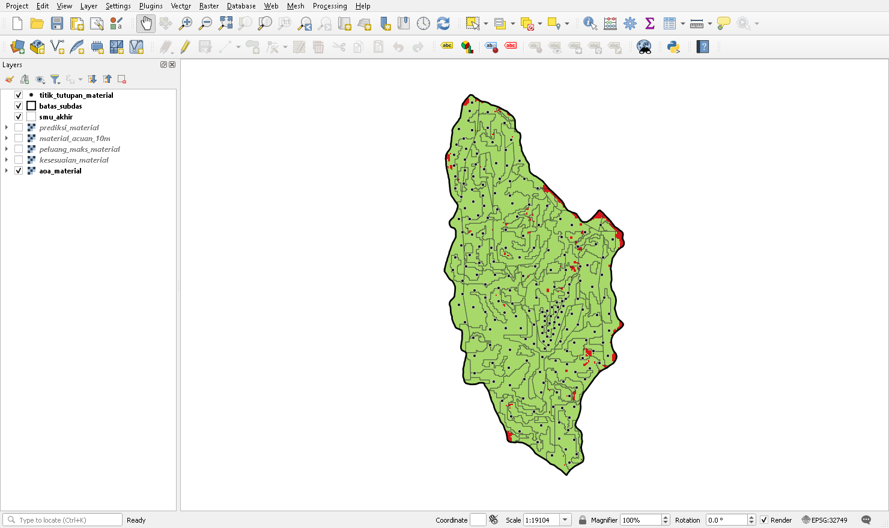

Gambar P5.23 Wilayah keberlakuan model, dengan merah menandai piksel di luar AOA

Sumber: Tangkapan layar uji coba

3. Cari **Zonal histogram** di Processing Toolbox. Isi **Raster layer** `prediksi_material`, **Vector layer containing zones** `smu_akhir`, **Output column prefix** `kelas_`, lalu simpan ke `hasil/smu_komposisi_material.gpkg`.

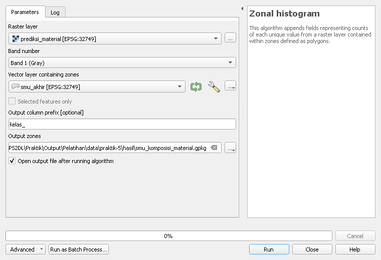

Gambar P5.24 Dialog Zonal Histogram

Sumber: Tangkapan layar uji coba

4. Buka tabel atribut hasilnya. Kolom `kelas_1` sampai `kelas_7` berisi jumlah piksel setiap kelas di dalam setiap poligon SMU. Satu piksel sama dengan 100 m², atau 0,01 ha.

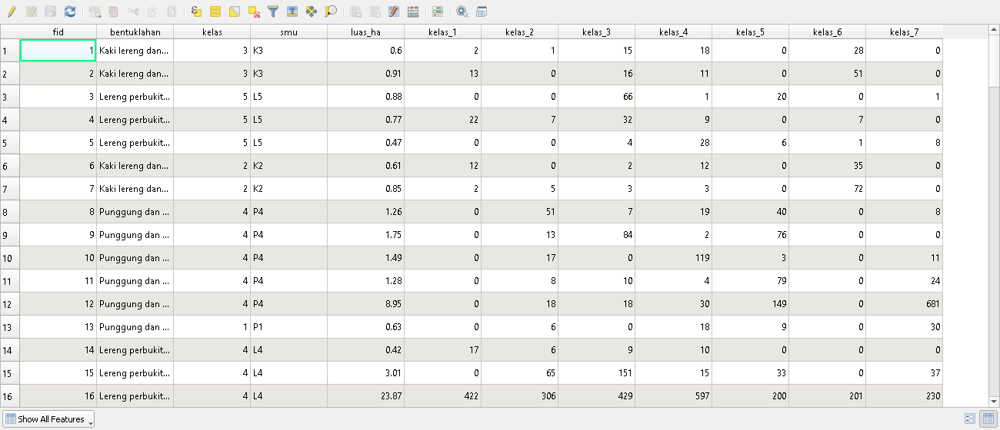

Gambar P5.25 Jumlah piksel setiap kelas material per poligon SMU pada tabel atribut

Sumber: Tangkapan layar uji coba

Tabel P5.13 Komposisi Tutupan Material Prediksi menurut Bentuklahan pada Peta SMU Contoh (%)

| **Bentuklahan pada peta SMU** | **Luas (ha)** | **1** | **2** | **3** | **4** | **5** | **6** | **7** |
| :-----: | ---: | ---: | ---: | ---: | ---: | ---: | ---: | ---: |
| Punggung dan interfluve | 41,5 | 0,0 | 12,1 | 12,7 | 10,9 | 26,0 | 0,0 | 38,4 |
| Lereng perbukitan | 230,7 | 12,4 | 14,8 | 20,8 | 15,7 | 14,5 | 10,6 | 11,2 |
| Kaki lereng dan dataran koluvial | 22,5 | 6,9 | 0,5 | 8,1 | 4,9 | 0,2 | 79,0 | 0,5 |

Sumber: Hasil uji coba, jumlah piksel prediksi CatBoost per bentuklahan; peta SMU contoh dari Praktik 2

Satuan kaki lereng dan dataran koluvial didominasi kelas 6, yaitu endapan, sesuai dengan proses pembentukannya. Pada lereng perbukitan, tidak ada kelas yang menempati lebih dari seperempat luas, sehingga satuan itu tidak dapat diberi satu label bahan induk hanya dari peta prediksi ini. Agregasi per satuan seperti ini juga merupakan cara sederhana untuk meredam bintik pada peta kelas.

## Tahap 9: Bahan Presentasi

Pada akhir pelatihan, setiap peserta atau kelompok menyajikan alur kerja dan hasilnya. Ekspor peta melalui **Project > Import/Export > Export Map to Image**. Susun penyajian untuk menjawab pertanyaan berikut:

1. Data apa yang dipakai, dan apa keterbatasan setiap sumbernya?
2. Bagaimana peta SMU disusun, dan di mana batasnya berbeda dari peta riset?
3. Kovariat mana yang dipilih, dan bagaimana kepentingan serta korelasi Pearson dipakai untuk memilihnya?
4. Seberapa baik CatBoost dibandingkan pembanding sederhananya, dan pada skema validasi yang mana?
5. Kelas mana yang paling sering tertukar, dan di mana peta ini paling tidak dapat dipercaya?
6. Jika sampel di kebun tidak seimbang, cara penanganan mana yang dipilih, dan apa akibatnya pada luas setiap kelas?
7. Jika ada anggaran untuk satu perbaikan, apa yang akan dipilih: titik pengamatan lapangan, DEM yang lebih rinci, peta geologi yang lebih rinci, atau data sensor proksimal? Mengapa?

## Bahan Diskusi

Mudah sekali membuat peta kelas yang tampak meyakinkan. Peta prediksi pada praktik ini berwarna rapi dan menampilkan alur endapan yang masuk akal, tetapi hanya 46% pikselnya sama dengan peta acuan, dan sebagian besar pikselnya memiliki peluang di bawah 0,7. Kemampuan membaca matriks kebingungan, peta peluang, dan hasil validasi spasial sama pentingnya dengan kemampuan menjalankan modelnya, terutama saat menerima peta kelas dari pihak lain.

Pilihan algoritme juga perlu ditempatkan secara wajar. CatBoost tidak lebih teliti daripada *random forest* pada data ini. Keunggulannya di sini bersifat praktis, yaitu kategori dapat dimasukkan langsung tanpa penyiapan tambahan, sedangkan keunggulan pengodean kategorinya baru akan terasa pada kategori yang sangat beragam. Hal ini sejalan dengan Modul 8, bahwa mutu data dan kovariat lebih menentukan daripada pilihan algoritme.

Hasil validasi zona patut mendapat perhatian khusus. Pada validasi acak dan blok spasial, model jauh lebih baik daripada pembanding sederhana, tetapi pada zona yang belum dilihatnya akurasinya hampir sama dengan menebak. Salah satu kemungkinan penjelasannya, ketinggian sebagai kovariat terpenting lebih banyak bekerja sebagai penanda letak di dalam Sub-DAS daripada sebagai penjelas sifat batuan yang berlaku di mana saja. Meyer et al. (2019) menunjukkan bahwa kovariat seperti ini dapat membuat model tampak baik dalam mereproduksi data, tetapi buruk dalam prediksi spasial. Bagi perkebunan, artinya model yang dilatih di satu kebun belum tentu berlaku di kebun lain, dan klaim seperti itu harus dibuktikan dengan validasi pada wilayah yang terpisah.

Sebelum memakai peta kelas hasil DSM, tanyakan selalu hal-hal berikut. Dari mana label kelasnya, dari pengamatan lapangan atau dari peta lain? Apakah ketelitiannya dinilai dengan data yang terpisah secara spasial? Bagaimana recall dan presisi setiap kelas, bukan hanya akurasi keseluruhannya? Berapa jumlah sampel setiap kelas, dan apa akibatnya pada luas kelas di peta? Mana peta peluangnya?

## Jika Tertinggal

Notebook sudah memuat keluaran uji coba. Semua keluaran tersedia di `data/praktik-5/hasil-contoh/`, termasuk proyek `Praktik_5_selesai.qgz`. Salin isinya ke `hasil/` jika perlu melanjutkan dari tahap tertentu.

## Rujukan Tambahan

Badan Informasi Geospasial. (2026). *Info Data Demnas* [Halaman portal]. Ina-Geoportal. https://tanahair.indonesia.go.id/portal-web/unduh/demnas

Branco, P., Torgo, L., & Ribeiro, R. P. (2017). SMOGN: A pre-processing approach for imbalanced regression. *Proceedings of Machine Learning Research*, *74*, 36–50.

Chawla, N. V., Bowyer, K. W., Hall, L. O., & Kegelmeyer, W. P. (2002). SMOTE: Synthetic minority over-sampling technique. *Journal of Artificial Intelligence Research*, *16*, 321–357.

Fatmawati, N. D. (2026). *Evaluasi pendekatan SCORPAN dalam prediksi spasial fraksi tekstur tanah pada bahan induk hasil proses alterasi di Sub-DAS Bompon* [Tesis magister, Universitas Gadjah Mada].

Lemaître, G., Nogueira, F., & Aridas, C. K. (2017). Imbalanced-learn: A Python toolbox to tackle the curse of imbalanced datasets in machine learning. *Journal of Machine Learning Research*, *18*(17), 1–5.

Malik, R. F. (2017). *Pemetaan geomorfologi detail menggunakan teknik step-wise-grid di Daerah Aliran Sungai (DAS) Bompon, Kabupaten Magelang, Jawa Tengah* [Karya akhir, Universitas Gadjah Mada].

Meyer, H., Reudenbach, C., Wöllauer, S., & Nauss, T. (2019). Importance of spatial predictor variable selection in machine learning applications – Moving from data reproduction to spatial prediction. *Ecological Modelling*, *411*, 108815.

Pontius, R. G., Jr., & Millones, M. (2011). Death to Kappa: Birth of quantity disagreement and allocation disagreement for accuracy assessment. *International Journal of Remote Sensing*, *32*(15), 4407–4429.

Prokhorenkova, L., Gusev, G., Vorobev, A., Dorogush, A. V., & Gulin, A. (2018). CatBoost: Unbiased boosting with categorical features. *Advances in Neural Information Processing Systems*, *31*, 6638–6648.

Rujukan lain mengikuti daftar pustaka modul teori.
