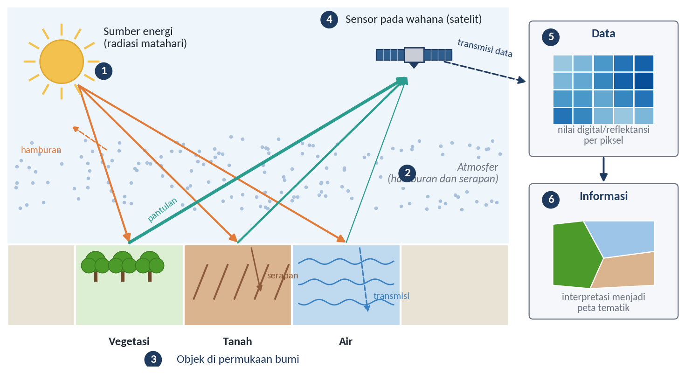
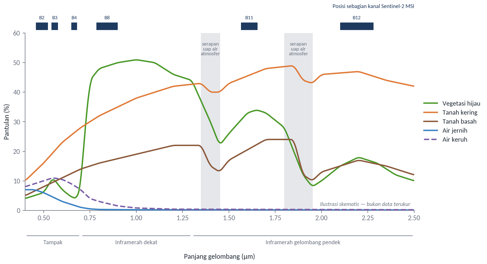
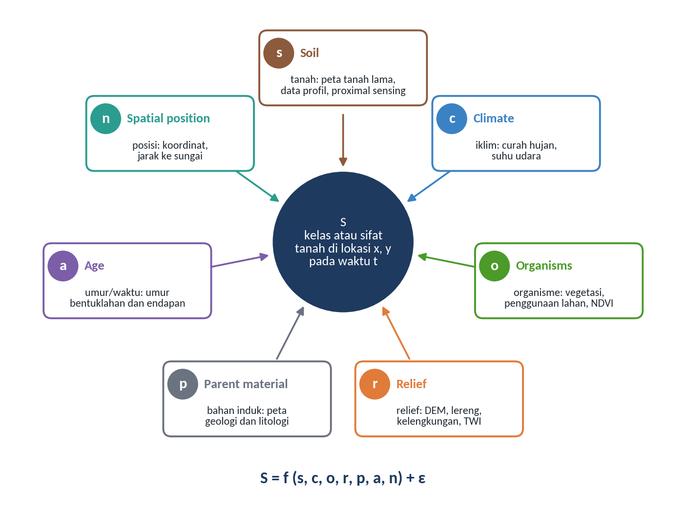
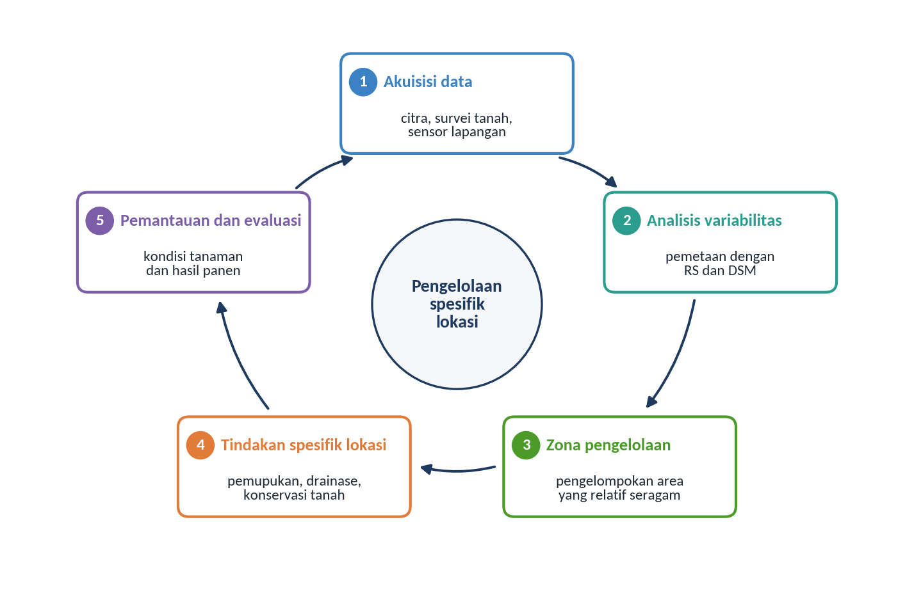
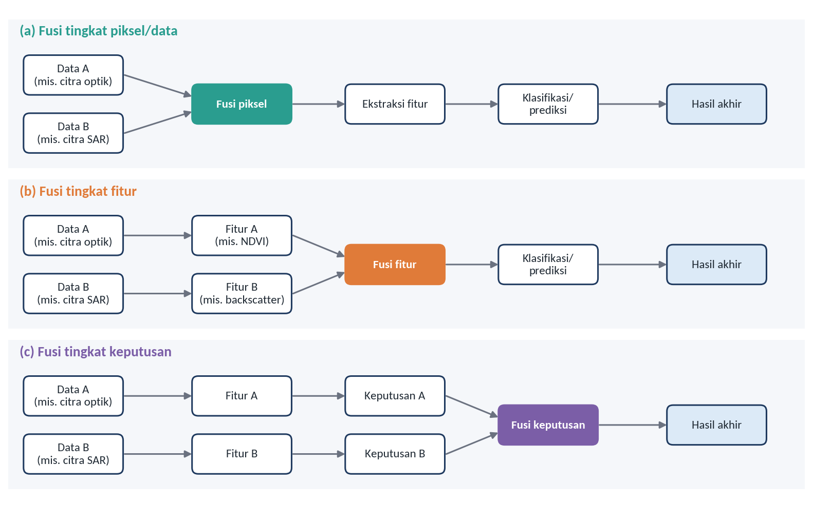
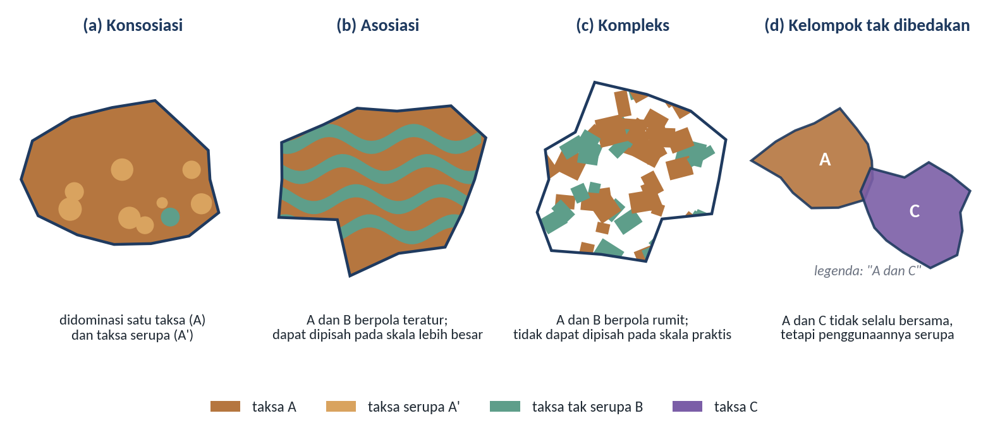
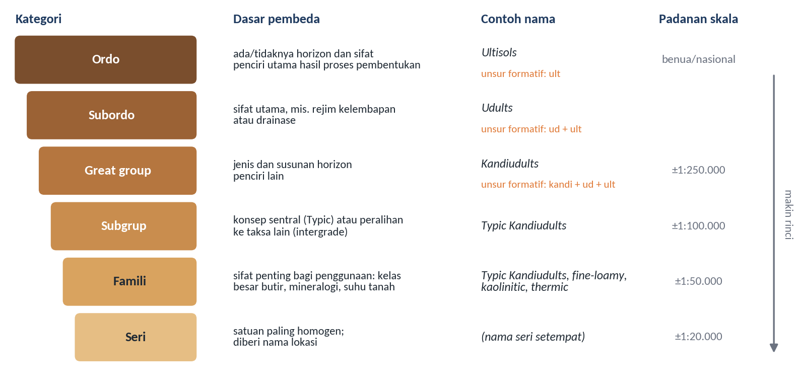
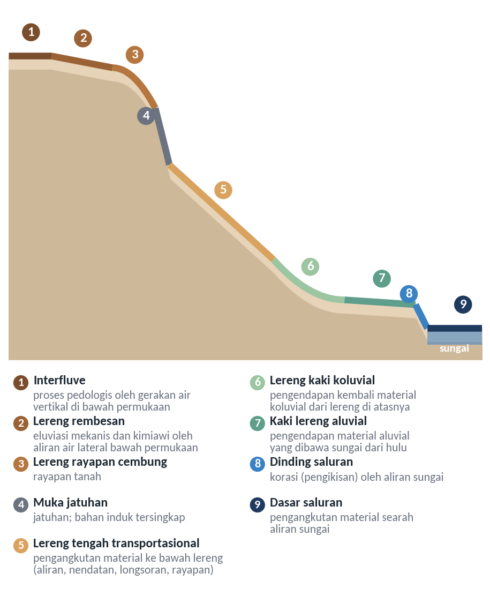
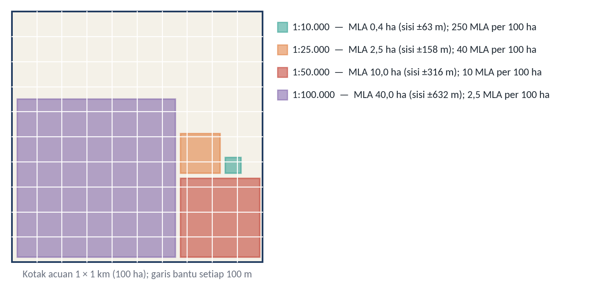
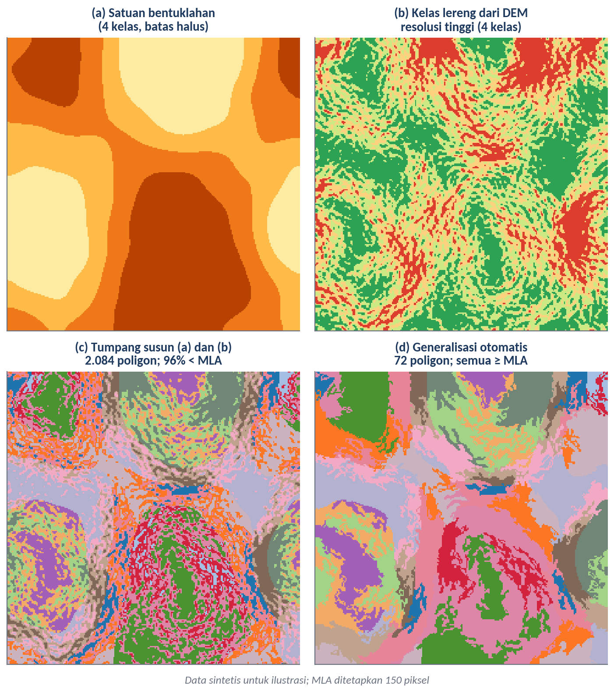

# Pengantar Remote Sensing dan Pemetaan Tanah pada Perkebunan

Subjudul: Dari data penginderaan jauh menuju pemetaan tanah digital dan satuan peta tanah
Pemateri: Prof. Dr. rer.nat. Junun Sartohadi, M.Sc.
Sesi: Hari ke-1, Selasa 3 November 2026, 08.00–09.00
Acuan: Modul 1, Modul 2, dan Modul 3

## Fokus pagi ini: memetakan tanah
Tata letak: teks
- Mengapa pemetaan tanah perlu pendekatan digital?
- Bagaimana data dari berbagai sensor dipadukan?
- Bagaimana batas satuan peta tanah ditarik dan disesuaikan dengan skala?
Catatan: Penginderaan jauh hanya disinggung seperlunya. Peserta yang ingin mendalami spektrum elektromagnetik, jenis sensor, dan resolusi citra dapat membaca Modul 1.

## Sensor merekam energi, bukan tanah
Tata letak: gambar-kanan
- *Remote sensing*: memperoleh informasi objek tanpa kontak langsung
- Sensor pasif memakai energi matahari, sensor aktif memancarkan sinyalnya sendiri
- Data rekaman baru bermakna setelah diolah dan ditafsirkan
- Uraian lengkap ada di Modul 1

Sumber: Diagram konseptual; definisi dari Lillesand dan Kiefer (1990) serta Sutanto (1994)
Catatan: Tekankan kalimat ketiga. Di kebun, citra saja belum memberi jawaban agronomis.

## Perbedaan pola pantulan menjadi dasar pengenalan permukaan
Tata letak: gambar-kanan
- **Vegetasi**: rendah di merah, melonjak di inframerah dekat
- **Tanah kering**: naik bertahap dari tampak ke inframerah
- **Tanah basah**: lebih rendah daripada tanah kering
- Spektrum dan resolusi citra dapat dibaca di Modul 1

Sumber: Ilustrasi skematis, digambar ulang dengan modifikasi dari Jensen (2004); posisi kanal Sentinel-2 mengacu pada Drusch et al. (2012)
Catatan: Grafik ini muncul kembali pada sesi bare soil. Kontras merah dan inframerah dekat adalah alasan vegetasi mudah dibedakan dari tanah.

## Pemetaan Tanah Konvensional dan Digital
Tata letak: pemisah
Keterangan: Dari survei lapangan menuju pemodelan spasial

## Dua pendekatan berbeda pada data, analisis, dan keterbatasan
Tata letak: tabel
| Aspek | Konvensional | Digital (DSM) |
|---|---|---|
| Data utama | Pengamatan profil, sampel, analisis laboratorium | Data tanah ditambah data lingkungan dan geospasial |
| Analisis | Interpretasi lanskap dan delineasi satuan tanah | Hubungan kuantitatif tanah dengan faktor lingkungan |
| Keterbatasan | Waktu dan biaya besar; sulit untuk pemantauan skala luas | Tetap memerlukan data tanah untuk membangun hubungan |
Sumber: Rangkuman dari Modul 1; keterbatasan survei konvensional dari Lu et al. (2023)
Catatan: Hindari kesan bahwa DSM menggantikan survei. Tanpa sampel tanah, model tidak punya apa yang dipelajari.

## SCORPAN menyatakan tanah sebagai fungsi kondisi lingkungannya
Tata letak: gambar-kanan
- Berawal dari faktor pembentuk tanah Jenny
- Tujuh faktor: *soil, climate, organisms, relief, parent material, age, spatial position*
- Hubungan tanah dan faktor lingkungan dinyatakan secara kuantitatif empiris

Sumber: Diagram konseptual disusun berdasarkan McBratney et al. (2003)
Catatan: Konsep ini diperdalam Dr. Guruh pada hari ke-3, lalu dikerjakan langsung pada praktik kovariat.

## Pertanian presisi mengelola keragaman, bukan rata-rata
Tata letak: gambar-kanan
- Mengelola variabilitas spasial dan temporal dalam produksi
- Tujuan: efisiensi, produktivitas, dan profitabilitas jangka panjang
- Sekaligus menekan dampak yang tidak diinginkan terhadap ekosistem

Sumber: Diagram konseptual disusun berdasarkan Elsharkawy et al. (2022) dan Weiss et al. (2020)
Catatan: Definisi mengikuti Elsharkawy et al. (2022) dan Mukhamedova et al. (2022).

## Informasi tanah untuk pengelolaan kebun
Tata letak: teks
- **DSM** memetakan sifat fisik dan kimia tanah: tekstur, kelembapan, pH, bahan organik, indikator kesuburan
- Hasilnya menjadi dasar pengelolaan spesifik lokasi, termasuk air dan pupuk
- Di kebun sawit, informasi tanah dipadukan dengan curah hujan, hama dan penyakit, varietas, dan umur tanaman (Ginting & Wiratmoko, 2021)
Catatan: Pertanyaan untuk diskusi: data apa yang sudah dimiliki kebun Bapak dan Ibu, dan data apa yang paling sulit diperoleh?

## Multi-source Data Fusion
Tata letak: pemisah
Keterangan: Memadukan data yang berbeda wataknya

## Setiap sumber data membawa informasi yang berbeda
Tata letak: tabel
| Sumber | Karakteristik | Contoh | Produk turunan |
|---|---|---|---|
| Optik | Pantulan cahaya matahari; sensor pasif | Sentinel-2, Landsat 8, SPOT | NDVI, EVI, BSI |
| SAR | Gelombang mikro; peka terhadap kekasaran, bentuk, dan kelembapan | Sentinel-1, ALOS PALSAR, TerraSAR-X | *Backscatter*, rasio polarisasi |
| LiDAR | Pulsa laser; dapat menembus celah vegetasi rapat | LiDAR wahana udara | CHM, DTM, DSM |
| DEM | Nilai elevasi permukaan, dari SAR, LiDAR, atau foto udara | DEMNAS, SRTM | Lereng, TWI, akumulasi aliran |
Sumber: Tabel 2.1
Catatan: Tahap praktik sesudah sesi ini memakai Sentinel-2, Sentinel-1, DEMNAS, LiDAR, dan foto udara.

## Fusi dapat dilakukan pada tiga tingkat
Tata letak: gambar-kanan
- **Piksel atau data**: misalnya pankromatik dengan multispektral
- **Fitur**: misalnya NDVI Sentinel-2 dengan *backscatter* ALOS PALSAR
- **Keputusan**: misalnya pemungutan suara dari beberapa hasil klasifikasi
- Tujuannya informasi yang lebih lengkap untuk interpretasi

Sumber: Digambar ulang dengan modifikasi berdasarkan konsep Pohl dan van Genderen (1998); pengertian fusi dari Zhang (2010)

## Remote Sensing untuk Delineasi SMU
Tata letak: pemisah
Keterangan: Dari kenampakan lanskap ke satuan peta tanah

## Satuan peta adalah satuan lanskap, bukan kelas taksonomi
Tata letak: teks
- **Delineasi**: satu poligon pada peta tanah
- **Satuan peta tanah (SMU)**: kumpulan delineasi dengan nama dan keterangan yang sama
- **Satuan taksonomi**: kelas yang didefinisikan tegas menurut sifat tanah
- Hampir setiap delineasi memuat tanah lain, yang disebut inklusi (Rossiter, 2000)
Catatan: Inklusi serupa hampir sama sifat dan interpretasinya dengan tanah yang dinamai. Inklusi tak serupa cukup berbeda sehingga dapat memengaruhi penggunaan lahan.

## Empat jenis satuan peta tanah
Tata letak: gambar-kanan
- **Konsosiasi**: didominasi satu taksa dan taksa serupa
- **Asosiasi**: taksa berbeda dengan pola teratur; dapat dipisahkan pada skala lebih besar
- **Kompleks**: taksa berbeda dengan pola rumit
- **Kelompok tak dibedakan**: digabung karena penggunaannya serupa

Sumber: Diagram konseptual disusun berdasarkan Rossiter (2000)
Catatan: Toposekuen atau katena pada lereng perbukitan umumnya termasuk asosiasi, karena batasnya dapat diduga dari posisi lereng serta perbedaan kelembapan atau warna permukaan. Inilah dasar pemanfaatan penginderaan jauh dalam delineasi.

## Nama satuan peta berasal dari sistem klasifikasi
Tata letak: gambar-kanan
- Enam kategori *Soil Taxonomy*: ordo sampai seri
- Nama dibaca dari kanan ke kiri
- *Typic Kandiudults*: *ult* Ultisols, *ud* rejim udik, *kandi* horizon kandik
- Kategori legenda mengikuti keragaman tanah, bukan semata skala

Sumber: Diagram konseptual disusun berdasarkan Soil Survey Staff (2022) dan Rossiter (2000)

## Tanah dan lanskap berkembang bersama
Tata letak: gambar-kanan
- Perubahan lanskap umumnya diikuti perubahan tanah (Hudson, 1992)
- Bentuklahan sering menjadi kerangka utama batas satuan (Zinck, 2023)
- Setiap posisi lereng dicirikan proses yang berbeda (Dalrymple et al., 1968)

Sumber: Digambar ulang dengan modifikasi dari Dalrymple et al. (1968)
Catatan: Unsur interpretasi citra sebagai petunjuk batas dibahas lebih rinci oleh Dr. Anggri pada sesi berikutnya.

## Kerincian batas dibatasi oleh resolusi data
Tata letak: teks
- **Elevasi dan turunannya** mengenali bentuk dan posisi lereng
- **Citra optik dan foto udara** memperlihatkan tutupan, drainase, dan rona permukaan
- Piksel puluhan meter umumnya hanya menggambarkan punggungan dan lembah utama
- Delineasi rinci memerlukan model medan LiDAR dan foto udara
Sumber: Modul 3; peran penginderaan jauh sebagai informasi pengganti dari Mulder et al. (2011)
Catatan: Peserta akan melihat sendiri pengaruhnya pada praktik sore ini, ketika kelas lereng dari DEM 30 m dibandingkan dengan kelas lereng dari LiDAR.

## Lima prinsip delineasi berbasis lanskap
Tata letak: teks
- **Homogen di dalam, kontras di antara**
- **Batas mengikuti perubahan lanskap**: tekuk lereng, batas koluvial, pola drainase
- **Hierarkis**: mulai dari bentuklahan, lalu kelas lereng (Sambodo & Arpornthip, 2021)
- **Sesuai skala**: kerincian mengikuti skala peta
- **Diuji di lapangan**: satuan adalah hipotesis
Sumber: Rangkuman dari Modul 3

## Skala peta menentukan luasan terkecil yang terbaca
Tata letak: gambar-kanan
- MLD: poligon terkecil yang terbaca pada peta, 0,4 cm²
- 1:10.000 berarti MLA 0,4 ha; 1:50.000 berarti 10 ha
- MMU boleh sama atau lebih besar dari MLA, sebaiknya tidak lebih kecil
Rumus: $\mathrm{MLA\ (ha)} = (\mathrm{angka\ skala} / 1000)^{2} / 250$

Sumber: Dihitung berdasarkan rumus MLA dari Rossiter (2000) dengan MLD 0,4 cm²

## Skala juga harus sepadan dengan kerapatan pengamatan
Tata letak: tabel
| Skala publikasi | Kerapatan pengamatan | MLA | Jenis satuan peta |
|---|---|---|---|
| 1:2.500 | > 4 per ha | 0,025 ha | Sederhana, rinci |
| 1:10.000 | 25–125 per km² | 0,4 ha | Sederhana, kurang rinci |
| 1:25.000 | 4–20 per km² | 2,5 ha | Sebagian besar sederhana |
| 1:50.000 | 1–5 per km² | 10 ha | Sebagian besar majemuk |
| 1:100.000 | ¼–1 per km² | 40 ha | Hampir selalu majemuk |
Sumber: Tabel 3.3, disarikan dari Rossiter (2000)
Catatan: Skala yang dapat dipertanggungjawabkan tidak hanya ditentukan resolusi citra. Sambodo dan Arpornthip (2021) memperkirakan pemetaan detail dengan satuan berbasis geomorfometri sekitar tujuh kali lebih murah daripada metode grid.

## Tumpang susun otomatis menghasilkan banyak poligon kecil
Tata letak: gambar-kanan
- Pada ilustrasi: 2.084 poligon, 96% lebih kecil dari MLA
- Generalisasi menurut ukuran: 72 poligon, semua terbaca
- Tetapi satuan kecil yang penting dapat hilang
- Satuan yang sangat kontras dapat dipertahankan sebagai simbol titik

Sumber: Ilustrasi konseptual dengan data sintetis; prinsip mengacu pada Rossiter (2000)
Catatan: Gejala yang sama akan terlihat pada data sungguhan dalam praktik delineasi SMU.

## Batas blok kebun tidak menggantikan batas satuan peta
Tata letak: teks
- SMU yang ditumpangsusunkan dengan blok menerjemahkan informasi tanah menjadi keputusan per blok
- Batas blok adalah batas administratif pengelolaan
- Batas SMU tetap ditarik dari perubahan lanskap
Sumber: Modul 3

## Alur pelatihan tiga hari
Tata letak: tabel
| Hari | Ceramah | Praktik |
|---|---|---|
| 1 | Pengantar; Interpretasi pedologis | Multi-source data fusion; Delineasi SMU |
| 2 | Bare soil detection; Proximal soil sensing | Delineasi SMU (lanjutan); Demonstrasi PSS; Bare soil detection |
| 3 | Digital soil mapping | Machine learning; Kovariat SCORPAN; Model DSM; Presentasi hasil |
Sumber: Rundown pelatihan
Catatan: Praktik 1, 2, 4, dan 5 memakai wilayah latihan yang sama, yaitu Sub-DAS Bompon, sehingga hasil satu sesi menjadi masukan sesi berikutnya. Praktik 3 memakai pustaka spektral dari Site Gunung Madu Plantation.
