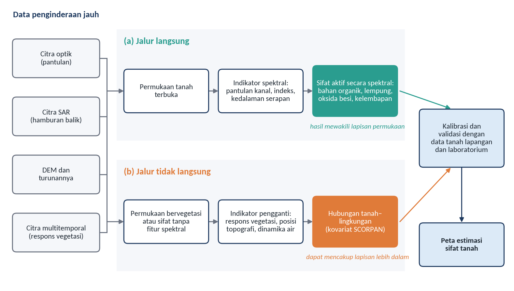
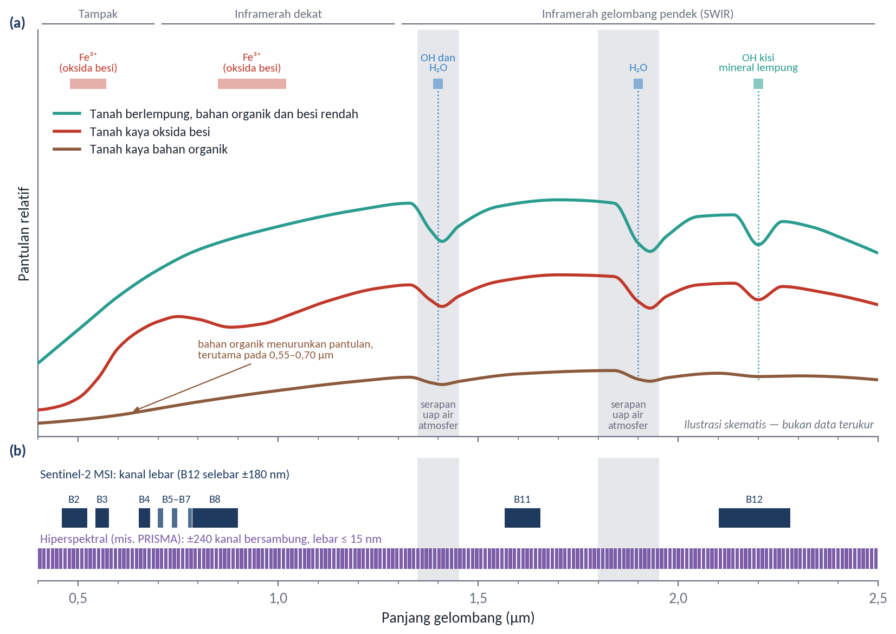
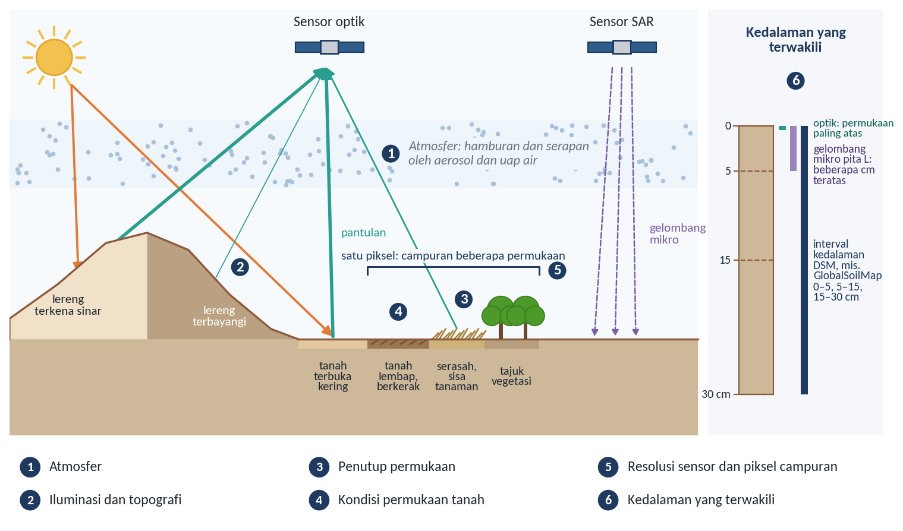
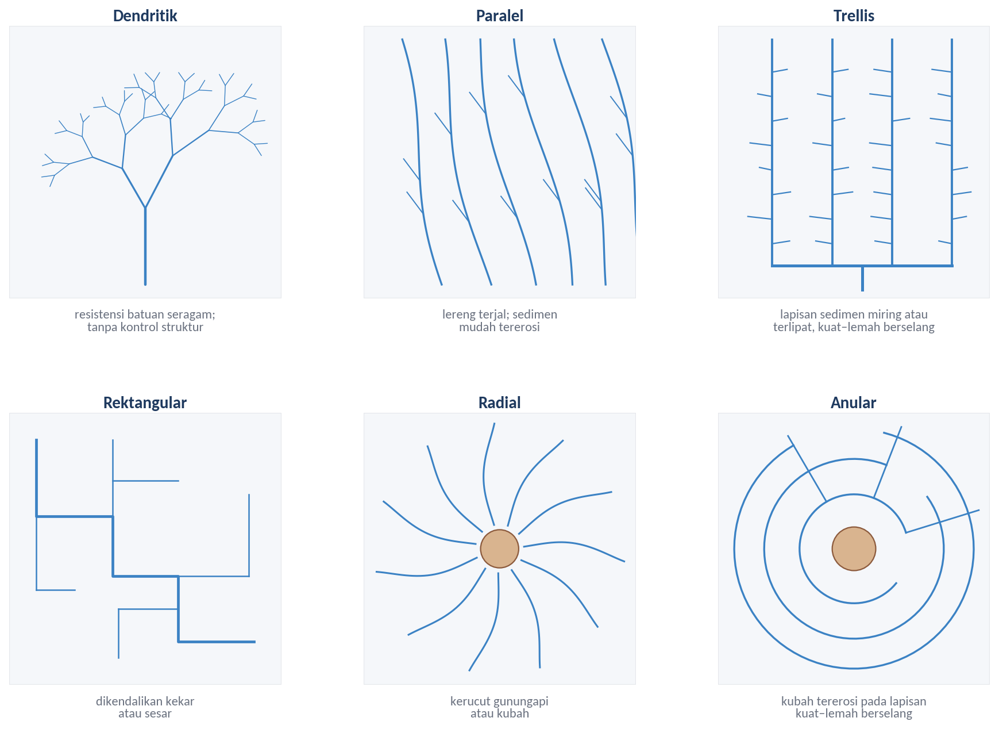
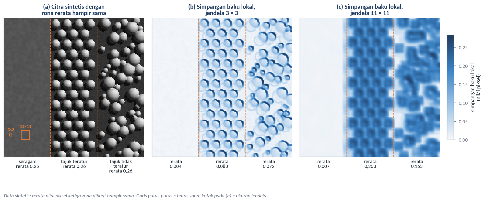
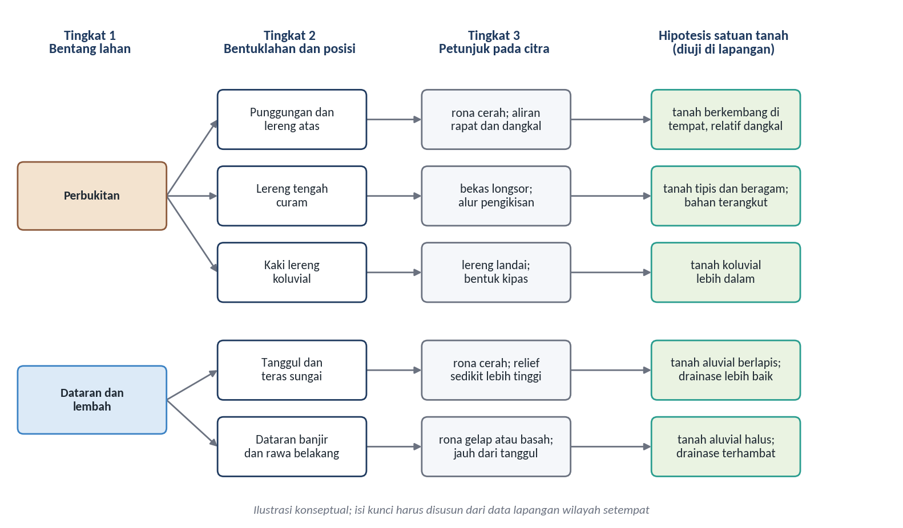
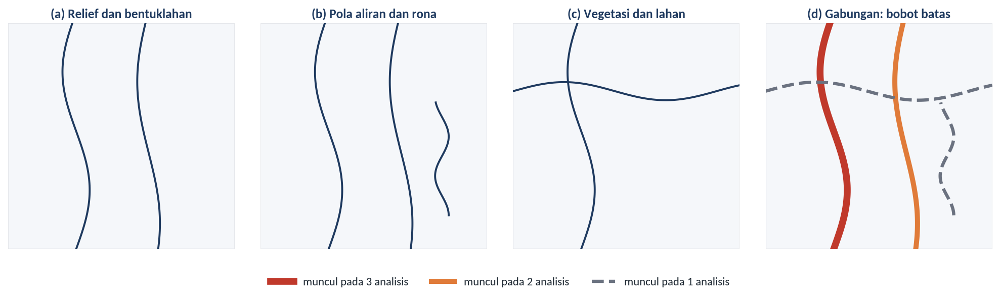
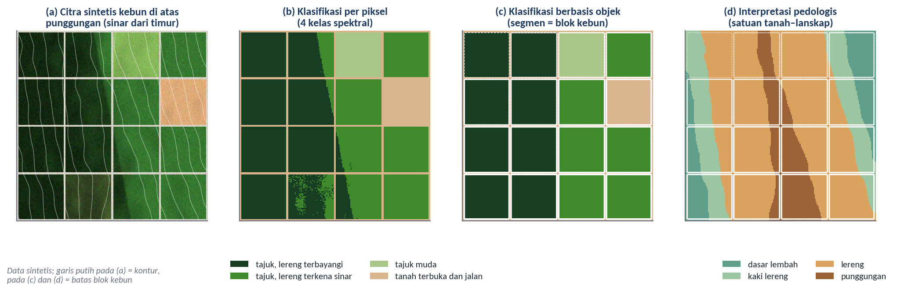

# Estimasi Sifat Tanah dan Interpretasi Pedologis dari Data Remote Sensing

Subjudul: Apa yang dapat dibaca sensor, dan bagaimana membaca tanah yang tidak terlihat
Pemateri: Dr. rer.nat Muhammad Anggri Setiawan, S.Si., M.Si.
Sesi: Hari ke-1, Selasa 3 November 2026, 09.15–10.15
Acuan: Modul 4 dan Modul 6

## Dua pertanyaan untuk sesi ini
Tata letak: teks
- Sifat tanah apa yang dapat diduga dari data penginderaan jauh, dan apa batasnya?
- Bagaimana menerjemahkan kenampakan pada citra menjadi informasi tentang tanah?
Catatan: Pertanyaan pertama adalah isi Modul 4, sedangkan pertanyaan kedua adalah isi Modul 6.

## Remote Sensing untuk Estimasi Soil Properties
Tata letak: pemisah
Keterangan: Jalur langsung, jalur tidak langsung, dan faktor pengganggunya

## Sensor tidak mengukur sifat tanah secara langsung
Tata letak: gambar-kanan
- Setiap estimasi memerlukan hubungan antara besaran yang terekam dan sifat tanah
- **Jalur langsung**: sifat tanah ikut membentuk sinyal; perlu tanah terbuka dan jejak spektral
- **Jalur tidak langsung**: vegetasi atau bentuk medan sebagai variabel pengganti
- Keduanya tetap memerlukan data lapangan dan laboratorium

Sumber: Diagram konseptual disusun berdasarkan Mulder et al. (2011) dan Chabrillat et al. (2019)
Catatan: Penginderaan jauh tidak menggantikan pengambilan sampel tanah, tetapi memperluas informasi dari titik sampel ke seluruh wilayah.

## Kromofor menentukan bentuk spektrum tanah
Tata letak: gambar-kanan
- **Oksida besi**: serapan biru–hijau dan 0,85–1,0 µm
- **Bahan organik**: menurunkan pantulan, terutama di wilayah tampak
- **Air dan OH**: serapan sekitar 1,4 dan 1,9 µm
- **Mineral lempung**: sekitar 2,2 µm; **karbonat**: sekitar 2,3 µm
- **Ukuran partikel**: mengubah tingkat pantulan

Sumber: Ilustrasi skematis berdasarkan Hunt (1977), Scheinost et al. (1998), Galvão dan Vitorello (1998), serta Chabrillat et al. (2019); posisi kanal dari Drusch et al. (2012) dan Cogliati et al. (2021)
Catatan: Satu fitur jarang mencerminkan satu sifat saja. Galvão dan Vitorello (1998) mendapati bahan organik lebih dari 1,7% sudah mengaburkan fitur besi pada tanah tropis Brasil.

## Indikator berbeda untuk sifat tanah yang berbeda
Tata letak: tabel
| Sifat tanah | Indikator dan data | Jalur |
|---|---|---|
| Kadar lempung | Kanal dan rasio SWIR; kedalaman serapan 2,2 µm; perubahan hamburan balik SAR | Langsung dan tidak langsung |
| Kelembapan permukaan | Pantulan SWIR; hamburan balik SAR; radiometer gelombang mikro | Langsung |
| Bahan organik, C-organik | Kanal tampak; indeks kecerahan dan warna; model seluruh kanal | Langsung |
| Oksida besi, warna | Kanal tampak dan inframerah dekat; indeks kemerahan | Langsung |
| Drainase | TWI dan indeks kedalaman muka air; kelembapan SAR multitemporal | Tidak langsung |
| pH, KTK, unsur hara | Model multivariat kanal dan kovariat lingkungan | Tidak langsung, berlaku lokal |
Sumber: Tabel 4.1, rangkuman berdasarkan Lillesand et al. (2015), Chabrillat et al. (2019), Hallikainen et al. (1985), Zribi et al. (2012), Ågren et al. (2014), dan Vaudour et al. (2019)
Catatan: Suatu sifat dapat diduga jika memiliki jejak spektral atau berkorelasi dengan sifat yang memilikinya, dan nilainya cukup bervariasi (Chabrillat et al., 2019). pH tidak memiliki fitur spektral.

## Radar dan elevasi melengkapi data optik
Tata letak: teks
- Hamburan balik ditentukan terutama oleh kekasaran dan konstanta dielektrik (Oh et al., 1992)
- Selisih dua citra TerraSAR-X, sesudah hujan dan saat kering, berkorelasi dengan tekstur (Zribi et al., 2012)
- TWI menjadi prediktor kebasahan yang baik, tetapi peka terhadap resolusi DEM (Ågren et al., 2014)
Rumus: $\mathrm{TWI} = \ln(a / \tan\beta)$
Sumber: Rumus TWI dari Beven dan Kirkby (1979)

## Indeks menonjolkan fitur, tetapi tidak menjamin sifat tanah
Tata letak: tabel
| Indeks | Kanal Sentinel-2 | Terkait dengan |
|---|---|---|
| Kecerahan (BI) | ((B4² + B3² + B2²) / 3)^0,5 | Bahan organik dan kelembapan |
| Pewarnaan (CI) | (B4 − B3) / (B4 + B3) | Warna tanah |
| Kemerahan (RI) | B4² / (B2 × B3³) | Kandungan hematit |
| Rasio mineral lempung (CMR) | B11 / B12 | Mineral lempung |
| NDVI | (B8 − B4) / (B8 + B4) | Tidak langsung, melalui vegetasi |
| NSMI, kedalaman serapan | Memerlukan data hiperspektral | Kelembapan; mineral lempung |
Sumber: Tabel 4.2; Forkuor et al. (2017), Mgohele et al. (2024), Haubrock et al. (2008), Clark dan Roush (1984); padanan kanal dari Drusch et al. (2012)
Catatan: Hubungan indeks dengan sifat tanah bersifat empiris, sehingga perlu dikalibrasi dengan data setempat. Pada praktik sore, peserta akan melihat CMR di lahan bervegetasi lebih banyak menggambarkan vegetasi.

## Resolusi spektral membatasi fitur yang tertangkap
Tata letak: teks
- Kanal Sentinel-2 lebar: B12 sekitar 180 nm, sehingga fitur sempit hanya terbaca sebagai rata-rata
- PRISMA merekam 0,40–2,50 µm dengan lebar kanal tidak lebih dari 15 nm, piksel 30 m (Cogliati et al., 2021)
- Tanpa derau, sensor hiperspektral umumnya lebih baik; derau memperkecil perbedaannya
- Peningkatannya belum cukup untuk estimasi kuantitatif tekstur dan karbon organik yang akurat (Castaldi et al., 2016)

## Banyak faktor ikut membentuk sinyal yang direkam
Tata letak: gambar-penuh

Sumber: Diagram konseptual disusun berdasarkan Chabrillat et al. (2019); kedalaman yang terwakili mengacu pada Kerr et al. (2010) dan Poggio et al. (2021)

## Setiap faktor pengganggu ada upaya pengendaliannya
Tata letak: tabel
| Faktor | Pengendalian |
|---|---|
| Atmosfer | Pakai pantulan permukaan; hindari wilayah serapan uap air |
| Iluminasi dan topografi | Koreksi topografi dengan DEM; indeks rasio dengan menyadari batasnya |
| Penutup permukaan | Saring piksel tanah terbuka; pilih waktu saat permukaan terbuka |
| Kondisi permukaan | Pilih citra saat permukaan kering dan seragam |
| Karakteristik sensor | Sesuaikan sensor dengan sifat sasaran; pakai citra multitemporal |
| Kedalaman yang terwakili | Sesuaikan kedalaman sampel; pakai kovariat untuk lapisan lebih dalam |
| Data kalibrasi dan model | Sampel mencakup rentang nilai; validasi dengan data independen |
Sumber: Tabel 4.3, rangkuman dari Modul 4

## Di kebun sawit, estimasi adalah gabungan berbagai indikator
Tata letak: teks
- Di bawah tajuk yang menutup, tanah sebagian besar tidak teramati sensor optik
- Kondisi tanaman tidak hanya mencerminkan tanah (Ginting & Wiratmoko, 2021)
- Gabungan yang tepat: tanah terbuka pada waktu yang tepat, SAR dan DEM, pengukuran proksimal, dan DSM yang dikalibrasi setempat
Catatan: Setiap unsur gabungan ini dibahas pada Modul 5, Modul 7, dan Modul 8.

## Interpretasi Pedologis
Tata letak: pemisah
Keterangan: Membaca tanah melalui kenampakan lanskap

## Tanah jarang tampak pada citra, jadi kita membaca petunjuknya
Tata letak: teks
- Vegetasi dapat dikenali langsung, tanah umumnya tertutup (Buringh, 1955)
- Hipotesis survei tanah: pola tanah dapat diramalkan dari kenampakan luar yang lebih mudah dipetakan (Rossiter, 2000)
- Kenampakan luar itu meliputi geomorfologi, vegetasi, penggunaan lahan, dan catatan sejarah
- Hasil interpretasi adalah hipotesis, bukan identifikasi tanah
Catatan: Kalimat terakhir adalah pesan utama bagian ini. Setiap unsur yang dibahas sesudah ini hanya memberi dugaan.

## Delapan unsur interpretasi dan makna pedologisnya
Tata letak: tabel
| Unsur | Yang dibaca | Makna pedologis |
|---|---|---|
| Rona | Kecerahan atau warna relatif | Air, bahan organik, dan oksida besi pada tanah terbuka |
| Bentuk | Wujud dan garis batas | Bentuklahan; batas lurus biasanya buatan manusia |
| Ukuran | Dimensi relatif dan mutlak | Dapat tidaknya dipetakan sebagai satuan tersendiri |
| Pola | Susunan keruangan | Pola aliran menunjukkan bahan induk dan struktur |
| Tekstur | Frekuensi variasi rona | Struktur tajuk; bukan tekstur tanah |
| Bayangan | Profil dan tinggi relatif | Punggungan, lembah, gawir; juga sumber kekeliruan |
| Situs | Kedudukan dalam lanskap | Hubungan tanah dengan posisi lereng |
| Asosiasi | Keterkaitan dengan objek lain | Sawah, bakau, atau kanal menunjukkan kondisi tanah |
Sumber: Rangkuman dari Modul 6; unsur dari Natural Resources Canada (2025), Lillesand et al. (2015), dan Sutanto (1994)
Catatan: Rona paling mendasar. Situs dan asosiasi paling menuntut pengetahuan lanskap, tetapi situs paling dekat dengan hubungan tanah dan lanskap.

## Warna pada komposit ditentukan oleh kanal yang dipilih
Tata letak: tabel
| Komposit | Kanal Sentinel-2 | Yang ditonjolkan |
|---|---|---|
| Warna asli | B4, B3, B2 | Tampak seperti dilihat mata |
| Warna semu inframerah dekat | B8, B4, B3 | Vegetasi merah; permukiman dan tanah terbuka abu-abu atau cokelat muda |
| Warna semu SWIR | B11 atau B12, B8, B3 | Vegetasi hijau cerah; tanah terbuka merah muda; air keruh dan tanah jenuh air biru |
Sumber: Riebeek (2014); kanal mengikuti Drusch et al. (2012)
Catatan: Peserta akan menyusun ketiga komposit ini sendiri pada praktik siang nanti. Ingatkan untuk selalu memeriksa kanal apa yang tampil sebelum menafsirkan warna.

## Pola dan kerapatan aliran memberi petunjuk bahan di bawah permukaan
Tata letak: gambar-kanan
- Analisis aliran berguna untuk menafsirkan struktur geologi (Howard, 1967)
- Kerapatan aliran berhubungan dengan transmisivitas batuan (Carlston, 1963)
- Makin mudah air meresap, makin jarang alurnya
- Perbandingan hanya sah pada cara dan skala yang sama
Rumus: $D_d = \frac{\sum L}{A}$

Sumber: Diagram konseptual; jenis pola mengacu pada Howard (1967) dan Sulaiman et al. (2021)

## Tekstur citra bukan tekstur tanah
Tata letak: gambar-kanan
- Tekstur citra adalah frekuensi variasi rona
- Di lahan bervegetasi, yang terukur adalah tajuk serta sinar dan bayangan di antaranya
- Jendela harus lebih kecil dari objek, tetapi mencakup variabilitas khasnya (Hall-Beyer, 2017)
- Perbedaan tekstur antarblok sawit lebih mencerminkan tanaman daripada tanah

Sumber: Ilustrasi konseptual dengan data sintetis; pengaruh ukuran jendela mengacu pada Hall-Beyer (2017)

## Tidak ada satu unsur pun yang cukup
Tata letak: teks
- Rona yang sama dapat berasal dari objek yang berbeda
- Keyakinan tumbuh dari **konvergensi bukti**, yaitu beberapa unsur yang saling menguatkan
- Ilustrasi: satuan dasar lembah basah diduga kuat bila posisinya terendah, memanjang mengikuti alur, berona gelap, dan berasosiasi dengan sawah
- Dugaan itu tetap hipotesis sampai dikonfirmasi di lapangan
Catatan: Contoh ini ilustrasi konseptual dari Modul 6. Prinsip kombinasi unsur mengikuti Rossiter (2000) dan Buringh (1954).

## Tidak semua faktor pembentuk tanah sama mudah dibaca
Tata letak: tabel
| Faktor | Kenampakan | Catatan |
|---|---|---|
| Relief | Lereng, bayangan medan, model elevasi | Paling sering menunjukkan perbedaan tanah yang besar |
| Bahan induk | Bentuklahan, pola aliran, singkapan | Sering memerlukan peta geologi |
| Waktu | Teras, tingkat pengikisan | Hanya memberi urutan umur relatif |
| Organisme | Vegetasi alami, penggunaan lahan | Sering kurang andal karena pengaruh manusia |
| Iklim | Perbedaan vegetasi antarwilayah | Jarang bervariasi pada skala kebun |
| Kondisi air | Rona basah, jarak ke alur | Paling jelas saat lahan basah dan terbuka |
Sumber: Tabel 6.1, rangkuman berdasarkan Buringh (1954, 1955), Rossiter (2000), Howard (1967), dan Sulaiman et al. (2021)
Catatan: Pada kebun monokultur, satu penggunaan lahan menutupi berbagai tanah, sehingga penggunaan lahan hampir tidak memberi petunjuk.

## Kunci interpretasi selalu bersifat lokal
Tata letak: gambar-kanan
- **Posisi lanskap**: membatasi kemungkinan tanah
- **Kenampakan luar**: vegetasi, litologi, penggunaan lahan
- **Morfologi**: ciri profil, hanya dapat diamati di lapangan
- Berlaku di wilayah lain hanya jika hubungan tanah dan lanskapnya serupa

Sumber: Ilustrasi konseptual; urutan tingkat mengikuti Rossiter (2000), hipotesis tanah disusun berdasarkan Dalrymple et al. (1968), Buringh (1954), dan Rossiter (2000)
Catatan: Kunci tertulis juga cara memindahkan pengetahuan tasit menjadi pengetahuan yang dapat dipelajari orang lain (Hudson, 1992).

## Batas yang muncul berulang lebih dapat dipercaya
Tata letak: gambar-kanan
- Analisis foto: mengenali pola dan menarik batas
- Klasifikasi: memerlukan lapangan dan laboratorium
- Batas yang muncul pada beberapa analisis unsur berarti satuannya berbeda dalam lebih dari satu sifat
- Batas yang muncul sekali, misalnya hanya dari vegetasi, meragukan

Sumber: Diagram konseptual berdasarkan prinsip analisis foto pedologis Buringh (1954)

## Interpretasi lebih baik memisahkan sifat fisik daripada kimia
Tata letak: tabel
| Sifat tanah | Korelasi intrakelas terhadap satuan interpretasi foto udara |
|---|---|
| Kadar lempung | 0,61 |
| pH | 0,33 |
| Bahan organik | 0,28 |
| Kalium tersedia | 0,06 |
Sumber: Contoh dalam Rossiter (2000)
Catatan: Makna praktisnya: informasi kesuburan untuk pemupukan tetap memerlukan pengambilan sampel. Buringh (1955) juga mengingatkan bahwa foto tidak pernah memuat seluruh rincian kondisi tanah.

## Interpretasi pedologis berbeda dari klasifikasi citra otomatis
Tata letak: tabel
| Aspek | Interpretasi pedologis | Berbasis piksel | Objek dan pembelajaran mesin |
|---|---|---|---|
| Satuan | Satuan lanskap | Piksel | Segmen atau piksel berfitur banyak |
| Penalaran | Faktor pembentuk tanah | Kemiripan statistik | Pola dari data latih |
| Keluaran | Hipotesis sebaran tanah | Kelas tutupan | Kelas sesuai data latih |
| Keterbatasan | Bergantung keahlian penafsir | Mengikuti penutup dan iluminasi | Pola belum tentu bermakna pedologis |
Sumber: Tabel 6.2, rangkuman berdasarkan Buringh (1954), Hudson (1992), Blaschke (2010), Maxwell et al. (2018), dan Wadoux, Samuel-Rosa, et al. (2020)
Catatan: Hengl dan Rossiter (2003) hanya mampu mereproduksi 45,3% satuan geopedologi dari sembilan parameter medan. Model juga dapat memprediksi karbon organik dengan akurat memakai kovariat semu (Wadoux, Samuel-Rosa, et al., 2020).

## Di kebun, klasifikasi cenderung mengikuti blok dan cahaya
Tata letak: gambar-penuh

Sumber: Ilustrasi konseptual dengan data sintetis
Catatan: Klasifikasi per piksel memisahkan tajuk yang sama karena iluminasi. Segmen berbasis objek mengikuti batas blok. Interpretasi pedologis menghasilkan satuan yang memotong batas blok.

## Peran masing-masing bagi perkebunan kelapa sawit
Tata letak: teks
- **Interpretasi pedologis**: satuan tanah–lanskap untuk delineasi SMU, stratifikasi sampel, dan kovariat kategorik
- **Klasifikasi otomatis**: kondisi penutup lahan, seperti status tajuk dan tanah terbuka
- Pengetahuan pedologis dapat masuk ke DSM, dan DSM dapat menghasilkan pengetahuan baru (Ma et al., 2019)
- Melihat menembus pola kebun menuju relief, air, dan bahan induk
Catatan: Sore ini peserta menerapkan unsur-unsur ini dalam praktik delineasi SMU.
