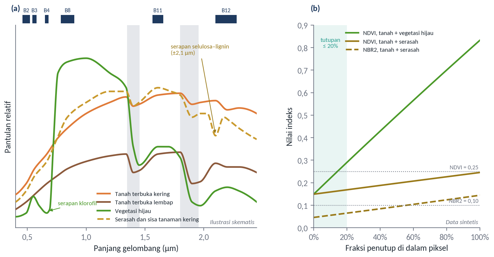
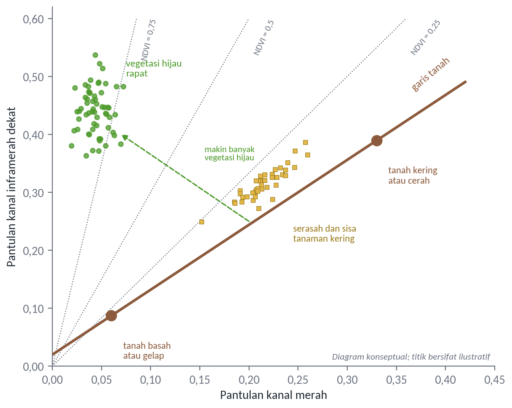
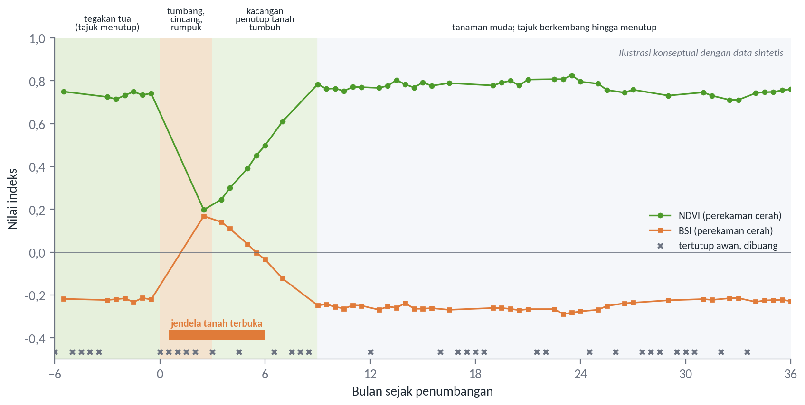
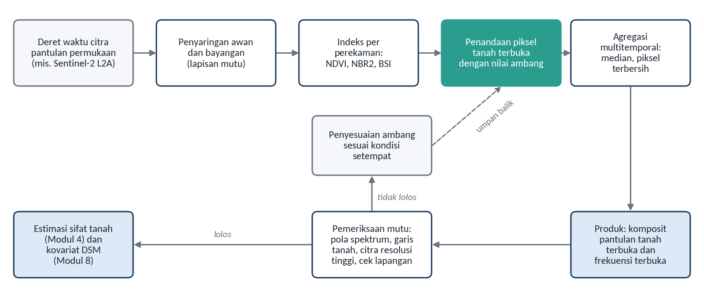

# Bare Soil Detection & Information Extraction

Subjudul: Mengenali piksel tanah terbuka dan mengambil informasi darinya
Pemateri: Dr. Retnadi Heru Jatmiko, M.Sc.
Sesi: Hari ke-2, Rabu 4 November 2026, 09.15–10.15
Acuan: Modul 5

## Citra optik hanya dapat membaca tanah yang terbuka
Tata letak: teks
- Deteksi tanah terbuka: mengenali piksel tanah, lalu mengekstraksi informasi spektralnya
- Permukaan terbuka: permukaan abiotik alami yang vegetasinya tidak ada atau hampir tidak ada (Demattê et al., 2020)
- Hasilnya berupa citra pantulan tanah dan frekuensi keterbukaan setiap piksel
- Keduanya dapat dipakai dalam pemetaan tanah digital
Catatan: Contoh penerapan: Diek et al. (2017) menurunkan peta pasir, debu, lempung, dan bahan organik dari komposit tanah terbuka Landsat.

## Permukaan Tanah, Vegetasi, dan Pantulan Spektral
Tata letak: pemisah
Keterangan: Tiga permukaan, satu piksel

## Vegetasi hijau mudah disaring, serasah jauh lebih sulit
Tata letak: gambar-kanan
- **Tanah**: naik bertahap dari biru sampai SWIR pertama
- **Vegetasi hijau**: kontras tajam merah dan inframerah dekat
- **Serasah**: tanpa kontras itu, mirip tanah sampai inframerah dekat
- Pembeda serasah: serapan lignin dan selulosa sekitar 2,1 µm (Daughtry, 2001)

Sumber: Ilustrasi skematis berdasarkan Daughtry (2001) dan Demattê et al. (2020); nilai pada (b) data sintetis dengan model campuran linear (Adams et al., 1986)
Catatan: Panel (b): NDVI naik cepat saat fraksi vegetasi hijau bertambah, tetapi hampir tidak berubah saat penutupnya serasah. Piksel berserasah lolos dari penyaringan NDVI.

## Satu piksel jarang berisi satu jenis permukaan
Tata letak: teks
- Pantulan piksel adalah campuran komponen murni menurut fraksi luasnya (Adams et al., 1986)
- Tutupan jagung beberapa persen sudah menurunkan ketelitian model karbon organik secara drastis (Bartholomeus et al., 2011)
- Vegetasi hijau atau kering lebih dari 20% dapat sangat mengubah bentuk spektrum (Castaldi et al., 2019)
- Fraksi tanah cenderung terduga terlalu tinggi karena tanah memantulkan lebih kuat (Asner & Heidebrecht, 2002)

## Garis tanah membantu memeriksa mutu deteksi
Tata letak: gambar-kanan
- Tanah terbuka membentuk garis pada ruang merah dan inframerah dekat
- Tanah basah dekat titik asal, tanah kering lebih jauh
- Vegetasi menjauh ke arah inframerah dekat tinggi
- Serasah tetap dekat garis, jadi tidak terpisahkan di ruang ini

Sumber: Diagram konseptual berdasarkan Baret et al. (1993) dan Demattê et al. (2020)

## Di bawah tajuk sawit, tanah hampir tidak teramati
Tata letak: teks
- Di bawah tajuk yang menutup, permukaan tanah hampir tidak mungkin teramati (Roberts et al., 2019)
- Fraksi tanah terbuka menurun seiring berkembangnya tajuk; kebun umur 2–3 tahun masih terbuka (Danylo et al., 2021)
- Pada blok menghasilkan, kesempatan muncul terutama saat peremajaan
- Permukaannya mosaik tanah, rumpukan batang tercincang, dan kacangan penutup
- *Pueraria javanica* dapat menutup 90–100% permukaan dalam 5–6 bulan (Astuti et al., 2018)
Catatan: Urutan persiapan peremajaan mengikuti Wibowo dan Junaedi (2017). Jendela pengamatan hanya beberapa bulan.

## Indeks untuk Bare Soil Detection
Tata letak: pemisah
Keterangan: Memanfaatkan kontras spektral

## Tiga kelompok indeks, tiga tugas berbeda
Tata letak: tabel
| Indeks | Sentinel-2 | Pemanfaatan |
|---|---|---|
| NDVI | (B8−B4) / (B8+B4) | Menyaring vegetasi hijau; misalnya tanah di bawah 0,25 |
| SAVI | 1,5 (B8−B4) / (B8+B4+0,5) | Meredam pengaruh latar tanah pada vegetasi jarang |
| BSI | ((B11+B4)−(B8+B2)) / ((B11+B4)+(B8+B2)) | Meningkat dengan fraksi tanah terbuka |
| NBR2 | (B11−B12) / (B11+B12) | Membedakan tanah dari serasah; misalnya −0,30 sampai 0,10 |
| VNSIR | 1−[(2B4−B3−B2)+3(B12−B8)] | Aturan tambahan; misalnya di bawah 0,9 |
| CAI | Memerlukan data hiperspektral | Positif untuk sisa tanaman, negatif untuk tanah |
Sumber: Tabel 5.1; Demattê et al. (2020), Castaldi et al. (2019), Huete (1988), Rikimaru et al. (2002) melalui Nugraha dan Citra (2021), Prajapati et al. (2019); padanan kanal Drusch et al. (2012)
Catatan: Keempat indeks pertama dihitung peserta sendiri pada praktik sore nanti.

## Nilai ambang tidak berlaku umum
Tata letak: teks
- Penentuan ambang memerlukan interpretasi citra dan pengamatan lapangan (Demattê et al., 2020)
- NDVI rendah tidak menjamin tanah terbuka: bisa kecambah, sisa tanaman, atau gulma (Castaldi et al., 2019)
- Indeks tidak membedakan tanah dari pasir, batuan, jalan, atau permukiman
- Karena itu hasilnya dipadukan dengan data penggunaan lahan
- Ambang dapat diturunkan dari data setempat (Danylo et al., 2021)
Catatan: Peserta akan membuktikan sendiri pada praktik sore: aturan yang sama menangkap banyak permukiman.

## Metode Bare Soil Detection
Tata letak: pemisah
Keterangan: Dari citra tunggal sampai deret waktu

## Lima metode yang tidak saling meniadakan
Tata letak: tabel
| Metode | Cara kerja | Catatan |
|---|---|---|
| Ambang citra tunggal | Satu citra, ambang indeks | Sederhana; bergantung waktu perekaman |
| Aturan gabungan | Beberapa indeks sekaligus (GEOS3) | Menyaring vegetasi hijau dan bahan kering |
| Komposit multitemporal | Kondisi paling terbuka dari banyak citra | Komposit lengkap memerlukan data beberapa tahun |
| Pemisahan campuran | Menduga fraksi di dalam piksel | Terbukti pada hiperspektral; pada Sentinel-2 perlu diuji |
| Deret waktu dan klasifikasi | Memantau perubahan | Radar membantu saat berawan |
Sumber: Demattê et al. (2020), Diek et al. (2017), Bartholomeus et al. (2011), Castaldi et al. (2019), Danylo et al. (2021), Descals et al. (2021)
Catatan: Diek et al. (2017) menemukan sekitar lima tahun data Landsat diperlukan untuk mencakup 90% luas maksimum tanah terbuka.

## Jendela tanah terbuka pada blok peremajaan sangat pendek
Tata letak: gambar-penuh

Sumber: Ilustrasi konseptual dengan data sintetis; urutan kegiatan berdasarkan Wibowo dan Junaedi (2017), Astuti et al. (2018), dan Danylo et al. (2021)
Catatan: Sebagian perekaman dapat hilang karena awan, sehingga kerapatan deret waktu sangat menentukan. Sentinel-2A dan 2B merekam ulang setiap lima hari atau kurang (Main-Knorn et al., 2017).

## Hasil deteksi selalu perlu diperiksa
Tata letak: gambar-kanan
- Spektrum seharusnya naik dari biru sampai SWIR pertama
- Sebaran piksel seharusnya mengikuti garis tanah
- Periksa dengan citra resolusi tinggi dan lapangan
- Jika belum memadai, sesuaikan ambang dan ulangi

Sumber: Diagram konseptual berdasarkan Demattê et al. (2020), Diek et al. (2017), dan Roberts et al. (2019)

## Empat konsekuensi praktis bagi perkebunan
Tata letak: teks
- Tanah terutama teramati pada blok peremajaan dan pembukaan lahan, hanya beberapa bulan
- Permukaan bercampur rumpukan batang, sehingga perlu indeks SWIR kedua dan pemeriksaan lapangan
- Blok diremajakan bergantian, sehingga komposit beberapa tahun mencakup lebih banyak blok
- Permukaan diolah alat berat, sehingga keterwakilannya terhadap lapisan sampel perlu diperiksa
Catatan: Untuk blok bertajuk tertutup, informasi tanah tetap perlu lewat kovariat lingkungan atau pengukuran proksimal. Ini jembatan ke sesi berikutnya.
