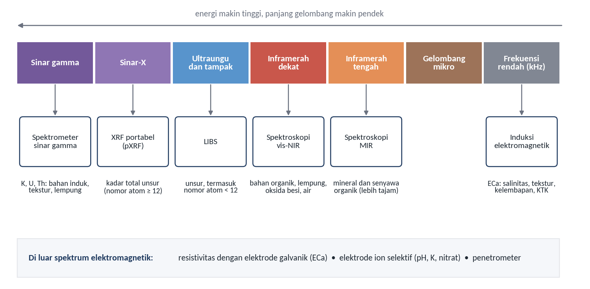
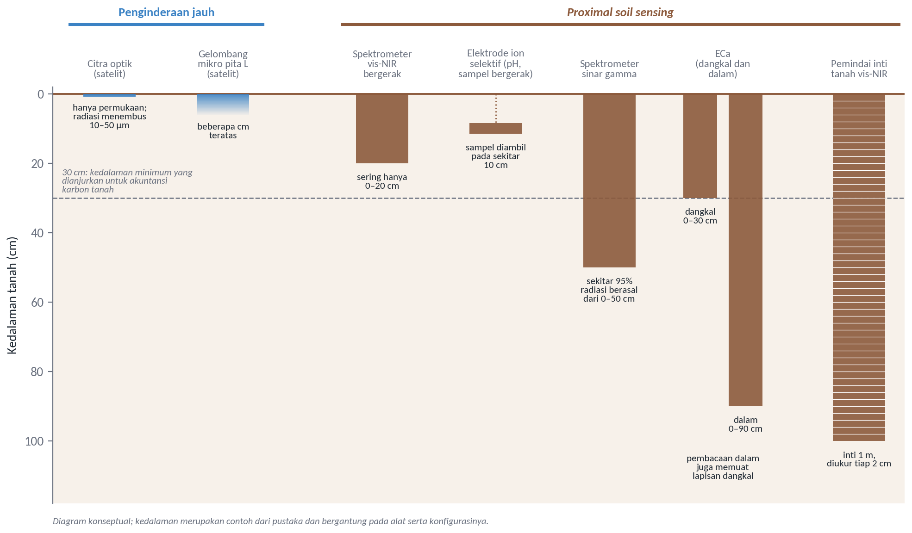
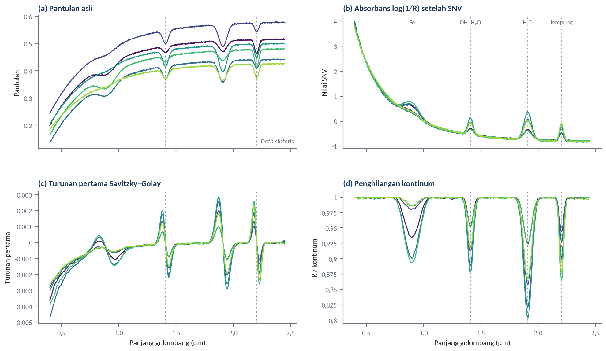
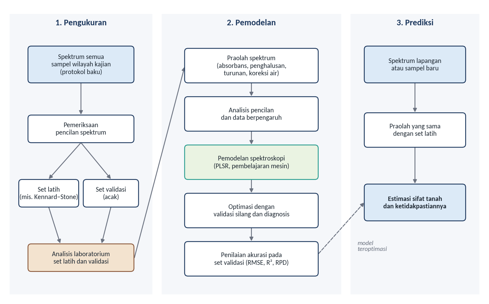

# Proximal Soil Sensing

Subjudul: Mengukur tanah dari dekat dan menafsirkan spektrumnya
Pemateri: Pandu Yudha Adi Putra Wirabuana, S.Hut., M.Sc., Ph.D.
Sesi: Hari ke-2, Rabu 4 November 2026, 10.15–11.45
Acuan: Modul 7

## Mengapa perlu sensor di dekat tanah
Tata letak: teks
- Pertanian presisi menuntut data tanah yang rapat dan dapat diperbarui
- Sampel dan laboratorium mahal serta lambat (Molin & Tavares, 2019)
- Rekomendasi pupuk karena itu sering masih disusun dari atas ke bawah
- Sensor membuka jalan dari bawah ke atas, bertolak dari kondisi setempat (Viscarra Rossel & Bouma, 2016)
Catatan: Contoh dari Brasil: peta kesuburan yang andal memerlukan sedikitnya satu sampel per hektare, dan ini sulit dipenuhi karena biaya.

## Konsep Proximal Soil Sensing
Tata letak: pemisah
Keterangan: Definisi, jenis sensor, dan kerapatan data

## PSS bekerja dalam kontak atau sekitar 2 m dari tanah
Tata letak: gambar-kanan
- Definisi Viscarra Rossel et al. (2011)
- Tekniknya lama dipakai di laboratorium; yang baru adalah peralatannya
- Alat makin ringan, kecil, kokoh, dan terjangkau
- Sebagian besar sensor memanfaatkan interaksi energi elektromagnetik dengan tanah

Sumber: Diagram konseptual berdasarkan Molin dan Tavares (2019) serta England dan Viscarra Rossel (2018)

## Cara pengoperasian menentukan sifat datanya
Tata letak: tabel
| Cara | Pemakaian | Kekuatan data |
|---|---|---|
| Alat meja (*benchtop*) | Sampel kering dan halus di laboratorium | Paling terkendali |
| Alat genggam | Titik pengamatan di lapangan | Langsung di lokasi |
| Sensor bergerak (*on-the-go*) | Dipasang pada kendaraan | Paling rapat ke arah mendatar |
| Pemindai inti tanah | Inti tanah per interval kedalaman | Informasi ke arah vertikal |
Sumber: England dan Viscarra Rossel (2018); Molin dan Tavares (2019)

## Tujuh jenis sensor untuk karakterisasi tanah
Tata letak: tabel
| Sensor | Prinsip | Sifat yang dapat diduga |
|---|---|---|
| vis-NIR | Pantulan difus 400–2.500 nm | C organik, N, lempung, oksida besi, kelembapan |
| MIR | Pantulan difus 2.500–25.000 nm | Mineral dan senyawa organik |
| pXRF | Sinar-X khas unsur | Kadar total Fe, Si, Al, K, Ca, P |
| LIBS | Emisi plasma | Komposisi unsur |
| Sinar gamma | Radiasi alami K, U, Th | Bahan induk, pelapukan, lempung |
| ECa | Induksi atau resistivitas | Salinitas, tekstur, kelembapan, KTK |
| ISE | Beda potensial ion | pH, K, nitrat |
Sumber: Tabel 7.1, rangkuman berdasarkan Molin dan Tavares (2019) serta England dan Viscarra Rossel (2018)

## Vis-NIR paling banyak dikembangkan, tetapi setiap sensor punya batas
Tata letak: teks
- **vis-NIR**: praktis, murah, tidak merusak, satu spektrum memuat banyak sifat
- **MIR**: fitur lebih kuat, tetapi sampel harus digiling dan sangat peka terhadap air
- **pXRF**: mengukur kadar total, bukan bentuk tersedia; batas deteksi P sekitar 5.000 mg/kg
- **Sinar gamma**: penutup tanaman setebal 2 cm dapat meredam hingga 35% radiasi
- **ECa**: sangat bergantung kelembapan, paling baik sedikit di bawah kapasitas lapang
Sumber: Molin dan Tavares (2019); England dan Viscarra Rossel (2018)
Catatan: Konsekuensi bagi pengguna: hasil pada kondisi kelembapan atau penutup yang berbeda tidak dapat langsung dibandingkan.

## Sensor bergerak menghasilkan data jauh lebih rapat
Tata letak: tabel
| Sistem, pada 4 m/s | Jarak antarlintasan | Kerapatan |
|---|---|---|
| ECa, satu data per detik | 10 m | ±250 titik/ha |
| ECa, satu data per detik | 20 m | ±125 titik/ha |
| ECa, satu data per detik | 30 m | ±83 titik/ha |
| pH bergerak, satu sampel per ±15 detik | 20 m | ±8 sampel/ha |
| Pengambilan sampel tanah biasa | – | Biasanya kurang dari 1 sampel/ha |
Sumber: Molin dan Tavares (2019)
Catatan: Serapat apa pun, data sensor tetap berupa sampel. Kecepatan dan jarak lintasan perlu sesuai dengan jangkauan keragaman spasial sifat yang dipetakan.

## Perbedaan Remote Sensing dan PSS
Tata letak: pemisah
Keterangan: Jarak, cakupan, dan kedalaman

## Yang membedakan adalah jarak, wahana, dan kondisi ukur
Tata letak: tabel
| Aspek | Penginderaan jauh | Proximal soil sensing |
|---|---|---|
| Jarak | Ratusan meter sampai ratusan kilometer | Kontak atau sekitar 2 m |
| Cakupan | Menyeluruh per piksel | Titik, lintasan, atau profil |
| Lapisan | Permukaan yang terbuka | Permukaan, sampel, atau inti tanah |
| Atmosfer dan penutup | Kuat; perlu koreksi dan penyaringan | Hampir tanpa atmosfer; dapat di bawah tajuk |
| Spektral | Umumnya kanal lebar | Spektrum bersambung |
| Peran dalam DSM | Kovariat menyeluruh | Data rapat untuk kalibrasi, validasi, kovariat lokal |
Sumber: Tabel 7.2, rangkuman berdasarkan Mulder et al. (2011), Molin dan Tavares (2019), England dan Viscarra Rossel (2018), Chabrillat et al. (2019)

## Perbedaan terpenting: lapisan tanah yang diwakili
Tata letak: gambar-kanan
- Spektroskopi reflektansi difus hanya menembus 10–50 µm permukaan
- Pita L satelit berkaitan dengan beberapa sentimeter teratas (Kerr et al., 2010)
- Pemindai inti dapat mengukur 1 m pada interval 2 cm
- vis-NIR bergerak sering hanya 0–20 cm, lebih dangkal dari anjuran 0–30 cm untuk akuntansi karbon

Sumber: Diagram konseptual; nilai dari Molin dan Tavares (2019), England dan Viscarra Rossel (2018), dan Kerr et al. (2010)

## Selisih laboratorium dan lapangan tidak selalu besar
Tata letak: tabel
| Kondisi pengukuran karbon organik | Median R² validasi |
|---|---|
| vis-NIR, sampel kering dihaluskan | 0,85 |
| vis-NIR, kondisi lapangan | 0,81 |
| MIR, sampel kering digiling halus | 0,93 |
Sumber: Rangkuman berbagai penelitian oleh England dan Viscarra Rossel (2018)
Catatan: Castaldi et al. (2016) menunjukkan ketelitian umumnya menurun saat spektrum pustaka diresampel ke kanal satelit. Ini akan dicoba di notebook praktik.

## Keduanya saling mengisi dalam pemetaan tanah digital
Tata letak: teks
- Penginderaan jauh unggul dalam cakupan
- PSS unggul dalam kerapatan dan kedalaman, serta dapat dipakai di bawah tajuk
- Contoh 50 ha di Brasil: ECa memandu lokasi sampel; satu sampel per 2,5 ha memberi peta lebih baik untuk hampir semua atribut daripada empat sampel per hektare (Molin & Tavares, 2019)
- Pada kebun bertajuk tertutup, peran PSS lebih penting lagi

## Interpretasi Pantulan Spektral
Tata letak: pemisah
Keterangan: Dari fitur serapan sampai model kalibrasi

## Spektrum dibaca dari intensitas, bentuk, dan fitur serapan
Tata letak: teks
- Tampak (400–700 nm): transisi elektronik, bahan organik dan oksida besi
- Inframerah dekat (700–2.500 nm): nada atas dan kombinasi, lebih lemah dan kurang khas
- Fitur tanah tropis: oksida besi 840–940 nm; air dan OH 1.400 dan 1.900 nm; kaolinit 2.205–2.225 nm; gibbsit 2.265 nm
- Titik awal yang baik, tetapi mineralogi setempat tetap perlu diperiksa
Sumber: England dan Viscarra Rossel (2018); Molin dan Tavares (2019)

## Spektrum mentah jarang langsung dipakai
Tata letak: gambar-kanan
- Keragaman spektrum terutama berasal dari ukuran partikel (Barnes et al., 1989)
- SNV dan *de-trending* meredam hamburan dan garis dasar
- Turunan Savitzky–Golay menajamkan fitur
- Di lapangan perlu koreksi air: EPO atau DS
- Perlakuan harus sama untuk data latih, validasi, dan prediksi

Sumber: Ilustrasi konseptual dengan data sintetis; praolah mengikuti Barnes et al. (1989), Savitzky dan Golay (1964), serta Clark dan Roush (1984)

## Alat merekam spektrum, nilai tanah datang dari model
Tata letak: gambar-kanan
- Spektrum dikalibrasi dengan hasil laboratorium
- Kumpulan spektrum, data analisis, dan metadata disebut pustaka spektral
- Alat dasarnya PLSR (Wold et al., 2001)
- Pada pustaka besar, pembelajaran mesin dapat menemukan hubungan lokal (Viscarra Rossel et al., 2016)

Sumber: Digambar ulang dengan modifikasi dari England dan Viscarra Rossel (2018)

## Pilihan pustaka menentukan ketelitian di tingkat kebun
Tata letak: tabel
| Pilihan | Gagasan | Catatan |
|---|---|---|
| Pustaka besar | Regional, nasional, atau global yang sudah ada | Tanpa biaya langsung; prediksi satu kebun cenderung bias |
| Pustaka lokal | Disusun dari sampel lokasi kajian | Lebih akurat; perlu biaya analisis laboratorium |
| Berbasis memori | Memilih sampel pustaka yang spektrumnya paling mirip | Jalan tengah |
| *Spiking* | Menambah sampel lokal ke kalibrasi pustaka besar | Jalan tengah |
| rs-local | 12–20 sampel lokal dipadukan dengan sampel terpilih dari pustaka | Dapat meningkatkan ketelitian dan kekokohan |
Sumber: England dan Viscarra Rossel (2018)

## Mutu model tidak melampaui mutu data laboratoriumnya
Tata letak: teks
- Pegangan: dua pertiga data untuk pelatihan, sepertiga untuk validasi
- Set latih dipilih agar mewakili spektrum, misalnya Kennard–Stone
- *Garbage in, garbage out*: sertakan duplikat buta, misalnya 15%, untuk menilai laboratorium
- Nilai pada set validasi dengan RMSE, R², RPD, atau RPIQ
Sumber: England dan Viscarra Rossel (2018); Castaldi et al. (2016)
Catatan: Pada sesi sesudah istirahat, peserta melihat sendiri bagaimana lapisan dari profil yang sama dapat membuat nilai validasi terlihat lebih baik jika data dibagi sembarangan.

## Sifat tanah berbeda, peluang kalibrasi berbeda
Tata letak: teks
- Umumnya mudah: karbon organik, N total, lempung, karena fiturnya jelas
- Umumnya sulit: hara tersedia, KTK, pH, kejenuhan basa, karena tanpa fitur sendiri
- Kalaupun berhasil, keberhasilannya lokal karena bergantung kovariasi (Molin & Tavares, 2019)
- Contoh industri sawit, 20 sampel tanah: R² tinggi untuk N, P, KTK, pH; rendah untuk Mg, Ca, B, Cu, Mn, Fe (Thandapani et al., 2024)
- NIR tetap metode sekunder yang harus dikalibrasi berkala
Catatan: Nilai tinggi KTK dan pH pada contoh tersebut lebih tepat dipahami sebagai kovariasi setempat, apalagi jumlah sampelnya kecil.

## Alat yang didemonstrasikan: ASD FieldSpec 4
Tata letak: tabel
| Spesifikasi | Nilai |
|---|---|
| Rentang panjang gelombang | 350–2.500 nm, 2.151 kanal |
| Resolusi spektral VNIR (700 nm) | 3 nm |
| Resolusi spektral SWIR (1.400 dan 2.100 nm) | 6–10 nm |
| Interval sampling | 1,4 nm VNIR, 1,1 nm SWIR |
| Kecepatan | Waktu pindai 100 milidetik, 2 spektrum per detik |
| Detektor | Silikon 512 elemen (VNIR), dua fotodioda InGaAs (SWIR) |
| Masukan dan berat | Serat optik 1,5 m, bidang pandang 25°; 5,44 kg |
Sumber: SciAps (2025), brosur ASD FieldSpec 4
Catatan: Kanal 2.151 berselang 1 nm tidak berarti resolusi spektralnya 1 nm.

## Dari demonstrasi ke notebook
Tata letak: teks
- Demonstrasi: pengukuran referensi dengan panel putih, pengukuran sampel, dan ulangan
- Hasil ukur berupa spektrum 350–2.500 nm, belum berupa nilai sifat tanah
- Notebook memakai pustaka 274 sampel dari 71 profil tanah, Site Gunung Madu Plantation, Lampung
- Sasarannya C-organik, sama dengan sasaran pemetaan pada hari ke-3
Catatan: Peserta akan melihat bahwa cara membagi data memengaruhi angka validasi, karena lapisan dari profil yang sama saling mirip. Pada lempung, MEC turun dari 0,66 menjadi 0,47 hanya karena data dibagi per profil. Pada C-organik, penurunannya kecil, dari 0,44 menjadi 0,40.
