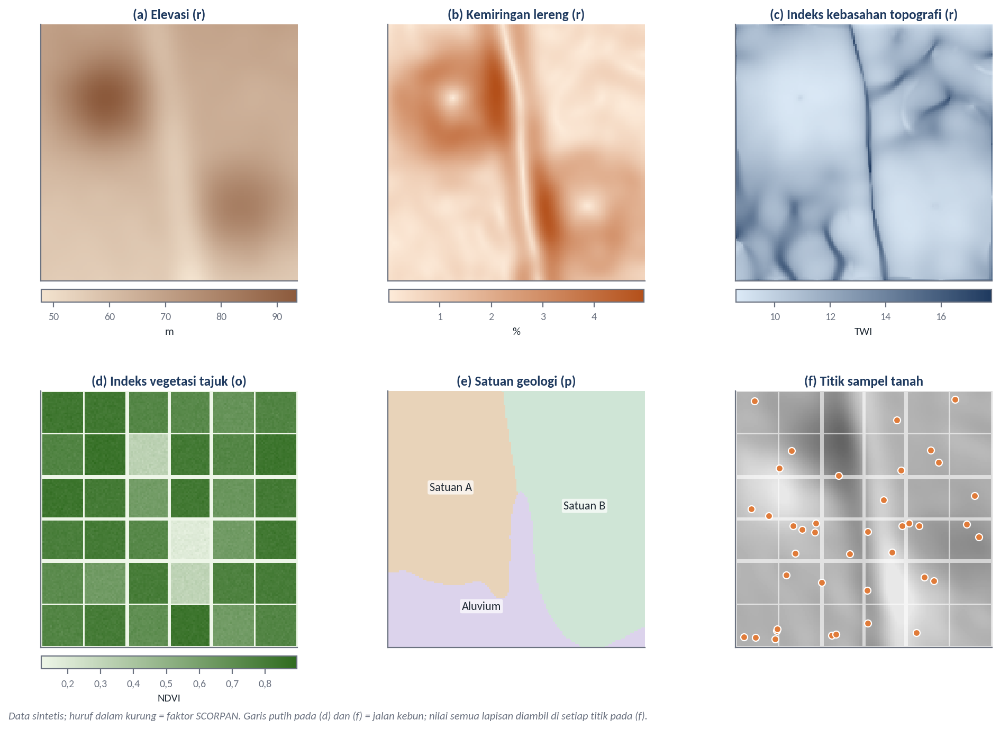
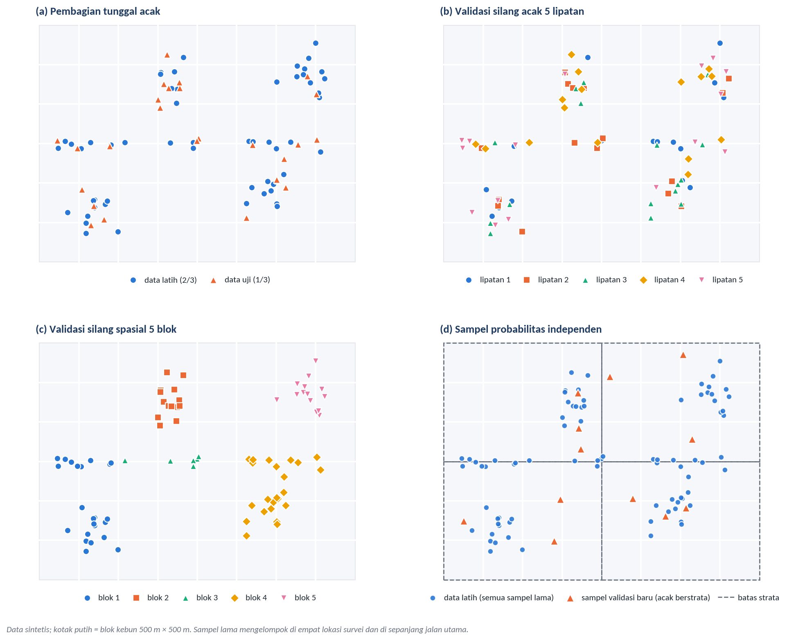
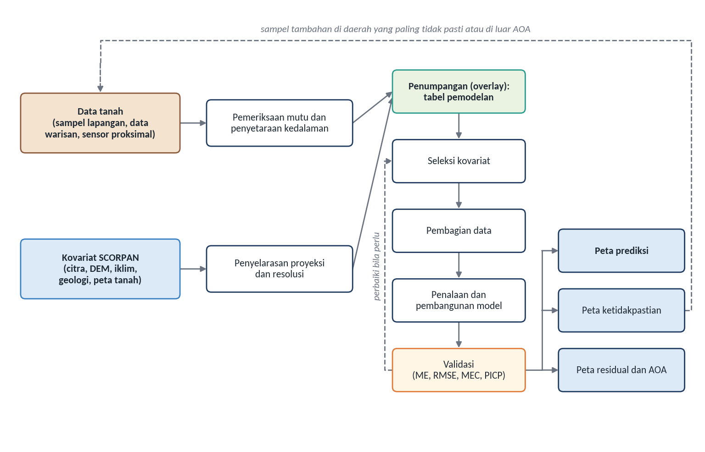
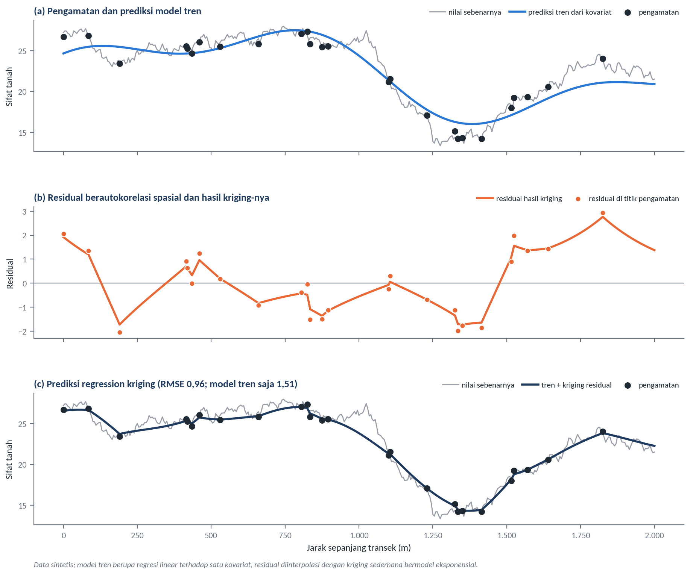
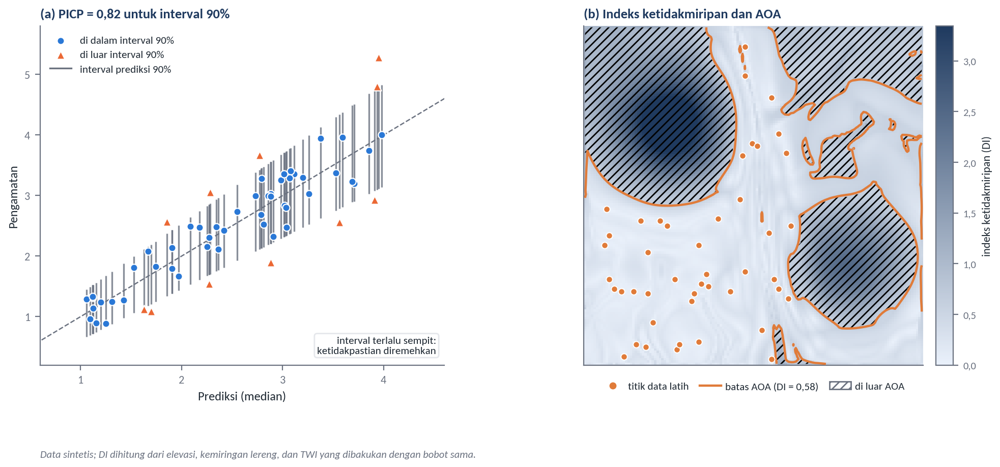

# Digital Soil Mapping

Subjudul: Dari data tanah dan kovariat sampai peta beserta ketidakpastiannya
Pemateri: Dr. Eng. Guruh Samodra, S.Si., M.Sc.
Sesi: Hari ke-3, Kamis 5 November 2026, 08.00–09.00
Acuan: Modul 8

## Empat pertanyaan dalam membangun model DSM
Tata letak: teks
- Data lingkungan apa yang masuk akal dipakai?
- Algoritme apa yang cocok dengan data yang dimiliki?
- Bagaimana menilai model dengan jujur?
- Seberapa jauh peta hasilnya boleh dipercaya?
Catatan: Keempat pertanyaan ini sama dengan urutan praktik hari ini.

## SCORPAN Sebagai Variabel Lingkungan
Tata letak: pemisah
Keterangan: Mewujudkan faktor pembentuk tanah sebagai data

## Fungsi f dipelajari dari data, bukan diturunkan dari teori
Tata letak: teks
Rumus: $S = f(s, c, o, r, p, a, n) + e$
- *S* sifat atau kelas tanah; *s, c, o, r, p, a, n* faktor lingkungan; *e* keragaman yang tidak terjelaskan
- *f* dipelajari dari pasangan nilai tanah dan nilai faktor di lokasi yang sama
- Setiap faktor harus tersedia di seluruh wilayah yang dipetakan
Sumber: McBratney et al. (2003); Wadoux, Minasny, dan McBratney (2020)

## Setiap faktor punya sumber data dan catatan di kebun sawit
Tata letak: tabel
| Faktor | Contoh kovariat | Catatan untuk kebun |
|---|---|---|
| s tanah | Peta warisan, data sensor proksimal | Data PSS rapat dapat menjadi kovariat lokal |
| c iklim | Hujan dan suhu jangka panjang | Jarang bervariasi di dalam satu kebun |
| o organisme | Indeks vegetasi, komposit tanah terbuka | Tajuk lebih mencerminkan umur dan kondisi tanaman |
| r relief | Elevasi, lereng, TPI, TWI, MrVBF | Tetap tersedia di bawah tajuk |
| p bahan induk | Satuan geologi, radiometrik | Periksa skala peta geologi |
| a umur | Permukaan geomorfik, teras | Hanya urutan relatif |
| n posisi | Koordinat, peta jarak | Dapat menimbulkan artefak |
Sumber: Tabel 8.1, rangkuman berdasarkan McBratney et al. (2003), Wadoux, Minasny, dan McBratney (2020), Poggio et al. (2021), dan Ågren et al. (2014)

## Kovariat adalah lapisan raster yang diambil nilainya di titik sampel
Tata letak: gambar-kanan
- Relief dari model elevasi, organisme dari citra, bahan induk dari peta geologi
- Penelitian di wilayah yang lebih sempit umumnya memakai sekitar 20 kovariat
- SoilGrids 2.0 memakai lebih dari 400 kovariat global
- Perhatikan: pola organisme mengikuti blok, pola relief mengikuti bentuk lahan

Sumber: Ilustrasi konseptual dengan data sintetis; jenis kovariat mengacu pada Wadoux, Minasny, dan McBratney (2020); SoilGrids dari Poggio et al. (2021)

## Kovariat tidak perlu dikumpulkan sebanyak-banyaknya
Tata letak: teks
- **Relevansi pedologis**: masuk akal mengendalikan sifat sasaran
- **Kesesuaian resolusi dan skala**: sepadan dengan keragaman yang dipetakan
- **Ketersediaan menyeluruh**: seragam di seluruh wilayah prediksi
- **Kesesuaian waktu**: periode sesuai dengan sifat dan waktu sampling
- **Tidak berlebihan**: kovariat yang mirip cukup diwakili satu
Catatan: Kriteria pertama paling sering terlewat. Model dapat tampak akurat dengan kovariat semu (Wadoux, Samuel-Rosa, et al., 2020).

## Relief tetap bicara di bawah tajuk
Tata letak: teks
- Perkebunan 5.220 ha di Llanos, Kolombia; DEM SRTM 30 m; lereng hanya 0–3%; satu kelas tanah (Martinez et al., 2021)
- Luas tangkapan termodifikasi berkorelasi paling kuat dengan hasil panen
- Arah korelasi berbeda antarzona: positif di satu zona, negatif di tiga zona
- Artinya hasil dapat dibatasi kekurangan maupun kelebihan air
Catatan: Di bawah tajuk, data sensor proksimal juga dapat menjadi kovariat.

## Algoritma Digital Soil Mapping
Tata letak: pemisah
Keterangan: Tidak ada yang selalu unggul

## Lima kelompok algoritme dengan kekuatan yang berbeda
Tata letak: tabel
| Kelompok | Kekuatan | Keterbatasan |
|---|---|---|
| Regresi linear | Sederhana, mudah ditafsirkan | Kurang menangkap hubungan tidak linear |
| Geostatistik | Memanfaatkan autokorelasi; ada varians prediksi | Memerlukan sampel cukup rapat |
| Berbasis pohon | Tidak linear, tahan kovariat berkorelasi | *Overfitting*; tidak andal di luar rentang data |
| Pembelajaran mesin lain | Luwes untuk pola rumit | Perlu pilihan parameter dan data latih tepat |
| Pengetahuan dan disagregasi | Memanfaatkan pakar dan peta warisan | Bergantung mutu pengetahuan dan peta |
Sumber: Tabel 8.2, rangkuman berdasarkan Nussbaum et al. (2018), Wadoux, Minasny, dan McBratney (2020), Maxwell et al. (2018), Meyer dan Pebesma (2021), Zhu et al. (2001), dan Sulaeman dan Husnain (2021)

## Mutu kovariat dan data sama pentingnya dengan algoritme
Tata letak: teks
- 48 kombinasi sifat dan kedalaman di Swiss: perbedaan antarmetode umumnya kecil (Nussbaum et al., 2018)
- *Random forest* terbaik pada 28 dari 48 kasus, tetapi cenderung *overfitting*
- SoilGrids250m membaik karena pembelajaran mesin, kovariat lebih rinci, dan data profil tambahan (Hengl et al., 2017)
- Sampel sedikit: pertimbangkan model sederhana. Sampel rapat: *kriging* residual dapat membantu
- Pilih dengan membandingkan pada skema validasi yang sama

## Data Splitting
Tata letak: pemisah
Keterangan: Cara membagi data menentukan angka yang dilaporkan

## Lima skema membagi data
Tata letak: gambar-kanan
- Pembagian tunggal (*holdout*)
- Validasi silang lipat-k
- *Leave-one-out*
- Validasi silang spasial
- Sampel probabilitas independen, satu-satunya yang menambah data baru

Sumber: Ilustrasi konseptual dengan data sintetis; skema mengacu pada Brus et al. (2011), Roberts et al. (2017), dan Wadoux, Minasny, dan McBratney (2020)

## Validasi acak dapat terlalu optimistis
Tata letak: teks
- Pengamatan berdekatan cenderung mirip, padahal model mengasumsikan saling bebas
- Biomassa Afrika Tengah: validasi acak menjelaskan lebih dari separuh keragaman, validasi spasial hampir nol (Ploton et al., 2020)
- Blok yang terlalu besar justru terlalu pesimistis (Roberts et al., 2017)
- Jalan paling kokoh: sampel validasi independen, misalnya acak berstrata (Brus et al., 2011)
- Di kebun: perlakukan pengamatan satu blok sebagai satu kelompok

## Pembuatan Model dan Validasi
Tata letak: pemisah
Keterangan: Alur kerja dan cara membaca angkanya

## Alur baku dari data tanah sampai peta
Tata letak: gambar-penuh

Sumber: Diagram konseptual berdasarkan Poggio et al. (2021) dan Wadoux, Minasny, dan McBratney (2020)
Catatan: Pelajaran penalaan dari Poggio et al. (2021): menambah pohon di atas 200 hanya menaikkan ketelitian kurang dari 0,1%. Penalaan dan penilaian akhir sebaiknya tidak memakai data uji yang sama.

## Setiap ukuran menjawab pertanyaan yang berbeda
Tata letak: tabel
| Ukuran | Pertanyaan yang dijawab | Ideal |
|---|---|---|
| ME | Apakah model cenderung terlalu tinggi atau rendah? | 0 |
| MAE | Berapa rata-rata besar galat? | 0 |
| RMSE | Berapa besar galat, dengan galat besar lebih berat? | 0 |
| MEC | Berapa keragaman yang dijelaskan terhadap garis 1:1? | 1 |
| R² | Seberapa kuat hubungan linearnya? | 1 |
| PICP | Apakah interval prediksi jujur? | Sama dengan tingkat interval |
Sumber: Tabel 8.3, rangkuman berdasarkan Nussbaum et al. (2018), Poggio et al. (2021), dan Wadoux, Minasny, dan McBratney (2020)
Catatan: Model yang prediksinya selalu 20% lebih tinggi dapat punya R² tinggi, tetapi MEC-nya rendah. MEC negatif berarti lebih buruk daripada menebak rata-rata. Ini akan penting saat membaca hasil praktik.

## Residual dan Uncertainty
Tata letak: pemisah
Keterangan: Seberapa jauh peta boleh dipercaya

## Residual menyimpan informasi yang sering terabaikan
Tata letak: gambar-kanan
- Residual berautokorelasi menandakan prediktor penting belum masuk
- *Kriging* residual ditambahkan pada prediksi tren
- Manfaatnya bergantung kerapatan sampel (Hengl et al., 2017)
- Kondisi kebun dengan data rapat lebih mendekati kasus yang bermanfaat

Sumber: Ilustrasi konseptual dengan data sintetis; prinsip mengacu pada Nussbaum et al. (2018) dan Hengl et al. (2017)

## Ketidakpastian perlu dipetakan dan divalidasi
Tata letak: teks
- **Aleatorik**: derau dan galat pengukuran, sulit dikurangi
- **Epistemik**: keterbatasan model, dapat dikurangi dengan sampel tambahan
- QRF menduga seluruh sebaran bersyarat (Meinshausen, 2006)
- PICP interval 90% idealnya mendekati 0,90
Rumus: $\mathrm{PI90} = q_{0{,}95} - q_{0{,}05}$
Sumber: Wadoux, Minasny, dan McBratney (2020); Poggio et al. (2021)

## Interval prediksi hanya bermakna di wilayah yang mirip data latih
Tata letak: gambar-kanan
- Interval RF tidak melebar saat mengekstrapolasi, QRF pun tidak mengatasinya (Meyer & Pebesma, 2021)
- Indeks ketidakmiripan: jarak ke data latih dalam ruang kovariat
- AOA: wilayah yang DI-nya di bawah ambang
- Di luar AOA, prediksi ditandai atau tidak dipakai

Sumber: Ilustrasi konseptual dengan data sintetis; PICP mengacu pada Poggio et al. (2021), DI dan AOA mengacu pada Meyer dan Pebesma (2021)

## DSM adalah siklus, bukan satu peta
Tata letak: teks
- Peta ketidakpastian dan AOA menunjukkan di mana peta dapat dipercaya untuk rekomendasi pupuk
- Daerah interval lebar atau di luar AOA menjadi sasaran sampel berikutnya
- Peta, ketidakpastian, sampel baru, dan model yang diperbarui membentuk siklus
Catatan: Sesudah sesi ini peserta langsung masuk praktik: machine learning, kovariat SCORPAN, dan pembangunan model.
