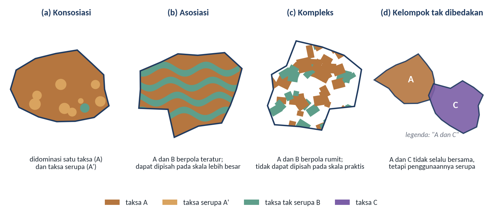
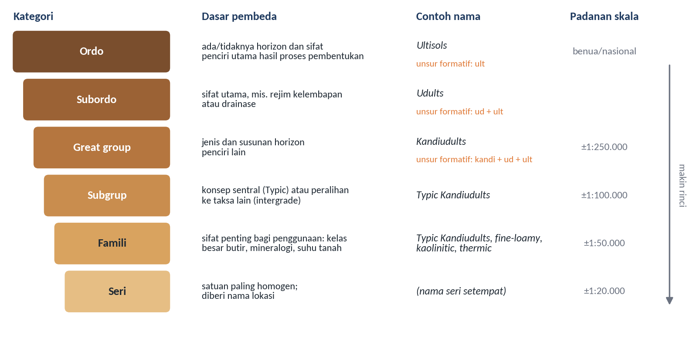
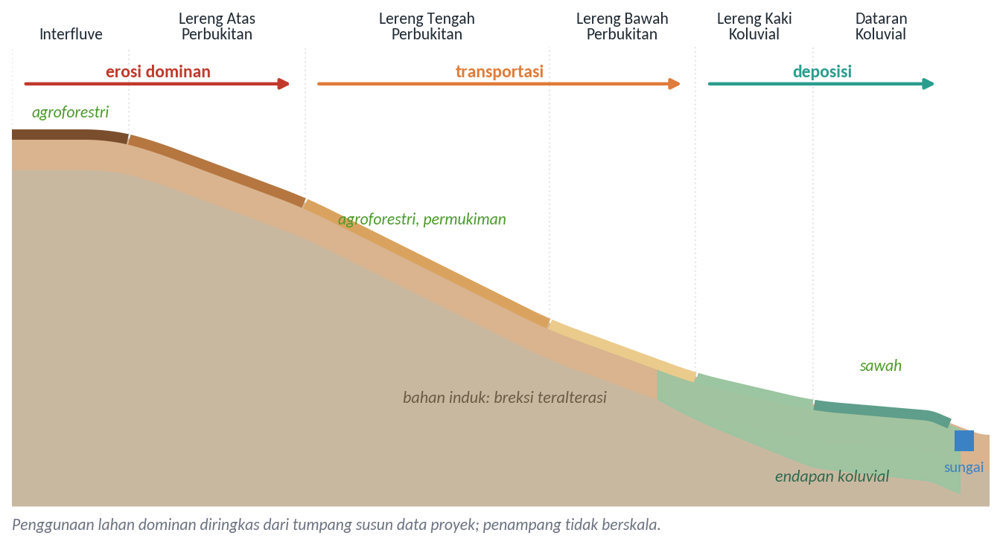
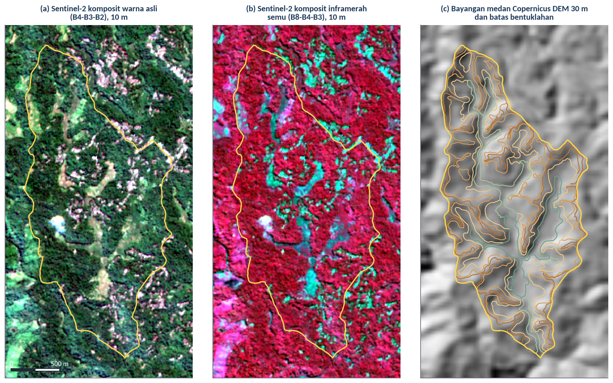
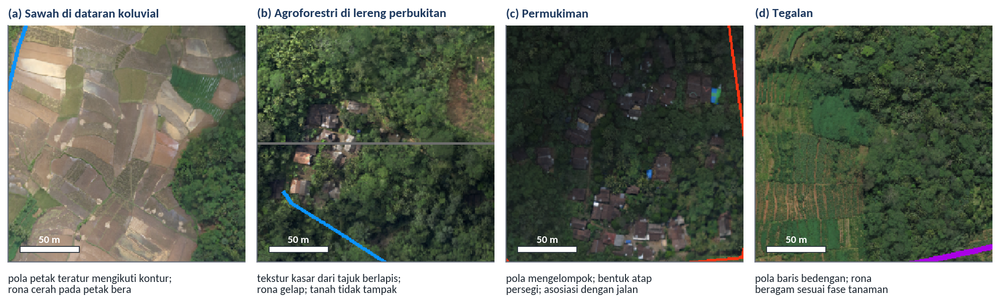
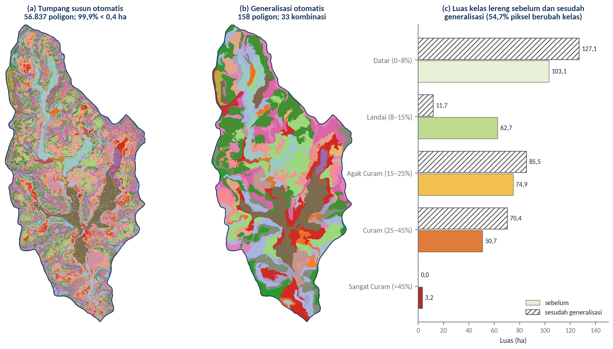
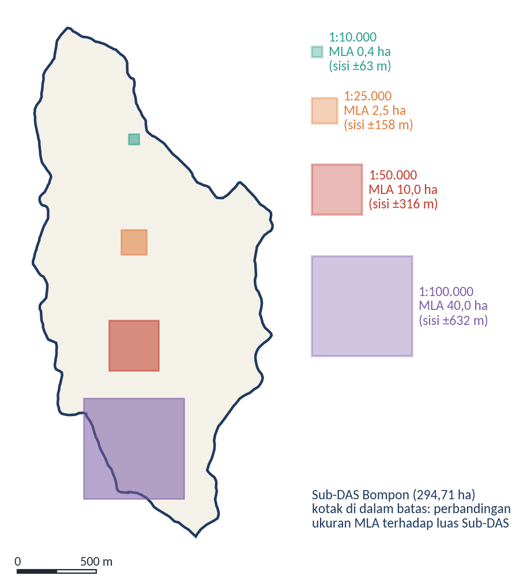

# Remote Sensing untuk Delineasi Soil Mapping Units (SMU)

## Tujuan dan Capaian Pembelajaran

Modul ini bertujuan membekali peserta dengan pemahaman mengenai prinsip delineasi *Soil Mapping Unit* (SMU) atau satuan peta tanah menggunakan data *remote sensing*. Modul ini melanjutkan Modul 2 dengan memanfaatkan data multisumber yang telah diselaraskan untuk menarik batas satuan peta tanah, sekaligus menyiapkan dasar bagi interpretasi pedologis pada Modul 6 dan penyusunan rancangan pengambilan sampel serta kovariat kategorik pada Modul 8.

Setelah mempelajari modul ini, peserta diharapkan mampu:

1. menjelaskan konsep satuan peta tanah, jenis-jenisnya, serta hubungan antara satuan peta dan kategori klasifikasi tanah;
2. menjelaskan prinsip delineasi berbasis lanskap dan peran data penginderaan jauh beserta turunannya dalam delineasi tersebut;
3. menggunakan unsur-unsur interpretasi citra sebagai kunci untuk mengenali batas satuan peta tanah;
4. menentukan kerincian delineasi berdasarkan skala peta dan satuan pemetaan terkecil; dan
5. melakukan ekstraksi data penginderaan jauh dan delineasi satuan peta tanah secara *on-screen digitizing* di Sub-DAS Bompon.

*Ceramah dan diskusi:*

## Konsep Soil Mapping Unit (SMU)

Peta tanah menyajikan sebaran tanah dalam bentuk poligon-poligon yang masing-masing diberi nama sesuai dengan tanah yang diwakilinya. Setiap poligon tersebut disebut delineasi, sedangkan kumpulan delineasi yang diberi nama dan keterangan yang sama dalam legenda disebut satuan peta tanah atau *Soil Mapping Unit* (SMU). Rossiter (2000) menekankan bahwa satuan peta perlu dibedakan dari satuan taksonomi. Satuan taksonomi adalah kelas dalam suatu sistem klasifikasi tanah yang didefinisikan secara tegas berdasarkan sifat-sifat tanah, sedangkan satuan peta adalah satuan lanskap yang digambar di atas peta. Karena batas di lapangan jarang setegas batas kelas dalam sistem klasifikasi, hampir setiap delineasi memuat tanah lain selain tanah yang namanya tercantum. Tanah lain tersebut disebut inklusi, dan dibedakan menjadi inklusi serupa, yaitu tanah yang sifat dan interpretasinya hampir sama dengan tanah yang dinamai, serta inklusi tak serupa, yaitu tanah yang berbeda cukup jauh sehingga dapat memengaruhi penggunaan lahan (Rossiter, 2000).

Berdasarkan komposisi dan pola sebaran komponennya, satuan peta tanah dibedakan menjadi beberapa jenis, sebagaimana dirangkum pada Tabel 3.1 dan diilustrasikan pada Gambar 3.1. Konsosiasi merupakan satuan peta yang paling homogen. Rossiter (2000), merujuk pada *Soil Survey Manual*, menguraikan bahwa suatu konsosiasi harus memenuhi beberapa ketentuan: sedikitnya 50% luas setiap delineasi termasuk taksa yang dinamai, sedikitnya 75% termasuk taksa yang dinamai atau taksa serupa, inklusi tak serupa yang membatasi penggunaan tidak lebih dari 15%, dan tidak ada satu pun inklusi tak serupa yang membatasi melebihi 10% luas. Apabila ketentuan tersebut tidak terpenuhi karena dua tanah atau lebih yang berbeda nyata hadir bersama-sama, satuan peta tersebut merupakan satuan majemuk, yaitu asosiasi atau kompleks.

Tabel 3.1 Jenis Satuan Peta Tanah

| **Jenis satuan peta** | **Ciri utama** | **Contoh penamaan** |
| :--- | :--- | :--- |
| Konsosiasi | Didominasi satu taksa dan taksa serupa; inklusi tak serupa terbatas | Tanah A |
| Asosiasi | Dua taksa atau lebih yang berbeda nyata dengan pola sebaran teratur dan dapat diramalkan; dapat dipisahkan menjadi konsosiasi pada skala yang lebih besar | Asosiasi A–B |
| Kompleks | Dua taksa atau lebih yang berbeda nyata dengan pola sebaran rumit; tidak dapat dipisahkan pada skala praktis | Kompleks A–B |
| Kelompok tak dibedakan | Dua taksa atau lebih yang tidak selalu hadir bersama dalam satu delineasi, tetapi digabung karena penggunaan dan pengelolaannya serupa | Tanah A dan C |

Sumber: Disarikan dari Rossiter (2000)

Gambar 3.1 Ilustrasi empat jenis satuan peta tanah

Sumber: Diagram konseptual disusun berdasarkan Rossiter (2000)

Perbedaan antara asosiasi dan kompleks berkaitan erat dengan skala. Komponen suatu asosiasi sebenarnya dapat dipetakan secara terpisah apabila skala peta diperbesar, sedangkan komponen suatu kompleks tersebar terlalu rumit untuk dipisahkan pada skala apa pun yang masih praktis (Rossiter, 2000). Rossiter juga mencatat bahwa toposekuen atau katena pada lereng perbukitan umumnya termasuk asosiasi, karena batas antartanahnya dapat diduga di lapangan maupun pada foto udara dari posisi lereng serta perbedaan kelembapan atau warna permukaan. Pengamatan ini menjadi dasar bagi pemanfaatan penginderaan jauh dalam delineasi: selama perbedaan tanah diikuti oleh perbedaan kenampakan lanskap yang dapat dikenali, batas satuan peta dapat ditarik dari data citra dan data medan.

Nama satuan peta tanah umumnya diambil dari suatu sistem klasifikasi tanah. Dalam sistem *Soil Taxonomy*, tanah diklasifikasikan secara hierarkis ke dalam enam kategori, yaitu ordo, subordo, *great group*, subgrup, famili, dan seri (Rossiter, 2000; Soil Survey Staff, 2022). Ordo dibedakan berdasarkan horizon dan sifat penciri yang mencerminkan proses pembentukan tanah yang dominan. Subordo menambahkan sifat utama, misalnya rejim kelembapan tanah atau drainase. *Great group* menambahkan jenis dan susunan horizon penciri lainnya. Subgrup menunjukkan apakah tanah tersebut mewakili konsep sentral kelasnya (*Typic*) atau merupakan peralihan (*intergrade*) ke kelas lain. Famili menambahkan sifat-sifat yang penting bagi penggunaan, seperti kelas besar butir, mineralogi, dan rejim suhu tanah, sedangkan seri merupakan satuan yang paling homogen dan biasanya diberi nama sesuai lokasi tempat tanah tersebut pertama kali dideskripsi (Rossiter, 2000). Hierarki tersebut beserta contoh penamaannya ditunjukkan pada Gambar 3.2.

<!-- Catatan editor: subbab ini mengembangkan catatan mentah pada kerangka modul ("Ordo penciri utama, sub ordo, great group iklim ... sub grup pendugaan perkembangan, family series lokasi ... peta tanah itu sub group ... 3 huruf terakhir Ordo") sebagai uraian hierarki Soil Taxonomy. Tafsiran ini perlu ditinjau narasumber. -->

Gambar 3.2 Hierarki kategori *Soil Taxonomy*, contoh penamaan, dan padanan skala peta yang mendekati

Sumber: Diagram konseptual disusun berdasarkan Soil Survey Staff (2022) dan Rossiter (2000); contoh nama famili diambil dari Rossiter (2000), bukan hasil klasifikasi tanah Sub-DAS Bompon

Nama-nama dalam *Soil Taxonomy* disusun dari unsur formatif yang berasal dari bahasa Yunani dan Latin, dan dirancang untuk dibaca suku demi suku dari kanan ke kiri (Soil Survey Staff, 2022). Suku terakhir nama pada kategori di bawah ordo selalu memuat unsur formatif ordonya, misalnya *ult* untuk Ultisols, *alf* untuk Alfisols, dan *ept* untuk Inceptisols. Pada contoh *Typic Kandiudults*, unsur *ult* menunjukkan ordo Ultisols, *ud* menunjukkan rejim kelembapan udik pada tingkat subordo, *kandi* menunjukkan adanya horizon kandik pada tingkat *great group*, dan *Typic* menunjukkan konsep sentral pada tingkat subgrup. Dengan membaca nama secara demikian, pengguna peta dapat menangkap sifat-sifat pokok tanah tanpa harus membuka deskripsi profilnya.

Kategori klasifikasi yang digunakan untuk menamai satuan peta berkaitan dengan skala peta. Soil Survey Staff (2022) menyatakan bahwa setiap kategori makin spesifik, mulai dari satuan tanah berskala benua pada tingkat ordo hingga satuan tanah rinci yang dapat ditampilkan pada peta berskala kebun pada tingkat famili. Rossiter (2000) memberikan padanan kasar antara kategori dan skala, yaitu seri sekitar 1:20.000, famili sekitar 1:50.000, subgrup sekitar 1:100.000, dan *great group* sekitar 1:250.000, sambil mengingatkan bahwa padanan ini sering tidak berlaku karena satu delineasi rinci pun dapat memuat beberapa ordo. Oleh karena itu, pilihan kategori untuk legenda harus didasarkan pada keragaman tanah di wilayah kajian, bukan semata-mata pada skala peta.

Dalam praktik pemetaan tanah berbasis penginderaan jauh, satuan peta sering kali disusun terlebih dahulu sebagai satuan lahan, yaitu satuan yang batasnya ditarik dari faktor-faktor lingkungan yang mengendalikan pembentukan tanah, sebelum isinya dicirikan melalui pengamatan tanah di lapangan. Pendekatan inilah yang digunakan di Sub-DAS Bompon. Sambodo dan Arpornthip (2021) menyusun satuan peta tanah dari kombinasi susunan bentuklahan dan kelas lereng, lalu mengambil sampel tanah dari setiap satuan untuk menguji keterkaitannya dengan pH tanah. Fatmawati (2026) menggunakan satuan pemetaan yang tersusun dari bentuklahan, penggunaan lahan, dan kemiringan lereng sebagai dasar penentuan 50 titik sampel secara acak berstrata. Pada kedua penelitian tersebut, satuan hasil delineasi berperan sebagai hipotesis awal mengenai sebaran tanah yang kemudian diuji dengan data lapangan.

## Prinsip Delineasi Berbasis Lanskap

Delineasi berbasis lanskap bertumpu pada paradigma tanah–lanskap (*soil–landscape paradigm*), yaitu pemahaman bahwa tanah dan lanskap berkembang bersama sehingga perubahan kondisi lanskap umumnya diikuti oleh perubahan tanah (Hudson, 1992). Dalam kerangka faktor pembentuk tanah, relief, bahan induk, dan umur lahan bervariasi bersama bentuklahan, sehingga satuan bentuklahan sering dijadikan kerangka utama dalam menarik batas satuan peta tanah. Zinck (2023) mengembangkan gagasan ini menjadi pendekatan geopedologi, yang menempatkan bentuklahan sebagai wadah tempat tanah terbentuk dan menggunakan hierarki satuan geomorfologi sebagai kerangka pemetaan tanah.

Pada skala lereng, keterkaitan tanah dan lanskap tampak jelas pada toposekuen. Conacher dan Dalrymple (1977) membagi permukaan lereng ke dalam satuan-satuan yang dibedakan menurut proses pedogeomorfik dominannya, dari punggungan di bagian atas hingga lereng kaki dan dasar lembah di bagian bawah. Di Sub-DAS Bompon, susunan bentuklahan dibagi ke dalam enam satuan, yaitu *interfluve*, lereng atas perbukitan, lereng tengah perbukitan, lereng bawah perbukitan, lereng kaki koluvial, dan dataran koluvial (Gambar 3.3). Sambodo (2021) menjelaskan bahwa proses dominan pada *interfluve* dan lereng atas adalah erosi, lereng tengah dan lereng bawah merupakan zona transportasi tempat laju erosi dan sedimentasi relatif seimbang, sedangkan lereng kaki koluvial dan dataran koluvial merupakan zona pengendapan material hasil erosi maupun longsor. Perbedaan proses inilah yang menjadi alasan pedologis mengapa batas antarbentuklahan dapat diharapkan sejalan dengan perbedaan tanah.

Gambar 3.3 Toposekuen konseptual susunan bentuklahan Sub-DAS Bompon dan proses dominannya

Sumber: Diagram konseptual disusun berdasarkan Sambodo (2021); penggunaan lahan dominan diringkas dari data spasial Sub-DAS Bompon (data proyek)

Pola penggunaan lahan di Sub-DAS Bompon memperlihatkan keterkaitan yang kuat dengan susunan bentuklahan tersebut. Tumpang susun data proyek menunjukkan bahwa sekitar 86% luas sawah (29,0 dari 33,9 ha) berada pada lereng kaki koluvial dan dataran koluvial, sedangkan sekitar 97% luas agroforestri berada pada *interfluve* dan lereng perbukitan. Keterkaitan ini berguna bagi delineasi, karena pola penggunaan lahan yang mudah dikenali pada citra dapat membantu menelusuri batas bentuklahan. Namun, penggunaan lahan juga merupakan hasil keputusan manusia, sehingga batasnya tidak selalu berimpit dengan batas tanah. Petak sawah yang dibangun di lereng tengah, misalnya, mencerminkan rekayasa teras, bukan perubahan bahan induk.

Data penginderaan jauh dan turunannya berperan pada setiap tahap delineasi berbasis lanskap. Data elevasi beserta turunannya, seperti kemiringan lereng, kelengkungan lereng, indeks posisi topografi, dan indeks kedataran dasar lembah multiresolusi (*Multi-resolution Valley Bottom Flatness*, MrVBF) yang dirancang untuk memetakan area pengendapan (Gallant & Dowling, 2003), membantu mengenali bentuk dan posisi lereng. Citra optik dan foto udara memperlihatkan tutupan lahan, pola drainase, dan rona permukaan yang membantu menelusuri batas di lapangan. Mulder et al. (2011) mencatat bahwa penginderaan jauh dalam pemetaan tanah dan medan terutama berperan sebagai sumber informasi lingkungan pengganti, karena tanah itu sendiri jarang teramati secara langsung. Gambar 3.4 memperlihatkan contoh data tersebut untuk Sub-DAS Bompon, yaitu citra Sentinel-2 perekaman Juli 2025 dan bayangan medan dari Copernicus DEM.

Gambar 3.4 Data penginderaan jauh untuk delineasi di Sub-DAS Bompon: (a) komposit warna asli dan (b) komposit inframerah semu Sentinel-2 perekaman 21 Juli 2025, serta (c) bayangan medan Copernicus DEM dengan batas bentuklahan

Sumber: Diolah dari data Copernicus Sentinel-2 Level-2A 2025 (Drusch et al., 2012), Copernicus DEM GLO-30 (European Space Agency, t.t.), dan data spasial Sub-DAS Bompon (data proyek)

Gambar tersebut juga memperlihatkan keterbatasan data terbuka beresolusi menengah untuk wilayah sekecil Sub-DAS Bompon. Pada komposit inframerah semu, hampir seluruh wilayah tampak merah karena tertutup vegetasi rapat, sedangkan petak sawah dan tegalan di lembah tampak sebagai pola biru kehijauan. Bayangan medan dari Copernicus DEM berukuran piksel 30 m hanya menggambarkan punggungan dan lembah utama, sehingga batas bentuklahan yang lebih rinci tidak dapat ditelusuri darinya. Copernicus DEM juga merupakan model permukaan yang masih memuat tinggi tajuk vegetasi. Oleh karena itu, delineasi rinci di Bompon memerlukan data elevasi beresolusi tinggi, seperti DTM LiDAR yang digunakan oleh Fatmawati (2026), serta foto udara beresolusi tinggi.

Berdasarkan uraian tersebut, prinsip delineasi satuan peta tanah berbasis lanskap dapat dirangkum sebagai berikut:

1. **Homogen di dalam, kontras di antara**, setiap satuan peta sebaiknya serelatif mungkin seragam dalam faktor-faktor pembentuk tanah yang penting di wilayah kajian, sedangkan satuan yang bersebelahan sebaiknya berbeda secara nyata.
2. **Batas mengikuti perubahan lanskap**, batas ditarik pada tempat perubahan lanskap terjadi, seperti tekuk lereng, perubahan bentuk lereng dari cembung ke cekung, batas endapan koluvial, atau perubahan pola drainase, bukan pada garis bantu yang tidak bermakna di lapangan.
3. **Hierarkis**, delineasi dimulai dari satuan yang paling menentukan pembentukan tanah, misalnya bentuklahan, lalu dirinci dengan parameter lain seperti kelas lereng atau penggunaan lahan yang relevan. Sambodo (2021) menerapkan prinsip ini dengan menggunakan kelas lereng untuk merinci satuan bentuklahan yang hanya sesuai untuk skala sekitar 1:12.500 agar menjadi satuan peta untuk skala 1:10.000.
4. **Sesuai skala**, kerincian delineasi disesuaikan dengan skala peta dan satuan pemetaan terkecil yang akan dibahas dalam subbab berikutnya.
5. **Diuji di lapangan**, satuan hasil delineasi diperlakukan sebagai hipotesis yang harus diverifikasi melalui pengamatan dan pengambilan sampel tanah.

Prinsip yang sama berlaku pada perkebunan kelapa sawit, dengan satu pertimbangan tambahan, yaitu keselarasan antara batas satuan peta tanah dan satuan pengelolaan kebun. Satuan peta tanah yang ditumpangsusunkan dengan batas blok kebun memungkinkan informasi tanah diterjemahkan langsung menjadi keputusan pengelolaan per blok. Namun, batas blok merupakan batas administratif pengelolaan, sehingga batas tersebut tidak dapat menggantikan batas satuan peta tanah yang ditarik dari perubahan lanskap.

## Kunci Interpretasi Citra untuk Identifikasi Batas SMU

Interpretasi citra adalah kegiatan mengkaji citra untuk mengenali objek dan menilai maknanya. Pengenalan objek tersebut didasarkan pada unsur-unsur interpretasi citra, yaitu rona atau warna, bentuk, ukuran, tekstur, pola, bayangan, situs, dan asosiasi (Lillesand et al., 2015; Sutanto, 1994). Dalam delineasi satuan peta tanah, unsur-unsur tersebut tidak digunakan untuk mengenali tanah secara langsung, melainkan untuk mengenali kenampakan lanskap yang berkaitan dengan perbedaan tanah. Lillesand et al. (2015) juga menjelaskan penggunaan kunci interpretasi (*interpretation key*), yaitu kumpulan contoh citra dan uraian ciri-ciri kenampakan yang membantu penafsir mengenali objek secara konsisten. Kunci interpretasi untuk batas satuan peta tanah dapat disusun dengan memadukan unsur-unsur interpretasi dengan petunjuk pedologis yang diberikannya, sebagaimana dirangkum pada Tabel 3.2.

Tabel 3.2 Unsur Interpretasi Citra sebagai Petunjuk Batas Satuan Peta Tanah

| **Unsur interpretasi** | **Petunjuk bagi batas satuan peta tanah** | **Contoh kenampakan di Sub-DAS Bompon** |
| :--- | :--- | :--- |
| Rona dan warna | Perbedaan kelembapan, bahan organik, atau bahan permukaan pada tanah terbuka; perbedaan jenis dan kondisi vegetasi | Petak sawah bera tampak cerah, sedangkan tajuk agroforestri tampak gelap |
| Tekstur | Perbedaan tutupan vegetasi dan kekasaran permukaan | Tajuk berlapis agroforestri bertekstur kasar; sawah dan tegalan bertekstur halus |
| Pola | Pola teras, pola drainase, dan pola tanam yang mencerminkan relief dan pengelolaan | Petak sawah bertingkat mengikuti kontur di lembah; baris bedengan pada tegalan |
| Bentuk dan ukuran | Bentuk satuan lahan, misalnya kipas koluvial, bekas longsor, atau petak lahan | Bentuk tapal kuda pada bekas longsor; petak memanjang di dasar lembah |
| Bayangan dan relief | Tekuk lereng, punggungan, dan lembah yang tampak pada stereo atau bayangan medan | Punggungan *interfluve* dan lembah utama pada bayangan medan |
| Situs | Posisi suatu kenampakan dalam lanskap | Sawah pada lereng kaki dan dataran koluvial; agroforestri pada lereng perbukitan |
| Asosiasi | Kehadiran bersama beberapa kenampakan yang menunjukkan kondisi tertentu | Permukiman yang berasosiasi dengan jalan pada punggungan dan lereng bawah |

Sumber: Unsur interpretasi berdasarkan Lillesand et al. (2015) dan Sutanto (1994); contoh kenampakan berdasarkan foto udara dan data spasial Sub-DAS Bompon (data proyek)

Gambar 3.5 memperlihatkan penerapan unsur-unsur interpretasi tersebut pada foto udara Sub-DAS Bompon. Petak sawah di dataran koluvial dikenali dari pola petak yang teratur mengikuti kontur dan rona cerah pada petak yang sedang bera. Agroforestri di lereng perbukitan dikenali dari tekstur kasar tajuk berlapis yang menutupi hampir seluruh permukaan tanah. Permukiman dikenali dari pola mengelompok, bentuk atap persegi, dan asosiasinya dengan jalan, sedangkan tegalan dikenali dari pola baris bedengan dengan rona yang beragam sesuai fase tanaman. Bagi delineasi satuan peta tanah, kenampakan-kenampakan ini terutama berguna sebagai penanda situs dan batas bentuklahan, karena sebaran sawah dan agroforestri di Bompon sangat terkait dengan posisi lereng.

Gambar 3.5 Penerapan unsur interpretasi pada foto udara Sub-DAS Bompon: (a) sawah, (b) agroforestri, (c) permukiman, dan (d) tegalan

Sumber: Foto udara Sub-DAS Bompon (data proyek); garis berwarna di tepi beberapa panel merupakan unsur tata letak peta asli

Penggunaan kunci interpretasi untuk batas satuan peta tanah memiliki beberapa keterbatasan. Pertama, batas tanah di alam sering bersifat gradual, sedangkan batas pada peta digambar sebagai garis tegas, sehingga posisi garis selalu mengandung ketidakpastian. Kedua, tutupan vegetasi yang rapat, seperti agroforestri di Bompon, menyembunyikan permukaan tanah sehingga penafsir harus bergantung pada petunjuk tidak langsung dari relief dan situs. Ketiga, sebagian kenampakan merupakan hasil kegiatan manusia, seperti teras dan permukiman, yang dapat mengaburkan hubungan alami antara tanah dan lanskap. Keempat, proses geomorfologi aktif seperti longsor dapat mengubah tanah dalam waktu singkat. Di Bompon, endapan longsor membentuk zona dengan karakteristik tanah yang berbeda menurut aktivitas longsor dan posisi lerengnya (Aliyyah et al., 2022; Sari et al., 2022), sehingga sebaran longsor perlu dipertimbangkan sebagai petunjuk batas tambahan. Pembahasan yang lebih mendalam mengenai penalaran pedologis di balik pola citra dan perbedaannya dengan klasifikasi otomatis disajikan dalam Modul 6.

## Skala Pemetaan dan Minimum Mapping Unit

Skala peta menentukan seberapa rinci satuan peta tanah dapat digambarkan dan dibaca. Konsep yang menghubungkan keduanya adalah delineasi terkecil yang masih terbaca (*Minimum Legible Delineation*, MLD), yaitu ukuran poligon terkecil yang masih dapat dibaca dengan jelas pada peta. Rossiter (2000) menyebutkan dua definisi MLD yang umum digunakan, yaitu 0,4 cm² pada peta menurut kelompok kajian kecukupan inventarisasi sumber daya tanah Cornell dan 0,25 cm² menurut Vink. Apabila dikonversi ke ukuran di lapangan, MLD tersebut menjadi luasan terkecil yang terbaca (*Minimum Legible Area*, MLA). Dengan definisi Cornell, MLA dalam hektare dapat dihitung sebagai berikut (Rossiter, 2000):

MLA (ha) = (angka skala / 1.000)² / 250

Dengan rumus tersebut, peta berskala 1:10.000 memiliki MLA 0,4 ha, setara dengan bujur sangkar bersisi sekitar 63 m, sedangkan peta berskala 1:50.000 memiliki MLA 10 ha. Nilai 0,4 ha untuk skala 1:10.000 inilah yang digunakan dalam pemetaan tanah detail di Sub-DAS Bompon oleh Sambodo (2021). Satuan pemetaan terkecil (*Minimum Mapping Unit*, MMU) adalah ukuran poligon terkecil yang secara sengaja dipetakan dalam suatu survei. MMU dapat ditetapkan sama dengan MLA atau lebih besar, tetapi tidak sebaiknya lebih kecil, karena poligon yang lebih kecil dari MLA tidak akan terbaca pada skala publikasinya. Gambar 3.7, yang dibahas setelah analisis tumpang susun di bawah, memperlihatkan perbandingan ukuran MLA pada beberapa skala terhadap luas Sub-DAS Bompon.

Skala juga berkaitan dengan intensitas survei, yaitu kerapatan pengamatan lapangan dan jenis satuan peta yang dihasilkan. Rossiter (2000), dengan mengacu pada orde survei dalam *Soil Survey Manual*, membagi intensitas survei ke dalam beberapa tingkat sebagaimana diringkas pada Tabel 3.3.

Tabel 3.3 Tingkat Intensitas Survei Tanah dan Padanan Skalanya

| **Tingkat intensitas** | **Orde NRCS** | **Kerapatan pengamatan** | **Skala publikasi** | **MLA** | **Jenis satuan peta** |
| :--- | :--- | :--- | :--- | :--- | :--- |
| Sangat tinggi (intensif) | Pertama | > 4 per ha | 1:2.500 | 0,025 ha | Sederhana, rinci |
| Tinggi (intensif) | Pertama | 25–125 per km² | 1:10.000 | 0,4 ha | Sederhana |
| Agak tinggi (detail) | Kedua | 4–20 per km² | 1:25.000 | 2,5 ha | Sebagian besar sederhana, sebagian majemuk |
| Sedang (semi-detail) | Ketiga | 1–5 per km² | 1:50.000 | 10 ha | Sebagian besar majemuk |
| Rendah (semi-detail) | Keempat | ¼–1 per km² | 1:100.000 | 40 ha | Hampir selalu majemuk |
| Sangat rendah (tinjau) | Kelima | < 1 per km² | 1:250.000 | 250 ha | Majemuk atau dominan sederhana |

Sumber: Disarikan dari Rossiter (2000)

Tabel tersebut dapat digunakan untuk menilai survei di Sub-DAS Bompon. Pemetaan dengan pendekatan geomorfometri oleh Sambodo (2021) menggunakan 124 lokasi sampel pada wilayah seluas sekitar 295 ha, atau sekitar 42 sampel per km², yang termasuk tingkat intensitas tinggi untuk skala 1:10.000. Sebagai pembanding, metode grid berukuran 60 × 60 m pada wilayah yang sama memerlukan 811 sampel, dan waktu surveinya diperkirakan 54 hari, sedangkan pendekatan geomorfometri hanya memerlukan sekitar 8 hari (Sambodo, 2021). Sambodo dan Arpornthip (2021) memperkirakan bahwa pendekatan berbasis geomorfometri tersebut sekitar tujuh kali lebih murah daripada metode grid. Sementara itu, 50 titik sampel yang digunakan oleh Fatmawati (2026) setara dengan sekitar 17 titik per km², yang termasuk tingkat intensitas agak tinggi atau setara dengan peta berskala sekitar 1:25.000 menurut Tabel 3.3. Perbandingan ini menunjukkan bahwa skala peta yang dapat dipertanggungjawabkan tidak hanya ditentukan oleh resolusi data penginderaan jauh, tetapi juga oleh kerapatan pengamatan lapangan.

Hubungan antara skala dan kerincian data dapat diperlihatkan dengan menumpangsusunkan secara otomatis tiga lapisan data proyek Sub-DAS Bompon, yaitu bentuklahan, kelas lereng, dan penggunaan lahan, pada grid berukuran 2 m. Hasilnya menunjukkan 111 kombinasi kelas yang tersebar dalam 56.837 poligon, dan 99,9% di antaranya lebih kecil dari MLA skala 1:10.000. Poligon-poligon kecil tersebut mencakup sekitar 84% luas Sub-DAS, dan 47 dari 111 kombinasi bahkan memiliki luas total kurang dari 0,4 ha. Sumber utama fragmentasi ini adalah lapisan kelas lereng yang diturunkan dari DTM LiDAR. Lapisan tersebut tersusun atas 44.425 poligon, hampir seluruhnya lebih kecil dari MLA, sedangkan lapisan bentuklahan dan penggunaan lahan masing-masing hanya memiliki 68 dan 73 poligon (Gambar 3.6a).

Fragmentasi tersebut tidak dapat diselesaikan dengan generalisasi otomatis semata. Gambar 3.6 memperlihatkan hasil generalisasi otomatis bertahap dengan penyaringan (*sieve*), yaitu menggabungkan setiap poligon yang lebih kecil dari 0,4 ha ke poligon tetangga terbesarnya. Lapisan lereng disaring terlebih dahulu, kemudian ditumpangsusunkan kembali dengan bentuklahan dan penggunaan lahan, lalu poligon sisa yang masih lebih kecil dari MLA disaring kembali. Hasil akhirnya memenuhi syarat keterbacaan, yaitu 158 poligon dengan 33 kombinasi dan luas rata-rata 1,87 ha. Namun, proses tersebut mengubah kelas lereng pada 54,7% piksel. Kelas landai menyusut dari 62,7 ha menjadi 11,7 ha, sedangkan kelas sangat curam hilang sama sekali. Dari 32 strata satuan lahan yang telah diwakili oleh titik sampel Fatmawati (2026), hanya 22 yang masih bertahan setelah generalisasi otomatis tersebut. Hasil ini sejalan dengan pengalaman Sambodo (2021) bahwa konversi otomatis dari raster lereng menghasilkan batas berbentuk kotak-kotak yang tidak realistis, sehingga delineasi perlu dilakukan secara manual dengan bantuan bayangan medan, ortofoto, dan kontur.

Gambar 3.6 Tumpang susun otomatis bentuklahan, kelas lereng, dan penggunaan lahan di Sub-DAS Bompon: (a) sebelum generalisasi, (b) setelah generalisasi otomatis dengan ambang MLA 0,4 ha, dan (c) perubahan luas kelas lereng akibat generalisasi

Sumber: Diolah dari data spasial Sub-DAS Bompon (data proyek) pada grid 2 m; warna pada panel (a) dan (b) mewakili kombinasi kelas dan dipilih secara acak

Gambar 3.7 Perbandingan ukuran MLA pada skala 1:10.000, 1:25.000, 1:50.000, dan 1:100.000 terhadap luas Sub-DAS Bompon

Sumber: Dihitung berdasarkan rumus MLA dari Rossiter (2000) dengan MLD 0,4 cm²; batas Sub-DAS dari data proyek

Gambar 3.7 memperlihatkan bahwa pada skala 1:10.000, Sub-DAS Bompon seluas 294,71 ha setara dengan sekitar 737 kali MLA, sehingga keragaman lanskap yang cukup rinci masih dapat ditampilkan. Pada skala 1:100.000, satu MLA sudah mencakup sekitar 40 ha atau hampir sepertujuh luas Sub-DAS, sehingga peta pada skala tersebut hanya dapat menampilkan beberapa satuan majemuk.

Resolusi data elevasi juga memengaruhi kelas lereng yang dihasilkan, dan pada akhirnya memengaruhi delineasi. Tabel 3.4 membandingkan sebaran kelas lereng di Sub-DAS Bompon dari DTM LiDAR data proyek dengan kelas lereng yang dihitung dari Copernicus DEM berukuran piksel 30 m. DTM LiDAR menghasilkan proporsi kelas datar yang jauh lebih besar, yaitu 34,9% berbanding 10,4%, sedangkan Copernicus DEM menggeser sebagian besar wilayah ke kelas agak curam dan curam. Perbedaan ini sesuai dengan dugaan bahwa data beresolusi tinggi mampu merekam bidang-bidang datar yang sempit, seperti teras sawah dan halaman permukiman, sedangkan DEM beresolusi 30 m merata-ratakan lereng di dalam setiap pikselnya. Karena Copernicus DEM merupakan model permukaan yang masih memuat tajuk vegetasi, perbedaan tersebut juga dapat dipengaruhi oleh tutupan agroforestri yang rapat. Dugaan ini perlu diuji dengan pengukuran lereng di lapangan sebelum dijadikan kesimpulan.

Tabel 3.4 Sebaran Kelas Lereng di Sub-DAS Bompon dari Dua Sumber Data Elevasi

| **Kelas lereng** | **DTM LiDAR (data proyek), % luas** | **Copernicus DEM 30 m, % luas** |
| :--- | :--- | :--- |
| Datar (0–8%) | 34,9 | 10,4 |
| Landai (8–15%) | 21,4 | 20,9 |
| Agak curam (15–25%) | 25,3 | 40,2 |
| Curam (25–45%) | 17,2 | 27,9 |
| Sangat curam (>45%) | 1,1 | 0,5 |

Sumber: Diolah dari data spasial Sub-DAS Bompon (data proyek; Fatmawati, 2026) dan Copernicus DEM GLO-30 (European Space Agency, t.t.)

*Demonstrasi dan praktik:*

## Praktik: Ekstraksi Data Penginderaan Jauh dan Delineasi SMU secara On-screen Digitizing di Sub-DAS Bompon

**Tujuan**

Praktik ini melatih peserta untuk mengekstraksi informasi dari data penginderaan jauh yang diperlukan dalam delineasi, membandingkan hasil tumpang susun otomatis dengan delineasi berbasis interpretasi, dan menghasilkan peta satuan peta tanah Sub-DAS Bompon untuk skala 1:10.000 secara *on-screen digitizing*. Peta tersebut akan digunakan sebagai dasar interpretasi pedologis pada Modul 6 dan sebagai kovariat kategorik serta kerangka pengambilan sampel pada Modul 8.

**Input Data**

- Berkas `bompon.gpkg` (EPSG:32749), terutama lapisan `batas_subdas`, `bentuklahan`, `kelas_lereng`, `penggunaan_lahan`, `longsor`, `sungai`, dan `titik_sampel_rencana`.
- Citra Sentinel-2 Level-2A perekaman 21 Juli 2025 yang telah dipotong ke wilayah kajian (`terbuka/sentinel2_l2a_20250721_10m.tif`), dengan urutan kanal B02, B03, B04, B05, B06, B07, B08, B8A, B11, dan B12 dalam satuan reflektansi.
- Copernicus DEM GLO-30 yang telah diproyeksikan ke EPSG:32749 (`terbuka/copdem_glo30_30m.tif`).
- Foto udara Sub-DAS Bompon (`mentah/SHP Bompon/das Bompon1.tif`), yang digunakan hanya sebagai acuan visual karena berupa ekspor tata letak peta dengan garis jalan, sungai, dan batas yang ikut tercetak.
- Opsional: hasil praktik Modul 2 (`dem_10m.tif` dan `lereng_10m.tif` dari DEMNAS).

**Software**

- QGIS versi 3.x dengan penyedia algoritma GDAL; nama menu dan algoritma mengacu pada QGIS 3.44.

**Langkah Kerja**

*A. Mengekstraksi data penginderaan jauh*

1. Buat proyek baru dengan sistem koordinat EPSG:32749, lalu muat lapisan-lapisan dari `bompon.gpkg`, citra Sentinel-2, Copernicus DEM, dan foto udara.
2. Tampilkan citra Sentinel-2 sebagai komposit warna asli dengan mengatur *Symbology* menjadi *Multiband color* dengan kanal 3 (B04) sebagai merah, kanal 2 (B03) sebagai hijau, dan kanal 1 (B02) sebagai biru. Buat salinan lapisan dan tampilkan sebagai komposit inframerah semu dengan kanal 7 (B08), kanal 3 (B04), dan kanal 2 (B03).
3. Hitung NDVI melalui **Raster > Raster Calculator** dengan ekspresi `("sentinel2@7" - "sentinel2@3") / ("sentinel2@7" + "sentinel2@3")`, dengan nama lapisan disesuaikan. Simpan sebagai `ndvi_20250721.tif`.
4. Buat bayangan medan melalui **Raster > Analysis > Hillshade** dari Copernicus DEM (atau dari `dem_10m.tif` hasil Modul 2) dengan azimut 315° dan ketinggian matahari 45°.
5. Hitung kemiringan lereng melalui **Raster > Analysis > Slope** dengan opsi persen, lalu kelaskan ke dalam lima kelas (0–8, 8–15, 15–25, 25–45, dan >45%) melalui **Processing Toolbox > Raster analysis > Reclassify by table**. Bandingkan hasilnya dengan lapisan `kelas_lereng`.
6. Opsional: hitung indeks posisi topografi melalui **Raster > Analysis > Topographic Position Index (TPI)** untuk membantu membedakan punggungan, lereng, dan lembah.

*B. Mengamati hasil tumpang susun otomatis*

7. Tumpangsusunkan `bentuklahan` dan `penggunaan_lahan` melalui **Vector > Geoprocessing Tools > Intersection**, lalu pecah poligon majemuk melalui **Vector > Geometry Tools > Multipart to Singleparts**.
8. Tambahkan kolom `luas_ha` melalui **Field Calculator** dengan ekspresi `$area / 10000`, lalu pilih poligon yang lebih kecil dari 0,4 ha dengan ekspresi `"luas_ha" < 0.4`. Catat jumlahnya. Instruktur dapat memperlihatkan bahwa penambahan lapisan `kelas_lereng` ke dalam tumpang susun ini menghasilkan lebih dari 50.000 poligon, sebagaimana diuraikan pada subbab sebelumnya.

*C. Mendelineasi satuan peta tanah secara on-screen*

9. Buat lapisan baru melalui **Layer > Create Layer > New GeoPackage Layer** dengan nama `smu_bompon`, tipe geometri poligon, sistem koordinat EPSG:32749, serta kolom `kode` (teks), `bentuklahan` (teks), `lereng` (teks), `penggunaan` (teks), dan `catatan` (teks).
10. Aktifkan penangkapan titik (*snapping*) melalui **Project > Snapping Options** terhadap `batas_subdas` dan `smu_bompon`, lalu aktifkan opsi *Avoid Overlap* pada lapisan `smu_bompon` agar poligon tidak saling bertampalan.
11. Atur skala tampilan pada 1:10.000 dan pertahankan skala tersebut selama delineasi. Delineasi yang dibuat pada skala yang jauh lebih besar cenderung menghasilkan poligon yang terlalu rinci.
12. Gunakan lapisan `bentuklahan` sebagai kerangka utama. Rinci setiap satuan bentuklahan bila bayangan medan, kelas lereng, atau foto udara memperlihatkan perubahan lereng atau perubahan kenampakan yang jelas dan cukup luas, misalnya tekuk lereng, batas endapan koluvial, petak sawah bertingkat, atau bekas longsor. Gunakan unsur interpretasi pada Tabel 3.2 sebagai kunci.
13. Isi atribut setiap poligon. Gunakan kode yang mencerminkan susunan hierarkisnya, misalnya `LT-AC-AF` untuk lereng tengah, agak curam, dan agroforestri, lalu catat petunjuk interpretasi yang digunakan pada kolom `catatan`.
14. Periksa hasil delineasi:
    - hitung `luas_ha` dan gabungkan poligon yang lebih kecil dari 0,4 ha dengan poligon tetangga yang paling serupa melalui **Edit > Edit Geometry > Merge Selected Features**;
    - periksa validitas geometri melalui **Vector > Geometry Tools > Check Validity**;
    - periksa celah antara `batas_subdas` dan `smu_bompon` melalui **Vector > Geoprocessing Tools > Difference**.
15. Hitung jumlah titik sampel pada setiap satuan melalui **Vector > Analysis Tools > Count Points in Polygon** menggunakan `titik_sampel_rencana`.

**Expected Output**

- Lapisan `smu_bompon` yang menutupi seluruh Sub-DAS (sekitar 294,7 ha) tanpa celah dan tanpa tampalan, dengan setiap poligon berukuran sekurang-kurangnya 0,4 ha.
- Tabel atribut yang memuat kode, komponen penyusun, luas, catatan interpretasi, dan jumlah titik sampel setiap satuan.
- Lapisan turunan citra dan DEM, yaitu komposit warna, NDVI, bayangan medan, dan kelas lereng.
- Catatan jumlah poligon hasil tumpang susun otomatis sebagai pembanding.

Jumlah dan bentuk satuan peta hasil delineasi akan berbeda antarpeserta, karena delineasi melibatkan penilaian penafsir. Modul ini tidak menyediakan kunci jawaban berupa peta tunggal. Mutu hasil dinilai dari konsistensi penerapan prinsip delineasi, kepatuhan terhadap MLA, kelengkapan atribut, dan kemampuan peserta menjelaskan alasan setiap batas yang ditarik.

**Interpretation**

Bandingkan jumlah poligon dan kombinasi kelas pada peta hasil delineasi dengan hasil tumpang susun otomatis. Peta hasil delineasi seharusnya jauh lebih sederhana, tetapi tetap mempertahankan perbedaan lanskap yang bermakna, seperti batas antara lereng perbukitan dan endapan koluvial. Perhatikan batas mana yang mudah ditarik dan mana yang sulit. Batas antara dataran koluvial bersawah dan lereng berhutan agroforestri umumnya tegas, sedangkan batas antara lereng tengah dan lereng bawah di bawah tutupan agroforestri sering kali bergradasi dan bergantung pada data elevasi. Periksa pula satuan yang tidak memiliki titik sampel. Satuan tersebut belum terwakili oleh pengamatan lapangan, sehingga sifat tanahnya belum dapat dinyatakan dan perlu menjadi prioritas pengamatan tambahan. Terakhir, bandingkan kelas lereng dari DEM terbuka dengan lapisan `kelas_lereng` dan diskusikan bagaimana perbedaan tersebut akan memengaruhi batas yang Anda tarik apabila hanya data terbuka yang tersedia.

**Troubleshooting**

- **Poligon saling bertampalan atau menyisakan celah.** Pastikan *snapping* dan opsi *Avoid Overlap* aktif sebelum mulai mendigitasi. Celah kecil dapat dideteksi dengan **Difference** terhadap batas Sub-DAS, lalu diperbaiki dengan menggeser verteks.
- **Luas poligon bernilai sangat kecil atau tidak masuk akal.** Periksa bahwa lapisan `smu_bompon` menggunakan EPSG:32749. Lapisan bersistem koordinat geografis akan menghasilkan luas dalam satuan derajat persegi.
- **Proses Intersection berjalan sangat lama atau aplikasi berhenti merespons.** Lapisan `kelas_lereng` tersusun atas puluhan ribu bagian poligon. Lakukan tumpang susun cukup pada `bentuklahan` dan `penggunaan_lahan`, dan gunakan `kelas_lereng` hanya sebagai acuan visual.
- **Citra Sentinel-2 tampak gelap atau pucat.** Atur peregangan kontras pada *Symbology* menjadi *Cumulative count cut* 2–98%, yang dihitung dari tampilan saat ini.
- **Geometri tidak valid setelah penggabungan poligon.** Jalankan **Check Validity**, lalu perbaiki dengan **Processing Toolbox > Vector geometry > Fix geometries**.
- **Garis jalan, sungai, atau batas tampak pada foto udara.** Garis tersebut merupakan bagian dari tata letak peta asli. Jangan menjadikannya acuan batas, dan gunakan lapisan vektor `sungai` serta `batas_subdas` sebagai acuan.

Pada perkebunan kelapa sawit, langkah ekstraksi data yang sama dapat diterapkan dengan beberapa penyesuaian. Bayangan medan dan kelas lereng sebaiknya diturunkan dari data elevasi yang mewakili permukaan tanah di bawah tajuk, misalnya DTM LiDAR, karena tajuk sawit yang rapat akan mengganggu model permukaan. Batas blok kebun dapat ditambahkan sebagai lapisan acuan untuk menilai keselarasan satuan peta tanah dengan satuan pengelolaan.

## Rangkuman

Satuan peta tanah adalah satuan lanskap yang digambarkan pada peta dan diberi nama sesuai tanah yang diwakilinya. Satuan ini berbeda dari satuan taksonomi karena hampir selalu memuat inklusi. Berdasarkan komposisinya, satuan peta tanah dibedakan menjadi konsosiasi, asosiasi, kompleks, dan kelompok tak dibedakan. Nama satuan peta umumnya diambil dari sistem klasifikasi tanah seperti *Soil Taxonomy*, yang tersusun hierarkis dari ordo hingga seri dan nama taksanya dapat dibaca dari unsur-unsur formatifnya. Kategori yang digunakan dalam legenda berkaitan dengan skala, tetapi pilihan akhirnya tetap harus didasarkan pada keragaman tanah di wilayah kajian.

Delineasi satuan peta tanah berbasis lanskap bertumpu pada paradigma tanah–lanskap: batas ditarik pada perubahan lanskap yang dapat diharapkan sejalan dengan perubahan tanah. Data penginderaan jauh dan turunannya, mulai dari DEM dan parameter medan hingga citra optik dan foto udara, menyediakan informasi untuk mengenali perubahan tersebut melalui unsur-unsur interpretasi citra. Di Sub-DAS Bompon, susunan enam satuan bentuklahan dari *interfluve* hingga dataran koluvial mencerminkan zona erosi, transportasi, dan pengendapan, dan sangat terkait dengan sebaran sawah serta agroforestri.

Kerincian delineasi dibatasi oleh skala peta melalui konsep MLD dan MLA. Pada skala 1:10.000, poligon terkecil yang masih terbaca adalah 0,4 ha. Analisis data Bompon menunjukkan bahwa tumpang susun otomatis lapisan beresolusi tinggi menghasilkan puluhan ribu poligon yang hampir semuanya lebih kecil dari batas tersebut, sedangkan generalisasi otomatis memenuhi syarat keterbacaan dengan mengorbankan ketepatan kelas lereng dan keterwakilan strata sampel. Oleh karena itu, delineasi satuan peta tanah tetap memerlukan interpretasi oleh penafsir yang memahami hubungan tanah dan lanskap. Peta satuan peta tanah hasil praktik modul ini akan menjadi dasar interpretasi pedologis pada Modul 6 dan penyusunan dataset pemodelan pada Modul 8. Modul 4 selanjutnya membahas pemanfaatan informasi spektral untuk mengestimasi sifat-sifat tanah.

## Daftar Pustaka

Aliyyah, H. L., Pulungan, N. A. H. J., & Sartohadi, J. (2022). Soil water availability for crops on landslide deposits in Bompon Sub-Watershed, Magelang. *IOP Conference Series: Earth and Environmental Science*, *974*(1), 012042. https://doi.org/10.1088/1755-1315/974/1/012042

Conacher, A. J., & Dalrymple, J. B. (1977). The nine unit landsurface model and pedogeomorphic research. *Geoderma*, *18*(1–2), 127–144. https://doi.org/10.1016/0016-7061(77)90087-8

Drusch, M., Del Bello, U., Carlier, S., Colin, O., Fernandez, V., Gascon, F., Hoersch, B., Isola, C., Laberinti, P., Martimort, P., Meygret, A., Spoto, F., Sy, O., Marchese, F., & Bargellini, P. (2012). Sentinel-2: ESA's optical high-resolution mission for GMES operational services. *Remote Sensing of Environment*, *120*, 25–36. https://doi.org/10.1016/j.rse.2011.11.026

European Space Agency. (t.t.). *Copernicus DEM: Global and European Digital Elevation Model (COP-DEM)* [Data set]. https://doi.org/10.5270/ESA-c5d3d65

Fatmawati, N. D. (2026). *Evaluasi pendekatan SCORPAN dalam prediksi spasial fraksi tekstur tanah pada bahan induk hasil proses alterasi di Sub-DAS Bompon* [Tesis magister, Universitas Gadjah Mada].

Gallant, J. C., & Dowling, T. I. (2003). A multiresolution index of valley bottom flatness for mapping depositional areas. *Water Resources Research*, *39*(12), 1347. https://doi.org/10.1029/2002WR001426

Hudson, B. D. (1992). The soil survey as paradigm-based science. *Soil Science Society of America Journal*, *56*(3), 836–841. https://doi.org/10.2136/sssaj1992.03615995005600030027x

Lillesand, T. M., Kiefer, R. W., & Chipman, J. W. (2015). *Remote sensing and image interpretation* (Edisi ke-7). John Wiley & Sons.

Mulder, V. L., de Bruin, S., Schaepman, M. E., & Mayr, T. R. (2011). The use of remote sensing in soil and terrain mapping—A review. *Geoderma*, *162*(1–2), 1–19. https://doi.org/10.1016/j.geoderma.2010.12.018

Rossiter, D. G. (2000). *Methodology for soil resource inventories* (Edisi revisi ke-2) [Catatan kuliah]. International Institute for Aerospace Survey & Earth Sciences (ITC). https://www.css.cornell.edu/faculty/dgr2/_static/files/pdf/SSM_LectureNotes2.pdf

Sambodo, A. P. (2021). *Application of landform arrangement and slope classes on detailed soil resources mapping in transitional volcanic landscape. Case study: Bompon Watershed, Magelang Regency, Central Java* [Tesis magister, Prince of Songkla University]. https://kb.psu.ac.th/psukb/bitstream/2016/17974/3/6130420006.pdf

Sambodo, A. P., & Arpornthip, T. (2021). Increasing the efficiency of detailed soil resource mapping on transitional volcanic landforms using a geomorphometric approach. *Applied and Environmental Soil Science*, *2021*, 1–12. https://doi.org/10.1155/2021/8867647

Sari, H. R., Pulungan, N. A. H. J., & Sartohadi, J. (2022). Variation of surface soil characteristics in landslide deposition areas based on landslide activities and slope position in Bompon Sub-Watershed, Magelang. Dalam *Proceedings of the 2nd International Conference on Smart and Innovative Agriculture (ICoSIA 2021)* (Advances in Biological Sciences Research). Atlantis Press. https://doi.org/10.2991/absr.k.220305.012

Soil Survey Staff. (2022). *Keys to soil taxonomy* (Edisi ke-13). USDA Natural Resources Conservation Service.

Sutanto. (1994). *Penginderaan jauh* (Jilid 1 dan 2). Gadjah Mada University Press.

Zinck, J. A. (2023). The geopedologic approach. Dalam J. A. Zinck, G. Metternicht, H. F. del Valle, & M. Angelini (Ed.), *Geopedology: An integration of geomorphology and pedology for soil and landscape studies* (hlm. 35–67). Springer. https://doi.org/10.1007/978-3-031-20667-2_4
